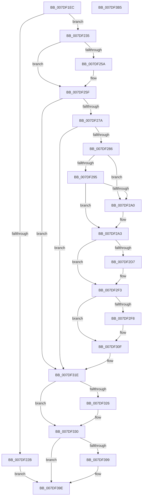

# CmCompleteRegistryInitialization

- RVA: `0x007DF1EC`–`0x007DF3B6` (길이 `458` bytes)
- VA: `0x00000001407DF1EC`
- 실행 섹션: `PAGE`
- PDB 이름 있음: `예`; PDB Function 태그: `아니요`
- unwind 정보 RVA: `0x000A1020`
- 디코드: `112`개 명령, `458/458` bytes 표시
- 미해석 바이트: `0` (있으면 어셈블리에 `.byte`로 보존)

> 이 문서는 커널 이미지의 기계어와 PDB 기호를 분석해 생성했습니다. 4번과 5번은 함수 원형과 자료형을 바이너리 사용 방식에서 추정한 C 해석이며 원본 소스 복구 결과는 아닙니다.

## 1. Dependencies

- 직접 호출 지점: **24**; 고유 호출 대상: **24**
- 직접 호출자로 확인된 함수: **1**
- RIP 상대 이미지 참조: **13**

### Outgoing calls
- `0x007DF23A` → [EtwInitialize](../7B/EtwInitialize_function_007B4D40.md) (function, `0x007B4D40`)
- `0x007DF246` → `ext-ms-win-ntos-kcminitcfg-l1-1-0.dll!CmCompleteInitMachineConfig` (import, 간접 대상; import `ext-ms-win-ntos-kcminitcfg-l1-1-0.dll!CmCompleteInitMachineConfig`)
- `0x007DF25A` → [CmpInitializeSystemHivesLoad](CmpInitializeSystemHivesLoad_function_007DAC7C.md) (function, `0x007DAC7C`)
- `0x007DF25F` → [CmpLockRegistryExclusive](../84/CmpLockRegistryExclusive_function_0084F9B4.md) (function, `0x0084F9B4`)
- `0x007DF267` → [CmpCmdInit](../7E/CmpCmdInit_function_007E5768.md) (function, `0x007E5768`)
- `0x007DF26C` → [CmpUnlockRegistry](../../pagecmrc/BC/CmpUnlockRegistry_function_00BC9A84.md) (function, `0x00BC9A84`)
- `0x007DF2AD` → [KeInitializeEvent](../../text/40/KeInitializeEvent_function_0040DD10.md) (function, `0x0040DD10`)
- `0x007DF2CE` → [CmpCreateRegistryThread](../7E/CmpCreateRegistryThread_function_007E80D0.md) (function, `0x007E80D0`)
- `0x007DF2ED` → [KeBugCheckEx](../../text/4F/KeBugCheckEx_function_004FD660.md) (function, `0x004FD660`)
- `0x007DF30A` → [KeWaitForSingleObject](../../text/20/KeWaitForSingleObject_function_0020E6B0.md) (function, `0x0020E6B0`)
- `0x007DF314` → [ZwClose](../../text/6A/ZwClose_function_006AD2B0.md) (function, `0x006AD2B0`)
- `0x007DF326` → [ExpRefreshSystemTime](../7C/ExpRefreshSystemTime_function_007C6264.md) (function, `0x007C6264`)
- `0x007DF32B` → [PsBootPhaseComplete](../77/PsBootPhaseComplete_function_0077EA18.md) (function, `0x0077EA18`)
- `0x007DF332` → [RtlLockBootStatusData](../A9/RtlLockBootStatusData_function_00A94BE0.md) (function, `0x00A94BE0`)
- `0x007DF337` → [PnpBootPhaseComplete](../72/PnpBootPhaseComplete_function_00723A44.md) (function, `0x00723A44`)
- `0x007DF33C` → [PoInitHiberServices](../75/PoInitHiberServices_function_007537C4.md) (function, `0x007537C4`)
- `0x007DF341` → [PoClearTransitionMarker](../75/PoClearTransitionMarker_function_00753C88.md) (function, `0x00753C88`)
- `0x007DF34D` → [PopAcquireRwLockExclusive](../../text/43/PopAcquireRwLockExclusive_function_00430B44.md) (function, `0x00430B44`)
- `0x007DF360` → [PopReleaseRwLock](../../text/2D/PopReleaseRwLock_function_002DFBBC.md) (function, `0x002DFBBC`)
- `0x007DF36E` → [PopQueueWorkItem](../../text/4A/PopQueueWorkItem_function_004A20F8.md) (function, `0x004A20F8`)
- `0x007DF373` → [PopCancelIgnoreBatteryStatusChange](../AD/PopCancelIgnoreBatteryStatusChange_function_00AD4338.md) (function, `0x00AD4338`)
- `0x007DF378` → [PsGetCurrentServerSiloGlobals](../../text/2F/PsGetCurrentServerSiloGlobals_function_002FE1F0.md) (function, `0x002FE1F0`)
- `0x007DF388` → [ExNotifyPlatformBinaryExecuted](../7C/ExNotifyPlatformBinaryExecuted_function_007C3A18.md) (function, `0x007C3A18`)
- `0x007DF399` → [IopCopyBootLogRegistryToFile](../71/IopCopyBootLogRegistryToFile_function_0071B19C.md) (function, `0x0071B19C`)

### Direct callers
- [NtInitializeRegistry](NtInitializeRegistry_function_007DFC90.md) at `0x007DFD37`

### Static image references
- `0x007DF21A` → RVA `0x00FD80D0` (`PAGEDATA`; read/write)
- `0x007DF23F` → RVA `0x00E660B8` (`.data`; read)
- `0x007DF246` → RVA `0x001512C0` (`ext-ms-win-ntos-kcminitcfg-l1-1-0.dll!CmCompleteInitMachineConfig (IAT)`; read)
- `0x007DF252` → RVA `0x00EEFB78` (`.data`; read)
- `0x007DF286` → RVA `0x00EEFB68` (`.data`; read)
- `0x007DF28C` → RVA `0x00EEFB44` (`.data`; write)
- `0x007DF295` → RVA `0x00FD8016` (`PAGEDATA`; read)
- `0x007DF2B5` → RVA `0x007DA210` (`CmpFinishSystemHivesLoad`; read)
- `0x007DF31E` → RVA `0x00E0EC74` (`.data`; read)
- `0x007DF346` → RVA `0x00F0B980` (`.data`; read)
- `0x007DF359` → RVA `0x00F0B994` (`.data`; write)
- `0x007DF367` → RVA `0x00F0B940` (`.data`; read)
- `0x007DF38D` → RVA `0x00E67DFC` (`.data`; write)

## 2. Other-region calls and transfers

- 다른 실행 섹션으로 향하는 call: **9**
  - `0x007DF26C` → [CmpUnlockRegistry](../../pagecmrc/BC/CmpUnlockRegistry_function_00BC9A84.md) (`PAGE` → `PAGECMRC`)
  - `0x007DF2AD` → [KeInitializeEvent](../../text/40/KeInitializeEvent_function_0040DD10.md) (`PAGE` → `.text`)
  - `0x007DF2ED` → [KeBugCheckEx](../../text/4F/KeBugCheckEx_function_004FD660.md) (`PAGE` → `.text`)
  - `0x007DF30A` → [KeWaitForSingleObject](../../text/20/KeWaitForSingleObject_function_0020E6B0.md) (`PAGE` → `.text`)
  - `0x007DF314` → [ZwClose](../../text/6A/ZwClose_function_006AD2B0.md) (`PAGE` → `.text`)
  - `0x007DF34D` → [PopAcquireRwLockExclusive](../../text/43/PopAcquireRwLockExclusive_function_00430B44.md) (`PAGE` → `.text`)
  - `0x007DF360` → [PopReleaseRwLock](../../text/2D/PopReleaseRwLock_function_002DFBBC.md) (`PAGE` → `.text`)
  - `0x007DF36E` → [PopQueueWorkItem](../../text/4A/PopQueueWorkItem_function_004A20F8.md) (`PAGE` → `.text`)
  - `0x007DF378` → [PsGetCurrentServerSiloGlobals](../../text/2F/PsGetCurrentServerSiloGlobals_function_002FE1F0.md) (`PAGE` → `.text`)
- 별도 외부 분기/꼬리 이동을 확인하지 못했습니다.

## 3. Assembly (complete function range)

```asm
007DF1EC  4C 8B DC                        mov r11, rsp
007DF1EF  49 89 5B 08                     mov qword ptr [r11 + 8], rbx
007DF1F3  49 89 6B 18                     mov qword ptr [r11 + 0x18], rbp
007DF1F7  49 89 73 20                     mov qword ptr [r11 + 0x20], rsi
007DF1FB  57                              push rdi
007DF1FC  48 83 EC 50                     sub rsp, 0x50
007DF200  33 C0                           xor eax, eax
007DF202  33 DB                           xor ebx, ebx
007DF204  0F 57 C0                        xorps xmm0, xmm0
007DF207  49 89 5B 10                     mov qword ptr [r11 + 0x10], rbx
007DF20B  0F 11 44 24 30                  movups xmmword ptr [rsp + 0x30], xmm0
007DF210  49 89 43 E8                     mov qword ptr [r11 - 0x18], rax
007DF214  0F B7 F1                        movzx esi, cx
007DF217  8D 68 01                        lea ebp, [rax + 1]
007DF21A  87 05 B0 8E 7F 00               xchg dword ptr [rip + 0x7f8eb0], eax
007DF220  66 3B CD                        cmp cx, bp
007DF223  40 0F 94 C7                     sete dil
007DF227  85 C0                           test eax, eax
007DF229  75 0A                           jne 0x1407df235
007DF22B  BB 22 00 00 C0                  mov ebx, 0xc0000022
007DF230  E9 69 01 00 00                  jmp 0x1407df39e
007DF235  33 D2                           xor edx, edx
007DF237  8D 4A 03                        lea ecx, [rdx + 3]
007DF23A  E8 01 5B FD FF                  call 0x1407b4d40
007DF23F  48 8D 0D 72 6E 68 00            lea rcx, [rip + 0x686e72]
007DF246  48 FF 15 73 20 97 FF            call qword ptr [rip - 0x68df8d]
007DF24D  0F 1F 44 00 00                  nop dword ptr [rax + rax]
007DF252  39 1D 20 09 71 00               cmp dword ptr [rip + 0x710920], ebx
007DF258  75 05                           jne 0x1407df25f
007DF25A  E8 1D BA FF FF                  call 0x1407dac7c
007DF25F  E8 50 07 07 00                  call 0x14084f9b4
007DF264  40 8A CF                        mov cl, dil
007DF267  E8 FC 64 00 00                  call 0x1407e5768
007DF26C  E8 13 A8 3E 00                  call 0x140bc9a84
007DF271  66 3B F5                        cmp si, bp
007DF274  0F 84 A4 00 00 00               je 0x1407df31e
007DF27A  39 1D F8 08 71 00               cmp dword ptr [rip + 0x7108f8], ebx
007DF280  0F 85 98 00 00 00               jne 0x1407df31e
007DF286  38 1D DC 08 71 00               cmp byte ptr [rip + 0x7108dc], bl
007DF28C  40 88 2D B1 08 71 00            mov byte ptr [rip + 0x7108b1], bpl
007DF293  75 0B                           jne 0x1407df2a0
007DF295  38 1D 7B 8D 7F 00               cmp byte ptr [rip + 0x7f8d7b], bl
007DF29B  40 8A FB                        mov dil, bl
007DF29E  74 03                           je 0x1407df2a3
007DF2A0  40 8A FD                        mov dil, bpl
007DF2A3  45 33 C0                        xor r8d, r8d
007DF2A6  48 8D 4C 24 30                  lea rcx, [rsp + 0x30]
007DF2AB  33 D2                           xor edx, edx
007DF2AD  E8 5E EA C2 FF                  call 0x14040dd10
007DF2B2  40 8A C7                        mov al, dil
007DF2B5  4C 8D 05 54 AF FF FF            lea r8, [rip - 0x50ac]
007DF2BC  F6 D8                           neg al
007DF2BE  48 8D 4C 24 68                  lea rcx, [rsp + 0x68]
007DF2C3  48 8D 44 24 30                  lea rax, [rsp + 0x30]
007DF2C8  4D 1B C9                        sbb r9, r9
007DF2CB  4C 23 C8                        and r9, rax
007DF2CE  E8 FD 8D 00 00                  call 0x1407e80d0
007DF2D3  85 C0                           test eax, eax
007DF2D5  79 1C                           jns 0x1407df2f3
007DF2D7  BA 02 00 00 00                  mov edx, 2
007DF2DC  48 98                           cdqe
007DF2DE  48 89 44 24 20                  mov qword ptr [rsp + 0x20], rax
007DF2E3  44 8D 4A 01                     lea r9d, [rdx + 1]
007DF2E7  45 8B C1                        mov r8d, r9d
007DF2EA  8D 4A 72                        lea ecx, [rdx + 0x72]
007DF2ED  E8 6E E3 D1 FF                  call 0x1404fd660
007DF2F2  CC                              int3
007DF2F3  40 84 FF                        test dil, dil
007DF2F6  74 17                           je 0x1407df30f
007DF2F8  45 33 C9                        xor r9d, r9d
007DF2FB  48 89 5C 24 20                  mov qword ptr [rsp + 0x20], rbx
007DF300  45 33 C0                        xor r8d, r8d
007DF303  48 8D 4C 24 30                  lea rcx, [rsp + 0x30]
007DF308  33 D2                           xor edx, edx
007DF30A  E8 A1 F3 A2 FF                  call 0x14020e6b0
007DF30F  48 8B 4C 24 68                  mov rcx, qword ptr [rsp + 0x68]
007DF314  E8 97 DF EC FF                  call 0x1406ad2b0
007DF319  48 89 5C 24 68                  mov qword ptr [rsp + 0x68], rbx
007DF31E  39 1D 50 F9 62 00               cmp dword ptr [rip + 0x62f950], ebx
007DF324  75 0A                           jne 0x1407df330
007DF326  E8 39 6F FE FF                  call 0x1407c6264
007DF32B  E8 E8 F6 F9 FF                  call 0x14077ea18
007DF330  33 C9                           xor ecx, ecx
007DF332  E8 A9 58 2B 00                  call 0x140a94be0
007DF337  E8 08 47 F4 FF                  call 0x140723a44
007DF33C  E8 83 44 F7 FF                  call 0x1407537c4
007DF341  E8 42 49 F7 FF                  call 0x140753c88
007DF346  48 8D 0D 33 C6 72 00            lea rcx, [rip + 0x72c633]
007DF34D  E8 F2 17 C5 FF                  call 0x140430b44
007DF352  48 8D 0D 27 C6 72 00            lea rcx, [rip + 0x72c627]
007DF359  40 88 2D 34 C6 72 00            mov byte ptr [rip + 0x72c634], bpl
007DF360  E8 57 08 B0 FF                  call 0x1402dfbbc
007DF365  8B D5                           mov edx, ebp
007DF367  48 8D 0D D2 C5 72 00            lea rcx, [rip + 0x72c5d2]
007DF36E  E8 85 2D CC FF                  call 0x1404a20f8
007DF373  E8 C0 4F 2F 00                  call 0x140ad4338
007DF378  E8 73 EE B1 FF                  call 0x1402fe1f0
007DF37D  48 8B 88 00 04 00 00            mov rcx, qword ptr [rax + 0x400]
007DF384  48 89 69 08                     mov qword ptr [rcx + 8], rbp
007DF388  E8 8B 46 FE FF                  call 0x1407c3a18
007DF38D  40 88 2D 68 8A 68 00            mov byte ptr [rip + 0x688a68], bpl
007DF394  66 3B F5                        cmp si, bp
007DF397  74 05                           je 0x1407df39e
007DF399  E8 FE BD F3 FF                  call 0x14071b19c
007DF39E  48 8B 6C 24 70                  mov rbp, qword ptr [rsp + 0x70]
007DF3A3  8B C3                           mov eax, ebx
007DF3A5  48 8B 5C 24 60                  mov rbx, qword ptr [rsp + 0x60]
007DF3AA  48 8B 74 24 78                  mov rsi, qword ptr [rsp + 0x78]
007DF3AF  48 83 C4 50                     add rsp, 0x50
007DF3B3  5F                              pop rdi
007DF3B4  C3                              ret
007DF3B5  CC                              int3
```

## 4. C-style interpretation (structured pseudocode)

```c
__int64 __fastcall CmCompleteRegistryInitialization(unsigned __int16 a1, int a2, int a3, __int64 a4)
{
    __int64 result;
    __int64 v_rbx;
    __int64 v_rdi;
    __int64 v_rsp;
    unsigned __int64 v_stack_m28;
    unsigned __int64 v_stack_m38;
    unsigned __int64 v_stack_p10;
    unsigned __int64 v_stack_p18;
    unsigned __int64 v_stack_p20;
    unsigned __int64 v_stack_p8;

    *(unsigned __int64 *)(v_rsp + 8) = v_rbx;
    *(unsigned __int64 *)(v_rsp + 24) = v_rbp;
    *(unsigned __int64 *)(v_rsp + 32) = v_rsi;
    v_rsp = (v_rsp) - (80);
    result = 0;
    v_rbx = 0;
    *(unsigned __int64 *)(v_rsp + 16) = 0;
    v_stack_m28 = v_xmm0;
    *(unsigned __int64 *)(v_rsp - 24) = 0;
    v_rdi = (a1 == ((unsigned __int16)(result + 1))) ? 1 : 0;
    if (0 != 0) goto loc_007DF235;
    goto loc_007DF39E;
loc_007DF235:
    a2 = 0;
    result = EtwInitialize(a2 + 3, a2, a3, a4);
    result = ext_ms_win_ntos_kcminitcfg_l1_1_0_dll_CmCompleteInitMachineConfig(v_rip + 6844018, a2, a3, a4);
    if ((*(unsigned int *)(v_rip + 7407904)) == ((unsigned int)((unsigned int)(0xC0000022ULL)))) {
        result = CmpInitializeSystemHivesLoad(v_rip + 6844018, a2, a3, a4);
    }
    result = CmpLockRegistryExclusive(v_rip + 6844018, a2, a3, a4);
    result = CmpCmdInit((unsigned __int8)(v_rdi), a2, a3, a4);
    result = CmpUnlockRegistry((unsigned __int8)(v_rdi), a2, a3, a4);
    if (a1 == ((unsigned __int16)(result + 1))) goto loc_007DF31E;
    if ((*(unsigned int *)(v_rip + 7407864)) != ((unsigned int)((unsigned int)(0xC0000022ULL)))) goto loc_007DF31E;
    *(unsigned __int8 *)(v_rip + 7407793) = (unsigned __int8)(result + 1);
    if ((*(unsigned __int8 *)(v_rip + 7407836)) != ((unsigned __int8)((unsigned int)(0xC0000022ULL)))) goto loc_007DF2A0;
    v_rdi = (unsigned __int8)((unsigned int)(0xC0000022ULL));
    if ((*(unsigned __int8 *)(v_rip + 8359291)) != ((unsigned __int8)((unsigned int)(0xC0000022ULL)))) {
        v_rdi = (unsigned __int8)(result + 1);
    }
    a3 = 0;
    a2 = 0;
    result = KeInitializeEvent(v_stack_m28, a2, a3, a4);
    result = (unsigned __int8)(-((unsigned __int8)(v_rdi)));
    a4 = (a4) & (v_stack_m28);
    result = CmpCreateRegistryThread(v_stack_p10, a2, v_rip - 20652, a4);
    if (sign_flag) {
        a2 = 2;
        v_stack_m38 = result;
        a4 = a2 + 1;
        a3 = (unsigned int)(a4);
        a1 = a2 + 114;
        result = KeBugCheckEx(a1, a2, a3, a4);
    }
    if ((unsigned __int8)(v_rdi) != 0) {
        a4 = 0;
        v_stack_m38 = (unsigned int)(0xC0000022ULL);
        a3 = 0;
        a1 = v_stack_m28;
        a2 = 0;
        result = KeWaitForSingleObject(a1, a2, a3, a4);
    }
    result = ZwClose(v_stack_p10, a2, a3, a4);
    v_stack_p10 = (unsigned int)(0xC0000022ULL);
loc_007DF31E:
    if ((*(unsigned int *)(v_rip + 6486352)) == ((unsigned int)((unsigned int)(0xC0000022ULL)))) {
        result = ExpRefreshSystemTime(v_stack_p10, a2, a3, a4);
        result = PsBootPhaseComplete(v_stack_p10, a2, a3, a4);
    }
    a1 = 0;
    result = RtlLockBootStatusData(a1, a2, a3, a4);
    result = PnpBootPhaseComplete(a1, a2, a3, a4);
    result = PoInitHiberServices(a1, a2, a3, a4);
    result = PoClearTransitionMarker(a1, a2, a3, a4);
    result = PopAcquireRwLockExclusive(v_rip + 7521843, a2, a3, a4);
    *(unsigned __int8 *)(v_rip + 7521844) = (unsigned __int8)(result + 1);
    result = PopReleaseRwLock(v_rip + 7521831, a2, a3, a4);
    result = PopQueueWorkItem(v_rip + 7521746, (unsigned int)((unsigned int)(result + 1)), a3, a4);
    result = PopCancelIgnoreBatteryStatusChange(v_rip + 7521746, (unsigned int)((unsigned int)(result + 1)), a3, a4);
    result = PsGetCurrentServerSiloGlobals(v_rip + 7521746, (unsigned int)((unsigned int)(result + 1)), a3, a4);
    *(unsigned __int64 *)(*(unsigned __int64 *)(result + 1024) + 8) = result + 1;
    result = ExNotifyPlatformBinaryExecuted(*(unsigned __int64 *)(result + 1024), (unsigned int)((unsigned int)(result + 1)), a3, a4);
    *(unsigned __int8 *)(v_rip + 6851176) = (unsigned __int8)(result + 1);
    if (0 != ((unsigned __int16)(result + 1))) {
        result = IopCopyBootLogRegistryToFile(*(unsigned __int64 *)(result + 1024), (unsigned int)((unsigned int)(result + 1)), a3, a4);
    }
    v_rsp = (v_rsp) + (80);
    return (unsigned int)((unsigned int)((unsigned int)(0xC0000022ULL)));
}
```

## 5. (Beta) C Style

```c
int64_t CmCompleteRegistryInitialization(uint16_t Arg1, int32_t Arg2, int32_t Arg3, int64_t Arg4)
{
    int64_t result;
    int64_t local_rbx;
    int64_t local_rdi;
    int64_t local_rsp;
    uint64_t v_stack_m28;
    uint64_t v_stack_m38;
    uint64_t v_stack_p10;
    uint64_t v_stack_p18;
    uint64_t v_stack_p20;
    uint64_t v_stack_p8;

    *(uint64_t *)(local_rsp + 0x8) = local_rbx;
    *(uint64_t *)(local_rsp + 0x18) = local_rbp;
    *(uint64_t *)(local_rsp + 0x20) = local_rsi;
    local_rsp = (local_rsp) - (80);
    result = 0;
    local_rbx = 0;
    *(uint64_t *)(local_rsp + 0x10) = 0;
    v_stack_m28 = v_xmm0;
    *(uint64_t *)(local_rsp - 0x18) = 0;
    local_rdi = (Arg1 == ((uint16_t)(result + 1))) ? 1 : 0;
    if (0 != 0) goto loc_007DF235;
    goto loc_007DF39E;
loc_007DF235:
    Arg2 = 0;
    result = EtwInitialize(Arg2 + 3, Arg2, Arg3, Arg4);
    result = kernel_indirect_call(v_rip + 6844018, Arg2, Arg3, Arg4);
    if ((*(uint32_t *)(v_rip + 0x710920)) == ((uint32_t)((uint32_t)(0xC0000022ULL)))) {
        result = CmpInitializeSystemHivesLoad(v_rip + 6844018, Arg2, Arg3, Arg4);
    }
    result = CmpLockRegistryExclusive(v_rip + 6844018, Arg2, Arg3, Arg4);
    result = CmpCmdInit((uint8_t)(local_rdi), Arg2, Arg3, Arg4);
    result = CmpUnlockRegistry((uint8_t)(local_rdi), Arg2, Arg3, Arg4);
    if (Arg1 == ((uint16_t)(result + 1))) goto loc_007DF31E;
    if ((*(uint32_t *)(v_rip + 0x7108F8)) != ((uint32_t)((uint32_t)(0xC0000022ULL)))) goto loc_007DF31E;
    *(uint8_t *)(v_rip + 0x7108B1) = (uint8_t)(result + 1);
    if ((*(uint8_t *)(v_rip + 0x7108DC)) != ((uint8_t)((uint32_t)(0xC0000022ULL)))) goto loc_007DF2A0;
    local_rdi = (uint8_t)((uint32_t)(0xC0000022ULL));
    if ((*(uint8_t *)(v_rip + 0x7F8D7B)) != ((uint8_t)((uint32_t)(0xC0000022ULL)))) {
        local_rdi = (uint8_t)(result + 1);
    }
    Arg3 = 0;
    Arg2 = 0;
    result = KeInitializeEvent(v_stack_m28, Arg2, Arg3, Arg4);
    result = (uint8_t)(-((uint8_t)(local_rdi)));
    Arg4 = (Arg4) & (v_stack_m28);
    result = CmpCreateRegistryThread(v_stack_p10, Arg2, v_rip - 20652, Arg4);
    if (sign_flag) {
        Arg2 = 2;
        v_stack_m38 = result;
        Arg4 = Arg2 + 1;
        Arg3 = (uint32_t)(Arg4);
        Arg1 = Arg2 + 114;
        result = KeBugCheckEx(Arg1, Arg2, Arg3, Arg4);
    }
    if ((uint8_t)(local_rdi) != 0) {
        Arg4 = 0;
        v_stack_m38 = (uint32_t)(0xC0000022ULL);
        Arg3 = 0;
        Arg1 = v_stack_m28;
        Arg2 = 0;
        result = KeWaitForSingleObject(Arg1, Arg2, Arg3, Arg4);
    }
    result = ZwClose(v_stack_p10, Arg2, Arg3, Arg4);
    v_stack_p10 = (uint32_t)(0xC0000022ULL);
loc_007DF31E:
    if ((*(uint32_t *)(v_rip + 0x62F950)) == ((uint32_t)((uint32_t)(0xC0000022ULL)))) {
        result = ExpRefreshSystemTime(v_stack_p10, Arg2, Arg3, Arg4);
        result = PsBootPhaseComplete(v_stack_p10, Arg2, Arg3, Arg4);
    }
    Arg1 = 0;
    result = RtlLockBootStatusData(Arg1, Arg2, Arg3, Arg4);
    result = PnpBootPhaseComplete(Arg1, Arg2, Arg3, Arg4);
    result = PoInitHiberServices(Arg1, Arg2, Arg3, Arg4);
    result = PoClearTransitionMarker(Arg1, Arg2, Arg3, Arg4);
    result = PopAcquireRwLockExclusive(v_rip + 7521843, Arg2, Arg3, Arg4);
    *(uint8_t *)(v_rip + 0x72C634) = (uint8_t)(result + 1);
    result = PopReleaseRwLock(v_rip + 7521831, Arg2, Arg3, Arg4);
    result = PopQueueWorkItem(v_rip + 7521746, (uint32_t)((uint32_t)(result + 1)), Arg3, Arg4);
    result = PopCancelIgnoreBatteryStatusChange(v_rip + 7521746, (uint32_t)((uint32_t)(result + 1)), Arg3, Arg4);
    result = PsGetCurrentServerSiloGlobals(v_rip + 7521746, (uint32_t)((uint32_t)(result + 1)), Arg3, Arg4);
    *(uint64_t *)(*(uint64_t *)(result + 0x400) + 0x8) = result + 1;
    result = ExNotifyPlatformBinaryExecuted(*(uint64_t *)(result + 0x400), (uint32_t)((uint32_t)(result + 1)), Arg3, Arg4);
    *(uint8_t *)(v_rip + 0x688A68) = (uint8_t)(result + 1);
    if (0 != ((uint16_t)(result + 1))) {
        result = IopCopyBootLogRegistryToFile(*(uint64_t *)(result + 0x400), (uint32_t)((uint32_t)(result + 1)), Arg3, Arg4);
    }
    local_rsp = (local_rsp) + (80);
    return (uint32_t)((uint32_t)((uint32_t)(0xC0000022ULL)));
}
```

## 6. Execution-region graph

[열기: 2D/3D 그래프와 함수 탐색 컨트롤 패널](../../../control-panel.html?section=page&rva=0x007DF1EC&view=graph)

- 2D 그래프는 위에서 아래로 흐르고, 3D 그래프는 빈 공간을 드래그해 회전합니다. Shift+드래그는 이동, 휠은 확대·축소, 함수 노드 선택은 대상 보고서 이동입니다.

### Static fallback


