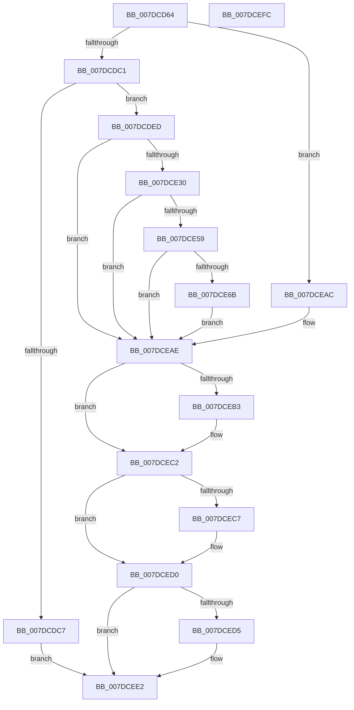

# CmDumpKeyToFile

- RVA: `0x007DCD64`–`0x007DCEFD` (길이 `409` bytes)
- VA: `0x00000001407DCD64`
- 실행 섹션: `PAGE`
- PDB 이름 있음: `예`; PDB Function 태그: `아니요`
- unwind 정보 RVA: `0x000D6588`
- 디코드: `118`개 명령, `409/409` bytes 표시
- 미해석 바이트: `0` (있으면 어셈블리에 `.byte`로 보존)

> 이 문서는 커널 이미지의 기계어와 PDB 기호를 분석해 생성했습니다. 4번과 5번은 함수 원형과 자료형을 바이너리 사용 방식에서 추정한 C 해석이며 원본 소스 복구 결과는 아닙니다.

## 1. Dependencies

- 직접 호출 지점: **20**; 고유 호출 대상: **15**
- 직접 호출자로 확인된 함수: **1**
- RIP 상대 이미지 참조: **0**

### Outgoing calls
- `0x007DCD96` → [CmpLockRegistry](../../pagecmrc/BC/CmpLockRegistry_function_00BC9B34.md) (function, `0x00BC9B34`)
- `0x007DCDA5` → [CmpLockKcbShared](../../pagecmrc/BC/CmpLockKcbShared_function_00BC9A1C.md) (function, `0x00BC9A1C`)
- `0x007DCDB0` → [CmpIsKeyBodyEligibleForDump](../../pagecmrc/BC/CmpIsKeyBodyEligibleForDump_function_00BC926C.md) (function, `0x00BC926C`)
- `0x007DCDCA` → [CmpUnlockKcb](../../pagecmrc/BC/CmpUnlockKcb_function_00BC92C0.md) (function, `0x00BC92C0`)
- `0x007DCDCF` → [CmpUnlockRegistry](../../pagecmrc/BC/CmpUnlockRegistry_function_00BC9A84.md) (function, `0x00BC9A84`)
- `0x007DCDE1` → [CmSaveKey](CmSaveKey_function_007DDBDC.md) (function, `0x007DDBDC`)
- `0x007DCDF1` → [HvLockHiveFlusherExclusive](../../pagecmrc/BC/HvLockHiveFlusherExclusive_function_00BC9C50.md) (function, `0x00BC9C50`)
- `0x007DCDFD` → [CmLockHiveSecurityShared](../../pagecmrc/BC/CmLockHiveSecurityShared_function_00BC996C.md) (function, `0x00BC996C`)
- `0x007DCE1A` → [CmpDoAccessCheckOnSubtree](../../pagecmrc/BC/CmpDoAccessCheckOnSubtree_function_00BC9CD0.md) (function, `0x00BC9CD0`)
- `0x007DCE25` → [CmUnlockHiveSecurity](../../pagecmrc/BC/CmUnlockHiveSecurity_function_00BC99C8.md) (function, `0x00BC99C8`)
- `0x007DCE49` → [HvAllocateOffsetArraysForHiveSnapshot](../7F/HvAllocateOffsetArraysForHiveSnapshot_function_007F3A24.md) (function, `0x007F3A24`)
- `0x007DCE60` → [HvSnapshotHiveToOffsetArray](../../pagecmrc/BC/HvSnapshotHiveToOffsetArray_function_00BC9508.md) (function, `0x00BC9508`)
- `0x007DCE6F` → [HvUnlockHiveFlusherExclusive](../../pagecmrc/BC/HvUnlockHiveFlusherExclusive_function_00BC9C34.md) (function, `0x00BC9C34`)
- `0x007DCE7A` → [CmpUnlockKcb](../../pagecmrc/BC/CmpUnlockKcb_function_00BC92C0.md) (function, `0x00BC92C0`)
- `0x007DCE7F` → [CmpUnlockRegistry](../../pagecmrc/BC/CmpUnlockRegistry_function_00BC9A84.md) (function, `0x00BC9A84`)
- `0x007DCE9E` → [CmpWriteOffsetArrayToFile](../7E/CmpWriteOffsetArrayToFile_function_007EC82C.md) (function, `0x007EC82C`)
- `0x007DCEBD` → [CmpFreeOffsetArray](../7E/CmpFreeOffsetArray_function_007EC540.md) (function, `0x007EC540`)
- `0x007DCECB` → [HvUnlockHiveFlusherExclusive](../../pagecmrc/BC/HvUnlockHiveFlusherExclusive_function_00BC9C34.md) (function, `0x00BC9C34`)
- `0x007DCED8` → [CmpUnlockKcb](../../pagecmrc/BC/CmpUnlockKcb_function_00BC92C0.md) (function, `0x00BC92C0`)
- `0x007DCEDD` → [CmpUnlockRegistry](../../pagecmrc/BC/CmpUnlockRegistry_function_00BC9A84.md) (function, `0x00BC9A84`)

### Direct callers
- [sub_00B44216](../B4/Unknown_function_00B44216.md) at `0x00B442C5`

### Static image references
- 디코드된 RIP-relative 메모리 참조가 없습니다.

## 2. Other-region calls and transfers

- 다른 실행 섹션으로 향하는 call: **16**
  - `0x007DCD96` → [CmpLockRegistry](../../pagecmrc/BC/CmpLockRegistry_function_00BC9B34.md) (`PAGE` → `PAGECMRC`)
  - `0x007DCDA5` → [CmpLockKcbShared](../../pagecmrc/BC/CmpLockKcbShared_function_00BC9A1C.md) (`PAGE` → `PAGECMRC`)
  - `0x007DCDB0` → [CmpIsKeyBodyEligibleForDump](../../pagecmrc/BC/CmpIsKeyBodyEligibleForDump_function_00BC926C.md) (`PAGE` → `PAGECMRC`)
  - `0x007DCDCA` → [CmpUnlockKcb](../../pagecmrc/BC/CmpUnlockKcb_function_00BC92C0.md) (`PAGE` → `PAGECMRC`)
  - `0x007DCDCF` → [CmpUnlockRegistry](../../pagecmrc/BC/CmpUnlockRegistry_function_00BC9A84.md) (`PAGE` → `PAGECMRC`)
  - `0x007DCDF1` → [HvLockHiveFlusherExclusive](../../pagecmrc/BC/HvLockHiveFlusherExclusive_function_00BC9C50.md) (`PAGE` → `PAGECMRC`)
  - `0x007DCDFD` → [CmLockHiveSecurityShared](../../pagecmrc/BC/CmLockHiveSecurityShared_function_00BC996C.md) (`PAGE` → `PAGECMRC`)
  - `0x007DCE1A` → [CmpDoAccessCheckOnSubtree](../../pagecmrc/BC/CmpDoAccessCheckOnSubtree_function_00BC9CD0.md) (`PAGE` → `PAGECMRC`)
  - `0x007DCE25` → [CmUnlockHiveSecurity](../../pagecmrc/BC/CmUnlockHiveSecurity_function_00BC99C8.md) (`PAGE` → `PAGECMRC`)
  - `0x007DCE60` → [HvSnapshotHiveToOffsetArray](../../pagecmrc/BC/HvSnapshotHiveToOffsetArray_function_00BC9508.md) (`PAGE` → `PAGECMRC`)
  - `0x007DCE6F` → [HvUnlockHiveFlusherExclusive](../../pagecmrc/BC/HvUnlockHiveFlusherExclusive_function_00BC9C34.md) (`PAGE` → `PAGECMRC`)
  - `0x007DCE7A` → [CmpUnlockKcb](../../pagecmrc/BC/CmpUnlockKcb_function_00BC92C0.md) (`PAGE` → `PAGECMRC`)
  - `0x007DCE7F` → [CmpUnlockRegistry](../../pagecmrc/BC/CmpUnlockRegistry_function_00BC9A84.md) (`PAGE` → `PAGECMRC`)
  - `0x007DCECB` → [HvUnlockHiveFlusherExclusive](../../pagecmrc/BC/HvUnlockHiveFlusherExclusive_function_00BC9C34.md) (`PAGE` → `PAGECMRC`)
  - `0x007DCED8` → [CmpUnlockKcb](../../pagecmrc/BC/CmpUnlockKcb_function_00BC92C0.md) (`PAGE` → `PAGECMRC`)
  - `0x007DCEDD` → [CmpUnlockRegistry](../../pagecmrc/BC/CmpUnlockRegistry_function_00BC9A84.md) (`PAGE` → `PAGECMRC`)
- 별도 외부 분기/꼬리 이동을 확인하지 못했습니다.

## 3. Assembly (complete function range)

```asm
007DCD64  4C 8B DC                        mov r11, rsp
007DCD67  49 89 5B 10                     mov qword ptr [r11 + 0x10], rbx
007DCD6B  55                              push rbp
007DCD6C  56                              push rsi
007DCD6D  57                              push rdi
007DCD6E  41 54                           push r12
007DCD70  41 55                           push r13
007DCD72  41 56                           push r14
007DCD74  41 57                           push r15
007DCD76  48 83 EC 40                     sub rsp, 0x40
007DCD7A  33 C0                           xor eax, eax
007DCD7C  4D 8B E8                        mov r13, r8
007DCD7F  41 89 43 20                     mov dword ptr [r11 + 0x20], eax
007DCD83  44 8A F0                        mov r14b, al
007DCD86  41 89 43 08                     mov dword ptr [r11 + 8], eax
007DCD8A  8B F0                           mov esi, eax
007DCD8C  49 89 43 B8                     mov qword ptr [r11 - 0x48], rax
007DCD90  44 8A E2                        mov r12b, dl
007DCD93  48 8B E9                        mov rbp, rcx
007DCD96  E8 99 CD 3E 00                  call 0x140bc9b34
007DCD9B  48 8B 5D 08                     mov rbx, qword ptr [rbp + 8]
007DCD9F  41 B7 01                        mov r15b, 1
007DCDA2  48 8B CB                        mov rcx, rbx
007DCDA5  E8 72 CC 3E 00                  call 0x140bc9a1c
007DCDAA  48 8B D3                        mov rdx, rbx
007DCDAD  48 8B CD                        mov rcx, rbp
007DCDB0  E8 B7 C4 3E 00                  call 0x140bc926c
007DCDB5  8B F8                           mov edi, eax
007DCDB7  33 C0                           xor eax, eax
007DCDB9  85 FF                           test edi, edi
007DCDBB  0F 88 EB 00 00 00               js 0x1407dceac
007DCDC1  66 39 43 42                     cmp word ptr [rbx + 0x42], ax
007DCDC5  74 26                           je 0x1407dcded
007DCDC7  48 8B CB                        mov rcx, rbx
007DCDCA  E8 F1 C4 3E 00                  call 0x140bc92c0
007DCDCF  E8 B0 CC 3E 00                  call 0x140bc9a84
007DCDD4  45 8A CC                        mov r9b, r12b
007DCDD7  44 8D 46 05                     lea r8d, [rsi + 5]
007DCDDB  49 8B D5                        mov rdx, r13
007DCDDE  48 8B CD                        mov rcx, rbp
007DCDE1  E8 F6 0D 00 00                  call 0x1407ddbdc
007DCDE6  8B F8                           mov edi, eax
007DCDE8  E9 F5 00 00 00                  jmp 0x1407dcee2
007DCDED  48 8B 4B 20                     mov rcx, qword ptr [rbx + 0x20]
007DCDF1  E8 5A CE 3E 00                  call 0x140bc9c50
007DCDF6  48 8B 4B 20                     mov rcx, qword ptr [rbx + 0x20]
007DCDFA  45 8A F7                        mov r14b, r15b
007DCDFD  E8 6A CB 3E 00                  call 0x140bc996c
007DCE02  8B 53 28                        mov edx, dword ptr [rbx + 0x28]
007DCE05  41 B9 19 00 02 00               mov r9d, 0x20019
007DCE0B  48 8B 4B 20                     mov rcx, qword ptr [rbx + 0x20]
007DCE0F  45 8A C4                        mov r8b, r12b
007DCE12  C7 44 24 20 03 00 00 00         mov dword ptr [rsp + 0x20], 3
007DCE1A  E8 B1 CE 3E 00                  call 0x140bc9cd0
007DCE1F  48 8B 4B 20                     mov rcx, qword ptr [rbx + 0x20]
007DCE23  8B F8                           mov edi, eax
007DCE25  E8 9E CB 3E 00                  call 0x140bc99c8
007DCE2A  33 ED                           xor ebp, ebp
007DCE2C  85 FF                           test edi, edi
007DCE2E  78 7E                           js 0x1407dceae
007DCE30  48 8B 4B 20                     mov rcx, qword ptr [rbx + 0x20]
007DCE34  4C 8D 8C 24 98 00 00 00         lea r9, [rsp + 0x98]
007DCE3C  4C 8D 44 24 30                  lea r8, [rsp + 0x30]
007DCE41  48 8D 94 24 80 00 00 00         lea rdx, [rsp + 0x80]
007DCE49  E8 D6 6B 01 00                  call 0x1407f3a24
007DCE4E  48 8B 74 24 30                  mov rsi, qword ptr [rsp + 0x30]
007DCE53  8B F8                           mov edi, eax
007DCE55  85 C0                           test eax, eax
007DCE57  78 55                           js 0x1407dceae
007DCE59  48 8B 4B 20                     mov rcx, qword ptr [rbx + 0x20]
007DCE5D  4C 8B C6                        mov r8, rsi
007DCE60  E8 A3 C6 3E 00                  call 0x140bc9508
007DCE65  8B F8                           mov edi, eax
007DCE67  85 C0                           test eax, eax
007DCE69  78 43                           js 0x1407dceae
007DCE6B  48 8B 4B 20                     mov rcx, qword ptr [rbx + 0x20]
007DCE6F  E8 C0 CD 3E 00                  call 0x140bc9c34
007DCE74  48 8B CB                        mov rcx, rbx
007DCE77  44 8A F5                        mov r14b, bpl
007DCE7A  E8 41 C4 3E 00                  call 0x140bc92c0
007DCE7F  E8 00 CC 3E 00                  call 0x140bc9a84
007DCE84  44 8B 8C 24 98 00 00 00         mov r9d, dword ptr [rsp + 0x98]
007DCE8C  4C 8B C6                        mov r8, rsi
007DCE8F  8B 94 24 80 00 00 00            mov edx, dword ptr [rsp + 0x80]
007DCE96  44 8A FD                        mov r15b, bpl
007DCE99  4C 89 6C 24 20                  mov qword ptr [rsp + 0x20], r13
007DCE9E  E8 89 F9 00 00                  call 0x1407ec82c
007DCEA3  85 C0                           test eax, eax
007DCEA5  8B F8                           mov edi, eax
007DCEA7  0F 49 FD                        cmovns edi, ebp
007DCEAA  EB 02                           jmp 0x1407dceae
007DCEAC  33 ED                           xor ebp, ebp
007DCEAE  48 85 F6                        test rsi, rsi
007DCEB1  74 0F                           je 0x1407dcec2
007DCEB3  8B 8C 24 80 00 00 00            mov ecx, dword ptr [rsp + 0x80]
007DCEBA  48 8B D6                        mov rdx, rsi
007DCEBD  E8 7E F6 00 00                  call 0x1407ec540
007DCEC2  45 84 F6                        test r14b, r14b
007DCEC5  74 09                           je 0x1407dced0
007DCEC7  48 8B 4B 20                     mov rcx, qword ptr [rbx + 0x20]
007DCECB  E8 64 CD 3E 00                  call 0x140bc9c34
007DCED0  45 84 FF                        test r15b, r15b
007DCED3  74 0D                           je 0x1407dcee2
007DCED5  48 8B CB                        mov rcx, rbx
007DCED8  E8 E3 C3 3E 00                  call 0x140bc92c0
007DCEDD  E8 A2 CB 3E 00                  call 0x140bc9a84
007DCEE2  48 8B 9C 24 88 00 00 00         mov rbx, qword ptr [rsp + 0x88]
007DCEEA  8B C7                           mov eax, edi
007DCEEC  48 83 C4 40                     add rsp, 0x40
007DCEF0  41 5F                           pop r15
007DCEF2  41 5E                           pop r14
007DCEF4  41 5D                           pop r13
007DCEF6  41 5C                           pop r12
007DCEF8  5F                              pop rdi
007DCEF9  5E                              pop rsi
007DCEFA  5D                              pop rbp
007DCEFB  C3                              ret
007DCEFC  CC                              int3
```

## 4. C-style interpretation (structured pseudocode)

```c
__int64 __fastcall CmDumpKeyToFile(__int64 a1, unsigned __int8 a2, __int64 a3)
{
    __int64 result;
    __int64 v_rbp;
    __int64 v_rdi;
    __int64 v_rsp;
    unsigned __int64 v_stack_m48;
    unsigned int v_stack_m58;
    unsigned __int64 v_stack_p10;
    unsigned __int64 v_stack_p20;
    unsigned __int64 v_stack_p8;

    *(unsigned __int64 *)(v_rsp + 16) = v_rbx;
    v_rsp = (v_rsp) - (64);
    result = 0;
    *(unsigned int *)(v_rsp + 32) = 0;
    *(unsigned int *)(v_rsp + 8) = 0;
    *(unsigned __int64 *)(v_rsp - 72) = 0;
    result = CmpLockRegistry(a1, a2, a3, a4);
    result = CmpLockKcbShared(*(unsigned __int64 *)(a1 + 8), a2, a3, a4);
    result = CmpIsKeyBodyEligibleForDump(a1, *(unsigned __int64 *)(a1 + 8), a3, a4);
    result = 0;
    if (sign_flag) goto loc_007DCEAC;
    if ((*(unsigned __int16 *)(*(unsigned __int64 *)(a1 + 8) + 66)) == 0) goto loc_007DCDED;
    result = CmpUnlockKcb(*(unsigned __int64 *)(a1 + 8), *(unsigned __int64 *)(a1 + 8), a3, a4);
    result = CmpUnlockRegistry(*(unsigned __int64 *)(a1 + 8), *(unsigned __int64 *)(a1 + 8), a3, a4);
    result = CmSaveKey(a1, a3, 0 + 5, a2);
    goto loc_007DCEE2;
loc_007DCDED:
    result = HvLockHiveFlusherExclusive(*(unsigned __int64 *)(*(unsigned __int64 *)(a1 + 8) + 32), a3, 0 + 5, a2);
    result = CmLockHiveSecurityShared(*(unsigned __int64 *)(*(unsigned __int64 *)(a1 + 8) + 32), a3, 0 + 5, a2);
    v_stack_m58 = 3;
    result = CmpDoAccessCheckOnSubtree(*(unsigned __int64 *)(*(unsigned __int64 *)(a1 + 8) + 32), (unsigned int)(*(unsigned int *)(*(unsigned __int64 *)(a1 + 8) + 40)), a2, (unsigned int)(0x20019ULL));
    result = CmUnlockHiveSecurity(*(unsigned __int64 *)(*(unsigned __int64 *)(a1 + 8) + 32), (unsigned int)(*(unsigned int *)(*(unsigned __int64 *)(a1 + 8) + 40)), a2, (unsigned int)(0x20019ULL));
    v_rbp = 0;
    if (sign_flag) goto loc_007DCEAE;
    result = HvAllocateOffsetArraysForHiveSnapshot(*(unsigned __int64 *)(*(unsigned __int64 *)(a1 + 8) + 32), v_stack_p8, v_stack_m48, v_stack_p20);
    if (sign_flag) goto loc_007DCEAE;
    result = HvSnapshotHiveToOffsetArray(*(unsigned __int64 *)(*(unsigned __int64 *)(a1 + 8) + 32), v_stack_p8, v_stack_m48, v_stack_p20);
    if (sign_flag) goto loc_007DCEAE;
    result = HvUnlockHiveFlusherExclusive(*(unsigned __int64 *)(*(unsigned __int64 *)(a1 + 8) + 32), v_stack_p8, v_stack_m48, v_stack_p20);
    result = CmpUnlockKcb(*(unsigned __int64 *)(a1 + 8), v_stack_p8, v_stack_m48, v_stack_p20);
    result = CmpUnlockRegistry(*(unsigned __int64 *)(a1 + 8), v_stack_p8, v_stack_m48, v_stack_p20);
    v_stack_m58 = a3;
    result = CmpWriteOffsetArrayToFile(*(unsigned __int64 *)(a1 + 8), (unsigned int)(v_stack_p8), v_stack_m48, (unsigned int)(v_stack_p20));
    v_rdi = (unsigned int)((unsigned int)(result));
    if (!sign_flag) { v_rdi = 0; }
    goto loc_007DCEAE;
loc_007DCEAC:
    v_rbp = 0;
loc_007DCEAE:
    if (v_stack_m48 != 0) {
        a1 = v_stack_p8;
        a2 = v_stack_m48;
        result = CmpFreeOffsetArray(a1, a2, v_stack_m48, (unsigned int)(v_stack_p20));
    }
    if (0 != 0) {
        a1 = *(unsigned __int64 *)(*(unsigned __int64 *)(a1 + 8) + 32);
        result = HvUnlockHiveFlusherExclusive(a1, a2, v_stack_m48, (unsigned int)(v_stack_p20));
    }
    if (0 != 0) {
        a1 = *(unsigned __int64 *)(a1 + 8);
        result = CmpUnlockKcb(a1, a2, v_stack_m48, (unsigned int)(v_stack_p20));
        result = CmpUnlockRegistry(a1, a2, v_stack_m48, (unsigned int)(v_stack_p20));
    }
    v_rsp = (v_rsp) + (64);
    return (unsigned int)((unsigned int)(v_rdi));
}
```

## 5. (Beta) C Style

```c
int64_t CmDumpKeyToFile(void *Arg1, uint8_t Arg2, int64_t Arg3)
{
    uint8_t *arg1 = (uint8_t *)Arg1;

    int64_t result;
    int64_t local_rbp;
    int64_t local_rdi;
    int64_t local_rsp;
    uint64_t v_stack_m48;
    uint32_t v_stack_m58;
    uint64_t v_stack_p10;
    uint64_t v_stack_p20;
    uint64_t v_stack_p8;

    *(uint64_t *)(local_rsp + 0x10) = local_rbx;
    local_rsp = (local_rsp) - (64);
    result = 0;
    *(uint32_t *)(local_rsp + 0x20) = 0;
    *(uint32_t *)(local_rsp + 0x8) = 0;
    *(uint64_t *)(local_rsp - 0x48) = 0;
    result = CmpLockRegistry(Arg1, Arg2, Arg3, a4);
    result = CmpLockKcbShared(*(uint64_t *)(arg1 + 0x8), Arg2, Arg3, a4);
    result = CmpIsKeyBodyEligibleForDump(Arg1, *(uint64_t *)(arg1 + 0x8), Arg3, a4);
    result = 0;
    if (sign_flag) goto loc_007DCEAC;
    if ((*(uint16_t *)(*(uint64_t *)(arg1 + 0x8) + 0x42)) == 0) goto loc_007DCDED;
    result = CmpUnlockKcb(*(uint64_t *)(arg1 + 0x8), *(uint64_t *)(arg1 + 0x8), Arg3, a4);
    result = CmpUnlockRegistry(*(uint64_t *)(arg1 + 0x8), *(uint64_t *)(arg1 + 0x8), Arg3, a4);
    result = CmSaveKey(Arg1, Arg3, 0 + 5, Arg2);
    goto loc_007DCEE2;
loc_007DCDED:
    result = HvLockHiveFlusherExclusive(*(uint64_t *)(*(uint64_t *)(arg1 + 0x8) + 0x20), Arg3, 0 + 5, Arg2);
    result = CmLockHiveSecurityShared(*(uint64_t *)(*(uint64_t *)(arg1 + 0x8) + 0x20), Arg3, 0 + 5, Arg2);
    v_stack_m58 = 3;
    result = CmpDoAccessCheckOnSubtree(*(uint64_t *)(*(uint64_t *)(arg1 + 0x8) + 0x20), (uint32_t)(*(uint32_t *)(*(uint64_t *)(arg1 + 0x8) + 0x28)), Arg2, (uint32_t)(0x20019ULL));
    result = CmUnlockHiveSecurity(*(uint64_t *)(*(uint64_t *)(arg1 + 0x8) + 0x20), (uint32_t)(*(uint32_t *)(*(uint64_t *)(arg1 + 0x8) + 0x28)), Arg2, (uint32_t)(0x20019ULL));
    local_rbp = 0;
    if (sign_flag) goto loc_007DCEAE;
    result = HvAllocateOffsetArraysForHiveSnapshot(*(uint64_t *)(*(uint64_t *)(arg1 + 0x8) + 0x20), v_stack_p8, v_stack_m48, v_stack_p20);
    if (sign_flag) goto loc_007DCEAE;
    result = HvSnapshotHiveToOffsetArray(*(uint64_t *)(*(uint64_t *)(arg1 + 0x8) + 0x20), v_stack_p8, v_stack_m48, v_stack_p20);
    if (sign_flag) goto loc_007DCEAE;
    result = HvUnlockHiveFlusherExclusive(*(uint64_t *)(*(uint64_t *)(arg1 + 0x8) + 0x20), v_stack_p8, v_stack_m48, v_stack_p20);
    result = CmpUnlockKcb(*(uint64_t *)(arg1 + 0x8), v_stack_p8, v_stack_m48, v_stack_p20);
    result = CmpUnlockRegistry(*(uint64_t *)(arg1 + 0x8), v_stack_p8, v_stack_m48, v_stack_p20);
    v_stack_m58 = Arg3;
    result = CmpWriteOffsetArrayToFile(*(uint64_t *)(arg1 + 0x8), (uint32_t)(v_stack_p8), v_stack_m48, (uint32_t)(v_stack_p20));
    local_rdi = (uint32_t)((uint32_t)(result));
    if (!sign_flag) { local_rdi = 0; }
    goto loc_007DCEAE;
loc_007DCEAC:
    local_rbp = 0;
loc_007DCEAE:
    if (v_stack_m48 != 0) {
        Arg1 = v_stack_p8;
        Arg2 = v_stack_m48;
        result = CmpFreeOffsetArray(Arg1, Arg2, v_stack_m48, (uint32_t)(v_stack_p20));
    }
    if (0 != 0) {
        Arg1 = *(uint64_t *)(*(uint64_t *)(arg1 + 0x8) + 0x20);
        result = HvUnlockHiveFlusherExclusive(Arg1, Arg2, v_stack_m48, (uint32_t)(v_stack_p20));
    }
    if (0 != 0) {
        Arg1 = *(uint64_t *)(arg1 + 0x8);
        result = CmpUnlockKcb(Arg1, Arg2, v_stack_m48, (uint32_t)(v_stack_p20));
        result = CmpUnlockRegistry(Arg1, Arg2, v_stack_m48, (uint32_t)(v_stack_p20));
    }
    local_rsp = (local_rsp) + (64);
    return (uint32_t)((uint32_t)(local_rdi));
}
```

### 관측된 메모리 오프셋

구조체 형식이 확인되지 않은 접근은 인자 기준의 오프셋으로만 기록했습니다.

| 기준 인자 | 오프셋 표현 | 폭 (bit) | 접근 |
|---|---:|---:|---|
| `Arg1` | `+ 0x8` | `64` | `R` |

## 6. Execution-region graph

[열기: 2D/3D 그래프와 함수 탐색 컨트롤 패널](../../../control-panel.html?section=page&rva=0x007DCD64&view=graph)

- 2D 그래프는 위에서 아래로 흐르고, 3D 그래프는 빈 공간을 드래그해 회전합니다. Shift+드래그는 이동, 휠은 확대·축소, 함수 노드 선택은 대상 보고서 이동입니다.

### Static fallback


