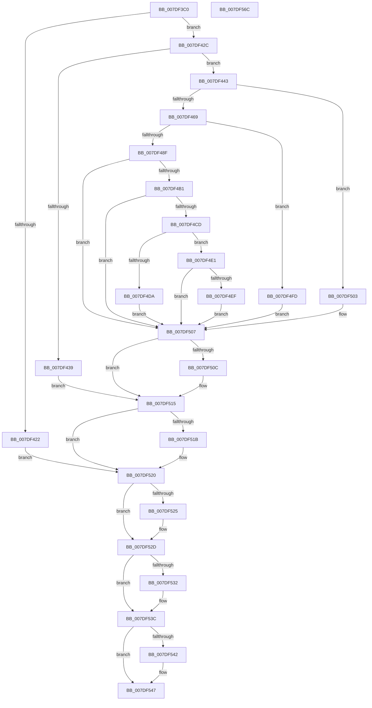

# CmOpenKeyForBugCheckRecovery

- RVA: `0x007DF3C0`–`0x007DF56D` (길이 `429` bytes)
- VA: `0x00000001407DF3C0`
- 실행 섹션: `PAGE`
- PDB 이름 있음: `예`; PDB Function 태그: `아니요`
- unwind 정보 RVA: `0x000D68A4`
- 디코드: `127`개 명령, `429/429` bytes 표시
- 미해석 바이트: `0` (있으면 어셈블리에 `.byte`로 보존)

> 이 문서는 커널 이미지의 기계어와 PDB 기호를 분석해 생성했습니다. 4번과 5번은 함수 원형과 자료형을 바이너리 사용 방식에서 추정한 C 해석이며 원본 소스 복구 결과는 아닙니다.

## 1. Dependencies

- 직접 호출 지점: **15**; 고유 호출 대상: **15**
- 직접 호출자로 확인된 함수: **0**
- RIP 상대 이미지 참조: **0**

### Outgoing calls
- `0x007DF404` → [CmpInitializeThreadInfo](../../text/3F/CmpInitializeThreadInfo_function_003FBE70.md) (function, `0x003FBE70`)
- `0x007DF42C` → [CmpAcquireShutdownRundown](../../pagecmrc/BC/CmpAcquireShutdownRundown_function_00BC9400.md) (function, `0x00BC9400`)
- `0x007DF45A` → [CmOpenKey](../87/CmOpenKey_function_00876350.md) (function, `0x00876350`)
- `0x007DF484` → [CmObReferenceObjectByHandle](../../pagecmrc/BC/CmObReferenceObjectByHandle_function_00BC9350.md) (function, `0x00BC9350`)
- `0x007DF48F` → [CmpLockRegistry](../../pagecmrc/BC/CmpLockRegistry_function_00BC9B34.md) (function, `0x00BC9B34`)
- `0x007DF4A6` → [CmpStartKcbStackForTopLayerKcb](../84/CmpStartKcbStackForTopLayerKcb_function_00848390.md) (function, `0x00848390`)
- `0x007DF4B5` → [CmpLockKcbStackTopExclusiveRestShared](../84/CmpLockKcbStackTopExclusiveRestShared_function_00846B04.md) (function, `0x00846B04`)
- `0x007DF4C2` → [CmpPerformKeyBodyDeletionCheck](../../pagecmrc/BC/CmpPerformKeyBodyDeletionCheck_function_00BC97D0.md) (function, `0x00BC97D0`)
- `0x007DF4E4` → [CmpLockKeyBodyIntoMemory](../7E/CmpLockKeyBodyIntoMemory_function_007EAF10.md) (function, `0x007EAF10`)
- `0x007DF510` → [CmpUnlockKcbStack](../84/CmpUnlockKcbStack_function_00848460.md) (function, `0x00848460`)
- `0x007DF51B` → [CmpUnlockRegistry](../../pagecmrc/BC/CmpUnlockRegistry_function_00BC9A84.md) (function, `0x00BC9A84`)
- `0x007DF528` → [ObfDereferenceObject](../../text/2F/ObfDereferenceObject_function_002F9350.md) (function, `0x002F9350`)
- `0x007DF537` → [ObCloseHandle](../8A/ObCloseHandle_function_008A1870.md) (function, `0x008A1870`)
- `0x007DF542` → [CmpReleaseShutdownRundown](../../pagecmrc/BC/CmpReleaseShutdownRundown_function_00BC9880.md) (function, `0x00BC9880`)
- `0x007DF54B` → [CmCleanupThreadInfo](../../text/41/CmCleanupThreadInfo_function_0041FD50.md) (function, `0x0041FD50`)

### Direct callers
- 이 함수 시작 RVA로 연결되는 직접 call은 확인되지 않았습니다. 간접 호출은 완전히 역산할 수 없습니다.

### Static image references
- 디코드된 RIP-relative 메모리 참조가 없습니다.

## 2. Other-region calls and transfers

- 다른 실행 섹션으로 향하는 call: **9**
  - `0x007DF404` → [CmpInitializeThreadInfo](../../text/3F/CmpInitializeThreadInfo_function_003FBE70.md) (`PAGE` → `.text`)
  - `0x007DF42C` → [CmpAcquireShutdownRundown](../../pagecmrc/BC/CmpAcquireShutdownRundown_function_00BC9400.md) (`PAGE` → `PAGECMRC`)
  - `0x007DF484` → [CmObReferenceObjectByHandle](../../pagecmrc/BC/CmObReferenceObjectByHandle_function_00BC9350.md) (`PAGE` → `PAGECMRC`)
  - `0x007DF48F` → [CmpLockRegistry](../../pagecmrc/BC/CmpLockRegistry_function_00BC9B34.md) (`PAGE` → `PAGECMRC`)
  - `0x007DF4C2` → [CmpPerformKeyBodyDeletionCheck](../../pagecmrc/BC/CmpPerformKeyBodyDeletionCheck_function_00BC97D0.md) (`PAGE` → `PAGECMRC`)
  - `0x007DF51B` → [CmpUnlockRegistry](../../pagecmrc/BC/CmpUnlockRegistry_function_00BC9A84.md) (`PAGE` → `PAGECMRC`)
  - `0x007DF528` → [ObfDereferenceObject](../../text/2F/ObfDereferenceObject_function_002F9350.md) (`PAGE` → `.text`)
  - `0x007DF542` → [CmpReleaseShutdownRundown](../../pagecmrc/BC/CmpReleaseShutdownRundown_function_00BC9880.md) (`PAGE` → `PAGECMRC`)
  - `0x007DF54B` → [CmCleanupThreadInfo](../../text/41/CmCleanupThreadInfo_function_0041FD50.md) (`PAGE` → `.text`)
- 별도 외부 분기/꼬리 이동을 확인하지 못했습니다.

## 3. Assembly (complete function range)

```asm
007DF3C0  48 89 74 24 10                  mov qword ptr [rsp + 0x10], rsi
007DF3C5  48 89 7C 24 20                  mov qword ptr [rsp + 0x20], rdi
007DF3CA  48 89 4C 24 08                  mov qword ptr [rsp + 8], rcx
007DF3CF  55                              push rbp
007DF3D0  41 54                           push r12
007DF3D2  41 55                           push r13
007DF3D4  41 56                           push r14
007DF3D6  41 57                           push r15
007DF3D8  48 8B EC                        mov rbp, rsp
007DF3DB  48 83 EC 70                     sub rsp, 0x70
007DF3DF  0F 57 C0                        xorps xmm0, xmm0
007DF3E2  48 8D 4D C8                     lea rcx, [rbp - 0x38]
007DF3E6  0F 57 C9                        xorps xmm1, xmm1
007DF3E9  33 C0                           xor eax, eax
007DF3EB  0F 11 45 E0                     movups xmmword ptr [rbp - 0x20], xmm0
007DF3EF  48 89 45 D8                     mov qword ptr [rbp - 0x28], rax
007DF3F3  45 8B E9                        mov r13d, r9d
007DF3F6  0F 11 45 F0                     movups xmmword ptr [rbp - 0x10], xmm0
007DF3FA  49 8B F0                        mov rsi, r8
007DF3FD  44 8B E2                        mov r12d, edx
007DF400  0F 11 4D C8                     movups xmmword ptr [rbp - 0x38], xmm1
007DF404  E8 67 CA C1 FF                  call 0x1403fbe70
007DF409  45 33 FF                        xor r15d, r15d
007DF40C  45 33 F6                        xor r14d, r14d
007DF40F  33 FF                           xor edi, edi
007DF411  4C 89 7D 40                     mov qword ptr [rbp + 0x40], r15
007DF415  F7 46 18 00 02 00 00            test dword ptr [rsi + 0x18], 0x200
007DF41C  4C 89 75 C0                     mov qword ptr [rbp - 0x40], r14
007DF420  75 0A                           jne 0x1407df42c
007DF422  BE 0D 00 00 C0                  mov esi, 0xc000000d
007DF427  E9 F4 00 00 00                  jmp 0x1407df520
007DF42C  E8 CF 9F 3E 00                  call 0x140bc9400
007DF431  40 8A F8                        mov dil, al
007DF434  83 E7 01                        and edi, 1
007DF437  75 0A                           jne 0x1407df443
007DF439  BE 89 01 00 C0                  mov esi, 0xc0000189
007DF43E  E9 D2 00 00 00                  jmp 0x1407df515
007DF443  44 88 74 24 28                  mov byte ptr [rsp + 0x28], r14b
007DF448  48 8D 4D C0                     lea rcx, [rbp - 0x40]
007DF44C  4C 21 74 24 20                  and qword ptr [rsp + 0x20], r14
007DF451  45 8B CD                        mov r9d, r13d
007DF454  4C 8B C6                        mov r8, rsi
007DF457  41 8B D4                        mov edx, r12d
007DF45A  E8 F1 6E 09 00                  call 0x140876350
007DF45F  8B F0                           mov esi, eax
007DF461  85 C0                           test eax, eax
007DF463  0F 88 9A 00 00 00               js 0x1407df503
007DF469  4C 21 74 24 28                  and qword ptr [rsp + 0x28], r14
007DF46E  48 8D 45 40                     lea rax, [rbp + 0x40]
007DF472  4C 8B 75 C0                     mov r14, qword ptr [rbp - 0x40]
007DF476  45 33 C9                        xor r9d, r9d
007DF479  49 8B CE                        mov rcx, r14
007DF47C  48 89 44 24 20                  mov qword ptr [rsp + 0x20], rax
007DF481  41 8B D4                        mov edx, r12d
007DF484  E8 C7 9E 3E 00                  call 0x140bc9350
007DF489  8B F0                           mov esi, eax
007DF48B  85 C0                           test eax, eax
007DF48D  78 6E                           js 0x1407df4fd
007DF48F  E8 A0 A6 3E 00                  call 0x140bc9b34
007DF494  4C 8B 7D 40                     mov r15, qword ptr [rbp + 0x40]
007DF498  48 8D 4D E0                     lea rcx, [rbp - 0x20]
007DF49C  83 CF 02                        or edi, 2
007DF49F  4D 8B 6F 08                     mov r13, qword ptr [r15 + 8]
007DF4A3  49 8B D5                        mov rdx, r13
007DF4A6  E8 E5 8E 06 00                  call 0x140848390
007DF4AB  8B F0                           mov esi, eax
007DF4AD  85 C0                           test eax, eax
007DF4AF  78 56                           js 0x1407df507
007DF4B1  48 8D 4D E0                     lea rcx, [rbp - 0x20]
007DF4B5  E8 4A 76 06 00                  call 0x140846b04
007DF4BA  33 D2                           xor edx, edx
007DF4BC  49 8B CF                        mov rcx, r15
007DF4BF  83 CF 04                        or edi, 4
007DF4C2  E8 09 A3 3E 00                  call 0x140bc97d0
007DF4C7  8B F0                           mov esi, eax
007DF4C9  85 C0                           test eax, eax
007DF4CB  78 3A                           js 0x1407df507
007DF4CD  41 F7 85 B8 00 00 00 00 00 04 00  test dword ptr [r13 + 0xb8], 0x40000
007DF4D8  75 07                           jne 0x1407df4e1
007DF4DA  BE 0D 00 00 C0                  mov esi, 0xc000000d
007DF4DF  EB 26                           jmp 0x1407df507
007DF4E1  49 8B CF                        mov rcx, r15
007DF4E4  E8 27 BA 00 00                  call 0x1407eaf10
007DF4E9  8B F0                           mov esi, eax
007DF4EB  85 C0                           test eax, eax
007DF4ED  78 18                           js 0x1407df507
007DF4EF  48 8B 45 30                     mov rax, qword ptr [rbp + 0x30]
007DF4F3  4C 89 30                        mov qword ptr [rax], r14
007DF4F6  45 33 F6                        xor r14d, r14d
007DF4F9  33 F6                           xor esi, esi
007DF4FB  EB 0A                           jmp 0x1407df507
007DF4FD  4C 8B 7D 40                     mov r15, qword ptr [rbp + 0x40]
007DF501  EB 04                           jmp 0x1407df507
007DF503  4C 8B 75 C0                     mov r14, qword ptr [rbp - 0x40]
007DF507  83 FF 04                        cmp edi, 4
007DF50A  72 09                           jb 0x1407df515
007DF50C  48 8D 4D E0                     lea rcx, [rbp - 0x20]
007DF510  E8 4B 8F 06 00                  call 0x140848460
007DF515  40 F6 C7 02                     test dil, 2
007DF519  74 05                           je 0x1407df520
007DF51B  E8 64 A5 3E 00                  call 0x140bc9a84
007DF520  4D 85 FF                        test r15, r15
007DF523  74 08                           je 0x1407df52d
007DF525  49 8B CF                        mov rcx, r15
007DF528  E8 23 9E B1 FF                  call 0x1402f9350
007DF52D  4D 85 F6                        test r14, r14
007DF530  74 0A                           je 0x1407df53c
007DF532  33 D2                           xor edx, edx
007DF534  49 8B CE                        mov rcx, r14
007DF537  E8 34 23 0C 00                  call 0x1408a1870
007DF53C  40 F6 C7 01                     test dil, 1
007DF540  74 05                           je 0x1407df547
007DF542  E8 39 A3 3E 00                  call 0x140bc9880
007DF547  48 8D 4D C8                     lea rcx, [rbp - 0x38]
007DF54B  E8 00 08 C4 FF                  call 0x14041fd50
007DF550  4C 8D 5C 24 70                  lea r11, [rsp + 0x70]
007DF555  8B C6                           mov eax, esi
007DF557  49 8B 73 38                     mov rsi, qword ptr [r11 + 0x38]
007DF55B  49 8B 7B 48                     mov rdi, qword ptr [r11 + 0x48]
007DF55F  49 8B E3                        mov rsp, r11
007DF562  41 5F                           pop r15
007DF564  41 5E                           pop r14
007DF566  41 5D                           pop r13
007DF568  41 5C                           pop r12
007DF56A  5D                              pop rbp
007DF56B  C3                              ret
007DF56C  CC                              int3
```

## 4. C-style interpretation (structured pseudocode)

```c
__int64 __fastcall CmOpenKeyForBugCheckRecovery(__int64 a1, int a2, __int64 a3, int a4)
{
    __int64 result;
    __int64 v_r14;
    __int64 v_r15;
    __int64 v_rdi;
    __int64 v_rsi;
    __int64 v_rsp;
    unsigned __int64 v_stack_m28;
    unsigned __int64 v_stack_m38;
    unsigned __int64 v_stack_m48;
    unsigned __int64 v_stack_m50;
    unsigned __int64 v_stack_m60;
    unsigned __int64 v_stack_m68;
    unsigned __int8 v_stack_m70;
    unsigned __int64 v_stack_m78;
    unsigned __int64 v_stack_p10;
    unsigned __int64 v_stack_p18;
    unsigned __int64 v_stack_p20;
    unsigned __int64 v_stack_p8;

    v_stack_p10 = v_rsi;
    v_stack_p20 = v_rdi;
    v_stack_p8 = a1;
    v_rsp = (v_rsp) - (112);
    result = 0;
    v_stack_m48 = v_xmm0;
    v_stack_m50 = 0;
    v_stack_m38 = v_xmm0;
    v_stack_m60 = v_xmm1;
    result = CmpInitializeThreadInfo(v_stack_m60, a2, a3, a4);
    v_r15 = 0;
    v_r14 = 0;
    v_rdi = 0;
    v_stack_p18 = 0;
    v_stack_m68 = 0;
    if (((*(unsigned int *)(a3 + 24)) & (512)) != 0) goto loc_007DF42C;
    goto loc_007DF520;
loc_007DF42C:
    result = CmpAcquireShutdownRundown(v_stack_m60, a2, a3, a4);
    v_rdi = (unsigned int)(((unsigned __int8)(result)) & (1));
    if (condition_is_not_equal) goto loc_007DF443;
    goto loc_007DF515;
loc_007DF443:
    v_stack_m70 = 0;
    result = CmOpenKey(v_stack_m68, (unsigned int)((unsigned int)((unsigned int)(a2))), (unsigned int)(0xC0000189ULL), (unsigned int)((unsigned int)((unsigned int)(a4))));
    if (sign_flag) goto loc_007DF503;
    a4 = 0;
    v_stack_m78 = v_stack_p18;
    result = CmObReferenceObjectByHandle(v_stack_m68, (unsigned int)((unsigned int)((unsigned int)(a2))), (unsigned int)(0xC0000189ULL), a4);
    if (sign_flag) goto loc_007DF4FD;
    result = CmpLockRegistry(v_stack_m68, (unsigned int)((unsigned int)((unsigned int)(a2))), (unsigned int)(0xC0000189ULL), a4);
    v_rdi = (unsigned int)((v_rdi) | (2));
    result = CmpStartKcbStackForTopLayerKcb(v_stack_m48, *(unsigned __int64 *)(v_stack_p18 + 8), (unsigned int)(0xC0000189ULL), a4);
    if (sign_flag) goto loc_007DF507;
    result = CmpLockKcbStackTopExclusiveRestShared(v_stack_m48, *(unsigned __int64 *)(v_stack_p18 + 8), (unsigned int)(0xC0000189ULL), a4);
    a2 = 0;
    v_rdi = (unsigned int)((v_rdi) | (4));
    result = CmpPerformKeyBodyDeletionCheck(v_stack_p18, a2, (unsigned int)(0xC0000189ULL), a4);
    if (sign_flag) goto loc_007DF507;
    if (((*(unsigned int *)(*(unsigned __int64 *)(v_stack_p18 + 8) + 184)) & (0x40000ULL)) != 0) goto loc_007DF4E1;
    goto loc_007DF507;
loc_007DF4E1:
    result = CmpLockKeyBodyIntoMemory(v_stack_p18, a2, (unsigned int)(0xC0000189ULL), a4);
    if (sign_flag) goto loc_007DF507;
    *(unsigned __int64 *)(v_stack_p8) = v_stack_m68;
    v_r14 = 0;
    v_rsi = 0;
    goto loc_007DF507;
loc_007DF4FD:
    goto loc_007DF507;
loc_007DF503:
loc_007DF507:
    result = v_stack_p8;
    if (((unsigned int)(v_rdi)) >= 4) {
        a1 = v_stack_m48;
        result = CmpUnlockKcbStack(a1, a2, (unsigned int)(0xC0000189ULL), a4);
    }
    if ((((unsigned __int8)(v_rdi)) & (2)) != 0) {
        result = CmpUnlockRegistry(a1, a2, (unsigned int)(0xC0000189ULL), a4);
    }
    if (v_stack_p18 != 0) {
        a1 = v_stack_p18;
        result = ObfDereferenceObject(a1, a2, (unsigned int)(0xC0000189ULL), a4);
    }
    if (v_stack_m68 != 0) {
        a2 = 0;
        a1 = v_stack_m68;
        result = ObCloseHandle(a1, a2, (unsigned int)(0xC0000189ULL), a4);
    }
    if ((((unsigned __int8)(v_rdi)) & (1)) != 0) {
        result = CmpReleaseShutdownRundown(a1, a2, (unsigned int)(0xC0000189ULL), a4);
    }
    result = CmCleanupThreadInfo(v_stack_m60, a2, (unsigned int)(0xC0000189ULL), a4);
    return 0;
}
```

## 5. (Beta) C Style

```c
int64_t CmOpenKeyForBugCheckRecovery(int64_t Arg1, int32_t Arg2, void *Arg3, int32_t Arg4)
{
    uint8_t *arg3 = (uint8_t *)Arg3;

    int64_t result;
    int64_t local_r14;
    int64_t local_r15;
    int64_t local_rdi;
    int64_t local_rsi;
    int64_t local_rsp;
    uint64_t v_stack_m28;
    uint64_t v_stack_m38;
    uint64_t v_stack_m48;
    uint64_t v_stack_m50;
    uint64_t v_stack_m60;
    uint64_t v_stack_m68;
    uint8_t v_stack_m70;
    uint64_t v_stack_m78;
    uint64_t v_stack_p10;
    uint64_t v_stack_p18;
    uint64_t v_stack_p20;
    uint64_t v_stack_p8;

    v_stack_p10 = local_rsi;
    v_stack_p20 = local_rdi;
    v_stack_p8 = Arg1;
    local_rsp = (local_rsp) - (112);
    result = 0;
    v_stack_m48 = v_xmm0;
    v_stack_m50 = 0;
    v_stack_m38 = v_xmm0;
    v_stack_m60 = v_xmm1;
    result = CmpInitializeThreadInfo(v_stack_m60, Arg2, Arg3, Arg4);
    local_r15 = 0;
    local_r14 = 0;
    local_rdi = 0;
    v_stack_p18 = 0;
    v_stack_m68 = 0;
    if (((*(uint32_t *)(arg3 + 0x18)) & (512)) != 0) goto loc_007DF42C;
    goto loc_007DF520;
loc_007DF42C:
    result = CmpAcquireShutdownRundown(v_stack_m60, Arg2, Arg3, Arg4);
    local_rdi = (uint32_t)(((uint8_t)(result)) & (1));
    if (condition_is_not_equal) goto loc_007DF443;
    goto loc_007DF515;
loc_007DF443:
    v_stack_m70 = 0;
    result = CmOpenKey(v_stack_m68, (uint32_t)((uint32_t)((uint32_t)(Arg2))), (uint32_t)(0xC0000189ULL), (uint32_t)((uint32_t)((uint32_t)(Arg4))));
    if (sign_flag) goto loc_007DF503;
    Arg4 = 0;
    v_stack_m78 = v_stack_p18;
    result = CmObReferenceObjectByHandle(v_stack_m68, (uint32_t)((uint32_t)((uint32_t)(Arg2))), (uint32_t)(0xC0000189ULL), Arg4);
    if (sign_flag) goto loc_007DF4FD;
    result = CmpLockRegistry(v_stack_m68, (uint32_t)((uint32_t)((uint32_t)(Arg2))), (uint32_t)(0xC0000189ULL), Arg4);
    local_rdi = (uint32_t)((local_rdi) | (2));
    result = CmpStartKcbStackForTopLayerKcb(v_stack_m48, *(uint64_t *)(v_stack_p18 + 0x8), (uint32_t)(0xC0000189ULL), Arg4);
    if (sign_flag) goto loc_007DF507;
    result = CmpLockKcbStackTopExclusiveRestShared(v_stack_m48, *(uint64_t *)(v_stack_p18 + 0x8), (uint32_t)(0xC0000189ULL), Arg4);
    Arg2 = 0;
    local_rdi = (uint32_t)((local_rdi) | (4));
    result = CmpPerformKeyBodyDeletionCheck(v_stack_p18, Arg2, (uint32_t)(0xC0000189ULL), Arg4);
    if (sign_flag) goto loc_007DF507;
    if (((*(uint32_t *)(*(uint64_t *)(v_stack_p18 + 0x8) + 0xB8)) & (0x40000ULL)) != 0) goto loc_007DF4E1;
    goto loc_007DF507;
loc_007DF4E1:
    result = CmpLockKeyBodyIntoMemory(v_stack_p18, Arg2, (uint32_t)(0xC0000189ULL), Arg4);
    if (sign_flag) goto loc_007DF507;
    *(uint64_t *)(v_stack_p8) = v_stack_m68;
    local_r14 = 0;
    local_rsi = 0;
    goto loc_007DF507;
loc_007DF4FD:
    goto loc_007DF507;
loc_007DF503:
loc_007DF507:
    result = v_stack_p8;
    if (((uint32_t)(local_rdi)) >= 4) {
        Arg1 = v_stack_m48;
        result = CmpUnlockKcbStack(Arg1, Arg2, (uint32_t)(0xC0000189ULL), Arg4);
    }
    if ((((uint8_t)(local_rdi)) & (2)) != 0) {
        result = CmpUnlockRegistry(Arg1, Arg2, (uint32_t)(0xC0000189ULL), Arg4);
    }
    if (v_stack_p18 != 0) {
        Arg1 = v_stack_p18;
        result = ObfDereferenceObject(Arg1, Arg2, (uint32_t)(0xC0000189ULL), Arg4);
    }
    if (v_stack_m68 != 0) {
        Arg2 = 0;
        Arg1 = v_stack_m68;
        result = ObCloseHandle(Arg1, Arg2, (uint32_t)(0xC0000189ULL), Arg4);
    }
    if ((((uint8_t)(local_rdi)) & (1)) != 0) {
        result = CmpReleaseShutdownRundown(Arg1, Arg2, (uint32_t)(0xC0000189ULL), Arg4);
    }
    result = CmCleanupThreadInfo(v_stack_m60, Arg2, (uint32_t)(0xC0000189ULL), Arg4);
    return 0;
}
```

### 관측된 메모리 오프셋

구조체 형식이 확인되지 않은 접근은 인자 기준의 오프셋으로만 기록했습니다.

| 기준 인자 | 오프셋 표현 | 폭 (bit) | 접근 |
|---|---:|---:|---|
| `Arg3` | `+ 0x18` | `32` | `R` |

## 6. Execution-region graph

[열기: 2D/3D 그래프와 함수 탐색 컨트롤 패널](../../../control-panel.html?section=page&rva=0x007DF3C0&view=graph)

- 2D 그래프는 위에서 아래로 흐르고, 3D 그래프는 빈 공간을 드래그해 회전합니다. Shift+드래그는 이동, 휠은 확대·축소, 함수 노드 선택은 대상 보고서 이동입니다.

### Static fallback


