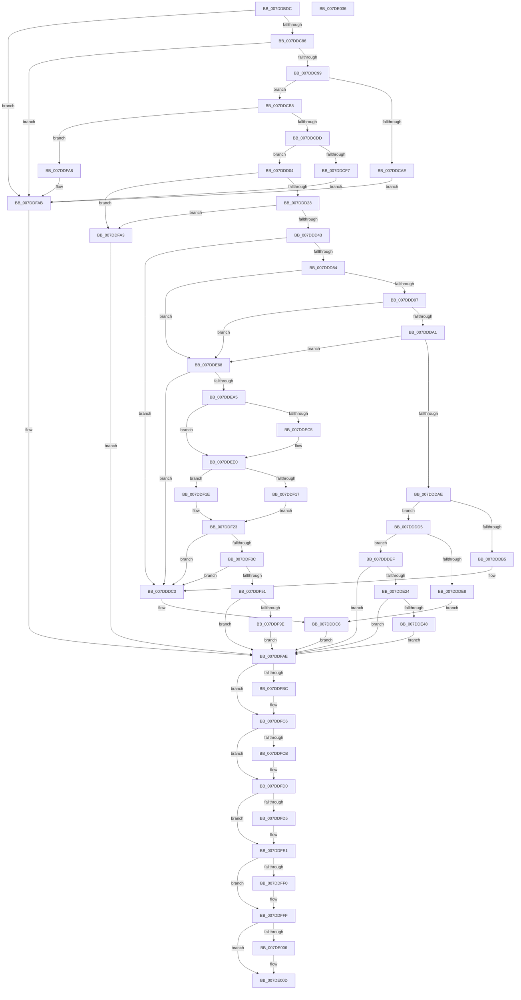

# CmSaveKey

- RVA: `0x007DDBDC`–`0x007DE037` (길이 `1,115` bytes)
- VA: `0x00000001407DDBDC`
- 실행 섹션: `PAGE`
- PDB 이름 있음: `예`; PDB Function 태그: `아니요`
- unwind 정보 RVA: `0x00090DB8`
- 디코드: `283`개 명령, `1,115/1,115` bytes 표시
- 미해석 바이트: `0` (있으면 어셈블리에 `.byte`로 보존)

> 이 문서는 커널 이미지의 기계어와 PDB 기호를 분석해 생성했습니다. 4번과 5번은 함수 원형과 자료형을 바이너리 사용 방식에서 추정한 C 해석이며 원본 소스 복구 결과는 아닙니다.

## 1. Dependencies

- 직접 호출 지점: **45**; 고유 호출 대상: **34**
- 직접 호출자로 확인된 함수: **2**
- RIP 상대 이미지 참조: **5**

### Outgoing calls
- `0x007DDC38` → [memset](../../text/6C/memset_function_006C6C40.md) (function, `0x006C6C40`)
- `0x007DDC56` → [CmpInitializeKeyNodeStack](../94/CmpInitializeKeyNodeStack_function_00946804.md) (function, `0x00946804`)
- `0x007DDC77` → [CmpUuidCreate](../AB/CmpUuidCreate_function_00AB81F8.md) (function, `0x00AB81F8`)
- `0x007DDC8A` → [CmpUuidCreate](../AB/CmpUuidCreate_function_00AB81F8.md) (function, `0x00AB81F8`)
- `0x007DDCA1` → [CmpCreateTemporaryHive](CmpCreateTemporaryHive_function_007DE528.md) (function, `0x007DE528`)
- `0x007DDCB8` → [CmpLockRegistry](../../pagecmrc/BC/CmpLockRegistry_function_00BC9B34.md) (function, `0x00BC9B34`)
- `0x007DDCCE` → [CmpStartKcbStackForTopLayerKcb](../84/CmpStartKcbStackForTopLayerKcb_function_00848390.md) (function, `0x00848390`)
- `0x007DDCE2` → [CmpLockKcbStackShared](../94/CmpLockKcbStackShared_function_00948000.md) (function, `0x00948000`)
- `0x007DDD07` → [CmpTraceHiveSaveStart](../AD/CmpTraceHiveSaveStart_function_00AD8A5C.md) (function, `0x00AD8A5C`)
- `0x007DDD16` → [CmpPerformKeyBodyDeletionCheck](../../pagecmrc/BC/CmpPerformKeyBodyDeletionCheck_function_00BC97D0.md) (function, `0x00BC97D0`)
- `0x007DDD34` → [CmpStartKeyNodeStack](../94/CmpStartKeyNodeStack_function_00945338.md) (function, `0x00945338`)
- `0x007DDD48` → [CmpLockKcbStackFlusherLocksExclusive](../../text/66/CmpLockKcbStackFlusherLocksExclusive_function_0066AC00.md) (function, `0x0066AC00`)
- `0x007DDD59` → [CmpPopulateKeyNodeStackFromKcbStack](../94/CmpPopulateKeyNodeStackFromKcbStack_function_009453CC.md) (function, `0x009453CC`)
- `0x007DDD79` → [CmpDoAccessCheckOnLayeredSubtree](../94/CmpDoAccessCheckOnLayeredSubtree_function_00945488.md) (function, `0x00945488`)
- `0x007DDDB9` → [CmpLogUnsupportedOperation](../9A/CmpLogUnsupportedOperation_function_009AEA40.md) (function, `0x009AEA40`)
- `0x007DDDCB` → [CmpUnlockKcbStackFlusherLocksExclusive](../../text/4D/CmpUnlockKcbStackFlusherLocksExclusive_function_004D07E4.md) (function, `0x004D07E4`)
- `0x007DDDDC` → [ExAcquireRundownProtection](../../text/21/ExAcquireRundownProtection_function_00216620.md) (function, `0x00216620`)
- `0x007DDDF4` → [CmpUnlockKcbStackFlusherLocksExclusive](../../text/4D/CmpUnlockKcbStackFlusherLocksExclusive_function_004D07E4.md) (function, `0x004D07E4`)
- `0x007DDDFE` → [CmpUnlockKcbStack](../84/CmpUnlockKcbStack_function_00848460.md) (function, `0x00848460`)
- `0x007DDE06` → [CmpUnlockRegistry](../../pagecmrc/BC/CmpUnlockRegistry_function_00BC9A84.md) (function, `0x00BC9A84`)
- `0x007DDE15` → [CmpSaveKeyByFileCopy](CmpSaveKeyByFileCopy_function_007DEFC0.md) (function, `0x007DEFC0`)
- `0x007DDE3B` → [EtwEventEnabled](../../text/39/EtwEventEnabled_function_00392450.md) (function, `0x00392450`)
- `0x007DDE5E` → [EtwWrite](../../text/41/EtwWrite_function_0041C720.md) (function, `0x0041C720`)
- `0x007DDE96` → [CmpCopyMergeOfLayeredKeyNode](../94/CmpCopyMergeOfLayeredKeyNode_function_00945A78.md) (function, `0x00945A78`)
- `0x007DDEBC` → [EtwEventEnabled](../../text/39/EtwEventEnabled_function_00392450.md) (function, `0x00392450`)
- `0x007DDEDB` → [EtwWrite](../../text/41/EtwWrite_function_0041C720.md) (function, `0x0041C720`)
- `0x007DDEF5` → [CmpKeyNodeStackGetEntryAtLayerHeight](../94/CmpKeyNodeStackGetEntryAtLayerHeight_function_00946ABC.md) (function, `0x00946ABC`)
- `0x007DDF17` → [HvpGetCellFlat](../85/HvpGetCellFlat_function_00854C60.md) (function, `0x00854C60`)
- `0x007DDF1E` → [HvpGetCellPaged](../85/HvpGetCellPaged_function_00854CB0.md) (function, `0x00854CB0`)
- `0x007DDF2D` → [CmpFullPromoteSingleKeyFromKeyNodeStacks](../8B/CmpFullPromoteSingleKeyFromKeyNodeStacks_function_008B1A40.md) (function, `0x008B1A40`)
- `0x007DDF42` → [CmpPromoteSubtree](../94/CmpPromoteSubtree_function_00944D60.md) (function, `0x00944D60`)
- `0x007DDF56` → [CmpUnlockKcbStackFlusherLocksExclusive](../../text/4D/CmpUnlockKcbStackFlusherLocksExclusive_function_004D07E4.md) (function, `0x004D07E4`)
- `0x007DDF5F` → [CmpCleanupKeyNodeStack](../94/CmpCleanupKeyNodeStack_function_00946A5C.md) (function, `0x00946A5C`)
- `0x007DDF68` → [CmpInitializeKeyNodeStack](../94/CmpInitializeKeyNodeStack_function_00946804.md) (function, `0x00946804`)
- `0x007DDF72` → [CmpUnlockKcbStack](../84/CmpUnlockKcbStack_function_00848460.md) (function, `0x00848460`)
- `0x007DDF7A` → [CmpUnlockRegistry](../../pagecmrc/BC/CmpUnlockRegistry_function_00BC9A84.md) (function, `0x00BC9A84`)
- `0x007DDF90` → [HvWriteExternal](../A8/HvWriteExternal_function_00A83C20.md) (function, `0x00A83C20`)
- `0x007DDFB2` → [CmpCleanupKeyNodeStack](../94/CmpCleanupKeyNodeStack_function_00946A5C.md) (function, `0x00946A5C`)
- `0x007DDFC1` → [CmpUnlockKcbStack](../84/CmpUnlockKcbStack_function_00848460.md) (function, `0x00848460`)
- `0x007DDFCB` → [CmpUnlockRegistry](../../pagecmrc/BC/CmpUnlockRegistry_function_00BC9A84.md) (function, `0x00BC9A84`)
- `0x007DDFDC` → [ExReleaseRundownProtection](../../text/34/ExReleaseRundownProtection_function_00349E80.md) (function, `0x00349E80`)
- `0x007DDFE6` → [CmpCleanupKcbStack](../94/CmpCleanupKcbStack_function_009470A0.md) (function, `0x009470A0`)
- `0x007DDFFA` → [CmpDestroyHive](../9B/CmpDestroyHive_function_009B1708.md) (function, `0x009B1708`)
- `0x007DE008` → [CmpTraceHiveSaveStop](../7E/CmpTraceHiveSaveStop_function_007E67C8.md) (function, `0x007E67C8`)
- `0x007DE016` → [_security_check_cookie](../../text/6A/_security_check_cookie_function_006AC640.md) (function, `0x006AC640`)

### Direct callers
- [CmDumpKeyToFile](CmDumpKeyToFile_function_007DCD64.md) at `0x007DCDE1`
- [sub_00B44216](../B4/Unknown_function_00B44216.md) at `0x00B442E4`

### Static image references
- `0x007DDBF8` → RVA `0x00E0A740` (`.data`; read)
- `0x007DDCE7` → RVA `0x00FD9A90` (`PAGEDATA`; read)
- `0x007DDE24` → RVA `0x00022868` (`.rdata`; read)
- `0x007DDE2B` → RVA `0x00FD8018` (`PAGEDATA`; read)
- `0x007DDEA5` → RVA `0x00021B88` (`.rdata`; read)

## 2. Other-region calls and transfers

- 다른 실행 섹션으로 향하는 call: **17**
  - `0x007DDC38` → [memset](../../text/6C/memset_function_006C6C40.md) (`PAGE` → `.text`)
  - `0x007DDCB8` → [CmpLockRegistry](../../pagecmrc/BC/CmpLockRegistry_function_00BC9B34.md) (`PAGE` → `PAGECMRC`)
  - `0x007DDD16` → [CmpPerformKeyBodyDeletionCheck](../../pagecmrc/BC/CmpPerformKeyBodyDeletionCheck_function_00BC97D0.md) (`PAGE` → `PAGECMRC`)
  - `0x007DDD48` → [CmpLockKcbStackFlusherLocksExclusive](../../text/66/CmpLockKcbStackFlusherLocksExclusive_function_0066AC00.md) (`PAGE` → `.text`)
  - `0x007DDDCB` → [CmpUnlockKcbStackFlusherLocksExclusive](../../text/4D/CmpUnlockKcbStackFlusherLocksExclusive_function_004D07E4.md) (`PAGE` → `.text`)
  - `0x007DDDDC` → [ExAcquireRundownProtection](../../text/21/ExAcquireRundownProtection_function_00216620.md) (`PAGE` → `.text`)
  - `0x007DDDF4` → [CmpUnlockKcbStackFlusherLocksExclusive](../../text/4D/CmpUnlockKcbStackFlusherLocksExclusive_function_004D07E4.md) (`PAGE` → `.text`)
  - `0x007DDE06` → [CmpUnlockRegistry](../../pagecmrc/BC/CmpUnlockRegistry_function_00BC9A84.md) (`PAGE` → `PAGECMRC`)
  - `0x007DDE3B` → [EtwEventEnabled](../../text/39/EtwEventEnabled_function_00392450.md) (`PAGE` → `.text`)
  - `0x007DDE5E` → [EtwWrite](../../text/41/EtwWrite_function_0041C720.md) (`PAGE` → `.text`)
  - `0x007DDEBC` → [EtwEventEnabled](../../text/39/EtwEventEnabled_function_00392450.md) (`PAGE` → `.text`)
  - `0x007DDEDB` → [EtwWrite](../../text/41/EtwWrite_function_0041C720.md) (`PAGE` → `.text`)
  - `0x007DDF56` → [CmpUnlockKcbStackFlusherLocksExclusive](../../text/4D/CmpUnlockKcbStackFlusherLocksExclusive_function_004D07E4.md) (`PAGE` → `.text`)
  - `0x007DDF7A` → [CmpUnlockRegistry](../../pagecmrc/BC/CmpUnlockRegistry_function_00BC9A84.md) (`PAGE` → `PAGECMRC`)
  - `0x007DDFCB` → [CmpUnlockRegistry](../../pagecmrc/BC/CmpUnlockRegistry_function_00BC9A84.md) (`PAGE` → `PAGECMRC`)
  - `0x007DDFDC` → [ExReleaseRundownProtection](../../text/34/ExReleaseRundownProtection_function_00349E80.md) (`PAGE` → `.text`)
  - `0x007DE016` → [_security_check_cookie](../../text/6A/_security_check_cookie_function_006AC640.md) (`PAGE` → `.text`)
- 별도 외부 분기/꼬리 이동을 확인하지 못했습니다.

## 3. Assembly (complete function range)

```asm
007DDBDC  48 89 5C 24 18                  mov qword ptr [rsp + 0x18], rbx
007DDBE1  55                              push rbp
007DDBE2  56                              push rsi
007DDBE3  57                              push rdi
007DDBE4  41 54                           push r12
007DDBE6  41 55                           push r13
007DDBE8  41 56                           push r14
007DDBEA  41 57                           push r15
007DDBEC  48 8D 6C 24 D9                  lea rbp, [rsp - 0x27]
007DDBF1  48 81 EC 00 01 00 00            sub rsp, 0x100
007DDBF8  48 8B 05 41 CB 62 00            mov rax, qword ptr [rip + 0x62cb41]
007DDBFF  48 33 C4                        xor rax, rsp
007DDC02  48 89 45 17                     mov qword ptr [rbp + 0x17], rax
007DDC06  33 C0                           xor eax, eax
007DDC08  44 89 44 24 38                  mov dword ptr [rsp + 0x38], r8d
007DDC0D  48 89 55 D7                     mov qword ptr [rbp - 0x29], rdx
007DDC11  4C 8B E9                        mov r13, rcx
007DDC14  0F 57 C0                        xorps xmm0, xmm0
007DDC17  44 88 4C 24 32                  mov byte ptr [rsp + 0x32], r9b
007DDC1C  0F 57 C9                        xorps xmm1, xmm1
007DDC1F  89 45 89                        mov dword ptr [rbp - 0x77], eax
007DDC22  44 8D 40 4A                     lea r8d, [rax + 0x4a]
007DDC26  66 89 45 8D                     mov word ptr [rbp - 0x73], ax
007DDC2A  33 D2                           xor edx, edx
007DDC2C  48 8D 4D 87                     lea rcx, [rbp - 0x79]
007DDC30  0F 11 45 F7                     movups xmmword ptr [rbp - 9], xmm0
007DDC34  0F 11 4D E7                     movups xmmword ptr [rbp - 0x19], xmm1
007DDC38  E8 03 90 EE FF                  call 0x1406c6c40
007DDC3D  0F 57 C0                        xorps xmm0, xmm0
007DDC40  48 8D 4D 87                     lea rcx, [rbp - 0x79]
007DDC44  83 C8 FF                        or eax, 0xffffffff
007DDC47  0F 11 44 24 40                  movups xmmword ptr [rsp + 0x40], xmm0
007DDC4C  66 89 44 24 42                  mov word ptr [rsp + 0x42], ax
007DDC51  0F 11 44 24 50                  movups xmmword ptr [rsp + 0x50], xmm0
007DDC56  E8 A9 8B 16 00                  call 0x140946804
007DDC5B  83 4C 24 34 FF                  or dword ptr [rsp + 0x34], 0xffffffff
007DDC60  48 8D 4D F7                     lea rcx, [rbp - 9]
007DDC64  40 32 F6                        xor sil, sil
007DDC67  45 32 E4                        xor r12b, r12b
007DDC6A  40 88 74 24 31                  mov byte ptr [rsp + 0x31], sil
007DDC6F  45 32 F6                        xor r14b, r14b
007DDC72  45 33 FF                        xor r15d, r15d
007DDC75  33 FF                           xor edi, edi
007DDC77  E8 7C A5 2D 00                  call 0x140ab81f8
007DDC7C  8B D8                           mov ebx, eax
007DDC7E  85 C0                           test eax, eax
007DDC80  0F 88 25 03 00 00               js 0x1407ddfab
007DDC86  48 8D 4D E7                     lea rcx, [rbp - 0x19]
007DDC8A  E8 69 A5 2D 00                  call 0x140ab81f8
007DDC8F  8B D8                           mov ebx, eax
007DDC91  85 C0                           test eax, eax
007DDC93  0F 88 12 03 00 00               js 0x1407ddfab
007DDC99  48 8D 55 E7                     lea rdx, [rbp - 0x19]
007DDC9D  48 8D 4D F7                     lea rcx, [rbp - 9]
007DDCA1  E8 82 08 00 00                  call 0x1407de528
007DDCA6  48 8B F8                        mov rdi, rax
007DDCA9  48 85 C0                        test rax, rax
007DDCAC  75 0A                           jne 0x1407ddcb8
007DDCAE  BB 9A 00 00 C0                  mov ebx, 0xc000009a
007DDCB3  E9 F3 02 00 00                  jmp 0x1407ddfab
007DDCB8  E8 77 BE 3E 00                  call 0x140bc9b34
007DDCBD  4D 8B 75 08                     mov r14, qword ptr [r13 + 8]
007DDCC1  48 8D 4C 24 40                  lea rcx, [rsp + 0x40]
007DDCC6  49 8B D6                        mov rdx, r14
007DDCC9  BE 01 00 00 00                  mov esi, 1
007DDCCE  E8 BD A6 06 00                  call 0x140848390
007DDCD3  8B D8                           mov ebx, eax
007DDCD5  85 C0                           test eax, eax
007DDCD7  0F 88 CB 02 00 00               js 0x1407ddfa8
007DDCDD  48 8D 4C 24 40                  lea rcx, [rsp + 0x40]
007DDCE2  E8 19 A3 16 00                  call 0x140948000
007DDCE7  48 8B 05 A2 BD 7F 00            mov rax, qword ptr [rip + 0x7fbda2]
007DDCEE  44 8A E6                        mov r12b, sil
007DDCF1  49 39 46 20                     cmp qword ptr [r14 + 0x20], rax
007DDCF5  75 0D                           jne 0x1407ddd04
007DDCF7  BB 22 00 00 C0                  mov ebx, 0xc0000022
007DDCFC  45 8A F7                        mov r14b, r15b
007DDCFF  E9 A7 02 00 00                  jmp 0x1407ddfab
007DDD04  49 8B CE                        mov rcx, r14
007DDD07  E8 50 AD 2F 00                  call 0x140ad8a5c
007DDD0C  33 D2                           xor edx, edx
007DDD0E  40 88 74 24 31                  mov byte ptr [rsp + 0x31], sil
007DDD13  49 8B CD                        mov rcx, r13
007DDD16  E8 B5 BA 3E 00                  call 0x140bc97d0
007DDD1B  45 33 ED                        xor r13d, r13d
007DDD1E  8B D8                           mov ebx, eax
007DDD20  85 C0                           test eax, eax
007DDD22  0F 88 7B 02 00 00               js 0x1407ddfa3
007DDD28  41 0F B7 56 42                  movzx edx, word ptr [r14 + 0x42]
007DDD2D  48 8D 4D 87                     lea rcx, [rbp - 0x79]
007DDD31  66 03 D6                        add dx, si
007DDD34  E8 FF 75 16 00                  call 0x140945338
007DDD39  8B D8                           mov ebx, eax
007DDD3B  85 C0                           test eax, eax
007DDD3D  0F 88 60 02 00 00               js 0x1407ddfa3
007DDD43  48 8D 4C 24 40                  lea rcx, [rsp + 0x40]
007DDD48  E8 B3 CE E8 FF                  call 0x14066ac00
007DDD4D  45 33 C0                        xor r8d, r8d
007DDD50  48 8D 54 24 40                  lea rdx, [rsp + 0x40]
007DDD55  48 8D 4D 87                     lea rcx, [rbp - 0x79]
007DDD59  E8 6E 76 16 00                  call 0x1409453cc
007DDD5E  44 8A 4C 24 32                  mov r9b, byte ptr [rsp + 0x32]
007DDD63  4C 8D 45 87                     lea r8, [rbp - 0x79]
007DDD67  33 C9                           xor ecx, ecx
007DDD69  C7 44 24 28 03 00 00 00         mov dword ptr [rsp + 0x28], 3
007DDD71  C7 44 24 20 19 00 02 00         mov dword ptr [rsp + 0x20], 0x20019
007DDD79  E8 0A 77 16 00                  call 0x140945488
007DDD7E  8B D8                           mov ebx, eax
007DDD80  85 C0                           test eax, eax
007DDD82  78 3F                           js 0x1407dddc3
007DDD84  4D 8B 7E 20                     mov r15, qword ptr [r14 + 0x20]
007DDD88  41 8B 87 A0 00 00 00            mov eax, dword ptr [r15 + 0xa0]
007DDD8F  A8 02                           test al, 2
007DDD91  0F 84 D1 00 00 00               je 0x1407dde68
007DDD97  45 39 6F 68                     cmp dword ptr [r15 + 0x68], r13d
007DDD9B  0F 84 C7 00 00 00               je 0x1407dde68
007DDDA1  4D 39 AF 08 06 00 00            cmp qword ptr [r15 + 0x608], r13
007DDDA8  0F 84 BA 00 00 00               je 0x1407dde68
007DDDAE  66 45 39 6E 42                  cmp word ptr [r14 + 0x42], r13w
007DDDB3  74 20                           je 0x1407dddd5
007DDDB5  41 8D 4D 19                     lea ecx, [r13 + 0x19]
007DDDB9  E8 82 0C 1D 00                  call 0x1409aea40
007DDDBE  BB 02 00 00 C0                  mov ebx, 0xc0000002
007DDDC3  45 8A F5                        mov r14b, r13b
007DDDC6  48 8D 4C 24 40                  lea rcx, [rsp + 0x40]
007DDDCB  E8 14 2A CF FF                  call 0x1404d07e4
007DDDD0  E9 D9 01 00 00                  jmp 0x1407ddfae
007DDDD5  49 8D 8F 68 06 00 00            lea rcx, [r15 + 0x668]
007DDDDC  E8 3F 88 A3 FF                  call 0x140216620
007DDDE1  44 8A F0                        mov r14b, al
007DDDE4  84 C0                           test al, al
007DDDE6  75 07                           jne 0x1407dddef
007DDDE8  BB 7C 01 00 C0                  mov ebx, 0xc000017c
007DDDED  EB D7                           jmp 0x1407dddc6
007DDDEF  48 8D 4C 24 40                  lea rcx, [rsp + 0x40]
007DDDF4  E8 EB 29 CF FF                  call 0x1404d07e4
007DDDF9  48 8D 4C 24 40                  lea rcx, [rsp + 0x40]
007DDDFE  E8 5D A6 06 00                  call 0x140848460
007DDE03  45 8A E5                        mov r12b, r13b
007DDE06  E8 79 BC 3E 00                  call 0x140bc9a84
007DDE0B  48 8B 55 D7                     mov rdx, qword ptr [rbp - 0x29]
007DDE0F  49 8B CF                        mov rcx, r15
007DDE12  41 8A F5                        mov sil, r13b
007DDE15  E8 A6 11 00 00                  call 0x1407defc0
007DDE1A  8B D8                           mov ebx, eax
007DDE1C  85 C0                           test eax, eax
007DDE1E  0F 88 8A 01 00 00               js 0x1407ddfae
007DDE24  0F 10 05 3D 4A 84 FF            movups xmm0, xmmword ptr [rip - 0x7bb5c3]
007DDE2B  48 8B 0D E6 A1 7F 00            mov rcx, qword ptr [rip + 0x7fa1e6]
007DDE32  48 8D 55 D7                     lea rdx, [rbp - 0x29]
007DDE36  F3 0F 7F 45 D7                  movdqu xmmword ptr [rbp - 0x29], xmm0
007DDE3B  E8 10 46 BB FF                  call 0x140392450
007DDE40  84 C0                           test al, al
007DDE42  0F 84 66 01 00 00               je 0x1407ddfae
007DDE48  48 8B 0D C9 A1 7F 00            mov rcx, qword ptr [rip + 0x7fa1c9]
007DDE4F  48 8D 55 D7                     lea rdx, [rbp - 0x29]
007DDE53  45 33 C9                        xor r9d, r9d
007DDE56  4C 89 6C 24 20                  mov qword ptr [rsp + 0x20], r13
007DDE5B  45 33 C0                        xor r8d, r8d
007DDE5E  E8 BD E8 C3 FF                  call 0x14041c720
007DDE63  E9 46 01 00 00                  jmp 0x1407ddfae
007DDE68  48 8B 47 40                     mov rax, qword ptr [rdi + 0x40]
007DDE6C  44 8B CE                        mov r9d, esi
007DDE6F  8B 4C 24 38                     mov ecx, dword ptr [rsp + 0x38]
007DDE73  41 83 C8 FF                     or r8d, 0xffffffff
007DDE77  48 8B D7                        mov rdx, rdi
007DDE7A  89 48 18                        mov dword ptr [rax + 0x18], ecx
007DDE7D  48 8D 44 24 34                  lea rax, [rsp + 0x34]
007DDE82  89 8F DC 00 00 00               mov dword ptr [rdi + 0xdc], ecx
007DDE88  48 8D 4D 87                     lea rcx, [rbp - 0x79]
007DDE8C  48 89 44 24 28                  mov qword ptr [rsp + 0x28], rax
007DDE91  44 89 6C 24 20                  mov dword ptr [rsp + 0x20], r13d
007DDE96  E8 DD 7B 16 00                  call 0x140945a78
007DDE9B  8B D8                           mov ebx, eax
007DDE9D  85 C0                           test eax, eax
007DDE9F  0F 88 1E FF FF FF               js 0x1407dddc3
007DDEA5  0F 10 05 DC 3C 84 FF            movups xmm0, xmmword ptr [rip - 0x7bc324]
007DDEAC  48 8B 0D 65 A1 7F 00            mov rcx, qword ptr [rip + 0x7fa165]
007DDEB3  48 8D 55 07                     lea rdx, [rbp + 7]
007DDEB7  F3 0F 7F 45 07                  movdqu xmmword ptr [rbp + 7], xmm0
007DDEBC  E8 8F 45 BB FF                  call 0x140392450
007DDEC1  84 C0                           test al, al
007DDEC3  74 1B                           je 0x1407ddee0
007DDEC5  48 8B 0D 4C A1 7F 00            mov rcx, qword ptr [rip + 0x7fa14c]
007DDECC  48 8D 55 07                     lea rdx, [rbp + 7]
007DDED0  45 33 C9                        xor r9d, r9d
007DDED3  4C 89 6C 24 20                  mov qword ptr [rsp + 0x20], r13
007DDED8  45 33 C0                        xor r8d, r8d
007DDEDB  E8 40 E8 C3 FF                  call 0x14041c720
007DDEE0  48 8B 47 40                     mov rax, qword ptr [rdi + 0x40]
007DDEE4  48 8D 4D 87                     lea rcx, [rbp - 0x79]
007DDEE8  44 8B 4C 24 34                  mov r9d, dword ptr [rsp + 0x34]
007DDEED  44 89 48 24                     mov dword ptr [rax + 0x24], r9d
007DDEF1  0F B7 55 87                     movzx edx, word ptr [rbp - 0x79]
007DDEF5  E8 C2 8B 16 00                  call 0x140946abc
007DDEFA  48 8B D8                        mov rbx, rax
007DDEFD  41 8B D1                        mov edx, r9d
007DDF00  48 8B CF                        mov rcx, rdi
007DDF03  48 89 38                        mov qword ptr [rax], rdi
007DDF06  4C 8D 40 18                     lea r8, [rax + 0x18]
007DDF0A  44 89 48 08                     mov dword ptr [rax + 8], r9d
007DDF0E  40 84 B7 8C 00 00 00            test byte ptr [rdi + 0x8c], sil
007DDF15  74 07                           je 0x1407ddf1e
007DDF17  E8 44 6D 07 00                  call 0x140854c60
007DDF1C  EB 05                           jmp 0x1407ddf23
007DDF1E  E8 8D 6D 07 00                  call 0x140854cb0
007DDF23  48 8D 55 87                     lea rdx, [rbp - 0x79]
007DDF27  48 89 43 10                     mov qword ptr [rbx + 0x10], rax
007DDF2B  33 C9                           xor ecx, ecx
007DDF2D  E8 0E 3B 0D 00                  call 0x1408b1a40
007DDF32  8B D8                           mov ebx, eax
007DDF34  85 C0                           test eax, eax
007DDF36  0F 88 87 FE FF FF               js 0x1407dddc3
007DDF3C  48 8D 55 87                     lea rdx, [rbp - 0x79]
007DDF40  33 C9                           xor ecx, ecx
007DDF42  E8 19 6E 16 00                  call 0x140944d60
007DDF47  8B D8                           mov ebx, eax
007DDF49  85 C0                           test eax, eax
007DDF4B  0F 88 72 FE FF FF               js 0x1407dddc3
007DDF51  48 8D 4C 24 40                  lea rcx, [rsp + 0x40]
007DDF56  E8 89 28 CF FF                  call 0x1404d07e4
007DDF5B  48 8D 4D 87                     lea rcx, [rbp - 0x79]
007DDF5F  E8 F8 8A 16 00                  call 0x140946a5c
007DDF64  48 8D 4D 87                     lea rcx, [rbp - 0x79]
007DDF68  E8 97 88 16 00                  call 0x140946804
007DDF6D  48 8D 4C 24 40                  lea rcx, [rsp + 0x40]
007DDF72  E8 E9 A4 06 00                  call 0x140848460
007DDF77  45 8A E5                        mov r12b, r13b
007DDF7A  E8 05 BB 3E 00                  call 0x140bc9a84
007DDF7F  48 8B 45 D7                     mov rax, qword ptr [rbp - 0x29]
007DDF83  48 8B CF                        mov rcx, rdi
007DDF86  48 89 87 18 06 00 00            mov qword ptr [rdi + 0x618], rax
007DDF8D  41 8A F5                        mov sil, r13b
007DDF90  E8 8B 5C 2A 00                  call 0x140a83c20
007DDF95  8B D8                           mov ebx, eax
007DDF97  45 8A F5                        mov r14b, r13b
007DDF9A  85 C0                           test eax, eax
007DDF9C  78 10                           js 0x1407ddfae
007DDF9E  41 8B DD                        mov ebx, r13d
007DDFA1  EB 0B                           jmp 0x1407ddfae
007DDFA3  45 8A F5                        mov r14b, r13b
007DDFA6  EB 06                           jmp 0x1407ddfae
007DDFA8  45 8A F4                        mov r14b, r12b
007DDFAB  45 33 ED                        xor r13d, r13d
007DDFAE  48 8D 4D 87                     lea rcx, [rbp - 0x79]
007DDFB2  E8 A5 8A 16 00                  call 0x140946a5c
007DDFB7  45 84 E4                        test r12b, r12b
007DDFBA  74 0A                           je 0x1407ddfc6
007DDFBC  48 8D 4C 24 40                  lea rcx, [rsp + 0x40]
007DDFC1  E8 9A A4 06 00                  call 0x140848460
007DDFC6  40 84 F6                        test sil, sil
007DDFC9  74 05                           je 0x1407ddfd0
007DDFCB  E8 B4 BA 3E 00                  call 0x140bc9a84
007DDFD0  45 84 F6                        test r14b, r14b
007DDFD3  74 0C                           je 0x1407ddfe1
007DDFD5  49 8D 8F 68 06 00 00            lea rcx, [r15 + 0x668]
007DDFDC  E8 9F BE B6 FF                  call 0x140349e80
007DDFE1  48 8D 4C 24 40                  lea rcx, [rsp + 0x40]
007DDFE6  E8 B5 90 16 00                  call 0x1409470a0
007DDFEB  48 85 FF                        test rdi, rdi
007DDFEE  74 0F                           je 0x1407ddfff
007DDFF0  48 8B CF                        mov rcx, rdi
007DDFF3  4C 89 AF 18 06 00 00            mov qword ptr [rdi + 0x618], r13
007DDFFA  E8 09 37 1D 00                  call 0x1409b1708
007DDFFF  44 38 6C 24 31                  cmp byte ptr [rsp + 0x31], r13b
007DE004  74 07                           je 0x1407de00d
007DE006  8B CB                           mov ecx, ebx
007DE008  E8 BB 87 00 00                  call 0x1407e67c8
007DE00D  8B C3                           mov eax, ebx
007DE00F  48 8B 4D 17                     mov rcx, qword ptr [rbp + 0x17]
007DE013  48 33 CC                        xor rcx, rsp
007DE016  E8 25 E6 EC FF                  call 0x1406ac640
007DE01B  48 8B 9C 24 50 01 00 00         mov rbx, qword ptr [rsp + 0x150]
007DE023  48 81 C4 00 01 00 00            add rsp, 0x100
007DE02A  41 5F                           pop r15
007DE02C  41 5E                           pop r14
007DE02E  41 5D                           pop r13
007DE030  41 5C                           pop r12
007DE032  5F                              pop rdi
007DE033  5E                              pop rsi
007DE034  5D                              pop rbp
007DE035  C3                              ret
007DE036  CC                              int3
```

## 4. C-style interpretation (structured pseudocode)

```c
__int64 __fastcall CmSaveKey(__int64 a1, __int64 a2, int a3, unsigned __int8 a4)
{
    __int64 result;
    __int64 v_r12;
    __int64 v_r13;
    __int64 v_r14;
    __int64 v_r15;
    __int64 v_rdi;
    __int64 v_rsi;
    __int64 v_rsp;
    unsigned int v_stack_m100;
    unsigned int v_stack_m104;
    unsigned __int8 v_stack_m106;
    unsigned __int8 v_stack_m107;
    unsigned int v_stack_m110;
    unsigned int v_stack_m118;
    unsigned __int64 v_stack_m48;
    unsigned __int64 v_stack_m58;
    unsigned __int64 v_stack_m5F;
    unsigned __int64 v_stack_m68;
    unsigned __int64 v_stack_m78;
    unsigned __int64 v_stack_m88;
    unsigned __int16 v_stack_mD2;
    unsigned int v_stack_mD6;
    unsigned __int64 v_stack_mD8;
    unsigned __int64 v_stack_mE8;
    unsigned __int16 v_stack_mF6;
    unsigned __int64 v_stack_mF8;
    unsigned __int64 v_stack_p18;

    v_stack_p18 = v_rbx;
    v_rsp = (v_rsp) - (256);
    result = (*(unsigned __int64 *)(v_rip + 6474561)) ^ (v_rsp);
    v_stack_m48 = result;
    result = 0;
    v_stack_m100 = a3;
    v_stack_m88 = a2;
    v_stack_m106 = a4;
    v_stack_mD6 = 0;
    v_stack_mD2 = 0;
    a2 = 0;
    v_stack_m68 = v_xmm0;
    v_stack_m78 = v_xmm1;
    result = memset(v_stack_mD8, a2, result + 74, a4);
    result = (unsigned int)((result) | (0xFFFFFFFFULL));
    v_stack_mF8 = v_xmm0;
    v_stack_mF6 = (unsigned __int16)(result);
    v_stack_mE8 = v_xmm0;
    result = CmpInitializeKeyNodeStack(v_stack_mD8, a2, result + 74, a4);
    v_rsi = 0;
    v_r12 = 0;
    v_stack_m107 = 0;
    v_r14 = 0;
    v_r15 = 0;
    v_rdi = 0;
    result = CmpUuidCreate(v_stack_m68, a2, result + 74, a4);
    if (sign_flag) goto loc_007DDFAB;
    result = CmpUuidCreate(v_stack_m78, a2, result + 74, a4);
    if (sign_flag) goto loc_007DDFAB;
    result = CmpCreateTemporaryHive(v_stack_m68, v_stack_m78, result + 74, a4);
    if (result != 0) goto loc_007DDCB8;
    goto loc_007DDFAB;
loc_007DDCB8:
    result = CmpLockRegistry(v_stack_m68, v_stack_m78, result + 74, a4);
    result = CmpStartKcbStackForTopLayerKcb(v_stack_mF8, *(unsigned __int64 *)(a1 + 8), result + 74, a4);
    if (sign_flag) goto loc_007DDFA8;
    result = CmpLockKcbStackShared(v_stack_mF8, *(unsigned __int64 *)(a1 + 8), result + 74, a4);
    if ((*(unsigned __int64 *)(*(unsigned __int64 *)(a1 + 8) + 32)) != (*(unsigned __int64 *)(v_rip + 8371618))) goto loc_007DDD04;
    goto loc_007DDFAB;
loc_007DDD04:
    result = CmpTraceHiveSaveStart(0, *(unsigned __int64 *)(a1 + 8), result + 74, a4);
    a2 = 0;
    v_stack_m107 = 1;
    result = CmpPerformKeyBodyDeletionCheck(a1, a2, result + 74, a4);
    v_r13 = 0;
    if (sign_flag) goto loc_007DDFA3;
    a2 = (unsigned __int16)((*(unsigned __int16 *)(0 + 66)) + (1));
    result = CmpStartKeyNodeStack(v_stack_mD8, a2, result + 74, a4);
    if (sign_flag) goto loc_007DDFA3;
    result = CmpLockKcbStackFlusherLocksExclusive(v_stack_mF8, a2, result + 74, a4);
    a3 = 0;
    result = CmpPopulateKeyNodeStackFromKcbStack(v_stack_mD8, v_stack_mF8, a3, a4);
    a1 = 0;
    v_stack_m110 = 3;
    v_stack_m118 = 0x20019ULL;
    result = CmpDoAccessCheckOnLayeredSubtree(a1, v_stack_mF8, v_stack_mD8, v_stack_m106);
    if (sign_flag) goto loc_007DDDC3;
    if ((((unsigned __int8)((unsigned int)(*(unsigned int *)(*(unsigned __int64 *)(0 + 32) + 160)))) & (2)) == 0) goto loc_007DDE68;
    if ((*(unsigned int *)(*(unsigned __int64 *)(0 + 32) + 104)) == 0) goto loc_007DDE68;
    if ((*(unsigned __int64 *)(*(unsigned __int64 *)(0 + 32) + 1544)) == 0) goto loc_007DDE68;
    if ((*(unsigned __int16 *)(0 + 66)) == 0) goto loc_007DDDD5;
    result = CmpLogUnsupportedOperation(v_r13 + 25, v_stack_mF8, v_stack_mD8, v_stack_m106);
loc_007DDDC3:
loc_007DDDC6:
    result = CmpUnlockKcbStackFlusherLocksExclusive(v_stack_mF8, v_stack_mF8, v_stack_mD8, v_stack_m106);
    goto loc_007DDFAE;
loc_007DDDD5:
    result = ExAcquireRundownProtection(*(unsigned __int64 *)(0 + 32) + 1640, v_stack_mF8, v_stack_mD8, v_stack_m106);
    if ((unsigned __int8)(result) != 0) goto loc_007DDDEF;
    goto loc_007DDDC6;
loc_007DDDEF:
    result = CmpUnlockKcbStackFlusherLocksExclusive(v_stack_mF8, v_stack_mF8, v_stack_mD8, v_stack_m106);
    result = CmpUnlockKcbStack(v_stack_mF8, v_stack_mF8, v_stack_mD8, v_stack_m106);
    result = CmpUnlockRegistry(v_stack_mF8, v_stack_mF8, v_stack_mD8, v_stack_m106);
    result = CmpSaveKeyByFileCopy(*(unsigned __int64 *)(0 + 32), v_stack_m88, v_stack_mD8, v_stack_m106);
    if (sign_flag) goto loc_007DDFAE;
    v_stack_m88 = v_xmm0;
    result = EtwEventEnabled(*(unsigned __int64 *)(v_rip + 8364518), v_stack_m88, v_stack_mD8, v_stack_m106);
    if ((unsigned __int8)(result) == 0) goto loc_007DDFAE;
    a4 = 0;
    v_stack_m118 = 0;
    a3 = 0;
    result = EtwWrite(*(unsigned __int64 *)(v_rip + 8364489), v_stack_m88, a3, a4);
    goto loc_007DDFAE;
loc_007DDE68:
    a3 = (unsigned int)((a3) | (0xFFFFFFFFULL));
    *(unsigned int *)(*(unsigned __int64 *)(result + 64) + 24) = (unsigned int)((unsigned int)(v_stack_m100));
    *(unsigned int *)(result + 220) = (unsigned int)((unsigned int)(v_stack_m100));
    v_stack_m110 = v_stack_m104;
    v_stack_m118 = 0;
    result = CmpCopyMergeOfLayeredKeyNode(v_stack_mD8, result, a3, 0);
    if (sign_flag) goto loc_007DDDC3;
    v_stack_m58 = v_xmm0;
    result = EtwEventEnabled(*(unsigned __int64 *)(v_rip + 8364389), v_stack_m58, a3, 0);
    if ((unsigned __int8)(result) != 0) {
        a1 = *(unsigned __int64 *)(v_rip + 8364364);
        a2 = v_stack_m58;
        a4 = 0;
        v_stack_m118 = 0;
        a3 = 0;
        result = EtwWrite(a1, a2, a3, a4);
    }
    *(unsigned int *)(*(unsigned __int64 *)(result + 64) + 36) = (unsigned int)((unsigned int)(v_stack_m104));
    result = CmpKeyNodeStackGetEntryAtLayerHeight(v_stack_mD8, v_stack_mD8, a3, (unsigned int)(v_stack_m104));
    *(unsigned __int64 *)(result) = result;
    *(unsigned int *)(result + 8) = (unsigned int)((unsigned int)(v_stack_m104));
    if (((*(unsigned __int8 *)(result + 140)) & (0)) == 0) goto loc_007DDF1E;
    result = HvpGetCellFlat(result, (unsigned int)((unsigned int)((unsigned int)(v_stack_m104))), result + 24, (unsigned int)(v_stack_m104));
    goto loc_007DDF23;
loc_007DDF1E:
    result = HvpGetCellPaged(result, (unsigned int)((unsigned int)((unsigned int)(v_stack_m104))), result + 24, (unsigned int)(v_stack_m104));
loc_007DDF23:
    *(unsigned __int64 *)(result + 16) = result;
    a1 = 0;
    result = CmpFullPromoteSingleKeyFromKeyNodeStacks(a1, v_stack_mD8, result + 24, (unsigned int)(v_stack_m104));
    if (sign_flag) goto loc_007DDDC3;
    a1 = 0;
    result = CmpPromoteSubtree(a1, v_stack_mD8, result + 24, (unsigned int)(v_stack_m104));
    if (sign_flag) goto loc_007DDDC3;
    result = CmpUnlockKcbStackFlusherLocksExclusive(v_stack_mF8, v_stack_mD8, result + 24, (unsigned int)(v_stack_m104));
    result = CmpCleanupKeyNodeStack(v_stack_mD8, v_stack_mD8, result + 24, (unsigned int)(v_stack_m104));
    result = CmpInitializeKeyNodeStack(v_stack_mD8, v_stack_mD8, result + 24, (unsigned int)(v_stack_m104));
    result = CmpUnlockKcbStack(v_stack_mF8, v_stack_mD8, result + 24, (unsigned int)(v_stack_m104));
    result = CmpUnlockRegistry(v_stack_mF8, v_stack_mD8, result + 24, (unsigned int)(v_stack_m104));
    *(unsigned __int64 *)(result + 1560) = v_stack_m88;
    result = HvWriteExternal(result, v_stack_mD8, result + 24, (unsigned int)(v_stack_m104));
    if (sign_flag) goto loc_007DDFAE;
    goto loc_007DDFAE;
loc_007DDFA3:
    goto loc_007DDFAE;
loc_007DDFA8:
loc_007DDFAB:
    v_r13 = 0;
loc_007DDFAE:
    result = CmpCleanupKeyNodeStack(v_stack_mD8, v_stack_mD8, result + 24, (unsigned int)(v_stack_m104));
    if (0 != 0) {
        a1 = v_stack_mF8;
        result = CmpUnlockKcbStack(a1, v_stack_mD8, result + 24, (unsigned int)(v_stack_m104));
    }
    if (0 != 0) {
        result = CmpUnlockRegistry(a1, v_stack_mD8, result + 24, (unsigned int)(v_stack_m104));
    }
    if (0 != 0) {
        a1 = *(unsigned __int64 *)(0 + 32) + 1640;
        result = ExReleaseRundownProtection(a1, v_stack_mD8, result + 24, (unsigned int)(v_stack_m104));
    }
    result = CmpCleanupKcbStack(v_stack_mF8, v_stack_mD8, result + 24, (unsigned int)(v_stack_m104));
    if (result != 0) {
        a1 = result;
        *(unsigned __int64 *)(result + 1560) = 0;
        result = CmpDestroyHive(a1, v_stack_mD8, result + 24, (unsigned int)(v_stack_m104));
    }
    if (v_stack_m107 != 0) {
        a1 = 0;
        result = CmpTraceHiveSaveStop(a1, v_stack_mD8, result + 24, (unsigned int)(v_stack_m104));
    }
    a1 = (v_stack_m48) ^ (v_rsp);
    result = _security_check_cookie(a1, v_stack_mD8, result + 24, (unsigned int)(v_stack_m104));
    v_rsp = (v_rsp) + (256);
    return result;
}
```

## 5. (Beta) C Style

```c
int64_t CmSaveKey(void *Arg1, int64_t Arg2, int32_t Arg3, uint8_t Arg4)
{
    uint8_t *arg1 = (uint8_t *)Arg1;

    int64_t result;
    int64_t local_r12;
    int64_t local_r13;
    int64_t local_r14;
    int64_t local_r15;
    int64_t local_rdi;
    int64_t local_rsi;
    int64_t local_rsp;
    uint32_t v_stack_m100;
    uint32_t v_stack_m104;
    uint8_t v_stack_m106;
    uint8_t v_stack_m107;
    uint32_t v_stack_m110;
    uint32_t v_stack_m118;
    uint64_t v_stack_m48;
    uint64_t v_stack_m58;
    uint64_t v_stack_m5F;
    uint64_t v_stack_m68;
    uint64_t v_stack_m78;
    uint64_t v_stack_m88;
    uint16_t v_stack_mD2;
    uint32_t v_stack_mD6;
    uint64_t v_stack_mD8;
    uint64_t v_stack_mE8;
    uint16_t v_stack_mF6;
    uint64_t v_stack_mF8;
    uint64_t v_stack_p18;

    v_stack_p18 = local_rbx;
    local_rsp = (local_rsp) - (256);
    result = (*(uint64_t *)(v_rip + 0x62CB41)) ^ (local_rsp);
    v_stack_m48 = result;
    result = 0;
    v_stack_m100 = Arg3;
    v_stack_m88 = Arg2;
    v_stack_m106 = Arg4;
    v_stack_mD6 = 0;
    v_stack_mD2 = 0;
    Arg2 = 0;
    v_stack_m68 = v_xmm0;
    v_stack_m78 = v_xmm1;
    result = memset(v_stack_mD8, Arg2, result + 74, Arg4);
    result = (uint32_t)((result) | (0xFFFFFFFFULL));
    v_stack_mF8 = v_xmm0;
    v_stack_mF6 = (uint16_t)(result);
    v_stack_mE8 = v_xmm0;
    result = CmpInitializeKeyNodeStack(v_stack_mD8, Arg2, result + 74, Arg4);
    local_rsi = 0;
    local_r12 = 0;
    v_stack_m107 = 0;
    local_r14 = 0;
    local_r15 = 0;
    local_rdi = 0;
    result = CmpUuidCreate(v_stack_m68, Arg2, result + 74, Arg4);
    if (sign_flag) goto loc_007DDFAB;
    result = CmpUuidCreate(v_stack_m78, Arg2, result + 74, Arg4);
    if (sign_flag) goto loc_007DDFAB;
    result = CmpCreateTemporaryHive(v_stack_m68, v_stack_m78, result + 74, Arg4);
    if (result != 0) goto loc_007DDCB8;
    goto loc_007DDFAB;
loc_007DDCB8:
    result = CmpLockRegistry(v_stack_m68, v_stack_m78, result + 74, Arg4);
    result = CmpStartKcbStackForTopLayerKcb(v_stack_mF8, *(uint64_t *)(arg1 + 0x8), result + 74, Arg4);
    if (sign_flag) goto loc_007DDFA8;
    result = CmpLockKcbStackShared(v_stack_mF8, *(uint64_t *)(arg1 + 0x8), result + 74, Arg4);
    if ((*(uint64_t *)(*(uint64_t *)(arg1 + 0x8) + 0x20)) != (*(uint64_t *)(v_rip + 0x7FBDA2))) goto loc_007DDD04;
    goto loc_007DDFAB;
loc_007DDD04:
    result = CmpTraceHiveSaveStart(0, *(uint64_t *)(arg1 + 0x8), result + 74, Arg4);
    Arg2 = 0;
    v_stack_m107 = 1;
    result = CmpPerformKeyBodyDeletionCheck(Arg1, Arg2, result + 74, Arg4);
    local_r13 = 0;
    if (sign_flag) goto loc_007DDFA3;
    Arg2 = (uint16_t)((*(uint16_t *)(0 + 0x42)) + (1));
    result = CmpStartKeyNodeStack(v_stack_mD8, Arg2, result + 74, Arg4);
    if (sign_flag) goto loc_007DDFA3;
    result = CmpLockKcbStackFlusherLocksExclusive(v_stack_mF8, Arg2, result + 74, Arg4);
    Arg3 = 0;
    result = CmpPopulateKeyNodeStackFromKcbStack(v_stack_mD8, v_stack_mF8, Arg3, Arg4);
    Arg1 = 0;
    v_stack_m110 = 3;
    v_stack_m118 = 0x20019ULL;
    result = CmpDoAccessCheckOnLayeredSubtree(Arg1, v_stack_mF8, v_stack_mD8, v_stack_m106);
    if (sign_flag) goto loc_007DDDC3;
    if ((((uint8_t)((uint32_t)(*(uint32_t *)(*(uint64_t *)(0 + 0x20) + 0xA0)))) & (2)) == 0) goto loc_007DDE68;
    if ((*(uint32_t *)(*(uint64_t *)(0 + 0x20) + 0x68)) == 0) goto loc_007DDE68;
    if ((*(uint64_t *)(*(uint64_t *)(0 + 0x20) + 0x608)) == 0) goto loc_007DDE68;
    if ((*(uint16_t *)(0 + 0x42)) == 0) goto loc_007DDDD5;
    result = CmpLogUnsupportedOperation(local_r13 + 25, v_stack_mF8, v_stack_mD8, v_stack_m106);
loc_007DDDC3:
loc_007DDDC6:
    result = CmpUnlockKcbStackFlusherLocksExclusive(v_stack_mF8, v_stack_mF8, v_stack_mD8, v_stack_m106);
    goto loc_007DDFAE;
loc_007DDDD5:
    result = ExAcquireRundownProtection(*(uint64_t *)(0 + 0x20) + 1640, v_stack_mF8, v_stack_mD8, v_stack_m106);
    if ((uint8_t)(result) != 0) goto loc_007DDDEF;
    goto loc_007DDDC6;
loc_007DDDEF:
    result = CmpUnlockKcbStackFlusherLocksExclusive(v_stack_mF8, v_stack_mF8, v_stack_mD8, v_stack_m106);
    result = CmpUnlockKcbStack(v_stack_mF8, v_stack_mF8, v_stack_mD8, v_stack_m106);
    result = CmpUnlockRegistry(v_stack_mF8, v_stack_mF8, v_stack_mD8, v_stack_m106);
    result = CmpSaveKeyByFileCopy(*(uint64_t *)(0 + 0x20), v_stack_m88, v_stack_mD8, v_stack_m106);
    if (sign_flag) goto loc_007DDFAE;
    v_stack_m88 = v_xmm0;
    result = EtwEventEnabled(*(uint64_t *)(v_rip + 0x7FA1E6), v_stack_m88, v_stack_mD8, v_stack_m106);
    if ((uint8_t)(result) == 0) goto loc_007DDFAE;
    Arg4 = 0;
    v_stack_m118 = 0;
    Arg3 = 0;
    result = EtwWrite(*(uint64_t *)(v_rip + 0x7FA1C9), v_stack_m88, Arg3, Arg4);
    goto loc_007DDFAE;
loc_007DDE68:
    Arg3 = (uint32_t)((Arg3) | (0xFFFFFFFFULL));
    *(uint32_t *)(*(uint64_t *)(result + 0x40) + 0x18) = (uint32_t)((uint32_t)(v_stack_m100));
    *(uint32_t *)(result + 0xDC) = (uint32_t)((uint32_t)(v_stack_m100));
    v_stack_m110 = v_stack_m104;
    v_stack_m118 = 0;
    result = CmpCopyMergeOfLayeredKeyNode(v_stack_mD8, result, Arg3, 0);
    if (sign_flag) goto loc_007DDDC3;
    v_stack_m58 = v_xmm0;
    result = EtwEventEnabled(*(uint64_t *)(v_rip + 0x7FA165), v_stack_m58, Arg3, 0);
    if ((uint8_t)(result) != 0) {
        Arg1 = *(uint64_t *)(v_rip + 0x7FA14C);
        Arg2 = v_stack_m58;
        Arg4 = 0;
        v_stack_m118 = 0;
        Arg3 = 0;
        result = EtwWrite(Arg1, Arg2, Arg3, Arg4);
    }
    *(uint32_t *)(*(uint64_t *)(result + 0x40) + 0x24) = (uint32_t)((uint32_t)(v_stack_m104));
    result = CmpKeyNodeStackGetEntryAtLayerHeight(v_stack_mD8, v_stack_mD8, Arg3, (uint32_t)(v_stack_m104));
    *(uint64_t *)(result) = result;
    *(uint32_t *)(result + 0x8) = (uint32_t)((uint32_t)(v_stack_m104));
    if (((*(uint8_t *)(result + 0x8C)) & (0)) == 0) goto loc_007DDF1E;
    result = HvpGetCellFlat(result, (uint32_t)((uint32_t)((uint32_t)(v_stack_m104))), result + 24, (uint32_t)(v_stack_m104));
    goto loc_007DDF23;
loc_007DDF1E:
    result = HvpGetCellPaged(result, (uint32_t)((uint32_t)((uint32_t)(v_stack_m104))), result + 24, (uint32_t)(v_stack_m104));
loc_007DDF23:
    *(uint64_t *)(result + 0x10) = result;
    Arg1 = 0;
    result = CmpFullPromoteSingleKeyFromKeyNodeStacks(Arg1, v_stack_mD8, result + 24, (uint32_t)(v_stack_m104));
    if (sign_flag) goto loc_007DDDC3;
    Arg1 = 0;
    result = CmpPromoteSubtree(Arg1, v_stack_mD8, result + 24, (uint32_t)(v_stack_m104));
    if (sign_flag) goto loc_007DDDC3;
    result = CmpUnlockKcbStackFlusherLocksExclusive(v_stack_mF8, v_stack_mD8, result + 24, (uint32_t)(v_stack_m104));
    result = CmpCleanupKeyNodeStack(v_stack_mD8, v_stack_mD8, result + 24, (uint32_t)(v_stack_m104));
    result = CmpInitializeKeyNodeStack(v_stack_mD8, v_stack_mD8, result + 24, (uint32_t)(v_stack_m104));
    result = CmpUnlockKcbStack(v_stack_mF8, v_stack_mD8, result + 24, (uint32_t)(v_stack_m104));
    result = CmpUnlockRegistry(v_stack_mF8, v_stack_mD8, result + 24, (uint32_t)(v_stack_m104));
    *(uint64_t *)(result + 0x618) = v_stack_m88;
    result = HvWriteExternal(result, v_stack_mD8, result + 24, (uint32_t)(v_stack_m104));
    if (sign_flag) goto loc_007DDFAE;
    goto loc_007DDFAE;
loc_007DDFA3:
    goto loc_007DDFAE;
loc_007DDFA8:
loc_007DDFAB:
    local_r13 = 0;
loc_007DDFAE:
    result = CmpCleanupKeyNodeStack(v_stack_mD8, v_stack_mD8, result + 24, (uint32_t)(v_stack_m104));
    if (0 != 0) {
        Arg1 = v_stack_mF8;
        result = CmpUnlockKcbStack(Arg1, v_stack_mD8, result + 24, (uint32_t)(v_stack_m104));
    }
    if (0 != 0) {
        result = CmpUnlockRegistry(Arg1, v_stack_mD8, result + 24, (uint32_t)(v_stack_m104));
    }
    if (0 != 0) {
        Arg1 = *(uint64_t *)(0 + 0x20) + 1640;
        result = ExReleaseRundownProtection(Arg1, v_stack_mD8, result + 24, (uint32_t)(v_stack_m104));
    }
    result = CmpCleanupKcbStack(v_stack_mF8, v_stack_mD8, result + 24, (uint32_t)(v_stack_m104));
    if (result != 0) {
        Arg1 = result;
        *(uint64_t *)(result + 0x618) = 0;
        result = CmpDestroyHive(Arg1, v_stack_mD8, result + 24, (uint32_t)(v_stack_m104));
    }
    if (v_stack_m107 != 0) {
        Arg1 = 0;
        result = CmpTraceHiveSaveStop(Arg1, v_stack_mD8, result + 24, (uint32_t)(v_stack_m104));
    }
    Arg1 = (v_stack_m48) ^ (local_rsp);
    result = _security_check_cookie(Arg1, v_stack_mD8, result + 24, (uint32_t)(v_stack_m104));
    local_rsp = (local_rsp) + (256);
    return result;
}
```

### 관측된 메모리 오프셋

구조체 형식이 확인되지 않은 접근은 인자 기준의 오프셋으로만 기록했습니다.

| 기준 인자 | 오프셋 표현 | 폭 (bit) | 접근 |
|---|---:|---:|---|
| `Arg1` | `+ 0x8` | `64` | `R` |

## 6. Execution-region graph

[열기: 2D/3D 그래프와 함수 탐색 컨트롤 패널](../../../control-panel.html?section=page&rva=0x007DDBDC&view=graph)

- 2D 그래프는 위에서 아래로 흐르고, 3D 그래프는 빈 공간을 드래그해 회전합니다. Shift+드래그는 이동, 휠은 확대·축소, 함수 노드 선택은 대상 보고서 이동입니다.

### Static fallback


