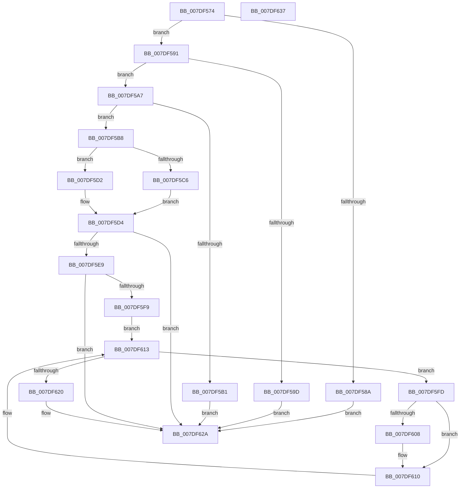

# CmpAcceptBoot

- RVA: `0x007DF574`–`0x007DF638` (길이 `196` bytes)
- VA: `0x00000001407DF574`
- 실행 섹션: `PAGE`
- PDB 이름 있음: `예`; PDB Function 태그: `아니요`
- unwind 정보 RVA: `0x0005CAAC`
- 디코드: `56`개 명령, `196/196` bytes 표시
- 미해석 바이트: `0` (있으면 어셈블리에 `.byte`로 보존)

> 이 문서는 커널 이미지의 기계어와 PDB 기호를 분석해 생성했습니다. 4번과 5번은 함수 원형과 자료형을 바이너리 사용 방식에서 추정한 C 해석이며 원본 소스 복구 결과는 아닙니다.

## 1. Dependencies

- 직접 호출 지점: **9**; 고유 호출 대상: **9**
- 직접 호출자로 확인된 함수: **1**
- RIP 상대 이미지 참조: **5**

### Outgoing calls
- `0x007DF581` → [PsIsCurrentThreadInServerSilo](../../text/43/PsIsCurrentThreadInServerSilo_function_004362E0.md) (function, `0x004362E0`)
- `0x007DF5B8` → [KeCommitSmtState](../../text/5B/KeCommitSmtState_function_005BE7AC.md) (function, `0x005BE7AC`)
- `0x007DF5C9` → [CmpSaveBootControlSet](CmpSaveBootControlSet_function_007DC744.md) (function, `0x007DC744`)
- `0x007DF5DB` → [guard_dispatch_icall](../../text/6B/guard_dispatch_icall_function_006BAAD0.md) (function, `0x006BAAD0`)
- `0x007DF5F0` → [CmpAcquireShutdownRundown](../../pagecmrc/BC/CmpAcquireShutdownRundown_function_00BC9400.md) (function, `0x00BC9400`)
- `0x007DF60B` → [CmpTrimHive](../A4/CmpTrimHive_function_00A4F2FC.md) (function, `0x00A4F2FC`)
- `0x007DF613` → [CmpGetNextActiveHive](../84/CmpGetNextActiveHive_function_0084E2A0.md) (function, `0x0084E2A0`)
- `0x007DF620` → [CmpUpdateReorganizeRegistryValues](../7E/CmpUpdateReorganizeRegistryValues_function_007EA7D4.md) (function, `0x007EA7D4`)
- `0x007DF625` → [CmpReleaseShutdownRundown](../../pagecmrc/BC/CmpReleaseShutdownRundown_function_00BC9880.md) (function, `0x00BC9880`)

### Direct callers
- [NtInitializeRegistry](NtInitializeRegistry_function_007DFC90.md) at `0x007DFD14`

### Static image references
- `0x007DF593` → RVA `0x00FD8278` (`PAGEDATA`; read/write)
- `0x007DF5BD` → RVA `0x00FD8108` (`PAGEDATA`; read)
- `0x007DF5D4` → RVA `0x00E006C8` (`.data`; read)
- `0x007DF5E0` → RVA `0x00E0EC94` (`.data`; read)
- `0x007DF5E9` → RVA `0x00E0EC94` (`.data`; write)

## 2. Other-region calls and transfers

- 다른 실행 섹션으로 향하는 call: **5**
  - `0x007DF581` → [PsIsCurrentThreadInServerSilo](../../text/43/PsIsCurrentThreadInServerSilo_function_004362E0.md) (`PAGE` → `.text`)
  - `0x007DF5B8` → [KeCommitSmtState](../../text/5B/KeCommitSmtState_function_005BE7AC.md) (`PAGE` → `.text`)
  - `0x007DF5DB` → [guard_dispatch_icall](../../text/6B/guard_dispatch_icall_function_006BAAD0.md) (`PAGE` → `.text`)
  - `0x007DF5F0` → [CmpAcquireShutdownRundown](../../pagecmrc/BC/CmpAcquireShutdownRundown_function_00BC9400.md) (`PAGE` → `PAGECMRC`)
  - `0x007DF625` → [CmpReleaseShutdownRundown](../../pagecmrc/BC/CmpReleaseShutdownRundown_function_00BC9880.md) (`PAGE` → `PAGECMRC`)
- 별도 외부 분기/꼬리 이동을 확인하지 못했습니다.

## 3. Assembly (complete function range)

```asm
007DF574  48 89 5C 24 08                  mov qword ptr [rsp + 8], rbx
007DF579  57                              push rdi
007DF57A  48 83 EC 20                     sub rsp, 0x20
007DF57E  0F B7 D9                        movzx ebx, cx
007DF581  E8 5A 6D C5 FF                  call 0x1404362e0
007DF586  84 C0                           test al, al
007DF588  74 07                           je 0x1407df591
007DF58A  33 DB                           xor ebx, ebx
007DF58C  E9 99 00 00 00                  jmp 0x1407df62a
007DF591  33 C0                           xor eax, eax
007DF593  87 05 DF 8C 7F 00               xchg dword ptr [rip + 0x7f8cdf], eax
007DF599  85 C0                           test eax, eax
007DF59B  75 0A                           jne 0x1407df5a7
007DF59D  BB 22 00 00 C0                  mov ebx, 0xc0000022
007DF5A2  E9 83 00 00 00                  jmp 0x1407df62a
007DF5A7  B8 00 F0 00 00                  mov eax, 0xf000
007DF5AC  66 03 D8                        add bx, ax
007DF5AF  75 07                           jne 0x1407df5b8
007DF5B1  BB 0D 00 00 C0                  mov ebx, 0xc000000d
007DF5B6  EB 72                           jmp 0x1407df62a
007DF5B8  E8 EF F1 DD FF                  call 0x1405be7ac
007DF5BD  83 3D 44 8B 7F 00 00            cmp dword ptr [rip + 0x7f8b44], 0
007DF5C4  74 0C                           je 0x1407df5d2
007DF5C6  0F B7 CB                        movzx ecx, bx
007DF5C9  E8 76 D1 FF FF                  call 0x1407dc744
007DF5CE  8B D8                           mov ebx, eax
007DF5D0  EB 02                           jmp 0x1407df5d4
007DF5D2  33 DB                           xor ebx, ebx
007DF5D4  48 8B 05 ED 10 62 00            mov rax, qword ptr [rip + 0x6210ed]
007DF5DB  E8 F0 B4 ED FF                  call 0x1406baad0
007DF5E0  80 3D AD F6 62 00 02            cmp byte ptr [rip + 0x62f6ad], 2
007DF5E7  74 41                           je 0x1407df62a
007DF5E9  C6 05 A4 F6 62 00 02            mov byte ptr [rip + 0x62f6a4], 2
007DF5F0  E8 0B 9E 3E 00                  call 0x140bc9400
007DF5F5  84 C0                           test al, al
007DF5F7  74 31                           je 0x1407df62a
007DF5F9  33 C9                           xor ecx, ecx
007DF5FB  EB 16                           jmp 0x1407df613
007DF5FD  8B 8F A0 00 00 00               mov ecx, dword ptr [rdi + 0xa0]
007DF603  F6 C1 10                        test cl, 0x10
007DF606  75 08                           jne 0x1407df610
007DF608  48 8B CF                        mov rcx, rdi
007DF60B  E8 EC FC 26 00                  call 0x140a4f2fc
007DF610  48 8B CF                        mov rcx, rdi
007DF613  E8 88 EC 06 00                  call 0x14084e2a0
007DF618  48 8B F8                        mov rdi, rax
007DF61B  48 85 C0                        test rax, rax
007DF61E  75 DD                           jne 0x1407df5fd
007DF620  E8 AF B1 00 00                  call 0x1407ea7d4
007DF625  E8 56 A2 3E 00                  call 0x140bc9880
007DF62A  8B C3                           mov eax, ebx
007DF62C  48 8B 5C 24 30                  mov rbx, qword ptr [rsp + 0x30]
007DF631  48 83 C4 20                     add rsp, 0x20
007DF635  5F                              pop rdi
007DF636  C3                              ret
007DF637  CC                              int3
```

## 4. C-style interpretation (structured pseudocode)

```c
__int64 __fastcall CmpAcceptBoot(unsigned __int16 a1)
{
    __int64 result;
    __int64 v_rbx;
    __int64 v_rsp;
    unsigned __int64 v_stack_p8;

    v_stack_p8 = v_rbx;
    v_rsp = (v_rsp) - (32);
    result = PsIsCurrentThreadInServerSilo(a1, a2, a3, a4);
    if ((unsigned __int8)(result) == 0) goto loc_007DF591;
    v_rbx = 0;
    goto loc_007DF62A;
loc_007DF591:
    result = 0;
    if (0 != 0) goto loc_007DF5A7;
    goto loc_007DF62A;
loc_007DF5A7:
    v_rbx = (unsigned __int16)(((unsigned int)(0xC0000022ULL)) + ((unsigned __int16)((unsigned int)(0xF000ULL))));
    if (condition_is_not_equal) goto loc_007DF5B8;
    goto loc_007DF62A;
loc_007DF5B8:
    result = KeCommitSmtState(a1, a2, a3, a4);
    if ((*(unsigned int *)(v_rip + 8358724)) == 0) goto loc_007DF5D2;
    result = CmpSaveBootControlSet((unsigned __int16)((unsigned int)(0xC000000DULL)), a2, a3, a4);
    goto loc_007DF5D4;
loc_007DF5D2:
    v_rbx = 0;
loc_007DF5D4:
    result = guard_dispatch_icall((unsigned __int16)((unsigned int)(0xC000000DULL)), a2, a3, a4);
    if ((*(unsigned __int8 *)(v_rip + 6485677)) == 2) goto loc_007DF62A;
    *(unsigned __int8 *)(v_rip + 6485668) = 2;
    result = CmpAcquireShutdownRundown((unsigned __int16)((unsigned int)(0xC000000DULL)), a2, a3, a4);
    if ((unsigned __int8)(result) == 0) goto loc_007DF62A;
    a1 = 0;
    goto loc_007DF613;
loc_007DF5FD:
    if ((((unsigned __int8)((unsigned int)(*(unsigned int *)(v_rdi + 160)))) & (16)) == 0) {
        a1 = v_rdi;
        result = CmpTrimHive(a1, a2, a3, a4);
    }
loc_007DF613:
    result = CmpGetNextActiveHive(v_rdi, a2, a3, a4);
    if (result != 0) goto loc_007DF5FD;
    result = CmpUpdateReorganizeRegistryValues(v_rdi, a2, a3, a4);
    result = CmpReleaseShutdownRundown(v_rdi, a2, a3, a4);
loc_007DF62A:
    v_rsp = (v_rsp) + (32);
    return 0;
}
```

## 5. (Beta) C Style

```c
int64_t CmpAcceptBoot(uint16_t Arg1)
{
    int64_t result;
    int64_t local_rbx;
    int64_t local_rsp;
    uint64_t v_stack_p8;

    v_stack_p8 = local_rbx;
    local_rsp = (local_rsp) - (32);
    result = PsIsCurrentThreadInServerSilo(Arg1, a2, a3, a4);
    if ((uint8_t)(result) == 0) goto loc_007DF591;
    local_rbx = 0;
    goto loc_007DF62A;
loc_007DF591:
    result = 0;
    if (0 != 0) goto loc_007DF5A7;
    goto loc_007DF62A;
loc_007DF5A7:
    local_rbx = (uint16_t)(((uint32_t)(0xC0000022ULL)) + ((uint16_t)((uint32_t)(0xF000ULL))));
    if (condition_is_not_equal) goto loc_007DF5B8;
    goto loc_007DF62A;
loc_007DF5B8:
    result = KeCommitSmtState(Arg1, a2, a3, a4);
    if ((*(uint32_t *)(v_rip + 0x7F8B44)) == 0) goto loc_007DF5D2;
    result = CmpSaveBootControlSet((uint16_t)((uint32_t)(0xC000000DULL)), a2, a3, a4);
    goto loc_007DF5D4;
loc_007DF5D2:
    local_rbx = 0;
loc_007DF5D4:
    result = guard_dispatch_icall((uint16_t)((uint32_t)(0xC000000DULL)), a2, a3, a4);
    if ((*(uint8_t *)(v_rip + 0x62F6AD)) == 2) goto loc_007DF62A;
    *(uint8_t *)(v_rip + 0x62F6A4) = 2;
    result = CmpAcquireShutdownRundown((uint16_t)((uint32_t)(0xC000000DULL)), a2, a3, a4);
    if ((uint8_t)(result) == 0) goto loc_007DF62A;
    Arg1 = 0;
    goto loc_007DF613;
loc_007DF5FD:
    if ((((uint8_t)((uint32_t)(*(uint32_t *)(local_rdi + 0xA0)))) & (16)) == 0) {
        Arg1 = local_rdi;
        result = CmpTrimHive(Arg1, a2, a3, a4);
    }
loc_007DF613:
    result = CmpGetNextActiveHive(local_rdi, a2, a3, a4);
    if (result != 0) goto loc_007DF5FD;
    result = CmpUpdateReorganizeRegistryValues(local_rdi, a2, a3, a4);
    result = CmpReleaseShutdownRundown(local_rdi, a2, a3, a4);
loc_007DF62A:
    local_rsp = (local_rsp) + (32);
    return 0;
}
```

## 6. Execution-region graph

[열기: 2D/3D 그래프와 함수 탐색 컨트롤 패널](../../../control-panel.html?section=page&rva=0x007DF574&view=graph)

- 2D 그래프는 위에서 아래로 흐르고, 3D 그래프는 빈 공간을 드래그해 회전합니다. Shift+드래그는 이동, 휠은 확대·축소, 함수 노드 선택은 대상 보고서 이동입니다.

### Static fallback


