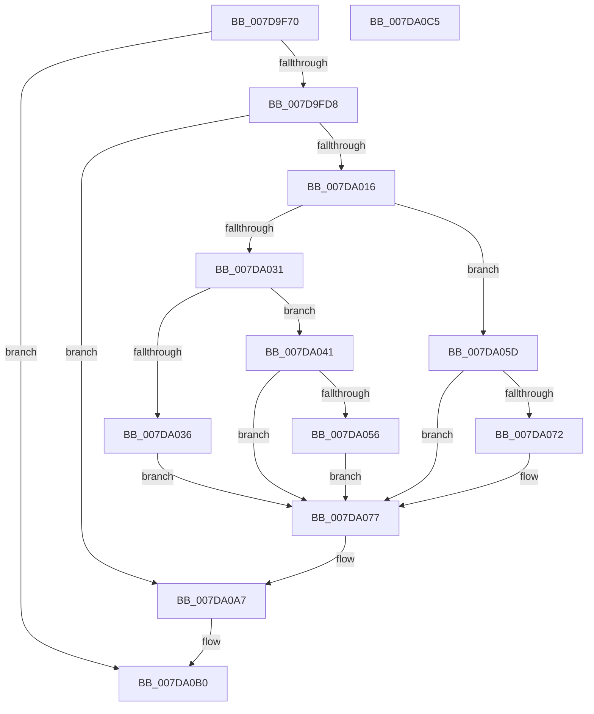

# CmpCreatePerfKeys

- RVA: `0x007D9F70`–`0x007DA0C6` (길이 `342` bytes)
- VA: `0x00000001407D9F70`
- 실행 섹션: `PAGE`
- PDB 이름 있음: `예`; PDB Function 태그: `아니요`
- unwind 정보 RVA: `0x000B0904`
- 디코드: `78`개 명령, `342/342` bytes 표시
- 미해석 바이트: `0` (있으면 어셈블리에 `.byte`로 보존)

> 이 문서는 커널 이미지의 기계어와 PDB 기호를 분석해 생성했습니다. 4번과 5번은 함수 원형과 자료형을 바이너리 사용 방식에서 추정한 C 해석이며 원본 소스 복구 결과는 아닙니다.

## 1. Dependencies

- 직접 호출 지점: **7**; 고유 호출 대상: **5**
- 직접 호출자로 확인된 함수: **1**
- RIP 상대 이미지 참조: **7**

### Outgoing calls
- `0x007D9FCB` → [ZwOpenKey](../../text/6A/ZwOpenKey_function_006AD310.md) (function, `0x006AD310`)
- `0x007D9FEA` → [CmpCreatePredefined](CmpCreatePredefined_function_007DA0CC.md) (function, `0x007DA0CC`)
- `0x007DA001` → [CmpCreatePredefined](CmpCreatePredefined_function_007DA0CC.md) (function, `0x007DA0CC`)
- `0x007DA08E` → [RtlStringCbPrintfW](../../text/40/RtlStringCbPrintfW_function_0040FB40.md) (function, `0x0040FB40`)
- `0x007DA0A2` → [CmpCreatePredefined](CmpCreatePredefined_function_007DA0CC.md) (function, `0x007DA0CC`)
- `0x007DA0AB` → [ZwClose](../../text/6A/ZwClose_function_006AD2B0.md) (function, `0x006AD2B0`)
- `0x007DA0B7` → [_security_check_cookie](../../text/6A/_security_check_cookie_function_006AC640.md) (function, `0x006AC640`)

### Direct callers
- [CmpFinishSystemHivesLoad](CmpFinishSystemHivesLoad_function_007DA210.md) at `0x007DA82B`

### Static image references
- `0x007D9F7C` → RVA `0x00E0A740` (`.data`; read)
- `0x007D9F8F` → RVA `0x00B4BD58` (`CmpPerflibPathString`; read)
- `0x007D9FDC` → RVA `0x00B09000` (` ?? ::NNGAKEGL::`string'`; read)
- `0x007D9FF3` → RVA `0x00B09010` (` ?? ::NNGAKEGL::`string'`; read)
- `0x007DA006` → RVA `0x00FD9A98` (`PAGEDATA`; read)
- `0x007DA016` → RVA `0x00FD9A60` (`PAGEDATA`; read)
- `0x007DA07A` → RVA `0x00B090E0` (` ?? ::NNGAKEGL::`string'`; read)

## 2. Other-region calls and transfers

- 다른 실행 섹션으로 향하는 call: **4**
  - `0x007D9FCB` → [ZwOpenKey](../../text/6A/ZwOpenKey_function_006AD310.md) (`PAGE` → `.text`)
  - `0x007DA08E` → [RtlStringCbPrintfW](../../text/40/RtlStringCbPrintfW_function_0040FB40.md) (`PAGE` → `.text`)
  - `0x007DA0AB` → [ZwClose](../../text/6A/ZwClose_function_006AD2B0.md) (`PAGE` → `.text`)
  - `0x007DA0B7` → [_security_check_cookie](../../text/6A/_security_check_cookie_function_006AC640.md) (`PAGE` → `.text`)
- 별도 외부 분기/꼬리 이동을 확인하지 못했습니다.

## 3. Assembly (complete function range)

```asm
007D9F70  40 55                           push rbp
007D9F72  48 8B EC                        mov rbp, rsp
007D9F75  48 81 EC 80 00 00 00            sub rsp, 0x80
007D9F7C  48 8B 05 BD 07 63 00            mov rax, qword ptr [rip + 0x6307bd]
007D9F83  48 33 C4                        xor rax, rsp
007D9F86  48 89 45 F8                     mov qword ptr [rbp - 8], rax
007D9F8A  48 83 65 B0 00                  and qword ptr [rbp - 0x50], 0
007D9F8F  48 8D 05 C2 1D 37 00            lea rax, [rip + 0x371dc2]
007D9F96  83 65 D4 00                     and dword ptr [rbp - 0x2c], 0
007D9F9A  4C 8D 45 B8                     lea r8, [rbp - 0x48]
007D9F9E  48 83 65 C0 00                  and qword ptr [rbp - 0x40], 0
007D9FA3  48 8D 4D B0                     lea rcx, [rbp - 0x50]
007D9FA7  0F 57 C0                        xorps xmm0, xmm0
007D9FAA  48 C7 45 B8 30 00 00 00         mov qword ptr [rbp - 0x48], 0x30
007D9FB2  83 65 BC 00                     and dword ptr [rbp - 0x44], 0
007D9FB6  BA 06 00 02 00                  mov edx, 0x20006
007D9FBB  48 89 45 C8                     mov qword ptr [rbp - 0x38], rax
007D9FBF  F3 0F 7F 45 D8                  movdqu xmmword ptr [rbp - 0x28], xmm0
007D9FC4  C7 45 D0 40 02 00 00            mov dword ptr [rbp - 0x30], 0x240
007D9FCB  E8 40 33 ED FF                  call 0x1406ad310
007D9FD0  85 C0                           test eax, eax
007D9FD2  0F 88 D8 00 00 00               js 0x1407da0b0
007D9FD8  48 8B 4D B0                     mov rcx, qword ptr [rbp - 0x50]
007D9FDC  48 8D 15 1D F0 32 00            lea rdx, [rip + 0x32f01d]
007D9FE3  49 C7 C0 50 00 00 80            mov r8, 0xffffffff80000050
007D9FEA  E8 DD 00 00 00                  call 0x1407da0cc
007D9FEF  48 8B 4D B0                     mov rcx, qword ptr [rbp - 0x50]
007D9FF3  48 8D 15 16 F0 32 00            lea rdx, [rip + 0x32f016]
007D9FFA  49 C7 C0 60 00 00 80            mov r8, 0xffffffff80000060
007DA001  E8 C6 00 00 00                  call 0x1407da0cc
007DA006  81 3D 88 FA 7F 00 09 04 00 00   cmp dword ptr [rip + 0x7ffa88], 0x409
007DA010  0F 84 91 00 00 00               je 0x1407da0a7
007DA016  0F B7 0D 43 FA 7F 00            movzx ecx, word ptr [rip + 0x7ffa43]
007DA01D  BA FF 03 00 00                  mov edx, 0x3ff
007DA022  8B C1                           mov eax, ecx
007DA024  41 B9 04 00 00 00               mov r9d, 4
007DA02A  23 C2                           and eax, edx
007DA02C  41 3B C1                        cmp eax, r9d
007DA02F  74 2C                           je 0x1407da05d
007DA031  83 F8 16                        cmp eax, 0x16
007DA034  74 0B                           je 0x1407da041
007DA036  66 23 CA                        and cx, dx
007DA039  41 B9 03 00 00 00               mov r9d, 3
007DA03F  EB 36                           jmp 0x1407da077
007DA041  BA 00 FC 00 00                  mov edx, 0xfc00
007DA046  0F B7 C1                        movzx eax, cx
007DA049  66 23 C2                        and ax, dx
007DA04C  BA 00 04 00 00                  mov edx, 0x400
007DA051  66 3B C2                        cmp ax, dx
007DA054  74 21                           je 0x1407da077
007DA056  B9 16 08 00 00                  mov ecx, 0x816
007DA05B  EB 1A                           jmp 0x1407da077
007DA05D  BA 00 FC 00 00                  mov edx, 0xfc00
007DA062  0F B7 C1                        movzx eax, cx
007DA065  66 23 C2                        and ax, dx
007DA068  BA 00 08 00 00                  mov edx, 0x800
007DA06D  66 3B C2                        cmp ax, dx
007DA070  74 05                           je 0x1407da077
007DA072  B9 04 04 00 00                  mov ecx, 0x404
007DA077  0F B7 C1                        movzx eax, cx
007DA07A  4C 8D 05 5F F0 32 00            lea r8, [rip + 0x32f05f]
007DA081  48 8D 4D E8                     lea rcx, [rbp - 0x18]
007DA085  89 44 24 20                     mov dword ptr [rsp + 0x20], eax
007DA089  BA 0A 00 00 00                  mov edx, 0xa
007DA08E  E8 AD 5A C3 FF                  call 0x14040fb40
007DA093  48 8B 4D B0                     mov rcx, qword ptr [rbp - 0x50]
007DA097  48 8D 55 E8                     lea rdx, [rbp - 0x18]
007DA09B  49 C7 C0 60 00 00 80            mov r8, 0xffffffff80000060
007DA0A2  E8 25 00 00 00                  call 0x1407da0cc
007DA0A7  48 8B 4D B0                     mov rcx, qword ptr [rbp - 0x50]
007DA0AB  E8 00 32 ED FF                  call 0x1406ad2b0
007DA0B0  48 8B 4D F8                     mov rcx, qword ptr [rbp - 8]
007DA0B4  48 33 CC                        xor rcx, rsp
007DA0B7  E8 84 25 ED FF                  call 0x1406ac640
007DA0BC  48 81 C4 80 00 00 00            add rsp, 0x80
007DA0C3  5D                              pop rbp
007DA0C4  C3                              ret
007DA0C5  CC                              int3
```

## 4. C-style interpretation (structured pseudocode)

```c
__int64 __fastcall CmpCreatePerfKeys(void)
{
    __int64 result;
    __int64 v_rsp;
    unsigned __int64 v_stack_m10;
    unsigned __int64 v_stack_m20;
    unsigned __int64 v_stack_m30;
    unsigned int v_stack_m34;
    unsigned int v_stack_m38;
    unsigned __int64 v_stack_m40;
    unsigned __int64 v_stack_m48;
    unsigned int v_stack_m4C;
    unsigned __int64 v_stack_m50;
    unsigned __int64 v_stack_m58;
    unsigned int v_stack_m68;

    v_rsp = (v_rsp) - (128);
    result = (*(unsigned __int64 *)(v_rip + 6490045)) ^ (v_rsp);
    v_stack_m10 = result;
    v_stack_m50 = 48;
    v_stack_m40 = v_rip + 3612098;
    v_stack_m30 = v_xmm0;
    v_stack_m38 = 576;
    result = ZwOpenKey(v_stack_m58, (unsigned int)(0x20006ULL), v_stack_m50, a4);
    if (sign_flag) goto loc_007DA0B0;
    result = CmpCreatePredefined(v_stack_m58, v_rip + 3338269, 0xFFFFFFFF80000050ULL, a4);
    result = CmpCreatePredefined(v_stack_m58, v_rip + 3338262, 0xFFFFFFFF80000060ULL, a4);
    if ((*(unsigned int *)(v_rip + 8387208)) == 0x409ULL) goto loc_007DA0A7;
    result = (unsigned int)(((unsigned int)((unsigned int)(*(unsigned __int16 *)(v_rip + 8387139)))) & ((unsigned int)((unsigned int)(0x3FFULL))));
    if (((unsigned int)(result)) == 4) goto loc_007DA05D;
    if (((unsigned int)(result)) == 22) goto loc_007DA041;
    a1 = (unsigned __int16)((*(unsigned __int16 *)(v_rip + 8387139)) & ((unsigned __int16)((unsigned int)(0x3FFULL))));
    goto loc_007DA077;
loc_007DA041:
    result = (unsigned __int16)(((unsigned __int16)(a1)) & ((unsigned __int16)((unsigned int)(0xFC00ULL))));
    if (((unsigned __int16)(result)) == ((unsigned __int16)((unsigned int)(0x400ULL)))) goto loc_007DA077;
    goto loc_007DA077;
loc_007DA05D:
    result = (unsigned __int16)(((unsigned __int16)((unsigned int)(0x816ULL))) & ((unsigned __int16)((unsigned int)(0xFC00ULL))));
    if (((unsigned __int16)(result)) != ((unsigned __int16)((unsigned int)(0x800ULL)))) {
        a1 = 0x404ULL;
    }
    v_stack_m68 = (unsigned int)((unsigned __int16)(a1));
    result = RtlStringCbPrintfW(v_stack_m20, 10, v_rip + 3338335, 3);
    result = CmpCreatePredefined(v_stack_m58, v_stack_m20, 0xFFFFFFFF80000060ULL, 3);
loc_007DA0A7:
    result = ZwClose(v_stack_m58, v_stack_m20, 0xFFFFFFFF80000060ULL, 3);
loc_007DA0B0:
    a1 = (v_stack_m10) ^ (v_rsp);
    result = _security_check_cookie(a1, v_stack_m20, 0xFFFFFFFF80000060ULL, 3);
    v_rsp = (v_rsp) + (128);
    return result;
}
```

## 5. (Beta) C Style

```c
void CmpCreatePerfKeys(void)
{
    int64_t result;
    int64_t local_rsp;
    uint64_t v_stack_m10;
    uint64_t v_stack_m20;
    uint64_t v_stack_m30;
    uint32_t v_stack_m34;
    uint32_t v_stack_m38;
    uint64_t v_stack_m40;
    uint64_t v_stack_m48;
    uint32_t v_stack_m4C;
    uint64_t v_stack_m50;
    uint64_t v_stack_m58;
    uint32_t v_stack_m68;

    local_rsp = (local_rsp) - (128);
    result = (*(uint64_t *)(v_rip + 0x6307BD)) ^ (local_rsp);
    v_stack_m10 = result;
    v_stack_m50 = 48;
    v_stack_m40 = v_rip + 3612098;
    v_stack_m30 = v_xmm0;
    v_stack_m38 = 576;
    result = ZwOpenKey(v_stack_m58, (uint32_t)(0x20006ULL), v_stack_m50, a4);
    if (sign_flag) goto loc_007DA0B0;
    result = CmpCreatePredefined(v_stack_m58, v_rip + 3338269, 0xFFFFFFFF80000050ULL, a4);
    result = CmpCreatePredefined(v_stack_m58, v_rip + 3338262, 0xFFFFFFFF80000060ULL, a4);
    if ((*(uint32_t *)(v_rip + 0x7FFA88)) == 0x409ULL) goto loc_007DA0A7;
    result = (uint32_t)(((uint32_t)((uint32_t)(*(uint16_t *)(v_rip + 0x7FFA43)))) & ((uint32_t)((uint32_t)(0x3FFULL))));
    if (((uint32_t)(result)) == 4) goto loc_007DA05D;
    if (((uint32_t)(result)) == 22) goto loc_007DA041;
    a1 = (uint16_t)((*(uint16_t *)(v_rip + 0x7FFA43)) & ((uint16_t)((uint32_t)(0x3FFULL))));
    goto loc_007DA077;
loc_007DA041:
    result = (uint16_t)(((uint16_t)(a1)) & ((uint16_t)((uint32_t)(0xFC00ULL))));
    if (((uint16_t)(result)) == ((uint16_t)((uint32_t)(0x400ULL)))) goto loc_007DA077;
    goto loc_007DA077;
loc_007DA05D:
    result = (uint16_t)(((uint16_t)((uint32_t)(0x816ULL))) & ((uint16_t)((uint32_t)(0xFC00ULL))));
    if (((uint16_t)(result)) != ((uint16_t)((uint32_t)(0x800ULL)))) {
        a1 = 0x404ULL;
    }
    v_stack_m68 = (uint32_t)((uint16_t)(a1));
    result = RtlStringCbPrintfW(v_stack_m20, 10, v_rip + 3338335, 3);
    result = CmpCreatePredefined(v_stack_m58, v_stack_m20, 0xFFFFFFFF80000060ULL, 3);
loc_007DA0A7:
    result = ZwClose(v_stack_m58, v_stack_m20, 0xFFFFFFFF80000060ULL, 3);
loc_007DA0B0:
    a1 = (v_stack_m10) ^ (local_rsp);
    result = _security_check_cookie(a1, v_stack_m20, 0xFFFFFFFF80000060ULL, 3);
    local_rsp = (local_rsp) + (128);
    return result;
}
```

## 6. Execution-region graph

[열기: 2D/3D 그래프와 함수 탐색 컨트롤 패널](../../../control-panel.html?section=page&rva=0x007D9F70&view=graph)

- 2D 그래프는 위에서 아래로 흐르고, 3D 그래프는 빈 공간을 드래그해 회전합니다. Shift+드래그는 이동, 휠은 확대·축소, 함수 노드 선택은 대상 보고서 이동입니다.

### Static fallback


