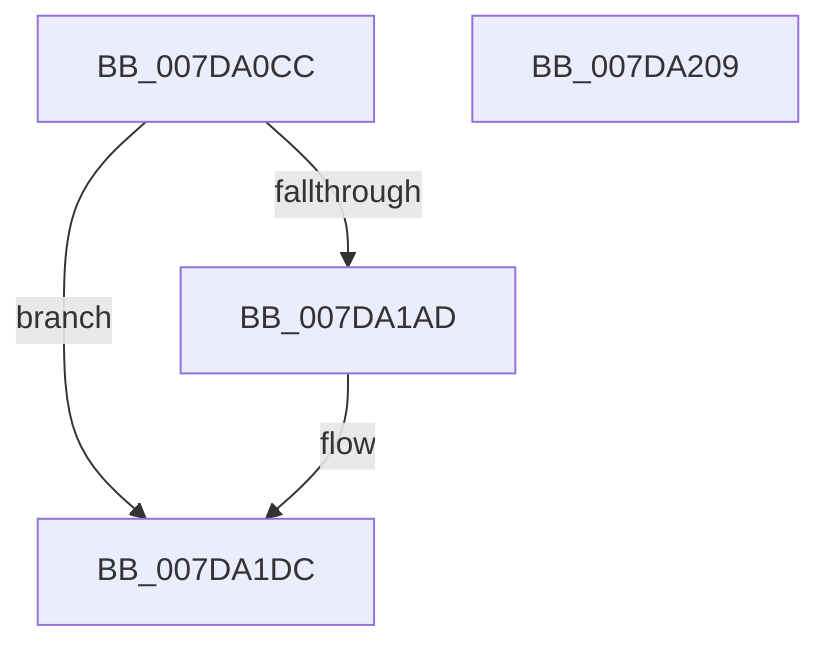

# CmpCreatePredefined

- RVA: `0x007DA0CC`–`0x007DA20A` (길이 `318` bytes)
- VA: `0x00000001407DA0CC`
- 실행 섹션: `PAGE`
- PDB 이름 있음: `예`; PDB Function 태그: `아니요`
- unwind 정보 RVA: `0x000D6368`
- 디코드: `71`개 명령, `318/318` bytes 표시
- 미해석 바이트: `0` (있으면 어셈블리에 `.byte`로 보존)

> 이 문서는 커널 이미지의 기계어와 PDB 기호를 분석해 생성했습니다. 4번과 5번은 함수 원형과 자료형을 바이너리 사용 방식에서 추정한 C 해석이며 원본 소스 복구 결과는 아닙니다.

## 1. Dependencies

- 직접 호출 지점: **8**; 고유 호출 대상: **8**
- 직접 호출자로 확인된 함수: **1**
- RIP 상대 이미지 참조: **2**

### Outgoing calls
- `0x007DA11C` → [memset](../../text/6C/memset_function_006C6C40.md) (function, `0x006C6C40`)
- `0x007DA133` → [CmpInitializeParseContext](../87/CmpInitializeParseContext_function_008767F0.md) (function, `0x008767F0`)
- `0x007DA152` → [RtlInitUnicodeString](../../text/42/RtlInitUnicodeString_function_0042A780.md) (function, `0x0042A780`)
- `0x007DA1A4` → [ObOpenObjectByName](../89/ObOpenObjectByName_function_00899F50.md) (function, `0x00899F50`)
- `0x007DA1CD` → [ObReferenceObjectByHandle](../86/ObReferenceObjectByHandle_function_00868DB0.md) (function, `0x00868DB0`)
- `0x007DA1D7` → [ZwClose](../../text/6A/ZwClose_function_006AD2B0.md) (function, `0x006AD2B0`)
- `0x007DA1E2` → [CmpCleanupParseContext](../87/CmpCleanupParseContext_function_00876910.md) (function, `0x00876910`)
- `0x007DA1F1` → [_security_check_cookie](../../text/6A/_security_check_cookie_function_006AC640.md) (function, `0x006AC640`)

### Direct callers
- [CmpCreatePerfKeys](CmpCreatePerfKeys_function_007D9F70.md) at `0x007D9FEA`
- [CmpCreatePerfKeys](CmpCreatePerfKeys_function_007D9F70.md) at `0x007DA001`
- [CmpCreatePerfKeys](CmpCreatePerfKeys_function_007D9F70.md) at `0x007DA0A2`

### Static image references
- `0x007DA0E3` → RVA `0x00E0A740` (`.data`; read)
- `0x007DA157` → RVA `0x00FC6AC0` (`ALMOSTRO`; read)

## 2. Other-region calls and transfers

- 다른 실행 섹션으로 향하는 call: **4**
  - `0x007DA11C` → [memset](../../text/6C/memset_function_006C6C40.md) (`PAGE` → `.text`)
  - `0x007DA152` → [RtlInitUnicodeString](../../text/42/RtlInitUnicodeString_function_0042A780.md) (`PAGE` → `.text`)
  - `0x007DA1D7` → [ZwClose](../../text/6A/ZwClose_function_006AD2B0.md) (`PAGE` → `.text`)
  - `0x007DA1F1` → [_security_check_cookie](../../text/6A/_security_check_cookie_function_006AC640.md) (`PAGE` → `.text`)
- 별도 외부 분기/꼬리 이동을 확인하지 못했습니다.

## 3. Assembly (complete function range)

```asm
007DA0CC  48 89 5C 24 20                  mov qword ptr [rsp + 0x20], rbx
007DA0D1  55                              push rbp
007DA0D2  56                              push rsi
007DA0D3  57                              push rdi
007DA0D4  48 8D AC 24 90 FE FF FF         lea rbp, [rsp - 0x170]
007DA0DC  48 81 EC 70 02 00 00            sub rsp, 0x270
007DA0E3  48 8B 05 56 06 63 00            mov rax, qword ptr [rip + 0x630656]
007DA0EA  48 33 C4                        xor rax, rsp
007DA0ED  48 89 85 60 01 00 00            mov qword ptr [rbp + 0x160], rax
007DA0F4  83 64 24 74 00                  and dword ptr [rsp + 0x74], 0
007DA0F9  49 8B F8                        mov rdi, r8
007DA0FC  48 8B DA                        mov rbx, rdx
007DA0FF  48 C7 44 24 58 30 00 00 00      mov qword ptr [rsp + 0x58], 0x30
007DA108  83 64 24 5C 00                  and dword ptr [rsp + 0x5c], 0
007DA10D  48 8B F1                        mov rsi, rcx
007DA110  33 D2                           xor edx, edx
007DA112  48 8D 4D 90                     lea rcx, [rbp - 0x70]
007DA116  41 B8 D0 01 00 00               mov r8d, 0x1d0
007DA11C  E8 1F CB EE FF                  call 0x1406c6c40
007DA121  48 83 64 24 40 00               and qword ptr [rsp + 0x40], 0
007DA127  48 8D 4D 90                     lea rcx, [rbp - 0x70]
007DA12B  0F 57 C0                        xorps xmm0, xmm0
007DA12E  0F 11 44 24 48                  movups xmmword ptr [rsp + 0x48], xmm0
007DA133  E8 B8 C6 09 00                  call 0x1408767f0
007DA138  48 8B D3                        mov rdx, rbx
007DA13B  C7 45 A8 01 00 00 01            mov dword ptr [rbp - 0x58], 0x1000001
007DA142  48 8D 4C 24 48                  lea rcx, [rsp + 0x48]
007DA147  C7 45 90 21 00 00 00            mov dword ptr [rbp - 0x70], 0x21
007DA14E  48 89 7D C8                     mov qword ptr [rbp - 0x38], rdi
007DA152  E8 29 06 C5 FF                  call 0x14042a780
007DA157  48 8B 15 62 C9 7E 00            mov rdx, qword ptr [rip + 0x7ec962]
007DA15E  48 8D 44 24 48                  lea rax, [rsp + 0x48]
007DA163  48 89 44 24 68                  mov qword ptr [rsp + 0x68], rax
007DA168  48 8D 4C 24 58                  lea rcx, [rsp + 0x58]
007DA16D  48 8D 44 24 40                  lea rax, [rsp + 0x40]
007DA172  48 89 74 24 60                  mov qword ptr [rsp + 0x60], rsi
007DA177  48 89 44 24 30                  mov qword ptr [rsp + 0x30], rax
007DA17C  0F 57 C0                        xorps xmm0, xmm0
007DA17F  48 8D 45 90                     lea rax, [rbp - 0x70]
007DA183  C7 44 24 70 40 02 00 00         mov dword ptr [rsp + 0x70], 0x240
007DA18B  48 89 44 24 28                  mov qword ptr [rsp + 0x28], rax
007DA190  45 33 C9                        xor r9d, r9d
007DA193  45 33 C0                        xor r8d, r8d
007DA196  C7 44 24 20 19 00 02 00         mov dword ptr [rsp + 0x20], 0x20019
007DA19E  F3 0F 7F 44 24 78               movdqu xmmword ptr [rsp + 0x78], xmm0
007DA1A4  E8 A7 FD 0B 00                  call 0x140899f50
007DA1A9  85 C0                           test eax, eax
007DA1AB  78 2F                           js 0x1407da1dc
007DA1AD  48 83 64 24 28 00               and qword ptr [rsp + 0x28], 0
007DA1B3  48 8D 45 88                     lea rax, [rbp - 0x78]
007DA1B7  4C 8B 05 02 C9 7E 00            mov r8, qword ptr [rip + 0x7ec902]
007DA1BE  45 33 C9                        xor r9d, r9d
007DA1C1  48 8B 4C 24 40                  mov rcx, qword ptr [rsp + 0x40]
007DA1C6  33 D2                           xor edx, edx
007DA1C8  48 89 44 24 20                  mov qword ptr [rsp + 0x20], rax
007DA1CD  E8 DE EB 08 00                  call 0x140868db0
007DA1D2  48 8B 4C 24 40                  mov rcx, qword ptr [rsp + 0x40]
007DA1D7  E8 D4 30 ED FF                  call 0x1406ad2b0
007DA1DC  33 D2                           xor edx, edx
007DA1DE  48 8D 4D 90                     lea rcx, [rbp - 0x70]
007DA1E2  E8 29 C7 09 00                  call 0x140876910
007DA1E7  48 8B 8D 60 01 00 00            mov rcx, qword ptr [rbp + 0x160]
007DA1EE  48 33 CC                        xor rcx, rsp
007DA1F1  E8 4A 24 ED FF                  call 0x1406ac640
007DA1F6  48 8B 9C 24 A8 02 00 00         mov rbx, qword ptr [rsp + 0x2a8]
007DA1FE  48 81 C4 70 02 00 00            add rsp, 0x270
007DA205  5F                              pop rdi
007DA206  5E                              pop rsi
007DA207  5D                              pop rbp
007DA208  C3                              ret
007DA209  CC                              int3
```

## 4. C-style interpretation (structured pseudocode)

```c
__int64 __fastcall CmpCreatePredefined(__int64 a1, __int64 a2, __int64 a3, int a4)
{
    __int64 result;
    __int64 v_rsp;
    unsigned __int64 v_stack_m188;
    unsigned __int64 v_stack_m1C0;
    unsigned int v_stack_m1E0;
    unsigned __int64 v_stack_m1F8;
    unsigned __int64 v_stack_m200;
    unsigned __int64 v_stack_m210;
    unsigned int v_stack_m214;
    unsigned int v_stack_m218;
    unsigned __int64 v_stack_m220;
    unsigned __int64 v_stack_m228;
    unsigned int v_stack_m22C;
    unsigned __int64 v_stack_m230;
    unsigned __int64 v_stack_m240;
    unsigned __int64 v_stack_m248;
    unsigned __int64 v_stack_m258;
    unsigned __int64 v_stack_m260;
    unsigned int v_stack_m268;
    unsigned __int64 v_stack_m28;
    unsigned __int64 v_stack_p20;

    v_stack_p20 = v_rbx;
    v_rsp = (v_rsp) - (624);
    result = (*(unsigned __int64 *)(v_rip + 6489686)) ^ (v_rsp);
    v_stack_m28 = result;
    v_stack_m230 = 48;
    a2 = 0;
    result = memset(v_stack_m1F8, a2, 464, a4);
    v_stack_m240 = v_xmm0;
    result = CmpInitializeParseContext(v_stack_m1F8, a2, 464, a4);
    v_stack_m1E0 = 0x1000001ULL;
    v_stack_m1F8 = 33;
    v_stack_m1C0 = a3;
    result = RtlInitUnicodeString(v_stack_m240, 0, 464, a4);
    v_stack_m220 = v_stack_m240;
    v_stack_m228 = a1;
    v_stack_m258 = v_stack_m248;
    v_stack_m218 = 576;
    v_stack_m260 = v_stack_m1F8;
    a4 = 0;
    a3 = 0;
    v_stack_m268 = 0x20019ULL;
    v_stack_m210 = v_xmm0;
    result = ObOpenObjectByName(v_stack_m230, *(unsigned __int64 *)(v_rip + 8309090), a3, a4);
    if (!(sign_flag)) {
        result = v_stack_m200;
        a3 = *(unsigned __int64 *)(v_rip + 8308994);
        a4 = 0;
        a1 = v_stack_m248;
        a2 = 0;
        v_stack_m268 = result;
        result = ObReferenceObjectByHandle(a1, a2, a3, a4);
        a1 = v_stack_m248;
        result = ZwClose(a1, a2, a3, a4);
    }
    a2 = 0;
    result = CmpCleanupParseContext(v_stack_m1F8, a2, a3, a4);
    a1 = (v_stack_m28) ^ (v_rsp);
    result = _security_check_cookie(a1, a2, a3, a4);
    v_rsp = (v_rsp) + (624);
    return result;
}
```

## 5. (Beta) C Style

```c
int64_t CmpCreatePredefined(int64_t Arg1, int64_t Arg2, int64_t Arg3, int32_t Arg4)
{
    int64_t result;
    int64_t local_rsp;
    uint64_t v_stack_m188;
    uint64_t v_stack_m1C0;
    uint32_t v_stack_m1E0;
    uint64_t v_stack_m1F8;
    uint64_t v_stack_m200;
    uint64_t v_stack_m210;
    uint32_t v_stack_m214;
    uint32_t v_stack_m218;
    uint64_t v_stack_m220;
    uint64_t v_stack_m228;
    uint32_t v_stack_m22C;
    uint64_t v_stack_m230;
    uint64_t v_stack_m240;
    uint64_t v_stack_m248;
    uint64_t v_stack_m258;
    uint64_t v_stack_m260;
    uint32_t v_stack_m268;
    uint64_t v_stack_m28;
    uint64_t v_stack_p20;

    v_stack_p20 = local_rbx;
    local_rsp = (local_rsp) - (624);
    result = (*(uint64_t *)(v_rip + 0x630656)) ^ (local_rsp);
    v_stack_m28 = result;
    v_stack_m230 = 48;
    Arg2 = 0;
    result = memset(v_stack_m1F8, Arg2, 464, Arg4);
    v_stack_m240 = v_xmm0;
    result = CmpInitializeParseContext(v_stack_m1F8, Arg2, 464, Arg4);
    v_stack_m1E0 = 0x1000001ULL;
    v_stack_m1F8 = 33;
    v_stack_m1C0 = Arg3;
    result = RtlInitUnicodeString(v_stack_m240, 0, 464, Arg4);
    v_stack_m220 = v_stack_m240;
    v_stack_m228 = Arg1;
    v_stack_m258 = v_stack_m248;
    v_stack_m218 = 576;
    v_stack_m260 = v_stack_m1F8;
    Arg4 = 0;
    Arg3 = 0;
    v_stack_m268 = 0x20019ULL;
    v_stack_m210 = v_xmm0;
    result = ObOpenObjectByName(v_stack_m230, *(uint64_t *)(v_rip + 0x7EC962), Arg3, Arg4);
    if (!(sign_flag)) {
        result = v_stack_m200;
        Arg3 = *(uint64_t *)(v_rip + 0x7EC902);
        Arg4 = 0;
        Arg1 = v_stack_m248;
        Arg2 = 0;
        v_stack_m268 = result;
        result = ObReferenceObjectByHandle(Arg1, Arg2, Arg3, Arg4);
        Arg1 = v_stack_m248;
        result = ZwClose(Arg1, Arg2, Arg3, Arg4);
    }
    Arg2 = 0;
    result = CmpCleanupParseContext(v_stack_m1F8, Arg2, Arg3, Arg4);
    Arg1 = (v_stack_m28) ^ (local_rsp);
    result = _security_check_cookie(Arg1, Arg2, Arg3, Arg4);
    local_rsp = (local_rsp) + (624);
    return result;
}
```

## 6. Execution-region graph

[열기: 2D/3D 그래프와 함수 탐색 컨트롤 패널](../../../control-panel.html?section=page&rva=0x007DA0CC&view=graph)

- 2D 그래프는 위에서 아래로 흐르고, 3D 그래프는 빈 공간을 드래그해 회전합니다. Shift+드래그는 이동, 휠은 확대·축소, 함수 노드 선택은 대상 보고서 이동입니다.

### Static fallback


