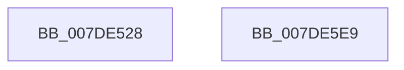

# CmpCreateTemporaryHive

- RVA: `0x007DE528`–`0x007DE5EA` (길이 `194` bytes)
- VA: `0x00000001407DE528`
- 실행 섹션: `PAGE`
- PDB 이름 있음: `예`; PDB Function 태그: `아니요`
- unwind 정보 RVA: `0x000D6568`
- 디코드: `43`개 명령, `194/194` bytes 표시
- 미해석 바이트: `0` (있으면 어셈블리에 `.byte`로 보존)

> 이 문서는 커널 이미지의 기계어와 PDB 기호를 분석해 생성했습니다. 4번과 5번은 함수 원형과 자료형을 바이너리 사용 방식에서 추정한 C 해석이며 원본 소스 복구 결과는 아닙니다.

## 1. Dependencies

- 직접 호출 지점: **3**; 고유 호출 대상: **3**
- 직접 호출자로 확인된 함수: **2**
- RIP 상대 이미지 참조: **1**

### Outgoing calls
- `0x007DE569` → [memset](../../text/6C/memset_function_006C6C40.md) (function, `0x006C6C40`)
- `0x007DE5B4` → [CmpCreateHive](../87/CmpCreateHive_function_00879DF0.md) (function, `0x00879DF0`)
- `0x007DE5CF` → [_security_check_cookie](../../text/6A/_security_check_cookie_function_006AC640.md) (function, `0x006AC640`)

### Direct callers
- [CmSaveKey](CmSaveKey_function_007DDBDC.md) at `0x007DDCA1`
- [CmSaveMergedKeys](CmSaveMergedKeys_function_007DE040.md) at `0x007DE19B`

### Static image references
- `0x007DE53A` → RVA `0x00E0A740` (`.data`; read)

## 2. Other-region calls and transfers

- 다른 실행 섹션으로 향하는 call: **2**
  - `0x007DE569` → [memset](../../text/6C/memset_function_006C6C40.md) (`PAGE` → `.text`)
  - `0x007DE5CF` → [_security_check_cookie](../../text/6A/_security_check_cookie_function_006AC640.md) (`PAGE` → `.text`)
- 별도 외부 분기/꼬리 이동을 확인하지 못했습니다.

## 3. Assembly (complete function range)

```asm
007DE528  48 89 5C 24 18                  mov qword ptr [rsp + 0x18], rbx
007DE52D  48 89 74 24 20                  mov qword ptr [rsp + 0x20], rsi
007DE532  57                              push rdi
007DE533  48 81 EC 40 02 00 00            sub rsp, 0x240
007DE53A  48 8B 05 FF C1 62 00            mov rax, qword ptr [rip + 0x62c1ff]
007DE541  48 33 C4                        xor rax, rsp
007DE544  48 89 84 24 30 02 00 00         mov qword ptr [rsp + 0x230], rax
007DE54C  48 8B FA                        mov rdi, rdx
007DE54F  48 8B D9                        mov rbx, rcx
007DE552  33 F6                           xor esi, esi
007DE554  48 8D 8C 24 80 00 00 00         lea rcx, [rsp + 0x80]
007DE55C  33 D2                           xor edx, edx
007DE55E  48 89 74 24 70                  mov qword ptr [rsp + 0x70], rsi
007DE563  41 B8 B0 01 00 00               mov r8d, 0x1b0
007DE569  E8 D2 86 EE FF                  call 0x1406c6c40
007DE56E  48 8D 84 24 80 00 00 00         lea rax, [rsp + 0x80]
007DE576  45 33 C9                        xor r9d, r9d
007DE579  48 89 44 24 60                  mov qword ptr [rsp + 0x60], rax
007DE57E  44 8D 46 01                     lea r8d, [rsi + 1]
007DE582  48 89 74 24 58                  mov qword ptr [rsp + 0x58], rsi
007DE587  48 8D 4C 24 70                  lea rcx, [rsp + 0x70]
007DE58C  48 89 74 24 50                  mov qword ptr [rsp + 0x50], rsi
007DE591  33 D2                           xor edx, edx
007DE593  48 89 7C 24 48                  mov qword ptr [rsp + 0x48], rdi
007DE598  48 89 5C 24 40                  mov qword ptr [rsp + 0x40], rbx
007DE59D  C7 44 24 38 00 00 12 01         mov dword ptr [rsp + 0x38], 0x1120000
007DE5A5  48 89 74 24 30                  mov qword ptr [rsp + 0x30], rsi
007DE5AA  48 89 74 24 28                  mov qword ptr [rsp + 0x28], rsi
007DE5AF  48 89 74 24 20                  mov qword ptr [rsp + 0x20], rsi
007DE5B4  E8 37 B8 09 00                  call 0x140879df0
007DE5B9  85 C0                           test eax, eax
007DE5BB  48 0F 49 74 24 70               cmovns rsi, qword ptr [rsp + 0x70]
007DE5C1  48 8B C6                        mov rax, rsi
007DE5C4  48 8B 8C 24 30 02 00 00         mov rcx, qword ptr [rsp + 0x230]
007DE5CC  48 33 CC                        xor rcx, rsp
007DE5CF  E8 6C E0 EC FF                  call 0x1406ac640
007DE5D4  4C 8D 9C 24 40 02 00 00         lea r11, [rsp + 0x240]
007DE5DC  49 8B 5B 20                     mov rbx, qword ptr [r11 + 0x20]
007DE5E0  49 8B 73 28                     mov rsi, qword ptr [r11 + 0x28]
007DE5E4  49 8B E3                        mov rsp, r11
007DE5E7  5F                              pop rdi
007DE5E8  C3                              ret
007DE5E9  CC                              int3
```

## 4. C-style interpretation (structured pseudocode)

```c
__int64 __fastcall CmpCreateTemporaryHive(__int64 a1, __int64 a2, __int64 a3, int a4)
{
    __int64 result;
    __int64 v_rsi;
    __int64 v_rsp;
    unsigned __int64 v_stack_m18;
    unsigned __int64 v_stack_m1C8;
    unsigned __int64 v_stack_m1D8;
    unsigned __int64 v_stack_m1E8;
    unsigned __int64 v_stack_m1F0;
    unsigned __int64 v_stack_m1F8;
    unsigned __int64 v_stack_m200;
    unsigned __int64 v_stack_m208;
    unsigned int v_stack_m210;
    unsigned __int64 v_stack_m218;
    unsigned __int64 v_stack_m220;
    unsigned __int64 v_stack_m228;
    unsigned __int64 v_stack_m8;
    unsigned __int64 v_stack_p18;
    unsigned __int64 v_stack_p20;

    v_stack_p18 = v_rbx;
    v_stack_p20 = v_rsi;
    v_rsp = (v_rsp) - (576);
    result = (*(unsigned __int64 *)(v_rip + 6472191)) ^ (v_rsp);
    v_stack_m18 = result;
    v_rsi = 0;
    a2 = 0;
    v_stack_m1D8 = 0;
    result = memset(v_stack_m1C8, a2, 432, a4);
    a4 = 0;
    v_stack_m1E8 = v_stack_m1C8;
    v_stack_m1F0 = 0;
    v_stack_m1F8 = 0;
    a2 = 0;
    v_stack_m200 = 0;
    v_stack_m208 = a1;
    v_stack_m210 = 0x1120000ULL;
    v_stack_m218 = 0;
    v_stack_m220 = 0;
    v_stack_m228 = 0;
    result = CmpCreateHive(v_stack_m1D8, a2, v_rsi + 1, a4);
    if (!sign_flag) { v_rsi = v_stack_m1D8; }
    a1 = (v_stack_m18) ^ (v_rsp);
    result = _security_check_cookie(a1, a2, v_rsi + 1, a4);
    return result;
}
```

## 5. (Beta) C Style

```c
int64_t CmpCreateTemporaryHive(int64_t Arg1, int64_t Arg2, int64_t Arg3, int32_t Arg4)
{
    int64_t result;
    int64_t local_rsi;
    int64_t local_rsp;
    uint64_t v_stack_m18;
    uint64_t v_stack_m1C8;
    uint64_t v_stack_m1D8;
    uint64_t v_stack_m1E8;
    uint64_t v_stack_m1F0;
    uint64_t v_stack_m1F8;
    uint64_t v_stack_m200;
    uint64_t v_stack_m208;
    uint32_t v_stack_m210;
    uint64_t v_stack_m218;
    uint64_t v_stack_m220;
    uint64_t v_stack_m228;
    uint64_t v_stack_m8;
    uint64_t v_stack_p18;
    uint64_t v_stack_p20;

    v_stack_p18 = local_rbx;
    v_stack_p20 = local_rsi;
    local_rsp = (local_rsp) - (576);
    result = (*(uint64_t *)(v_rip + 0x62C1FF)) ^ (local_rsp);
    v_stack_m18 = result;
    local_rsi = 0;
    Arg2 = 0;
    v_stack_m1D8 = 0;
    result = memset(v_stack_m1C8, Arg2, 432, Arg4);
    Arg4 = 0;
    v_stack_m1E8 = v_stack_m1C8;
    v_stack_m1F0 = 0;
    v_stack_m1F8 = 0;
    Arg2 = 0;
    v_stack_m200 = 0;
    v_stack_m208 = Arg1;
    v_stack_m210 = 0x1120000ULL;
    v_stack_m218 = 0;
    v_stack_m220 = 0;
    v_stack_m228 = 0;
    result = CmpCreateHive(v_stack_m1D8, Arg2, local_rsi + 1, Arg4);
    if (!sign_flag) { local_rsi = v_stack_m1D8; }
    Arg1 = (v_stack_m18) ^ (local_rsp);
    result = _security_check_cookie(Arg1, Arg2, local_rsi + 1, Arg4);
    return result;
}
```

## 6. Execution-region graph

[열기: 2D/3D 그래프와 함수 탐색 컨트롤 패널](../../../control-panel.html?section=page&rva=0x007DE528&view=graph)

- 2D 그래프는 위에서 아래로 흐르고, 3D 그래프는 빈 공간을 드래그해 회전합니다. Shift+드래그는 이동, 휠은 확대·축소, 함수 노드 선택은 대상 보고서 이동입니다.

### Static fallback


