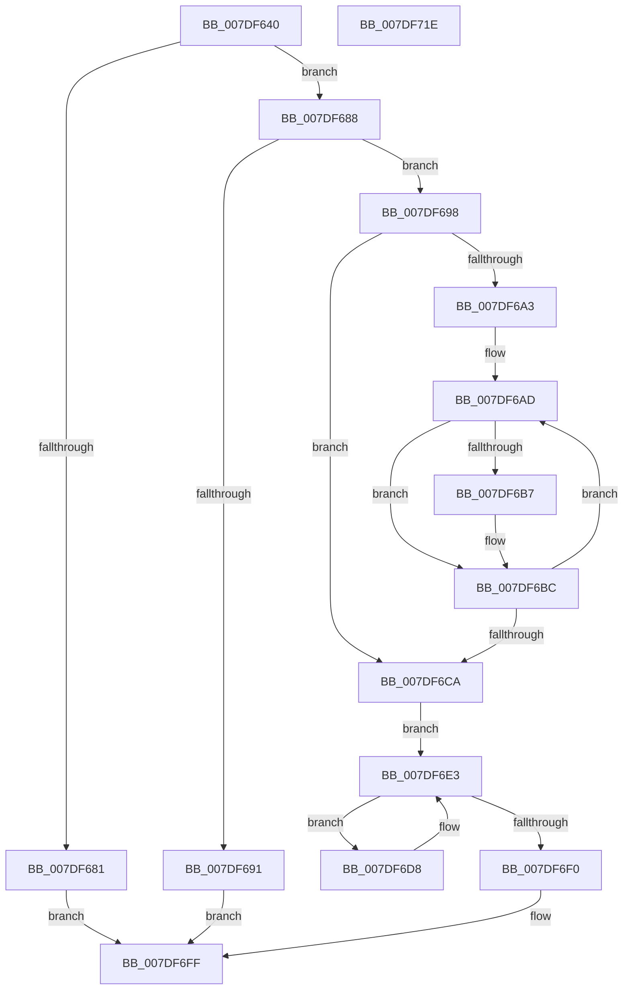

# CmpHandlePageFileOpenNotification

- RVA: `0x007DF640`–`0x007DF71F` (길이 `223` bytes)
- VA: `0x00000001407DF640`
- 실행 섹션: `PAGE`
- PDB 이름 있음: `예`; PDB Function 태그: `아니요`
- unwind 정보 RVA: `0x000BF7C4`
- 디코드: `61`개 명령, `223/223` bytes 표시
- 미해석 바이트: `0` (있으면 어셈블리에 `.byte`로 보존)

> 이 문서는 커널 이미지의 기계어와 PDB 기호를 분석해 생성했습니다. 4번과 5번은 함수 원형과 자료형을 바이너리 사용 방식에서 추정한 C 해석이며 원본 소스 복구 결과는 아닙니다.

## 1. Dependencies

- 직접 호출 지점: **8**; 고유 호출 대상: **8**
- 직접 호출자로 확인된 함수: **1**
- RIP 상대 이미지 참조: **3**

### Outgoing calls
- `0x007DF688` → [CmpAcquireShutdownRundown](../../pagecmrc/BC/CmpAcquireShutdownRundown_function_00BC9400.md) (function, `0x00BC9400`)
- `0x007DF6B7` → [CmpVolumeContextSendDeviceUsageNotification](../7E/CmpVolumeContextSendDeviceUsageNotification_function_007E87DC.md) (function, `0x007E87DC`)
- `0x007DF6CF` → [CmpAttachToRegistryProcess](../../pagecmrc/BC/CmpAttachToRegistryProcess_function_00BC98E0.md) (function, `0x00BC98E0`)
- `0x007DF6DB` → [CmpRecheckHiveVolumePolicy](../../text/46/CmpRecheckHiveVolumePolicy_function_0046EE14.md) (function, `0x0046EE14`)
- `0x007DF6E3` → [CmpGetNextActiveHive](../84/CmpGetNextActiveHive_function_0084E2A0.md) (function, `0x0084E2A0`)
- `0x007DF6F5` → [CmpDetachFromRegistryProcess](../../pagecmrc/BC/CmpDetachFromRegistryProcess_function_00BC9920.md) (function, `0x00BC9920`)
- `0x007DF6FA` → [CmpReleaseShutdownRundown](../../pagecmrc/BC/CmpReleaseShutdownRundown_function_00BC9880.md) (function, `0x00BC9880`)
- `0x007DF709` → [_security_check_cookie](../../text/6A/_security_check_cookie_function_006AC640.md) (function, `0x006AC640`)

### Direct callers
- [NtInitializeRegistry](NtInitializeRegistry_function_007DFC90.md) at `0x007DFD22`

### Static image references
- `0x007DF64F` → RVA `0x00E0A740` (`.data`; read)
- `0x007DF677` → RVA `0x00EF7C5C` (`.data`; read/write)
- `0x007DF698` → RVA `0x00FD8678` (`PAGEDATA`; read)

## 2. Other-region calls and transfers

- 다른 실행 섹션으로 향하는 call: **6**
  - `0x007DF688` → [CmpAcquireShutdownRundown](../../pagecmrc/BC/CmpAcquireShutdownRundown_function_00BC9400.md) (`PAGE` → `PAGECMRC`)
  - `0x007DF6CF` → [CmpAttachToRegistryProcess](../../pagecmrc/BC/CmpAttachToRegistryProcess_function_00BC98E0.md) (`PAGE` → `PAGECMRC`)
  - `0x007DF6DB` → [CmpRecheckHiveVolumePolicy](../../text/46/CmpRecheckHiveVolumePolicy_function_0046EE14.md) (`PAGE` → `.text`)
  - `0x007DF6F5` → [CmpDetachFromRegistryProcess](../../pagecmrc/BC/CmpDetachFromRegistryProcess_function_00BC9920.md) (`PAGE` → `PAGECMRC`)
  - `0x007DF6FA` → [CmpReleaseShutdownRundown](../../pagecmrc/BC/CmpReleaseShutdownRundown_function_00BC9880.md) (`PAGE` → `PAGECMRC`)
  - `0x007DF709` → [_security_check_cookie](../../text/6A/_security_check_cookie_function_006AC640.md) (`PAGE` → `.text`)
- 별도 외부 분기/꼬리 이동을 확인하지 못했습니다.

## 3. Assembly (complete function range)

```asm
007DF640  48 89 5C 24 08                  mov qword ptr [rsp + 8], rbx
007DF645  48 89 74 24 10                  mov qword ptr [rsp + 0x10], rsi
007DF64A  57                              push rdi
007DF64B  48 83 EC 60                     sub rsp, 0x60
007DF64F  48 8B 05 EA B0 62 00            mov rax, qword ptr [rip + 0x62b0ea]
007DF656  48 33 C4                        xor rax, rsp
007DF659  48 89 44 24 50                  mov qword ptr [rsp + 0x50], rax
007DF65E  0F 57 C0                        xorps xmm0, xmm0
007DF661  B8 01 00 00 00                  mov eax, 1
007DF666  0F 11 44 24 20                  movups xmmword ptr [rsp + 0x20], xmm0
007DF66B  33 DB                           xor ebx, ebx
007DF66D  0F 11 44 24 30                  movups xmmword ptr [rsp + 0x30], xmm0
007DF672  0F 11 44 24 40                  movups xmmword ptr [rsp + 0x40], xmm0
007DF677  87 05 DF 85 71 00               xchg dword ptr [rip + 0x7185df], eax
007DF67D  85 C0                           test eax, eax
007DF67F  74 07                           je 0x1407df688
007DF681  BB 22 00 00 C0                  mov ebx, 0xc0000022
007DF686  EB 77                           jmp 0x1407df6ff
007DF688  E8 73 9D 3E 00                  call 0x140bc9400
007DF68D  84 C0                           test al, al
007DF68F  75 07                           jne 0x1407df698
007DF691  BB 89 01 00 C0                  mov ebx, 0xc0000189
007DF696  EB 67                           jmp 0x1407df6ff
007DF698  48 39 1D D9 8F 7F 00            cmp qword ptr [rip + 0x7f8fd9], rbx
007DF69F  8B FB                           mov edi, ebx
007DF6A1  74 27                           je 0x1407df6ca
007DF6A3  48 8B C3                        mov rax, rbx
007DF6A6  48 8D 35 CB 8F 7F 00            lea rsi, [rip + 0x7f8fcb]
007DF6AD  48 8B 4C 30 08                  mov rcx, qword ptr [rax + rsi + 8]
007DF6B2  48 85 C9                        test rcx, rcx
007DF6B5  74 05                           je 0x1407df6bc
007DF6B7  E8 20 91 00 00                  call 0x1407e87dc
007DF6BC  FF C7                           inc edi
007DF6BE  8B C7                           mov eax, edi
007DF6C0  48 C1 E0 04                     shl rax, 4
007DF6C4  48 39 1C 30                     cmp qword ptr [rax + rsi], rbx
007DF6C8  75 E3                           jne 0x1407df6ad
007DF6CA  48 8D 4C 24 20                  lea rcx, [rsp + 0x20]
007DF6CF  E8 0C A2 3E 00                  call 0x140bc98e0
007DF6D4  33 C9                           xor ecx, ecx
007DF6D6  EB 0B                           jmp 0x1407df6e3
007DF6D8  48 8B CF                        mov rcx, rdi
007DF6DB  E8 34 F7 C8 FF                  call 0x14046ee14
007DF6E0  48 8B CF                        mov rcx, rdi
007DF6E3  E8 B8 EB 06 00                  call 0x14084e2a0
007DF6E8  48 8B F8                        mov rdi, rax
007DF6EB  48 85 C0                        test rax, rax
007DF6EE  75 E8                           jne 0x1407df6d8
007DF6F0  48 8D 4C 24 20                  lea rcx, [rsp + 0x20]
007DF6F5  E8 26 A2 3E 00                  call 0x140bc9920
007DF6FA  E8 81 A1 3E 00                  call 0x140bc9880
007DF6FF  8B C3                           mov eax, ebx
007DF701  48 8B 4C 24 50                  mov rcx, qword ptr [rsp + 0x50]
007DF706  48 33 CC                        xor rcx, rsp
007DF709  E8 32 CF EC FF                  call 0x1406ac640
007DF70E  48 8B 5C 24 70                  mov rbx, qword ptr [rsp + 0x70]
007DF713  48 8B 74 24 78                  mov rsi, qword ptr [rsp + 0x78]
007DF718  48 83 C4 60                     add rsp, 0x60
007DF71C  5F                              pop rdi
007DF71D  C3                              ret
007DF71E  CC                              int3
```

## 4. C-style interpretation (structured pseudocode)

```c
__int64 __fastcall CmpHandlePageFileOpenNotification(void)
{
    __int64 result;
    __int64 v_rbx;
    __int64 v_rdi;
    __int64 v_rsp;
    unsigned __int64 v_stack_m18;
    unsigned __int64 v_stack_m28;
    unsigned __int64 v_stack_m38;
    unsigned __int64 v_stack_m48;
    unsigned __int64 v_stack_p10;
    unsigned __int64 v_stack_p8;

    v_stack_p8 = v_rbx;
    v_stack_p10 = v_rsi;
    v_rsp = (v_rsp) - (96);
    result = (*(unsigned __int64 *)(v_rip + 6467818)) ^ (v_rsp);
    v_stack_m18 = result;
    v_stack_m48 = v_xmm0;
    v_rbx = 0;
    v_stack_m38 = v_xmm0;
    v_stack_m28 = v_xmm0;
    if (1 == 0) goto loc_007DF688;
    goto loc_007DF6FF;
loc_007DF688:
    result = CmpAcquireShutdownRundown(a1, a2, a3, a4);
    if ((unsigned __int8)(result) != 0) goto loc_007DF698;
    goto loc_007DF6FF;
loc_007DF698:
    if ((*(unsigned __int64 *)(v_rip + 8359897)) == ((unsigned int)(0xC0000189ULL))) goto loc_007DF6CA;
loc_007DF6AD:
    result = (unsigned int)(0xC0000189ULL);
    if (*(unsigned __int64 *)((unsigned int)(0xC0000189ULL) + v_rip + 8359883 * 1 + 8) != 0) {
        result = CmpVolumeContextSendDeviceUsageNotification(*(unsigned __int64 *)((unsigned int)(0xC0000189ULL) + v_rip + 8359883 * 1 + 8), a2, a3, a4);
    }
    v_rdi = (unsigned int)(((unsigned int)((unsigned int)((unsigned int)(0xC0000189ULL)))) + 1);
    result = ((unsigned int)((unsigned int)(v_rdi))) << (4);
    if ((*(unsigned __int64 *)(result + v_rip + 8359883 * 1)) != ((unsigned int)(0xC0000189ULL))) goto loc_007DF6AD;
loc_007DF6CA:
    result = CmpAttachToRegistryProcess(v_stack_m48, a2, a3, a4);
    a1 = 0;
    goto loc_007DF6E3;
loc_007DF6D8:
    result = CmpRecheckHiveVolumePolicy(v_rdi, a2, a3, a4);
loc_007DF6E3:
    result = CmpGetNextActiveHive(v_rdi, a2, a3, a4);
    if (result != 0) goto loc_007DF6D8;
    result = CmpDetachFromRegistryProcess(v_stack_m48, a2, a3, a4);
    result = CmpReleaseShutdownRundown(v_stack_m48, a2, a3, a4);
loc_007DF6FF:
    a1 = (v_stack_m18) ^ (v_rsp);
    result = _security_check_cookie(a1, a2, a3, a4);
    v_rsp = (v_rsp) + (96);
    return result;
}
```

## 5. (Beta) C Style

```c
void CmpHandlePageFileOpenNotification(void)
{
    int64_t result;
    int64_t local_rbx;
    int64_t local_rdi;
    int64_t local_rsp;
    uint64_t v_stack_m18;
    uint64_t v_stack_m28;
    uint64_t v_stack_m38;
    uint64_t v_stack_m48;
    uint64_t v_stack_p10;
    uint64_t v_stack_p8;

    v_stack_p8 = local_rbx;
    v_stack_p10 = local_rsi;
    local_rsp = (local_rsp) - (96);
    result = (*(uint64_t *)(v_rip + 0x62B0EA)) ^ (local_rsp);
    v_stack_m18 = result;
    v_stack_m48 = v_xmm0;
    local_rbx = 0;
    v_stack_m38 = v_xmm0;
    v_stack_m28 = v_xmm0;
    if (1 == 0) goto loc_007DF688;
    goto loc_007DF6FF;
loc_007DF688:
    result = CmpAcquireShutdownRundown(a1, a2, a3, a4);
    if ((uint8_t)(result) != 0) goto loc_007DF698;
    goto loc_007DF6FF;
loc_007DF698:
    if ((*(uint64_t *)(v_rip + 0x7F8FD9)) == ((uint32_t)(0xC0000189ULL))) goto loc_007DF6CA;
loc_007DF6AD:
    result = (uint32_t)(0xC0000189ULL);
    if (*(uint64_t *)((uint32_t)(0xC0000189ULL) + v_rip + 0x7F8FCB * 1 + 0x8) != 0) {
        result = CmpVolumeContextSendDeviceUsageNotification(*(uint64_t *)((uint32_t)(0xC0000189ULL) + v_rip + 0x7F8FCB * 1 + 0x8), a2, a3, a4);
    }
    local_rdi = (uint32_t)(((uint32_t)((uint32_t)((uint32_t)(0xC0000189ULL)))) + 1);
    result = ((uint32_t)((uint32_t)(local_rdi))) << (4);
    if ((*(uint64_t *)(result + v_rip + 0x7F8FCB * 1)) != ((uint32_t)(0xC0000189ULL))) goto loc_007DF6AD;
loc_007DF6CA:
    result = CmpAttachToRegistryProcess(v_stack_m48, a2, a3, a4);
    a1 = 0;
    goto loc_007DF6E3;
loc_007DF6D8:
    result = CmpRecheckHiveVolumePolicy(local_rdi, a2, a3, a4);
loc_007DF6E3:
    result = CmpGetNextActiveHive(local_rdi, a2, a3, a4);
    if (result != 0) goto loc_007DF6D8;
    result = CmpDetachFromRegistryProcess(v_stack_m48, a2, a3, a4);
    result = CmpReleaseShutdownRundown(v_stack_m48, a2, a3, a4);
loc_007DF6FF:
    a1 = (v_stack_m18) ^ (local_rsp);
    result = _security_check_cookie(a1, a2, a3, a4);
    local_rsp = (local_rsp) + (96);
    return result;
}
```

## 6. Execution-region graph

[열기: 2D/3D 그래프와 함수 탐색 컨트롤 패널](../../../control-panel.html?section=page&rva=0x007DF640&view=graph)

- 2D 그래프는 위에서 아래로 흐르고, 3D 그래프는 빈 공간을 드래그해 회전합니다. Shift+드래그는 이동, 휠은 확대·축소, 함수 노드 선택은 대상 보고서 이동입니다.

### Static fallback


