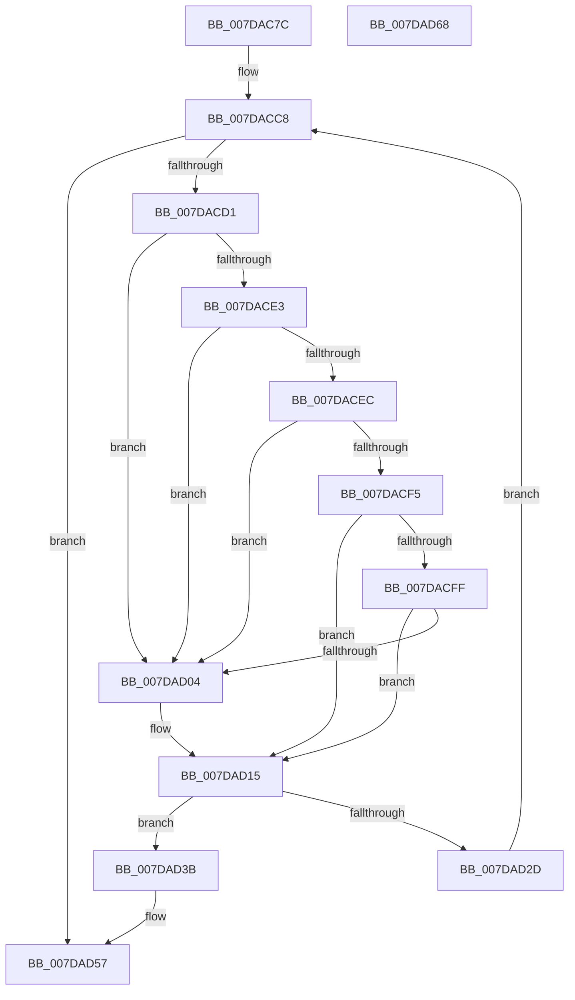

# CmpInitializeSystemHivesLoad

- RVA: `0x007DAC7C`–`0x007DAD69` (길이 `237` bytes)
- VA: `0x00000001407DAC7C`
- 실행 섹션: `PAGE`
- PDB 이름 있음: `예`; PDB Function 태그: `아니요`
- unwind 정보 RVA: `0x000D6538`
- 디코드: `61`개 명령, `237/237` bytes 표시
- 미해석 바이트: `0` (있으면 어셈블리에 `.byte`로 보존)

> 이 문서는 커널 이미지의 기계어와 PDB 기호를 분석해 생성했습니다. 4번과 5번은 함수 원형과 자료형을 바이너리 사용 방식에서 추정한 C 해석이며 원본 소스 복구 결과는 아닙니다.

## 1. Dependencies

- 직접 호출 지점: **6**; 고유 호출 대상: **5**
- 직접 호출자로 확인된 함수: **1**
- RIP 상대 이미지 참조: **7**

### Outgoing calls
- `0x007DACA7` → [KeInitializeEvent](../../text/40/KeInitializeEvent_function_0040DD10.md) (function, `0x0040DD10`)
- `0x007DACBA` → [KeInitializeEvent](../../text/40/KeInitializeEvent_function_0040DD10.md) (function, `0x0040DD10`)
- `0x007DAD10` → [KeSetEvent](../../text/33/KeSetEvent_function_0033F310.md) (function, `0x0033F310`)
- `0x007DAD24` → [CmpCreateRegistryThread](../7E/CmpCreateRegistryThread_function_007E80D0.md) (function, `0x007E80D0`)
- `0x007DAD32` → [ZwClose](../../text/6A/ZwClose_function_006AD2B0.md) (function, `0x006AD2B0`)
- `0x007DAD51` → [KeBugCheckEx](../../text/4F/KeBugCheckEx_function_004FD660.md) (function, `0x004FD660`)

### Direct callers
- [CmCompleteRegistryInitialization](CmCompleteRegistryInitialization_function_007DF1EC.md) at `0x007DF25A`

### Static image references
- `0x007DAC92` → RVA `0x00EF7C40` (`.data`; read)
- `0x007DAC9C` → RVA `0x00FD8001` (`PAGEDATA`; write)
- `0x007DACAF` → RVA `0x00EF7C20` (`.data`; read)
- `0x007DACC1` → RVA `0x00E098A0` (`.data`; read)
- `0x007DACE3` → RVA `0x00EEFB68` (`.data`; read)
- `0x007DACEC` → RVA `0x00FD8016` (`PAGEDATA`; read)
- `0x007DAD18` → RVA `0x007DB040` (`CmpLoadHiveThread`; read)

## 2. Other-region calls and transfers

- 다른 실행 섹션으로 향하는 call: **5**
  - `0x007DACA7` → [KeInitializeEvent](../../text/40/KeInitializeEvent_function_0040DD10.md) (`PAGE` → `.text`)
  - `0x007DACBA` → [KeInitializeEvent](../../text/40/KeInitializeEvent_function_0040DD10.md) (`PAGE` → `.text`)
  - `0x007DAD10` → [KeSetEvent](../../text/33/KeSetEvent_function_0033F310.md) (`PAGE` → `.text`)
  - `0x007DAD32` → [ZwClose](../../text/6A/ZwClose_function_006AD2B0.md) (`PAGE` → `.text`)
  - `0x007DAD51` → [KeBugCheckEx](../../text/4F/KeBugCheckEx_function_004FD660.md) (`PAGE` → `.text`)
- 별도 외부 분기/꼬리 이동을 확인하지 못했습니다.

## 3. Assembly (complete function range)

```asm
007DAC7C  48 89 5C 24 10                  mov qword ptr [rsp + 0x10], rbx
007DAC81  48 89 7C 24 18                  mov qword ptr [rsp + 0x18], rdi
007DAC86  41 56                           push r14
007DAC88  48 83 EC 30                     sub rsp, 0x30
007DAC8C  48 83 64 24 40 00               and qword ptr [rsp + 0x40], 0
007DAC92  48 8D 0D A7 CF 71 00            lea rcx, [rip + 0x71cfa7]
007DAC99  45 33 C0                        xor r8d, r8d
007DAC9C  C6 05 5E D3 7F 00 00            mov byte ptr [rip + 0x7fd35e], 0
007DACA3  41 8D 50 01                     lea edx, [r8 + 1]
007DACA7  E8 64 30 C3 FF                  call 0x14040dd10
007DACAC  45 33 C0                        xor r8d, r8d
007DACAF  48 8D 0D 6A CF 71 00            lea rcx, [rip + 0x71cf6a]
007DACB6  41 8D 50 01                     lea edx, [r8 + 1]
007DACBA  E8 51 30 C3 FF                  call 0x14040dd10
007DACBF  33 DB                           xor ebx, ebx
007DACC1  4C 8D 35 D8 EB 62 00            lea r14, [rip + 0x62ebd8]
007DACC8  83 FB 07                        cmp ebx, 7
007DACCB  0F 83 86 00 00 00               jae 0x1407dad57
007DACD1  8B FB                           mov edi, ebx
007DACD3  48 69 CF B8 00 00 00            imul rcx, rdi, 0xb8
007DACDA  42 8B 44 31 20                  mov eax, dword ptr [rcx + r14 + 0x20]
007DACDF  A8 01                           test al, 1
007DACE1  75 21                           jne 0x1407dad04
007DACE3  80 3D 7E 4E 71 00 00            cmp byte ptr [rip + 0x714e7e], 0
007DACEA  75 18                           jne 0x1407dad04
007DACEC  80 3D 23 D3 7F 00 00            cmp byte ptr [rip + 0x7fd323], 0
007DACF3  75 0F                           jne 0x1407dad04
007DACF5  8D 43 FE                        lea eax, [rbx - 2]
007DACF8  A9 FA FF FF FF                  test eax, 0xfffffffa
007DACFD  75 16                           jne 0x1407dad15
007DACFF  83 FB 07                        cmp ebx, 7
007DAD02  74 11                           je 0x1407dad15
007DAD04  48 83 C1 40                     add rcx, 0x40
007DAD08  45 33 C0                        xor r8d, r8d
007DAD0B  49 03 CE                        add rcx, r14
007DAD0E  33 D2                           xor edx, edx
007DAD10  E8 FB 45 B6 FF                  call 0x14033f310
007DAD15  4C 8B CF                        mov r9, rdi
007DAD18  4C 8D 05 21 03 00 00            lea r8, [rip + 0x321]
007DAD1F  48 8D 4C 24 40                  lea rcx, [rsp + 0x40]
007DAD24  E8 A7 D3 00 00                  call 0x1407e80d0
007DAD29  85 C0                           test eax, eax
007DAD2B  78 0E                           js 0x1407dad3b
007DAD2D  48 8B 4C 24 40                  mov rcx, qword ptr [rsp + 0x40]
007DAD32  E8 79 25 ED FF                  call 0x1406ad2b0
007DAD37  FF C3                           inc ebx
007DAD39  EB 8D                           jmp 0x1407dacc8
007DAD3B  BA 02 00 00 00                  mov edx, 2
007DAD40  48 98                           cdqe
007DAD42  4C 8B CF                        mov r9, rdi
007DAD45  48 89 44 24 20                  mov qword ptr [rsp + 0x20], rax
007DAD4A  8D 4A 72                        lea ecx, [rdx + 0x72]
007DAD4D  44 8D 42 01                     lea r8d, [rdx + 1]
007DAD51  E8 0A 29 D2 FF                  call 0x1404fd660
007DAD56  CC                              int3
007DAD57  48 8B 5C 24 48                  mov rbx, qword ptr [rsp + 0x48]
007DAD5C  48 8B 7C 24 50                  mov rdi, qword ptr [rsp + 0x50]
007DAD61  48 83 C4 30                     add rsp, 0x30
007DAD65  41 5E                           pop r14
007DAD67  C3                              ret
007DAD68  CC                              int3
```

## 4. C-style interpretation (structured pseudocode)

```c
__int64 __fastcall CmpInitializeSystemHivesLoad(__int64 a1, __int64 a2, int a3)
{
    __int64 result;
    __int64 v_rbx;
    __int64 v_rsp;
    unsigned __int64 v_stack_m18;
    unsigned __int64 v_stack_p10;
    unsigned __int64 v_stack_p18;
    unsigned __int64 v_stack_p8;

    v_stack_p10 = v_rbx;
    v_stack_p18 = v_rdi;
    v_rsp = (v_rsp) - (48);
    a3 = 0;
    *(unsigned __int8 *)(v_rip + 8377182) = 0;
    result = KeInitializeEvent(v_rip + 7458727, a3 + 1, a3, a4);
    a3 = 0;
    result = KeInitializeEvent(v_rip + 7458666, a3 + 1, a3, a4);
    v_rbx = 0;
loc_007DACC8:
    if (0 >= 7) goto loc_007DAD57;
    a1 = (v_rip + 7458666) * (0);
    if ((((unsigned __int8)((unsigned int)(*(unsigned int *)(a1 + v_rip + 6482904 * 1 + 32)))) & (1)) != 0) goto loc_007DAD04;
    if ((*(unsigned __int8 *)(v_rip + 7425662)) != 0) goto loc_007DAD04;
    if ((*(unsigned __int8 *)(v_rip + 8377123)) != 0) goto loc_007DAD04;
    if ((((unsigned int)(v_rbx - 2)) & (0xFFFFFFFAULL)) != 0) goto loc_007DAD15;
    result = v_rbx - 2;
    if (0 != 7) {
        a1 = (a1) + (64);
        a3 = 0;
        a1 = (a1) + (v_rip + 6482904);
        a2 = 0;
        result = KeSetEvent(a1, a2, a3, a4);
    }
    result = CmpCreateRegistryThread(v_stack_p8, a2, v_rip + 801, 0);
    if (sign_flag) goto loc_007DAD3B;
    result = ZwClose(v_stack_p8, a2, v_rip + 801, 0);
    v_rbx = (unsigned int)((v_rbx) + 1);
    goto loc_007DACC8;
loc_007DAD3B:
    v_stack_m18 = result;
    result = KeBugCheckEx(2 + 114, 2, 2 + 1, 0);
loc_007DAD57:
    v_rsp = (v_rsp) + (48);
    return result;
}
```

## 5. (Beta) C Style

```c
int64_t CmpInitializeSystemHivesLoad(int64_t Arg1, int64_t Arg2, int32_t Arg3)
{
    int64_t result;
    int64_t local_rbx;
    int64_t local_rsp;
    uint64_t v_stack_m18;
    uint64_t v_stack_p10;
    uint64_t v_stack_p18;
    uint64_t v_stack_p8;

    v_stack_p10 = local_rbx;
    v_stack_p18 = local_rdi;
    local_rsp = (local_rsp) - (48);
    Arg3 = 0;
    *(uint8_t *)(v_rip + 0x7FD35E) = 0;
    result = KeInitializeEvent(v_rip + 7458727, Arg3 + 1, Arg3, a4);
    Arg3 = 0;
    result = KeInitializeEvent(v_rip + 7458666, Arg3 + 1, Arg3, a4);
    local_rbx = 0;
loc_007DACC8:
    if (0 >= 7) goto loc_007DAD57;
    Arg1 = (v_rip + 7458666) * (0);
    if ((((uint8_t)((uint32_t)(*(uint32_t *)(Arg1 + v_rip + 0x62EBD8 * 1 + 0x20)))) & (1)) != 0) goto loc_007DAD04;
    if ((*(uint8_t *)(v_rip + 0x714E7E)) != 0) goto loc_007DAD04;
    if ((*(uint8_t *)(v_rip + 0x7FD323)) != 0) goto loc_007DAD04;
    if ((((uint32_t)(local_rbx - 2)) & (0xFFFFFFFAULL)) != 0) goto loc_007DAD15;
    result = local_rbx - 2;
    if (0 != 7) {
        Arg1 = (Arg1) + (64);
        Arg3 = 0;
        Arg1 = (Arg1) + (v_rip + 6482904);
        Arg2 = 0;
        result = KeSetEvent(Arg1, Arg2, Arg3, a4);
    }
    result = CmpCreateRegistryThread(v_stack_p8, Arg2, v_rip + 801, 0);
    if (sign_flag) goto loc_007DAD3B;
    result = ZwClose(v_stack_p8, Arg2, v_rip + 801, 0);
    local_rbx = (uint32_t)((local_rbx) + 1);
    goto loc_007DACC8;
loc_007DAD3B:
    v_stack_m18 = result;
    result = KeBugCheckEx(2 + 114, 2, 2 + 1, 0);
loc_007DAD57:
    local_rsp = (local_rsp) + (48);
    return result;
}
```

## 6. Execution-region graph

[열기: 2D/3D 그래프와 함수 탐색 컨트롤 패널](../../../control-panel.html?section=page&rva=0x007DAC7C&view=graph)

- 2D 그래프는 위에서 아래로 흐르고, 3D 그래프는 빈 공간을 드래그해 회전합니다. Shift+드래그는 이동, 휠은 확대·축소, 함수 노드 선택은 대상 보고서 이동입니다.

### Static fallback


