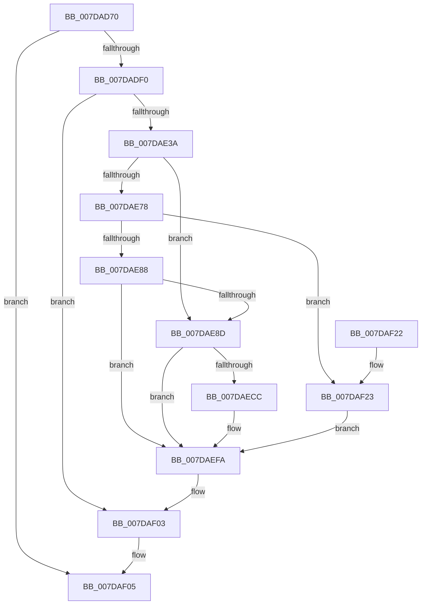

# CmpInterlockedFunction

- RVA: `0x007DAD70`–`0x007DAF2A` (길이 `442` bytes)
- VA: `0x00000001407DAD70`
- 실행 섹션: `PAGE`
- PDB 이름 있음: `예`; PDB Function 태그: `아니요`
- unwind 정보 RVA: `0x000D64C4`
- 디코드: `100`개 명령, `442/442` bytes 표시
- 미해석 바이트: `0` (있으면 어셈블리에 `.byte`로 보존)

> 이 문서는 커널 이미지의 기계어와 PDB 기호를 분석해 생성했습니다. 4번과 5번은 함수 원형과 자료형을 바이너리 사용 방식에서 추정한 C 해석이며 원본 소스 복구 결과는 아닙니다.

## 1. Dependencies

- 직접 호출 지점: **10**; 고유 호출 대상: **7**
- 직접 호출자로 확인된 함수: **1**
- RIP 상대 이미지 참조: **4**

### Outgoing calls
- `0x007DADE3` → [ZwOpenKey](../../text/6A/ZwOpenKey_function_006AD310.md) (function, `0x006AD310`)
- `0x007DAE22` → [ZwOpenKey](../../text/6A/ZwOpenKey_function_006AD310.md) (function, `0x006AD310`)
- `0x007DAE2D` → [ZwClose](../../text/6A/ZwClose_function_006AD2B0.md) (function, `0x006AD2B0`)
- `0x007DAE45` → [RtlInitUnicodeString](../../text/42/RtlInitUnicodeString_function_0042A780.md) (function, `0x0042A780`)
- `0x007DAE6D` → [ZwQueryValueKey](../../text/6A/ZwQueryValueKey_function_006AD3B0.md) (function, `0x006AD3B0`)
- `0x007DAEB6` → [ZwSetValueKey](../../text/6A/ZwSetValueKey_function_006ADCD0.md) (function, `0x006ADCD0`)
- `0x007DAEBF` → [ZwFlushKey](../../text/6A/ZwFlushKey_function_006AEF10.md) (function, `0x006AEF10`)
- `0x007DAEF5` → [ZwSetValueKey](../../text/6A/ZwSetValueKey_function_006ADCD0.md) (function, `0x006ADCD0`)
- `0x007DAEFE` → [ZwClose](../../text/6A/ZwClose_function_006AD2B0.md) (function, `0x006AD2B0`)
- `0x007DAF0C` → [_security_check_cookie](../../text/6A/_security_check_cookie_function_006AC640.md) (function, `0x006AC640`)

### Direct callers
- [CmpFinishSystemHivesLoad](CmpFinishSystemHivesLoad_function_007DA210.md) at `0x007DA642`
- [CmpFinishSystemHivesLoad](CmpFinishSystemHivesLoad_function_007DA210.md) at `0x007DAADD`

### Static image references
- `0x007DAD82` → RVA `0x00E0A740` (`.data`; read)
- `0x007DAD94` → RVA `0x00FD9EF8` (`PAGEDATA`; read)
- `0x007DAE00` → RVA `0x00B4BD48` (`CmpControlSessionManagerPathString`; read)
- `0x007DAE3A` → RVA `0x00B57500` (` ?? ::LBKOJDO::`string'`; read)

## 2. Other-region calls and transfers

- 다른 실행 섹션으로 향하는 call: **10**
  - `0x007DADE3` → [ZwOpenKey](../../text/6A/ZwOpenKey_function_006AD310.md) (`PAGE` → `.text`)
  - `0x007DAE22` → [ZwOpenKey](../../text/6A/ZwOpenKey_function_006AD310.md) (`PAGE` → `.text`)
  - `0x007DAE2D` → [ZwClose](../../text/6A/ZwClose_function_006AD2B0.md) (`PAGE` → `.text`)
  - `0x007DAE45` → [RtlInitUnicodeString](../../text/42/RtlInitUnicodeString_function_0042A780.md) (`PAGE` → `.text`)
  - `0x007DAE6D` → [ZwQueryValueKey](../../text/6A/ZwQueryValueKey_function_006AD3B0.md) (`PAGE` → `.text`)
  - `0x007DAEB6` → [ZwSetValueKey](../../text/6A/ZwSetValueKey_function_006ADCD0.md) (`PAGE` → `.text`)
  - `0x007DAEBF` → [ZwFlushKey](../../text/6A/ZwFlushKey_function_006AEF10.md) (`PAGE` → `.text`)
  - `0x007DAEF5` → [ZwSetValueKey](../../text/6A/ZwSetValueKey_function_006ADCD0.md) (`PAGE` → `.text`)
  - `0x007DAEFE` → [ZwClose](../../text/6A/ZwClose_function_006AD2B0.md) (`PAGE` → `.text`)
  - `0x007DAF0C` → [_security_check_cookie](../../text/6A/_security_check_cookie_function_006AC640.md) (`PAGE` → `.text`)
- 별도 외부 분기/꼬리 이동을 확인하지 못했습니다.

## 3. Assembly (complete function range)

```asm
007DAD70  48 89 5C 24 08                  mov qword ptr [rsp + 8], rbx
007DAD75  55                              push rbp
007DAD76  48 8D 6C 24 A9                  lea rbp, [rsp - 0x57]
007DAD7B  48 81 EC B0 00 00 00            sub rsp, 0xb0
007DAD82  48 8B 05 B7 F9 62 00            mov rax, qword ptr [rip + 0x62f9b7]
007DAD89  48 33 C4                        xor rax, rsp
007DAD8C  48 89 45 4F                     mov qword ptr [rbp + 0x4f], rax
007DAD90  83 65 23 00                     and dword ptr [rbp + 0x23], 0
007DAD94  48 8D 05 5D F1 7F 00            lea rax, [rip + 0x7ff15d]
007DAD9B  48 83 65 EF 00                  and qword ptr [rbp - 0x11], 0
007DADA0  4C 8D 45 07                     lea r8, [rbp + 7]
007DADA4  48 83 65 DF 00                  and qword ptr [rbp - 0x21], 0
007DADA9  48 8D 4D EF                     lea rcx, [rbp - 0x11]
007DADAD  83 65 E7 00                     and dword ptr [rbp - 0x19], 0
007DADB1  0F 57 C0                        xorps xmm0, xmm0
007DADB4  48 83 65 0F 00                  and qword ptr [rbp + 0xf], 0
007DADB9  BA 1F 00 02 00                  mov edx, 0x2001f
007DADBE  48 C7 45 07 30 00 00 00         mov qword ptr [rbp + 7], 0x30
007DADC6  BB 30 00 00 00                  mov ebx, 0x30
007DADCB  83 65 0B 00                     and dword ptr [rbp + 0xb], 0
007DADCF  0F 11 45 F7                     movups xmmword ptr [rbp - 9], xmm0
007DADD3  48 89 45 17                     mov qword ptr [rbp + 0x17], rax
007DADD7  F3 0F 7F 45 27                  movdqu xmmword ptr [rbp + 0x27], xmm0
007DADDC  C7 45 1F 40 02 00 00            mov dword ptr [rbp + 0x1f], 0x240
007DADE3  E8 28 25 ED FF                  call 0x1406ad310
007DADE8  85 C0                           test eax, eax
007DADEA  0F 88 15 01 00 00               js 0x1407daf05
007DADF0  48 8B 45 EF                     mov rax, qword ptr [rbp - 0x11]
007DADF4  4C 8D 45 07                     lea r8, [rbp + 7]
007DADF8  48 89 45 0F                     mov qword ptr [rbp + 0xf], rax
007DADFC  48 8D 4D DF                     lea rcx, [rbp - 0x21]
007DAE00  48 8D 05 41 0F 37 00            lea rax, [rip + 0x370f41]
007DAE07  89 5D 07                        mov dword ptr [rbp + 7], ebx
007DAE0A  0F 57 C0                        xorps xmm0, xmm0
007DAE0D  48 89 45 17                     mov qword ptr [rbp + 0x17], rax
007DAE11  BA 1F 00 02 00                  mov edx, 0x2001f
007DAE16  C7 45 1F 40 02 00 00            mov dword ptr [rbp + 0x1f], 0x240
007DAE1D  F3 0F 7F 45 27                  movdqu xmmword ptr [rbp + 0x27], xmm0
007DAE22  E8 E9 24 ED FF                  call 0x1406ad310
007DAE27  48 8B 4D EF                     mov rcx, qword ptr [rbp - 0x11]
007DAE2B  8B D8                           mov ebx, eax
007DAE2D  E8 7E 24 ED FF                  call 0x1406ad2b0
007DAE32  85 DB                           test ebx, ebx
007DAE34  0F 88 C9 00 00 00               js 0x1407daf03
007DAE3A  48 8D 15 BF C6 37 00            lea rdx, [rip + 0x37c6bf]
007DAE41  48 8D 4D F7                     lea rcx, [rbp - 9]
007DAE45  E8 36 F9 C4 FF                  call 0x14042a780
007DAE4A  48 8B 4D DF                     mov rcx, qword ptr [rbp - 0x21]
007DAE4E  48 8D 45 E7                     lea rax, [rbp - 0x19]
007DAE52  48 89 44 24 28                  mov qword ptr [rsp + 0x28], rax
007DAE57  4C 8D 4D 37                     lea r9, [rbp + 0x37]
007DAE5B  41 B8 02 00 00 00               mov r8d, 2
007DAE61  C7 44 24 20 14 00 00 00         mov dword ptr [rsp + 0x20], 0x14
007DAE69  48 8D 55 F7                     lea rdx, [rbp - 9]
007DAE6D  E8 3E 25 ED FF                  call 0x1406ad3b0
007DAE72  8B D8                           mov ebx, eax
007DAE74  85 C0                           test eax, eax
007DAE76  78 15                           js 0x1407dae8d
007DAE78  0F B6 4D 43                     movzx ecx, byte ptr [rbp + 0x43]
007DAE7C  89 4D D7                        mov dword ptr [rbp - 0x29], ecx
007DAE7F  83 F9 01                        cmp ecx, 1
007DAE82  0F 84 9B 00 00 00               je 0x1407daf23
007DAE88  83 F9 02                        cmp ecx, 2
007DAE8B  74 6D                           je 0x1407daefa
007DAE8D  48 8B 4D DF                     mov rcx, qword ptr [rbp - 0x21]
007DAE91  48 8D 45 D7                     lea rax, [rbp - 0x29]
007DAE95  C7 44 24 28 04 00 00 00         mov dword ptr [rsp + 0x28], 4
007DAE9D  48 8D 55 F7                     lea rdx, [rbp - 9]
007DAEA1  41 B9 04 00 00 00               mov r9d, 4
007DAEA7  48 89 44 24 20                  mov qword ptr [rsp + 0x20], rax
007DAEAC  45 33 C0                        xor r8d, r8d
007DAEAF  C7 45 D7 01 00 00 00            mov dword ptr [rbp - 0x29], 1
007DAEB6  E8 15 2E ED FF                  call 0x1406adcd0
007DAEBB  48 8B 4D DF                     mov rcx, qword ptr [rbp - 0x21]
007DAEBF  E8 4C 40 ED FF                  call 0x1406aef10
007DAEC4  8B 4D D7                        mov ecx, dword ptr [rbp - 0x29]
007DAEC7  83 F9 02                        cmp ecx, 2
007DAECA  74 2E                           je 0x1407daefa
007DAECC  48 8B 4D DF                     mov rcx, qword ptr [rbp - 0x21]
007DAED0  48 8D 45 D7                     lea rax, [rbp - 0x29]
007DAED4  C7 44 24 28 04 00 00 00         mov dword ptr [rsp + 0x28], 4
007DAEDC  48 8D 55 F7                     lea rdx, [rbp - 9]
007DAEE0  41 B9 04 00 00 00               mov r9d, 4
007DAEE6  48 89 44 24 20                  mov qword ptr [rsp + 0x20], rax
007DAEEB  45 33 C0                        xor r8d, r8d
007DAEEE  C7 45 D7 02 00 00 00            mov dword ptr [rbp - 0x29], 2
007DAEF5  E8 D6 2D ED FF                  call 0x1406adcd0
007DAEFA  48 8B 4D DF                     mov rcx, qword ptr [rbp - 0x21]
007DAEFE  E8 AD 23 ED FF                  call 0x1406ad2b0
007DAF03  8B C3                           mov eax, ebx
007DAF05  48 8B 4D 4F                     mov rcx, qword ptr [rbp + 0x4f]
007DAF09  48 33 CC                        xor rcx, rsp
007DAF0C  E8 2F 17 ED FF                  call 0x1406ac640
007DAF11  48 8B 9C 24 C0 00 00 00         mov rbx, qword ptr [rsp + 0xc0]
007DAF19  48 81 C4 B0 00 00 00            add rsp, 0xb0
007DAF20  5D                              pop rbp
007DAF21  C3                              ret
007DAF22  CC                              int3
007DAF23  BB 01 00 00 C0                  mov ebx, 0xc0000001
007DAF28  EB D0                           jmp 0x1407daefa
```

## 4. C-style interpretation (structured pseudocode)

```c
__int64 __fastcall CmpInterlockedFunction(void)
{
    __int64 result;
    __int64 v_rsp;
    unsigned __int64 v_stack_m10;
    unsigned __int8 v_stack_m1C;
    unsigned __int64 v_stack_m28;
    unsigned __int64 v_stack_m38;
    unsigned int v_stack_m3C;
    unsigned int v_stack_m40;
    unsigned __int64 v_stack_m48;
    unsigned __int64 v_stack_m50;
    unsigned int v_stack_m54;
    unsigned __int64 v_stack_m58;
    unsigned __int64 v_stack_m5F;
    unsigned __int64 v_stack_m68;
    unsigned __int64 v_stack_m70;
    unsigned int v_stack_m78;
    unsigned __int64 v_stack_m80;
    unsigned int v_stack_m88;
    unsigned __int64 v_stack_m90;
    unsigned int v_stack_m98;
    unsigned __int64 v_stack_p8;

    v_stack_p8 = v_rbx;
    v_rsp = (v_rsp) - (176);
    result = (*(unsigned __int64 *)(v_rip + 6486455)) ^ (v_rsp);
    v_stack_m10 = result;
    v_stack_m58 = 48;
    v_stack_m68 = v_xmm0;
    v_stack_m48 = v_rip + 8384861;
    v_stack_m38 = v_xmm0;
    v_stack_m40 = 576;
    result = ZwOpenKey(v_stack_m70, (unsigned int)(0x2001FULL), v_stack_m58, a4);
    if (sign_flag) goto loc_007DAF05;
    v_stack_m50 = v_stack_m70;
    v_stack_m58 = 48;
    v_stack_m48 = v_rip + 3608385;
    v_stack_m40 = 576;
    v_stack_m38 = v_xmm0;
    result = ZwOpenKey(v_stack_m80, (unsigned int)(0x2001FULL), v_stack_m58, a4);
    result = ZwClose(v_stack_m70, (unsigned int)(0x2001FULL), v_stack_m58, a4);
    if (sign_flag) goto loc_007DAF03;
    result = RtlInitUnicodeString(v_stack_m68, v_rip + 3655359, v_stack_m58, a4);
    v_stack_m90 = v_stack_m78;
    v_stack_m98 = 20;
    result = ZwQueryValueKey(v_stack_m80, v_stack_m68, 2, v_stack_m28);
    if (sign_flag) goto loc_007DAE8D;
    v_stack_m88 = (unsigned int)(v_stack_m1C);
    if (((unsigned int)(v_stack_m1C)) == 1) goto loc_007DAF23;
    if (((unsigned int)(v_stack_m1C)) == 2) goto loc_007DAEFA;
loc_007DAE8D:
    v_stack_m90 = 4;
    v_stack_m98 = v_stack_m88;
    a3 = 0;
    v_stack_m88 = 1;
    result = ZwSetValueKey(v_stack_m80, v_stack_m68, a3, 4);
    result = ZwFlushKey(v_stack_m80, v_stack_m68, a3, 4);
    if (((unsigned int)((unsigned int)(v_stack_m88))) != 2) {
        a1 = v_stack_m80;
        result = v_stack_m88;
        v_stack_m90 = 4;
        a2 = v_stack_m68;
        a4 = 4;
        v_stack_m98 = result;
        a3 = 0;
        v_stack_m88 = 2;
        result = ZwSetValueKey(a1, a2, a3, a4);
    }
    result = ZwClose(v_stack_m80, a2, a3, a4);
loc_007DAF03:
loc_007DAF05:
    a1 = (v_stack_m10) ^ (v_rsp);
    result = _security_check_cookie(a1, a2, a3, a4);
    v_rsp = (v_rsp) + (176);
    return result;
loc_007DAF23:
    goto loc_007DAEFA;
}
```

## 5. (Beta) C Style

```c
void CmpInterlockedFunction(void)
{
    int64_t result;
    int64_t local_rsp;
    uint64_t v_stack_m10;
    uint8_t v_stack_m1C;
    uint64_t v_stack_m28;
    uint64_t v_stack_m38;
    uint32_t v_stack_m3C;
    uint32_t v_stack_m40;
    uint64_t v_stack_m48;
    uint64_t v_stack_m50;
    uint32_t v_stack_m54;
    uint64_t v_stack_m58;
    uint64_t v_stack_m5F;
    uint64_t v_stack_m68;
    uint64_t v_stack_m70;
    uint32_t v_stack_m78;
    uint64_t v_stack_m80;
    uint32_t v_stack_m88;
    uint64_t v_stack_m90;
    uint32_t v_stack_m98;
    uint64_t v_stack_p8;

    v_stack_p8 = local_rbx;
    local_rsp = (local_rsp) - (176);
    result = (*(uint64_t *)(v_rip + 0x62F9B7)) ^ (local_rsp);
    v_stack_m10 = result;
    v_stack_m58 = 48;
    v_stack_m68 = v_xmm0;
    v_stack_m48 = v_rip + 8384861;
    v_stack_m38 = v_xmm0;
    v_stack_m40 = 576;
    result = ZwOpenKey(v_stack_m70, (uint32_t)(0x2001FULL), v_stack_m58, a4);
    if (sign_flag) goto loc_007DAF05;
    v_stack_m50 = v_stack_m70;
    v_stack_m58 = 48;
    v_stack_m48 = v_rip + 3608385;
    v_stack_m40 = 576;
    v_stack_m38 = v_xmm0;
    result = ZwOpenKey(v_stack_m80, (uint32_t)(0x2001FULL), v_stack_m58, a4);
    result = ZwClose(v_stack_m70, (uint32_t)(0x2001FULL), v_stack_m58, a4);
    if (sign_flag) goto loc_007DAF03;
    result = RtlInitUnicodeString(v_stack_m68, v_rip + 3655359, v_stack_m58, a4);
    v_stack_m90 = v_stack_m78;
    v_stack_m98 = 20;
    result = ZwQueryValueKey(v_stack_m80, v_stack_m68, 2, v_stack_m28);
    if (sign_flag) goto loc_007DAE8D;
    v_stack_m88 = (uint32_t)(v_stack_m1C);
    if (((uint32_t)(v_stack_m1C)) == 1) goto loc_007DAF23;
    if (((uint32_t)(v_stack_m1C)) == 2) goto loc_007DAEFA;
loc_007DAE8D:
    v_stack_m90 = 4;
    v_stack_m98 = v_stack_m88;
    a3 = 0;
    v_stack_m88 = 1;
    result = ZwSetValueKey(v_stack_m80, v_stack_m68, a3, 4);
    result = ZwFlushKey(v_stack_m80, v_stack_m68, a3, 4);
    if (((uint32_t)((uint32_t)(v_stack_m88))) != 2) {
        a1 = v_stack_m80;
        result = v_stack_m88;
        v_stack_m90 = 4;
        a2 = v_stack_m68;
        a4 = 4;
        v_stack_m98 = result;
        a3 = 0;
        v_stack_m88 = 2;
        result = ZwSetValueKey(a1, a2, a3, a4);
    }
    result = ZwClose(v_stack_m80, a2, a3, a4);
loc_007DAF03:
loc_007DAF05:
    a1 = (v_stack_m10) ^ (local_rsp);
    result = _security_check_cookie(a1, a2, a3, a4);
    local_rsp = (local_rsp) + (176);
    return result;
loc_007DAF23:
    goto loc_007DAEFA;
}
```

## 6. Execution-region graph

[열기: 2D/3D 그래프와 함수 탐색 컨트롤 패널](../../../control-panel.html?section=page&rva=0x007DAD70&view=graph)

- 2D 그래프는 위에서 아래로 흐르고, 3D 그래프는 빈 공간을 드래그해 회전합니다. Shift+드래그는 이동, 휠은 확대·축소, 함수 노드 선택은 대상 보고서 이동입니다.

### Static fallback


