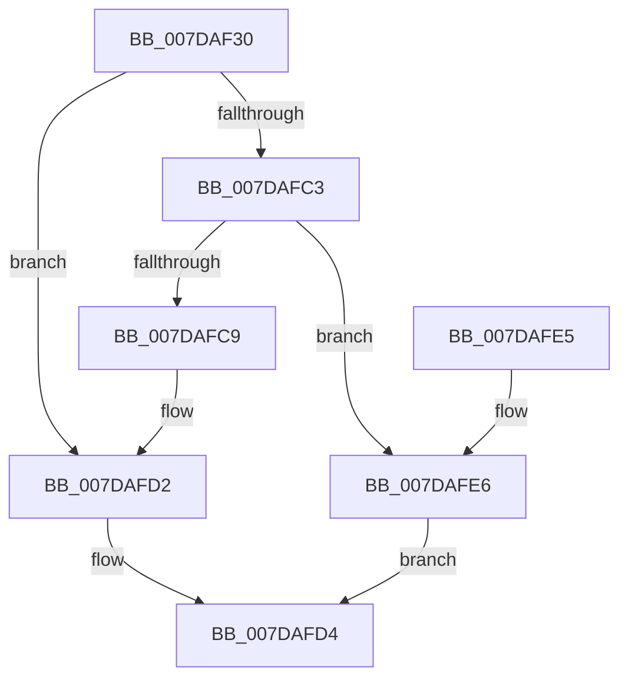

# CmpLinkKeyToHive

- RVA: `0x007DAF30`–`0x007DB02E` (길이 `254` bytes)
- VA: `0x00000001407DAF30`
- 실행 섹션: `PAGE`
- PDB 이름 있음: `예`; PDB Function 태그: `아니요`
- unwind 정보 RVA: `0x000D6388`
- 디코드: `64`개 명령, `254/254` bytes 표시
- 미해석 바이트: `0` (있으면 어셈블리에 `.byte`로 보존)

> 이 문서는 커널 이미지의 기계어와 PDB 기호를 분석해 생성했습니다. 4번과 5번은 함수 원형과 자료형을 바이너리 사용 방식에서 추정한 C 해석이며 원본 소스 복구 결과는 아닙니다.

## 1. Dependencies

- 직접 호출 지점: **6**; 고유 호출 대상: **4**
- 직접 호출자로 확인된 함수: **1**
- RIP 상대 이미지 참조: **1**

### Outgoing calls
- `0x007DAF6C` → [RtlInitUnicodeString](../../text/42/RtlInitUnicodeString_function_0042A780.md) (function, `0x0042A780`)
- `0x007DAFBA` → [ZwCreateKey](../../text/6A/ZwCreateKey_function_006AD470.md) (function, `0x006AD470`)
- `0x007DAFCD` → [ZwClose](../../text/6A/ZwClose_function_006AD2B0.md) (function, `0x006AD2B0`)
- `0x007DAFED` → [RtlInitUnicodeString](../../text/42/RtlInitUnicodeString_function_0042A780.md) (function, `0x0042A780`)
- `0x007DB017` → [ZwSetValueKey](../../text/6A/ZwSetValueKey_function_006ADCD0.md) (function, `0x006ADCD0`)
- `0x007DB022` → [ZwClose](../../text/6A/ZwClose_function_006AD2B0.md) (function, `0x006AD2B0`)

### Direct callers
- [CmpFinishSystemHivesLoad](CmpFinishSystemHivesLoad_function_007DA210.md) at `0x007DA85C`

### Static image references
- `0x007DAFF6` → RVA `0x00FD9C00` (`PAGEDATA`; read)

## 2. Other-region calls and transfers

- 다른 실행 섹션으로 향하는 call: **6**
  - `0x007DAF6C` → [RtlInitUnicodeString](../../text/42/RtlInitUnicodeString_function_0042A780.md) (`PAGE` → `.text`)
  - `0x007DAFBA` → [ZwCreateKey](../../text/6A/ZwCreateKey_function_006AD470.md) (`PAGE` → `.text`)
  - `0x007DAFCD` → [ZwClose](../../text/6A/ZwClose_function_006AD2B0.md) (`PAGE` → `.text`)
  - `0x007DAFED` → [RtlInitUnicodeString](../../text/42/RtlInitUnicodeString_function_0042A780.md) (`PAGE` → `.text`)
  - `0x007DB017` → [ZwSetValueKey](../../text/6A/ZwSetValueKey_function_006ADCD0.md) (`PAGE` → `.text`)
  - `0x007DB022` → [ZwClose](../../text/6A/ZwClose_function_006AD2B0.md) (`PAGE` → `.text`)
- 별도 외부 분기/꼬리 이동을 확인하지 못했습니다.

## 3. Assembly (complete function range)

```asm
007DAF30  48 89 5C 24 08                  mov qword ptr [rsp + 8], rbx
007DAF35  55                              push rbp
007DAF36  48 8D 6C 24 A9                  lea rbp, [rsp - 0x57]
007DAF3B  48 81 EC 90 00 00 00            sub rsp, 0x90
007DAF42  33 C0                           xor eax, eax
007DAF44  48 8B DA                        mov rbx, rdx
007DAF47  21 45 43                        and dword ptr [rbp + 0x43], eax
007DAF4A  48 8B D1                        mov rdx, rcx
007DAF4D  48 21 45 7F                     and qword ptr [rbp + 0x7f], rax
007DAF51  48 8D 4D 17                     lea rcx, [rbp + 0x17]
007DAF55  21 45 77                        and dword ptr [rbp + 0x77], eax
007DAF58  0F 57 C0                        xorps xmm0, xmm0
007DAF5B  0F 57 C9                        xorps xmm1, xmm1
007DAF5E  89 45 2B                        mov dword ptr [rbp + 0x2b], eax
007DAF61  21 45 2B                        and dword ptr [rbp + 0x2b], eax
007DAF64  0F 11 45 17                     movups xmmword ptr [rbp + 0x17], xmm0
007DAF68  0F 11 4D 07                     movups xmmword ptr [rbp + 7], xmm1
007DAF6C  E8 0F F8 C4 FF                  call 0x14042a780
007DAF71  48 83 65 2F 00                  and qword ptr [rbp + 0x2f], 0
007DAF76  48 8D 45 17                     lea rax, [rbp + 0x17]
007DAF7A  45 33 C9                        xor r9d, r9d
007DAF7D  48 89 45 37                     mov qword ptr [rbp + 0x37], rax
007DAF81  48 8D 45 77                     lea rax, [rbp + 0x77]
007DAF85  C7 45 27 30 00 00 00            mov dword ptr [rbp + 0x27], 0x30
007DAF8C  48 89 44 24 30                  mov qword ptr [rsp + 0x30], rax
007DAF91  4C 8D 45 27                     lea r8, [rbp + 0x27]
007DAF95  0F 57 C0                        xorps xmm0, xmm0
007DAF98  C7 44 24 28 03 00 00 00         mov dword ptr [rsp + 0x28], 3
007DAFA0  48 83 64 24 20 00               and qword ptr [rsp + 0x20], 0
007DAFA6  41 8D 51 20                     lea edx, [r9 + 0x20]
007DAFAA  48 8D 4D 7F                     lea rcx, [rbp + 0x7f]
007DAFAE  C7 45 3F 40 02 00 00            mov dword ptr [rbp + 0x3f], 0x240
007DAFB5  F3 0F 7F 45 47                  movdqu xmmword ptr [rbp + 0x47], xmm0
007DAFBA  E8 B1 24 ED FF                  call 0x1406ad470
007DAFBF  85 C0                           test eax, eax
007DAFC1  78 0F                           js 0x1407dafd2
007DAFC3  83 7D 77 01                     cmp dword ptr [rbp + 0x77], 1
007DAFC7  74 1D                           je 0x1407dafe6
007DAFC9  48 8B 4D 7F                     mov rcx, qword ptr [rbp + 0x7f]
007DAFCD  E8 DE 22 ED FF                  call 0x1406ad2b0
007DAFD2  32 C0                           xor al, al
007DAFD4  48 8B 9C 24 A0 00 00 00         mov rbx, qword ptr [rsp + 0xa0]
007DAFDC  48 81 C4 90 00 00 00            add rsp, 0x90
007DAFE3  5D                              pop rbp
007DAFE4  C3                              ret
007DAFE5  CC                              int3
007DAFE6  48 8B D3                        mov rdx, rbx
007DAFE9  48 8D 4D 07                     lea rcx, [rbp + 7]
007DAFED  E8 8E F7 C4 FF                  call 0x14042a780
007DAFF2  0F B7 45 07                     movzx eax, word ptr [rbp + 7]
007DAFF6  48 8D 15 03 EC 7F 00            lea rdx, [rip + 0x7fec03]
007DAFFD  48 8B 4D 7F                     mov rcx, qword ptr [rbp + 0x7f]
007DB001  41 B9 06 00 00 00               mov r9d, 6
007DB007  89 44 24 28                     mov dword ptr [rsp + 0x28], eax
007DB00B  45 33 C0                        xor r8d, r8d
007DB00E  48 8B 45 0F                     mov rax, qword ptr [rbp + 0xf]
007DB012  48 89 44 24 20                  mov qword ptr [rsp + 0x20], rax
007DB017  E8 B4 2C ED FF                  call 0x1406adcd0
007DB01C  48 8B 4D 7F                     mov rcx, qword ptr [rbp + 0x7f]
007DB020  8B D8                           mov ebx, eax
007DB022  E8 89 22 ED FF                  call 0x1406ad2b0
007DB027  85 DB                           test ebx, ebx
007DB029  0F 99 C0                        setns al
007DB02C  EB A6                           jmp 0x1407dafd4
```

## 4. C-style interpretation (structured pseudocode)

```c
__int64 __fastcall CmpLinkKeyToHive(__int64 a1, __int64 a2, __int64 a3, int a4)
{
    __int64 result;
    __int64 v_rsp;
    unsigned __int64 v_stack_m18;
    unsigned int v_stack_m1C;
    unsigned int v_stack_m20;
    unsigned __int64 v_stack_m28;
    unsigned __int64 v_stack_m30;
    unsigned int v_stack_m34;
    unsigned int v_stack_m38;
    unsigned __int64 v_stack_m48;
    unsigned __int64 v_stack_m50;
    unsigned __int64 v_stack_m58;
    unsigned __int64 v_stack_m5F;
    unsigned __int64 v_stack_m68;
    unsigned int v_stack_m70;
    unsigned __int64 v_stack_m78;
    unsigned int v_stack_p18;
    unsigned __int64 v_stack_p20;
    unsigned int v_stack_p28;
    unsigned __int64 v_stack_p8;

    v_stack_p8 = v_rbx;
    v_rsp = (v_rsp) - (144);
    result = 0;
    v_stack_m34 = 0;
    v_stack_m48 = v_xmm0;
    v_stack_m58 = v_xmm1;
    result = RtlInitUnicodeString(v_stack_m48, a1, a3, a4);
    a4 = 0;
    v_stack_m28 = v_stack_m48;
    v_stack_m38 = 48;
    v_stack_m68 = v_stack_p18;
    v_stack_m70 = 3;
    v_stack_m20 = 576;
    v_stack_m18 = v_xmm0;
    result = ZwCreateKey(v_stack_p20, a4 + 32, v_stack_m38, a4);
    if (sign_flag) goto loc_007DAFD2;
    if (v_stack_p18 == 1) goto loc_007DAFE6;
    result = ZwClose(v_stack_p20, a4 + 32, v_stack_m38, a4);
loc_007DAFD2:
    result = 0;
loc_007DAFD4:
    v_rsp = (v_rsp) + (144);
    return result;
loc_007DAFE6:
    result = RtlInitUnicodeString(v_stack_m58, v_stack_p8, v_stack_m38, a4);
    v_stack_p28 = (unsigned int)(v_stack_m58);
    a3 = 0;
    v_stack_p20 = v_stack_m50;
    result = ZwSetValueKey(v_stack_p20, v_rip + 8383491, a3, 6);
    result = ZwClose(v_stack_p20, v_rip + 8383491, a3, 6);
    result = (!sign_flag) ? 1 : 0;
    goto loc_007DAFD4;
}
```

## 5. (Beta) C Style

```c
int64_t CmpLinkKeyToHive(int64_t Arg1, int64_t Arg2, int64_t Arg3, int32_t Arg4)
{
    int64_t result;
    int64_t local_rsp;
    uint64_t v_stack_m18;
    uint32_t v_stack_m1C;
    uint32_t v_stack_m20;
    uint64_t v_stack_m28;
    uint64_t v_stack_m30;
    uint32_t v_stack_m34;
    uint32_t v_stack_m38;
    uint64_t v_stack_m48;
    uint64_t v_stack_m50;
    uint64_t v_stack_m58;
    uint64_t v_stack_m5F;
    uint64_t v_stack_m68;
    uint32_t v_stack_m70;
    uint64_t v_stack_m78;
    uint32_t v_stack_p18;
    uint64_t v_stack_p20;
    uint32_t v_stack_p28;
    uint64_t v_stack_p8;

    v_stack_p8 = local_rbx;
    local_rsp = (local_rsp) - (144);
    result = 0;
    v_stack_m34 = 0;
    v_stack_m48 = v_xmm0;
    v_stack_m58 = v_xmm1;
    result = RtlInitUnicodeString(v_stack_m48, Arg1, Arg3, Arg4);
    Arg4 = 0;
    v_stack_m28 = v_stack_m48;
    v_stack_m38 = 48;
    v_stack_m68 = v_stack_p18;
    v_stack_m70 = 3;
    v_stack_m20 = 576;
    v_stack_m18 = v_xmm0;
    result = ZwCreateKey(v_stack_p20, Arg4 + 32, v_stack_m38, Arg4);
    if (sign_flag) goto loc_007DAFD2;
    if (v_stack_p18 == 1) goto loc_007DAFE6;
    result = ZwClose(v_stack_p20, Arg4 + 32, v_stack_m38, Arg4);
loc_007DAFD2:
    result = 0;
loc_007DAFD4:
    local_rsp = (local_rsp) + (144);
    return result;
loc_007DAFE6:
    result = RtlInitUnicodeString(v_stack_m58, v_stack_p8, v_stack_m38, Arg4);
    v_stack_p28 = (uint32_t)(v_stack_m58);
    Arg3 = 0;
    v_stack_p20 = v_stack_m50;
    result = ZwSetValueKey(v_stack_p20, v_rip + 8383491, Arg3, 6);
    result = ZwClose(v_stack_p20, v_rip + 8383491, Arg3, 6);
    result = (!sign_flag) ? 1 : 0;
    goto loc_007DAFD4;
}
```

## 6. Execution-region graph

[열기: 2D/3D 그래프와 함수 탐색 컨트롤 패널](../../../control-panel.html?section=page&rva=0x007DAF30&view=graph)

- 2D 그래프는 위에서 아래로 흐르고, 3D 그래프는 빈 공간을 드래그해 회전합니다. Shift+드래그는 이동, 휠은 확대·축소, 함수 노드 선택은 대상 보고서 이동입니다.

### Static fallback


