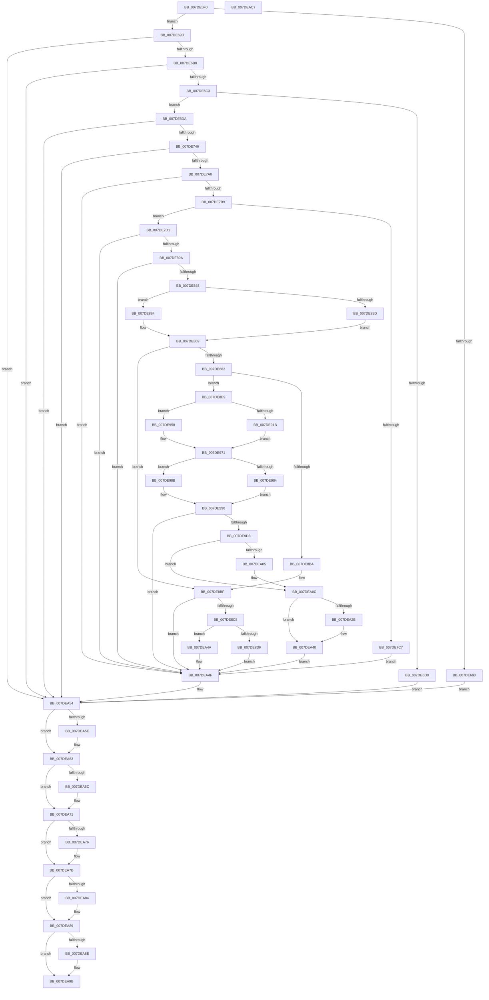

# CmpLoadHiveVolatile

- RVA: `0x007DE5F0`–`0x007DEAC8` (길이 `1,240` bytes)
- VA: `0x00000001407DE5F0`
- 실행 섹션: `PAGE`
- PDB 이름 있음: `예`; PDB Function 태그: `아니요`
- unwind 정보 RVA: `0x000D65C0`
- 디코드: `305`개 명령, `1,240/1,240` bytes 표시
- 미해석 바이트: `0` (있으면 어셈블리에 `.byte`로 보존)

> 이 문서는 커널 이미지의 기계어와 PDB 기호를 분석해 생성했습니다. 4번과 5번은 함수 원형과 자료형을 바이너리 사용 방식에서 추정한 C 해석이며 원본 소스 복구 결과는 아닙니다.

## 1. Dependencies

- 직접 호출 지점: **35**; 고유 호출 대상: **30**
- 직접 호출자로 확인된 함수: **1**
- RIP 상대 이미지 참조: **10**

### Outgoing calls
- `0x007DE664` → [memset](../../text/6C/memset_function_006C6C40.md) (function, `0x006C6C40`)
- `0x007DE674` → [RtlInitUnicodeString](../../text/42/RtlInitUnicodeString_function_0042A780.md) (function, `0x0042A780`)
- `0x007DE67E` → [HvpGetCellContextInitialize](../85/HvpGetCellContextInitialize_function_00855F10.md) (function, `0x00855F10`)
- `0x007DE687` → [CmpAcquireHiveLoadUnloadRundown](../../pagecmrc/BC/CmpAcquireHiveLoadUnloadRundown_function_00BC9C6C.md) (function, `0x00BC9C6C`)
- `0x007DE6A1` → [CmpUuidCreate](../AB/CmpUuidCreate_function_00AB81F8.md) (function, `0x00AB81F8`)
- `0x007DE6B4` → [CmpUuidCreate](../AB/CmpUuidCreate_function_00AB81F8.md) (function, `0x00AB81F8`)
- `0x007DE737` → [CmpCreateHive](../87/CmpCreateHive_function_00879DF0.md) (function, `0x00879DF0`)
- `0x007DE791` → [CmpCreateHive](../87/CmpCreateHive_function_00879DF0.md) (function, `0x00879DF0`)
- `0x007DE7A0` → [CmpLockRegistryExclusive](../84/CmpLockRegistryExclusive_function_0084F9B4.md) (function, `0x0084F9B4`)
- `0x007DE7AA` → [CmpPerformKeyBodyDeletionCheck](../../pagecmrc/BC/CmpPerformKeyBodyDeletionCheck_function_00BC97D0.md) (function, `0x00BC97D0`)
- `0x007DE7FB` → [CmpCopyKeyPartial](../85/CmpCopyKeyPartial_function_0085AFF4.md) (function, `0x0085AFF4`)
- `0x007DE839` → [CmpCopySyncTree](../7F/CmpCopySyncTree_function_007F21A0.md) (function, `0x007F21A0`)
- `0x007DE85D` → [HvpGetCellFlat](../85/HvpGetCellFlat_function_00854C60.md) (function, `0x00854C60`)
- `0x007DE864` → [HvpGetCellPaged](../85/HvpGetCellPaged_function_00854CB0.md) (function, `0x00854CB0`)
- `0x007DE873` → [CmpConstructNameWithStatus](../85/CmpConstructNameWithStatus_function_008562A0.md) (function, `0x008562A0`)
- `0x007DE8AC` → [CmpAllocatePool](../../text/3C/CmpAllocatePool_function_003CD504.md) (function, `0x003CD504`)
- `0x007DE8DF` → [HvpReleaseCellFlat](../85/HvpReleaseCellFlat_function_0085CC20.md) (function, `0x0085CC20`)
- `0x007DE8F8` → [RtlCopyUnicodeString](../../text/3F/RtlCopyUnicodeString_function_003FEF30.md) (function, `0x003FEF30`)
- `0x007DE908` → [RtlAppendUnicodeToString](../../text/40/RtlAppendUnicodeToString_function_0040F990.md) (function, `0x0040F990`)
- `0x007DE93B` → [CmpCopyCompressedName](../84/CmpCopyCompressedName_function_0084E0D0.md) (function, `0x0084E0D0`)
- `0x007DE96C` → [RtlAppendUnicodeStringToString](../../text/40/RtlAppendUnicodeStringToString_function_0040FA50.md) (function, `0x0040FA50`)
- `0x007DE984` → [HvpReleaseCellFlat](../85/HvpReleaseCellFlat_function_0085CC20.md) (function, `0x0085CC20`)
- `0x007DE98B` → [HvpReleaseCellPaged](../85/HvpReleaseCellPaged_function_00855F40.md) (function, `0x00855F40`)
- `0x007DE9CD` → [CmpLinkHiveToMaster](../87/CmpLinkHiveToMaster_function_00877D6C.md) (function, `0x00877D6C`)
- `0x007DE9DD` → [CmpAddToHiveFileList](../A8/CmpAddToHiveFileList_function_00A81914.md) (function, `0x00A81914`)
- `0x007DE9E2` → [CmpLockHiveListExclusive](../A7/CmpLockHiveListExclusive_function_00A72240.md) (function, `0x00A72240`)
- `0x007DEA1D` → [CmpUnlockHiveList](../84/CmpUnlockHiveList_function_0084E424.md) (function, `0x0084E424`)
- `0x007DEA4A` → [HvpReleaseCellPaged](../85/HvpReleaseCellPaged_function_00855F40.md) (function, `0x00855F40`)
- `0x007DEA4F` → [CmpUnlockRegistry](../../pagecmrc/BC/CmpUnlockRegistry_function_00BC9A84.md) (function, `0x00BC9A84`)
- `0x007DEA5E` → [CmpDestroyHive](../9B/CmpDestroyHive_function_009B1708.md) (function, `0x009B1708`)
- `0x007DEA6C` → [CmpDestroyHive](../9B/CmpDestroyHive_function_009B1708.md) (function, `0x009B1708`)
- `0x007DEA76` → [CmpReleaseHiveLoadUnloadRundown](../../pagecmrc/BC/CmpReleaseHiveLoadUnloadRundown_function_00BC9CAC.md) (function, `0x00BC9CAC`)
- `0x007DEA84` → [CmSiFreeMemory](../../text/47/CmSiFreeMemory_function_00475D80.md) (function, `0x00475D80`)
- `0x007DEA96` → [CmpFreePoolWithTag](../../text/44/CmpFreePoolWithTag_function_004489E0.md) (function, `0x004489E0`)
- `0x007DEAA7` → [_security_check_cookie](../../text/6A/_security_check_cookie_function_006AC640.md) (function, `0x006AC640`)

### Direct callers
- [CmRestoreKey](CmRestoreKey_function_007DCF04.md) at `0x007DD033`

### Static image references
- `0x007DE60F` → RVA `0x00E0A740` (`.data`; read)
- `0x007DE6C7` → RVA `0x00FD9A90` (`PAGEDATA`; read)
- `0x007DE8FD` → RVA `0x00AFC990` (` ?? ::NNGAKEGL::`string'`; read)
- `0x007DE9E7` → RVA `0x00FD9D20` (`PAGEDATA`; read)
- `0x007DE9EE` → RVA `0x00FD9D18` (`PAGEDATA`; read)
- `0x007DEA16` → RVA `0x00FD9D20` (`PAGEDATA`; write)
- `0x007DEA22` → RVA `0x00FD9A62` (`PAGEDATA`; read)
- `0x007DEA2B` → RVA `0x00FD8060` (`PAGEDATA`; read)
- `0x007DEA32` → RVA `0x00FD81C0` (`PAGEDATA`; write)
- `0x007DEA39` → RVA `0x00FD9A62` (`PAGEDATA`; write)

## 2. Other-region calls and transfers

- 다른 실행 섹션으로 향하는 call: **13**
  - `0x007DE664` → [memset](../../text/6C/memset_function_006C6C40.md) (`PAGE` → `.text`)
  - `0x007DE674` → [RtlInitUnicodeString](../../text/42/RtlInitUnicodeString_function_0042A780.md) (`PAGE` → `.text`)
  - `0x007DE687` → [CmpAcquireHiveLoadUnloadRundown](../../pagecmrc/BC/CmpAcquireHiveLoadUnloadRundown_function_00BC9C6C.md) (`PAGE` → `PAGECMRC`)
  - `0x007DE7AA` → [CmpPerformKeyBodyDeletionCheck](../../pagecmrc/BC/CmpPerformKeyBodyDeletionCheck_function_00BC97D0.md) (`PAGE` → `PAGECMRC`)
  - `0x007DE8AC` → [CmpAllocatePool](../../text/3C/CmpAllocatePool_function_003CD504.md) (`PAGE` → `.text`)
  - `0x007DE8F8` → [RtlCopyUnicodeString](../../text/3F/RtlCopyUnicodeString_function_003FEF30.md) (`PAGE` → `.text`)
  - `0x007DE908` → [RtlAppendUnicodeToString](../../text/40/RtlAppendUnicodeToString_function_0040F990.md) (`PAGE` → `.text`)
  - `0x007DE96C` → [RtlAppendUnicodeStringToString](../../text/40/RtlAppendUnicodeStringToString_function_0040FA50.md) (`PAGE` → `.text`)
  - `0x007DEA4F` → [CmpUnlockRegistry](../../pagecmrc/BC/CmpUnlockRegistry_function_00BC9A84.md) (`PAGE` → `PAGECMRC`)
  - `0x007DEA76` → [CmpReleaseHiveLoadUnloadRundown](../../pagecmrc/BC/CmpReleaseHiveLoadUnloadRundown_function_00BC9CAC.md) (`PAGE` → `PAGECMRC`)
  - `0x007DEA84` → [CmSiFreeMemory](../../text/47/CmSiFreeMemory_function_00475D80.md) (`PAGE` → `.text`)
  - `0x007DEA96` → [CmpFreePoolWithTag](../../text/44/CmpFreePoolWithTag_function_004489E0.md) (`PAGE` → `.text`)
  - `0x007DEAA7` → [_security_check_cookie](../../text/6A/_security_check_cookie_function_006AC640.md) (`PAGE` → `.text`)
- 별도 외부 분기/꼬리 이동을 확인하지 못했습니다.

## 3. Assembly (complete function range)

```asm
007DE5F0  48 89 5C 24 18                  mov qword ptr [rsp + 0x18], rbx
007DE5F5  55                              push rbp
007DE5F6  56                              push rsi
007DE5F7  57                              push rdi
007DE5F8  41 54                           push r12
007DE5FA  41 55                           push r13
007DE5FC  41 56                           push r14
007DE5FE  41 57                           push r15
007DE600  48 8D AC 24 40 FE FF FF         lea rbp, [rsp - 0x1c0]
007DE608  48 81 EC C0 02 00 00            sub rsp, 0x2c0
007DE60F  48 8B 05 2A C1 62 00            mov rax, qword ptr [rip + 0x62c12a]
007DE616  48 33 C4                        xor rax, rsp
007DE619  48 89 85 B0 01 00 00            mov qword ptr [rbp + 0x1b0], rax
007DE620  4C 8B 71 08                     mov r14, qword ptr [rcx + 8]
007DE624  0F 57 C0                        xorps xmm0, xmm0
007DE627  33 FF                           xor edi, edi
007DE629  0F 57 C9                        xorps xmm1, xmm1
007DE62C  4C 8B E2                        mov r12, rdx
007DE62F  48 89 7C 24 78                  mov qword ptr [rsp + 0x78], rdi
007DE634  4C 8B F9                        mov r15, rcx
007DE637  89 7D 90                        mov dword ptr [rbp - 0x70], edi
007DE63A  33 D2                           xor edx, edx
007DE63C  48 89 7D A0                     mov qword ptr [rbp - 0x60], rdi
007DE640  48 8D 4D 00                     lea rcx, [rbp]
007DE644  41 B8 B0 01 00 00               mov r8d, 0x1b0
007DE64A  0F 11 45 A8                     movups xmmword ptr [rbp - 0x58], xmm0
007DE64E  8B F7                           mov esi, edi
007DE650  0F 11 4D 80                     movups xmmword ptr [rbp - 0x80], xmm1
007DE654  0F 11 45 E8                     movups xmmword ptr [rbp - 0x18], xmm0
007DE658  0F 11 4D D8                     movups xmmword ptr [rbp - 0x28], xmm1
007DE65C  0F 11 45 B8                     movups xmmword ptr [rbp - 0x48], xmm0
007DE660  0F 11 45 C8                     movups xmmword ptr [rbp - 0x38], xmm0
007DE664  E8 D7 85 EE FF                  call 0x1406c6c40
007DE669  33 D2                           xor edx, edx
007DE66B  48 89 7C 24 70                  mov qword ptr [rsp + 0x70], rdi
007DE670  48 8D 4D 80                     lea rcx, [rbp - 0x80]
007DE674  E8 07 C1 C4 FF                  call 0x14042a780
007DE679  48 8D 4C 24 78                  lea rcx, [rsp + 0x78]
007DE67E  E8 8D 78 07 00                  call 0x140855f10
007DE683  48 89 7D 98                     mov qword ptr [rbp - 0x68], rdi
007DE687  E8 E0 B5 3E 00                  call 0x140bc9c6c
007DE68C  44 8A E8                        mov r13b, al
007DE68F  84 C0                           test al, al
007DE691  75 0A                           jne 0x1407de69d
007DE693  BB 89 01 00 C0                  mov ebx, 0xc0000189
007DE698  E9 B7 03 00 00                  jmp 0x1407dea54
007DE69D  48 8D 4D E8                     lea rcx, [rbp - 0x18]
007DE6A1  E8 52 9B 2D 00                  call 0x140ab81f8
007DE6A6  8B D8                           mov ebx, eax
007DE6A8  85 C0                           test eax, eax
007DE6AA  0F 88 A4 03 00 00               js 0x1407dea54
007DE6B0  48 8D 4D D8                     lea rcx, [rbp - 0x28]
007DE6B4  E8 3F 9B 2D 00                  call 0x140ab81f8
007DE6B9  8B D8                           mov ebx, eax
007DE6BB  85 C0                           test eax, eax
007DE6BD  0F 88 91 03 00 00               js 0x1407dea54
007DE6C3  49 8B 7E 20                     mov rdi, qword ptr [r14 + 0x20]
007DE6C7  48 3B 3D C2 B3 7F 00            cmp rdi, qword ptr [rip + 0x7fb3c2]
007DE6CE  74 0A                           je 0x1407de6da
007DE6D0  BB 0D 00 00 C0                  mov ebx, 0xc000000d
007DE6D5  E9 7A 03 00 00                  jmp 0x1407dea54
007DE6DA  48 21 75 D0                     and qword ptr [rbp - 0x30], rsi
007DE6DE  48 8D 45 00                     lea rax, [rbp]
007DE6E2  48 89 44 24 60                  mov qword ptr [rsp + 0x60], rax
007DE6E7  48 8D 4D 98                     lea rcx, [rbp - 0x68]
007DE6EB  4C 89 65 B8                     mov qword ptr [rbp - 0x48], r12
007DE6EF  48 8D 45 B8                     lea rax, [rbp - 0x48]
007DE6F3  45 33 E4                        xor r12d, r12d
007DE6F6  0F 57 C0                        xorps xmm0, xmm0
007DE6F9  4C 89 64 24 58                  mov qword ptr [rsp + 0x58], r12
007DE6FE  45 33 C9                        xor r9d, r9d
007DE701  4C 89 64 24 50                  mov qword ptr [rsp + 0x50], r12
007DE706  41 B8 00 80 00 00               mov r8d, 0x8000
007DE70C  4C 89 64 24 48                  mov qword ptr [rsp + 0x48], r12
007DE711  4C 89 64 24 40                  mov qword ptr [rsp + 0x40], r12
007DE716  41 8D 54 24 02                  lea edx, [r12 + 2]
007DE71B  C7 44 24 38 01 00 19 01         mov dword ptr [rsp + 0x38], 0x1190001
007DE723  4C 89 64 24 30                  mov qword ptr [rsp + 0x30], r12
007DE728  48 89 44 24 28                  mov qword ptr [rsp + 0x28], rax
007DE72D  4C 89 64 24 20                  mov qword ptr [rsp + 0x20], r12
007DE732  F3 0F 7F 45 C0                  movdqu xmmword ptr [rbp - 0x40], xmm0
007DE737  E8 B4 B6 09 00                  call 0x140879df0
007DE73C  8B D8                           mov ebx, eax
007DE73E  85 C0                           test eax, eax
007DE740  0F 88 0E 03 00 00               js 0x1407dea54
007DE746  48 8D 45 00                     lea rax, [rbp]
007DE74A  45 33 C9                        xor r9d, r9d
007DE74D  48 89 44 24 60                  mov qword ptr [rsp + 0x60], rax
007DE752  45 8D 44 24 01                  lea r8d, [r12 + 1]
007DE757  4C 89 64 24 58                  mov qword ptr [rsp + 0x58], r12
007DE75C  48 8D 45 D8                     lea rax, [rbp - 0x28]
007DE760  4C 89 64 24 50                  mov qword ptr [rsp + 0x50], r12
007DE765  48 8D 4C 24 70                  lea rcx, [rsp + 0x70]
007DE76A  48 89 44 24 48                  mov qword ptr [rsp + 0x48], rax
007DE76F  33 D2                           xor edx, edx
007DE771  48 8D 45 E8                     lea rax, [rbp - 0x18]
007DE775  48 89 44 24 40                  mov qword ptr [rsp + 0x40], rax
007DE77A  C7 44 24 38 00 00 12 01         mov dword ptr [rsp + 0x38], 0x1120000
007DE782  4C 89 64 24 30                  mov qword ptr [rsp + 0x30], r12
007DE787  4C 89 64 24 28                  mov qword ptr [rsp + 0x28], r12
007DE78C  4C 89 64 24 20                  mov qword ptr [rsp + 0x20], r12
007DE791  E8 5A B6 09 00                  call 0x140879df0
007DE796  8B D8                           mov ebx, eax
007DE798  85 C0                           test eax, eax
007DE79A  0F 88 B4 02 00 00               js 0x1407dea54
007DE7A0  E8 0F 12 07 00                  call 0x14084f9b4
007DE7A5  33 D2                           xor edx, edx
007DE7A7  49 8B CF                        mov rcx, r15
007DE7AA  E8 21 B0 3E 00                  call 0x140bc97d0
007DE7AF  8B D8                           mov ebx, eax
007DE7B1  85 C0                           test eax, eax
007DE7B3  0F 88 96 02 00 00               js 0x1407dea4f
007DE7B9  45 8D 7C 24 01                  lea r15d, [r12 + 1]
007DE7BE  44 38 BF 80 0B 00 00            cmp byte ptr [rdi + 0xb80], r15b
007DE7C5  75 0A                           jne 0x1407de7d1
007DE7C7  BB 89 01 00 C0                  mov ebx, 0xc0000189
007DE7CC  E9 7E 02 00 00                  jmp 0x1407dea4f
007DE7D1  48 8B 4D 98                     mov rcx, qword ptr [rbp - 0x68]
007DE7D5  48 8D 45 90                     lea rax, [rbp - 0x70]
007DE7D9  4C 8B 44 24 70                  mov r8, qword ptr [rsp + 0x70]
007DE7DE  41 83 C9 FF                     or r9d, 0xffffffff
007DE7E2  48 89 44 24 38                  mov qword ptr [rsp + 0x38], rax
007DE7E7  44 89 7C 24 30                  mov dword ptr [rsp + 0x30], r15d
007DE7EC  48 8B 51 40                     mov rdx, qword ptr [rcx + 0x40]
007DE7F0  C7 44 24 20 02 00 00 00         mov dword ptr [rsp + 0x20], 2
007DE7F8  8B 52 24                        mov edx, dword ptr [rdx + 0x24]
007DE7FB  E8 F4 C7 07 00                  call 0x14085aff4
007DE800  8B D8                           mov ebx, eax
007DE802  85 C0                           test eax, eax
007DE804  0F 88 45 02 00 00               js 0x1407dea4f
007DE80A  48 8B 44 24 70                  mov rax, qword ptr [rsp + 0x70]
007DE80F  8B 7D 90                        mov edi, dword ptr [rbp - 0x70]
007DE812  44 8B CF                        mov r9d, edi
007DE815  44 89 64 24 28                  mov dword ptr [rsp + 0x28], r12d
007DE81A  C7 44 24 20 02 00 00 00         mov dword ptr [rsp + 0x20], 2
007DE822  48 8B 48 40                     mov rcx, qword ptr [rax + 0x40]
007DE826  89 79 24                        mov dword ptr [rcx + 0x24], edi
007DE829  48 8B 4D 98                     mov rcx, qword ptr [rbp - 0x68]
007DE82D  4C 8B 44 24 70                  mov r8, qword ptr [rsp + 0x70]
007DE832  48 8B 41 40                     mov rax, qword ptr [rcx + 0x40]
007DE836  8B 50 24                        mov edx, dword ptr [rax + 0x24]
007DE839  E8 62 39 01 00                  call 0x1407f21a0
007DE83E  8B D8                           mov ebx, eax
007DE840  85 C0                           test eax, eax
007DE842  0F 88 07 02 00 00               js 0x1407dea4f
007DE848  48 8B 4C 24 70                  mov rcx, qword ptr [rsp + 0x70]
007DE84D  4C 8D 44 24 78                  lea r8, [rsp + 0x78]
007DE852  8B D7                           mov edx, edi
007DE854  44 84 B9 8C 00 00 00            test byte ptr [rcx + 0x8c], r15b
007DE85B  74 07                           je 0x1407de864
007DE85D  E8 FE 63 07 00                  call 0x140854c60
007DE862  EB 05                           jmp 0x1407de869
007DE864  E8 47 64 07 00                  call 0x140854cb0
007DE869  48 8D 55 A0                     lea rdx, [rbp - 0x60]
007DE86D  49 8B CE                        mov rcx, r14
007DE870  48 8B F8                        mov rdi, rax
007DE873  E8 28 7A 07 00                  call 0x1408562a0
007DE878  48 8B 75 A0                     mov rsi, qword ptr [rbp - 0x60]
007DE87C  8B D8                           mov ebx, eax
007DE87E  85 C0                           test eax, eax
007DE880  78 3D                           js 0x1407de8bf
007DE882  0F B7 4F 48                     movzx ecx, word ptr [rdi + 0x48]
007DE886  41 B6 20                        mov r14b, 0x20
007DE889  0F B7 D9                        movzx ebx, cx
007DE88C  41 B8 43 4D 20 20               mov r8d, 0x20204d43
007DE892  66 03 DB                        add bx, bx
007DE895  44 84 77 02                     test byte ptr [rdi + 2], r14b
007DE899  66 0F 44 D9                     cmove bx, cx
007DE89D  B9 00 01 00 00                  mov ecx, 0x100
007DE8A2  66 83 C3 02                     add bx, 2
007DE8A6  66 03 1E                        add bx, word ptr [rsi]
007DE8A9  0F B7 D3                        movzx edx, bx
007DE8AC  E8 53 EC BE FF                  call 0x1403cd504
007DE8B1  48 89 45 88                     mov qword ptr [rbp - 0x78], rax
007DE8B5  48 85 C0                        test rax, rax
007DE8B8  75 2F                           jne 0x1407de8e9
007DE8BA  BB 9A 00 00 C0                  mov ebx, 0xc000009a
007DE8BF  48 85 FF                        test rdi, rdi
007DE8C2  0F 84 87 01 00 00               je 0x1407dea4f
007DE8C8  48 8B 4C 24 70                  mov rcx, qword ptr [rsp + 0x70]
007DE8CD  48 8D 54 24 78                  lea rdx, [rsp + 0x78]
007DE8D2  44 84 B9 8C 00 00 00            test byte ptr [rcx + 0x8c], r15b
007DE8D9  0F 84 6B 01 00 00               je 0x1407dea4a
007DE8DF  E8 3C E3 07 00                  call 0x14085cc20
007DE8E4  E9 66 01 00 00                  jmp 0x1407dea4f
007DE8E9  48 8B D6                        mov rdx, rsi
007DE8EC  66 89 5D 82                     mov word ptr [rbp - 0x7e], bx
007DE8F0  48 8D 4D 80                     lea rcx, [rbp - 0x80]
007DE8F4  66 89 5D 80                     mov word ptr [rbp - 0x80], bx
007DE8F8  E8 33 06 C2 FF                  call 0x1403fef30
007DE8FD  48 8D 15 8C E0 31 00            lea rdx, [rip + 0x31e08c]
007DE904  48 8D 4D 80                     lea rcx, [rbp - 0x80]
007DE908  E8 83 10 C3 FF                  call 0x14040f990
007DE90D  4C 8D 47 4C                     lea r8, [rdi + 0x4c]
007DE911  0F B7 47 48                     movzx eax, word ptr [rdi + 0x48]
007DE915  44 84 77 02                     test byte ptr [rdi + 2], r14b
007DE919  74 3D                           je 0x1407de958
007DE91B  0F B7 55 82                     movzx edx, word ptr [rbp - 0x7e]
007DE91F  66 03 C0                        add ax, ax
007DE922  0F B7 4D 80                     movzx ecx, word ptr [rbp - 0x80]
007DE926  44 0F B7 C8                     movzx r9d, ax
007DE92A  0F B7 45 80                     movzx eax, word ptr [rbp - 0x80]
007DE92E  2B D0                           sub edx, eax
007DE930  48 D1 E9                        shr rcx, 1
007DE933  48 8B 45 88                     mov rax, qword ptr [rbp - 0x78]
007DE937  48 8D 0C 48                     lea rcx, [rax + rcx*2]
007DE93B  E8 90 F7 06 00                  call 0x14084e0d0
007DE940  0F B7 57 48                     movzx edx, word ptr [rdi + 0x48]
007DE944  0F B7 CA                        movzx ecx, dx
007DE947  66 03 C9                        add cx, cx
007DE94A  44 84 77 02                     test byte ptr [rdi + 2], r14b
007DE94E  66 0F 44 CA                     cmove cx, dx
007DE952  66 01 4D 80                     add word ptr [rbp - 0x80], cx
007DE956  EB 19                           jmp 0x1407de971
007DE958  48 8D 55 A8                     lea rdx, [rbp - 0x58]
007DE95C  4C 89 45 B0                     mov qword ptr [rbp - 0x50], r8
007DE960  48 8D 4D 80                     lea rcx, [rbp - 0x80]
007DE964  66 89 45 AA                     mov word ptr [rbp - 0x56], ax
007DE968  66 89 45 A8                     mov word ptr [rbp - 0x58], ax
007DE96C  E8 DF 10 C3 FF                  call 0x14040fa50
007DE971  48 8B 4C 24 70                  mov rcx, qword ptr [rsp + 0x70]
007DE976  48 8D 54 24 78                  lea rdx, [rsp + 0x78]
007DE97B  44 84 B9 8C 00 00 00            test byte ptr [rcx + 0x8c], r15b
007DE982  74 07                           je 0x1407de98b
007DE984  E8 97 E2 07 00                  call 0x14085cc20
007DE989  EB 05                           jmp 0x1407de990
007DE98B  E8 B0 75 07 00                  call 0x140855f40
007DE990  4C 8B 44 24 70                  mov r8, qword ptr [rsp + 0x70]
007DE995  48 8D 45 00                     lea rax, [rbp]
007DE999  48 89 44 24 58                  mov qword ptr [rsp + 0x58], rax
007DE99E  48 8D 4D 80                     lea rcx, [rbp - 0x80]
007DE9A2  44 88 7C 24 50                  mov byte ptr [rsp + 0x50], r15b
007DE9A7  45 33 C9                        xor r9d, r9d
007DE9AA  4C 89 64 24 48                  mov qword ptr [rsp + 0x48], r12
007DE9AF  33 D2                           xor edx, edx
007DE9B1  4C 89 64 24 40                  mov qword ptr [rsp + 0x40], r12
007DE9B6  4C 89 64 24 38                  mov qword ptr [rsp + 0x38], r12
007DE9BB  4C 89 64 24 30                  mov qword ptr [rsp + 0x30], r12
007DE9C0  44 88 64 24 28                  mov byte ptr [rsp + 0x28], r12b
007DE9C5  C7 44 24 20 00 02 00 00         mov dword ptr [rsp + 0x20], 0x200
007DE9CD  E8 9A 93 09 00                  call 0x140877d6c
007DE9D2  8B D8                           mov ebx, eax
007DE9D4  85 C0                           test eax, eax
007DE9D6  78 77                           js 0x1407dea4f
007DE9D8  48 8B 4C 24 70                  mov rcx, qword ptr [rsp + 0x70]
007DE9DD  E8 32 2F 2A 00                  call 0x140a81914
007DE9E2  E8 59 38 29 00                  call 0x140a72240
007DE9E7  48 8B 0D 32 B3 7F 00            mov rcx, qword ptr [rip + 0x7fb332]
007DE9EE  48 8D 15 23 B3 7F 00            lea rdx, [rip + 0x7fb323]
007DE9F5  48 8B 44 24 70                  mov rax, qword ptr [rsp + 0x70]
007DE9FA  48 05 48 06 00 00               add rax, 0x648
007DEA00  48 39 11                        cmp qword ptr [rcx], rdx
007DEA03  74 07                           je 0x1407dea0c
007DEA05  B9 03 00 00 00                  mov ecx, 3
007DEA0A  CD 29                           int 0x29
007DEA0C  48 89 10                        mov qword ptr [rax], rdx
007DEA0F  48 89 48 08                     mov qword ptr [rax + 8], rcx
007DEA13  48 89 01                        mov qword ptr [rcx], rax
007DEA16  48 89 05 03 B3 7F 00            mov qword ptr [rip + 0x7fb303], rax
007DEA1D  E8 02 FA 06 00                  call 0x14084e424
007DEA22  44 38 25 39 B0 7F 00            cmp byte ptr [rip + 0x7fb039], r12b
007DEA29  75 15                           jne 0x1407dea40
007DEA2B  48 8B 05 2E 96 7F 00            mov rax, qword ptr [rip + 0x7f962e]
007DEA32  48 89 05 87 97 7F 00            mov qword ptr [rip + 0x7f9787], rax
007DEA39  44 88 3D 22 B0 7F 00            mov byte ptr [rip + 0x7fb022], r15b
007DEA40  4C 89 64 24 70                  mov qword ptr [rsp + 0x70], r12
007DEA45  41 8B DC                        mov ebx, r12d
007DEA48  EB 05                           jmp 0x1407dea4f
007DEA4A  E8 F1 74 07 00                  call 0x140855f40
007DEA4F  E8 30 B0 3E 00                  call 0x140bc9a84
007DEA54  48 8B 4C 24 70                  mov rcx, qword ptr [rsp + 0x70]
007DEA59  48 85 C9                        test rcx, rcx
007DEA5C  74 05                           je 0x1407dea63
007DEA5E  E8 A5 2C 1D 00                  call 0x1409b1708
007DEA63  48 8B 4D 98                     mov rcx, qword ptr [rbp - 0x68]
007DEA67  48 85 C9                        test rcx, rcx
007DEA6A  74 05                           je 0x1407dea71
007DEA6C  E8 97 2C 1D 00                  call 0x1409b1708
007DEA71  45 84 ED                        test r13b, r13b
007DEA74  74 05                           je 0x1407dea7b
007DEA76  E8 31 B2 3E 00                  call 0x140bc9cac
007DEA7B  48 8B 4D 88                     mov rcx, qword ptr [rbp - 0x78]
007DEA7F  48 85 C9                        test rcx, rcx
007DEA82  74 05                           je 0x1407dea89
007DEA84  E8 F7 72 C9 FF                  call 0x140475d80
007DEA89  48 85 F6                        test rsi, rsi
007DEA8C  74 0D                           je 0x1407dea9b
007DEA8E  BA 43 4D 4E 62                  mov edx, 0x624e4d43
007DEA93  48 8B CE                        mov rcx, rsi
007DEA96  E8 45 9F C6 FF                  call 0x1404489e0
007DEA9B  8B C3                           mov eax, ebx
007DEA9D  48 8B 8D B0 01 00 00            mov rcx, qword ptr [rbp + 0x1b0]
007DEAA4  48 33 CC                        xor rcx, rsp
007DEAA7  E8 94 DB EC FF                  call 0x1406ac640
007DEAAC  48 8B 9C 24 10 03 00 00         mov rbx, qword ptr [rsp + 0x310]
007DEAB4  48 81 C4 C0 02 00 00            add rsp, 0x2c0
007DEABB  41 5F                           pop r15
007DEABD  41 5E                           pop r14
007DEABF  41 5D                           pop r13
007DEAC1  41 5C                           pop r12
007DEAC3  5F                              pop rdi
007DEAC4  5E                              pop rsi
007DEAC5  5D                              pop rbp
007DEAC6  C3                              ret
007DEAC7  CC                              int3
```

## 4. C-style interpretation (structured pseudocode)

```c
__int64 __fastcall CmpLoadHiveVolatile(__int64 a1, __int64 a2, __int64 a3, int a4)
{
    __int64 result;
    __int64 v_r12;
    __int64 v_rbx;
    __int64 v_rdi;
    __int64 v_rsp;
    unsigned __int64 v_stack_m1F8;
    unsigned __int64 v_stack_m210;
    unsigned __int64 v_stack_m220;
    unsigned __int64 v_stack_m228;
    unsigned __int64 v_stack_m230;
    unsigned __int64 v_stack_m238;
    unsigned __int64 v_stack_m240;
    unsigned __int64 v_stack_m248;
    unsigned __int16 v_stack_m24E;
    unsigned __int64 v_stack_m250;
    unsigned __int64 v_stack_m258;
    unsigned __int64 v_stack_m260;
    unsigned int v_stack_m268;
    unsigned __int64 v_stack_m270;
    unsigned __int16 v_stack_m276;
    unsigned __int64 v_stack_m278;
    unsigned __int64 v_stack_m280;
    unsigned __int64 v_stack_m288;
    unsigned __int64 v_stack_m298;
    unsigned __int64 v_stack_m2A0;
    unsigned __int64 v_stack_m2A8;
    unsigned __int64 v_stack_m2B0;
    unsigned __int64 v_stack_m2B8;
    unsigned int v_stack_m2C0;
    unsigned __int64 v_stack_m2C8;
    unsigned __int64 v_stack_m2D0;
    unsigned __int64 v_stack_m2D8;
    unsigned __int64 v_stack_m48;
    unsigned __int64 v_stack_p18;

    v_stack_p18 = v_rbx;
    v_rsp = (v_rsp) - (704);
    result = (*(unsigned __int64 *)(v_rip + 6471978)) ^ (v_rsp);
    v_stack_m48 = result;
    v_rdi = 0;
    v_stack_m280 = 0;
    v_stack_m268 = 0;
    a2 = 0;
    v_stack_m258 = 0;
    v_stack_m250 = v_xmm0;
    v_stack_m278 = v_xmm1;
    v_stack_m210 = v_xmm0;
    v_stack_m220 = v_xmm1;
    v_stack_m240 = v_xmm0;
    v_stack_m230 = v_xmm0;
    result = memset(v_stack_m1F8, a2, 432, a4);
    a2 = 0;
    v_stack_m288 = 0;
    result = RtlInitUnicodeString(v_stack_m278, a2, 432, a4);
    result = HvpGetCellContextInitialize(v_stack_m280, a2, 432, a4);
    v_stack_m260 = 0;
    result = CmpAcquireHiveLoadUnloadRundown(v_stack_m280, a2, 432, a4);
    if ((unsigned __int8)(result) != 0) goto loc_007DE69D;
    goto loc_007DEA54;
loc_007DE69D:
    result = CmpUuidCreate(v_stack_m210, a2, 432, a4);
    if (sign_flag) goto loc_007DEA54;
    result = CmpUuidCreate(v_stack_m220, a2, 432, a4);
    if (sign_flag) goto loc_007DEA54;
    if ((*(unsigned __int64 *)(*(unsigned __int64 *)(a1 + 8) + 32)) == (*(unsigned __int64 *)(v_rip + 8369090))) goto loc_007DE6DA;
    goto loc_007DEA54;
loc_007DE6DA:
    v_stack_m298 = v_stack_m1F8;
    v_stack_m240 = 0;
    v_r12 = 0;
    v_stack_m2A0 = 0;
    a4 = 0;
    v_stack_m2A8 = 0;
    v_stack_m2B0 = 0;
    v_stack_m2B8 = 0;
    v_stack_m2C0 = 0x1190001ULL;
    v_stack_m2C8 = 0;
    v_stack_m2D0 = v_stack_m240;
    v_stack_m2D8 = 0;
    v_stack_m238 = v_xmm0;
    result = CmpCreateHive(v_stack_m260, v_r12 + 2, (unsigned int)(0x8000ULL), a4);
    if (sign_flag) goto loc_007DEA54;
    a4 = 0;
    v_stack_m298 = v_stack_m1F8;
    v_stack_m2A0 = 0;
    v_stack_m2A8 = 0;
    v_stack_m2B0 = v_stack_m220;
    a2 = 0;
    v_stack_m2B8 = v_stack_m210;
    v_stack_m2C0 = 0x1120000ULL;
    v_stack_m2C8 = 0;
    v_stack_m2D0 = 0;
    v_stack_m2D8 = 0;
    result = CmpCreateHive(v_stack_m288, a2, v_r12 + 1, a4);
    if (sign_flag) goto loc_007DEA54;
    result = CmpLockRegistryExclusive(v_stack_m288, a2, v_r12 + 1, a4);
    a2 = 0;
    result = CmpPerformKeyBodyDeletionCheck(a1, a2, v_r12 + 1, a4);
    if (sign_flag) goto loc_007DEA4F;
    if ((*(unsigned __int8 *)(*(unsigned __int64 *)(*(unsigned __int64 *)(a1 + 8) + 32) + 2944)) != ((unsigned __int8)(v_r12 + 1))) goto loc_007DE7D1;
    goto loc_007DEA4F;
loc_007DE7D1:
    a4 = (unsigned int)((a4) | (0xFFFFFFFFULL));
    v_stack_m2C0 = v_stack_m268;
    v_stack_m2C8 = (unsigned int)(v_r12 + 1);
    v_stack_m2D8 = 2;
    result = CmpCopyKeyPartial(v_stack_m260, (unsigned int)(*(unsigned int *)(*(unsigned __int64 *)(v_stack_m260 + 64) + 36)), v_stack_m288, a4);
    if (sign_flag) goto loc_007DEA4F;
    v_stack_m2D0 = 0;
    v_stack_m2D8 = 2;
    *(unsigned int *)(*(unsigned __int64 *)(v_stack_m288 + 64) + 36) = (unsigned int)((unsigned int)(v_stack_m268));
    result = CmpCopySyncTree(v_stack_m260, (unsigned int)(*(unsigned int *)(*(unsigned __int64 *)(v_stack_m260 + 64) + 36)), v_stack_m288, (unsigned int)((unsigned int)((unsigned int)(v_stack_m268))));
    if (sign_flag) goto loc_007DEA4F;
    if (((*(unsigned __int8 *)(v_stack_m288 + 140)) & ((unsigned __int8)(v_r12 + 1))) == 0) goto loc_007DE864;
    result = HvpGetCellFlat(v_stack_m288, (unsigned int)((unsigned int)((unsigned int)(v_stack_m268))), v_stack_m280, (unsigned int)((unsigned int)((unsigned int)(v_stack_m268))));
    goto loc_007DE869;
loc_007DE864:
    result = HvpGetCellPaged(v_stack_m288, (unsigned int)((unsigned int)((unsigned int)(v_stack_m268))), v_stack_m280, (unsigned int)((unsigned int)((unsigned int)(v_stack_m268))));
loc_007DE869:
    result = CmpConstructNameWithStatus(*(unsigned __int64 *)(a1 + 8), v_stack_m258, v_stack_m280, (unsigned int)((unsigned int)((unsigned int)(v_stack_m268))));
    if (sign_flag) goto loc_007DE8BF;
    v_rbx = (unsigned __int16)(((unsigned __int16)(*(unsigned __int16 *)(result + 72))) + ((unsigned __int16)((unsigned __int16)(*(unsigned __int16 *)(result + 72)))));
    if (((*(unsigned __int8 *)(result + 2)) & (32)) == 0) { v_rbx = (unsigned __int16)(*(unsigned __int16 *)(result + 72)); }
    v_rbx = (unsigned __int16)((v_rbx) + (2));
    v_rbx = (unsigned __int16)((v_rbx) + (*(unsigned __int16 *)(v_stack_m258)));
    result = CmpAllocatePool(256, (unsigned __int16)(v_rbx), (unsigned int)(0x20204D43ULL), (unsigned int)((unsigned int)((unsigned int)(v_stack_m268))));
    v_stack_m270 = result;
    if (result != 0) goto loc_007DE8E9;
loc_007DE8BF:
    if (result == 0) goto loc_007DEA4F;
    if (((*(unsigned __int8 *)(v_stack_m288 + 140)) & ((unsigned __int8)(v_r12 + 1))) == 0) goto loc_007DEA4A;
    result = HvpReleaseCellFlat(v_stack_m288, v_stack_m280, (unsigned int)(0x20204D43ULL), (unsigned int)((unsigned int)((unsigned int)(v_stack_m268))));
    goto loc_007DEA4F;
loc_007DE8E9:
    v_stack_m276 = (unsigned __int16)((unsigned int)(0xC000009AULL));
    v_stack_m278 = (unsigned __int16)((unsigned int)(0xC000009AULL));
    result = RtlCopyUnicodeString(v_stack_m278, v_stack_m258, (unsigned int)(0x20204D43ULL), (unsigned int)((unsigned int)((unsigned int)(v_stack_m268))));
    result = RtlAppendUnicodeToString(v_stack_m278, v_rip + 3268748, (unsigned int)(0x20204D43ULL), (unsigned int)((unsigned int)((unsigned int)(v_stack_m268))));
    if (((*(unsigned __int8 *)(result + 2)) & (32)) == 0) goto loc_007DE958;
    result = (unsigned __int16)((*(unsigned __int16 *)(result + 72)) + ((unsigned __int16)(*(unsigned __int16 *)(result + 72))));
    a2 = (unsigned int)((v_stack_m276) - ((unsigned int)(v_stack_m278)));
    a1 = (v_stack_m278) >> (1);
    result = CmpCopyCompressedName(v_stack_m270 + a1 * 2, a2, result + 76, (unsigned __int16)(result));
    a1 = (unsigned __int16)(((unsigned __int16)(*(unsigned __int16 *)(result + 72))) + ((unsigned __int16)((unsigned __int16)(*(unsigned __int16 *)(result + 72)))));
    if (((*(unsigned __int8 *)(result + 2)) & (32)) == 0) { a1 = (unsigned __int16)(*(unsigned __int16 *)(result + 72)); }
    goto loc_007DE971;
loc_007DE958:
    v_stack_m248 = result + 76;
    v_stack_m24E = (unsigned __int16)(result);
    v_stack_m250 = (unsigned __int16)(result);
    result = RtlAppendUnicodeStringToString(v_stack_m278, v_stack_m250, result + 76, (unsigned __int16)(result));
loc_007DE971:
    if (((*(unsigned __int8 *)(v_stack_m288 + 140)) & ((unsigned __int8)(v_r12 + 1))) == 0) goto loc_007DE98B;
    result = HvpReleaseCellFlat(v_stack_m288, v_stack_m280, result + 76, (unsigned __int16)(result));
    goto loc_007DE990;
loc_007DE98B:
    result = HvpReleaseCellPaged(v_stack_m288, v_stack_m280, result + 76, (unsigned __int16)(result));
loc_007DE990:
    v_stack_m2A0 = v_stack_m1F8;
    v_stack_m2A8 = (unsigned __int8)(v_r12 + 1);
    a4 = 0;
    v_stack_m2B0 = 0;
    a2 = 0;
    v_stack_m2B8 = 0;
    v_stack_m2C0 = 0;
    v_stack_m2C8 = 0;
    v_stack_m2D0 = 0;
    v_stack_m2D8 = 512;
    result = CmpLinkHiveToMaster(v_stack_m278, a2, v_stack_m288, a4);
    if (sign_flag) goto loc_007DEA4F;
    result = CmpAddToHiveFileList(v_stack_m288, a2, v_stack_m288, a4);
    result = CmpLockHiveListExclusive(v_stack_m288, a2, v_stack_m288, a4);
    result = (v_stack_m288) + (0x648ULL);
    if ((*(unsigned __int64 *)(*(unsigned __int64 *)(v_rip + 8368946))) != (v_rip + 8368931)) {
        a1 = 3;
    }
    *(unsigned __int64 *)(result) = v_rip + 8368931;
    *(unsigned __int64 *)(result + 8) = a1;
    *(unsigned __int64 *)(a1) = result;
    *(unsigned __int64 *)(v_rip + 8368899) = result;
    result = CmpUnlockHiveList(a1, v_rip + 8368931, v_stack_m288, a4);
    if ((*(unsigned __int8 *)(v_rip + 8368185)) == 0) {
        result = *(unsigned __int64 *)(v_rip + 8361518);
        *(unsigned __int64 *)(v_rip + 8361863) = result;
        *(unsigned __int8 *)(v_rip + 8368162) = (unsigned __int8)(v_r12 + 1);
    }
    v_stack_m288 = 0;
    goto loc_007DEA4F;
loc_007DEA4A:
    result = HvpReleaseCellPaged(a1, v_rip + 8368931, v_stack_m288, a4);
loc_007DEA4F:
    result = CmpUnlockRegistry(a1, v_rip + 8368931, v_stack_m288, a4);
loc_007DEA54:
    if (v_stack_m288 != 0) {
        result = CmpDestroyHive(v_stack_m288, v_rip + 8368931, v_stack_m288, a4);
    }
    if (v_stack_m260 != 0) {
        result = CmpDestroyHive(v_stack_m260, v_rip + 8368931, v_stack_m288, a4);
    }
    if ((unsigned __int8)((unsigned __int8)(result)) != 0) {
        result = CmpReleaseHiveLoadUnloadRundown(v_stack_m260, v_rip + 8368931, v_stack_m288, a4);
    }
    if (v_stack_m270 != 0) {
        result = CmSiFreeMemory(v_stack_m270, v_rip + 8368931, v_stack_m288, a4);
    }
    if (v_stack_m258 != 0) {
        a2 = 0x624E4D43ULL;
        a1 = v_stack_m258;
        result = CmpFreePoolWithTag(a1, a2, v_stack_m288, a4);
    }
    a1 = (v_stack_m48) ^ (v_rsp);
    result = _security_check_cookie(a1, a2, v_stack_m288, a4);
    v_rsp = (v_rsp) + (704);
    return result;
}
```

## 5. (Beta) C Style

```c
int64_t CmpLoadHiveVolatile(void *Arg1, int64_t Arg2, int64_t Arg3, int32_t Arg4)
{
    uint8_t *arg1 = (uint8_t *)Arg1;

    int64_t result;
    int64_t local_r12;
    int64_t local_rbx;
    int64_t local_rdi;
    int64_t local_rsp;
    uint64_t v_stack_m1F8;
    uint64_t v_stack_m210;
    uint64_t v_stack_m220;
    uint64_t v_stack_m228;
    uint64_t v_stack_m230;
    uint64_t v_stack_m238;
    uint64_t v_stack_m240;
    uint64_t v_stack_m248;
    uint16_t v_stack_m24E;
    uint64_t v_stack_m250;
    uint64_t v_stack_m258;
    uint64_t v_stack_m260;
    uint32_t v_stack_m268;
    uint64_t v_stack_m270;
    uint16_t v_stack_m276;
    uint64_t v_stack_m278;
    uint64_t v_stack_m280;
    uint64_t v_stack_m288;
    uint64_t v_stack_m298;
    uint64_t v_stack_m2A0;
    uint64_t v_stack_m2A8;
    uint64_t v_stack_m2B0;
    uint64_t v_stack_m2B8;
    uint32_t v_stack_m2C0;
    uint64_t v_stack_m2C8;
    uint64_t v_stack_m2D0;
    uint64_t v_stack_m2D8;
    uint64_t v_stack_m48;
    uint64_t v_stack_p18;

    v_stack_p18 = local_rbx;
    local_rsp = (local_rsp) - (704);
    result = (*(uint64_t *)(v_rip + 0x62C12A)) ^ (local_rsp);
    v_stack_m48 = result;
    local_rdi = 0;
    v_stack_m280 = 0;
    v_stack_m268 = 0;
    Arg2 = 0;
    v_stack_m258 = 0;
    v_stack_m250 = v_xmm0;
    v_stack_m278 = v_xmm1;
    v_stack_m210 = v_xmm0;
    v_stack_m220 = v_xmm1;
    v_stack_m240 = v_xmm0;
    v_stack_m230 = v_xmm0;
    result = memset(v_stack_m1F8, Arg2, 432, Arg4);
    Arg2 = 0;
    v_stack_m288 = 0;
    result = RtlInitUnicodeString(v_stack_m278, Arg2, 432, Arg4);
    result = HvpGetCellContextInitialize(v_stack_m280, Arg2, 432, Arg4);
    v_stack_m260 = 0;
    result = CmpAcquireHiveLoadUnloadRundown(v_stack_m280, Arg2, 432, Arg4);
    if ((uint8_t)(result) != 0) goto loc_007DE69D;
    goto loc_007DEA54;
loc_007DE69D:
    result = CmpUuidCreate(v_stack_m210, Arg2, 432, Arg4);
    if (sign_flag) goto loc_007DEA54;
    result = CmpUuidCreate(v_stack_m220, Arg2, 432, Arg4);
    if (sign_flag) goto loc_007DEA54;
    if ((*(uint64_t *)(*(uint64_t *)(arg1 + 0x8) + 0x20)) == (*(uint64_t *)(v_rip + 0x7FB3C2))) goto loc_007DE6DA;
    goto loc_007DEA54;
loc_007DE6DA:
    v_stack_m298 = v_stack_m1F8;
    v_stack_m240 = 0;
    local_r12 = 0;
    v_stack_m2A0 = 0;
    Arg4 = 0;
    v_stack_m2A8 = 0;
    v_stack_m2B0 = 0;
    v_stack_m2B8 = 0;
    v_stack_m2C0 = 0x1190001ULL;
    v_stack_m2C8 = 0;
    v_stack_m2D0 = v_stack_m240;
    v_stack_m2D8 = 0;
    v_stack_m238 = v_xmm0;
    result = CmpCreateHive(v_stack_m260, local_r12 + 2, (uint32_t)(0x8000ULL), Arg4);
    if (sign_flag) goto loc_007DEA54;
    Arg4 = 0;
    v_stack_m298 = v_stack_m1F8;
    v_stack_m2A0 = 0;
    v_stack_m2A8 = 0;
    v_stack_m2B0 = v_stack_m220;
    Arg2 = 0;
    v_stack_m2B8 = v_stack_m210;
    v_stack_m2C0 = 0x1120000ULL;
    v_stack_m2C8 = 0;
    v_stack_m2D0 = 0;
    v_stack_m2D8 = 0;
    result = CmpCreateHive(v_stack_m288, Arg2, local_r12 + 1, Arg4);
    if (sign_flag) goto loc_007DEA54;
    result = CmpLockRegistryExclusive(v_stack_m288, Arg2, local_r12 + 1, Arg4);
    Arg2 = 0;
    result = CmpPerformKeyBodyDeletionCheck(Arg1, Arg2, local_r12 + 1, Arg4);
    if (sign_flag) goto loc_007DEA4F;
    if ((*(uint8_t *)(*(uint64_t *)(*(uint64_t *)(arg1 + 0x8) + 0x20) + 0xB80)) != ((uint8_t)(local_r12 + 1))) goto loc_007DE7D1;
    goto loc_007DEA4F;
loc_007DE7D1:
    Arg4 = (uint32_t)((Arg4) | (0xFFFFFFFFULL));
    v_stack_m2C0 = v_stack_m268;
    v_stack_m2C8 = (uint32_t)(local_r12 + 1);
    v_stack_m2D8 = 2;
    result = CmpCopyKeyPartial(v_stack_m260, (uint32_t)(*(uint32_t *)(*(uint64_t *)(v_stack_m260 + 0x40) + 0x24)), v_stack_m288, Arg4);
    if (sign_flag) goto loc_007DEA4F;
    v_stack_m2D0 = 0;
    v_stack_m2D8 = 2;
    *(uint32_t *)(*(uint64_t *)(v_stack_m288 + 0x40) + 0x24) = (uint32_t)((uint32_t)(v_stack_m268));
    result = CmpCopySyncTree(v_stack_m260, (uint32_t)(*(uint32_t *)(*(uint64_t *)(v_stack_m260 + 0x40) + 0x24)), v_stack_m288, (uint32_t)((uint32_t)((uint32_t)(v_stack_m268))));
    if (sign_flag) goto loc_007DEA4F;
    if (((*(uint8_t *)(v_stack_m288 + 0x8C)) & ((uint8_t)(local_r12 + 1))) == 0) goto loc_007DE864;
    result = HvpGetCellFlat(v_stack_m288, (uint32_t)((uint32_t)((uint32_t)(v_stack_m268))), v_stack_m280, (uint32_t)((uint32_t)((uint32_t)(v_stack_m268))));
    goto loc_007DE869;
loc_007DE864:
    result = HvpGetCellPaged(v_stack_m288, (uint32_t)((uint32_t)((uint32_t)(v_stack_m268))), v_stack_m280, (uint32_t)((uint32_t)((uint32_t)(v_stack_m268))));
loc_007DE869:
    result = CmpConstructNameWithStatus(*(uint64_t *)(arg1 + 0x8), v_stack_m258, v_stack_m280, (uint32_t)((uint32_t)((uint32_t)(v_stack_m268))));
    if (sign_flag) goto loc_007DE8BF;
    local_rbx = (uint16_t)(((uint16_t)(*(uint16_t *)(result + 0x48))) + ((uint16_t)((uint16_t)(*(uint16_t *)(result + 0x48)))));
    if (((*(uint8_t *)(result + 0x2)) & (32)) == 0) { local_rbx = (uint16_t)(*(uint16_t *)(result + 0x48)); }
    local_rbx = (uint16_t)((local_rbx) + (2));
    local_rbx = (uint16_t)((local_rbx) + (*(uint16_t *)(v_stack_m258)));
    result = CmpAllocatePool(256, (uint16_t)(local_rbx), (uint32_t)(0x20204D43ULL), (uint32_t)((uint32_t)((uint32_t)(v_stack_m268))));
    v_stack_m270 = result;
    if (result != 0) goto loc_007DE8E9;
loc_007DE8BF:
    if (result == 0) goto loc_007DEA4F;
    if (((*(uint8_t *)(v_stack_m288 + 0x8C)) & ((uint8_t)(local_r12 + 1))) == 0) goto loc_007DEA4A;
    result = HvpReleaseCellFlat(v_stack_m288, v_stack_m280, (uint32_t)(0x20204D43ULL), (uint32_t)((uint32_t)((uint32_t)(v_stack_m268))));
    goto loc_007DEA4F;
loc_007DE8E9:
    v_stack_m276 = (uint16_t)((uint32_t)(0xC000009AULL));
    v_stack_m278 = (uint16_t)((uint32_t)(0xC000009AULL));
    result = RtlCopyUnicodeString(v_stack_m278, v_stack_m258, (uint32_t)(0x20204D43ULL), (uint32_t)((uint32_t)((uint32_t)(v_stack_m268))));
    result = RtlAppendUnicodeToString(v_stack_m278, v_rip + 3268748, (uint32_t)(0x20204D43ULL), (uint32_t)((uint32_t)((uint32_t)(v_stack_m268))));
    if (((*(uint8_t *)(result + 0x2)) & (32)) == 0) goto loc_007DE958;
    result = (uint16_t)((*(uint16_t *)(result + 0x48)) + ((uint16_t)(*(uint16_t *)(result + 0x48))));
    Arg2 = (uint32_t)((v_stack_m276) - ((uint32_t)(v_stack_m278)));
    Arg1 = (v_stack_m278) >> (1);
    result = CmpCopyCompressedName(v_stack_m270 + Arg1 * 2, Arg2, result + 76, (uint16_t)(result));
    Arg1 = (uint16_t)(((uint16_t)(*(uint16_t *)(result + 0x48))) + ((uint16_t)((uint16_t)(*(uint16_t *)(result + 0x48)))));
    if (((*(uint8_t *)(result + 0x2)) & (32)) == 0) { Arg1 = (uint16_t)(*(uint16_t *)(result + 0x48)); }
    goto loc_007DE971;
loc_007DE958:
    v_stack_m248 = result + 76;
    v_stack_m24E = (uint16_t)(result);
    v_stack_m250 = (uint16_t)(result);
    result = RtlAppendUnicodeStringToString(v_stack_m278, v_stack_m250, result + 76, (uint16_t)(result));
loc_007DE971:
    if (((*(uint8_t *)(v_stack_m288 + 0x8C)) & ((uint8_t)(local_r12 + 1))) == 0) goto loc_007DE98B;
    result = HvpReleaseCellFlat(v_stack_m288, v_stack_m280, result + 76, (uint16_t)(result));
    goto loc_007DE990;
loc_007DE98B:
    result = HvpReleaseCellPaged(v_stack_m288, v_stack_m280, result + 76, (uint16_t)(result));
loc_007DE990:
    v_stack_m2A0 = v_stack_m1F8;
    v_stack_m2A8 = (uint8_t)(local_r12 + 1);
    Arg4 = 0;
    v_stack_m2B0 = 0;
    Arg2 = 0;
    v_stack_m2B8 = 0;
    v_stack_m2C0 = 0;
    v_stack_m2C8 = 0;
    v_stack_m2D0 = 0;
    v_stack_m2D8 = 512;
    result = CmpLinkHiveToMaster(v_stack_m278, Arg2, v_stack_m288, Arg4);
    if (sign_flag) goto loc_007DEA4F;
    result = CmpAddToHiveFileList(v_stack_m288, Arg2, v_stack_m288, Arg4);
    result = CmpLockHiveListExclusive(v_stack_m288, Arg2, v_stack_m288, Arg4);
    result = (v_stack_m288) + (0x648ULL);
    if ((*(uint64_t *)(*(uint64_t *)(v_rip + 0x7FB332))) != (v_rip + 8368931)) {
        Arg1 = 3;
    }
    *(uint64_t *)(result) = v_rip + 8368931;
    *(void **)(result + 0x8) = Arg1;
    *(uint64_t *)(arg1) = result;
    *(uint64_t *)(v_rip + 0x7FB303) = result;
    result = CmpUnlockHiveList(Arg1, v_rip + 8368931, v_stack_m288, Arg4);
    if ((*(uint8_t *)(v_rip + 0x7FB039)) == 0) {
        result = *(uint64_t *)(v_rip + 0x7F962E);
        *(uint64_t *)(v_rip + 0x7F9787) = result;
        *(uint8_t *)(v_rip + 0x7FB022) = (uint8_t)(local_r12 + 1);
    }
    v_stack_m288 = 0;
    goto loc_007DEA4F;
loc_007DEA4A:
    result = HvpReleaseCellPaged(Arg1, v_rip + 8368931, v_stack_m288, Arg4);
loc_007DEA4F:
    result = CmpUnlockRegistry(Arg1, v_rip + 8368931, v_stack_m288, Arg4);
loc_007DEA54:
    if (v_stack_m288 != 0) {
        result = CmpDestroyHive(v_stack_m288, v_rip + 8368931, v_stack_m288, Arg4);
    }
    if (v_stack_m260 != 0) {
        result = CmpDestroyHive(v_stack_m260, v_rip + 8368931, v_stack_m288, Arg4);
    }
    if ((uint8_t)((uint8_t)(result)) != 0) {
        result = CmpReleaseHiveLoadUnloadRundown(v_stack_m260, v_rip + 8368931, v_stack_m288, Arg4);
    }
    if (v_stack_m270 != 0) {
        result = CmSiFreeMemory(v_stack_m270, v_rip + 8368931, v_stack_m288, Arg4);
    }
    if (v_stack_m258 != 0) {
        Arg2 = 0x624E4D43ULL;
        Arg1 = v_stack_m258;
        result = CmpFreePoolWithTag(Arg1, Arg2, v_stack_m288, Arg4);
    }
    Arg1 = (v_stack_m48) ^ (local_rsp);
    result = _security_check_cookie(Arg1, Arg2, v_stack_m288, Arg4);
    local_rsp = (local_rsp) + (704);
    return result;
}
```

### 관측된 메모리 오프셋

구조체 형식이 확인되지 않은 접근은 인자 기준의 오프셋으로만 기록했습니다.

| 기준 인자 | 오프셋 표현 | 폭 (bit) | 접근 |
|---|---:|---:|---|
| `Arg1` | `+ 0x8` | `64` | `R` |

## 6. Execution-region graph

[열기: 2D/3D 그래프와 함수 탐색 컨트롤 패널](../../../control-panel.html?section=page&rva=0x007DE5F0&view=graph)

- 2D 그래프는 위에서 아래로 흐르고, 3D 그래프는 빈 공간을 드래그해 회전합니다. Shift+드래그는 이동, 휠은 확대·축소, 함수 노드 선택은 대상 보고서 이동입니다.

### Static fallback


