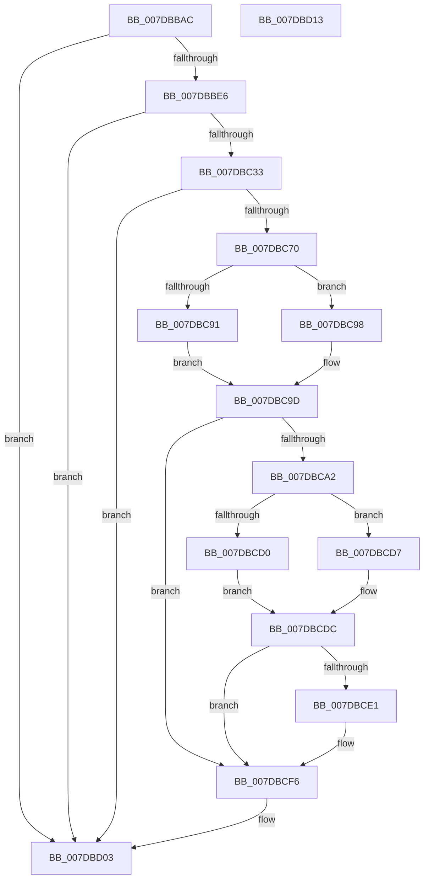

# CmpMarkCurrentProfileDirty

- RVA: `0x007DBBAC`–`0x007DBD14` (길이 `360` bytes)
- VA: `0x00000001407DBBAC`
- 실행 섹션: `PAGE`
- PDB 이름 있음: `예`; PDB Function 태그: `아니요`
- unwind 정보 RVA: `0x000D62D0`
- 디코드: `94`개 명령, `360/360` bytes 표시
- 미해석 바이트: `0` (있으면 어셈블리에 `.byte`로 보존)

> 이 문서는 커널 이미지의 기계어와 PDB 기호를 분석해 생성했습니다. 4번과 5번은 함수 원형과 자료형을 바이너리 사용 방식에서 추정한 C 해석이며 원본 소스 복구 결과는 아닙니다.

## 1. Dependencies

- 직접 호출 지점: **14**; 고유 호출 대상: **13**
- 직접 호출자로 확인된 함수: **1**
- RIP 상대 이미지 참조: **3**

### Outgoing calls
- `0x007DBBD9` → [CmpOpenDevicesControlSet](CmpOpenDevicesControlSet_function_007DC5B0.md) (function, `0x007DC5B0`)
- `0x007DBC1C` → [ZwOpenKey](../../text/6A/ZwOpenKey_function_006AD310.md) (function, `0x006AD310`)
- `0x007DBC26` → [ZwClose](../../text/6A/ZwClose_function_006AD2B0.md) (function, `0x006AD2B0`)
- `0x007DBC58` → [ObReferenceObjectByHandle](../86/ObReferenceObjectByHandle_function_00868DB0.md) (function, `0x00868DB0`)
- `0x007DBC63` → [ZwClose](../../text/6A/ZwClose_function_006AD2B0.md) (function, `0x006AD2B0`)
- `0x007DBC70` → [CmpLockRegistryExclusive](../84/CmpLockRegistryExclusive_function_0084F9B4.md) (function, `0x0084F9B4`)
- `0x007DBC91` → [HvpGetCellFlat](../85/HvpGetCellFlat_function_00854C60.md) (function, `0x00854C60`)
- `0x007DBC98` → [HvpGetCellPaged](../85/HvpGetCellPaged_function_00854CB0.md) (function, `0x00854CB0`)
- `0x007DBCB4` → [CmpFindValueByName](../84/CmpFindValueByName_function_00844E1C.md) (function, `0x00844E1C`)
- `0x007DBCD0` → [HvpReleaseCellFlat](../85/HvpReleaseCellFlat_function_0085CC20.md) (function, `0x0085CC20`)
- `0x007DBCD7` → [HvpReleaseCellPaged](../85/HvpReleaseCellPaged_function_00855F40.md) (function, `0x00855F40`)
- `0x007DBCF1` → [HvpMarkCellDirty](../85/HvpMarkCellDirty_function_00858080.md) (function, `0x00858080`)
- `0x007DBCF6` → [CmpUnlockRegistry](../../pagecmrc/BC/CmpUnlockRegistry_function_00BC9A84.md) (function, `0x00BC9A84`)
- `0x007DBCFE` → [ObfDereferenceObject](../../text/2F/ObfDereferenceObject_function_002F9350.md) (function, `0x002F9350`)

### Direct callers
- [CmInitSystem1](../../init/C5/CmInitSystem1_function_00C559CC.md) at `0x00C562C7`

### Static image references
- `0x007DBBEA` → RVA `0x00B4AFA8` (`CmpControlIdConfigDbString`; read)
- `0x007DBC33` → RVA `0x00FC6AC0` (`ALMOSTRO`; read)
- `0x007DBCA6` → RVA `0x00B4AFD8` (`CmpCurrentConfigString`; read)

## 2. Other-region calls and transfers

- 다른 실행 섹션으로 향하는 call: **5**
  - `0x007DBC1C` → [ZwOpenKey](../../text/6A/ZwOpenKey_function_006AD310.md) (`PAGE` → `.text`)
  - `0x007DBC26` → [ZwClose](../../text/6A/ZwClose_function_006AD2B0.md) (`PAGE` → `.text`)
  - `0x007DBC63` → [ZwClose](../../text/6A/ZwClose_function_006AD2B0.md) (`PAGE` → `.text`)
  - `0x007DBCF6` → [CmpUnlockRegistry](../../pagecmrc/BC/CmpUnlockRegistry_function_00BC9A84.md) (`PAGE` → `PAGECMRC`)
  - `0x007DBCFE` → [ObfDereferenceObject](../../text/2F/ObfDereferenceObject_function_002F9350.md) (`PAGE` → `.text`)
- 별도 외부 분기/꼬리 이동을 확인하지 못했습니다.

## 3. Assembly (complete function range)

```asm
007DBBAC  48 89 5C 24 20                  mov qword ptr [rsp + 0x20], rbx
007DBBB1  55                              push rbp
007DBBB2  56                              push rsi
007DBBB3  57                              push rdi
007DBBB4  48 8B EC                        mov rbp, rsp
007DBBB7  48 83 EC 60                     sub rsp, 0x60
007DBBBB  83 4D 20 FF                     or dword ptr [rbp + 0x20], 0xffffffff
007DBBBF  48 8D 55 30                     lea rdx, [rbp + 0x30]
007DBBC3  33 F6                           xor esi, esi
007DBBC5  45 33 C0                        xor r8d, r8d
007DBBC8  48 89 75 30                     mov qword ptr [rbp + 0x30], rsi
007DBBCC  48 89 75 28                     mov qword ptr [rbp + 0x28], rsi
007DBBD0  89 75 D4                        mov dword ptr [rbp - 0x2c], esi
007DBBD3  89 75 EC                        mov dword ptr [rbp - 0x14], esi
007DBBD6  89 75 24                        mov dword ptr [rbp + 0x24], esi
007DBBD9  E8 D2 09 00 00                  call 0x1407dc5b0
007DBBDE  85 C0                           test eax, eax
007DBBE0  0F 88 1D 01 00 00               js 0x1407dbd03
007DBBE6  48 8B 7D 30                     mov rdi, qword ptr [rbp + 0x30]
007DBBEA  48 8D 05 B7 F3 36 00            lea rax, [rip + 0x36f3b7]
007DBBF1  0F 57 C0                        xorps xmm0, xmm0
007DBBF4  48 89 7D D8                     mov qword ptr [rbp - 0x28], rdi
007DBBF8  4C 8D 45 D0                     lea r8, [rbp - 0x30]
007DBBFC  48 89 45 E0                     mov qword ptr [rbp - 0x20], rax
007DBC00  BA 19 00 02 00                  mov edx, 0x20019
007DBC05  C7 45 D0 30 00 00 00            mov dword ptr [rbp - 0x30], 0x30
007DBC0C  48 8D 4D 28                     lea rcx, [rbp + 0x28]
007DBC10  C7 45 E8 40 02 00 00            mov dword ptr [rbp - 0x18], 0x240
007DBC17  F3 0F 7F 45 F0                  movdqu xmmword ptr [rbp - 0x10], xmm0
007DBC1C  E8 EF 16 ED FF                  call 0x1406ad310
007DBC21  48 8B CF                        mov rcx, rdi
007DBC24  8B D8                           mov ebx, eax
007DBC26  E8 85 16 ED FF                  call 0x1406ad2b0
007DBC2B  85 DB                           test ebx, ebx
007DBC2D  0F 88 D0 00 00 00               js 0x1407dbd03
007DBC33  4C 8B 05 86 AE 7E 00            mov r8, qword ptr [rip + 0x7eae86]
007DBC3A  48 8D 45 30                     lea rax, [rbp + 0x30]
007DBC3E  48 8B 4D 28                     mov rcx, qword ptr [rbp + 0x28]
007DBC42  45 33 C9                        xor r9d, r9d
007DBC45  48 89 74 24 28                  mov qword ptr [rsp + 0x28], rsi
007DBC4A  BA 19 00 02 00                  mov edx, 0x20019
007DBC4F  48 89 44 24 20                  mov qword ptr [rsp + 0x20], rax
007DBC54  48 89 75 30                     mov qword ptr [rbp + 0x30], rsi
007DBC58  E8 53 D1 08 00                  call 0x140868db0
007DBC5D  48 8B 4D 28                     mov rcx, qword ptr [rbp + 0x28]
007DBC61  8B D8                           mov ebx, eax
007DBC63  E8 48 16 ED FF                  call 0x1406ad2b0
007DBC68  85 DB                           test ebx, ebx
007DBC6A  0F 88 93 00 00 00               js 0x1407dbd03
007DBC70  E8 3F 3D 07 00                  call 0x14084f9b4
007DBC75  48 8B 5D 30                     mov rbx, qword ptr [rbp + 0x30]
007DBC79  4C 8D 45 20                     lea r8, [rbp + 0x20]
007DBC7D  48 8B 43 08                     mov rax, qword ptr [rbx + 8]
007DBC81  48 8B 48 20                     mov rcx, qword ptr [rax + 0x20]
007DBC85  8B 50 28                        mov edx, dword ptr [rax + 0x28]
007DBC88  F6 81 8C 00 00 00 01            test byte ptr [rcx + 0x8c], 1
007DBC8F  74 07                           je 0x1407dbc98
007DBC91  E8 CA 8F 07 00                  call 0x140854c60
007DBC96  EB 05                           jmp 0x1407dbc9d
007DBC98  E8 13 90 07 00                  call 0x140854cb0
007DBC9D  48 85 C0                        test rax, rax
007DBCA0  74 54                           je 0x1407dbcf6
007DBCA2  48 8B 4B 08                     mov rcx, qword ptr [rbx + 8]
007DBCA6  4C 8D 05 2B F3 36 00            lea r8, [rip + 0x36f32b]
007DBCAD  48 8B D0                        mov rdx, rax
007DBCB0  48 8B 49 20                     mov rcx, qword ptr [rcx + 0x20]
007DBCB4  E8 63 91 06 00                  call 0x140844e1c
007DBCB9  48 8B 4B 08                     mov rcx, qword ptr [rbx + 8]
007DBCBD  48 8D 55 20                     lea rdx, [rbp + 0x20]
007DBCC1  8B F8                           mov edi, eax
007DBCC3  48 8B 49 20                     mov rcx, qword ptr [rcx + 0x20]
007DBCC7  F6 81 8C 00 00 00 01            test byte ptr [rcx + 0x8c], 1
007DBCCE  74 07                           je 0x1407dbcd7
007DBCD0  E8 4B 0F 08 00                  call 0x14085cc20
007DBCD5  EB 05                           jmp 0x1407dbcdc
007DBCD7  E8 64 A2 07 00                  call 0x140855f40
007DBCDC  83 FF FF                        cmp edi, -1
007DBCDF  74 15                           je 0x1407dbcf6
007DBCE1  48 8B 4B 08                     mov rcx, qword ptr [rbx + 8]
007DBCE5  45 33 C9                        xor r9d, r9d
007DBCE8  41 B0 01                        mov r8b, 1
007DBCEB  8B D7                           mov edx, edi
007DBCED  48 8B 49 20                     mov rcx, qword ptr [rcx + 0x20]
007DBCF1  E8 8A C3 07 00                  call 0x140858080
007DBCF6  E8 89 DD 3E 00                  call 0x140bc9a84
007DBCFB  48 8B CB                        mov rcx, rbx
007DBCFE  E8 4D D6 B1 FF                  call 0x1402f9350
007DBD03  48 8B 9C 24 98 00 00 00         mov rbx, qword ptr [rsp + 0x98]
007DBD0B  48 83 C4 60                     add rsp, 0x60
007DBD0F  5F                              pop rdi
007DBD10  5E                              pop rsi
007DBD11  5D                              pop rbp
007DBD12  C3                              ret
007DBD13  CC                              int3
```

## 4. C-style interpretation (structured pseudocode)

```c
__int64 __fastcall CmpMarkCurrentProfileDirty(__int64 a1, __int64 a2, int a3, int a4)
{
    __int64 result;
    __int64 v_rsi;
    __int64 v_rsp;
    unsigned __int64 v_stack_m28;
    unsigned int v_stack_m2C;
    unsigned int v_stack_m30;
    unsigned __int64 v_stack_m38;
    unsigned __int64 v_stack_m40;
    unsigned int v_stack_m44;
    unsigned __int64 v_stack_m48;
    unsigned __int64 v_stack_m50;
    unsigned __int64 v_stack_m58;
    unsigned __int64 v_stack_p10;
    unsigned __int64 v_stack_p18;
    unsigned __int64 v_stack_p20;
    unsigned int v_stack_p8;
    unsigned int v_stack_pC;

    v_stack_p20 = v_rbx;
    v_rsp = (v_rsp) - (96);
    v_rsi = 0;
    a3 = 0;
    v_stack_p18 = 0;
    v_stack_p10 = 0;
    v_stack_m44 = 0;
    v_stack_m2C = 0;
    v_stack_pC = 0;
    result = CmpOpenDevicesControlSet(a1, v_stack_p18, a3, a4);
    if (sign_flag) goto loc_007DBD03;
    v_stack_m40 = v_stack_p18;
    v_stack_m38 = v_rip + 3601335;
    v_stack_m48 = 48;
    v_stack_m30 = 576;
    v_stack_m28 = v_xmm0;
    result = ZwOpenKey(v_stack_p10, (unsigned int)(0x20019ULL), v_stack_m48, a4);
    result = ZwClose(v_stack_p18, (unsigned int)(0x20019ULL), v_stack_m48, a4);
    if (sign_flag) goto loc_007DBD03;
    a4 = 0;
    v_stack_m50 = 0;
    v_stack_m58 = v_stack_p18;
    v_stack_p18 = 0;
    result = ObReferenceObjectByHandle(v_stack_p10, (unsigned int)(0x20019ULL), *(unsigned __int64 *)(v_rip + 8302214), a4);
    result = ZwClose(v_stack_p10, (unsigned int)(0x20019ULL), *(unsigned __int64 *)(v_rip + 8302214), a4);
    if (sign_flag) goto loc_007DBD03;
    result = CmpLockRegistryExclusive(v_stack_p10, (unsigned int)(0x20019ULL), *(unsigned __int64 *)(v_rip + 8302214), a4);
    if (((*(unsigned __int8 *)(*(unsigned __int64 *)(*(unsigned __int64 *)(v_stack_p18 + 8) + 32) + 140)) & (1)) == 0) goto loc_007DBC98;
    result = HvpGetCellFlat(*(unsigned __int64 *)(*(unsigned __int64 *)(v_stack_p18 + 8) + 32), (unsigned int)(*(unsigned int *)(*(unsigned __int64 *)(v_stack_p18 + 8) + 40)), v_stack_p8, a4);
    goto loc_007DBC9D;
loc_007DBC98:
    result = HvpGetCellPaged(*(unsigned __int64 *)(*(unsigned __int64 *)(v_stack_p18 + 8) + 32), (unsigned int)(*(unsigned int *)(*(unsigned __int64 *)(v_stack_p18 + 8) + 40)), v_stack_p8, a4);
loc_007DBC9D:
    if (result == 0) goto loc_007DBCF6;
    result = CmpFindValueByName(*(unsigned __int64 *)(*(unsigned __int64 *)(v_stack_p18 + 8) + 32), result, v_rip + 3601195, a4);
    if (((*(unsigned __int8 *)(*(unsigned __int64 *)(*(unsigned __int64 *)(v_stack_p18 + 8) + 32) + 140)) & (1)) == 0) goto loc_007DBCD7;
    result = HvpReleaseCellFlat(*(unsigned __int64 *)(*(unsigned __int64 *)(v_stack_p18 + 8) + 32), v_stack_p8, v_rip + 3601195, a4);
    goto loc_007DBCDC;
loc_007DBCD7:
    result = HvpReleaseCellPaged(*(unsigned __int64 *)(*(unsigned __int64 *)(v_stack_p18 + 8) + 32), v_stack_p8, v_rip + 3601195, a4);
loc_007DBCDC:
    if (((unsigned int)((unsigned int)((unsigned int)(result)))) != -1) {
        a1 = *(unsigned __int64 *)(v_stack_p18 + 8);
        a4 = 0;
        a3 = 1;
        a2 = (unsigned int)((unsigned int)((unsigned int)(result)));
        a1 = *(unsigned __int64 *)(a1 + 32);
        result = HvpMarkCellDirty(a1, a2, a3, a4);
    }
    result = CmpUnlockRegistry(a1, a2, a3, a4);
    result = ObfDereferenceObject(v_stack_p18, a2, a3, a4);
loc_007DBD03:
    v_rsp = (v_rsp) + (96);
    return result;
}
```

## 5. (Beta) C Style

```c
int64_t CmpMarkCurrentProfileDirty(int64_t Arg1, int64_t Arg2, int32_t Arg3, int32_t Arg4)
{
    int64_t result;
    int64_t local_rsi;
    int64_t local_rsp;
    uint64_t v_stack_m28;
    uint32_t v_stack_m2C;
    uint32_t v_stack_m30;
    uint64_t v_stack_m38;
    uint64_t v_stack_m40;
    uint32_t v_stack_m44;
    uint64_t v_stack_m48;
    uint64_t v_stack_m50;
    uint64_t v_stack_m58;
    uint64_t v_stack_p10;
    uint64_t v_stack_p18;
    uint64_t v_stack_p20;
    uint32_t v_stack_p8;
    uint32_t v_stack_pC;

    v_stack_p20 = local_rbx;
    local_rsp = (local_rsp) - (96);
    local_rsi = 0;
    Arg3 = 0;
    v_stack_p18 = 0;
    v_stack_p10 = 0;
    v_stack_m44 = 0;
    v_stack_m2C = 0;
    v_stack_pC = 0;
    result = CmpOpenDevicesControlSet(Arg1, v_stack_p18, Arg3, Arg4);
    if (sign_flag) goto loc_007DBD03;
    v_stack_m40 = v_stack_p18;
    v_stack_m38 = v_rip + 3601335;
    v_stack_m48 = 48;
    v_stack_m30 = 576;
    v_stack_m28 = v_xmm0;
    result = ZwOpenKey(v_stack_p10, (uint32_t)(0x20019ULL), v_stack_m48, Arg4);
    result = ZwClose(v_stack_p18, (uint32_t)(0x20019ULL), v_stack_m48, Arg4);
    if (sign_flag) goto loc_007DBD03;
    Arg4 = 0;
    v_stack_m50 = 0;
    v_stack_m58 = v_stack_p18;
    v_stack_p18 = 0;
    result = ObReferenceObjectByHandle(v_stack_p10, (uint32_t)(0x20019ULL), *(uint64_t *)(v_rip + 0x7EAE86), Arg4);
    result = ZwClose(v_stack_p10, (uint32_t)(0x20019ULL), *(uint64_t *)(v_rip + 0x7EAE86), Arg4);
    if (sign_flag) goto loc_007DBD03;
    result = CmpLockRegistryExclusive(v_stack_p10, (uint32_t)(0x20019ULL), *(uint64_t *)(v_rip + 0x7EAE86), Arg4);
    if (((*(uint8_t *)(*(uint64_t *)(*(uint64_t *)(v_stack_p18 + 0x8) + 0x20) + 0x8C)) & (1)) == 0) goto loc_007DBC98;
    result = HvpGetCellFlat(*(uint64_t *)(*(uint64_t *)(v_stack_p18 + 0x8) + 0x20), (uint32_t)(*(uint32_t *)(*(uint64_t *)(v_stack_p18 + 0x8) + 0x28)), v_stack_p8, Arg4);
    goto loc_007DBC9D;
loc_007DBC98:
    result = HvpGetCellPaged(*(uint64_t *)(*(uint64_t *)(v_stack_p18 + 0x8) + 0x20), (uint32_t)(*(uint32_t *)(*(uint64_t *)(v_stack_p18 + 0x8) + 0x28)), v_stack_p8, Arg4);
loc_007DBC9D:
    if (result == 0) goto loc_007DBCF6;
    result = CmpFindValueByName(*(uint64_t *)(*(uint64_t *)(v_stack_p18 + 0x8) + 0x20), result, v_rip + 3601195, Arg4);
    if (((*(uint8_t *)(*(uint64_t *)(*(uint64_t *)(v_stack_p18 + 0x8) + 0x20) + 0x8C)) & (1)) == 0) goto loc_007DBCD7;
    result = HvpReleaseCellFlat(*(uint64_t *)(*(uint64_t *)(v_stack_p18 + 0x8) + 0x20), v_stack_p8, v_rip + 3601195, Arg4);
    goto loc_007DBCDC;
loc_007DBCD7:
    result = HvpReleaseCellPaged(*(uint64_t *)(*(uint64_t *)(v_stack_p18 + 0x8) + 0x20), v_stack_p8, v_rip + 3601195, Arg4);
loc_007DBCDC:
    if (((uint32_t)((uint32_t)((uint32_t)(result)))) != -1) {
        Arg1 = *(uint64_t *)(v_stack_p18 + 0x8);
        Arg4 = 0;
        Arg3 = 1;
        Arg2 = (uint32_t)((uint32_t)((uint32_t)(result)));
        Arg1 = *(uint64_t *)(Arg1 + 0x20);
        result = HvpMarkCellDirty(Arg1, Arg2, Arg3, Arg4);
    }
    result = CmpUnlockRegistry(Arg1, Arg2, Arg3, Arg4);
    result = ObfDereferenceObject(v_stack_p18, Arg2, Arg3, Arg4);
loc_007DBD03:
    local_rsp = (local_rsp) + (96);
    return result;
}
```

## 6. Execution-region graph

[열기: 2D/3D 그래프와 함수 탐색 컨트롤 패널](../../../control-panel.html?section=page&rva=0x007DBBAC&view=graph)

- 2D 그래프는 위에서 아래로 흐르고, 3D 그래프는 빈 공간을 드래그해 회전합니다. Shift+드래그는 이동, 휠은 확대·축소, 함수 노드 선택은 대상 보고서 이동입니다.

### Static fallback


