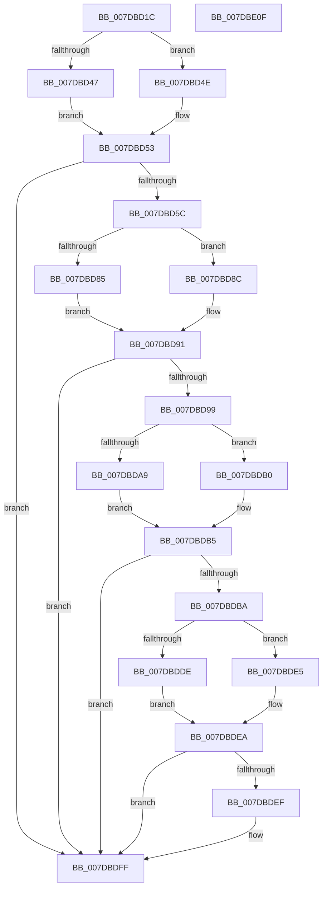

# CmpMarkCurrentValueDirty

- RVA: `0x007DBD1C`–`0x007DBE10` (길이 `244` bytes)
- VA: `0x00000001407DBD1C`
- 실행 섹션: `PAGE`
- PDB 이름 있음: `예`; PDB Function 태그: `아니요`
- unwind 정보 RVA: `0x000D62E4`
- 디코드: `67`개 명령, `244/244` bytes 표시
- 미해석 바이트: `0` (있으면 어셈블리에 `.byte`로 보존)

> 이 문서는 커널 이미지의 기계어와 PDB 기호를 분석해 생성했습니다. 4번과 5번은 함수 원형과 자료형을 바이너리 사용 방식에서 추정한 C 해석이며 원본 소스 복구 결과는 아닙니다.

## 1. Dependencies

- 직접 호출 지점: **11**; 고유 호출 대상: **7**
- 직접 호출자로 확인된 함수: **1**
- RIP 상대 이미지 참조: **2**

### Outgoing calls
- `0x007DBD47` → [HvpGetCellFlat](../85/HvpGetCellFlat_function_00854C60.md) (function, `0x00854C60`)
- `0x007DBD4E` → [HvpGetCellPaged](../85/HvpGetCellPaged_function_00854CB0.md) (function, `0x00854CB0`)
- `0x007DBD70` → [CmpFindSubKeyByNameWithStatus](../85/CmpFindSubKeyByNameWithStatus_function_00852770.md) (function, `0x00852770`)
- `0x007DBD85` → [HvpReleaseCellFlat](../85/HvpReleaseCellFlat_function_0085CC20.md) (function, `0x0085CC20`)
- `0x007DBD8C` → [HvpReleaseCellPaged](../85/HvpReleaseCellPaged_function_00855F40.md) (function, `0x00855F40`)
- `0x007DBDA9` → [HvpGetCellFlat](../85/HvpGetCellFlat_function_00854C60.md) (function, `0x00854C60`)
- `0x007DBDB0` → [HvpGetCellPaged](../85/HvpGetCellPaged_function_00854CB0.md) (function, `0x00854CB0`)
- `0x007DBDC7` → [CmpFindValueByName](../84/CmpFindValueByName_function_00844E1C.md) (function, `0x00844E1C`)
- `0x007DBDDE` → [HvpReleaseCellFlat](../85/HvpReleaseCellFlat_function_0085CC20.md) (function, `0x0085CC20`)
- `0x007DBDE5` → [HvpReleaseCellPaged](../85/HvpReleaseCellPaged_function_00855F40.md) (function, `0x00855F40`)
- `0x007DBDFA` → [HvpMarkCellDirty](../85/HvpMarkCellDirty_function_00858080.md) (function, `0x00858080`)

### Direct callers
- [CmpLoadHiveThread](CmpLoadHiveThread_function_007DB040.md) at `0x007DB8E3`

### Static image references
- `0x007DBD63` → RVA `0x00B4B4E0` (`CmpSelectString`; read)
- `0x007DBDBA` → RVA `0x00B4AFC8` (`CmpCurrentString`; read)

## 2. Other-region calls and transfers

- 다른 실행 섹션으로 향하는 call: **0**
- 별도 외부 분기/꼬리 이동을 확인하지 못했습니다.

## 3. Assembly (complete function range)

```asm
007DBD1C  48 89 5C 24 10                  mov qword ptr [rsp + 0x10], rbx
007DBD21  48 89 7C 24 20                  mov qword ptr [rsp + 0x20], rdi
007DBD26  55                              push rbp
007DBD27  48 8B EC                        mov rbp, rsp
007DBD2A  48 83 EC 20                     sub rsp, 0x20
007DBD2E  83 4D 20 FF                     or dword ptr [rbp + 0x20], 0xffffffff
007DBD32  4C 8D 45 20                     lea r8, [rbp + 0x20]
007DBD36  33 FF                           xor edi, edi
007DBD38  48 8B D9                        mov rbx, rcx
007DBD3B  F6 81 8C 00 00 00 01            test byte ptr [rcx + 0x8c], 1
007DBD42  89 7D 24                        mov dword ptr [rbp + 0x24], edi
007DBD45  74 07                           je 0x1407dbd4e
007DBD47  E8 14 8F 07 00                  call 0x140854c60
007DBD4C  EB 05                           jmp 0x1407dbd53
007DBD4E  E8 5D 8F 07 00                  call 0x140854cb0
007DBD53  48 85 C0                        test rax, rax
007DBD56  0F 84 A3 00 00 00               je 0x1407dbdff
007DBD5C  4C 8D 4D 10                     lea r9, [rbp + 0x10]
007DBD60  89 7D 10                        mov dword ptr [rbp + 0x10], edi
007DBD63  4C 8D 05 76 F7 36 00            lea r8, [rip + 0x36f776]
007DBD6A  48 8B D0                        mov rdx, rax
007DBD6D  48 8B CB                        mov rcx, rbx
007DBD70  E8 FB 69 07 00                  call 0x140852770
007DBD75  F6 83 8C 00 00 00 01            test byte ptr [rbx + 0x8c], 1
007DBD7C  48 8D 55 20                     lea rdx, [rbp + 0x20]
007DBD80  48 8B CB                        mov rcx, rbx
007DBD83  74 07                           je 0x1407dbd8c
007DBD85  E8 96 0E 08 00                  call 0x14085cc20
007DBD8A  EB 05                           jmp 0x1407dbd91
007DBD8C  E8 AF A1 07 00                  call 0x140855f40
007DBD91  8B 55 10                        mov edx, dword ptr [rbp + 0x10]
007DBD94  83 FA FF                        cmp edx, -1
007DBD97  74 66                           je 0x1407dbdff
007DBD99  F6 83 8C 00 00 00 01            test byte ptr [rbx + 0x8c], 1
007DBDA0  4C 8D 45 20                     lea r8, [rbp + 0x20]
007DBDA4  48 8B CB                        mov rcx, rbx
007DBDA7  74 07                           je 0x1407dbdb0
007DBDA9  E8 B2 8E 07 00                  call 0x140854c60
007DBDAE  EB 05                           jmp 0x1407dbdb5
007DBDB0  E8 FB 8E 07 00                  call 0x140854cb0
007DBDB5  48 85 C0                        test rax, rax
007DBDB8  74 45                           je 0x1407dbdff
007DBDBA  4C 8D 05 07 F2 36 00            lea r8, [rip + 0x36f207]
007DBDC1  48 8B D0                        mov rdx, rax
007DBDC4  48 8B CB                        mov rcx, rbx
007DBDC7  E8 50 90 06 00                  call 0x140844e1c
007DBDCC  F6 83 8C 00 00 00 01            test byte ptr [rbx + 0x8c], 1
007DBDD3  48 8D 55 20                     lea rdx, [rbp + 0x20]
007DBDD7  8B F8                           mov edi, eax
007DBDD9  48 8B CB                        mov rcx, rbx
007DBDDC  74 07                           je 0x1407dbde5
007DBDDE  E8 3D 0E 08 00                  call 0x14085cc20
007DBDE3  EB 05                           jmp 0x1407dbdea
007DBDE5  E8 56 A1 07 00                  call 0x140855f40
007DBDEA  83 FF FF                        cmp edi, -1
007DBDED  74 10                           je 0x1407dbdff
007DBDEF  45 33 C9                        xor r9d, r9d
007DBDF2  45 33 C0                        xor r8d, r8d
007DBDF5  8B D7                           mov edx, edi
007DBDF7  48 8B CB                        mov rcx, rbx
007DBDFA  E8 81 C2 07 00                  call 0x140858080
007DBDFF  48 8B 5C 24 38                  mov rbx, qword ptr [rsp + 0x38]
007DBE04  48 8B 7C 24 48                  mov rdi, qword ptr [rsp + 0x48]
007DBE09  48 83 C4 20                     add rsp, 0x20
007DBE0D  5D                              pop rbp
007DBE0E  C3                              ret
007DBE0F  CC                              int3
```

## 4. C-style interpretation (structured pseudocode)

```c
__int64 __fastcall CmpMarkCurrentValueDirty(__int64 a1)
{
    __int64 result;
    __int64 v_rdi;
    __int64 v_rsp;
    unsigned __int64 v_stack_p10;
    unsigned int v_stack_p18;
    unsigned int v_stack_p1C;
    unsigned __int64 v_stack_p20;
    unsigned __int64 v_stack_p8;

    v_stack_p10 = v_rbx;
    v_stack_p20 = v_rdi;
    v_rsp = (v_rsp) - (32);
    v_rdi = 0;
    v_stack_p1C = 0;
    if (((*(unsigned __int8 *)(a1 + 140)) & (1)) == 0) goto loc_007DBD4E;
    result = HvpGetCellFlat(a1, a2, v_stack_p18, a4);
    goto loc_007DBD53;
loc_007DBD4E:
    result = HvpGetCellPaged(a1, a2, v_stack_p18, a4);
loc_007DBD53:
    if (result == 0) goto loc_007DBDFF;
    v_stack_p8 = 0;
    result = CmpFindSubKeyByNameWithStatus(a1, result, v_rip + 3602294, v_stack_p8);
    if (((*(unsigned __int8 *)(a1 + 140)) & (1)) == 0) goto loc_007DBD8C;
    result = HvpReleaseCellFlat(a1, v_stack_p18, v_rip + 3602294, v_stack_p8);
    goto loc_007DBD91;
loc_007DBD8C:
    result = HvpReleaseCellPaged(a1, v_stack_p18, v_rip + 3602294, v_stack_p8);
loc_007DBD91:
    if (((unsigned int)((unsigned int)(v_stack_p8))) == -1) goto loc_007DBDFF;
    if (((*(unsigned __int8 *)(a1 + 140)) & (1)) == 0) goto loc_007DBDB0;
    result = HvpGetCellFlat(a1, (unsigned int)(v_stack_p8), v_stack_p18, v_stack_p8);
    goto loc_007DBDB5;
loc_007DBDB0:
    result = HvpGetCellPaged(a1, (unsigned int)(v_stack_p8), v_stack_p18, v_stack_p8);
loc_007DBDB5:
    if (result == 0) goto loc_007DBDFF;
    result = CmpFindValueByName(a1, result, v_rip + 3600903, v_stack_p8);
    if (((*(unsigned __int8 *)(a1 + 140)) & (1)) == 0) goto loc_007DBDE5;
    result = HvpReleaseCellFlat(a1, v_stack_p18, v_rip + 3600903, v_stack_p8);
    goto loc_007DBDEA;
loc_007DBDE5:
    result = HvpReleaseCellPaged(a1, v_stack_p18, v_rip + 3600903, v_stack_p8);
loc_007DBDEA:
    if (((unsigned int)((unsigned int)((unsigned int)(result)))) != -1) {
        a4 = 0;
        a3 = 0;
        a2 = (unsigned int)((unsigned int)((unsigned int)(result)));
        a1 = a1;
        result = HvpMarkCellDirty(a1, a2, a3, a4);
    }
    v_rsp = (v_rsp) + (32);
    return result;
}
```

## 5. (Beta) C Style

```c
int64_t CmpMarkCurrentValueDirty(void *Arg1)
{
    uint8_t *arg1 = (uint8_t *)Arg1;

    int64_t result;
    int64_t local_rdi;
    int64_t local_rsp;
    uint64_t v_stack_p10;
    uint32_t v_stack_p18;
    uint32_t v_stack_p1C;
    uint64_t v_stack_p20;
    uint64_t v_stack_p8;

    v_stack_p10 = local_rbx;
    v_stack_p20 = local_rdi;
    local_rsp = (local_rsp) - (32);
    local_rdi = 0;
    v_stack_p1C = 0;
    if (((*(uint8_t *)(arg1 + 0x8C)) & (1)) == 0) goto loc_007DBD4E;
    result = HvpGetCellFlat(Arg1, a2, v_stack_p18, a4);
    goto loc_007DBD53;
loc_007DBD4E:
    result = HvpGetCellPaged(Arg1, a2, v_stack_p18, a4);
loc_007DBD53:
    if (result == 0) goto loc_007DBDFF;
    v_stack_p8 = 0;
    result = CmpFindSubKeyByNameWithStatus(Arg1, result, v_rip + 3602294, v_stack_p8);
    if (((*(uint8_t *)(arg1 + 0x8C)) & (1)) == 0) goto loc_007DBD8C;
    result = HvpReleaseCellFlat(Arg1, v_stack_p18, v_rip + 3602294, v_stack_p8);
    goto loc_007DBD91;
loc_007DBD8C:
    result = HvpReleaseCellPaged(Arg1, v_stack_p18, v_rip + 3602294, v_stack_p8);
loc_007DBD91:
    if (((uint32_t)((uint32_t)(v_stack_p8))) == -1) goto loc_007DBDFF;
    if (((*(uint8_t *)(arg1 + 0x8C)) & (1)) == 0) goto loc_007DBDB0;
    result = HvpGetCellFlat(Arg1, (uint32_t)(v_stack_p8), v_stack_p18, v_stack_p8);
    goto loc_007DBDB5;
loc_007DBDB0:
    result = HvpGetCellPaged(Arg1, (uint32_t)(v_stack_p8), v_stack_p18, v_stack_p8);
loc_007DBDB5:
    if (result == 0) goto loc_007DBDFF;
    result = CmpFindValueByName(Arg1, result, v_rip + 3600903, v_stack_p8);
    if (((*(uint8_t *)(arg1 + 0x8C)) & (1)) == 0) goto loc_007DBDE5;
    result = HvpReleaseCellFlat(Arg1, v_stack_p18, v_rip + 3600903, v_stack_p8);
    goto loc_007DBDEA;
loc_007DBDE5:
    result = HvpReleaseCellPaged(Arg1, v_stack_p18, v_rip + 3600903, v_stack_p8);
loc_007DBDEA:
    if (((uint32_t)((uint32_t)((uint32_t)(result)))) != -1) {
        a4 = 0;
        a3 = 0;
        a2 = (uint32_t)((uint32_t)((uint32_t)(result)));
        Arg1 = Arg1;
        result = HvpMarkCellDirty(Arg1, a2, a3, a4);
    }
    local_rsp = (local_rsp) + (32);
    return result;
}
```

### 관측된 메모리 오프셋

구조체 형식이 확인되지 않은 접근은 인자 기준의 오프셋으로만 기록했습니다.

| 기준 인자 | 오프셋 표현 | 폭 (bit) | 접근 |
|---|---:|---:|---|
| `Arg1` | `+ 0x8C` | `8` | `R` |

## 6. Execution-region graph

[열기: 2D/3D 그래프와 함수 탐색 컨트롤 패널](../../../control-panel.html?section=page&rva=0x007DBD1C&view=graph)

- 2D 그래프는 위에서 아래로 흐르고, 3D 그래프는 빈 공간을 드래그해 회전합니다. Shift+드래그는 이동, 휠은 확대·축소, 함수 노드 선택은 대상 보고서 이동입니다.

### Static fallback


