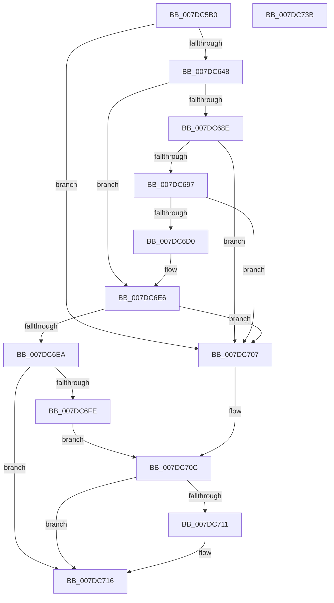

# CmpOpenDevicesControlSet

- RVA: `0x007DC5B0`–`0x007DC73C` (길이 `396` bytes)
- VA: `0x00000001407DC5B0`
- 실행 섹션: `PAGE`
- PDB 이름 있음: `예`; PDB Function 태그: `아니요`
- unwind 정보 RVA: `0x000D639C`
- 디코드: `99`개 명령, `396/396` bytes 표시
- 미해석 바이트: `0` (있으면 어셈블리에 `.byte`로 보존)

> 이 문서는 커널 이미지의 기계어와 PDB 기호를 분석해 생성했습니다. 4번과 5번은 함수 원형과 자료형을 바이너리 사용 방식에서 추정한 C 해석이며 원본 소스 복구 결과는 아닙니다.

## 1. Dependencies

- 직접 호출 지점: **6**; 고유 호출 대상: **4**
- 직접 호출자로 확인된 함수: **4**
- RIP 상대 이미지 참조: **5**

### Outgoing calls
- `0x007DC639` → [RtlUnicodeStringPrintf](../../text/48/RtlUnicodeStringPrintf_function_0048B984.md) (function, `0x0048B984`)
- `0x007DC680` → [ZwOpenKey](../../text/6A/ZwOpenKey_function_006AD310.md) (function, `0x006AD310`)
- `0x007DC6C5` → [RtlUnicodeStringPrintf](../../text/48/RtlUnicodeStringPrintf_function_0048B984.md) (function, `0x0048B984`)
- `0x007DC6DF` → [ZwOpenKey](../../text/6A/ZwOpenKey_function_006AD310.md) (function, `0x006AD310`)
- `0x007DC711` → [ZwClose](../../text/6A/ZwClose_function_006AD2B0.md) (function, `0x006AD2B0`)
- `0x007DC71F` → [_security_check_cookie](../../text/6A/_security_check_cookie_function_006AC640.md) (function, `0x006AC640`)

### Direct callers
- [CmpMarkCurrentProfileDirty](CmpMarkCurrentProfileDirty_function_007DBBAC.md) at `0x007DBBD9`
- [CmSetAcpiHwProfile](../7E/CmSetAcpiHwProfile_function_007E2584.md) at `0x007E2635`
- [CmpMoveBiosAliasTable](../7E/CmpMoveBiosAliasTable_function_007E4578.md) at `0x007E4A7A`
- [CmpCreateHardwareProfiles](../../init/C5/CmpCreateHardwareProfiles_function_00C56EF4.md) at `0x00C56F86`

### Static image references
- `0x007DC5C8` → RVA `0x00E0A740` (`.data`; read)
- `0x007DC5D8` → RVA `0x00B4B4D0` (`CmpDevicesHiveNameString`; read)
- `0x007DC5E4` → RVA `0x00B4AF30` (`CmpSystemHiveNameString`; read)
- `0x007DC5EB` → RVA `0x00EEFB6C` (`.data`; read)
- `0x007DC623` → RVA `0x00B09080` (` ?? ::NNGAKEGL::`string'`; read)

## 2. Other-region calls and transfers

- 다른 실행 섹션으로 향하는 call: **6**
  - `0x007DC639` → [RtlUnicodeStringPrintf](../../text/48/RtlUnicodeStringPrintf_function_0048B984.md) (`PAGE` → `.text`)
  - `0x007DC680` → [ZwOpenKey](../../text/6A/ZwOpenKey_function_006AD310.md) (`PAGE` → `.text`)
  - `0x007DC6C5` → [RtlUnicodeStringPrintf](../../text/48/RtlUnicodeStringPrintf_function_0048B984.md) (`PAGE` → `.text`)
  - `0x007DC6DF` → [ZwOpenKey](../../text/6A/ZwOpenKey_function_006AD310.md) (`PAGE` → `.text`)
  - `0x007DC711` → [ZwClose](../../text/6A/ZwClose_function_006AD2B0.md) (`PAGE` → `.text`)
  - `0x007DC71F` → [_security_check_cookie](../../text/6A/_security_check_cookie_function_006AC640.md) (`PAGE` → `.text`)
- 별도 외부 분기/꼬리 이동을 확인하지 못했습니다.

## 3. Assembly (complete function range)

```asm
007DC5B0  48 89 5C 24 08                  mov qword ptr [rsp + 8], rbx
007DC5B5  55                              push rbp
007DC5B6  56                              push rsi
007DC5B7  57                              push rdi
007DC5B8  41 55                           push r13
007DC5BA  41 56                           push r14
007DC5BC  48 8D 6C 24 80                  lea rbp, [rsp - 0x80]
007DC5C1  48 81 EC 80 01 00 00            sub rsp, 0x180
007DC5C8  48 8B 05 71 E1 62 00            mov rax, qword ptr [rip + 0x62e171]
007DC5CF  48 33 C4                        xor rax, rsp
007DC5D2  48 89 45 70                     mov qword ptr [rbp + 0x70], rax
007DC5D6  33 C0                           xor eax, eax
007DC5D8  48 8D 3D F1 EE 36 00            lea rdi, [rip + 0x36eef1]
007DC5DF  48 21 44 24 20                  and qword ptr [rsp + 0x20], rax
007DC5E4  4C 8D 2D 45 E9 36 00            lea r13, [rip + 0x36e945]
007DC5EB  39 05 7B 35 71 00               cmp dword ptr [rip + 0x71357b], eax
007DC5F1  48 8D 4C 24 28                  lea rcx, [rsp + 0x28]
007DC5F6  0F 57 C0                        xorps xmm0, xmm0
007DC5F9  48 89 44 24 58                  mov qword ptr [rsp + 0x58], rax
007DC5FE  89 44 24 60                     mov dword ptr [rsp + 0x60], eax
007DC602  49 0F 44 FD                     cmove rdi, r13
007DC606  0F 11 44 24 28                  movups xmmword ptr [rsp + 0x28], xmm0
007DC60B  B8 00 01 00 00                  mov eax, 0x100
007DC610  49 8B F0                        mov rsi, r8
007DC613  66 89 44 24 2A                  mov word ptr [rsp + 0x2a], ax
007DC618  4C 8B F2                        mov r14, rdx
007DC61B  48 8D 44 24 70                  lea rax, [rsp + 0x70]
007DC620  4C 8B C7                        mov r8, rdi
007DC623  48 8D 15 56 CA 32 00            lea rdx, [rip + 0x32ca56]
007DC62A  48 89 44 24 30                  mov qword ptr [rsp + 0x30], rax
007DC62F  0F 11 44 24 38                  movups xmmword ptr [rsp + 0x38], xmm0
007DC634  0F 11 44 24 48                  movups xmmword ptr [rsp + 0x48], xmm0
007DC639  E8 46 F3 CA FF                  call 0x14048b984
007DC63E  8B D8                           mov ebx, eax
007DC640  85 C0                           test eax, eax
007DC642  0F 88 BF 00 00 00               js 0x1407dc707
007DC648  48 83 64 24 40 00               and qword ptr [rsp + 0x40], 0
007DC64E  48 8D 44 24 28                  lea rax, [rsp + 0x28]
007DC653  0F 57 C0                        xorps xmm0, xmm0
007DC656  48 89 44 24 48                  mov qword ptr [rsp + 0x48], rax
007DC65B  4C 8D 44 24 38                  lea r8, [rsp + 0x38]
007DC660  C7 44 24 38 30 00 00 00         mov dword ptr [rsp + 0x38], 0x30
007DC668  BA 19 00 02 00                  mov edx, 0x20019
007DC66D  C7 44 24 50 40 02 00 00         mov dword ptr [rsp + 0x50], 0x240
007DC675  48 8D 4C 24 20                  lea rcx, [rsp + 0x20]
007DC67A  F3 0F 7F 44 24 58               movdqu xmmword ptr [rsp + 0x58], xmm0
007DC680  E8 8B 0C ED FF                  call 0x1406ad310
007DC685  8B D8                           mov ebx, eax
007DC687  3D 34 00 00 C0                  cmp eax, 0xc0000034
007DC68C  75 58                           jne 0x1407dc6e6
007DC68E  83 3D D7 34 71 00 00            cmp dword ptr [rip + 0x7134d7], 0
007DC695  74 70                           je 0x1407dc707
007DC697  0F 57 C0                        xorps xmm0, xmm0
007DC69A  48 8D 15 DF C9 32 00            lea rdx, [rip + 0x32c9df]
007DC6A1  0F 11 44 24 28                  movups xmmword ptr [rsp + 0x28], xmm0
007DC6A6  B8 00 01 00 00                  mov eax, 0x100
007DC6AB  48 8D 4C 24 28                  lea rcx, [rsp + 0x28]
007DC6B0  66 89 44 24 2A                  mov word ptr [rsp + 0x2a], ax
007DC6B5  4D 8B C5                        mov r8, r13
007DC6B8  48 8D 44 24 70                  lea rax, [rsp + 0x70]
007DC6BD  49 8B FD                        mov rdi, r13
007DC6C0  48 89 44 24 30                  mov qword ptr [rsp + 0x30], rax
007DC6C5  E8 BA F2 CA FF                  call 0x14048b984
007DC6CA  8B D8                           mov ebx, eax
007DC6CC  85 C0                           test eax, eax
007DC6CE  78 37                           js 0x1407dc707
007DC6D0  4C 8D 44 24 38                  lea r8, [rsp + 0x38]
007DC6D5  BA 19 00 02 00                  mov edx, 0x20019
007DC6DA  48 8D 4C 24 20                  lea rcx, [rsp + 0x20]
007DC6DF  E8 2C 0C ED FF                  call 0x1406ad310
007DC6E4  8B D8                           mov ebx, eax
007DC6E6  85 DB                           test ebx, ebx
007DC6E8  78 1D                           js 0x1407dc707
007DC6EA  48 8B 44 24 20                  mov rax, qword ptr [rsp + 0x20]
007DC6EF  33 C9                           xor ecx, ecx
007DC6F1  49 89 06                        mov qword ptr [r14], rax
007DC6F4  48 89 4C 24 20                  mov qword ptr [rsp + 0x20], rcx
007DC6F9  48 85 F6                        test rsi, rsi
007DC6FC  74 18                           je 0x1407dc716
007DC6FE  0F 10 07                        movups xmm0, xmmword ptr [rdi]
007DC701  F3 0F 7F 06                     movdqu xmmword ptr [rsi], xmm0
007DC705  EB 05                           jmp 0x1407dc70c
007DC707  48 8B 4C 24 20                  mov rcx, qword ptr [rsp + 0x20]
007DC70C  48 85 C9                        test rcx, rcx
007DC70F  74 05                           je 0x1407dc716
007DC711  E8 9A 0B ED FF                  call 0x1406ad2b0
007DC716  8B C3                           mov eax, ebx
007DC718  48 8B 4D 70                     mov rcx, qword ptr [rbp + 0x70]
007DC71C  48 33 CC                        xor rcx, rsp
007DC71F  E8 1C FF EC FF                  call 0x1406ac640
007DC724  48 8B 9C 24 B0 01 00 00         mov rbx, qword ptr [rsp + 0x1b0]
007DC72C  48 81 C4 80 01 00 00            add rsp, 0x180
007DC733  41 5E                           pop r14
007DC735  41 5D                           pop r13
007DC737  5F                              pop rdi
007DC738  5E                              pop rsi
007DC739  5D                              pop rbp
007DC73A  C3                              ret
007DC73B  CC                              int3
```

## 4. C-style interpretation (structured pseudocode)

```c
__int64 __fastcall CmpOpenDevicesControlSet(__int64 a1, __int64 a2, __int64 a3)
{
    __int64 result;
    __int64 v_rdi;
    __int64 v_rsp;
    unsigned __int64 v_stack_m138;
    unsigned int v_stack_m148;
    unsigned __int64 v_stack_m150;
    unsigned int v_stack_m158;
    unsigned __int64 v_stack_m160;
    unsigned __int64 v_stack_m168;
    unsigned __int64 v_stack_m170;
    unsigned __int64 v_stack_m178;
    unsigned __int16 v_stack_m17E;
    unsigned __int64 v_stack_m180;
    unsigned __int64 v_stack_m188;
    unsigned __int64 v_stack_m38;
    unsigned __int64 v_stack_mA8;
    unsigned __int64 v_stack_p8;

    v_stack_p8 = v_rbx;
    v_rsp = (v_rsp) - (384);
    result = (*(unsigned __int64 *)(v_rip + 6480241)) ^ (v_rsp);
    v_stack_m38 = result;
    result = 0;
    v_stack_m150 = 0;
    v_stack_m148 = 0;
    v_rdi = v_rip + 3600113;
    if ((*(unsigned int *)(v_rip + 7419259)) == 0) { v_rdi = v_rip + 3598661; }
    v_stack_m180 = v_xmm0;
    v_stack_m17E = 256;
    v_stack_m178 = v_stack_m138;
    v_stack_m170 = v_xmm0;
    v_stack_m160 = v_xmm0;
    result = RtlUnicodeStringPrintf(v_stack_m180, v_rip + 3328598, v_rdi, a4);
    if (sign_flag) goto loc_007DC707;
    v_stack_m160 = v_stack_m180;
    v_stack_m170 = 48;
    v_stack_m158 = 576;
    v_stack_m150 = v_xmm0;
    result = ZwOpenKey(v_stack_m188, (unsigned int)(0x20019ULL), v_stack_m170, a4);
    if (((unsigned int)(result)) != 0xC0000034ULL) goto loc_007DC6E6;
    if ((*(unsigned int *)(v_rip + 7419095)) == 0) goto loc_007DC707;
    v_stack_m180 = v_xmm0;
    v_stack_m17E = 256;
    v_stack_m178 = v_stack_m138;
    result = RtlUnicodeStringPrintf(v_stack_m180, v_rip + 3328479, v_rip + 3598661, a4);
    if (sign_flag) goto loc_007DC707;
    result = ZwOpenKey(v_stack_m188, (unsigned int)(0x20019ULL), v_stack_m170, a4);
loc_007DC6E6:
    if (sign_flag) goto loc_007DC707;
    a1 = 0;
    *(unsigned __int64 *)(a2) = v_stack_m188;
    v_stack_m188 = 0;
    if (a3 == 0) goto loc_007DC716;
    *(unsigned __int64 *)(a3) = v_xmm0;
    goto loc_007DC70C;
loc_007DC707:
loc_007DC70C:
    result = v_stack_m188;
    if (v_stack_m188 != 0) {
        result = ZwClose(v_stack_m188, (unsigned int)(0x20019ULL), v_stack_m170, a4);
    }
    a1 = (v_stack_m38) ^ (v_rsp);
    result = _security_check_cookie(a1, (unsigned int)(0x20019ULL), v_stack_m170, a4);
    v_rsp = (v_rsp) + (384);
    return result;
}
```

## 5. (Beta) C Style

```c
int64_t CmpOpenDevicesControlSet(int64_t Arg1, void *Arg2, int64_t Arg3)
{
    uint8_t *arg2 = (uint8_t *)Arg2;

    int64_t result;
    int64_t local_rdi;
    int64_t local_rsp;
    uint64_t v_stack_m138;
    uint32_t v_stack_m148;
    uint64_t v_stack_m150;
    uint32_t v_stack_m158;
    uint64_t v_stack_m160;
    uint64_t v_stack_m168;
    uint64_t v_stack_m170;
    uint64_t v_stack_m178;
    uint16_t v_stack_m17E;
    uint64_t v_stack_m180;
    uint64_t v_stack_m188;
    uint64_t v_stack_m38;
    uint64_t v_stack_mA8;
    uint64_t v_stack_p8;

    v_stack_p8 = local_rbx;
    local_rsp = (local_rsp) - (384);
    result = (*(uint64_t *)(v_rip + 0x62E171)) ^ (local_rsp);
    v_stack_m38 = result;
    result = 0;
    v_stack_m150 = 0;
    v_stack_m148 = 0;
    local_rdi = v_rip + 3600113;
    if ((*(uint32_t *)(v_rip + 0x71357B)) == 0) { local_rdi = v_rip + 3598661; }
    v_stack_m180 = v_xmm0;
    v_stack_m17E = 256;
    v_stack_m178 = v_stack_m138;
    v_stack_m170 = v_xmm0;
    v_stack_m160 = v_xmm0;
    result = RtlUnicodeStringPrintf(v_stack_m180, v_rip + 3328598, local_rdi, a4);
    if (sign_flag) goto loc_007DC707;
    v_stack_m160 = v_stack_m180;
    v_stack_m170 = 48;
    v_stack_m158 = 576;
    v_stack_m150 = v_xmm0;
    result = ZwOpenKey(v_stack_m188, (uint32_t)(0x20019ULL), v_stack_m170, a4);
    if (((uint32_t)(result)) != 0xC0000034ULL) goto loc_007DC6E6;
    if ((*(uint32_t *)(v_rip + 0x7134D7)) == 0) goto loc_007DC707;
    v_stack_m180 = v_xmm0;
    v_stack_m17E = 256;
    v_stack_m178 = v_stack_m138;
    result = RtlUnicodeStringPrintf(v_stack_m180, v_rip + 3328479, v_rip + 3598661, a4);
    if (sign_flag) goto loc_007DC707;
    result = ZwOpenKey(v_stack_m188, (uint32_t)(0x20019ULL), v_stack_m170, a4);
loc_007DC6E6:
    if (sign_flag) goto loc_007DC707;
    Arg1 = 0;
    *(uint64_t *)(arg2) = v_stack_m188;
    v_stack_m188 = 0;
    if (Arg3 == 0) goto loc_007DC716;
    *(uint64_t *)(Arg3) = v_xmm0;
    goto loc_007DC70C;
loc_007DC707:
loc_007DC70C:
    result = v_stack_m188;
    if (v_stack_m188 != 0) {
        result = ZwClose(v_stack_m188, (uint32_t)(0x20019ULL), v_stack_m170, a4);
    }
    Arg1 = (v_stack_m38) ^ (local_rsp);
    result = _security_check_cookie(Arg1, (uint32_t)(0x20019ULL), v_stack_m170, a4);
    local_rsp = (local_rsp) + (384);
    return result;
}
```

### 관측된 메모리 오프셋

구조체 형식이 확인되지 않은 접근은 인자 기준의 오프셋으로만 기록했습니다.

| 기준 인자 | 오프셋 표현 | 폭 (bit) | 접근 |
|---|---:|---:|---|
| `Arg2` | `+ 0x0` | `64` | `W` |

## 6. Execution-region graph

[열기: 2D/3D 그래프와 함수 탐색 컨트롤 패널](../../../control-panel.html?section=page&rva=0x007DC5B0&view=graph)

- 2D 그래프는 위에서 아래로 흐르고, 3D 그래프는 빈 공간을 드래그해 회전합니다. Shift+드래그는 이동, 휠은 확대·축소, 함수 노드 선택은 대상 보고서 이동입니다.

### Static fallback


