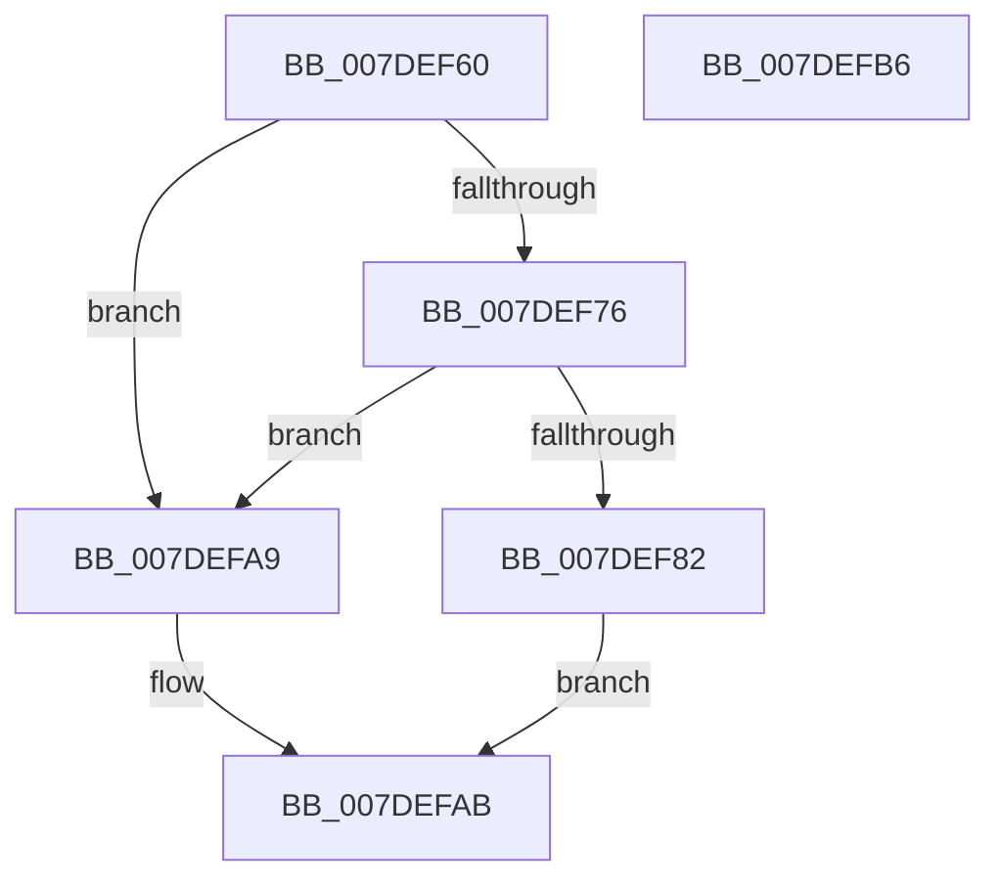

# CmpRefreshWorkerRoutine

- RVA: `0x007DEF60`–`0x007DEFB7` (길이 `87` bytes)
- VA: `0x00000001407DEF60`
- 실행 섹션: `PAGE`
- PDB 이름 있음: `예`; PDB Function 태그: `아니요`
- unwind 정보 RVA: `0x0005CAAC`
- 디코드: `25`개 명령, `87/87` bytes 표시
- 미해석 바이트: `0` (있으면 어셈블리에 `.byte`로 보존)

> 이 문서는 커널 이미지의 기계어와 PDB 기호를 분석해 생성했습니다. 4번과 5번은 함수 원형과 자료형을 바이너리 사용 방식에서 추정한 C 해석이며 원본 소스 복구 결과는 아닙니다.

## 1. Dependencies

- 직접 호출 지점: **3**; 고유 호출 대상: **3**
- 직접 호출자로 확인된 함수: **0**
- RIP 상대 이미지 참조: **0**

### Outgoing calls
- `0x007DEF8A` → [CmpFlushNotifiesOnKeyBodyList](../9B/CmpFlushNotifiesOnKeyBodyList_function_009B3594.md) (function, `0x009B3594`)
- `0x007DEF95` → [CmpMarkKeyUnbacked](../9B/CmpMarkKeyUnbacked_function_009B3C4C.md) (function, `0x009B3C4C`)
- `0x007DEF9D` → [CmpDiscardKcb](../9B/CmpDiscardKcb_function_009B2F34.md) (function, `0x009B2F34`)

### Direct callers
- 이 함수 시작 RVA로 연결되는 직접 call은 확인되지 않았습니다. 간접 호출은 완전히 역산할 수 없습니다.

### Static image references
- 디코드된 RIP-relative 메모리 참조가 없습니다.

## 2. Other-region calls and transfers

- 다른 실행 섹션으로 향하는 call: **0**
- 별도 외부 분기/꼬리 이동을 확인하지 못했습니다.

## 3. Assembly (complete function range)

```asm
007DEF60  48 89 5C 24 08                  mov qword ptr [rsp + 8], rbx
007DEF65  57                              push rdi
007DEF66  48 83 EC 20                     sub rsp, 0x20
007DEF6A  49 8B F8                        mov rdi, r8
007DEF6D  48 8B D9                        mov rbx, rcx
007DEF70  48 39 51 20                     cmp qword ptr [rcx + 0x20], rdx
007DEF74  75 33                           jne 0x1407defa9
007DEF76  F7 81 B8 00 00 00 00 00 04 00   test dword ptr [rcx + 0xb8], 0x40000
007DEF80  75 27                           jne 0x1407defa9
007DEF82  41 B1 01                        mov r9b, 1
007DEF85  BA 08 00 00 00                  mov edx, 8
007DEF8A  E8 05 46 1D 00                  call 0x1409b3594
007DEF8F  48 8B D7                        mov rdx, rdi
007DEF92  48 8B CB                        mov rcx, rbx
007DEF95  E8 B2 4C 1D 00                  call 0x1409b3c4c
007DEF9A  48 8B CB                        mov rcx, rbx
007DEF9D  E8 92 3F 1D 00                  call 0x1409b2f34
007DEFA2  B8 02 00 00 00                  mov eax, 2
007DEFA7  EB 02                           jmp 0x1407defab
007DEFA9  33 C0                           xor eax, eax
007DEFAB  48 8B 5C 24 30                  mov rbx, qword ptr [rsp + 0x30]
007DEFB0  48 83 C4 20                     add rsp, 0x20
007DEFB4  5F                              pop rdi
007DEFB5  C3                              ret
007DEFB6  CC                              int3
```

## 4. C-style interpretation (structured pseudocode)

```c
__int64 __fastcall CmpRefreshWorkerRoutine(__int64 a1, __int64 a2, __int64 a3)
{
    __int64 result;
    __int64 v_rsp;
    unsigned __int64 v_stack_p8;

    v_stack_p8 = v_rbx;
    v_rsp = (v_rsp) - (32);
    if ((*(unsigned __int64 *)(a1 + 32)) != a2) goto loc_007DEFA9;
    if (((*(unsigned int *)(a1 + 184)) & (0x40000ULL)) != 0) goto loc_007DEFA9;
    result = CmpFlushNotifiesOnKeyBodyList(a1, 8, a3, 1);
    result = CmpMarkKeyUnbacked(a1, a3, a3, 1);
    result = CmpDiscardKcb(a1, a3, a3, 1);
    goto loc_007DEFAB;
loc_007DEFA9:
    result = 0;
loc_007DEFAB:
    v_rsp = (v_rsp) + (32);
    return result;
}
```

## 5. (Beta) C Style

```c
int64_t CmpRefreshWorkerRoutine(void *Arg1, int64_t Arg2, int64_t Arg3)
{
    uint8_t *arg1 = (uint8_t *)Arg1;

    int64_t result;
    int64_t local_rsp;
    uint64_t v_stack_p8;

    v_stack_p8 = local_rbx;
    local_rsp = (local_rsp) - (32);
    if ((*(uint64_t *)(arg1 + 0x20)) != Arg2) goto loc_007DEFA9;
    if (((*(uint32_t *)(arg1 + 0xB8)) & (0x40000ULL)) != 0) goto loc_007DEFA9;
    result = CmpFlushNotifiesOnKeyBodyList(Arg1, 8, Arg3, 1);
    result = CmpMarkKeyUnbacked(Arg1, Arg3, Arg3, 1);
    result = CmpDiscardKcb(Arg1, Arg3, Arg3, 1);
    goto loc_007DEFAB;
loc_007DEFA9:
    result = 0;
loc_007DEFAB:
    local_rsp = (local_rsp) + (32);
    return result;
}
```

### 관측된 메모리 오프셋

구조체 형식이 확인되지 않은 접근은 인자 기준의 오프셋으로만 기록했습니다.

| 기준 인자 | 오프셋 표현 | 폭 (bit) | 접근 |
|---|---:|---:|---|
| `Arg1` | `+ 0x20` | `64` | `R` |
| `Arg1` | `+ 0xB8` | `32` | `R` |

## 6. Execution-region graph

[열기: 2D/3D 그래프와 함수 탐색 컨트롤 패널](../../../control-panel.html?section=page&rva=0x007DEF60&view=graph)

- 2D 그래프는 위에서 아래로 흐르고, 3D 그래프는 빈 공간을 드래그해 회전합니다. Shift+드래그는 이동, 휠은 확대·축소, 함수 노드 선택은 대상 보고서 이동입니다.

### Static fallback


