# CmpSaveBootControlSet

- RVA: `0x007DC744`–`0x007DCCA0` (길이 `1,372` bytes)
- VA: `0x00000001407DC744`
- 실행 섹션: `PAGE`
- PDB 이름 있음: `예`; PDB Function 태그: `아니요`
- unwind 정보 RVA: `0x000CCF38`
- 디코드: `345`개 명령, `1,372/1,372` bytes 표시
- 미해석 바이트: `0` (있으면 어셈블리에 `.byte`로 보존)

> 이 문서는 커널 이미지의 기계어와 PDB 기호를 분석해 생성했습니다. 4번과 5번은 함수 원형과 자료형을 바이너리 사용 방식에서 추정한 C 해석이며 원본 소스 복구 결과는 아닙니다.

## 1. Dependencies

- 직접 호출 지점: **42**; 고유 호출 대상: **32**
- 직접 호출자로 확인된 함수: **1**
- RIP 상대 이미지 참조: **6**

### Outgoing calls
- `0x007DC7E2` → [CmpInitializeDelayDerefContext](../../text/42/CmpInitializeDelayDerefContext_function_0042A7F0.md) (function, `0x0042A7F0`)
- `0x007DC7E7` → [CmpAcquireShutdownRundown](../../pagecmrc/BC/CmpAcquireShutdownRundown_function_00BC9400.md) (function, `0x00BC9400`)
- `0x007DC831` → [ZwOpenKey](../../text/6A/ZwOpenKey_function_006AD310.md) (function, `0x006AD310`)
- `0x007DC859` → [ZwQuerySecurityObject](../../text/6A/ZwQuerySecurityObject_function_006AFDF0.md) (function, `0x006AFDF0`)
- `0x007DC876` → [CmpAllocatePool](../../text/3C/CmpAllocatePool_function_003CD504.md) (function, `0x003CD504`)
- `0x007DC89F` → [ZwQuerySecurityObject](../../text/6A/ZwQuerySecurityObject_function_006AFDF0.md) (function, `0x006AFDF0`)
- `0x007DC8AB` → [CmSiFreeMemory](../../text/47/CmSiFreeMemory_function_00475D80.md) (function, `0x00475D80`)
- `0x007DC8CD` → [RtlUnicodeStringPrintf](../../text/48/RtlUnicodeStringPrintf_function_0048B984.md) (function, `0x0048B984`)
- `0x007DC917` → [ZwCreateKey](../../text/6A/ZwCreateKey_function_006AD470.md) (function, `0x006AD470`)
- `0x007DC926` → [CmSiFreeMemory](../../text/47/CmSiFreeMemory_function_00475D80.md) (function, `0x00475D80`)
- `0x007DC94F` → [CmObReferenceObjectByHandle](../../pagecmrc/BC/CmObReferenceObjectByHandle_function_00BC9350.md) (function, `0x00BC9350`)
- `0x007DC979` → [CmObReferenceObjectByHandle](../../pagecmrc/BC/CmObReferenceObjectByHandle_function_00BC9350.md) (function, `0x00BC9350`)
- `0x007DC988` → [CmpLockRegistryExclusive](../84/CmpLockRegistryExclusive_function_0084F9B4.md) (function, `0x0084F9B4`)
- `0x007DC99C` → [CmpPerformKeyBodyDeletionCheck](../../pagecmrc/BC/CmpPerformKeyBodyDeletionCheck_function_00BC97D0.md) (function, `0x00BC97D0`)
- `0x007DC9B0` → [CmpPerformKeyBodyDeletionCheck](../../pagecmrc/BC/CmpPerformKeyBodyDeletionCheck_function_00BC97D0.md) (function, `0x00BC97D0`)
- `0x007DC9CD` → [CmpTryAcquireKcbIXLocks](../9B/CmpTryAcquireKcbIXLocks_function_009B056C.md) (function, `0x009B056C`)
- `0x007DC9F8` → [CmpPrepareToInvalidateAllHigherLayerKcbs](../7F/CmpPrepareToInvalidateAllHigherLayerKcbs_function_007F174C.md) (function, `0x007F174C`)
- `0x007DCA26` → [CmpPrepareForSubtreeInvalidation](../9B/CmpPrepareForSubtreeInvalidation_function_009B01B0.md) (function, `0x009B01B0`)
- `0x007DCA52` → [CmpLogTransactionAbortedWithChildName](../9A/CmpLogTransactionAbortedWithChildName_function_009AED70.md) (function, `0x009AED70`)
- `0x007DCA57` → [CmpUnlockRegistry](../../pagecmrc/BC/CmpUnlockRegistry_function_00BC9A84.md) (function, `0x00BC9A84`)
- `0x007DCA63` → [CmpAbortRollbackPacket](../AB/CmpAbortRollbackPacket_function_00ABEA80.md) (function, `0x00ABEA80`)
- `0x007DCA77` → [CmpRetryBackOff](../94/CmpRetryBackOff_function_0094B474.md) (function, `0x0094B474`)
- `0x007DCA81` → [CmpCleanupRollbackPacket](../9B/CmpCleanupRollbackPacket_function_009B014C.md) (function, `0x009B014C`)
- `0x007DCA8E` → [CmpLockRegistryExclusive](../84/CmpLockRegistryExclusive_function_0084F9B4.md) (function, `0x0084F9B4`)
- `0x007DCAA6` → [CmpInvalidateAllHigherLayerKcbs](../7F/CmpInvalidateAllHigherLayerKcbs_function_007F1560.md) (function, `0x007F1560`)
- `0x007DCAC3` → [CmpInvalidateSubtree](../7E/CmpInvalidateSubtree_function_007EAEC0.md) (function, `0x007EAEC0`)
- `0x007DCACC` → [CmpAttachToRegistryProcess](../../pagecmrc/BC/CmpAttachToRegistryProcess_function_00BC98E0.md) (function, `0x00BC98E0`)
- `0x007DCB16` → [CmpCopySyncTree](../7F/CmpCopySyncTree_function_007F21A0.md) (function, `0x007F21A0`)
- `0x007DCB25` → [CmpRebuildKcbCache](../87/CmpRebuildKcbCache_function_00874DF8.md) (function, `0x00874DF8`)
- `0x007DCB44` → [CmpDrainDelayDerefContext](../../text/41/CmpDrainDelayDerefContext_function_0041B9A0.md) (function, `0x0041B9A0`)
- `0x007DCB4E` → [CmpUnlockRegistry](../../pagecmrc/BC/CmpUnlockRegistry_function_00BC9A84.md) (function, `0x00BC9A84`)
- `0x007DCB5C` → [CmpDetachFromRegistryProcess](../../pagecmrc/BC/CmpDetachFromRegistryProcess_function_00BC9920.md) (function, `0x00BC9920`)
- `0x007DCB66` → [CmpCleanupRollbackPacket](../9B/CmpCleanupRollbackPacket_function_009B014C.md) (function, `0x009B014C`)
- `0x007DCB73` → [ObfDereferenceObject](../../text/2F/ObfDereferenceObject_function_002F9350.md) (function, `0x002F9350`)
- `0x007DCB80` → [ObfDereferenceObject](../../text/2F/ObfDereferenceObject_function_002F9350.md) (function, `0x002F9350`)
- `0x007DCB8F` → [ZwClose](../../text/6A/ZwClose_function_006AD2B0.md) (function, `0x006AD2B0`)
- `0x007DCB9D` → [ZwClose](../../text/6A/ZwClose_function_006AD2B0.md) (function, `0x006AD2B0`)
- `0x007DCBA9` → [CmpReleaseShutdownRundown](../../pagecmrc/BC/CmpReleaseShutdownRundown_function_00BC9880.md) (function, `0x00BC9880`)
- `0x007DCBD0` → [tlgKeywordOn](../../text/42/tlgKeywordOn_function_0042EAA0.md) (function, `0x0042EAA0`)
- `0x007DCC08` → [tlgKeywordOn](../../text/42/tlgKeywordOn_function_0042EAA0.md) (function, `0x0042EAA0`)
- `0x007DCC68` → [tlgWriteTransfer_EtwWriteTransfer](../../text/42/tlgWriteTransfer_EtwWriteTransfer_function_004260E0.md) (function, `0x004260E0`)
- `0x007DCC79` → [_security_check_cookie](../../text/6A/_security_check_cookie_function_006AC640.md) (function, `0x006AC640`)

### Direct callers
- [CmpAcceptBoot](CmpAcceptBoot_function_007DF574.md) at `0x007DF5C9`

### Static image references
- `0x007DC76A` → RVA `0x00E0A740` (`.data`; read)
- `0x007DC7FE` → RVA `0x00FD9EF8` (`PAGEDATA`; read)
- `0x007DC8C2` → RVA `0x00B09030` (` ?? ::NNGAKEGL::`string'`; read)
- `0x007DCBB2` → RVA `0x00E09F58` (`.data`; read)
- `0x007DCBE1` → RVA `0x00055F2A` (`.rdata`; read)
- `0x007DCC15` → RVA `0x00055EE5` (`.rdata`; read)

## 2. Other-region calls and transfers

- 다른 실행 섹션으로 향하는 call: **28**
  - `0x007DC7E2` → [CmpInitializeDelayDerefContext](../../text/42/CmpInitializeDelayDerefContext_function_0042A7F0.md) (`PAGE` → `.text`)
  - `0x007DC7E7` → [CmpAcquireShutdownRundown](../../pagecmrc/BC/CmpAcquireShutdownRundown_function_00BC9400.md) (`PAGE` → `PAGECMRC`)
  - `0x007DC831` → [ZwOpenKey](../../text/6A/ZwOpenKey_function_006AD310.md) (`PAGE` → `.text`)
  - `0x007DC859` → [ZwQuerySecurityObject](../../text/6A/ZwQuerySecurityObject_function_006AFDF0.md) (`PAGE` → `.text`)
  - `0x007DC876` → [CmpAllocatePool](../../text/3C/CmpAllocatePool_function_003CD504.md) (`PAGE` → `.text`)
  - `0x007DC89F` → [ZwQuerySecurityObject](../../text/6A/ZwQuerySecurityObject_function_006AFDF0.md) (`PAGE` → `.text`)
  - `0x007DC8AB` → [CmSiFreeMemory](../../text/47/CmSiFreeMemory_function_00475D80.md) (`PAGE` → `.text`)
  - `0x007DC8CD` → [RtlUnicodeStringPrintf](../../text/48/RtlUnicodeStringPrintf_function_0048B984.md) (`PAGE` → `.text`)
  - `0x007DC917` → [ZwCreateKey](../../text/6A/ZwCreateKey_function_006AD470.md) (`PAGE` → `.text`)
  - `0x007DC926` → [CmSiFreeMemory](../../text/47/CmSiFreeMemory_function_00475D80.md) (`PAGE` → `.text`)
  - `0x007DC94F` → [CmObReferenceObjectByHandle](../../pagecmrc/BC/CmObReferenceObjectByHandle_function_00BC9350.md) (`PAGE` → `PAGECMRC`)
  - `0x007DC979` → [CmObReferenceObjectByHandle](../../pagecmrc/BC/CmObReferenceObjectByHandle_function_00BC9350.md) (`PAGE` → `PAGECMRC`)
  - `0x007DC99C` → [CmpPerformKeyBodyDeletionCheck](../../pagecmrc/BC/CmpPerformKeyBodyDeletionCheck_function_00BC97D0.md) (`PAGE` → `PAGECMRC`)
  - `0x007DC9B0` → [CmpPerformKeyBodyDeletionCheck](../../pagecmrc/BC/CmpPerformKeyBodyDeletionCheck_function_00BC97D0.md) (`PAGE` → `PAGECMRC`)
  - `0x007DCA57` → [CmpUnlockRegistry](../../pagecmrc/BC/CmpUnlockRegistry_function_00BC9A84.md) (`PAGE` → `PAGECMRC`)
  - `0x007DCACC` → [CmpAttachToRegistryProcess](../../pagecmrc/BC/CmpAttachToRegistryProcess_function_00BC98E0.md) (`PAGE` → `PAGECMRC`)
  - `0x007DCB44` → [CmpDrainDelayDerefContext](../../text/41/CmpDrainDelayDerefContext_function_0041B9A0.md) (`PAGE` → `.text`)
  - `0x007DCB4E` → [CmpUnlockRegistry](../../pagecmrc/BC/CmpUnlockRegistry_function_00BC9A84.md) (`PAGE` → `PAGECMRC`)
  - `0x007DCB5C` → [CmpDetachFromRegistryProcess](../../pagecmrc/BC/CmpDetachFromRegistryProcess_function_00BC9920.md) (`PAGE` → `PAGECMRC`)
  - `0x007DCB73` → [ObfDereferenceObject](../../text/2F/ObfDereferenceObject_function_002F9350.md) (`PAGE` → `.text`)
  - `0x007DCB80` → [ObfDereferenceObject](../../text/2F/ObfDereferenceObject_function_002F9350.md) (`PAGE` → `.text`)
  - `0x007DCB8F` → [ZwClose](../../text/6A/ZwClose_function_006AD2B0.md) (`PAGE` → `.text`)
  - `0x007DCB9D` → [ZwClose](../../text/6A/ZwClose_function_006AD2B0.md) (`PAGE` → `.text`)
  - `0x007DCBA9` → [CmpReleaseShutdownRundown](../../pagecmrc/BC/CmpReleaseShutdownRundown_function_00BC9880.md) (`PAGE` → `PAGECMRC`)
  - `0x007DCBD0` → [tlgKeywordOn](../../text/42/tlgKeywordOn_function_0042EAA0.md) (`PAGE` → `.text`)
  - `0x007DCC08` → [tlgKeywordOn](../../text/42/tlgKeywordOn_function_0042EAA0.md) (`PAGE` → `.text`)
  - `0x007DCC68` → [tlgWriteTransfer_EtwWriteTransfer](../../text/42/tlgWriteTransfer_EtwWriteTransfer_function_004260E0.md) (`PAGE` → `.text`)
  - `0x007DCC79` → [_security_check_cookie](../../text/6A/_security_check_cookie_function_006AC640.md) (`PAGE` → `.text`)
- 별도 외부 분기/꼬리 이동을 확인하지 못했습니다.

## 3. Assembly (complete function range)

```asm
007DC744  48 8B C4                        mov rax, rsp
007DC747  48 89 58 10                     mov qword ptr [rax + 0x10], rbx
007DC74B  48 89 70 18                     mov qword ptr [rax + 0x18], rsi
007DC74F  48 89 78 20                     mov qword ptr [rax + 0x20], rdi
007DC753  55                              push rbp
007DC754  41 54                           push r12
007DC756  41 55                           push r13
007DC758  41 56                           push r14
007DC75A  41 57                           push r15
007DC75C  48 8D A8 78 FE FF FF            lea rbp, [rax - 0x188]
007DC763  48 81 EC 60 02 00 00            sub rsp, 0x260
007DC76A  48 8B 05 CF DF 62 00            mov rax, qword ptr [rip + 0x62dfcf]
007DC771  48 33 C4                        xor rax, rsp
007DC774  48 89 85 50 01 00 00            mov qword ptr [rbp + 0x150], rax
007DC77B  33 DB                           xor ebx, ebx
007DC77D  44 0F B7 E1                     movzx r12d, cx
007DC781  0F 57 C0                        xorps xmm0, xmm0
007DC784  89 5C 24 58                     mov dword ptr [rsp + 0x58], ebx
007DC788  33 C0                           xor eax, eax
007DC78A  48 89 5C 24 60                  mov qword ptr [rsp + 0x60], rbx
007DC78F  48 8D 4D 88                     lea rcx, [rbp - 0x78]
007DC793  48 89 45 B8                     mov qword ptr [rbp - 0x48], rax
007DC797  0F 11 45 C8                     movups xmmword ptr [rbp - 0x38], xmm0
007DC79B  89 45 C0                        mov dword ptr [rbp - 0x40], eax
007DC79E  44 8A EB                        mov r13b, bl
007DC7A1  0F 11 45 98                     movups xmmword ptr [rbp - 0x68], xmm0
007DC7A5  8B FB                           mov edi, ebx
007DC7A7  48 89 5C 24 68                  mov qword ptr [rsp + 0x68], rbx
007DC7AC  0F 11 45 A8                     movups xmmword ptr [rbp - 0x58], xmm0
007DC7B0  89 5C 24 5C                     mov dword ptr [rsp + 0x5c], ebx
007DC7B4  44 8A F3                        mov r14b, bl
007DC7B7  0F 11 45 88                     movups xmmword ptr [rbp - 0x78], xmm0
007DC7BB  48 89 5D 80                     mov qword ptr [rbp - 0x80], rbx
007DC7BF  8B F3                           mov esi, ebx
007DC7C1  0F 11 45 D8                     movups xmmword ptr [rbp - 0x28], xmm0
007DC7C5  48 89 5C 24 50                  mov qword ptr [rsp + 0x50], rbx
007DC7CA  44 8B FB                        mov r15d, ebx
007DC7CD  0F 11 45 E8                     movups xmmword ptr [rbp - 0x18], xmm0
007DC7D1  89 5C 24 48                     mov dword ptr [rsp + 0x48], ebx
007DC7D5  0F 11 45 F8                     movups xmmword ptr [rbp - 8], xmm0
007DC7D9  89 5C 24 44                     mov dword ptr [rsp + 0x44], ebx
007DC7DD  0F 11 44 24 70                  movups xmmword ptr [rsp + 0x70], xmm0
007DC7E2  E8 09 E0 C4 FF                  call 0x14042a7f0
007DC7E7  E8 14 CC 3E 00                  call 0x140bc9400
007DC7EC  88 44 24 40                     mov byte ptr [rsp + 0x40], al
007DC7F0  84 C0                           test al, al
007DC7F2  75 0A                           jne 0x1407dc7fe
007DC7F4  BB 89 01 00 C0                  mov ebx, 0xc0000189
007DC7F9  E9 40 03 00 00                  jmp 0x1407dcb3e
007DC7FE  48 8D 05 F3 D6 7F 00            lea rax, [rip + 0x7fd6f3]
007DC805  C7 45 98 30 00 00 00            mov dword ptr [rbp - 0x68], 0x30
007DC80C  0F 57 C0                        xorps xmm0, xmm0
007DC80F  48 89 45 A8                     mov qword ptr [rbp - 0x58], rax
007DC813  4C 8D 45 98                     lea r8, [rbp - 0x68]
007DC817  48 89 5D A0                     mov qword ptr [rbp - 0x60], rbx
007DC81B  BA 19 00 02 00                  mov edx, 0x20019
007DC820  C7 45 B0 40 02 00 00            mov dword ptr [rbp - 0x50], 0x240
007DC827  48 8D 4C 24 60                  lea rcx, [rsp + 0x60]
007DC82C  F3 0F 7F 45 B8                  movdqu xmmword ptr [rbp - 0x48], xmm0
007DC831  E8 DA 0A ED FF                  call 0x1406ad310
007DC836  8B D8                           mov ebx, eax
007DC838  85 C0                           test eax, eax
007DC83A  0F 88 FE 02 00 00               js 0x1407dcb3e
007DC840  48 8B 4C 24 60                  mov rcx, qword ptr [rsp + 0x60]
007DC845  48 8D 44 24 48                  lea rax, [rsp + 0x48]
007DC84A  45 33 C9                        xor r9d, r9d
007DC84D  48 89 44 24 20                  mov qword ptr [rsp + 0x20], rax
007DC852  45 33 C0                        xor r8d, r8d
007DC855  41 8D 51 04                     lea edx, [r9 + 4]
007DC859  E8 92 35 ED FF                  call 0x1406afdf0
007DC85E  BB 00 01 00 00                  mov ebx, 0x100
007DC863  3D 23 00 00 C0                  cmp eax, 0xc0000023
007DC868  75 49                           jne 0x1407dc8b3
007DC86A  8B 54 24 48                     mov edx, dword ptr [rsp + 0x48]
007DC86E  41 B8 43 4D 20 20               mov r8d, 0x20204d43
007DC874  8B CB                           mov ecx, ebx
007DC876  E8 89 0C BF FF                  call 0x1403cd504
007DC87B  4C 8B F8                        mov r15, rax
007DC87E  48 85 C0                        test rax, rax
007DC881  74 30                           je 0x1407dc8b3
007DC883  44 8B 4C 24 48                  mov r9d, dword ptr [rsp + 0x48]
007DC888  48 8D 44 24 48                  lea rax, [rsp + 0x48]
007DC88D  48 8B 4C 24 60                  mov rcx, qword ptr [rsp + 0x60]
007DC892  4D 8B C7                        mov r8, r15
007DC895  BA 04 00 00 00                  mov edx, 4
007DC89A  48 89 44 24 20                  mov qword ptr [rsp + 0x20], rax
007DC89F  E8 4C 35 ED FF                  call 0x1406afdf0
007DC8A4  85 C0                           test eax, eax
007DC8A6  79 0B                           jns 0x1407dc8b3
007DC8A8  49 8B CF                        mov rcx, r15
007DC8AB  E8 D0 94 C9 FF                  call 0x140475d80
007DC8B0  45 33 FF                        xor r15d, r15d
007DC8B3  48 8D 45 50                     lea rax, [rbp + 0x50]
007DC8B7  66 89 5D CA                     mov word ptr [rbp - 0x36], bx
007DC8BB  45 8B C4                        mov r8d, r12d
007DC8BE  48 89 45 D0                     mov qword ptr [rbp - 0x30], rax
007DC8C2  48 8D 15 67 C7 32 00            lea rdx, [rip + 0x32c767]
007DC8C9  48 8D 4D C8                     lea rcx, [rbp - 0x38]
007DC8CD  E8 B2 F0 CA FF                  call 0x14048b984
007DC8D2  48 21 75 A0                     and qword ptr [rbp - 0x60], rsi
007DC8D6  48 8D 45 C8                     lea rax, [rbp - 0x38]
007DC8DA  48 21 75 C0                     and qword ptr [rbp - 0x40], rsi
007DC8DE  4C 8D 45 98                     lea r8, [rbp - 0x68]
007DC8E2  48 89 45 A8                     mov qword ptr [rbp - 0x58], rax
007DC8E6  48 8D 4D 80                     lea rcx, [rbp - 0x80]
007DC8EA  48 8D 44 24 58                  lea rax, [rsp + 0x58]
007DC8EF  C7 45 98 30 00 00 00            mov dword ptr [rbp - 0x68], 0x30
007DC8F6  48 89 44 24 30                  mov qword ptr [rsp + 0x30], rax
007DC8FB  45 33 C9                        xor r9d, r9d
007DC8FE  21 74 24 28                     and dword ptr [rsp + 0x28], esi
007DC902  BA 1F 00 02 00                  mov edx, 0x2001f
007DC907  48 21 74 24 20                  and qword ptr [rsp + 0x20], rsi
007DC90C  C7 45 B0 40 02 00 00            mov dword ptr [rbp - 0x50], 0x240
007DC913  4C 89 7D B8                     mov qword ptr [rbp - 0x48], r15
007DC917  E8 54 0B ED FF                  call 0x1406ad470
007DC91C  8B D8                           mov ebx, eax
007DC91E  4D 85 FF                        test r15, r15
007DC921  74 08                           je 0x1407dc92b
007DC923  49 8B CF                        mov rcx, r15
007DC926  E8 55 94 C9 FF                  call 0x140475d80
007DC92B  85 DB                           test ebx, ebx
007DC92D  0F 88 0B 02 00 00               js 0x1407dcb3e
007DC933  48 21 74 24 28                  and qword ptr [rsp + 0x28], rsi
007DC938  48 8D 44 24 68                  lea rax, [rsp + 0x68]
007DC93D  48 8B 4C 24 60                  mov rcx, qword ptr [rsp + 0x60]
007DC942  45 33 C9                        xor r9d, r9d
007DC945  BA 19 00 02 00                  mov edx, 0x20019
007DC94A  48 89 44 24 20                  mov qword ptr [rsp + 0x20], rax
007DC94F  E8 FC C9 3E 00                  call 0x140bc9350
007DC954  8B D8                           mov ebx, eax
007DC956  85 C0                           test eax, eax
007DC958  0F 88 DB 01 00 00               js 0x1407dcb39
007DC95E  48 21 74 24 28                  and qword ptr [rsp + 0x28], rsi
007DC963  48 8D 44 24 50                  lea rax, [rsp + 0x50]
007DC968  48 8B 4D 80                     mov rcx, qword ptr [rbp - 0x80]
007DC96C  45 33 C9                        xor r9d, r9d
007DC96F  BA 06 00 02 00                  mov edx, 0x20006
007DC974  48 89 44 24 20                  mov qword ptr [rsp + 0x20], rax
007DC979  E8 D2 C9 3E 00                  call 0x140bc9350
007DC97E  8B D8                           mov ebx, eax
007DC980  85 C0                           test eax, eax
007DC982  0F 88 AC 01 00 00               js 0x1407dcb34
007DC988  E8 27 30 07 00                  call 0x14084f9b4
007DC98D  48 8B 7C 24 68                  mov rdi, qword ptr [rsp + 0x68]
007DC992  48 8B 74 24 50                  mov rsi, qword ptr [rsp + 0x50]
007DC997  33 D2                           xor edx, edx
007DC999  48 8B CF                        mov rcx, rdi
007DC99C  E8 2F CE 3E 00                  call 0x140bc97d0
007DC9A1  8B D8                           mov ebx, eax
007DC9A3  85 C0                           test eax, eax
007DC9A5  0F 88 84 01 00 00               js 0x1407dcb2f
007DC9AB  33 D2                           xor edx, edx
007DC9AD  48 8B CE                        mov rcx, rsi
007DC9B0  E8 1B CE 3E 00                  call 0x140bc97d0
007DC9B5  8B D8                           mov ebx, eax
007DC9B7  85 C0                           test eax, eax
007DC9B9  0F 88 70 01 00 00               js 0x1407dcb2f
007DC9BF  4C 8B 7E 08                     mov r15, qword ptr [rsi + 8]
007DC9C3  4C 8D 4C 24 70                  lea r9, [rsp + 0x70]
007DC9C8  49 8B CF                        mov rcx, r15
007DC9CB  B2 01                           mov dl, 1
007DC9CD  E8 9A 3B 1D 00                  call 0x1409b056c
007DC9D2  B9 00 00 00 80                  mov ecx, 0x80000000
007DC9D7  8B D8                           mov ebx, eax
007DC9D9  44 8B E0                        mov r12d, eax
007DC9DC  03 C1                           add eax, ecx
007DC9DE  85 C1                           test ecx, eax
007DC9E0  75 0C                           jne 0x1407dc9ee
007DC9E2  81 FB 2D 02 00 C0               cmp ebx, 0xc000022d
007DC9E8  0F 85 41 01 00 00               jne 0x1407dcb2f
007DC9EE  4C 8D 44 24 70                  lea r8, [rsp + 0x70]
007DC9F3  33 D2                           xor edx, edx
007DC9F5  49 8B CF                        mov rcx, r15
007DC9F8  E8 4F 4D 01 00                  call 0x1407f174c
007DC9FD  8B D8                           mov ebx, eax
007DC9FF  B8 2D 02 00 C0                  mov eax, 0xc000022d
007DCA04  3B D8                           cmp ebx, eax
007DCA06  75 05                           jne 0x1407dca0d
007DCA08  41 B4 01                        mov r12b, 1
007DCA0B  EB 0F                           jmp 0x1407dca1c
007DCA0D  44 3B E0                        cmp r12d, eax
007DCA10  41 0F 94 C4                     sete r12b
007DCA14  85 DB                           test ebx, ebx
007DCA16  0F 88 13 01 00 00               js 0x1407dcb2f
007DCA1C  4C 8D 44 24 70                  lea r8, [rsp + 0x70]
007DCA21  33 D2                           xor edx, edx
007DCA23  49 8B CF                        mov rcx, r15
007DCA26  E8 85 37 1D 00                  call 0x1409b01b0
007DCA2B  8B D8                           mov ebx, eax
007DCA2D  3D 2D 02 00 C0                  cmp eax, 0xc000022d
007DCA32  74 0D                           je 0x1407dca41
007DCA34  85 C0                           test eax, eax
007DCA36  0F 88 F3 00 00 00               js 0x1407dcb2f
007DCA3C  45 84 E4                        test r12b, r12b
007DCA3F  74 57                           je 0x1407dca98
007DCA41  8B 44 24 70                     mov eax, dword ptr [rsp + 0x70]
007DCA45  33 D2                           xor edx, edx
007DCA47  49 8B CF                        mov rcx, r15
007DCA4A  89 44 24 20                     mov dword ptr [rsp + 0x20], eax
007DCA4E  44 8D 42 0C                     lea r8d, [rdx + 0xc]
007DCA52  E8 19 23 1D 00                  call 0x1409aed70
007DCA57  E8 28 D0 3E 00                  call 0x140bc9a84
007DCA5C  33 D2                           xor edx, edx
007DCA5E  48 8D 4C 24 70                  lea rcx, [rsp + 0x70]
007DCA63  E8 18 20 2E 00                  call 0x140abea80
007DCA68  8B D8                           mov ebx, eax
007DCA6A  85 C0                           test eax, eax
007DCA6C  0F 88 CC 00 00 00               js 0x1407dcb3e
007DCA72  48 8D 4C 24 44                  lea rcx, [rsp + 0x44]
007DCA77  E8 F8 E9 16 00                  call 0x14094b474
007DCA7C  48 8D 4C 24 70                  lea rcx, [rsp + 0x70]
007DCA81  E8 C6 36 1D 00                  call 0x1409b014c
007DCA86  0F 57 C0                        xorps xmm0, xmm0
007DCA89  0F 11 44 24 70                  movups xmmword ptr [rsp + 0x70], xmm0
007DCA8E  E8 21 2F 07 00                  call 0x14084f9b4
007DCA93  E9 FF FE FF FF                  jmp 0x1407dc997
007DCA98  45 33 C0                        xor r8d, r8d
007DCA9B  4C 8D 4D 88                     lea r9, [rbp - 0x78]
007DCA9F  49 8B CF                        mov rcx, r15
007DCAA2  41 8D 50 08                     lea edx, [r8 + 8]
007DCAA6  E8 B5 4A 01 00                  call 0x1407f1560
007DCAAB  45 33 C0                        xor r8d, r8d
007DCAAE  48 8D 44 24 5C                  lea rax, [rsp + 0x5c]
007DCAB3  4C 8D 4D 88                     lea r9, [rbp - 0x78]
007DCAB7  48 89 44 24 20                  mov qword ptr [rsp + 0x20], rax
007DCABC  49 8B CF                        mov rcx, r15
007DCABF  41 8D 50 08                     lea edx, [r8 + 8]
007DCAC3  E8 F8 E3 00 00                  call 0x1407eaec0
007DCAC8  48 8D 4D D8                     lea rcx, [rbp - 0x28]
007DCACC  E8 0F CE 3E 00                  call 0x140bc98e0
007DCAD1  83 7C 24 58 01                  cmp dword ptr [rsp + 0x58], 1
007DCAD6  41 B5 01                        mov r13b, 1
007DCAD9  48 8B 47 08                     mov rax, qword ptr [rdi + 8]
007DCADD  4C 8B 50 20                     mov r10, qword ptr [rax + 0x20]
007DCAE1  8B 50 28                        mov edx, dword ptr [rax + 0x28]
007DCAE4  75 10                           jne 0x1407dcaf6
007DCAE6  48 8B 4E 08                     mov rcx, qword ptr [rsi + 8]
007DCAEA  33 C0                           xor eax, eax
007DCAEC  4C 8B 41 20                     mov r8, qword ptr [rcx + 0x20]
007DCAF0  44 8B 49 28                     mov r9d, dword ptr [rcx + 0x28]
007DCAF4  EB 11                           jmp 0x1407dcb07
007DCAF6  4C 8B 4E 08                     mov r9, qword ptr [rsi + 8]
007DCAFA  B8 01 00 00 00                  mov eax, 1
007DCAFF  4D 8B 41 20                     mov r8, qword ptr [r9 + 0x20]
007DCB03  45 8B 49 28                     mov r9d, dword ptr [r9 + 0x28]
007DCB07  89 44 24 28                     mov dword ptr [rsp + 0x28], eax
007DCB0B  49 8B CA                        mov rcx, r10
007DCB0E  C7 44 24 20 02 00 00 00         mov dword ptr [rsp + 0x20], 2
007DCB16  E8 85 56 01 00                  call 0x1407f21a0
007DCB1B  48 8B 4E 08                     mov rcx, qword ptr [rsi + 8]
007DCB1F  48 8D 55 88                     lea rdx, [rbp - 0x78]
007DCB23  8B D8                           mov ebx, eax
007DCB25  E8 CE 82 09 00                  call 0x140874df8
007DCB2A  45 8A F5                        mov r14b, r13b
007DCB2D  EB 0F                           jmp 0x1407dcb3e
007DCB2F  41 B6 01                        mov r14b, 1
007DCB32  EB 0A                           jmp 0x1407dcb3e
007DCB34  48 8B 74 24 50                  mov rsi, qword ptr [rsp + 0x50]
007DCB39  48 8B 7C 24 68                  mov rdi, qword ptr [rsp + 0x68]
007DCB3E  33 D2                           xor edx, edx
007DCB40  48 8D 4D 88                     lea rcx, [rbp - 0x78]
007DCB44  E8 57 EE C3 FF                  call 0x14041b9a0
007DCB49  45 84 F6                        test r14b, r14b
007DCB4C  74 05                           je 0x1407dcb53
007DCB4E  E8 31 CF 3E 00                  call 0x140bc9a84
007DCB53  45 84 ED                        test r13b, r13b
007DCB56  74 09                           je 0x1407dcb61
007DCB58  48 8D 4D D8                     lea rcx, [rbp - 0x28]
007DCB5C  E8 BF CD 3E 00                  call 0x140bc9920
007DCB61  48 8D 4C 24 70                  lea rcx, [rsp + 0x70]
007DCB66  E8 E1 35 1D 00                  call 0x1409b014c
007DCB6B  48 85 FF                        test rdi, rdi
007DCB6E  74 08                           je 0x1407dcb78
007DCB70  48 8B CF                        mov rcx, rdi
007DCB73  E8 D8 C7 B1 FF                  call 0x1402f9350
007DCB78  48 85 F6                        test rsi, rsi
007DCB7B  74 08                           je 0x1407dcb85
007DCB7D  48 8B CE                        mov rcx, rsi
007DCB80  E8 CB C7 B1 FF                  call 0x1402f9350
007DCB85  48 8B 4C 24 60                  mov rcx, qword ptr [rsp + 0x60]
007DCB8A  48 85 C9                        test rcx, rcx
007DCB8D  74 05                           je 0x1407dcb94
007DCB8F  E8 1C 07 ED FF                  call 0x1406ad2b0
007DCB94  48 8B 4D 80                     mov rcx, qword ptr [rbp - 0x80]
007DCB98  48 85 C9                        test rcx, rcx
007DCB9B  74 05                           je 0x1407dcba2
007DCB9D  E8 0E 07 ED FF                  call 0x1406ad2b0
007DCBA2  80 7C 24 40 00                  cmp byte ptr [rsp + 0x40], 0
007DCBA7  74 05                           je 0x1407dcbae
007DCBA9  E8 D2 CC 3E 00                  call 0x140bc9880
007DCBAE  85 DB                           test ebx, ebx
007DCBB0  78 3C                           js 0x1407dcbee
007DCBB2  83 3D 9F D3 62 00 05            cmp dword ptr [rip + 0x62d39f], 5
007DCBB9  0F 86 AE 00 00 00               jbe 0x1407dcc6d
007DCBBF  48 BA 00 00 00 00 00 40 00 00   movabs rdx, 0x400000000000
007DCBC9  48 8D 0D 88 D3 62 00            lea rcx, [rip + 0x62d388]
007DCBD0  E8 CB 1E C5 FF                  call 0x14042eaa0
007DCBD5  84 C0                           test al, al
007DCBD7  0F 84 90 00 00 00               je 0x1407dcc6d
007DCBDD  8B 44 24 5C                     mov eax, dword ptr [rsp + 0x5c]
007DCBE1  48 8D 15 42 93 87 FF            lea rdx, [rip - 0x786cbe]
007DCBE8  89 44 24 44                     mov dword ptr [rsp + 0x44], eax
007DCBEC  EB 2E                           jmp 0x1407dcc1c
007DCBEE  83 3D 63 D3 62 00 05            cmp dword ptr [rip + 0x62d363], 5
007DCBF5  76 76                           jbe 0x1407dcc6d
007DCBF7  48 BA 00 00 00 00 00 40 00 00   movabs rdx, 0x400000000000
007DCC01  48 8D 0D 50 D3 62 00            lea rcx, [rip + 0x62d350]
007DCC08  E8 93 1E C5 FF                  call 0x14042eaa0
007DCC0D  84 C0                           test al, al
007DCC0F  74 5C                           je 0x1407dcc6d
007DCC11  89 5C 24 44                     mov dword ptr [rsp + 0x44], ebx
007DCC15  48 8D 15 C9 92 87 FF            lea rdx, [rip - 0x786d37]
007DCC1C  83 65 3C 00                     and dword ptr [rbp + 0x3c], 0
007DCC20  48 8D 44 24 44                  lea rax, [rsp + 0x44]
007DCC25  83 65 4C 00                     and dword ptr [rbp + 0x4c], 0
007DCC29  B9 04 00 00 00                  mov ecx, 4
007DCC2E  48 89 45 30                     mov qword ptr [rbp + 0x30], rax
007DCC32  45 33 C9                        xor r9d, r9d
007DCC35  48 8D 44 24 50                  lea rax, [rsp + 0x50]
007DCC3A  89 4D 38                        mov dword ptr [rbp + 0x38], ecx
007DCC3D  48 89 45 40                     mov qword ptr [rbp + 0x40], rax
007DCC41  45 33 C0                        xor r8d, r8d
007DCC44  48 8D 45 10                     lea rax, [rbp + 0x10]
007DCC48  48 C7 44 24 50 00 00 00 01      mov qword ptr [rsp + 0x50], 0x1000000
007DCC51  48 89 44 24 28                  mov qword ptr [rsp + 0x28], rax
007DCC56  89 4C 24 20                     mov dword ptr [rsp + 0x20], ecx
007DCC5A  48 8D 0D F7 D2 62 00            lea rcx, [rip + 0x62d2f7]
007DCC61  C7 45 48 08 00 00 00            mov dword ptr [rbp + 0x48], 8
007DCC68  E8 73 94 C4 FF                  call 0x1404260e0
007DCC6D  8B C3                           mov eax, ebx
007DCC6F  48 8B 8D 50 01 00 00            mov rcx, qword ptr [rbp + 0x150]
007DCC76  48 33 CC                        xor rcx, rsp
007DCC79  E8 C2 F9 EC FF                  call 0x1406ac640
007DCC7E  4C 8D 9C 24 60 02 00 00         lea r11, [rsp + 0x260]
007DCC86  49 8B 5B 38                     mov rbx, qword ptr [r11 + 0x38]
007DCC8A  49 8B 73 40                     mov rsi, qword ptr [r11 + 0x40]
007DCC8E  49 8B 7B 48                     mov rdi, qword ptr [r11 + 0x48]
007DCC92  49 8B E3                        mov rsp, r11
007DCC95  41 5F                           pop r15
007DCC97  41 5E                           pop r14
007DCC99  41 5D                           pop r13
007DCC9B  41 5C                           pop r12
007DCC9D  5D                              pop rbp
007DCC9E  C3                              ret
007DCC9F  CC                              int3
```

## 4. C-style interpretation (structured pseudocode)

```c
__int64 __fastcall CmpSaveBootControlSet(unsigned __int16 a1, __int64 a2, __int64 a3, int a4)
{
    __int64 result;
    __int64 v_r12;
    __int64 v_r15;
    __int64 v_rbx;
    __int64 v_rsp;
    unsigned __int64 v_stack_m218;
    unsigned __int64 v_stack_m220;
    unsigned __int64 v_stack_m228;
    unsigned int v_stack_m22C;
    unsigned int v_stack_m230;
    unsigned __int64 v_stack_m238;
    unsigned int v_stack_m240;
    unsigned int v_stack_m244;
    unsigned __int8 v_stack_m248;
    unsigned __int64 v_stack_m258;
    unsigned int v_stack_m260;
    unsigned __int64 v_stack_m268;
    unsigned __int64 v_stack_m28;

    *(unsigned __int64 *)(v_rsp + 16) = v_rbx;
    *(unsigned __int64 *)(v_rsp + 24) = v_rsi;
    *(unsigned __int64 *)(v_rsp + 32) = v_rdi;
    v_rsp = (v_rsp) - (608);
    result = (*(unsigned __int64 *)(v_rip + 6479823)) ^ (v_rsp);
    *(unsigned __int64 *)(v_rsp - 392 + 336) = result;
    v_rbx = 0;
    v_stack_m230 = 0;
    result = 0;
    v_stack_m228 = 0;
    *(unsigned __int64 *)(v_rsp - 392 - 72) = 0;
    *(unsigned __int64 *)(v_rsp - 392 - 56) = v_xmm0;
    *(unsigned int *)(v_rsp - 392 - 64) = 0;
    *(unsigned __int64 *)(v_rsp - 392 - 104) = v_xmm0;
    v_stack_m220 = 0;
    *(unsigned __int64 *)(v_rsp - 392 - 88) = v_xmm0;
    v_stack_m22C = 0;
    *(unsigned __int64 *)(v_rsp - 392 - 120) = v_xmm0;
    *(unsigned __int64 *)(v_rsp - 392 - 128) = 0;
    *(unsigned __int64 *)(v_rsp - 392 - 40) = v_xmm0;
    v_stack_m238 = 0;
    *(unsigned __int64 *)(v_rsp - 392 - 24) = v_xmm0;
    v_stack_m240 = 0;
    *(unsigned __int64 *)(v_rsp - 392 - 8) = v_xmm0;
    v_stack_m244 = 0;
    v_stack_m218 = v_xmm0;
    result = CmpInitializeDelayDerefContext(v_rsp - 392 - 120, a2, a3, a4);
    result = CmpAcquireShutdownRundown(v_rsp - 392 - 120, a2, a3, a4);
    v_stack_m248 = (unsigned __int8)(result);
    if ((unsigned __int8)(result) != 0) goto loc_007DC7FE;
    goto loc_007DCB3E;
loc_007DC7FE:
    *(unsigned int *)(v_rsp - 392 - 104) = 48;
    *(unsigned __int64 *)(v_rsp - 392 - 88) = v_rip + 8378099;
    *(unsigned __int64 *)(v_rsp - 392 - 96) = (unsigned int)(0xC0000189ULL);
    *(unsigned int *)(v_rsp - 392 - 80) = 576;
    *(unsigned __int64 *)(v_rsp - 392 - 72) = v_xmm0;
    result = ZwOpenKey(v_stack_m228, (unsigned int)(0x20019ULL), v_rsp - 392 - 104, a4);
    if (sign_flag) goto loc_007DCB3E;
    a4 = 0;
    v_stack_m268 = v_stack_m240;
    a3 = 0;
    result = ZwQuerySecurityObject(v_stack_m228, a4 + 4, a3, a4);
    if (((unsigned int)(result)) != 0xC0000023ULL) goto loc_007DC8B3;
    result = CmpAllocatePool(256, (unsigned int)(v_stack_m240), (unsigned int)(0x20204D43ULL), a4);
    if (result == 0) goto loc_007DC8B3;
    v_stack_m268 = v_stack_m240;
    result = ZwQuerySecurityObject(v_stack_m228, 4, result, (unsigned int)(v_stack_m240));
    v_r15 = result;
    if (sign_flag) {
        a1 = result;
        result = CmSiFreeMemory(a1, 4, result, (unsigned int)(v_stack_m240));
        v_r15 = 0;
    }
    *(unsigned __int16 *)(v_rsp - 392 - 54) = 256;
    *(unsigned __int64 *)(v_rsp - 392 - 48) = v_rsp - 392 + 80;
    result = RtlUnicodeStringPrintf(v_rsp - 392 - 56, v_rip + 3327847, (unsigned int)(a1), (unsigned int)(v_stack_m240));
    *(unsigned __int64 *)(v_rsp - 392 - 88) = v_rsp - 392 - 56;
    *(unsigned int *)(v_rsp - 392 - 104) = 48;
    v_stack_m258 = v_stack_m230;
    a4 = 0;
    *(unsigned int *)(v_rsp - 392 - 80) = 576;
    *(unsigned __int64 *)(v_rsp - 392 - 72) = 0;
    result = ZwCreateKey(v_rsp - 392 - 128, (unsigned int)(0x2001FULL), v_rsp - 392 - 104, a4);
    if (0 != 0) {
        a1 = 0;
        result = CmSiFreeMemory(a1, (unsigned int)(0x2001FULL), v_rsp - 392 - 104, a4);
    }
    if (sign_flag) goto loc_007DCB3E;
    a4 = 0;
    v_stack_m268 = v_stack_m220;
    result = CmObReferenceObjectByHandle(v_stack_m228, (unsigned int)(0x20019ULL), v_rsp - 392 - 104, a4);
    if (sign_flag) goto loc_007DCB39;
    a4 = 0;
    v_stack_m268 = v_stack_m238;
    result = CmObReferenceObjectByHandle(*(unsigned __int64 *)(v_rsp - 392 - 128), (unsigned int)(0x20006ULL), v_rsp - 392 - 104, a4);
    if (sign_flag) goto loc_007DCB34;
    result = CmpLockRegistryExclusive(*(unsigned __int64 *)(v_rsp - 392 - 128), (unsigned int)(0x20006ULL), v_rsp - 392 - 104, a4);
loc_007DC997:
    a2 = 0;
    result = CmpPerformKeyBodyDeletionCheck(v_stack_m220, a2, v_rsp - 392 - 104, a4);
    if (sign_flag) goto loc_007DCB2F;
    a2 = 0;
    result = CmpPerformKeyBodyDeletionCheck(v_stack_m238, a2, v_rsp - 392 - 104, a4);
    if (sign_flag) goto loc_007DCB2F;
    result = CmpTryAcquireKcbIXLocks(*(unsigned __int64 *)(v_stack_m238 + 8), 1, v_rsp - 392 - 104, v_stack_m218);
    result = (unsigned int)((result) + ((unsigned int)((unsigned int)(0x80000000ULL))));
    if ((((unsigned int)((unsigned int)(0x80000000ULL))) & ((unsigned int)(result))) != 0) goto loc_007DC9EE;
    if (((unsigned int)((unsigned int)((unsigned int)(result)))) != 0xC000022DULL) goto loc_007DCB2F;
loc_007DC9EE:
    a2 = 0;
    result = CmpPrepareToInvalidateAllHigherLayerKcbs(*(unsigned __int64 *)(v_stack_m238 + 8), a2, v_stack_m218, v_stack_m218);
    if (((unsigned int)((unsigned int)((unsigned int)(result)))) != ((unsigned int)((unsigned int)(0xC000022DULL)))) goto loc_007DCA0D;
    goto loc_007DCA1C;
loc_007DCA0D:
    v_r12 = (1 == ((unsigned int)((unsigned int)(0xC000022DULL)))) ? 1 : 0;
    if (sign_flag) goto loc_007DCB2F;
loc_007DCA1C:
    a2 = 0;
    result = CmpPrepareForSubtreeInvalidation(*(unsigned __int64 *)(v_stack_m238 + 8), a2, v_stack_m218, v_stack_m218);
    if (((unsigned int)(result)) == 0xC000022DULL) goto loc_007DCA41;
    if (sign_flag) goto loc_007DCB2F;
    if ((unsigned __int8)(v_r12) == 0) goto loc_007DCA98;
loc_007DCA41:
    a2 = 0;
    v_stack_m268 = (unsigned int)((unsigned int)(v_stack_m218));
    result = CmpLogTransactionAbortedWithChildName(*(unsigned __int64 *)(v_stack_m238 + 8), a2, a2 + 12, v_stack_m218);
    result = CmpUnlockRegistry(*(unsigned __int64 *)(v_stack_m238 + 8), a2, a2 + 12, v_stack_m218);
    a2 = 0;
    result = CmpAbortRollbackPacket(v_stack_m218, a2, a2 + 12, v_stack_m218);
    if (sign_flag) goto loc_007DCB3E;
    result = CmpRetryBackOff(v_stack_m244, a2, a2 + 12, v_stack_m218);
    result = CmpCleanupRollbackPacket(v_stack_m218, a2, a2 + 12, v_stack_m218);
    v_stack_m218 = v_xmm0;
    result = CmpLockRegistryExclusive(v_stack_m218, a2, a2 + 12, v_stack_m218);
    goto loc_007DC997;
loc_007DCA98:
    a3 = 0;
    result = CmpInvalidateAllHigherLayerKcbs(*(unsigned __int64 *)(v_stack_m238 + 8), a3 + 8, a3, v_rsp - 392 - 120);
    a3 = 0;
    v_stack_m268 = v_stack_m22C;
    result = CmpInvalidateSubtree(*(unsigned __int64 *)(v_stack_m238 + 8), a3 + 8, a3, v_rsp - 392 - 120);
    result = CmpAttachToRegistryProcess(v_rsp - 392 - 40, a3 + 8, a3, v_rsp - 392 - 120);
    if (v_stack_m230 != 1) goto loc_007DCAF6;
    result = 0;
    goto loc_007DCB07;
loc_007DCAF6:
loc_007DCB07:
    v_stack_m260 = 1;
    v_stack_m268 = 2;
    result = CmpCopySyncTree(*(unsigned __int64 *)(*(unsigned __int64 *)(v_stack_m220 + 8) + 32), (unsigned int)(*(unsigned int *)(*(unsigned __int64 *)(v_stack_m220 + 8) + 40)), *(unsigned __int64 *)(*(unsigned __int64 *)(v_stack_m238 + 8) + 32), (unsigned int)(*(unsigned int *)(*(unsigned __int64 *)(v_stack_m238 + 8) + 40)));
    result = CmpRebuildKcbCache(*(unsigned __int64 *)(v_stack_m238 + 8), v_rsp - 392 - 120, *(unsigned __int64 *)(*(unsigned __int64 *)(v_stack_m238 + 8) + 32), (unsigned int)(*(unsigned int *)(*(unsigned __int64 *)(v_stack_m238 + 8) + 40)));
    goto loc_007DCB3E;
loc_007DCB2F:
    goto loc_007DCB3E;
loc_007DCB34:
loc_007DCB39:
loc_007DCB3E:
    a2 = 0;
    result = CmpDrainDelayDerefContext(v_rsp - 392 - 120, a2, *(unsigned __int64 *)(*(unsigned __int64 *)(v_stack_m238 + 8) + 32), (unsigned int)(*(unsigned int *)(*(unsigned __int64 *)(v_stack_m238 + 8) + 40)));
    if (1 != 0) {
        result = CmpUnlockRegistry(v_rsp - 392 - 120, a2, *(unsigned __int64 *)(*(unsigned __int64 *)(v_stack_m238 + 8) + 32), (unsigned int)(*(unsigned int *)(*(unsigned __int64 *)(v_stack_m238 + 8) + 40)));
    }
    if (1 != 0) {
        a1 = v_rsp - 392 - 40;
        result = CmpDetachFromRegistryProcess(a1, a2, *(unsigned __int64 *)(*(unsigned __int64 *)(v_stack_m238 + 8) + 32), (unsigned int)(*(unsigned int *)(*(unsigned __int64 *)(v_stack_m238 + 8) + 40)));
    }
    result = CmpCleanupRollbackPacket(v_stack_m218, a2, *(unsigned __int64 *)(*(unsigned __int64 *)(v_stack_m238 + 8) + 32), (unsigned int)(*(unsigned int *)(*(unsigned __int64 *)(v_stack_m238 + 8) + 40)));
    if (v_stack_m220 != 0) {
        a1 = v_stack_m220;
        result = ObfDereferenceObject(a1, a2, *(unsigned __int64 *)(*(unsigned __int64 *)(v_stack_m238 + 8) + 32), (unsigned int)(*(unsigned int *)(*(unsigned __int64 *)(v_stack_m238 + 8) + 40)));
    }
    if (v_stack_m238 != 0) {
        a1 = v_stack_m238;
        result = ObfDereferenceObject(a1, a2, *(unsigned __int64 *)(*(unsigned __int64 *)(v_stack_m238 + 8) + 32), (unsigned int)(*(unsigned int *)(*(unsigned __int64 *)(v_stack_m238 + 8) + 40)));
    }
    if (v_stack_m228 != 0) {
        result = ZwClose(v_stack_m228, a2, *(unsigned __int64 *)(*(unsigned __int64 *)(v_stack_m238 + 8) + 32), (unsigned int)(*(unsigned int *)(*(unsigned __int64 *)(v_stack_m238 + 8) + 40)));
    }
    if (*(unsigned __int64 *)(v_rsp - 392 - 128) != 0) {
        result = ZwClose(*(unsigned __int64 *)(v_rsp - 392 - 128), a2, *(unsigned __int64 *)(*(unsigned __int64 *)(v_stack_m238 + 8) + 32), (unsigned int)(*(unsigned int *)(*(unsigned __int64 *)(v_stack_m238 + 8) + 40)));
    }
    if (v_stack_m248 != 0) {
        result = CmpReleaseShutdownRundown(*(unsigned __int64 *)(v_rsp - 392 - 128), a2, *(unsigned __int64 *)(*(unsigned __int64 *)(v_stack_m238 + 8) + 32), (unsigned int)(*(unsigned int *)(*(unsigned __int64 *)(v_stack_m238 + 8) + 40)));
    }
    if (sign_flag) goto loc_007DCBEE;
    if ((*(unsigned int *)(v_rip + 6476703)) <= 5) goto loc_007DCC6D;
    result = tlgKeywordOn(v_rip + 6476680, a2, *(unsigned __int64 *)(*(unsigned __int64 *)(v_stack_m238 + 8) + 32), (unsigned int)(*(unsigned int *)(*(unsigned __int64 *)(v_stack_m238 + 8) + 40)));
    if ((unsigned __int8)(result) == 0) goto loc_007DCC6D;
    v_stack_m244 = (unsigned int)((unsigned int)(v_stack_m22C));
    goto loc_007DCC1C;
loc_007DCBEE:
    if ((*(unsigned int *)(v_rip + 6476643)) <= 5) goto loc_007DCC6D;
    result = tlgKeywordOn(v_rip + 6476624, v_rip - 7892158, *(unsigned __int64 *)(*(unsigned __int64 *)(v_stack_m238 + 8) + 32), (unsigned int)(*(unsigned int *)(*(unsigned __int64 *)(v_stack_m238 + 8) + 40)));
    if ((unsigned __int8)(result) == 0) goto loc_007DCC6D;
    v_stack_m244 = (unsigned int)((unsigned int)((unsigned int)(result)));
loc_007DCC1C:
    *(unsigned __int64 *)(v_rsp - 392 + 48) = v_stack_m244;
    a4 = 0;
    *(unsigned int *)(v_rsp - 392 + 56) = 4;
    *(unsigned __int64 *)(v_rsp - 392 + 64) = v_stack_m238;
    a3 = 0;
    v_stack_m238 = 0x1000000ULL;
    v_stack_m260 = v_rsp - 392 + 16;
    v_stack_m268 = 4;
    *(unsigned int *)(v_rsp - 392 + 72) = 8;
    result = tlgWriteTransfer_EtwWriteTransfer(v_rip + 6476535, v_rip - 7892279, a3, a4);
loc_007DCC6D:
    a1 = (*(unsigned __int64 *)(v_rsp - 392 + 336)) ^ (v_rsp);
    result = _security_check_cookie(a1, v_rip - 7892279, a3, a4);
    return result;
}
```

## 5. (Beta) C Style

```c
int64_t CmpSaveBootControlSet(uint16_t Arg1, int64_t Arg2, int64_t Arg3, int32_t Arg4)
{
    int64_t result;
    int64_t local_r12;
    int64_t local_r15;
    int64_t local_rbx;
    int64_t local_rsp;
    uint64_t v_stack_m218;
    uint64_t v_stack_m220;
    uint64_t v_stack_m228;
    uint32_t v_stack_m22C;
    uint32_t v_stack_m230;
    uint64_t v_stack_m238;
    uint32_t v_stack_m240;
    uint32_t v_stack_m244;
    uint8_t v_stack_m248;
    uint64_t v_stack_m258;
    uint32_t v_stack_m260;
    uint64_t v_stack_m268;
    uint64_t v_stack_m28;

    *(uint64_t *)(local_rsp + 0x10) = local_rbx;
    *(uint64_t *)(local_rsp + 0x18) = local_rsi;
    *(uint64_t *)(local_rsp + 0x20) = local_rdi;
    local_rsp = (local_rsp) - (608);
    result = (*(uint64_t *)(v_rip + 0x62DFCF)) ^ (local_rsp);
    *(uint64_t *)(local_rsp - 0x188 + 0x150) = result;
    local_rbx = 0;
    v_stack_m230 = 0;
    result = 0;
    v_stack_m228 = 0;
    *(uint64_t *)(local_rsp - 0x188 - 0x48) = 0;
    *(uint64_t *)(local_rsp - 0x188 - 0x38) = v_xmm0;
    *(uint32_t *)(local_rsp - 0x188 - 0x40) = 0;
    *(uint64_t *)(local_rsp - 0x188 - 0x68) = v_xmm0;
    v_stack_m220 = 0;
    *(uint64_t *)(local_rsp - 0x188 - 0x58) = v_xmm0;
    v_stack_m22C = 0;
    *(uint64_t *)(local_rsp - 0x188 - 0x78) = v_xmm0;
    *(uint64_t *)(local_rsp - 0x188 - 0x80) = 0;
    *(uint64_t *)(local_rsp - 0x188 - 0x28) = v_xmm0;
    v_stack_m238 = 0;
    *(uint64_t *)(local_rsp - 0x188 - 0x18) = v_xmm0;
    v_stack_m240 = 0;
    *(uint64_t *)(local_rsp - 0x188 - 0x8) = v_xmm0;
    v_stack_m244 = 0;
    v_stack_m218 = v_xmm0;
    result = CmpInitializeDelayDerefContext(local_rsp - 392 - 120, Arg2, Arg3, Arg4);
    result = CmpAcquireShutdownRundown(local_rsp - 392 - 120, Arg2, Arg3, Arg4);
    v_stack_m248 = (uint8_t)(result);
    if ((uint8_t)(result) != 0) goto loc_007DC7FE;
    goto loc_007DCB3E;
loc_007DC7FE:
    *(uint32_t *)(local_rsp - 0x188 - 0x68) = 48;
    *(uint64_t *)(local_rsp - 0x188 - 0x58) = v_rip + 8378099;
    *(uint64_t *)(local_rsp - 0x188 - 0x60) = (uint32_t)(0xC0000189ULL);
    *(uint32_t *)(local_rsp - 0x188 - 0x50) = 576;
    *(uint64_t *)(local_rsp - 0x188 - 0x48) = v_xmm0;
    result = ZwOpenKey(v_stack_m228, (uint32_t)(0x20019ULL), local_rsp - 392 - 104, Arg4);
    if (sign_flag) goto loc_007DCB3E;
    Arg4 = 0;
    v_stack_m268 = v_stack_m240;
    Arg3 = 0;
    result = ZwQuerySecurityObject(v_stack_m228, Arg4 + 4, Arg3, Arg4);
    if (((uint32_t)(result)) != 0xC0000023ULL) goto loc_007DC8B3;
    result = CmpAllocatePool(256, (uint32_t)(v_stack_m240), (uint32_t)(0x20204D43ULL), Arg4);
    if (result == 0) goto loc_007DC8B3;
    v_stack_m268 = v_stack_m240;
    result = ZwQuerySecurityObject(v_stack_m228, 4, result, (uint32_t)(v_stack_m240));
    local_r15 = result;
    if (sign_flag) {
        Arg1 = result;
        result = CmSiFreeMemory(Arg1, 4, result, (uint32_t)(v_stack_m240));
        local_r15 = 0;
    }
    *(uint16_t *)(local_rsp - 0x188 - 0x36) = 256;
    *(uint64_t *)(local_rsp - 0x188 - 0x30) = local_rsp - 392 + 80;
    result = RtlUnicodeStringPrintf(local_rsp - 392 - 56, v_rip + 3327847, (uint32_t)(Arg1), (uint32_t)(v_stack_m240));
    *(uint64_t *)(local_rsp - 0x188 - 0x58) = local_rsp - 392 - 56;
    *(uint32_t *)(local_rsp - 0x188 - 0x68) = 48;
    v_stack_m258 = v_stack_m230;
    Arg4 = 0;
    *(uint32_t *)(local_rsp - 0x188 - 0x50) = 576;
    *(uint64_t *)(local_rsp - 0x188 - 0x48) = 0;
    result = ZwCreateKey(local_rsp - 392 - 128, (uint32_t)(0x2001FULL), local_rsp - 392 - 104, Arg4);
    if (0 != 0) {
        Arg1 = 0;
        result = CmSiFreeMemory(Arg1, (uint32_t)(0x2001FULL), local_rsp - 392 - 104, Arg4);
    }
    if (sign_flag) goto loc_007DCB3E;
    Arg4 = 0;
    v_stack_m268 = v_stack_m220;
    result = CmObReferenceObjectByHandle(v_stack_m228, (uint32_t)(0x20019ULL), local_rsp - 392 - 104, Arg4);
    if (sign_flag) goto loc_007DCB39;
    Arg4 = 0;
    v_stack_m268 = v_stack_m238;
    result = CmObReferenceObjectByHandle(*(uint64_t *)(local_rsp - 0x188 - 0x80), (uint32_t)(0x20006ULL), local_rsp - 392 - 104, Arg4);
    if (sign_flag) goto loc_007DCB34;
    result = CmpLockRegistryExclusive(*(uint64_t *)(local_rsp - 0x188 - 0x80), (uint32_t)(0x20006ULL), local_rsp - 392 - 104, Arg4);
loc_007DC997:
    Arg2 = 0;
    result = CmpPerformKeyBodyDeletionCheck(v_stack_m220, Arg2, local_rsp - 392 - 104, Arg4);
    if (sign_flag) goto loc_007DCB2F;
    Arg2 = 0;
    result = CmpPerformKeyBodyDeletionCheck(v_stack_m238, Arg2, local_rsp - 392 - 104, Arg4);
    if (sign_flag) goto loc_007DCB2F;
    result = CmpTryAcquireKcbIXLocks(*(uint64_t *)(v_stack_m238 + 0x8), 1, local_rsp - 392 - 104, v_stack_m218);
    result = (uint32_t)((result) + ((uint32_t)((uint32_t)(0x80000000ULL))));
    if ((((uint32_t)((uint32_t)(0x80000000ULL))) & ((uint32_t)(result))) != 0) goto loc_007DC9EE;
    if (((uint32_t)((uint32_t)((uint32_t)(result)))) != 0xC000022DULL) goto loc_007DCB2F;
loc_007DC9EE:
    Arg2 = 0;
    result = CmpPrepareToInvalidateAllHigherLayerKcbs(*(uint64_t *)(v_stack_m238 + 0x8), Arg2, v_stack_m218, v_stack_m218);
    if (((uint32_t)((uint32_t)((uint32_t)(result)))) != ((uint32_t)((uint32_t)(0xC000022DULL)))) goto loc_007DCA0D;
    goto loc_007DCA1C;
loc_007DCA0D:
    local_r12 = (1 == ((uint32_t)((uint32_t)(0xC000022DULL)))) ? 1 : 0;
    if (sign_flag) goto loc_007DCB2F;
loc_007DCA1C:
    Arg2 = 0;
    result = CmpPrepareForSubtreeInvalidation(*(uint64_t *)(v_stack_m238 + 0x8), Arg2, v_stack_m218, v_stack_m218);
    if (((uint32_t)(result)) == 0xC000022DULL) goto loc_007DCA41;
    if (sign_flag) goto loc_007DCB2F;
    if ((uint8_t)(local_r12) == 0) goto loc_007DCA98;
loc_007DCA41:
    Arg2 = 0;
    v_stack_m268 = (uint32_t)((uint32_t)(v_stack_m218));
    result = CmpLogTransactionAbortedWithChildName(*(uint64_t *)(v_stack_m238 + 0x8), Arg2, Arg2 + 12, v_stack_m218);
    result = CmpUnlockRegistry(*(uint64_t *)(v_stack_m238 + 0x8), Arg2, Arg2 + 12, v_stack_m218);
    Arg2 = 0;
    result = CmpAbortRollbackPacket(v_stack_m218, Arg2, Arg2 + 12, v_stack_m218);
    if (sign_flag) goto loc_007DCB3E;
    result = CmpRetryBackOff(v_stack_m244, Arg2, Arg2 + 12, v_stack_m218);
    result = CmpCleanupRollbackPacket(v_stack_m218, Arg2, Arg2 + 12, v_stack_m218);
    v_stack_m218 = v_xmm0;
    result = CmpLockRegistryExclusive(v_stack_m218, Arg2, Arg2 + 12, v_stack_m218);
    goto loc_007DC997;
loc_007DCA98:
    Arg3 = 0;
    result = CmpInvalidateAllHigherLayerKcbs(*(uint64_t *)(v_stack_m238 + 0x8), Arg3 + 8, Arg3, local_rsp - 392 - 120);
    Arg3 = 0;
    v_stack_m268 = v_stack_m22C;
    result = CmpInvalidateSubtree(*(uint64_t *)(v_stack_m238 + 0x8), Arg3 + 8, Arg3, local_rsp - 392 - 120);
    result = CmpAttachToRegistryProcess(local_rsp - 392 - 40, Arg3 + 8, Arg3, local_rsp - 392 - 120);
    if (v_stack_m230 != 1) goto loc_007DCAF6;
    result = 0;
    goto loc_007DCB07;
loc_007DCAF6:
loc_007DCB07:
    v_stack_m260 = 1;
    v_stack_m268 = 2;
    result = CmpCopySyncTree(*(uint64_t *)(*(uint64_t *)(v_stack_m220 + 0x8) + 0x20), (uint32_t)(*(uint32_t *)(*(uint64_t *)(v_stack_m220 + 0x8) + 0x28)), *(uint64_t *)(*(uint64_t *)(v_stack_m238 + 0x8) + 0x20), (uint32_t)(*(uint32_t *)(*(uint64_t *)(v_stack_m238 + 0x8) + 0x28)));
    result = CmpRebuildKcbCache(*(uint64_t *)(v_stack_m238 + 0x8), local_rsp - 392 - 120, *(uint64_t *)(*(uint64_t *)(v_stack_m238 + 0x8) + 0x20), (uint32_t)(*(uint32_t *)(*(uint64_t *)(v_stack_m238 + 0x8) + 0x28)));
    goto loc_007DCB3E;
loc_007DCB2F:
    goto loc_007DCB3E;
loc_007DCB34:
loc_007DCB39:
loc_007DCB3E:
    Arg2 = 0;
    result = CmpDrainDelayDerefContext(local_rsp - 392 - 120, Arg2, *(uint64_t *)(*(uint64_t *)(v_stack_m238 + 0x8) + 0x20), (uint32_t)(*(uint32_t *)(*(uint64_t *)(v_stack_m238 + 0x8) + 0x28)));
    if (1 != 0) {
        result = CmpUnlockRegistry(local_rsp - 392 - 120, Arg2, *(uint64_t *)(*(uint64_t *)(v_stack_m238 + 0x8) + 0x20), (uint32_t)(*(uint32_t *)(*(uint64_t *)(v_stack_m238 + 0x8) + 0x28)));
    }
    if (1 != 0) {
        Arg1 = local_rsp - 392 - 40;
        result = CmpDetachFromRegistryProcess(Arg1, Arg2, *(uint64_t *)(*(uint64_t *)(v_stack_m238 + 0x8) + 0x20), (uint32_t)(*(uint32_t *)(*(uint64_t *)(v_stack_m238 + 0x8) + 0x28)));
    }
    result = CmpCleanupRollbackPacket(v_stack_m218, Arg2, *(uint64_t *)(*(uint64_t *)(v_stack_m238 + 0x8) + 0x20), (uint32_t)(*(uint32_t *)(*(uint64_t *)(v_stack_m238 + 0x8) + 0x28)));
    if (v_stack_m220 != 0) {
        Arg1 = v_stack_m220;
        result = ObfDereferenceObject(Arg1, Arg2, *(uint64_t *)(*(uint64_t *)(v_stack_m238 + 0x8) + 0x20), (uint32_t)(*(uint32_t *)(*(uint64_t *)(v_stack_m238 + 0x8) + 0x28)));
    }
    if (v_stack_m238 != 0) {
        Arg1 = v_stack_m238;
        result = ObfDereferenceObject(Arg1, Arg2, *(uint64_t *)(*(uint64_t *)(v_stack_m238 + 0x8) + 0x20), (uint32_t)(*(uint32_t *)(*(uint64_t *)(v_stack_m238 + 0x8) + 0x28)));
    }
    if (v_stack_m228 != 0) {
        result = ZwClose(v_stack_m228, Arg2, *(uint64_t *)(*(uint64_t *)(v_stack_m238 + 0x8) + 0x20), (uint32_t)(*(uint32_t *)(*(uint64_t *)(v_stack_m238 + 0x8) + 0x28)));
    }
    if (*(uint64_t *)(local_rsp - 0x188 - 0x80) != 0) {
        result = ZwClose(*(uint64_t *)(local_rsp - 0x188 - 0x80), Arg2, *(uint64_t *)(*(uint64_t *)(v_stack_m238 + 0x8) + 0x20), (uint32_t)(*(uint32_t *)(*(uint64_t *)(v_stack_m238 + 0x8) + 0x28)));
    }
    if (v_stack_m248 != 0) {
        result = CmpReleaseShutdownRundown(*(uint64_t *)(local_rsp - 0x188 - 0x80), Arg2, *(uint64_t *)(*(uint64_t *)(v_stack_m238 + 0x8) + 0x20), (uint32_t)(*(uint32_t *)(*(uint64_t *)(v_stack_m238 + 0x8) + 0x28)));
    }
    if (sign_flag) goto loc_007DCBEE;
    if ((*(uint32_t *)(v_rip + 0x62D39F)) <= 5) goto loc_007DCC6D;
    result = tlgKeywordOn(v_rip + 6476680, Arg2, *(uint64_t *)(*(uint64_t *)(v_stack_m238 + 0x8) + 0x20), (uint32_t)(*(uint32_t *)(*(uint64_t *)(v_stack_m238 + 0x8) + 0x28)));
    if ((uint8_t)(result) == 0) goto loc_007DCC6D;
    v_stack_m244 = (uint32_t)((uint32_t)(v_stack_m22C));
    goto loc_007DCC1C;
loc_007DCBEE:
    if ((*(uint32_t *)(v_rip + 0x62D363)) <= 5) goto loc_007DCC6D;
    result = tlgKeywordOn(v_rip + 6476624, v_rip - 7892158, *(uint64_t *)(*(uint64_t *)(v_stack_m238 + 0x8) + 0x20), (uint32_t)(*(uint32_t *)(*(uint64_t *)(v_stack_m238 + 0x8) + 0x28)));
    if ((uint8_t)(result) == 0) goto loc_007DCC6D;
    v_stack_m244 = (uint32_t)((uint32_t)((uint32_t)(result)));
loc_007DCC1C:
    *(uint64_t *)(local_rsp - 0x188 + 0x30) = v_stack_m244;
    Arg4 = 0;
    *(uint32_t *)(local_rsp - 0x188 + 0x38) = 4;
    *(uint64_t *)(local_rsp - 0x188 + 0x40) = v_stack_m238;
    Arg3 = 0;
    v_stack_m238 = 0x1000000ULL;
    v_stack_m260 = local_rsp - 392 + 16;
    v_stack_m268 = 4;
    *(uint32_t *)(local_rsp - 0x188 + 0x48) = 8;
    result = tlgWriteTransfer_EtwWriteTransfer(v_rip + 6476535, v_rip - 7892279, Arg3, Arg4);
loc_007DCC6D:
    Arg1 = (*(uint64_t *)(local_rsp - 0x188 + 0x150)) ^ (local_rsp);
    result = _security_check_cookie(Arg1, v_rip - 7892279, Arg3, Arg4);
    return result;
}
```

## 6. Execution-region graph

[열기: 2D/3D 그래프와 함수 탐색 컨트롤 패널](../../../control-panel.html?section=page&rva=0x007DC744&view=graph)

- 2D 그래프는 위에서 아래로 흐르고, 3D 그래프는 빈 공간을 드래그해 회전합니다. Shift+드래그는 이동, 휠은 확대·축소, 함수 노드 선택은 대상 보고서 이동입니다.

### Static fallback

```mermaid
flowchart TD
  bb_007DC744[BB_007DC744]
  bb_007DC7F4[BB_007DC7F4]
  bb_007DC7FE[BB_007DC7FE]
  bb_007DC840[BB_007DC840]
  bb_007DC86A[BB_007DC86A]
  bb_007DC883[BB_007DC883]
  bb_007DC8A8[BB_007DC8A8]
  bb_007DC8B3[BB_007DC8B3]
  bb_007DC923[BB_007DC923]
  bb_007DC92B[BB_007DC92B]
  bb_007DC933[BB_007DC933]
  bb_007DC95E[BB_007DC95E]
  bb_007DC988[BB_007DC988]
  bb_007DC997[BB_007DC997]
  bb_007DC9AB[BB_007DC9AB]
  bb_007DC9BF[BB_007DC9BF]
  bb_007DC9E2[BB_007DC9E2]
  bb_007DC9EE[BB_007DC9EE]
  bb_007DCA08[BB_007DCA08]
  bb_007DCA0D[BB_007DCA0D]
  bb_007DCA1C[BB_007DCA1C]
  bb_007DCA34[BB_007DCA34]
  bb_007DCA3C[BB_007DCA3C]
  bb_007DCA41[BB_007DCA41]
  bb_007DCA72[BB_007DCA72]
  bb_007DCA98[BB_007DCA98]
  bb_007DCAE6[BB_007DCAE6]
  bb_007DCAF6[BB_007DCAF6]
  bb_007DCB07[BB_007DCB07]
  bb_007DCB2F[BB_007DCB2F]
  bb_007DCB34[BB_007DCB34]
  bb_007DCB39[BB_007DCB39]
  bb_007DCB3E[BB_007DCB3E]
  bb_007DCB4E[BB_007DCB4E]
  bb_007DCB53[BB_007DCB53]
  bb_007DCB58[BB_007DCB58]
  bb_007DCB61[BB_007DCB61]
  bb_007DCB70[BB_007DCB70]
  bb_007DCB78[BB_007DCB78]
  bb_007DCB7D[BB_007DCB7D]
  bb_007DCB85[BB_007DCB85]
  bb_007DCB8F[BB_007DCB8F]
  bb_007DCB94[BB_007DCB94]
  bb_007DCB9D[BB_007DCB9D]
  bb_007DCBA2[BB_007DCBA2]
  bb_007DCBA9[BB_007DCBA9]
  bb_007DCBAE[BB_007DCBAE]
  bb_007DCBB2[BB_007DCBB2]
  bb_007DCBBF[BB_007DCBBF]
  bb_007DCBDD[BB_007DCBDD]
  bb_007DCBEE[BB_007DCBEE]
  bb_007DCBF7[BB_007DCBF7]
  bb_007DCC11[BB_007DCC11]
  bb_007DCC1C[BB_007DCC1C]
  bb_007DCC6D[BB_007DCC6D]
  bb_007DCC9F[BB_007DCC9F]
  bb_007DC744 -->|branch| bb_007DC7FE
  bb_007DC744 -->|fallthrough| bb_007DC7F4
  bb_007DC7F4 -->|branch| bb_007DCB3E
  bb_007DC7FE -->|branch| bb_007DCB3E
  bb_007DC7FE -->|fallthrough| bb_007DC840
  bb_007DC840 -->|branch| bb_007DC8B3
  bb_007DC840 -->|fallthrough| bb_007DC86A
  bb_007DC86A -->|branch| bb_007DC8B3
  bb_007DC86A -->|fallthrough| bb_007DC883
  bb_007DC883 -->|branch| bb_007DC8B3
  bb_007DC883 -->|fallthrough| bb_007DC8A8
  bb_007DC8A8 -->|flow| bb_007DC8B3
  bb_007DC8B3 -->|branch| bb_007DC92B
  bb_007DC8B3 -->|fallthrough| bb_007DC923
  bb_007DC923 -->|flow| bb_007DC92B
  bb_007DC92B -->|branch| bb_007DCB3E
  bb_007DC92B -->|fallthrough| bb_007DC933
  bb_007DC933 -->|branch| bb_007DCB39
  bb_007DC933 -->|fallthrough| bb_007DC95E
  bb_007DC95E -->|branch| bb_007DCB34
  bb_007DC95E -->|fallthrough| bb_007DC988
  bb_007DC988 -->|flow| bb_007DC997
  bb_007DC997 -->|branch| bb_007DCB2F
  bb_007DC997 -->|fallthrough| bb_007DC9AB
  bb_007DC9AB -->|branch| bb_007DCB2F
  bb_007DC9AB -->|fallthrough| bb_007DC9BF
  bb_007DC9BF -->|branch| bb_007DC9EE
  bb_007DC9BF -->|fallthrough| bb_007DC9E2
  bb_007DC9E2 -->|branch| bb_007DCB2F
  bb_007DC9E2 -->|fallthrough| bb_007DC9EE
  bb_007DC9EE -->|branch| bb_007DCA0D
  bb_007DC9EE -->|fallthrough| bb_007DCA08
  bb_007DCA08 -->|branch| bb_007DCA1C
  bb_007DCA0D -->|branch| bb_007DCB2F
  bb_007DCA0D -->|fallthrough| bb_007DCA1C
  bb_007DCA1C -->|branch| bb_007DCA41
  bb_007DCA1C -->|fallthrough| bb_007DCA34
  bb_007DCA34 -->|branch| bb_007DCB2F
  bb_007DCA34 -->|fallthrough| bb_007DCA3C
  bb_007DCA3C -->|branch| bb_007DCA98
  bb_007DCA3C -->|fallthrough| bb_007DCA41
  bb_007DCA41 -->|branch| bb_007DCB3E
  bb_007DCA41 -->|fallthrough| bb_007DCA72
  bb_007DCA72 -->|branch| bb_007DC997
  bb_007DCA98 -->|branch| bb_007DCAF6
  bb_007DCA98 -->|fallthrough| bb_007DCAE6
  bb_007DCAE6 -->|branch| bb_007DCB07
  bb_007DCAF6 -->|flow| bb_007DCB07
  bb_007DCB07 -->|branch| bb_007DCB3E
  bb_007DCB2F -->|branch| bb_007DCB3E
  bb_007DCB34 -->|flow| bb_007DCB39
  bb_007DCB39 -->|flow| bb_007DCB3E
  bb_007DCB3E -->|branch| bb_007DCB53
  bb_007DCB3E -->|fallthrough| bb_007DCB4E
  bb_007DCB4E -->|flow| bb_007DCB53
  bb_007DCB53 -->|branch| bb_007DCB61
  bb_007DCB53 -->|fallthrough| bb_007DCB58
  bb_007DCB58 -->|flow| bb_007DCB61
  bb_007DCB61 -->|branch| bb_007DCB78
  bb_007DCB61 -->|fallthrough| bb_007DCB70
  bb_007DCB70 -->|flow| bb_007DCB78
  bb_007DCB78 -->|branch| bb_007DCB85
  bb_007DCB78 -->|fallthrough| bb_007DCB7D
  bb_007DCB7D -->|flow| bb_007DCB85
  bb_007DCB85 -->|branch| bb_007DCB94
  bb_007DCB85 -->|fallthrough| bb_007DCB8F
  bb_007DCB8F -->|flow| bb_007DCB94
  bb_007DCB94 -->|branch| bb_007DCBA2
  bb_007DCB94 -->|fallthrough| bb_007DCB9D
  bb_007DCB9D -->|flow| bb_007DCBA2
  bb_007DCBA2 -->|branch| bb_007DCBAE
  bb_007DCBA2 -->|fallthrough| bb_007DCBA9
  bb_007DCBA9 -->|flow| bb_007DCBAE
  bb_007DCBAE -->|branch| bb_007DCBEE
  bb_007DCBAE -->|fallthrough| bb_007DCBB2
  bb_007DCBB2 -->|branch| bb_007DCC6D
  bb_007DCBB2 -->|fallthrough| bb_007DCBBF
  bb_007DCBBF -->|branch| bb_007DCC6D
  bb_007DCBBF -->|fallthrough| bb_007DCBDD
  bb_007DCBDD -->|branch| bb_007DCC1C
  bb_007DCBEE -->|branch| bb_007DCC6D
  bb_007DCBEE -->|fallthrough| bb_007DCBF7
  bb_007DCBF7 -->|branch| bb_007DCC6D
  bb_007DCBF7 -->|fallthrough| bb_007DCC11
  bb_007DCC11 -->|flow| bb_007DCC1C
  bb_007DCC1C -->|flow| bb_007DCC6D
```


