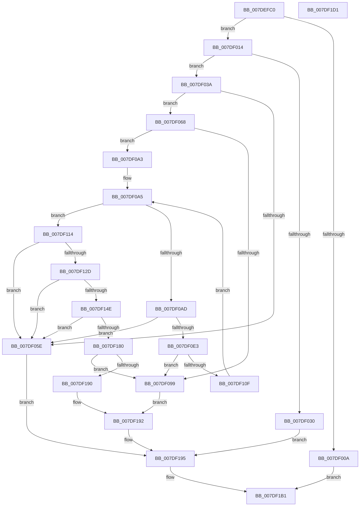

# CmpSaveKeyByFileCopy

- RVA: `0x007DEFC0`–`0x007DF1D2` (길이 `530` bytes)
- VA: `0x00000001407DEFC0`
- 실행 섹션: `PAGE`
- PDB 이름 있음: `예`; PDB Function 태그: `아니요`
- unwind 정보 RVA: `0x000C8B64`
- 디코드: `144`개 명령, `530/530` bytes 표시
- 미해석 바이트: `0` (있으면 어셈블리에 `.byte`로 보존)

> 이 문서는 커널 이미지의 기계어와 PDB 기호를 분석해 생성했습니다. 4번과 5번은 함수 원형과 자료형을 바이너리 사용 방식에서 추정한 C 해석이며 원본 소스 복구 결과는 아닙니다.

## 1. Dependencies

- 직접 호출 지점: **12**; 고유 호출 대상: **7**
- 직접 호출자로 확인된 함수: **1**
- RIP 상대 이미지 참조: **0**

### Outgoing calls
- `0x007DEFFD` → [ExAllocatePool2](../../poolcode/B8/ExAllocatePool2_function_00B820F0.md) (function, `0x00B820F0`)
- `0x007DF017` → [CmpBecomeActiveFlusherAndReconciler](../7E/CmpBecomeActiveFlusherAndReconciler_function_007E7E20.md) (function, `0x007E7E20`)
- `0x007DF052` → [CmpFileRead](../A6/CmpFileRead_function_00A6DBC0.md) (function, `0x00A6DBC0`)
- `0x007DF090` → [CmpFileWrite](../A6/CmpFileWrite_function_00A65840.md) (function, `0x00A65840`)
- `0x007DF0D3` → [CmpFileRead](../A6/CmpFileRead_function_00A6DBC0.md) (function, `0x00A6DBC0`)
- `0x007DF106` → [CmpFileWrite](../A6/CmpFileWrite_function_00A65840.md) (function, `0x00A65840`)
- `0x007DF11D` → [CmpFileFlush](../9B/CmpFileFlush_function_009B9A04.md) (function, `0x009B9A04`)
- `0x007DF13E` → [CmpFileRead](../A6/CmpFileRead_function_00A6DBC0.md) (function, `0x00A6DBC0`)
- `0x007DF170` → [CmpFileWrite](../A6/CmpFileWrite_function_00A65840.md) (function, `0x00A65840`)
- `0x007DF183` → [CmpFileFlush](../9B/CmpFileFlush_function_009B9A04.md) (function, `0x009B9A04`)
- `0x007DF1A2` → [CmpFinishBeingActiveFlusherAndReconciler](../7E/CmpFinishBeingActiveFlusherAndReconciler_function_007E7EB0.md) (function, `0x007E7EB0`)
- `0x007DF1AC` → [ExFreePoolWithTag](../../poolcode/B8/ExFreePoolWithTag_function_00B82870.md) (function, `0x00B82870`)

### Direct callers
- [CmSaveKey](CmSaveKey_function_007DDBDC.md) at `0x007DDE15`

### Static image references
- 디코드된 RIP-relative 메모리 참조가 없습니다.

## 2. Other-region calls and transfers

- 다른 실행 섹션으로 향하는 call: **2**
  - `0x007DEFFD` → [ExAllocatePool2](../../poolcode/B8/ExAllocatePool2_function_00B820F0.md) (`PAGE` → `POOLCODE`)
  - `0x007DF1AC` → [ExFreePoolWithTag](../../poolcode/B8/ExFreePoolWithTag_function_00B82870.md) (`PAGE` → `POOLCODE`)
- 별도 외부 분기/꼬리 이동을 확인하지 못했습니다.

## 3. Assembly (complete function range)

```asm
007DEFC0  48 8B C4                        mov rax, rsp
007DEFC3  48 89 58 08                     mov qword ptr [rax + 8], rbx
007DEFC7  48 89 70 10                     mov qword ptr [rax + 0x10], rsi
007DEFCB  48 89 78 18                     mov qword ptr [rax + 0x18], rdi
007DEFCF  4C 89 60 20                     mov qword ptr [rax + 0x20], r12
007DEFD3  55                              push rbp
007DEFD4  41 56                           push r14
007DEFD6  41 57                           push r15
007DEFD8  48 8B EC                        mov rbp, rsp
007DEFDB  48 83 EC 50                     sub rsp, 0x50
007DEFDF  33 C0                           xor eax, eax
007DEFE1  48 8B DA                        mov rbx, rdx
007DEFE4  48 8B F9                        mov rdi, rcx
007DEFE7  89 45 E4                        mov dword ptr [rbp - 0x1c], eax
007DEFEA  21 45 E4                        and dword ptr [rbp - 0x1c], eax
007DEFED  BA 00 00 01 00                  mov edx, 0x10000
007DEFF2  B9 09 01 00 00                  mov ecx, 0x109
007DEFF7  41 B8 43 4D 20 20               mov r8d, 0x20204d43
007DEFFD  E8 EE 30 3A 00                  call 0x140b820f0
007DF002  48 8B F0                        mov rsi, rax
007DF005  48 85 C0                        test rax, rax
007DF008  75 0A                           jne 0x1407df014
007DF00A  BB 9A 00 00 C0                  mov ebx, 0xc000009a
007DF00F  E9 9D 01 00 00                  jmp 0x1407df1b1
007DF014  48 8B CF                        mov rcx, rdi
007DF017  E8 04 8E 00 00                  call 0x1407e7e20
007DF01C  8B 87 80 10 00 00               mov eax, dword ptr [rdi + 0x1080]
007DF022  41 BE 02 00 00 00               mov r14d, 2
007DF028  48 8B CF                        mov rcx, rdi
007DF02B  41 84 C6                        test r14b, al
007DF02E  74 0A                           je 0x1407df03a
007DF030  BB 9A 00 00 C0                  mov ebx, 0xc000009a
007DF035  E9 5B 01 00 00                  jmp 0x1407df195
007DF03A  48 89 9F 18 06 00 00            mov qword ptr [rdi + 0x618], rbx
007DF041  4C 8B CE                        mov r9, rsi
007DF044  BB 00 10 00 00                  mov ebx, 0x1000
007DF049  45 33 C0                        xor r8d, r8d
007DF04C  33 D2                           xor edx, edx
007DF04E  89 5C 24 20                     mov dword ptr [rsp + 0x20], ebx
007DF052  E8 69 EB 28 00                  call 0x140a6dbc0
007DF057  48 8B CF                        mov rcx, rdi
007DF05A  85 C0                           test eax, eax
007DF05C  79 0A                           jns 0x1407df068
007DF05E  BB 4D 01 00 C0                  mov ebx, 0xc000014d
007DF063  E9 2D 01 00 00                  jmp 0x1407df195
007DF068  44 8B 7E 28                     mov r15d, dword ptr [rsi + 0x28]
007DF06C  4C 8D 45 E0                     lea r8, [rbp - 0x20]
007DF070  83 65 E0 00                     and dword ptr [rbp - 0x20], 0
007DF074  41 BC 01 00 00 00               mov r12d, 1
007DF07A  44 01 66 04                     add dword ptr [rsi + 4], r12d
007DF07E  45 8B CC                        mov r9d, r12d
007DF081  83 64 24 20 00                  and dword ptr [rsp + 0x20], 0
007DF086  41 8B D6                        mov edx, r14d
007DF089  48 89 75 E8                     mov qword ptr [rbp - 0x18], rsi
007DF08D  89 5D F0                        mov dword ptr [rbp - 0x10], ebx
007DF090  E8 AB 67 28 00                  call 0x140a65840
007DF095  85 C0                           test eax, eax
007DF097  79 0A                           jns 0x1407df0a3
007DF099  BB 4D 01 00 C0                  mov ebx, 0xc000014d
007DF09E  E9 EF 00 00 00                  jmp 0x1407df192
007DF0A3  33 DB                           xor ebx, ebx
007DF0A5  48 8B CF                        mov rcx, rdi
007DF0A8  41 3B DF                        cmp ebx, r15d
007DF0AB  73 67                           jae 0x1407df114
007DF0AD  B8 00 00 01 00                  mov eax, 0x10000
007DF0B2  44 8D A3 00 10 00 00            lea r12d, [rbx + 0x1000]
007DF0B9  45 8B F7                        mov r14d, r15d
007DF0BC  4C 8B CE                        mov r9, rsi
007DF0BF  44 2B F3                        sub r14d, ebx
007DF0C2  45 8B C4                        mov r8d, r12d
007DF0C5  44 3B F0                        cmp r14d, eax
007DF0C8  44 0F 47 F0                     cmova r14d, eax
007DF0CC  33 D2                           xor edx, edx
007DF0CE  44 89 74 24 20                  mov dword ptr [rsp + 0x20], r14d
007DF0D3  E8 E8 EA 28 00                  call 0x140a6dbc0
007DF0D8  48 8B CF                        mov rcx, rdi
007DF0DB  85 C0                           test eax, eax
007DF0DD  0F 88 7B FF FF FF               js 0x1407df05e
007DF0E3  83 64 24 20 00                  and dword ptr [rsp + 0x20], 0
007DF0E8  4C 8D 45 E0                     lea r8, [rbp - 0x20]
007DF0EC  44 89 65 E0                     mov dword ptr [rbp - 0x20], r12d
007DF0F0  41 BC 01 00 00 00               mov r12d, 1
007DF0F6  45 8B CC                        mov r9d, r12d
007DF0F9  48 89 75 E8                     mov qword ptr [rbp - 0x18], rsi
007DF0FD  44 89 75 F0                     mov dword ptr [rbp - 0x10], r14d
007DF101  41 8D 54 24 01                  lea edx, [r12 + 1]
007DF106  E8 35 67 28 00                  call 0x140a65840
007DF10B  85 C0                           test eax, eax
007DF10D  78 8A                           js 0x1407df099
007DF10F  41 03 DE                        add ebx, r14d
007DF112  EB 91                           jmp 0x1407df0a5
007DF114  41 BE 02 00 00 00               mov r14d, 2
007DF11A  41 8B D6                        mov edx, r14d
007DF11D  E8 E2 A8 1D 00                  call 0x1409b9a04
007DF122  48 8B CF                        mov rcx, rdi
007DF125  85 C0                           test eax, eax
007DF127  0F 88 31 FF FF FF               js 0x1407df05e
007DF12D  BB 00 10 00 00                  mov ebx, 0x1000
007DF132  4C 8B CE                        mov r9, rsi
007DF135  45 33 C0                        xor r8d, r8d
007DF138  89 5C 24 20                     mov dword ptr [rsp + 0x20], ebx
007DF13C  33 D2                           xor edx, edx
007DF13E  E8 7D EA 28 00                  call 0x140a6dbc0
007DF143  48 8B CF                        mov rcx, rdi
007DF146  85 C0                           test eax, eax
007DF148  0F 88 10 FF FF FF               js 0x1407df05e
007DF14E  44 01 66 04                     add dword ptr [rsi + 4], r12d
007DF152  4C 8D 45 E0                     lea r8, [rbp - 0x20]
007DF156  44 01 66 08                     add dword ptr [rsi + 8], r12d
007DF15A  45 8B CC                        mov r9d, r12d
007DF15D  83 65 E0 00                     and dword ptr [rbp - 0x20], 0
007DF161  41 8B D6                        mov edx, r14d
007DF164  83 64 24 20 00                  and dword ptr [rsp + 0x20], 0
007DF169  48 89 75 E8                     mov qword ptr [rbp - 0x18], rsi
007DF16D  89 5D F0                        mov dword ptr [rbp - 0x10], ebx
007DF170  E8 CB 66 28 00                  call 0x140a65840
007DF175  48 8B CF                        mov rcx, rdi
007DF178  85 C0                           test eax, eax
007DF17A  0F 88 DE FE FF FF               js 0x1407df05e
007DF180  41 8B D6                        mov edx, r14d
007DF183  E8 7C A8 1D 00                  call 0x1409b9a04
007DF188  85 C0                           test eax, eax
007DF18A  0F 88 09 FF FF FF               js 0x1407df099
007DF190  33 DB                           xor ebx, ebx
007DF192  48 8B CF                        mov rcx, rdi
007DF195  B8 18 06 00 00                  mov eax, 0x618
007DF19A  48 83 24 08 00                  and qword ptr [rax + rcx], 0
007DF19F  48 8B CF                        mov rcx, rdi
007DF1A2  E8 09 8D 00 00                  call 0x1407e7eb0
007DF1A7  33 D2                           xor edx, edx
007DF1A9  48 8B CE                        mov rcx, rsi
007DF1AC  E8 BF 36 3A 00                  call 0x140b82870
007DF1B1  4C 8D 5C 24 50                  lea r11, [rsp + 0x50]
007DF1B6  8B C3                           mov eax, ebx
007DF1B8  49 8B 5B 20                     mov rbx, qword ptr [r11 + 0x20]
007DF1BC  49 8B 73 28                     mov rsi, qword ptr [r11 + 0x28]
007DF1C0  49 8B 7B 30                     mov rdi, qword ptr [r11 + 0x30]
007DF1C4  4D 8B 63 38                     mov r12, qword ptr [r11 + 0x38]
007DF1C8  49 8B E3                        mov rsp, r11
007DF1CB  41 5F                           pop r15
007DF1CD  41 5E                           pop r14
007DF1CF  5D                              pop rbp
007DF1D0  C3                              ret
007DF1D1  CC                              int3
```

## 4. C-style interpretation (structured pseudocode)

```c
__int64 __fastcall CmpSaveKeyByFileCopy(__int64 a1, __int64 a2)
{
    __int64 result;
    __int64 v_r14;
    __int64 v_rbx;
    __int64 v_rsp;
    unsigned __int64 v_stack_m18;
    unsigned int v_stack_m28;
    unsigned __int64 v_stack_m30;
    unsigned int v_stack_m34;
    unsigned __int64 v_stack_m38;
    unsigned int v_stack_m48;

    *(unsigned __int64 *)(v_rsp + 8) = v_rbx;
    *(unsigned __int64 *)(v_rsp + 16) = v_rsi;
    *(unsigned __int64 *)(v_rsp + 24) = v_rdi;
    *(unsigned __int64 *)(v_rsp + 32) = v_r12;
    v_rsp = (v_rsp) - (80);
    result = 0;
    v_stack_m34 = 0;
    result = ExAllocatePool2(265, (unsigned int)(0x10000ULL), (unsigned int)(0x20204D43ULL), a4);
    if (result != 0) goto loc_007DF014;
    goto loc_007DF1B1;
loc_007DF014:
    result = CmpBecomeActiveFlusherAndReconciler(a1, (unsigned int)(0x10000ULL), (unsigned int)(0x20204D43ULL), a4);
    if (((2) & ((unsigned __int8)((unsigned int)(*(unsigned int *)(a1 + 4224))))) == 0) goto loc_007DF03A;
    goto loc_007DF195;
loc_007DF03A:
    *(unsigned __int64 *)(a1 + 1560) = (unsigned int)(0xC000009AULL);
    a3 = 0;
    a2 = 0;
    v_stack_m48 = (unsigned int)((unsigned int)(0x1000ULL));
    result = CmpFileRead(a1, a2, a3, result);
    if (!sign_flag) goto loc_007DF068;
loc_007DF05E:
    goto loc_007DF195;
loc_007DF068:
    v_stack_m30 = result;
    v_stack_m28 = (unsigned int)((unsigned int)(0xC000014DULL));
    result = CmpFileWrite(a1, 2, v_stack_m38, 1);
    if (!sign_flag) goto loc_007DF0A3;
loc_007DF099:
    goto loc_007DF192;
loc_007DF0A3:
    v_rbx = 0;
loc_007DF0A5:
    if (0 >= ((unsigned int)((unsigned int)(*(unsigned int *)(result + 40))))) goto loc_007DF114;
    v_r14 = (unsigned int)(((unsigned int)((unsigned int)((unsigned int)(*(unsigned int *)(result + 40))))) - (0));
    if (((unsigned int)(v_r14)) > ((unsigned int)((unsigned int)(0x10000ULL)))) { v_r14 = (unsigned int)((unsigned int)(0x10000ULL)); }
    a2 = 0;
    v_stack_m48 = (unsigned int)(v_r14);
    result = CmpFileRead(a1, a2, (unsigned int)((unsigned int)(v_rbx + 4096)), result);
    if (sign_flag) goto loc_007DF05E;
    v_stack_m38 = (unsigned int)(v_rbx + 4096);
    v_stack_m30 = result;
    v_stack_m28 = (unsigned int)(v_r14);
    result = CmpFileWrite(a1, 1 + 1, v_stack_m38, 1);
    if (sign_flag) goto loc_007DF099;
    v_rbx = (unsigned int)((v_rbx) + ((unsigned int)(v_r14)));
    goto loc_007DF0A5;
loc_007DF114:
    result = CmpFileFlush(a1, 2, v_stack_m38, 1);
    if (sign_flag) goto loc_007DF05E;
    a3 = 0;
    v_stack_m48 = (unsigned int)((unsigned int)(0x1000ULL));
    a2 = 0;
    result = CmpFileRead(a1, a2, a3, result);
    if (sign_flag) goto loc_007DF05E;
    v_stack_m30 = result;
    v_stack_m28 = (unsigned int)((unsigned int)(0x1000ULL));
    result = CmpFileWrite(a1, 2, v_stack_m38, 1);
    if (sign_flag) goto loc_007DF05E;
    result = CmpFileFlush(a1, 2, v_stack_m38, 1);
    if (sign_flag) goto loc_007DF099;
    v_rbx = 0;
loc_007DF192:
loc_007DF195:
    result = CmpFinishBeingActiveFlusherAndReconciler(a1, 2, v_stack_m38, 1);
    a2 = 0;
    result = ExFreePoolWithTag(result, a2, v_stack_m38, 1);
loc_007DF1B1:
    return 0;
}
```

## 5. (Beta) C Style

```c
int64_t CmpSaveKeyByFileCopy(void *Arg1, int64_t Arg2)
{
    uint8_t *arg1 = (uint8_t *)Arg1;

    int64_t result;
    int64_t local_r14;
    int64_t local_rbx;
    int64_t local_rsp;
    uint64_t v_stack_m18;
    uint32_t v_stack_m28;
    uint64_t v_stack_m30;
    uint32_t v_stack_m34;
    uint64_t v_stack_m38;
    uint32_t v_stack_m48;

    *(uint64_t *)(local_rsp + 0x8) = local_rbx;
    *(uint64_t *)(local_rsp + 0x10) = local_rsi;
    *(uint64_t *)(local_rsp + 0x18) = local_rdi;
    *(uint64_t *)(local_rsp + 0x20) = local_r12;
    local_rsp = (local_rsp) - (80);
    result = 0;
    v_stack_m34 = 0;
    result = ExAllocatePool2(265, (uint32_t)(0x10000ULL), (uint32_t)(0x20204D43ULL), a4);
    if (result != 0) goto loc_007DF014;
    goto loc_007DF1B1;
loc_007DF014:
    result = CmpBecomeActiveFlusherAndReconciler(Arg1, (uint32_t)(0x10000ULL), (uint32_t)(0x20204D43ULL), a4);
    if (((2) & ((uint8_t)((uint32_t)(*(uint32_t *)(arg1 + 0x1080))))) == 0) goto loc_007DF03A;
    goto loc_007DF195;
loc_007DF03A:
    *(uint64_t *)(arg1 + 0x618) = (uint32_t)(0xC000009AULL);
    a3 = 0;
    Arg2 = 0;
    v_stack_m48 = (uint32_t)((uint32_t)(0x1000ULL));
    result = CmpFileRead(Arg1, Arg2, a3, result);
    if (!sign_flag) goto loc_007DF068;
loc_007DF05E:
    goto loc_007DF195;
loc_007DF068:
    v_stack_m30 = result;
    v_stack_m28 = (uint32_t)((uint32_t)(0xC000014DULL));
    result = CmpFileWrite(Arg1, 2, v_stack_m38, 1);
    if (!sign_flag) goto loc_007DF0A3;
loc_007DF099:
    goto loc_007DF192;
loc_007DF0A3:
    local_rbx = 0;
loc_007DF0A5:
    if (0 >= ((uint32_t)((uint32_t)(*(uint32_t *)(result + 0x28))))) goto loc_007DF114;
    local_r14 = (uint32_t)(((uint32_t)((uint32_t)((uint32_t)(*(uint32_t *)(result + 0x28))))) - (0));
    if (((uint32_t)(local_r14)) > ((uint32_t)((uint32_t)(0x10000ULL)))) { local_r14 = (uint32_t)((uint32_t)(0x10000ULL)); }
    Arg2 = 0;
    v_stack_m48 = (uint32_t)(local_r14);
    result = CmpFileRead(Arg1, Arg2, (uint32_t)((uint32_t)(local_rbx + 4096)), result);
    if (sign_flag) goto loc_007DF05E;
    v_stack_m38 = (uint32_t)(local_rbx + 4096);
    v_stack_m30 = result;
    v_stack_m28 = (uint32_t)(local_r14);
    result = CmpFileWrite(Arg1, 1 + 1, v_stack_m38, 1);
    if (sign_flag) goto loc_007DF099;
    local_rbx = (uint32_t)((local_rbx) + ((uint32_t)(local_r14)));
    goto loc_007DF0A5;
loc_007DF114:
    result = CmpFileFlush(Arg1, 2, v_stack_m38, 1);
    if (sign_flag) goto loc_007DF05E;
    a3 = 0;
    v_stack_m48 = (uint32_t)((uint32_t)(0x1000ULL));
    Arg2 = 0;
    result = CmpFileRead(Arg1, Arg2, a3, result);
    if (sign_flag) goto loc_007DF05E;
    v_stack_m30 = result;
    v_stack_m28 = (uint32_t)((uint32_t)(0x1000ULL));
    result = CmpFileWrite(Arg1, 2, v_stack_m38, 1);
    if (sign_flag) goto loc_007DF05E;
    result = CmpFileFlush(Arg1, 2, v_stack_m38, 1);
    if (sign_flag) goto loc_007DF099;
    local_rbx = 0;
loc_007DF192:
loc_007DF195:
    result = CmpFinishBeingActiveFlusherAndReconciler(Arg1, 2, v_stack_m38, 1);
    Arg2 = 0;
    result = ExFreePoolWithTag(result, Arg2, v_stack_m38, 1);
loc_007DF1B1:
    return 0;
}
```

### 관측된 메모리 오프셋

구조체 형식이 확인되지 않은 접근은 인자 기준의 오프셋으로만 기록했습니다.

| 기준 인자 | 오프셋 표현 | 폭 (bit) | 접근 |
|---|---:|---:|---|
| `Arg1` | `+ 0x618` | `64` | `W` |
| `Arg1` | `+ 0x1080` | `32` | `R` |

## 6. Execution-region graph

[열기: 2D/3D 그래프와 함수 탐색 컨트롤 패널](../../../control-panel.html?section=page&rva=0x007DEFC0&view=graph)

- 2D 그래프는 위에서 아래로 흐르고, 3D 그래프는 빈 공간을 드래그해 회전합니다. Shift+드래그는 이동, 휠은 확대·축소, 함수 노드 선택은 대상 보고서 이동입니다.

### Static fallback


