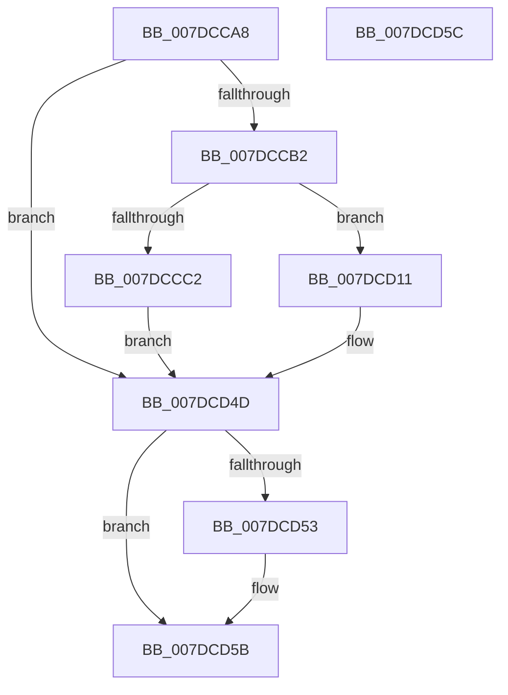

# CmpSetupLoggingState

- RVA: `0x007DCCA8`–`0x007DCD5D` (길이 `181` bytes)
- VA: `0x00000001407DCCA8`
- 실행 섹션: `PAGE`
- PDB 이름 있음: `예`; PDB Function 태그: `아니요`
- unwind 정보 RVA: `0x000DB714`
- 디코드: `44`개 명령, `181/181` bytes 표시
- 미해석 바이트: `0` (있으면 어셈블리에 `.byte`로 보존)

> 이 문서는 커널 이미지의 기계어와 PDB 기호를 분석해 생성했습니다. 4번과 5번은 함수 원형과 자료형을 바이너리 사용 방식에서 추정한 C 해석이며 원본 소스 복구 결과는 아닙니다.

## 1. Dependencies

- 직접 호출 지점: **0**; 고유 호출 대상: **0**
- 직접 호출자로 확인된 함수: **2**
- RIP 상대 이미지 참조: **0**

### Outgoing calls
- 직접 디코드된 call 명령이 없습니다.

### Direct callers
- [CmpInitializePreloadedHive](../../init/C5/CmpInitializePreloadedHive_function_00C58070.md) at `0x00C582B2`
- [CmpInitializeSystemHive](../../init/C5/CmpInitializeSystemHive_function_00C58798.md) at `0x00C5888B`

### Static image references
- 디코드된 RIP-relative 메모리 참조가 없습니다.

## 2. Other-region calls and transfers

- 다른 실행 섹션으로 향하는 call: **0**
- 별도 외부 분기/꼬리 이동을 확인하지 못했습니다.

## 3. Assembly (complete function range)

```asm
007DCCA8  8B 02                           mov eax, dword ptr [rdx]
007DCCAA  A8 01                           test al, 1
007DCCAC  0F 84 9B 00 00 00               je 0x1407dcd4d
007DCCB2  C6 81 C2 00 00 00 00            mov byte ptr [rcx + 0xc2], 0
007DCCB9  44 8B 02                        mov r8d, dword ptr [rdx]
007DCCBC  41 F6 C0 02                     test r8b, 2
007DCCC0  74 4F                           je 0x1407dcd11
007DCCC2  41 83 E0 38                     and r8d, 0x38
007DCCC6  41 8D 40 E0                     lea eax, [r8 - 0x20]
007DCCCA  F7 D8                           neg eax
007DCCCC  1B C0                           sbb eax, eax
007DCCCE  83 C0 05                        add eax, 5
007DCCD1  89 81 A8 00 00 00               mov dword ptr [rcx + 0xa8], eax
007DCCD7  41 83 F8 20                     cmp r8d, 0x20
007DCCDB  0F 94 C0                        sete al
007DCCDE  88 81 C0 00 00 00               mov byte ptr [rcx + 0xc0], al
007DCCE4  0F 95 C0                        setne al
007DCCE7  88 81 C1 00 00 00               mov byte ptr [rcx + 0xc1], al
007DCCED  8B 42 0C                        mov eax, dword ptr [rdx + 0xc]
007DCCF0  89 81 B8 00 00 00               mov dword ptr [rcx + 0xb8], eax
007DCCF6  8B 42 08                        mov eax, dword ptr [rdx + 8]
007DCCF9  89 81 AC 00 00 00               mov dword ptr [rcx + 0xac], eax
007DCCFF  8B 42 0C                        mov eax, dword ptr [rdx + 0xc]
007DCD02  83 A1 B4 00 00 00 00            and dword ptr [rcx + 0xb4], 0
007DCD09  89 81 B0 00 00 00               mov dword ptr [rcx + 0xb0], eax
007DCD0F  EB 3C                           jmp 0x1407dcd4d
007DCD11  66 C7 81 C0 00 00 00 01 01      mov word ptr [rcx + 0xc0], 0x101
007DCD1A  41 C1 E8 03                     shr r8d, 3
007DCD1E  41 83 E0 07                     and r8d, 7
007DCD22  44 89 81 A8 00 00 00            mov dword ptr [rcx + 0xa8], r8d
007DCD29  8B 42 0C                        mov eax, dword ptr [rdx + 0xc]
007DCD2C  89 81 B8 00 00 00               mov dword ptr [rcx + 0xb8], eax
007DCD32  8B 42 08                        mov eax, dword ptr [rdx + 8]
007DCD35  89 81 AC 00 00 00               mov dword ptr [rcx + 0xac], eax
007DCD3B  8B 42 0C                        mov eax, dword ptr [rdx + 0xc]
007DCD3E  89 81 B0 00 00 00               mov dword ptr [rcx + 0xb0], eax
007DCD44  8B 42 10                        mov eax, dword ptr [rdx + 0x10]
007DCD47  89 81 B4 00 00 00               mov dword ptr [rcx + 0xb4], eax
007DCD4D  8B 02                           mov eax, dword ptr [rdx]
007DCD4F  A8 40                           test al, 0x40
007DCD51  74 08                           je 0x1407dcd5b
007DCD53  0F BA A9 10 10 00 00 0F         bts dword ptr [rcx + 0x1010], 0xf
007DCD5B  C3                              ret
007DCD5C  CC                              int3
```

## 4. C-style interpretation (structured pseudocode)

```c
__int64 __fastcall CmpSetupLoggingState(__int64 a1, __int64 a2)
{
    __int64 result;

    if ((((unsigned __int8)((unsigned int)(*(unsigned int *)(a2)))) & (1)) == 0) goto loc_007DCD4D;
    *(unsigned __int8 *)(a1 + 194) = 0;
    if ((((unsigned __int8)((unsigned int)(*(unsigned int *)(a2)))) & (2)) == 0) goto loc_007DCD11;
    a3 = (unsigned int)(((unsigned int)(*(unsigned int *)(a2))) & (56));
    result = (unsigned int)(-(a3 - 32));
    result = (unsigned int)((result) + (5));
    *(unsigned int *)(a1 + 168) = (unsigned int)(result);
    result = (((unsigned int)(a3)) == 32) ? 1 : 0;
    *(unsigned __int8 *)(a1 + 192) = (unsigned __int8)(result);
    result = (((unsigned int)(a3)) != 32) ? 1 : 0;
    *(unsigned __int8 *)(a1 + 193) = (unsigned __int8)(result);
    *(unsigned int *)(a1 + 184) = (unsigned int)((unsigned int)(*(unsigned int *)(a2 + 12)));
    *(unsigned int *)(a1 + 172) = (unsigned int)((unsigned int)(*(unsigned int *)(a2 + 8)));
    *(unsigned int *)(a1 + 176) = (unsigned int)((unsigned int)(*(unsigned int *)(a2 + 12)));
    goto loc_007DCD4D;
loc_007DCD11:
    *(unsigned __int16 *)(a1 + 192) = 257;
    a3 = (unsigned int)((a3) >> (3));
    a3 = (unsigned int)((a3) & (7));
    *(unsigned int *)(a1 + 168) = (unsigned int)(a3);
    *(unsigned int *)(a1 + 184) = (unsigned int)((unsigned int)(*(unsigned int *)(a2 + 12)));
    *(unsigned int *)(a1 + 172) = (unsigned int)((unsigned int)(*(unsigned int *)(a2 + 8)));
    *(unsigned int *)(a1 + 176) = (unsigned int)((unsigned int)(*(unsigned int *)(a2 + 12)));
    *(unsigned int *)(a1 + 180) = (unsigned int)((unsigned int)(*(unsigned int *)(a2 + 16)));
loc_007DCD4D:
    if ((((unsigned __int8)((unsigned int)(*(unsigned int *)(a2)))) & (64)) != 0) {
    }
    return (unsigned int)(*(unsigned int *)(a2));
}
```

## 5. (Beta) C Style

```c
int64_t CmpSetupLoggingState(void *Arg1, void *Arg2)
{
    uint8_t *arg1 = (uint8_t *)Arg1;
    uint8_t *arg2 = (uint8_t *)Arg2;

    int64_t result;

    if ((((uint8_t)((uint32_t)(*(uint32_t *)(arg2)))) & (1)) == 0) goto loc_007DCD4D;
    *(uint8_t *)(arg1 + 0xC2) = 0;
    if ((((uint8_t)((uint32_t)(*(uint32_t *)(arg2)))) & (2)) == 0) goto loc_007DCD11;
    a3 = (uint32_t)(((uint32_t)(*(uint32_t *)(arg2))) & (56));
    result = (uint32_t)(-(a3 - 32));
    result = (uint32_t)((result) + (5));
    *(uint32_t *)(arg1 + 0xA8) = (uint32_t)(result);
    result = (((uint32_t)(a3)) == 32) ? 1 : 0;
    *(uint8_t *)(arg1 + 0xC0) = (uint8_t)(result);
    result = (((uint32_t)(a3)) != 32) ? 1 : 0;
    *(uint8_t *)(arg1 + 0xC1) = (uint8_t)(result);
    *(uint32_t *)(arg1 + 0xB8) = (uint32_t)((uint32_t)(*(uint32_t *)(arg2 + 0xC)));
    *(uint32_t *)(arg1 + 0xAC) = (uint32_t)((uint32_t)(*(uint32_t *)(arg2 + 0x8)));
    *(uint32_t *)(arg1 + 0xB0) = (uint32_t)((uint32_t)(*(uint32_t *)(arg2 + 0xC)));
    goto loc_007DCD4D;
loc_007DCD11:
    *(uint16_t *)(arg1 + 0xC0) = 257;
    a3 = (uint32_t)((a3) >> (3));
    a3 = (uint32_t)((a3) & (7));
    *(uint32_t *)(arg1 + 0xA8) = (uint32_t)(a3);
    *(uint32_t *)(arg1 + 0xB8) = (uint32_t)((uint32_t)(*(uint32_t *)(arg2 + 0xC)));
    *(uint32_t *)(arg1 + 0xAC) = (uint32_t)((uint32_t)(*(uint32_t *)(arg2 + 0x8)));
    *(uint32_t *)(arg1 + 0xB0) = (uint32_t)((uint32_t)(*(uint32_t *)(arg2 + 0xC)));
    *(uint32_t *)(arg1 + 0xB4) = (uint32_t)((uint32_t)(*(uint32_t *)(arg2 + 0x10)));
loc_007DCD4D:
    if ((((uint8_t)((uint32_t)(*(uint32_t *)(arg2)))) & (64)) != 0) {
    }
    return (uint32_t)(*(uint32_t *)(arg2));
}
```

### 관측된 메모리 오프셋

구조체 형식이 확인되지 않은 접근은 인자 기준의 오프셋으로만 기록했습니다.

| 기준 인자 | 오프셋 표현 | 폭 (bit) | 접근 |
|---|---:|---:|---|
| `Arg1` | `+ 0xA8` | `32` | `W` |
| `Arg1` | `+ 0xAC` | `32` | `W` |
| `Arg1` | `+ 0xB0` | `32` | `W` |
| `Arg1` | `+ 0xB4` | `32` | `R/W` |
| `Arg1` | `+ 0xB4` | `32` | `W` |
| `Arg1` | `+ 0xB8` | `32` | `W` |
| `Arg1` | `+ 0xC0` | `8` | `W` |
| `Arg1` | `+ 0xC0` | `16` | `W` |
| `Arg1` | `+ 0xC1` | `8` | `W` |
| `Arg1` | `+ 0xC2` | `8` | `W` |
| `Arg1` | `+ 0x1010` | `32` | `R/W` |
| `Arg2` | `+ 0x0` | `32` | `R` |
| `Arg2` | `+ 0x8` | `32` | `R` |
| `Arg2` | `+ 0xC` | `32` | `R` |
| `Arg2` | `+ 0x10` | `32` | `R` |

## 6. Execution-region graph

[열기: 2D/3D 그래프와 함수 탐색 컨트롤 패널](../../../control-panel.html?section=page&rva=0x007DCCA8&view=graph)

- 2D 그래프는 위에서 아래로 흐르고, 3D 그래프는 빈 공간을 드래그해 회전합니다. Shift+드래그는 이동, 휠은 확대·축소, 함수 노드 선택은 대상 보고서 이동입니다.

### Static fallback


