# ExRegisterExtension

- RVA: `0x007D0420`–`0x007D06C5` (길이 `677` bytes)
- VA: `0x00000001407D0420`
- 실행 섹션: `PAGE`
- PDB 이름 있음: `예`; PDB Function 태그: `아니요`
- unwind 정보 RVA: `0x000BE7D0`
- 디코드: `186`개 명령, `677/677` bytes 표시
- 미해석 바이트: `0` (있으면 어셈블리에 `.byte`로 보존)

> 이 문서는 커널 이미지의 기계어와 PDB 기호를 분석해 생성했습니다. 4번과 5번은 함수 원형과 자료형을 바이너리 사용 방식에서 추정한 C 해석이며 원본 소스 복구 결과는 아닙니다.

## 1. Dependencies

- 직접 호출 지점: **19**; 고유 호출 대상: **11**
- 직접 호출자로 확인된 함수: **0**
- RIP 상대 이미지 참조: **2**

### Outgoing calls
- `0x007D0489` → [KeAbPreAcquire](../../text/21/KeAbPreAcquire_function_00210230.md) (function, `0x00210230`)
- `0x007D04AC` → [ExfAcquirePushLockSharedEx](../../text/21/ExfAcquirePushLockSharedEx_function_0021044C.md) (function, `0x0021044C`)
- `0x007D04CD` → [ExpFindHost](ExpFindHost_function_007D09C8.md) (function, `0x007D09C8`)
- `0x007D0514` → [ExpDereferenceHost](ExpDereferenceHost_function_007D0990.md) (function, `0x007D0990`)
- `0x007D052D` → [ExfReleasePushLockShared](../../text/26/ExfReleasePushLockShared_function_00263440.md) (function, `0x00263440`)
- `0x007D0535` → [KeAbPostRelease](../../text/2E/KeAbPostRelease_function_002E1600.md) (function, `0x002E1600`)
- `0x007D053A` → [KeLeaveCriticalRegion](../../text/25/KeLeaveCriticalRegion_function_0025D8B0.md) (function, `0x0025D8B0`)
- `0x007D056B` → [KeAbPreAcquire](../../text/21/KeAbPreAcquire_function_00210230.md) (function, `0x00210230`)
- `0x007D0584` → [ExfAcquirePushLockExclusiveEx](../../text/20/ExfAcquirePushLockExclusiveEx_function_0020FC90.md) (function, `0x0020FC90`)
- `0x007D05CE` → [guard_dispatch_icall](../../text/6B/guard_dispatch_icall_function_006BAAD0.md) (function, `0x006BAAD0`)
- `0x007D0622` → [guard_dispatch_icall](../../text/6B/guard_dispatch_icall_function_006BAAD0.md) (function, `0x006BAAD0`)
- `0x007D062E` → [ExpVerifyCallbackResult](ExpVerifyCallbackResult_function_007D0A10.md) (function, `0x007D0A10`)
- `0x007D0647` → [ExfTryToWakePushLock](../../text/26/ExfTryToWakePushLock_function_00265DD0.md) (function, `0x00265DD0`)
- `0x007D064F` → [KeAbPostRelease](../../text/2E/KeAbPostRelease_function_002E1600.md) (function, `0x002E1600`)
- `0x007D0654` → [KeLeaveCriticalRegion](../../text/25/KeLeaveCriticalRegion_function_0025D8B0.md) (function, `0x0025D8B0`)
- `0x007D068C` → [ExfTryToWakePushLock](../../text/26/ExfTryToWakePushLock_function_00265DD0.md) (function, `0x00265DD0`)
- `0x007D0694` → [KeAbPostRelease](../../text/2E/KeAbPostRelease_function_002E1600.md) (function, `0x002E1600`)
- `0x007D0699` → [KeLeaveCriticalRegion](../../text/25/KeLeaveCriticalRegion_function_0025D8B0.md) (function, `0x0025D8B0`)
- `0x007D06A1` → [ExpDereferenceHost](ExpDereferenceHost_function_007D0990.md) (function, `0x007D0990`)

### Direct callers
- 이 함수 시작 RVA로 연결되는 직접 call은 확인되지 않았습니다. 간접 호출은 완전히 역산할 수 없습니다.

### Static image references
- `0x007D046E` → RVA `0x00FD9D38` (`PAGEDATA`; read)
- `0x007D05E8` → RVA `0x00FC6C08` (`ALMOSTRO`; read)

## 2. Other-region calls and transfers

- 다른 실행 섹션으로 향하는 call: **15**
  - `0x007D0489` → [KeAbPreAcquire](../../text/21/KeAbPreAcquire_function_00210230.md) (`PAGE` → `.text`)
  - `0x007D04AC` → [ExfAcquirePushLockSharedEx](../../text/21/ExfAcquirePushLockSharedEx_function_0021044C.md) (`PAGE` → `.text`)
  - `0x007D052D` → [ExfReleasePushLockShared](../../text/26/ExfReleasePushLockShared_function_00263440.md) (`PAGE` → `.text`)
  - `0x007D0535` → [KeAbPostRelease](../../text/2E/KeAbPostRelease_function_002E1600.md) (`PAGE` → `.text`)
  - `0x007D053A` → [KeLeaveCriticalRegion](../../text/25/KeLeaveCriticalRegion_function_0025D8B0.md) (`PAGE` → `.text`)
  - `0x007D056B` → [KeAbPreAcquire](../../text/21/KeAbPreAcquire_function_00210230.md) (`PAGE` → `.text`)
  - `0x007D0584` → [ExfAcquirePushLockExclusiveEx](../../text/20/ExfAcquirePushLockExclusiveEx_function_0020FC90.md) (`PAGE` → `.text`)
  - `0x007D05CE` → [guard_dispatch_icall](../../text/6B/guard_dispatch_icall_function_006BAAD0.md) (`PAGE` → `.text`)
  - `0x007D0622` → [guard_dispatch_icall](../../text/6B/guard_dispatch_icall_function_006BAAD0.md) (`PAGE` → `.text`)
  - `0x007D0647` → [ExfTryToWakePushLock](../../text/26/ExfTryToWakePushLock_function_00265DD0.md) (`PAGE` → `.text`)
  - `0x007D064F` → [KeAbPostRelease](../../text/2E/KeAbPostRelease_function_002E1600.md) (`PAGE` → `.text`)
  - `0x007D0654` → [KeLeaveCriticalRegion](../../text/25/KeLeaveCriticalRegion_function_0025D8B0.md) (`PAGE` → `.text`)
  - `0x007D068C` → [ExfTryToWakePushLock](../../text/26/ExfTryToWakePushLock_function_00265DD0.md) (`PAGE` → `.text`)
  - `0x007D0694` → [KeAbPostRelease](../../text/2E/KeAbPostRelease_function_002E1600.md) (`PAGE` → `.text`)
  - `0x007D0699` → [KeLeaveCriticalRegion](../../text/25/KeLeaveCriticalRegion_function_0025D8B0.md) (`PAGE` → `.text`)
- 별도 외부 분기/꼬리 이동을 확인하지 못했습니다.

## 3. Assembly (complete function range)

```asm
007D0420  48 89 5C 24 08                  mov qword ptr [rsp + 8], rbx
007D0425  55                              push rbp
007D0426  56                              push rsi
007D0427  57                              push rdi
007D0428  41 54                           push r12
007D042A  41 55                           push r13
007D042C  41 56                           push r14
007D042E  41 57                           push r15
007D0430  48 83 EC 30                     sub rsp, 0x30
007D0434  45 33 ED                        xor r13d, r13d
007D0437  0F 57 C0                        xorps xmm0, xmm0
007D043A  4D 8B F0                        mov r14, r8
007D043D  4C 8B E1                        mov r12, rcx
007D0440  45 8B FD                        mov r15d, r13d
007D0443  0F 11 44 24 20                  movups xmmword ptr [rsp + 0x20], xmm0
007D0448  81 FA 01 00 01 00               cmp edx, 0x10001
007D044E  0F 85 56 02 00 00               jne 0x1407d06aa
007D0454  4D 39 68 08                     cmp qword ptr [r8 + 8], r13
007D0458  75 0B                           jne 0x1407d0465
007D045A  66 45 39 68 06                  cmp word ptr [r8 + 6], r13w
007D045F  0F 85 45 02 00 00               jne 0x1407d06aa
007D0465  65 48 8B 04 25 88 01 00 00      mov rax, qword ptr gs:[0x188]
007D046E  48 8D 35 C3 98 80 00            lea rsi, [rip + 0x8098c3]
007D0475  48 83 CB FF                     or rbx, 0xffffffffffffffff
007D0479  45 33 C0                        xor r8d, r8d
007D047C  33 D2                           xor edx, edx
007D047E  48 8B CE                        mov rcx, rsi
007D0481  66 01 98 E4 01 00 00            add word ptr [rax + 0x1e4], bx
007D0488  90                              nop
007D0489  E8 A2 FD A3 FF                  call 0x140210230
007D048E  48 8B F8                        mov rdi, rax
007D0491  8D 6B 12                        lea ebp, [rbx + 0x12]
007D0494  33 C0                           xor eax, eax
007D0496  F0 48 0F B1 2D 99 98 80 00      lock cmpxchg qword ptr [rip + 0x809899], rbp
007D049F  74 10                           je 0x1407d04b1
007D04A1  4C 8B CE                        mov r9, rsi
007D04A4  4C 8B C7                        mov r8, rdi
007D04A7  33 D2                           xor edx, edx
007D04A9  48 8B CE                        mov rcx, rsi
007D04AC  E8 9B FF A3 FF                  call 0x14021044c
007D04B1  41 BA 01 00 00 00               mov r10d, 1
007D04B7  48 85 FF                        test rdi, rdi
007D04BA  74 04                           je 0x1407d04c0
007D04BC  44 88 57 0A                     mov byte ptr [rdi + 0xa], r10b
007D04C0  45 8B 46 02                     mov r8d, dword ptr [r14 + 2]
007D04C4  41 0F B7 0E                     movzx ecx, word ptr [r14]
007D04C8  44 89 44 24 78                  mov dword ptr [rsp + 0x78], r8d
007D04CD  E8 F6 04 00 00                  call 0x1407d09c8
007D04D2  48 8B F8                        mov rdi, rax
007D04D5  48 85 C0                        test rax, rax
007D04D8  74 3F                           je 0x1407d0519
007D04DA  44 0F B7 48 30                  movzx r9d, word ptr [rax + 0x30]
007D04DF  41 0F B7 CD                     movzx ecx, r13w
007D04E3  66 41 3B C9                     cmp cx, r9w
007D04E7  73 28                           jae 0x1407d0511
007D04E9  0F B7 D1                        movzx edx, cx
007D04EC  48 C1 E2 04                     shl rdx, 4
007D04F0  48 03 57 28                     add rdx, qword ptr [rdi + 0x28]
007D04F4  8B 02                           mov eax, dword ptr [rdx]
007D04F6  66 41 3B C0                     cmp ax, r8w
007D04FA  75 0A                           jne 0x1407d0506
007D04FC  C1 E8 10                        shr eax, 0x10
007D04FF  66 3B 44 24 7A                  cmp ax, word ptr [rsp + 0x7a]
007D0504  73 06                           jae 0x1407d050c
007D0506  66 41 03 CA                     add cx, r10w
007D050A  EB D7                           jmp 0x1407d04e3
007D050C  4C 8B FA                        mov r15, rdx
007D050F  EB 0B                           jmp 0x1407d051c
007D0511  48 8B CF                        mov rcx, rdi
007D0514  E8 77 04 00 00                  call 0x1407d0990
007D0519  49 8B FD                        mov rdi, r13
007D051C  48 8B C5                        mov rax, rbp
007D051F  F0 4C 0F B1 2D 10 98 80 00      lock cmpxchg qword ptr [rip + 0x809810], r13
007D0528  74 08                           je 0x1407d0532
007D052A  48 8B CE                        mov rcx, rsi
007D052D  E8 0E 2F A9 FF                  call 0x140263440
007D0532  48 8B CE                        mov rcx, rsi
007D0535  E8 C6 10 B1 FF                  call 0x1402e1600
007D053A  E8 71 D3 A8 FF                  call 0x14025d8b0
007D053F  48 85 FF                        test rdi, rdi
007D0542  75 0A                           jne 0x1407d054e
007D0544  BE 25 02 00 C0                  mov esi, 0xc0000225
007D0549  E9 58 01 00 00                  jmp 0x1407d06a6
007D054E  65 48 8B 04 25 88 01 00 00      mov rax, qword ptr gs:[0x188]
007D0557  48 8D 77 20                     lea rsi, [rdi + 0x20]
007D055B  45 33 C0                        xor r8d, r8d
007D055E  33 D2                           xor edx, edx
007D0560  48 8B CE                        mov rcx, rsi
007D0563  66 01 98 E4 01 00 00            add word ptr [rax + 0x1e4], bx
007D056A  90                              nop
007D056B  E8 C0 FC A3 FF                  call 0x140210230
007D0570  F0 48 0F BA 2E 00               lock bts qword ptr [rsi], 0
007D0576  48 8B E8                        mov rbp, rax
007D0579  73 0E                           jae 0x1407d0589
007D057B  4C 8B C6                        mov r8, rsi
007D057E  48 8B D0                        mov rdx, rax
007D0581  48 8B CE                        mov rcx, rsi
007D0584  E8 07 F7 A3 FF                  call 0x14020fc90
007D0589  48 85 ED                        test rbp, rbp
007D058C  74 04                           je 0x1407d0592
007D058E  C6 45 0A 01                     mov byte ptr [rbp + 0xa], 1
007D0592  4C 39 6F 60                     cmp qword ptr [rdi + 0x60], r13
007D0596  0F 85 D6 00 00 00               jne 0x1407d0672
007D059C  F6 47 70 01                     test byte ptr [rdi + 0x70], 1
007D05A0  0F 85 CC 00 00 00               jne 0x1407d0672
007D05A6  41 8B 46 02                     mov eax, dword ptr [r14 + 2]
007D05AA  89 44 24 24                     mov dword ptr [rsp + 0x24], eax
007D05AE  48 89 7C 24 28                  mov qword ptr [rsp + 0x28], rdi
007D05B3  41 8B 07                        mov eax, dword ptr [r15]
007D05B6  89 44 24 20                     mov dword ptr [rsp + 0x20], eax
007D05BA  48 8B 47 40                     mov rax, qword ptr [rdi + 0x40]
007D05BE  48 85 C0                        test rax, rax
007D05C1  74 1A                           je 0x1407d05dd
007D05C3  48 8B 57 48                     mov rdx, qword ptr [rdi + 0x48]
007D05C7  4C 8D 44 24 20                  lea r8, [rsp + 0x20]
007D05CC  33 C9                           xor ecx, ecx
007D05CE  E8 FD A4 EE FF                  call 0x1406baad0
007D05D3  8B F0                           mov esi, eax
007D05D5  85 C0                           test eax, eax
007D05D7  0F 88 9A 00 00 00               js 0x1407d0677
007D05DD  49 8B 4E 08                     mov rcx, qword ptr [r14 + 8]
007D05E1  41 8B 46 02                     mov eax, dword ptr [r14 + 2]
007D05E5  48 85 C9                        test rcx, rcx
007D05E8  48 0F 44 0D 18 66 7F 00         cmove rcx, qword ptr [rip + 0x7f6618]
007D05F0  89 47 50                        mov dword ptr [rdi + 0x50], eax
007D05F3  48 89 4F 60                     mov qword ptr [rdi + 0x60], rcx
007D05F7  41 0F B7 46 06                  movzx eax, word ptr [r14 + 6]
007D05FC  66 89 47 68                     mov word ptr [rdi + 0x68], ax
007D0600  49 8B C5                        mov rax, r13
007D0603  4C 89 7F 38                     mov qword ptr [rdi + 0x38], r15
007D0607  48 87 47 58                     xchg qword ptr [rdi + 0x58], rax
007D060B  48 8B 47 40                     mov rax, qword ptr [rdi + 0x40]
007D060F  48 85 C0                        test rax, rax
007D0612  74 1F                           je 0x1407d0633
007D0614  48 8B 57 48                     mov rdx, qword ptr [rdi + 0x48]
007D0618  4C 8D 44 24 20                  lea r8, [rsp + 0x20]
007D061D  B9 01 00 00 00                  mov ecx, 1
007D0622  E8 A9 A4 EE FF                  call 0x1406baad0
007D0627  8B D0                           mov edx, eax
007D0629  B9 01 00 00 00                  mov ecx, 1
007D062E  E8 DD 03 00 00                  call 0x1407d0a10
007D0633  48 8D 77 20                     lea rsi, [rdi + 0x20]
007D0637  F0 48 0F C1 1E                  lock xadd qword ptr [rsi], rbx
007D063C  80 E3 06                        and bl, 6
007D063F  80 FB 02                        cmp bl, 2
007D0642  75 08                           jne 0x1407d064c
007D0644  48 8B CE                        mov rcx, rsi
007D0647  E8 84 57 A9 FF                  call 0x140265dd0
007D064C  48 8B CE                        mov rcx, rsi
007D064F  E8 AC 0F B1 FF                  call 0x1402e1600
007D0654  E8 57 D2 A8 FF                  call 0x14025d8b0
007D0659  49 8B 4E 10                     mov rcx, qword ptr [r14 + 0x10]
007D065D  48 85 C9                        test rcx, rcx
007D0660  74 07                           je 0x1407d0669
007D0662  49 8B 47 08                     mov rax, qword ptr [r15 + 8]
007D0666  48 89 01                        mov qword ptr [rcx], rax
007D0669  49 89 3C 24                     mov qword ptr [r12], rdi
007D066D  41 8B F5                        mov esi, r13d
007D0670  EB 34                           jmp 0x1407d06a6
007D0672  BE 35 00 00 C0                  mov esi, 0xc0000035
007D0677  48 8D 6F 20                     lea rbp, [rdi + 0x20]
007D067B  F0 48 0F C1 5D 00               lock xadd qword ptr [rbp], rbx
007D0681  80 E3 06                        and bl, 6
007D0684  80 FB 02                        cmp bl, 2
007D0687  75 08                           jne 0x1407d0691
007D0689  48 8B CD                        mov rcx, rbp
007D068C  E8 3F 57 A9 FF                  call 0x140265dd0
007D0691  48 8B CD                        mov rcx, rbp
007D0694  E8 67 0F B1 FF                  call 0x1402e1600
007D0699  E8 12 D2 A8 FF                  call 0x14025d8b0
007D069E  48 8B CF                        mov rcx, rdi
007D06A1  E8 EA 02 00 00                  call 0x1407d0990
007D06A6  8B C6                           mov eax, esi
007D06A8  EB 05                           jmp 0x1407d06af
007D06AA  B8 0D 00 00 C0                  mov eax, 0xc000000d
007D06AF  48 8B 5C 24 70                  mov rbx, qword ptr [rsp + 0x70]
007D06B4  48 83 C4 30                     add rsp, 0x30
007D06B8  41 5F                           pop r15
007D06BA  41 5E                           pop r14
007D06BC  41 5D                           pop r13
007D06BE  41 5C                           pop r12
007D06C0  5F                              pop rdi
007D06C1  5E                              pop rsi
007D06C2  5D                              pop rbp
007D06C3  C3                              ret
007D06C4  CC                              int3
```

## 4. C-style interpretation (structured pseudocode)

```c
__int64 __fastcall ExRegisterExtension(__int64 a1, int a2, __int64 a3)
{
    __int64 result;
    __int64 v_r13;
    __int64 v_rbx;
    __int64 v_rsp;
    unsigned __int64 v_stack_m40;
    unsigned int v_stack_m44;
    unsigned __int64 v_stack_m48;
    unsigned int v_stack_p10;
    unsigned __int16 v_stack_p12;
    unsigned __int64 v_stack_p8;

    v_stack_p8 = v_rbx;
    v_rsp = (v_rsp) - (48);
    v_r13 = 0;
    v_stack_m48 = v_xmm0;
    if (a2 != 0x10001ULL) goto loc_007D06AA;
    if ((*(unsigned __int64 *)(a3 + 8)) != 0) goto loc_007D0465;
    if ((*(unsigned __int16 *)(a3 + 6)) != 0) goto loc_007D06AA;
loc_007D0465:
    v_rbx = (v_rbx) | (-1);
    a3 = 0;
    a2 = 0;
    result = KeAbPreAcquire(v_rip + 8427715, a2, a3, a4);
    result = 0;
    if (!(condition_is_equal)) {
        a4 = v_rip + 8427715;
        a3 = 0;
        a2 = 0;
        a1 = v_rip + 8427715;
        result = ExfAcquirePushLockSharedEx(a1, a2, a3, a4);
    }
    if (result != 0) {
        *(unsigned __int8 *)(result + 10) = 1;
    }
    v_stack_p10 = (unsigned int)((unsigned int)(*(unsigned int *)(a3 + 2)));
    result = ExpFindHost(*(unsigned __int16 *)(a3), a2, (unsigned int)(*(unsigned int *)(a3 + 2)), a4);
    if (result == 0) goto loc_007D0519;
loc_007D04E3:
    if (0 >= ((unsigned __int16)(*(unsigned __int16 *)(result + 48)))) goto loc_007D0511;
    a2 = (0) << (4);
    a2 = (a2) + (*(unsigned __int64 *)(result + 40));
    if (((unsigned __int16)((unsigned int)(*(unsigned int *)(a2)))) != ((unsigned __int16)((unsigned int)(*(unsigned int *)(a3 + 2))))) goto loc_007D0506;
    result = (unsigned int)(((unsigned int)(*(unsigned int *)(a2))) >> (16));
    if (((unsigned __int16)(result)) >= v_stack_p12) goto loc_007D050C;
loc_007D0506:
    a1 = (unsigned __int16)((0) + (1));
    goto loc_007D04E3;
loc_007D050C:
    goto loc_007D051C;
loc_007D0511:
    result = ExpDereferenceHost(result, a2, (unsigned int)(*(unsigned int *)(a3 + 2)), *(unsigned __int16 *)(result + 48));
loc_007D0519:
loc_007D051C:
    result = v_rbx + 18;
    if (!(condition_is_equal)) {
        a1 = v_rip + 8427715;
        result = ExfReleasePushLockShared(a1, a2, (unsigned int)(*(unsigned int *)(a3 + 2)), *(unsigned __int16 *)(result + 48));
    }
    result = KeAbPostRelease(v_rip + 8427715, a2, (unsigned int)(*(unsigned int *)(a3 + 2)), *(unsigned __int16 *)(result + 48));
    result = KeLeaveCriticalRegion(v_rip + 8427715, a2, (unsigned int)(*(unsigned int *)(a3 + 2)), *(unsigned __int16 *)(result + 48));
    if (0 != 0) goto loc_007D054E;
    goto loc_007D06A6;
loc_007D054E:
    a3 = 0;
    a2 = 0;
    result = KeAbPreAcquire(0 + 32, a2, a3, *(unsigned __int16 *)(result + 48));
    if (!(condition_is_above_or_equal)) {
        a3 = 0 + 32;
        a2 = result;
        a1 = 0 + 32;
        result = ExfAcquirePushLockExclusiveEx(a1, a2, a3, *(unsigned __int16 *)(result + 48));
    }
    if (result != 0) {
        *(unsigned __int8 *)(result + 10) = 1;
    }
    if ((*(unsigned __int64 *)(0 + 96)) != 0) goto loc_007D0672;
    if (((*(unsigned __int8 *)(0 + 112)) & (1)) != 0) goto loc_007D0672;
    v_stack_m44 = (unsigned int)((unsigned int)(*(unsigned int *)(a3 + 2)));
    v_stack_m40 = 0;
    v_stack_m48 = (unsigned int)((unsigned int)(*(unsigned int *)(a2)));
    if (*(unsigned __int64 *)(0 + 64) == 0) goto loc_007D05DD;
    a1 = 0;
    result = guard_dispatch_icall(a1, *(unsigned __int64 *)(0 + 72), v_stack_m48, *(unsigned __int16 *)(result + 48));
    if (sign_flag) goto loc_007D0677;
loc_007D05DD:
    a1 = *(unsigned __int64 *)(a3 + 8);
    if (*(unsigned __int64 *)(a3 + 8) == 0) { a1 = *(unsigned __int64 *)(v_rip + 8349208); }
    *(unsigned int *)(0 + 80) = (unsigned int)((unsigned int)(*(unsigned int *)(a3 + 2)));
    *(unsigned __int64 *)(0 + 96) = a1;
    *(unsigned __int16 *)(0 + 104) = (unsigned __int16)(*(unsigned __int16 *)(a3 + 6));
    *(unsigned __int64 *)(0 + 56) = a2;
    result = *(unsigned __int64 *)(0 + 64);
    if (*(unsigned __int64 *)(0 + 64) != 0) {
        a2 = *(unsigned __int64 *)(0 + 72);
        a3 = v_stack_m48;
        a1 = 1;
        result = guard_dispatch_icall(a1, a2, a3, *(unsigned __int16 *)(result + 48));
        a2 = (unsigned int)(result);
        a1 = 1;
        result = ExpVerifyCallbackResult(a1, a2, a3, *(unsigned __int16 *)(result + 48));
    }
    v_rbx = (unsigned __int8)((v_rbx) & (6));
    if (((unsigned __int8)(v_rbx)) == 2) {
        a1 = 0 + 32;
        result = ExfTryToWakePushLock(a1, a2, a3, *(unsigned __int16 *)(result + 48));
    }
    result = KeAbPostRelease(0 + 32, a2, a3, *(unsigned __int16 *)(result + 48));
    result = KeLeaveCriticalRegion(0 + 32, a2, a3, *(unsigned __int16 *)(result + 48));
    if (*(unsigned __int64 *)(a3 + 16) != 0) {
        result = *(unsigned __int64 *)(a2 + 8);
        *(unsigned __int64 *)(*(unsigned __int64 *)(a3 + 16)) = result;
    }
    *(unsigned __int64 *)(a1) = 0;
    goto loc_007D06A6;
loc_007D0672:
loc_007D0677:
    v_rbx = (unsigned __int8)((v_rbx) & (6));
    if (((unsigned __int8)(v_rbx)) == 2) {
        a1 = 0 + 32;
        result = ExfTryToWakePushLock(a1, a2, a3, *(unsigned __int16 *)(result + 48));
    }
    result = KeAbPostRelease(0 + 32, a2, a3, *(unsigned __int16 *)(result + 48));
    result = KeLeaveCriticalRegion(0 + 32, a2, a3, *(unsigned __int16 *)(result + 48));
    result = ExpDereferenceHost(0, a2, a3, *(unsigned __int16 *)(result + 48));
loc_007D06A6:
    goto loc_007D06AF;
loc_007D06AA:
loc_007D06AF:
    v_rsp = (v_rsp) + (48);
    return (unsigned int)(0xC000000DULL);
}
```

## 5. (Beta) C Style

```c
int64_t ExRegisterExtension(void *Arg1, int32_t Arg2, void *Arg3)
{
    uint8_t *arg1 = (uint8_t *)Arg1;
    uint8_t *arg3 = (uint8_t *)Arg3;

    int64_t result;
    int64_t local_r13;
    int64_t local_rbx;
    int64_t local_rsp;
    uint64_t v_stack_m40;
    uint32_t v_stack_m44;
    uint64_t v_stack_m48;
    uint32_t v_stack_p10;
    uint16_t v_stack_p12;
    uint64_t v_stack_p8;

    v_stack_p8 = local_rbx;
    local_rsp = (local_rsp) - (48);
    local_r13 = 0;
    v_stack_m48 = v_xmm0;
    if (Arg2 != 0x10001ULL) goto loc_007D06AA;
    if ((*(uint64_t *)(arg3 + 0x8)) != 0) goto loc_007D0465;
    if ((*(uint16_t *)(arg3 + 0x6)) != 0) goto loc_007D06AA;
loc_007D0465:
    local_rbx = (local_rbx) | (-1);
    Arg3 = 0;
    Arg2 = 0;
    result = KeAbPreAcquire(v_rip + 8427715, Arg2, Arg3, a4);
    result = 0;
    if (!(condition_is_equal)) {
        a4 = v_rip + 8427715;
        Arg3 = 0;
        Arg2 = 0;
        Arg1 = v_rip + 8427715;
        result = ExfAcquirePushLockSharedEx(Arg1, Arg2, Arg3, a4);
    }
    if (result != 0) {
        *(uint8_t *)(result + 0xA) = 1;
    }
    v_stack_p10 = (uint32_t)((uint32_t)(*(uint32_t *)(arg3 + 0x2)));
    result = ExpFindHost(*(uint16_t *)(arg3), Arg2, (uint32_t)(*(uint32_t *)(arg3 + 0x2)), a4);
    if (result == 0) goto loc_007D0519;
loc_007D04E3:
    if (0 >= ((uint16_t)(*(uint16_t *)(result + 0x30)))) goto loc_007D0511;
    Arg2 = (0) << (4);
    Arg2 = (Arg2) + (*(uint64_t *)(result + 0x28));
    if (((uint16_t)((uint32_t)(*(uint32_t *)(Arg2)))) != ((uint16_t)((uint32_t)(*(uint32_t *)(arg3 + 0x2))))) goto loc_007D0506;
    result = (uint32_t)(((uint32_t)(*(uint32_t *)(Arg2))) >> (16));
    if (((uint16_t)(result)) >= v_stack_p12) goto loc_007D050C;
loc_007D0506:
    Arg1 = (uint16_t)((0) + (1));
    goto loc_007D04E3;
loc_007D050C:
    goto loc_007D051C;
loc_007D0511:
    result = ExpDereferenceHost(result, Arg2, (uint32_t)(*(uint32_t *)(arg3 + 0x2)), *(uint16_t *)(result + 0x30));
loc_007D0519:
loc_007D051C:
    result = local_rbx + 18;
    if (!(condition_is_equal)) {
        Arg1 = v_rip + 8427715;
        result = ExfReleasePushLockShared(Arg1, Arg2, (uint32_t)(*(uint32_t *)(arg3 + 0x2)), *(uint16_t *)(result + 0x30));
    }
    result = KeAbPostRelease(v_rip + 8427715, Arg2, (uint32_t)(*(uint32_t *)(arg3 + 0x2)), *(uint16_t *)(result + 0x30));
    result = KeLeaveCriticalRegion(v_rip + 8427715, Arg2, (uint32_t)(*(uint32_t *)(arg3 + 0x2)), *(uint16_t *)(result + 0x30));
    if (0 != 0) goto loc_007D054E;
    goto loc_007D06A6;
loc_007D054E:
    Arg3 = 0;
    Arg2 = 0;
    result = KeAbPreAcquire(0 + 32, Arg2, Arg3, *(uint16_t *)(result + 0x30));
    if (!(condition_is_above_or_equal)) {
        Arg3 = 0 + 32;
        Arg2 = result;
        Arg1 = 0 + 32;
        result = ExfAcquirePushLockExclusiveEx(Arg1, Arg2, Arg3, *(uint16_t *)(result + 0x30));
    }
    if (result != 0) {
        *(uint8_t *)(result + 0xA) = 1;
    }
    if ((*(uint64_t *)(0 + 0x60)) != 0) goto loc_007D0672;
    if (((*(uint8_t *)(0 + 0x70)) & (1)) != 0) goto loc_007D0672;
    v_stack_m44 = (uint32_t)((uint32_t)(*(uint32_t *)(arg3 + 0x2)));
    v_stack_m40 = 0;
    v_stack_m48 = (uint32_t)((uint32_t)(*(uint32_t *)(Arg2)));
    if (*(uint64_t *)(0 + 0x40) == 0) goto loc_007D05DD;
    Arg1 = 0;
    result = guard_dispatch_icall(Arg1, *(uint64_t *)(0 + 0x48), v_stack_m48, *(uint16_t *)(result + 0x30));
    if (sign_flag) goto loc_007D0677;
loc_007D05DD:
    Arg1 = *(uint64_t *)(arg3 + 0x8);
    if (*(uint64_t *)(arg3 + 0x8) == 0) { Arg1 = *(uint64_t *)(v_rip + 0x7F6618); }
    *(uint32_t *)(0 + 0x50) = (uint32_t)((uint32_t)(*(uint32_t *)(arg3 + 0x2)));
    *(void **)(0 + 0x60) = Arg1;
    *(uint16_t *)(0 + 0x68) = (uint16_t)(*(uint16_t *)(arg3 + 0x6));
    *(uint64_t *)(0 + 0x38) = Arg2;
    result = *(uint64_t *)(0 + 0x40);
    if (*(uint64_t *)(0 + 0x40) != 0) {
        Arg2 = *(uint64_t *)(0 + 0x48);
        Arg3 = v_stack_m48;
        Arg1 = 1;
        result = guard_dispatch_icall(Arg1, Arg2, Arg3, *(uint16_t *)(result + 0x30));
        Arg2 = (uint32_t)(result);
        Arg1 = 1;
        result = ExpVerifyCallbackResult(Arg1, Arg2, Arg3, *(uint16_t *)(result + 0x30));
    }
    local_rbx = (uint8_t)((local_rbx) & (6));
    if (((uint8_t)(local_rbx)) == 2) {
        Arg1 = 0 + 32;
        result = ExfTryToWakePushLock(Arg1, Arg2, Arg3, *(uint16_t *)(result + 0x30));
    }
    result = KeAbPostRelease(0 + 32, Arg2, Arg3, *(uint16_t *)(result + 0x30));
    result = KeLeaveCriticalRegion(0 + 32, Arg2, Arg3, *(uint16_t *)(result + 0x30));
    if (*(uint64_t *)(arg3 + 0x10) != 0) {
        result = *(uint64_t *)(Arg2 + 0x8);
        *(uint64_t *)(*(uint64_t *)(arg3 + 0x10)) = result;
    }
    *(uint64_t *)(arg1) = 0;
    goto loc_007D06A6;
loc_007D0672:
loc_007D0677:
    local_rbx = (uint8_t)((local_rbx) & (6));
    if (((uint8_t)(local_rbx)) == 2) {
        Arg1 = 0 + 32;
        result = ExfTryToWakePushLock(Arg1, Arg2, Arg3, *(uint16_t *)(result + 0x30));
    }
    result = KeAbPostRelease(0 + 32, Arg2, Arg3, *(uint16_t *)(result + 0x30));
    result = KeLeaveCriticalRegion(0 + 32, Arg2, Arg3, *(uint16_t *)(result + 0x30));
    result = ExpDereferenceHost(0, Arg2, Arg3, *(uint16_t *)(result + 0x30));
loc_007D06A6:
    goto loc_007D06AF;
loc_007D06AA:
loc_007D06AF:
    local_rsp = (local_rsp) + (48);
    return (uint32_t)(0xC000000DULL);
}
```

### 관측된 메모리 오프셋

구조체 형식이 확인되지 않은 접근은 인자 기준의 오프셋으로만 기록했습니다.

| 기준 인자 | 오프셋 표현 | 폭 (bit) | 접근 |
|---|---:|---:|---|
| `Arg1` | `+ 0x0` | `64` | `W` |
| `Arg3` | `+ 0x0` | `16` | `R` |
| `Arg3` | `+ 0x2` | `32` | `R` |
| `Arg3` | `+ 0x6` | `16` | `R` |
| `Arg3` | `+ 0x8` | `64` | `R` |
| `Arg3` | `+ 0x10` | `64` | `R` |

## 6. Execution-region graph

[열기: 2D/3D 그래프와 함수 탐색 컨트롤 패널](../../../control-panel.html?section=page&rva=0x007D0420&view=graph)

- 2D 그래프는 위에서 아래로 흐르고, 3D 그래프는 빈 공간을 드래그해 회전합니다. Shift+드래그는 이동, 휠은 확대·축소, 함수 노드 선택은 대상 보고서 이동입니다.

### Static fallback

```mermaid
flowchart TD
  bb_007D0420[BB_007D0420]
  bb_007D0454[BB_007D0454]
  bb_007D045A[BB_007D045A]
  bb_007D0465[BB_007D0465]
  bb_007D04A1[BB_007D04A1]
  bb_007D04B1[BB_007D04B1]
  bb_007D04BC[BB_007D04BC]
  bb_007D04C0[BB_007D04C0]
  bb_007D04DA[BB_007D04DA]
  bb_007D04E3[BB_007D04E3]
  bb_007D04E9[BB_007D04E9]
  bb_007D04FC[BB_007D04FC]
  bb_007D0506[BB_007D0506]
  bb_007D050C[BB_007D050C]
  bb_007D0511[BB_007D0511]
  bb_007D0519[BB_007D0519]
  bb_007D051C[BB_007D051C]
  bb_007D052A[BB_007D052A]
  bb_007D0532[BB_007D0532]
  bb_007D0544[BB_007D0544]
  bb_007D054E[BB_007D054E]
  bb_007D057B[BB_007D057B]
  bb_007D0589[BB_007D0589]
  bb_007D058E[BB_007D058E]
  bb_007D0592[BB_007D0592]
  bb_007D059C[BB_007D059C]
  bb_007D05A6[BB_007D05A6]
  bb_007D05C3[BB_007D05C3]
  bb_007D05DD[BB_007D05DD]
  bb_007D0614[BB_007D0614]
  bb_007D0633[BB_007D0633]
  bb_007D0644[BB_007D0644]
  bb_007D064C[BB_007D064C]
  bb_007D0662[BB_007D0662]
  bb_007D0669[BB_007D0669]
  bb_007D0672[BB_007D0672]
  bb_007D0677[BB_007D0677]
  bb_007D0689[BB_007D0689]
  bb_007D0691[BB_007D0691]
  bb_007D06A6[BB_007D06A6]
  bb_007D06AA[BB_007D06AA]
  bb_007D06AF[BB_007D06AF]
  bb_007D06C4[BB_007D06C4]
  bb_007D0420 -->|branch| bb_007D06AA
  bb_007D0420 -->|fallthrough| bb_007D0454
  bb_007D0454 -->|branch| bb_007D0465
  bb_007D0454 -->|fallthrough| bb_007D045A
  bb_007D045A -->|branch| bb_007D06AA
  bb_007D045A -->|fallthrough| bb_007D0465
  bb_007D0465 -->|branch| bb_007D04B1
  bb_007D0465 -->|fallthrough| bb_007D04A1
  bb_007D04A1 -->|flow| bb_007D04B1
  bb_007D04B1 -->|branch| bb_007D04C0
  bb_007D04B1 -->|fallthrough| bb_007D04BC
  bb_007D04BC -->|flow| bb_007D04C0
  bb_007D04C0 -->|branch| bb_007D0519
  bb_007D04C0 -->|fallthrough| bb_007D04DA
  bb_007D04DA -->|flow| bb_007D04E3
  bb_007D04E3 -->|branch| bb_007D0511
  bb_007D04E3 -->|fallthrough| bb_007D04E9
  bb_007D04E9 -->|branch| bb_007D0506
  bb_007D04E9 -->|fallthrough| bb_007D04FC
  bb_007D04FC -->|branch| bb_007D050C
  bb_007D04FC -->|fallthrough| bb_007D0506
  bb_007D0506 -->|branch| bb_007D04E3
  bb_007D050C -->|branch| bb_007D051C
  bb_007D0511 -->|flow| bb_007D0519
  bb_007D0519 -->|flow| bb_007D051C
  bb_007D051C -->|branch| bb_007D0532
  bb_007D051C -->|fallthrough| bb_007D052A
  bb_007D052A -->|flow| bb_007D0532
  bb_007D0532 -->|branch| bb_007D054E
  bb_007D0532 -->|fallthrough| bb_007D0544
  bb_007D0544 -->|branch| bb_007D06A6
  bb_007D054E -->|branch| bb_007D0589
  bb_007D054E -->|fallthrough| bb_007D057B
  bb_007D057B -->|flow| bb_007D0589
  bb_007D0589 -->|branch| bb_007D0592
  bb_007D0589 -->|fallthrough| bb_007D058E
  bb_007D058E -->|flow| bb_007D0592
  bb_007D0592 -->|branch| bb_007D0672
  bb_007D0592 -->|fallthrough| bb_007D059C
  bb_007D059C -->|branch| bb_007D0672
  bb_007D059C -->|fallthrough| bb_007D05A6
  bb_007D05A6 -->|branch| bb_007D05DD
  bb_007D05A6 -->|fallthrough| bb_007D05C3
  bb_007D05C3 -->|branch| bb_007D0677
  bb_007D05C3 -->|fallthrough| bb_007D05DD
  bb_007D05DD -->|branch| bb_007D0633
  bb_007D05DD -->|fallthrough| bb_007D0614
  bb_007D0614 -->|flow| bb_007D0633
  bb_007D0633 -->|branch| bb_007D064C
  bb_007D0633 -->|fallthrough| bb_007D0644
  bb_007D0644 -->|flow| bb_007D064C
  bb_007D064C -->|branch| bb_007D0669
  bb_007D064C -->|fallthrough| bb_007D0662
  bb_007D0662 -->|flow| bb_007D0669
  bb_007D0669 -->|branch| bb_007D06A6
  bb_007D0672 -->|flow| bb_007D0677
  bb_007D0677 -->|branch| bb_007D0691
  bb_007D0677 -->|fallthrough| bb_007D0689
  bb_007D0689 -->|flow| bb_007D0691
  bb_007D0691 -->|flow| bb_007D06A6
  bb_007D06A6 -->|branch| bb_007D06AF
  bb_007D06AA -->|flow| bb_007D06AF
```


