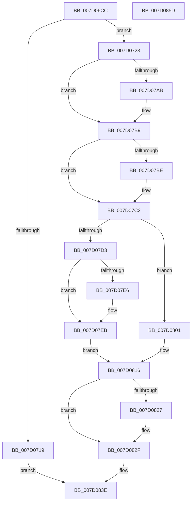

# ExRegisterHost

- RVA: `0x007D06CC`–`0x007D085E` (길이 `402` bytes)
- VA: `0x00000001407D06CC`
- 실행 섹션: `PAGE`
- PDB 이름 있음: `예`; PDB Function 태그: `아니요`
- unwind 정보 RVA: `0x0005FEF8`
- 디코드: `104`개 명령, `402/402` bytes 표시
- 미해석 바이트: `0` (있으면 어셈블리에 `.byte`로 보존)

> 이 문서는 커널 이미지의 기계어와 PDB 기호를 분석해 생성했습니다. 4번과 5번은 함수 원형과 자료형을 바이너리 사용 방식에서 추정한 C 해석이며 원본 소스 복구 결과는 아닙니다.

## 1. Dependencies

- 직접 호출 지점: **11**; 고유 호출 대상: **10**
- 직접 호출자로 확인된 함수: **15**
- RIP 상대 이미지 참조: **5**

### Outgoing calls
- `0x007D070A` → [ExAllocatePoolWithTag](../../poolcode/B8/ExAllocatePoolWithTag_function_00B82010.md) (function, `0x00B82010`)
- `0x007D073E` → [ExWaitForRundownProtectionRelease](../../text/2A/ExWaitForRundownProtectionRelease_function_002A4CB0.md) (function, `0x002A4CB0`)
- `0x007D0758` → [memcpy](../../text/6C/memcpy_function_006C6840.md) (function, `0x006C6840`)
- `0x007D079A` → [KeAbPreAcquire](../../text/21/KeAbPreAcquire_function_00210230.md) (function, `0x00210230`)
- `0x007D07B4` → [ExfAcquirePushLockExclusiveEx](../../text/20/ExfAcquirePushLockExclusiveEx_function_0020FC90.md) (function, `0x0020FC90`)
- `0x007D07C6` → [ExpFindHost](ExpFindHost_function_007D09C8.md) (function, `0x007D09C8`)
- `0x007D0809` → [ExpDereferenceHost](ExpDereferenceHost_function_007D0990.md) (function, `0x007D0990`)
- `0x007D0811` → [ExpDereferenceHost](ExpDereferenceHost_function_007D0990.md) (function, `0x007D0990`)
- `0x007D082A` → [ExfTryToWakePushLock](../../text/26/ExfTryToWakePushLock_function_00265DD0.md) (function, `0x00265DD0`)
- `0x007D0832` → [KeAbPostRelease](../../text/2E/KeAbPostRelease_function_002E1600.md) (function, `0x002E1600`)
- `0x007D0837` → [KeLeaveCriticalRegion](../../text/25/KeLeaveCriticalRegion_function_0025D8B0.md) (function, `0x0025D8B0`)

### Direct callers
- [EtwpInitializeProcessorTrace](../7C/EtwpInitializeProcessorTrace_function_007C114C.md) at `0x007C1198`
- [VmInitSystem](../../init/BE/VmInitSystem_function_00BEEEB8.md) at `0x00BEEF2F`
- [IoInitSystemPreDrivers](../../init/C2/IoInitSystemPreDrivers_function_00C2AC3C.md) at `0x00C2BABA`
- [KiInitSupervisorStateExtensionHost](../../init/C3/KiInitSupervisorStateExtensionHost_function_00C389EC.md) at `0x00C38A56`
- [PspInitializeBackgroundActivityModeratorCallouts](../../init/C4/PspInitializeBackgroundActivityModeratorCallouts_function_00C45764.md) at `0x00C457B0`
- [PspInitializeDesktopActivityModeratorCallouts](../../init/C4/PspInitializeDesktopActivityModeratorCallouts_function_00C45BF8.md) at `0x00C45C3D`
- [PspInitializeDxgExtensionHost](../../init/C4/PspInitializeDxgExtensionHost_function_00C45C60.md) at `0x00C45CC0`
- [PspInitializeHwTraceCallouts](../../init/C4/PspInitializeHwTraceCallouts_function_00C45CE4.md) at `0x00C45D30`
- [PspInitializeMMCSSCallouts](../../init/C4/PspInitializeMMCSSCallouts_function_00C45D54.md) at `0x00C45DA0`
- [PspInitializeOctagonExtensionHost](../../init/C4/PspInitializeOctagonExtensionHost_function_00C464F4.md) at `0x00C46542`
- [PspInitializeSecExtensionHost](../../init/C4/PspInitializeSecExtensionHost_function_00C46564.md) at `0x00C465B2`
- [PspInitializeNetRateControl](../../init/C4/PspInitializeNetRateControl_function_00C466DC.md) at `0x00C46725`
- [SepInitializeAuthorizationCallbacks](../../init/C4/SepInitializeAuthorizationCallbacks_function_00C4A820.md) at `0x00C4A86A`
- [SepInitializeAuthorizationCallbacks](../../init/C4/SepInitializeAuthorizationCallbacks_function_00C4A820.md) at `0x00C4A8AE`
- [ExpInitSystemPhase1](../../init/C5/ExpInitSystemPhase1_function_00C51508.md) at `0x00C517B8`
- [ExpInitializeCrossVmIntegration](../../init/C5/ExpInitializeCrossVmIntegration_function_00C54964.md) at `0x00C549C2`
- [ExpInitializeCrossVmIntegration](../../init/C5/ExpInitializeCrossVmIntegration_function_00C54964.md) at `0x00C549E7`

### Static image references
- `0x007D0762` → RVA `0x00FD9D38` (`PAGEDATA`; read)
- `0x007D07D3` → RVA `0x00FDA040` (`PAGEDATA`; read)
- `0x007D07DA` → RVA `0x00FDA038` (`PAGEDATA`; read)
- `0x007D07F5` → RVA `0x00FDA040` (`PAGEDATA`; write)
- `0x007D0816` → RVA `0x00FD9D38` (`PAGEDATA`; read/write)

## 2. Other-region calls and transfers

- 다른 실행 섹션으로 향하는 call: **8**
  - `0x007D070A` → [ExAllocatePoolWithTag](../../poolcode/B8/ExAllocatePoolWithTag_function_00B82010.md) (`PAGE` → `POOLCODE`)
  - `0x007D073E` → [ExWaitForRundownProtectionRelease](../../text/2A/ExWaitForRundownProtectionRelease_function_002A4CB0.md) (`PAGE` → `.text`)
  - `0x007D0758` → [memcpy](../../text/6C/memcpy_function_006C6840.md) (`PAGE` → `.text`)
  - `0x007D079A` → [KeAbPreAcquire](../../text/21/KeAbPreAcquire_function_00210230.md) (`PAGE` → `.text`)
  - `0x007D07B4` → [ExfAcquirePushLockExclusiveEx](../../text/20/ExfAcquirePushLockExclusiveEx_function_0020FC90.md) (`PAGE` → `.text`)
  - `0x007D082A` → [ExfTryToWakePushLock](../../text/26/ExfTryToWakePushLock_function_00265DD0.md) (`PAGE` → `.text`)
  - `0x007D0832` → [KeAbPostRelease](../../text/2E/KeAbPostRelease_function_002E1600.md) (`PAGE` → `.text`)
  - `0x007D0837` → [KeLeaveCriticalRegion](../../text/25/KeLeaveCriticalRegion_function_0025D8B0.md) (`PAGE` → `.text`)
- 별도 외부 분기/꼬리 이동을 확인하지 못했습니다.

## 3. Assembly (complete function range)

```asm
007D06CC  48 8B C4                        mov rax, rsp
007D06CF  48 89 58 08                     mov qword ptr [rax + 8], rbx
007D06D3  48 89 68 10                     mov qword ptr [rax + 0x10], rbp
007D06D7  48 89 70 18                     mov qword ptr [rax + 0x18], rsi
007D06DB  48 89 78 20                     mov qword ptr [rax + 0x20], rdi
007D06DF  41 54                           push r12
007D06E1  41 56                           push r14
007D06E3  41 57                           push r15
007D06E5  48 83 EC 20                     sub rsp, 0x20
007D06E9  41 0F B7 50 02                  movzx edx, word ptr [r8 + 2]
007D06EE  4C 8B F9                        mov r15, rcx
007D06F1  41 8B 48 10                     mov ecx, dword ptr [r8 + 0x10]
007D06F5  4D 8B F0                        mov r14, r8
007D06F8  48 C1 E2 04                     shl rdx, 4
007D06FC  0F BA E9 0A                     bts ecx, 0xa
007D0700  48 83 C2 78                     add rdx, 0x78
007D0704  41 B8 45 78 45 48               mov r8d, 0x48457845
007D070A  E8 01 19 3B 00                  call 0x140b82010
007D070F  33 F6                           xor esi, esi
007D0711  48 8B F8                        mov rdi, rax
007D0714  48 85 C0                        test rax, rax
007D0717  75 0A                           jne 0x1407d0723
007D0719  B8 9A 00 00 C0                  mov eax, 0xc000009a
007D071E  E9 1B 01 00 00                  jmp 0x1407d083e
007D0723  41 0F B7 06                     movzx eax, word ptr [r14]
007D0727  48 8D 4F 58                     lea rcx, [rdi + 0x58]
007D072B  66 89 47 10                     mov word ptr [rdi + 0x10], ax
007D072F  48 C7 47 18 01 00 00 00         mov qword ptr [rdi + 0x18], 1
007D0737  48 89 77 20                     mov qword ptr [rdi + 0x20], rsi
007D073B  48 89 31                        mov qword ptr [rcx], rsi
007D073E  E8 6D 45 AD FF                  call 0x1402a4cb0
007D0743  48 8D 4F 78                     lea rcx, [rdi + 0x78]
007D0747  48 89 4F 28                     mov qword ptr [rdi + 0x28], rcx
007D074B  45 0F B7 46 02                  movzx r8d, word ptr [r14 + 2]
007D0750  49 8B 56 08                     mov rdx, qword ptr [r14 + 8]
007D0754  49 C1 E0 04                     shl r8, 4
007D0758  E8 E3 60 EF FF                  call 0x1406c6840
007D075D  41 0F B7 46 02                  movzx eax, word ptr [r14 + 2]
007D0762  4C 8D 25 CF 95 80 00            lea r12, [rip + 0x8095cf]
007D0769  66 89 47 30                     mov word ptr [rdi + 0x30], ax
007D076D  48 83 CB FF                     or rbx, 0xffffffffffffffff
007D0771  49 8B 46 18                     mov rax, qword ptr [r14 + 0x18]
007D0775  45 33 C0                        xor r8d, r8d
007D0778  48 89 47 40                     mov qword ptr [rdi + 0x40], rax
007D077C  33 D2                           xor edx, edx
007D077E  49 8B 46 20                     mov rax, qword ptr [r14 + 0x20]
007D0782  49 8B CC                        mov rcx, r12
007D0785  48 89 47 48                     mov qword ptr [rdi + 0x48], rax
007D0789  65 48 8B 04 25 88 01 00 00      mov rax, qword ptr gs:[0x188]
007D0792  66 01 98 E4 01 00 00            add word ptr [rax + 0x1e4], bx
007D0799  90                              nop
007D079A  E8 91 FA A3 FF                  call 0x140210230
007D079F  F0 49 0F BA 2C 24 00            lock bts qword ptr [r12], 0
007D07A6  48 8B E8                        mov rbp, rax
007D07A9  73 0E                           jae 0x1407d07b9
007D07AB  4D 8B C4                        mov r8, r12
007D07AE  48 8B D0                        mov rdx, rax
007D07B1  49 8B CC                        mov rcx, r12
007D07B4  E8 D7 F4 A3 FF                  call 0x14020fc90
007D07B9  48 85 ED                        test rbp, rbp
007D07BC  74 04                           je 0x1407d07c2
007D07BE  C6 45 0A 01                     mov byte ptr [rbp + 0xa], 1
007D07C2  41 0F B7 0E                     movzx ecx, word ptr [r14]
007D07C6  E8 FD 01 00 00                  call 0x1407d09c8
007D07CB  48 8B E8                        mov rbp, rax
007D07CE  48 85 C0                        test rax, rax
007D07D1  75 2E                           jne 0x1407d0801
007D07D3  48 8B 05 66 98 80 00            mov rax, qword ptr [rip + 0x809866]
007D07DA  48 8D 0D 57 98 80 00            lea rcx, [rip + 0x809857]
007D07E1  48 39 08                        cmp qword ptr [rax], rcx
007D07E4  74 05                           je 0x1407d07eb
007D07E6  8D 4D 03                        lea ecx, [rbp + 3]
007D07E9  CD 29                           int 0x29
007D07EB  48 89 0F                        mov qword ptr [rdi], rcx
007D07EE  48 89 47 08                     mov qword ptr [rdi + 8], rax
007D07F2  48 89 38                        mov qword ptr [rax], rdi
007D07F5  48 89 3D 44 98 80 00            mov qword ptr [rip + 0x809844], rdi
007D07FC  49 89 3F                        mov qword ptr [r15], rdi
007D07FF  EB 15                           jmp 0x1407d0816
007D0801  48 8B CF                        mov rcx, rdi
007D0804  BE 35 00 00 C0                  mov esi, 0xc0000035
007D0809  E8 82 01 00 00                  call 0x1407d0990
007D080E  48 8B CD                        mov rcx, rbp
007D0811  E8 7A 01 00 00                  call 0x1407d0990
007D0816  F0 48 0F C1 1D 19 95 80 00      lock xadd qword ptr [rip + 0x809519], rbx
007D081F  80 E3 06                        and bl, 6
007D0822  80 FB 02                        cmp bl, 2
007D0825  75 08                           jne 0x1407d082f
007D0827  49 8B CC                        mov rcx, r12
007D082A  E8 A1 55 A9 FF                  call 0x140265dd0
007D082F  49 8B CC                        mov rcx, r12
007D0832  E8 C9 0D B1 FF                  call 0x1402e1600
007D0837  E8 74 D0 A8 FF                  call 0x14025d8b0
007D083C  8B C6                           mov eax, esi
007D083E  48 8B 5C 24 40                  mov rbx, qword ptr [rsp + 0x40]
007D0843  48 8B 6C 24 48                  mov rbp, qword ptr [rsp + 0x48]
007D0848  48 8B 74 24 50                  mov rsi, qword ptr [rsp + 0x50]
007D084D  48 8B 7C 24 58                  mov rdi, qword ptr [rsp + 0x58]
007D0852  48 83 C4 20                     add rsp, 0x20
007D0856  41 5F                           pop r15
007D0858  41 5E                           pop r14
007D085A  41 5C                           pop r12
007D085C  C3                              ret
007D085D  CC                              int3
```

## 4. C-style interpretation (structured pseudocode)

```c
__int64 __fastcall ExRegisterHost(__int64 a1, __int64 a2, __int64 a3)
{
    __int64 result;
    __int64 v_rbx;
    __int64 v_rsi;
    __int64 v_rsp;
    unsigned __int64 v_stack_p10;
    unsigned __int64 v_stack_p18;
    unsigned __int64 v_stack_p20;
    unsigned __int64 v_stack_p8;

    *(unsigned __int64 *)(v_rsp + 8) = v_rbx;
    *(unsigned __int64 *)(v_rsp + 16) = v_rbp;
    *(unsigned __int64 *)(v_rsp + 24) = v_rsi;
    *(unsigned __int64 *)(v_rsp + 32) = v_rdi;
    v_rsp = (v_rsp) - (32);
    a2 = (*(unsigned __int16 *)(a3 + 2)) << (4);
    a2 = (a2) + (120);
    result = ExAllocatePoolWithTag((unsigned int)(*(unsigned int *)(a3 + 16)), a2, (unsigned int)(0x48457845ULL), a4);
    v_rsi = 0;
    if (result != 0) goto loc_007D0723;
    goto loc_007D083E;
loc_007D0723:
    *(unsigned __int16 *)(result + 16) = (unsigned __int16)(*(unsigned __int16 *)(a3));
    *(unsigned __int64 *)(result + 24) = 1;
    *(unsigned __int64 *)(result + 32) = 0;
    *(unsigned __int64 *)(result + 88) = 0;
    result = ExWaitForRundownProtectionRelease(result + 88, a2, (unsigned int)(0x48457845ULL), a4);
    *(unsigned __int64 *)(result + 40) = result + 120;
    a3 = (*(unsigned __int16 *)(a3 + 2)) << (4);
    result = memcpy(result + 120, *(unsigned __int64 *)(a3 + 8), a3, a4);
    *(unsigned __int16 *)(result + 48) = (unsigned __int16)(*(unsigned __int16 *)(a3 + 2));
    v_rbx = (v_rbx) | (-1);
    a3 = 0;
    *(unsigned __int64 *)(result + 64) = *(unsigned __int64 *)(a3 + 24);
    a2 = 0;
    *(unsigned __int64 *)(result + 72) = *(unsigned __int64 *)(a3 + 32);
    result = KeAbPreAcquire(v_rip + 8426959, a2, a3, a4);
    if (!(condition_is_above_or_equal)) {
        a3 = v_rip + 8426959;
        a2 = result;
        a1 = v_rip + 8426959;
        result = ExfAcquirePushLockExclusiveEx(a1, a2, a3, a4);
    }
    if (result != 0) {
        *(unsigned __int8 *)(result + 10) = 1;
    }
    result = ExpFindHost(*(unsigned __int16 *)(a3), a2, a3, a4);
    if (result != 0) goto loc_007D0801;
    if ((*(unsigned __int64 *)(*(unsigned __int64 *)(v_rip + 8427622))) != (v_rip + 8427607)) {
        a1 = result + 3;
    }
    *(unsigned __int64 *)(result) = a1;
    *(unsigned __int64 *)(result + 8) = *(unsigned __int64 *)(v_rip + 8427622);
    *(unsigned __int64 *)(*(unsigned __int64 *)(v_rip + 8427622)) = result;
    *(unsigned __int64 *)(v_rip + 8427588) = result;
    *(unsigned __int64 *)(a1) = result;
    goto loc_007D0816;
loc_007D0801:
    result = ExpDereferenceHost(result, a2, a3, a4);
    result = ExpDereferenceHost(result, a2, a3, a4);
loc_007D0816:
    v_rbx = (unsigned __int8)((v_rbx) & (6));
    if (((unsigned __int8)(v_rbx)) == 2) {
        a1 = v_rip + 8426959;
        result = ExfTryToWakePushLock(a1, a2, a3, a4);
    }
    result = KeAbPostRelease(v_rip + 8426959, a2, a3, a4);
    result = KeLeaveCriticalRegion(v_rip + 8426959, a2, a3, a4);
loc_007D083E:
    v_rsp = (v_rsp) + (32);
    return (unsigned int)((unsigned int)((unsigned int)(0xC0000035ULL)));
}
```

## 5. (Beta) C Style

```c
int64_t ExRegisterHost(void *Arg1, int64_t Arg2, void *Arg3)
{
    uint8_t *arg1 = (uint8_t *)Arg1;
    uint8_t *arg3 = (uint8_t *)Arg3;

    int64_t result;
    int64_t local_rbx;
    int64_t local_rsi;
    int64_t local_rsp;
    uint64_t v_stack_p10;
    uint64_t v_stack_p18;
    uint64_t v_stack_p20;
    uint64_t v_stack_p8;

    *(uint64_t *)(local_rsp + 0x8) = local_rbx;
    *(uint64_t *)(local_rsp + 0x10) = local_rbp;
    *(uint64_t *)(local_rsp + 0x18) = local_rsi;
    *(uint64_t *)(local_rsp + 0x20) = local_rdi;
    local_rsp = (local_rsp) - (32);
    Arg2 = (*(uint16_t *)(arg3 + 0x2)) << (4);
    Arg2 = (Arg2) + (120);
    result = ExAllocatePoolWithTag((uint32_t)(*(uint32_t *)(arg3 + 0x10)), Arg2, (uint32_t)(0x48457845ULL), a4);
    local_rsi = 0;
    if (result != 0) goto loc_007D0723;
    goto loc_007D083E;
loc_007D0723:
    *(uint16_t *)(result + 0x10) = (uint16_t)(*(uint16_t *)(arg3));
    *(uint64_t *)(result + 0x18) = 1;
    *(uint64_t *)(result + 0x20) = 0;
    *(uint64_t *)(result + 0x58) = 0;
    result = ExWaitForRundownProtectionRelease(result + 88, Arg2, (uint32_t)(0x48457845ULL), a4);
    *(uint64_t *)(result + 0x28) = result + 120;
    Arg3 = (*(uint16_t *)(arg3 + 0x2)) << (4);
    result = memcpy(result + 120, *(uint64_t *)(arg3 + 0x8), Arg3, a4);
    *(uint16_t *)(result + 0x30) = (uint16_t)(*(uint16_t *)(arg3 + 0x2));
    local_rbx = (local_rbx) | (-1);
    Arg3 = 0;
    *(uint64_t *)(result + 0x40) = *(uint64_t *)(arg3 + 0x18);
    Arg2 = 0;
    *(uint64_t *)(result + 0x48) = *(uint64_t *)(arg3 + 0x20);
    result = KeAbPreAcquire(v_rip + 8426959, Arg2, Arg3, a4);
    if (!(condition_is_above_or_equal)) {
        Arg3 = v_rip + 8426959;
        Arg2 = result;
        Arg1 = v_rip + 8426959;
        result = ExfAcquirePushLockExclusiveEx(Arg1, Arg2, Arg3, a4);
    }
    if (result != 0) {
        *(uint8_t *)(result + 0xA) = 1;
    }
    result = ExpFindHost(*(uint16_t *)(arg3), Arg2, Arg3, a4);
    if (result != 0) goto loc_007D0801;
    if ((*(uint64_t *)(*(uint64_t *)(v_rip + 0x809866))) != (v_rip + 8427607)) {
        Arg1 = result + 3;
    }
    *(void **)(result) = Arg1;
    *(uint64_t *)(result + 0x8) = *(uint64_t *)(v_rip + 0x809866);
    *(uint64_t *)(*(uint64_t *)(v_rip + 0x809866)) = result;
    *(uint64_t *)(v_rip + 0x809844) = result;
    *(uint64_t *)(arg1) = result;
    goto loc_007D0816;
loc_007D0801:
    result = ExpDereferenceHost(result, Arg2, Arg3, a4);
    result = ExpDereferenceHost(result, Arg2, Arg3, a4);
loc_007D0816:
    local_rbx = (uint8_t)((local_rbx) & (6));
    if (((uint8_t)(local_rbx)) == 2) {
        Arg1 = v_rip + 8426959;
        result = ExfTryToWakePushLock(Arg1, Arg2, Arg3, a4);
    }
    result = KeAbPostRelease(v_rip + 8426959, Arg2, Arg3, a4);
    result = KeLeaveCriticalRegion(v_rip + 8426959, Arg2, Arg3, a4);
loc_007D083E:
    local_rsp = (local_rsp) + (32);
    return (uint32_t)((uint32_t)((uint32_t)(0xC0000035ULL)));
}
```

### 관측된 메모리 오프셋

구조체 형식이 확인되지 않은 접근은 인자 기준의 오프셋으로만 기록했습니다.

| 기준 인자 | 오프셋 표현 | 폭 (bit) | 접근 |
|---|---:|---:|---|
| `Arg1` | `+ 0x0` | `64` | `W` |
| `Arg3` | `+ 0x0` | `16` | `R` |
| `Arg3` | `+ 0x2` | `16` | `R` |
| `Arg3` | `+ 0x8` | `64` | `R` |
| `Arg3` | `+ 0x10` | `32` | `R` |
| `Arg3` | `+ 0x18` | `64` | `R` |
| `Arg3` | `+ 0x20` | `64` | `R` |

## 6. Execution-region graph

[열기: 2D/3D 그래프와 함수 탐색 컨트롤 패널](../../../control-panel.html?section=page&rva=0x007D06CC&view=graph)

- 2D 그래프는 위에서 아래로 흐르고, 3D 그래프는 빈 공간을 드래그해 회전합니다. Shift+드래그는 이동, 휠은 확대·축소, 함수 노드 선택은 대상 보고서 이동입니다.

### Static fallback


