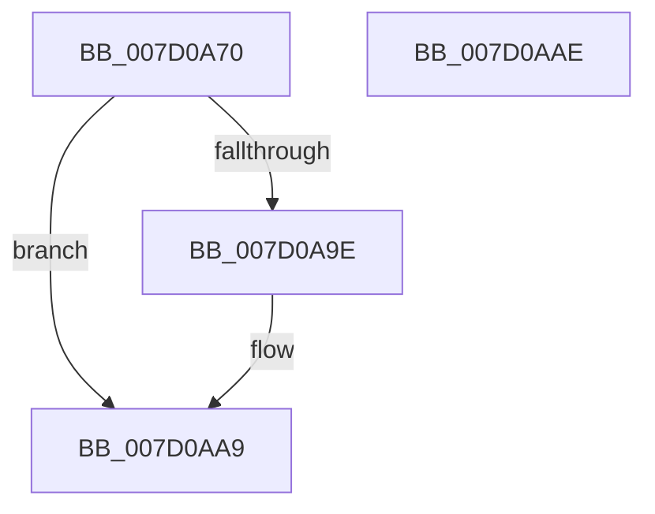

# ExSvmUpdateThreadPasidMsrApc

- RVA: `0x007D0A70`–`0x007D0AAF` (길이 `63` bytes)
- VA: `0x00000001407D0A70`
- 실행 섹션: `PAGE`
- PDB 이름 있음: `예`; PDB Function 태그: `아니요`
- unwind 정보 RVA: `0x0005C788`
- 디코드: `19`개 명령, `63/63` bytes 표시
- 미해석 바이트: `0` (있으면 어셈블리에 `.byte`로 보존)

> 이 문서는 커널 이미지의 기계어와 PDB 기호를 분석해 생성했습니다. 4번과 5번은 함수 원형과 자료형을 바이너리 사용 방식에서 추정한 C 해석이며 원본 소스 복구 결과는 아닙니다.

## 1. Dependencies

- 직접 호출 지점: **2**; 고유 호출 대상: **2**
- 직접 호출자로 확인된 함수: **1**
- RIP 상대 이미지 참조: **0**

### Outgoing calls
- `0x007D0A7B` → [ExBuildPasidMsrForThread](../../text/3D/ExBuildPasidMsrForThread_function_003D5C54.md) (function, `0x003D5C54`)
- `0x007D0AA4` → [ExFreePoolWithTag](../../poolcode/B8/ExFreePoolWithTag_function_00B82870.md) (function, `0x00B82870`)

### Direct callers
- [PsUpdateSvmProcessPasidAllThreads](../78/PsUpdateSvmProcessPasidAllThreads_function_00781404.md) at `0x007815EB`

### Static image references
- 디코드된 RIP-relative 메모리 참조가 없습니다.

## 2. Other-region calls and transfers

- 다른 실행 섹션으로 향하는 call: **2**
  - `0x007D0A7B` → [ExBuildPasidMsrForThread](../../text/3D/ExBuildPasidMsrForThread_function_003D5C54.md) (`PAGE` → `.text`)
  - `0x007D0AA4` → [ExFreePoolWithTag](../../poolcode/B8/ExFreePoolWithTag_function_00B82870.md) (`PAGE` → `POOLCODE`)
- 별도 외부 분기/꼬리 이동을 확인하지 못했습니다.

## 3. Assembly (complete function range)

```asm
007D0A70  48 83 EC 28                     sub rsp, 0x28
007D0A74  4C 8B C9                        mov r9, rcx
007D0A77  48 8B 49 58                     mov rcx, qword ptr [rcx + 0x58]
007D0A7B  E8 D4 51 C0 FF                  call 0x1403d5c54
007D0A80  48 8B D0                        mov rdx, rax
007D0A83  B9 93 0D 00 00                  mov ecx, 0xd93
007D0A88  48 C1 EA 20                     shr rdx, 0x20
007D0A8C  0F 30                           wrmsr
007D0A8E  49 8B 41 60                     mov rax, qword ptr [r9 + 0x60]
007D0A92  83 CA FF                        or edx, 0xffffffff
007D0A95  F0 0F C1 10                     lock xadd dword ptr [rax], edx
007D0A99  83 FA 01                        cmp edx, 1
007D0A9C  75 0B                           jne 0x1407d0aa9
007D0A9E  49 8B 49 60                     mov rcx, qword ptr [r9 + 0x60]
007D0AA2  33 D2                           xor edx, edx
007D0AA4  E8 C7 1D 3B 00                  call 0x140b82870
007D0AA9  48 83 C4 28                     add rsp, 0x28
007D0AAD  C3                              ret
007D0AAE  CC                              int3
```

## 4. C-style interpretation (structured pseudocode)

```c
__int64 __fastcall ExSvmUpdateThreadPasidMsrApc(__int64 a1)
{
    __int64 result;
    __int64 v_rsp;

    v_rsp = (v_rsp) - (40);
    result = ExBuildPasidMsrForThread(*(unsigned __int64 *)(a1 + 88), a2, a3, a1);
    a2 = (result) >> (32);
    a2 = (unsigned int)((a2) | (0xFFFFFFFFULL));
    result = *(unsigned __int64 *)(a1 + 96);
    if (((unsigned int)(a2)) == 1) {
        a1 = *(unsigned __int64 *)(a1 + 96);
        a2 = 0;
        result = ExFreePoolWithTag(a1, a2, a3, a1);
    }
    v_rsp = (v_rsp) + (40);
    return result;
}
```

## 5. (Beta) C Style

```c
int64_t ExSvmUpdateThreadPasidMsrApc(void *Arg1)
{
    uint8_t *arg1 = (uint8_t *)Arg1;

    int64_t result;
    int64_t local_rsp;

    local_rsp = (local_rsp) - (40);
    result = ExBuildPasidMsrForThread(*(uint64_t *)(arg1 + 0x58), a2, a3, Arg1);
    a2 = (result) >> (32);
    a2 = (uint32_t)((a2) | (0xFFFFFFFFULL));
    result = *(uint64_t *)(arg1 + 0x60);
    if (((uint32_t)(a2)) == 1) {
        Arg1 = *(uint64_t *)(arg1 + 0x60);
        a2 = 0;
        result = ExFreePoolWithTag(Arg1, a2, a3, Arg1);
    }
    local_rsp = (local_rsp) + (40);
    return result;
}
```

### 관측된 메모리 오프셋

구조체 형식이 확인되지 않은 접근은 인자 기준의 오프셋으로만 기록했습니다.

| 기준 인자 | 오프셋 표현 | 폭 (bit) | 접근 |
|---|---:|---:|---|
| `Arg1` | `+ 0x58` | `64` | `R` |

## 6. Execution-region graph

[열기: 2D/3D 그래프와 함수 탐색 컨트롤 패널](../../../control-panel.html?section=page&rva=0x007D0A70&view=graph)

- 2D 그래프는 위에서 아래로 흐르고, 3D 그래프는 빈 공간을 드래그해 회전합니다. Shift+드래그는 이동, 휠은 확대·축소, 함수 노드 선택은 대상 보고서 이동입니다.

### Static fallback


