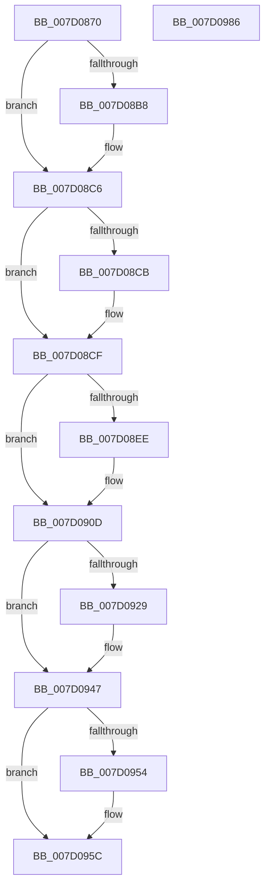

# ExUnregisterExtension

- RVA: `0x007D0870`–`0x007D0987` (길이 `279` bytes)
- VA: `0x00000001407D0870`
- 실행 섹션: `PAGE`
- PDB 이름 있음: `예`; PDB Function 태그: `아니요`
- unwind 정보 RVA: `0x00066400`
- 디코드: `74`개 명령, `279/279` bytes 표시
- 미해석 바이트: `0` (있으면 어셈블리에 `.byte`로 보존)

> 이 문서는 커널 이미지의 기계어와 PDB 기호를 분석해 생성했습니다. 4번과 5번은 함수 원형과 자료형을 바이너리 사용 방식에서 추정한 C 해석이며 원본 소스 복구 결과는 아닙니다.

## 1. Dependencies

- 직접 호출 지점: **11**; 고유 호출 대상: **9**
- 직접 호출자로 확인된 함수: **0**
- RIP 상대 이미지 참조: **0**

### Outgoing calls
- `0x007D08A8` → [KeAbPreAcquire](../../text/21/KeAbPreAcquire_function_00210230.md) (function, `0x00210230`)
- `0x007D08C1` → [ExfAcquirePushLockExclusiveEx](../../text/20/ExfAcquirePushLockExclusiveEx_function_0020FC90.md) (function, `0x0020FC90`)
- `0x007D08FC` → [guard_dispatch_icall](../../text/6B/guard_dispatch_icall_function_006BAAD0.md) (function, `0x006BAAD0`)
- `0x007D0908` → [ExpVerifyCallbackResult](ExpVerifyCallbackResult_function_007D0A10.md) (function, `0x007D0A10`)
- `0x007D0911` → [ExWaitForRundownProtectionRelease](../../text/2A/ExWaitForRundownProtectionRelease_function_002A4CB0.md) (function, `0x002A4CB0`)
- `0x007D0939` → [guard_dispatch_icall](../../text/6B/guard_dispatch_icall_function_006BAAD0.md) (function, `0x006BAAD0`)
- `0x007D0942` → [ExpVerifyCallbackResult](ExpVerifyCallbackResult_function_007D0A10.md) (function, `0x007D0A10`)
- `0x007D0957` → [ExfTryToWakePushLock](../../text/26/ExfTryToWakePushLock_function_00265DD0.md) (function, `0x00265DD0`)
- `0x007D095F` → [KeAbPostRelease](../../text/2E/KeAbPostRelease_function_002E1600.md) (function, `0x002E1600`)
- `0x007D0964` → [KeLeaveCriticalRegion](../../text/25/KeLeaveCriticalRegion_function_0025D8B0.md) (function, `0x0025D8B0`)
- `0x007D096C` → [ExpDereferenceHost](ExpDereferenceHost_function_007D0990.md) (function, `0x007D0990`)

### Direct callers
- 이 함수 시작 RVA로 연결되는 직접 call은 확인되지 않았습니다. 간접 호출은 완전히 역산할 수 없습니다.

### Static image references
- 디코드된 RIP-relative 메모리 참조가 없습니다.

## 2. Other-region calls and transfers

- 다른 실행 섹션으로 향하는 call: **8**
  - `0x007D08A8` → [KeAbPreAcquire](../../text/21/KeAbPreAcquire_function_00210230.md) (`PAGE` → `.text`)
  - `0x007D08C1` → [ExfAcquirePushLockExclusiveEx](../../text/20/ExfAcquirePushLockExclusiveEx_function_0020FC90.md) (`PAGE` → `.text`)
  - `0x007D08FC` → [guard_dispatch_icall](../../text/6B/guard_dispatch_icall_function_006BAAD0.md) (`PAGE` → `.text`)
  - `0x007D0911` → [ExWaitForRundownProtectionRelease](../../text/2A/ExWaitForRundownProtectionRelease_function_002A4CB0.md) (`PAGE` → `.text`)
  - `0x007D0939` → [guard_dispatch_icall](../../text/6B/guard_dispatch_icall_function_006BAAD0.md) (`PAGE` → `.text`)
  - `0x007D0957` → [ExfTryToWakePushLock](../../text/26/ExfTryToWakePushLock_function_00265DD0.md) (`PAGE` → `.text`)
  - `0x007D095F` → [KeAbPostRelease](../../text/2E/KeAbPostRelease_function_002E1600.md) (`PAGE` → `.text`)
  - `0x007D0964` → [KeLeaveCriticalRegion](../../text/25/KeLeaveCriticalRegion_function_0025D8B0.md) (`PAGE` → `.text`)
- 별도 외부 분기/꼬리 이동을 확인하지 못했습니다.

## 3. Assembly (complete function range)

```asm
007D0870  48 89 5C 24 08                  mov qword ptr [rsp + 8], rbx
007D0875  48 89 6C 24 10                  mov qword ptr [rsp + 0x10], rbp
007D087A  48 89 74 24 18                  mov qword ptr [rsp + 0x18], rsi
007D087F  57                              push rdi
007D0880  48 83 EC 30                     sub rsp, 0x30
007D0884  65 48 8B 04 25 88 01 00 00      mov rax, qword ptr gs:[0x188]
007D088D  48 8D 71 20                     lea rsi, [rcx + 0x20]
007D0891  48 8B F9                        mov rdi, rcx
007D0894  48 83 CB FF                     or rbx, 0xffffffffffffffff
007D0898  45 33 C0                        xor r8d, r8d
007D089B  33 D2                           xor edx, edx
007D089D  48 8B CE                        mov rcx, rsi
007D08A0  66 01 98 E4 01 00 00            add word ptr [rax + 0x1e4], bx
007D08A7  90                              nop
007D08A8  E8 83 F9 A3 FF                  call 0x140210230
007D08AD  F0 48 0F BA 2E 00               lock bts qword ptr [rsi], 0
007D08B3  48 8B E8                        mov rbp, rax
007D08B6  73 0E                           jae 0x1407d08c6
007D08B8  4C 8B C6                        mov r8, rsi
007D08BB  48 8B D0                        mov rdx, rax
007D08BE  48 8B CE                        mov rcx, rsi
007D08C1  E8 CA F3 A3 FF                  call 0x14020fc90
007D08C6  48 85 ED                        test rbp, rbp
007D08C9  74 04                           je 0x1407d08cf
007D08CB  C6 45 0A 01                     mov byte ptr [rbp + 0xa], 1
007D08CF  8B 47 50                        mov eax, dword ptr [rdi + 0x50]
007D08D2  89 44 24 24                     mov dword ptr [rsp + 0x24], eax
007D08D6  48 8B 47 38                     mov rax, qword ptr [rdi + 0x38]
007D08DA  48 89 7C 24 28                  mov qword ptr [rsp + 0x28], rdi
007D08DF  8B 08                           mov ecx, dword ptr [rax]
007D08E1  48 8B 47 40                     mov rax, qword ptr [rdi + 0x40]
007D08E5  89 4C 24 20                     mov dword ptr [rsp + 0x20], ecx
007D08E9  48 85 C0                        test rax, rax
007D08EC  74 1F                           je 0x1407d090d
007D08EE  48 8B 57 48                     mov rdx, qword ptr [rdi + 0x48]
007D08F2  4C 8D 44 24 20                  lea r8, [rsp + 0x20]
007D08F7  B9 02 00 00 00                  mov ecx, 2
007D08FC  E8 CF A1 EE FF                  call 0x1406baad0
007D0901  8B D0                           mov edx, eax
007D0903  B9 02 00 00 00                  mov ecx, 2
007D0908  E8 03 01 00 00                  call 0x1407d0a10
007D090D  48 8D 4F 58                     lea rcx, [rdi + 0x58]
007D0911  E8 9A 43 AD FF                  call 0x1402a4cb0
007D0916  48 8B 47 40                     mov rax, qword ptr [rdi + 0x40]
007D091A  48 83 67 60 00                  and qword ptr [rdi + 0x60], 0
007D091F  48 83 67 38 00                  and qword ptr [rdi + 0x38], 0
007D0924  48 85 C0                        test rax, rax
007D0927  74 1E                           je 0x1407d0947
007D0929  48 8B 57 48                     mov rdx, qword ptr [rdi + 0x48]
007D092D  4C 8D 44 24 20                  lea r8, [rsp + 0x20]
007D0932  BD 03 00 00 00                  mov ebp, 3
007D0937  8B CD                           mov ecx, ebp
007D0939  E8 92 A1 EE FF                  call 0x1406baad0
007D093E  8B D0                           mov edx, eax
007D0940  8B CD                           mov ecx, ebp
007D0942  E8 C9 00 00 00                  call 0x1407d0a10
007D0947  F0 48 0F C1 1E                  lock xadd qword ptr [rsi], rbx
007D094C  80 E3 06                        and bl, 6
007D094F  80 FB 02                        cmp bl, 2
007D0952  75 08                           jne 0x1407d095c
007D0954  48 8B CE                        mov rcx, rsi
007D0957  E8 74 54 A9 FF                  call 0x140265dd0
007D095C  48 8B CE                        mov rcx, rsi
007D095F  E8 9C 0C B1 FF                  call 0x1402e1600
007D0964  E8 47 CF A8 FF                  call 0x14025d8b0
007D0969  48 8B CF                        mov rcx, rdi
007D096C  E8 1F 00 00 00                  call 0x1407d0990
007D0971  48 8B 5C 24 40                  mov rbx, qword ptr [rsp + 0x40]
007D0976  48 8B 6C 24 48                  mov rbp, qword ptr [rsp + 0x48]
007D097B  48 8B 74 24 50                  mov rsi, qword ptr [rsp + 0x50]
007D0980  48 83 C4 30                     add rsp, 0x30
007D0984  5F                              pop rdi
007D0985  C3                              ret
007D0986  CC                              int3
```

## 4. C-style interpretation (structured pseudocode)

```c
__int64 __fastcall ExUnregisterExtension(__int64 a1, int a2, int a3)
{
    __int64 result;
    __int64 v_rbp;
    __int64 v_rbx;
    __int64 v_rsp;
    unsigned __int64 v_stack_m10;
    unsigned int v_stack_m14;
    unsigned int v_stack_m18;
    unsigned __int64 v_stack_p10;
    unsigned __int64 v_stack_p18;
    unsigned __int64 v_stack_p8;

    v_stack_p8 = v_rbx;
    v_stack_p10 = v_rbp;
    v_stack_p18 = v_rsi;
    v_rsp = (v_rsp) - (48);
    v_rbx = (v_rbx) | (-1);
    a3 = 0;
    a2 = 0;
    result = KeAbPreAcquire(a1 + 32, a2, a3, a4);
    if (!(condition_is_above_or_equal)) {
        a3 = a1 + 32;
        a2 = result;
        a1 = a1 + 32;
        result = ExfAcquirePushLockExclusiveEx(a1, a2, a3, a4);
    }
    if (result != 0) {
        *(unsigned __int8 *)(result + 10) = 1;
    }
    v_stack_m14 = (unsigned int)((unsigned int)(*(unsigned int *)(a1 + 80)));
    v_stack_m10 = a1;
    v_stack_m18 = (unsigned int)((unsigned int)(*(unsigned int *)(*(unsigned __int64 *)(a1 + 56))));
    result = *(unsigned __int64 *)(a1 + 64);
    if (*(unsigned __int64 *)(a1 + 64) != 0) {
        a2 = *(unsigned __int64 *)(a1 + 72);
        a3 = v_stack_m18;
        a1 = 2;
        result = guard_dispatch_icall(a1, a2, a3, a4);
        a2 = (unsigned int)(result);
        a1 = 2;
        result = ExpVerifyCallbackResult(a1, a2, a3, a4);
    }
    result = ExWaitForRundownProtectionRelease(a1 + 88, a2, a3, a4);
    result = *(unsigned __int64 *)(a1 + 64);
    v_rbp = result;
    if (*(unsigned __int64 *)(a1 + 64) != 0) {
        a2 = *(unsigned __int64 *)(a1 + 72);
        a3 = v_stack_m18;
        v_rbp = 3;
        a1 = (unsigned int)(v_rbp);
        result = guard_dispatch_icall(a1, a2, a3, a4);
        a2 = (unsigned int)(result);
        a1 = (unsigned int)(v_rbp);
        result = ExpVerifyCallbackResult(a1, a2, a3, a4);
    }
    v_rbx = (unsigned __int8)((v_rbx) & (6));
    if (((unsigned __int8)(v_rbx)) == 2) {
        a1 = a1 + 32;
        result = ExfTryToWakePushLock(a1, a2, a3, a4);
    }
    result = KeAbPostRelease(a1 + 32, a2, a3, a4);
    result = KeLeaveCriticalRegion(a1 + 32, a2, a3, a4);
    result = ExpDereferenceHost(a1, a2, a3, a4);
    v_rsp = (v_rsp) + (48);
    return result;
}
```

## 5. (Beta) C Style

```c
int64_t ExUnregisterExtension(void *Arg1, int32_t Arg2, int32_t Arg3)
{
    uint8_t *arg1 = (uint8_t *)Arg1;

    int64_t result;
    int64_t local_rbp;
    int64_t local_rbx;
    int64_t local_rsp;
    uint64_t v_stack_m10;
    uint32_t v_stack_m14;
    uint32_t v_stack_m18;
    uint64_t v_stack_p10;
    uint64_t v_stack_p18;
    uint64_t v_stack_p8;

    v_stack_p8 = local_rbx;
    v_stack_p10 = local_rbp;
    v_stack_p18 = local_rsi;
    local_rsp = (local_rsp) - (48);
    local_rbx = (local_rbx) | (-1);
    Arg3 = 0;
    Arg2 = 0;
    result = KeAbPreAcquire(Arg1 + 32, Arg2, Arg3, a4);
    if (!(condition_is_above_or_equal)) {
        Arg3 = Arg1 + 32;
        Arg2 = result;
        Arg1 = Arg1 + 32;
        result = ExfAcquirePushLockExclusiveEx(Arg1, Arg2, Arg3, a4);
    }
    if (result != 0) {
        *(uint8_t *)(result + 0xA) = 1;
    }
    v_stack_m14 = (uint32_t)((uint32_t)(*(uint32_t *)(arg1 + 0x50)));
    v_stack_m10 = Arg1;
    v_stack_m18 = (uint32_t)((uint32_t)(*(uint32_t *)(*(uint64_t *)(arg1 + 0x38))));
    result = *(uint64_t *)(arg1 + 0x40);
    if (*(uint64_t *)(arg1 + 0x40) != 0) {
        Arg2 = *(uint64_t *)(arg1 + 0x48);
        Arg3 = v_stack_m18;
        Arg1 = 2;
        result = guard_dispatch_icall(Arg1, Arg2, Arg3, a4);
        Arg2 = (uint32_t)(result);
        Arg1 = 2;
        result = ExpVerifyCallbackResult(Arg1, Arg2, Arg3, a4);
    }
    result = ExWaitForRundownProtectionRelease(Arg1 + 88, Arg2, Arg3, a4);
    result = *(uint64_t *)(arg1 + 0x40);
    local_rbp = result;
    if (*(uint64_t *)(arg1 + 0x40) != 0) {
        Arg2 = *(uint64_t *)(arg1 + 0x48);
        Arg3 = v_stack_m18;
        local_rbp = 3;
        Arg1 = (uint32_t)(local_rbp);
        result = guard_dispatch_icall(Arg1, Arg2, Arg3, a4);
        Arg2 = (uint32_t)(result);
        Arg1 = (uint32_t)(local_rbp);
        result = ExpVerifyCallbackResult(Arg1, Arg2, Arg3, a4);
    }
    local_rbx = (uint8_t)((local_rbx) & (6));
    if (((uint8_t)(local_rbx)) == 2) {
        Arg1 = Arg1 + 32;
        result = ExfTryToWakePushLock(Arg1, Arg2, Arg3, a4);
    }
    result = KeAbPostRelease(Arg1 + 32, Arg2, Arg3, a4);
    result = KeLeaveCriticalRegion(Arg1 + 32, Arg2, Arg3, a4);
    result = ExpDereferenceHost(Arg1, Arg2, Arg3, a4);
    local_rsp = (local_rsp) + (48);
    return result;
}
```

### 관측된 메모리 오프셋

구조체 형식이 확인되지 않은 접근은 인자 기준의 오프셋으로만 기록했습니다.

| 기준 인자 | 오프셋 표현 | 폭 (bit) | 접근 |
|---|---:|---:|---|
| `Arg1` | `+ 0x0` | `64` | `R/W` |
| `Arg1` | `+ 0x20` | `64` | `R` |
| `Arg1` | `+ 0x38` | `64` | `R` |
| `Arg1` | `+ 0x38` | `64` | `R/W` |
| `Arg1` | `+ 0x40` | `64` | `R` |
| `Arg1` | `+ 0x48` | `64` | `R` |
| `Arg1` | `+ 0x50` | `32` | `R` |
| `Arg1` | `+ 0x58` | `64` | `R` |
| `Arg1` | `+ 0x60` | `64` | `R/W` |

## 6. Execution-region graph

[열기: 2D/3D 그래프와 함수 탐색 컨트롤 패널](../../../control-panel.html?section=page&rva=0x007D0870&view=graph)

- 2D 그래프는 위에서 아래로 흐르고, 3D 그래프는 빈 공간을 드래그해 회전합니다. Shift+드래그는 이동, 휠은 확대·축소, 함수 노드 선택은 대상 보고서 이동입니다.

### Static fallback


