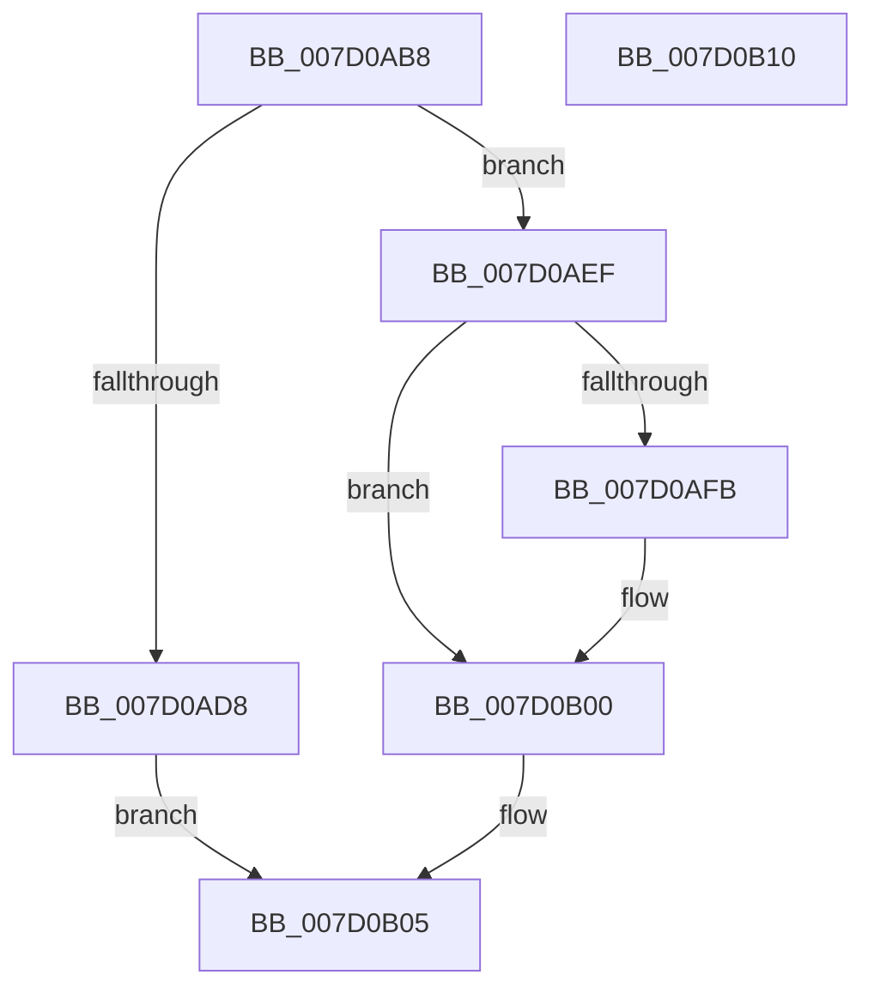

# ExpAssignPasid

- RVA: `0x007D0AB8`–`0x007D0B11` (길이 `89` bytes)
- VA: `0x00000001407D0AB8`
- 실행 섹션: `PAGE`
- PDB 이름 있음: `예`; PDB Function 태그: `아니요`
- unwind 정보 RVA: `0x0005CAAC`
- 디코드: `27`개 명령, `89/89` bytes 표시
- 미해석 바이트: `0` (있으면 어셈블리에 `.byte`로 보존)

> 이 문서는 커널 이미지의 기계어와 PDB 기호를 분석해 생성했습니다. 4번과 5번은 함수 원형과 자료형을 바이너리 사용 방식에서 추정한 C 해석이며 원본 소스 복구 결과는 아닙니다.

## 1. Dependencies

- 직접 호출 지점: **5**; 고유 호출 대상: **5**
- 직접 호출자로 확인된 함수: **1**
- RIP 상대 이미지 참조: **0**

### Outgoing calls
- `0x007D0AC7` → [ObfReferenceObject](../../text/20/ObfReferenceObject_function_0020FA20.md) (function, `0x0020FA20`)
- `0x007D0ADE` → [ExpFreeAsid](../../text/65/ExpFreeAsid_function_0065B1E8.md) (function, `0x0065B1E8`)
- `0x007D0AE6` → [ObfDereferenceObject](../../text/2F/ObfDereferenceObject_function_002F9350.md) (function, `0x002F9350`)
- `0x007D0AF2` → [ExIsSvmPasidMsrUpdateRequiredForProcess](../A5/ExIsSvmPasidMsrUpdateRequiredForProcess_function_00A5EAC0.md) (function, `0x00A5EAC0`)
- `0x007D0AFB` → [PsUpdateSvmProcessPasidAllThreads](../78/PsUpdateSvmProcessPasidAllThreads_function_00781404.md) (function, `0x00781404`)

### Direct callers
- [ExpShareAddressSpaceWithDevice](../../text/65/ExpShareAddressSpaceWithDevice_function_0065B528.md) at `0x0065B683`

### Static image references
- 디코드된 RIP-relative 메모리 참조가 없습니다.

## 2. Other-region calls and transfers

- 다른 실행 섹션으로 향하는 call: **3**
  - `0x007D0AC7` → [ObfReferenceObject](../../text/20/ObfReferenceObject_function_0020FA20.md) (`PAGE` → `.text`)
  - `0x007D0ADE` → [ExpFreeAsid](../../text/65/ExpFreeAsid_function_0065B1E8.md) (`PAGE` → `.text`)
  - `0x007D0AE6` → [ObfDereferenceObject](../../text/2F/ObfDereferenceObject_function_002F9350.md) (`PAGE` → `.text`)
- 별도 외부 분기/꼬리 이동을 확인하지 못했습니다.

## 3. Assembly (complete function range)

```asm
007D0AB8  48 89 5C 24 08                  mov qword ptr [rsp + 8], rbx
007D0ABD  57                              push rdi
007D0ABE  48 83 EC 20                     sub rsp, 0x20
007D0AC2  8B FA                           mov edi, edx
007D0AC4  48 8B D9                        mov rbx, rcx
007D0AC7  E8 54 EF A3 FF                  call 0x14020fa20
007D0ACC  33 C0                           xor eax, eax
007D0ACE  F0 0F B1 BB 00 06 00 00         lock cmpxchg dword ptr [rbx + 0x600], edi
007D0AD6  74 17                           je 0x1407d0aef
007D0AD8  8D 4F FF                        lea ecx, [rdi - 1]
007D0ADB  48 8B D3                        mov rdx, rbx
007D0ADE  E8 05 A7 E8 FF                  call 0x14065b1e8
007D0AE3  48 8B CB                        mov rcx, rbx
007D0AE6  E8 65 88 B2 FF                  call 0x1402f9350
007D0AEB  33 C0                           xor eax, eax
007D0AED  EB 16                           jmp 0x1407d0b05
007D0AEF  48 8B CB                        mov rcx, rbx
007D0AF2  E8 C9 DF 28 00                  call 0x140a5eac0
007D0AF7  84 C0                           test al, al
007D0AF9  74 05                           je 0x1407d0b00
007D0AFB  E8 04 09 FB FF                  call 0x140781404
007D0B00  B8 01 00 00 00                  mov eax, 1
007D0B05  48 8B 5C 24 30                  mov rbx, qword ptr [rsp + 0x30]
007D0B0A  48 83 C4 20                     add rsp, 0x20
007D0B0E  5F                              pop rdi
007D0B0F  C3                              ret
007D0B10  CC                              int3
```

## 4. C-style interpretation (structured pseudocode)

```c
__int64 __fastcall ExpAssignPasid(__int64 a1, int a2)
{
    __int64 result;
    __int64 v_rsp;
    unsigned __int64 v_stack_p8;

    v_stack_p8 = v_rbx;
    v_rsp = (v_rsp) - (32);
    result = ObfReferenceObject(a1, a2, a3, a4);
    result = 0;
    if (condition_is_equal) goto loc_007D0AEF;
    result = ExpFreeAsid((unsigned int)(a2) - 1, a1, a3, a4);
    result = ObfDereferenceObject(a1, a1, a3, a4);
    result = 0;
    goto loc_007D0B05;
loc_007D0AEF:
    result = ExIsSvmPasidMsrUpdateRequiredForProcess(a1, a1, a3, a4);
    if ((unsigned __int8)(result) != 0) {
        result = PsUpdateSvmProcessPasidAllThreads(a1, a1, a3, a4);
    }
loc_007D0B05:
    v_rsp = (v_rsp) + (32);
    return 1;
}
```

## 5. (Beta) C Style

```c
int64_t ExpAssignPasid(void *Arg1, void *Arg2)
{
    uint8_t *arg1 = (uint8_t *)Arg1;
    uint8_t *arg2 = (uint8_t *)Arg2;

    int64_t result;
    int64_t local_rsp;
    uint64_t v_stack_p8;

    v_stack_p8 = local_rbx;
    local_rsp = (local_rsp) - (32);
    result = ObfReferenceObject(Arg1, Arg2, a3, a4);
    result = 0;
    if (condition_is_equal) goto loc_007D0AEF;
    result = ExpFreeAsid((uint32_t)(Arg2) - 1, Arg1, a3, a4);
    result = ObfDereferenceObject(Arg1, Arg1, a3, a4);
    result = 0;
    goto loc_007D0B05;
loc_007D0AEF:
    result = ExIsSvmPasidMsrUpdateRequiredForProcess(Arg1, Arg1, a3, a4);
    if ((uint8_t)(result) != 0) {
        result = PsUpdateSvmProcessPasidAllThreads(Arg1, Arg1, a3, a4);
    }
loc_007D0B05:
    local_rsp = (local_rsp) + (32);
    return 1;
}
```

### 관측된 메모리 오프셋

구조체 형식이 확인되지 않은 접근은 인자 기준의 오프셋으로만 기록했습니다.

| 기준 인자 | 오프셋 표현 | 폭 (bit) | 접근 |
|---|---:|---:|---|
| `Arg1` | `+ 0x600` | `32` | `R` |
| `Arg2` | `- 0x1` | `32` | `R` |

## 6. Execution-region graph

[열기: 2D/3D 그래프와 함수 탐색 컨트롤 패널](../../../control-panel.html?section=page&rva=0x007D0AB8&view=graph)

- 2D 그래프는 위에서 아래로 흐르고, 3D 그래프는 빈 공간을 드래그해 회전합니다. Shift+드래그는 이동, 휠은 확대·축소, 함수 노드 선택은 대상 보고서 이동입니다.

### Static fallback


