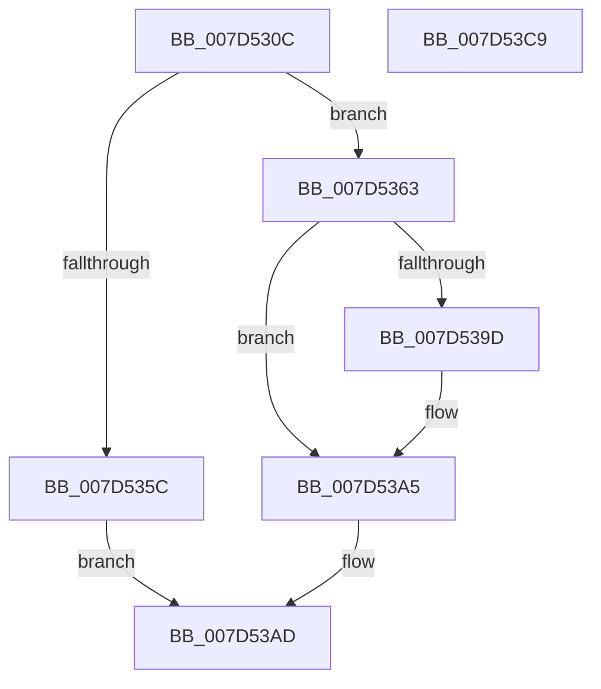

# ExpCreateCrossVmEvent

- RVA: `0x007D530C`–`0x007D53CA` (길이 `190` bytes)
- VA: `0x00000001407D530C`
- 실행 섹션: `PAGE`
- PDB 이름 있음: `예`; PDB Function 태그: `아니요`
- unwind 정보 RVA: `0x0007EE78`
- 디코드: `52`개 명령, `190/190` bytes 표시
- 미해석 바이트: `0` (있으면 어셈블리에 `.byte`로 보존)

> 이 문서는 커널 이미지의 기계어와 PDB 기호를 분석해 생성했습니다. 4번과 5번은 함수 원형과 자료형을 바이너리 사용 방식에서 추정한 C 해석이며 원본 소스 복구 결과는 아닙니다.

## 1. Dependencies

- 직접 호출 지점: **3**; 고유 호출 대상: **3**
- 직접 호출자로 확인된 함수: **1**
- RIP 상대 이미지 참조: **2**

### Outgoing calls
- `0x007D5352` → [ExGetExtensionTable](../../text/42/ExGetExtensionTable_function_00428814.md) (function, `0x00428814`)
- `0x007D5392` → [guard_dispatch_icall](../../text/6B/guard_dispatch_icall_function_006BAAD0.md) (function, `0x006BAAD0`)
- `0x007D53A8` → [ExReleaseExtensionTable](../../text/45/ExReleaseExtensionTable_function_00456DC0.md) (function, `0x00456DC0`)

### Direct callers
- [NtCreateCrossVmEvent](../7C/NtCreateCrossVmEvent_function_007CADC0.md) at `0x007CAE2D`

### Static image references
- `0x007D532C` → RVA `0x00EFA120` (`.data`; read)
- `0x007D5347` → RVA `0x00EFA118` (`.data`; read)

## 2. Other-region calls and transfers

- 다른 실행 섹션으로 향하는 call: **3**
  - `0x007D5352` → [ExGetExtensionTable](../../text/42/ExGetExtensionTable_function_00428814.md) (`PAGE` → `.text`)
  - `0x007D5392` → [guard_dispatch_icall](../../text/6B/guard_dispatch_icall_function_006BAAD0.md) (`PAGE` → `.text`)
  - `0x007D53A8` → [ExReleaseExtensionTable](../../text/45/ExReleaseExtensionTable_function_00456DC0.md) (`PAGE` → `.text`)
- 별도 외부 분기/꼬리 이동을 확인하지 못했습니다.

## 3. Assembly (complete function range)

```asm
007D530C  48 8B C4                        mov rax, rsp
007D530F  48 89 58 08                     mov qword ptr [rax + 8], rbx
007D5313  48 89 68 10                     mov qword ptr [rax + 0x10], rbp
007D5317  48 89 70 18                     mov qword ptr [rax + 0x18], rsi
007D531B  57                              push rdi
007D531C  41 56                           push r14
007D531E  41 57                           push r15
007D5320  48 83 EC 50                     sub rsp, 0x50
007D5324  48 83 60 D8 00                  and qword ptr [rax - 0x28], 0
007D5329  48 8B F1                        mov rsi, rcx
007D532C  48 8B 3D ED 4D 72 00            mov rdi, qword ptr [rip + 0x724ded]
007D5333  41 8B E9                        mov ebp, r9d
007D5336  48 8B 9C 24 98 00 00 00         mov rbx, qword ptr [rsp + 0x98]
007D533E  4D 8B F0                        mov r14, r8
007D5341  48 85 DB                        test rbx, rbx
007D5344  44 8B FA                        mov r15d, edx
007D5347  48 0F 44 3D C9 4D 72 00         cmove rdi, qword ptr [rip + 0x724dc9]
007D534F  48 8B CF                        mov rcx, rdi
007D5352  E8 BD 34 C5 FF                  call 0x140428814
007D5357  48 85 C0                        test rax, rax
007D535A  75 07                           jne 0x1407d5363
007D535C  BB 02 00 00 C0                  mov ebx, 0xc0000002
007D5361  EB 4A                           jmp 0x1407d53ad
007D5363  8A 8C 24 A0 00 00 00            mov cl, byte ptr [rsp + 0xa0]
007D536A  44 8B CD                        mov r9d, ebp
007D536D  48 8B 40 08                     mov rax, qword ptr [rax + 8]
007D5371  4D 8B C6                        mov r8, r14
007D5374  88 4C 24 30                     mov byte ptr [rsp + 0x30], cl
007D5378  41 8B D7                        mov edx, r15d
007D537B  48 8B 8C 24 90 00 00 00         mov rcx, qword ptr [rsp + 0x90]
007D5383  48 89 5C 24 28                  mov qword ptr [rsp + 0x28], rbx
007D5388  48 89 4C 24 20                  mov qword ptr [rsp + 0x20], rcx
007D538D  48 8D 4C 24 40                  lea rcx, [rsp + 0x40]
007D5392  E8 39 57 EE FF                  call 0x1406baad0
007D5397  8B D8                           mov ebx, eax
007D5399  85 C0                           test eax, eax
007D539B  78 08                           js 0x1407d53a5
007D539D  48 8B 54 24 40                  mov rdx, qword ptr [rsp + 0x40]
007D53A2  48 89 16                        mov qword ptr [rsi], rdx
007D53A5  48 8B CF                        mov rcx, rdi
007D53A8  E8 13 1A C8 FF                  call 0x140456dc0
007D53AD  4C 8D 5C 24 50                  lea r11, [rsp + 0x50]
007D53B2  8B C3                           mov eax, ebx
007D53B4  49 8B 5B 20                     mov rbx, qword ptr [r11 + 0x20]
007D53B8  49 8B 6B 28                     mov rbp, qword ptr [r11 + 0x28]
007D53BC  49 8B 73 30                     mov rsi, qword ptr [r11 + 0x30]
007D53C0  49 8B E3                        mov rsp, r11
007D53C3  41 5F                           pop r15
007D53C5  41 5E                           pop r14
007D53C7  5F                              pop rdi
007D53C8  C3                              ret
007D53C9  CC                              int3
```

## 4. C-style interpretation (structured pseudocode)

```c
__int64 __fastcall ExpCreateCrossVmEvent(__int64 a1, int a2, __int64 a3, int a4, __int64 a5, __int64 a6, unsigned __int8 a7)
{
    __int64 result;
    __int64 v_rdi;
    __int64 v_rsp;
    unsigned __int64 v_stack_m18;
    unsigned __int64 v_stack_m28;
    unsigned __int8 v_stack_m38;
    unsigned __int64 v_stack_m40;
    unsigned __int64 v_stack_m48;

    *(unsigned __int64 *)(v_rsp + 8) = v_rbx;
    *(unsigned __int64 *)(v_rsp + 16) = v_rbp;
    *(unsigned __int64 *)(v_rsp + 24) = v_rsi;
    v_rsp = (v_rsp) - (80);
    v_rdi = *(unsigned __int64 *)(v_rip + 7491053);
    if (a6 == 0) { v_rdi = *(unsigned __int64 *)(v_rip + 7491017); }
    result = ExGetExtensionTable(v_rdi, a2, a3, a4);
    if (result != 0) goto loc_007D5363;
    goto loc_007D53AD;
loc_007D5363:
    v_stack_m38 = a7;
    v_stack_m40 = (unsigned int)(0xC0000002ULL);
    v_stack_m48 = a5;
    result = guard_dispatch_icall(v_stack_m28, (unsigned int)((unsigned int)((unsigned int)(a2))), a3, (unsigned int)((unsigned int)((unsigned int)(a4))));
    if (!(sign_flag)) {
        a2 = v_stack_m28;
        *(unsigned __int64 *)(a1) = a2;
    }
    result = ExReleaseExtensionTable(v_rdi, a2, a3, (unsigned int)((unsigned int)((unsigned int)(a4))));
loc_007D53AD:
    return (unsigned int)((unsigned int)((unsigned int)((unsigned int)(result))));
}
```

## 5. (Beta) C Style

```c
int64_t ExpCreateCrossVmEvent(void *Arg1, int32_t Arg2, int64_t Arg3, int32_t Arg4, int64_t Arg5, int64_t Arg6, uint8_t Arg7)
{
    uint8_t *arg1 = (uint8_t *)Arg1;

    int64_t result;
    int64_t local_rdi;
    int64_t local_rsp;
    uint64_t v_stack_m18;
    uint64_t v_stack_m28;
    uint8_t v_stack_m38;
    uint64_t v_stack_m40;
    uint64_t v_stack_m48;

    *(uint64_t *)(local_rsp + 0x8) = local_rbx;
    *(uint64_t *)(local_rsp + 0x10) = local_rbp;
    *(uint64_t *)(local_rsp + 0x18) = local_rsi;
    local_rsp = (local_rsp) - (80);
    local_rdi = *(uint64_t *)(v_rip + 0x724DED);
    if (Arg6 == 0) { local_rdi = *(uint64_t *)(v_rip + 0x724DC9); }
    result = ExGetExtensionTable(local_rdi, Arg2, Arg3, Arg4);
    if (result != 0) goto loc_007D5363;
    goto loc_007D53AD;
loc_007D5363:
    v_stack_m38 = Arg7;
    v_stack_m40 = (uint32_t)(0xC0000002ULL);
    v_stack_m48 = Arg5;
    result = guard_dispatch_icall(v_stack_m28, (uint32_t)((uint32_t)((uint32_t)(Arg2))), Arg3, (uint32_t)((uint32_t)((uint32_t)(Arg4))));
    if (!(sign_flag)) {
        Arg2 = v_stack_m28;
        *(uint64_t *)(arg1) = Arg2;
    }
    result = ExReleaseExtensionTable(local_rdi, Arg2, Arg3, (uint32_t)((uint32_t)((uint32_t)(Arg4))));
loc_007D53AD:
    return (uint32_t)((uint32_t)((uint32_t)((uint32_t)(result))));
}
```

### 관측된 메모리 오프셋

구조체 형식이 확인되지 않은 접근은 인자 기준의 오프셋으로만 기록했습니다.

| 기준 인자 | 오프셋 표현 | 폭 (bit) | 접근 |
|---|---:|---:|---|
| `Arg1` | `+ 0x0` | `64` | `W` |

## 6. Execution-region graph

[열기: 2D/3D 그래프와 함수 탐색 컨트롤 패널](../../../control-panel.html?section=page&rva=0x007D530C&view=graph)

- 2D 그래프는 위에서 아래로 흐르고, 3D 그래프는 빈 공간을 드래그해 회전합니다. Shift+드래그는 이동, 휠은 확대·축소, 함수 노드 선택은 대상 보고서 이동입니다.

### Static fallback


