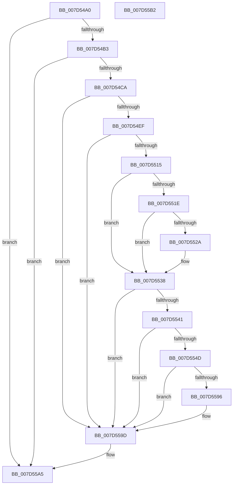

# ExpCrossVmIntHostCallback

- RVA: `0x007D54A0`–`0x007D55B3` (길이 `275` bytes)
- VA: `0x00000001407D54A0`
- 실행 섹션: `PAGE`
- PDB 이름 있음: `예`; PDB Function 태그: `아니요`
- unwind 정보 RVA: `0x00065960`
- 디코드: `62`개 명령, `275/275` bytes 표시
- 미해석 바이트: `0` (있으면 어셈블리에 `.byte`로 보존)

> 이 문서는 커널 이미지의 기계어와 PDB 기호를 분석해 생성했습니다. 4번과 5번은 함수 원형과 자료형을 바이너리 사용 방식에서 추정한 C 해석이며 원본 소스 복구 결과는 아닙니다.

## 1. Dependencies

- 직접 호출 지점: **7**; 고유 호출 대상: **4**
- 직접 호출자로 확인된 함수: **0**
- RIP 상대 이미지 참조: **12**

### Outgoing calls
- `0x007D54B9` → [ExGetExtensionTable](../../text/42/ExGetExtensionTable_function_00428814.md) (function, `0x00428814`)
- `0x007D54E2` → [guard_dispatch_icall](../../text/6B/guard_dispatch_icall_function_006BAAD0.md) (function, `0x006BAAD0`)
- `0x007D5508` → [guard_dispatch_icall](../../text/6B/guard_dispatch_icall_function_006BAAD0.md) (function, `0x006BAAD0`)
- `0x007D5533` → [guard_dispatch_icall](../../text/6B/guard_dispatch_icall_function_006BAAD0.md) (function, `0x006BAAD0`)
- `0x007D5559` → [guard_dispatch_icall](../../text/6B/guard_dispatch_icall_function_006BAAD0.md) (function, `0x006BAAD0`)
- `0x007D558D` → [ZwUpdateWnfStateData](../../text/6B/ZwUpdateWnfStateData_function_006B0D10.md) (function, `0x006B0D10`)
- `0x007D55A0` → [ExReleaseExtensionTable](../../text/45/ExReleaseExtensionTable_function_00456DC0.md) (function, `0x00456DC0`)

### Direct callers
- 이 함수 시작 RVA로 연결되는 직접 call은 확인되지 않았습니다. 간접 호출은 완전히 역산할 수 없습니다.

### Static image references
- `0x007D54CD` → RVA `0x00EFA110` (`.data`; read)
- `0x007D54D4` → RVA `0x007D5710` (`ExpObDeleteCrossVmEvent`; read)
- `0x007D54DB` → RVA `0x007D5630` (`ExpObCloseCrossVmEvent`; read)
- `0x007D54F3` → RVA `0x00EFA128` (`.data`; read)
- `0x007D54FA` → RVA `0x007D5760` (`ExpObDeleteCrossVmMutant`; read)
- `0x007D5501` → RVA `0x007D56A0` (`ExpObCloseCrossVmMutant`; read)
- `0x007D5515` → RVA `0x00EFA118` (`.data`; read)
- `0x007D552C` → RVA `0x007CF150` (`ExWnfCrossVmCallback`; read)
- `0x007D5538` → RVA `0x00EFA120` (`.data`; read)
- `0x007D555E` → RVA `0x00EF72F8` (`.data`; read)
- `0x007D556F` → RVA `0x00020940` (`.rdata`; read)
- `0x007D5596` → RVA `0x00EF747B` (`.data`; write)

## 2. Other-region calls and transfers

- 다른 실행 섹션으로 향하는 call: **7**
  - `0x007D54B9` → [ExGetExtensionTable](../../text/42/ExGetExtensionTable_function_00428814.md) (`PAGE` → `.text`)
  - `0x007D54E2` → [guard_dispatch_icall](../../text/6B/guard_dispatch_icall_function_006BAAD0.md) (`PAGE` → `.text`)
  - `0x007D5508` → [guard_dispatch_icall](../../text/6B/guard_dispatch_icall_function_006BAAD0.md) (`PAGE` → `.text`)
  - `0x007D5533` → [guard_dispatch_icall](../../text/6B/guard_dispatch_icall_function_006BAAD0.md) (`PAGE` → `.text`)
  - `0x007D5559` → [guard_dispatch_icall](../../text/6B/guard_dispatch_icall_function_006BAAD0.md) (`PAGE` → `.text`)
  - `0x007D558D` → [ZwUpdateWnfStateData](../../text/6B/ZwUpdateWnfStateData_function_006B0D10.md) (`PAGE` → `.text`)
  - `0x007D55A0` → [ExReleaseExtensionTable](../../text/45/ExReleaseExtensionTable_function_00456DC0.md) (`PAGE` → `.text`)
- 별도 외부 분기/꼬리 이동을 확인하지 못했습니다.

## 3. Assembly (complete function range)

```asm
007D54A0  48 89 5C 24 08                  mov qword ptr [rsp + 8], rbx
007D54A5  57                              push rdi
007D54A6  48 83 EC 40                     sub rsp, 0x40
007D54AA  83 F9 01                        cmp ecx, 1
007D54AD  0F 85 F2 00 00 00               jne 0x1407d55a5
007D54B3  48 8B 3A                        mov rdi, qword ptr [rdx]
007D54B6  48 8B CF                        mov rcx, rdi
007D54B9  E8 56 33 C5 FF                  call 0x140428814
007D54BE  48 8B D8                        mov rbx, rax
007D54C1  48 85 C0                        test rax, rax
007D54C4  0F 84 DB 00 00 00               je 0x1407d55a5
007D54CA  48 8B 00                        mov rax, qword ptr [rax]
007D54CD  4C 8D 05 3C 4C 72 00            lea r8, [rip + 0x724c3c]
007D54D4  48 8D 15 35 02 00 00            lea rdx, [rip + 0x235]
007D54DB  48 8D 0D 4E 01 00 00            lea rcx, [rip + 0x14e]
007D54E2  E8 E9 55 EE FF                  call 0x1406baad0
007D54E7  85 C0                           test eax, eax
007D54E9  0F 88 AE 00 00 00               js 0x1407d559d
007D54EF  48 8B 43 40                     mov rax, qword ptr [rbx + 0x40]
007D54F3  4C 8D 05 2E 4C 72 00            lea r8, [rip + 0x724c2e]
007D54FA  48 8D 15 5F 02 00 00            lea rdx, [rip + 0x25f]
007D5501  48 8D 0D 98 01 00 00            lea rcx, [rip + 0x198]
007D5508  E8 C3 55 EE FF                  call 0x1406baad0
007D550D  85 C0                           test eax, eax
007D550F  0F 88 88 00 00 00               js 0x1407d559d
007D5515  48 3B 3D FC 4B 72 00            cmp rdi, qword ptr [rip + 0x724bfc]
007D551C  75 1A                           jne 0x1407d5538
007D551E  48 8B 83 80 00 00 00            mov rax, qword ptr [rbx + 0x80]
007D5525  48 85 C0                        test rax, rax
007D5528  74 0E                           je 0x1407d5538
007D552A  33 D2                           xor edx, edx
007D552C  48 8D 0D 1D 9C FF FF            lea rcx, [rip - 0x63e3]
007D5533  E8 98 55 EE FF                  call 0x1406baad0
007D5538  48 3B 3D E1 4B 72 00            cmp rdi, qword ptr [rip + 0x724be1]
007D553F  75 5C                           jne 0x1407d559d
007D5541  48 8B 83 80 00 00 00            mov rax, qword ptr [rbx + 0x80]
007D5548  48 85 C0                        test rax, rax
007D554B  74 50                           je 0x1407d559d
007D554D  BA 01 00 00 00                  mov edx, 1
007D5552  48 8D 0D F7 9B FF FF            lea rcx, [rip - 0x6409]
007D5559  E8 72 55 EE FF                  call 0x1406baad0
007D555E  48 8B 05 93 1D 72 00            mov rax, qword ptr [rip + 0x721d93]
007D5565  48 8D 54 24 68                  lea rdx, [rsp + 0x68]
007D556A  83 64 24 30 00                  and dword ptr [rsp + 0x30], 0
007D556F  48 8D 0D CA B3 84 FF            lea rcx, [rip - 0x7b4c36]
007D5576  83 64 24 28 00                  and dword ptr [rsp + 0x28], 0
007D557B  45 33 C9                        xor r9d, r9d
007D557E  48 83 64 24 20 00               and qword ptr [rsp + 0x20], 0
007D5584  48 89 44 24 68                  mov qword ptr [rsp + 0x68], rax
007D5589  45 8D 41 08                     lea r8d, [r9 + 8]
007D558D  E8 7E B7 ED FF                  call 0x1406b0d10
007D5592  85 C0                           test eax, eax
007D5594  78 07                           js 0x1407d559d
007D5596  C6 05 DE 1E 72 00 01            mov byte ptr [rip + 0x721ede], 1
007D559D  48 8B CF                        mov rcx, rdi
007D55A0  E8 1B 18 C8 FF                  call 0x140456dc0
007D55A5  48 8B 5C 24 50                  mov rbx, qword ptr [rsp + 0x50]
007D55AA  33 C0                           xor eax, eax
007D55AC  48 83 C4 40                     add rsp, 0x40
007D55B0  5F                              pop rdi
007D55B1  C3                              ret
007D55B2  CC                              int3
```

## 4. C-style interpretation (structured pseudocode)

```c
__int64 __fastcall ExpCrossVmIntHostCallback(int a1, __int64 a2, __int64 a3, int a4)
{
    __int64 result;
    __int64 v_rsp;
    unsigned int v_stack_m18;
    unsigned int v_stack_m20;
    unsigned __int64 v_stack_m28;
    unsigned __int64 v_stack_p20;
    unsigned __int64 v_stack_p8;

    v_stack_p8 = v_rbx;
    v_rsp = (v_rsp) - (64);
    if (a1 != 1) goto loc_007D55A5;
    result = ExGetExtensionTable(*(unsigned __int64 *)(a2), a2, a3, a4);
    if (result == 0) goto loc_007D55A5;
    result = guard_dispatch_icall(v_rip + 334, v_rip + 565, v_rip + 7490620, a4);
    if (sign_flag) goto loc_007D559D;
    result = guard_dispatch_icall(v_rip + 408, v_rip + 607, v_rip + 7490606, a4);
    if (sign_flag) goto loc_007D559D;
    if ((*(unsigned __int64 *)(a2)) != (*(unsigned __int64 *)(v_rip + 7490556))) goto loc_007D5538;
    result = *(unsigned __int64 *)(result + 128);
    if (*(unsigned __int64 *)(result + 128) != 0) {
        a2 = 0;
        a1 = v_rip - 25571;
        result = guard_dispatch_icall(a1, a2, v_rip + 7490606, a4);
    }
    if ((*(unsigned __int64 *)(a2)) != (*(unsigned __int64 *)(v_rip + 7490529))) goto loc_007D559D;
    if (*(unsigned __int64 *)(result + 128) == 0) goto loc_007D559D;
    result = guard_dispatch_icall(v_rip - 25609, 1, v_rip + 7490606, a4);
    a4 = 0;
    v_stack_p20 = *(unsigned __int64 *)(v_rip + 7478675);
    result = ZwUpdateWnfStateData(v_rip - 8080438, v_stack_p20, a4 + 8, a4);
    if (!(sign_flag)) {
        *(unsigned __int8 *)(v_rip + 7479006) = 1;
    }
    result = ExReleaseExtensionTable(*(unsigned __int64 *)(a2), v_stack_p20, a4 + 8, a4);
loc_007D55A5:
    result = 0;
    v_rsp = (v_rsp) + (64);
    return result;
}
```

## 5. (Beta) C Style

```c
int64_t ExpCrossVmIntHostCallback(int32_t Arg1, void *Arg2, int64_t Arg3, int32_t Arg4)
{
    uint8_t *arg2 = (uint8_t *)Arg2;

    int64_t result;
    int64_t local_rsp;
    uint32_t v_stack_m18;
    uint32_t v_stack_m20;
    uint64_t v_stack_m28;
    uint64_t v_stack_p20;
    uint64_t v_stack_p8;

    v_stack_p8 = local_rbx;
    local_rsp = (local_rsp) - (64);
    if (Arg1 != 1) goto loc_007D55A5;
    result = ExGetExtensionTable(*(uint64_t *)(arg2), Arg2, Arg3, Arg4);
    if (result == 0) goto loc_007D55A5;
    result = guard_dispatch_icall(v_rip + 334, v_rip + 565, v_rip + 7490620, Arg4);
    if (sign_flag) goto loc_007D559D;
    result = guard_dispatch_icall(v_rip + 408, v_rip + 607, v_rip + 7490606, Arg4);
    if (sign_flag) goto loc_007D559D;
    if ((*(uint64_t *)(arg2)) != (*(uint64_t *)(v_rip + 0x724BFC))) goto loc_007D5538;
    result = *(uint64_t *)(result + 0x80);
    if (*(uint64_t *)(result + 0x80) != 0) {
        Arg2 = 0;
        Arg1 = v_rip - 25571;
        result = guard_dispatch_icall(Arg1, Arg2, v_rip + 7490606, Arg4);
    }
    if ((*(uint64_t *)(arg2)) != (*(uint64_t *)(v_rip + 0x724BE1))) goto loc_007D559D;
    if (*(uint64_t *)(result + 0x80) == 0) goto loc_007D559D;
    result = guard_dispatch_icall(v_rip - 25609, 1, v_rip + 7490606, Arg4);
    Arg4 = 0;
    v_stack_p20 = *(uint64_t *)(v_rip + 0x721D93);
    result = ZwUpdateWnfStateData(v_rip - 8080438, v_stack_p20, Arg4 + 8, Arg4);
    if (!(sign_flag)) {
        *(uint8_t *)(v_rip + 0x721EDE) = 1;
    }
    result = ExReleaseExtensionTable(*(uint64_t *)(arg2), v_stack_p20, Arg4 + 8, Arg4);
loc_007D55A5:
    result = 0;
    local_rsp = (local_rsp) + (64);
    return result;
}
```

### 관측된 메모리 오프셋

구조체 형식이 확인되지 않은 접근은 인자 기준의 오프셋으로만 기록했습니다.

| 기준 인자 | 오프셋 표현 | 폭 (bit) | 접근 |
|---|---:|---:|---|
| `Arg2` | `+ 0x0` | `64` | `R` |

## 6. Execution-region graph

[열기: 2D/3D 그래프와 함수 탐색 컨트롤 패널](../../../control-panel.html?section=page&rva=0x007D54A0&view=graph)

- 2D 그래프는 위에서 아래로 흐르고, 3D 그래프는 빈 공간을 드래그해 회전합니다. Shift+드래그는 이동, 휠은 확대·축소, 함수 노드 선택은 대상 보고서 이동입니다.

### Static fallback


