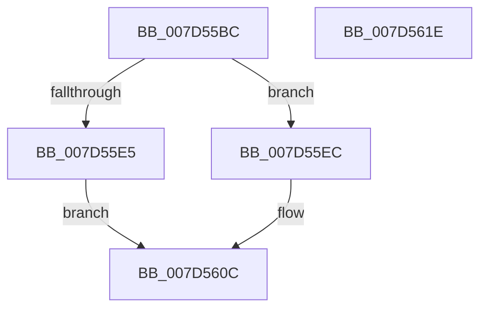

# ExpCrossVmWnfPull

- RVA: `0x007D55BC`–`0x007D561F` (길이 `99` bytes)
- VA: `0x00000001407D55BC`
- 실행 섹션: `PAGE`
- PDB 이름 있음: `예`; PDB Function 태그: `아니요`
- unwind 정보 RVA: `0x00060BC4`
- 디코드: `28`개 명령, `99/99` bytes 표시
- 미해석 바이트: `0` (있으면 어셈블리에 `.byte`로 보존)

> 이 문서는 커널 이미지의 기계어와 PDB 기호를 분석해 생성했습니다. 4번과 5번은 함수 원형과 자료형을 바이너리 사용 방식에서 추정한 C 해석이며 원본 소스 복구 결과는 아닙니다.

## 1. Dependencies

- 직접 호출 지점: **3**; 고유 호출 대상: **3**
- 직접 호출자로 확인된 함수: **1**
- RIP 상대 이미지 참조: **2**

### Outgoing calls
- `0x007D55DB` → [ExGetExtensionTable](../../text/42/ExGetExtensionTable_function_00428814.md) (function, `0x00428814`)
- `0x007D55FD` → [guard_dispatch_icall](../../text/6B/guard_dispatch_icall_function_006BAAD0.md) (function, `0x006BAAD0`)
- `0x007D5607` → [ExReleaseExtensionTable](../../text/45/ExReleaseExtensionTable_function_00456DC0.md) (function, `0x00456DC0`)

### Direct callers
- [ExpWnfPopulateStateData](../8B/ExpWnfPopulateStateData_function_008BF354.md) at `0x008BF4B7`

### Static image references
- `0x007D55CB` → RVA `0x00EFA118` (`.data`; read)
- `0x007D55F0` → RVA `0x007D66F0` (`ExpWnfPopulateStateDataRemoteCallback`; read)

## 2. Other-region calls and transfers

- 다른 실행 섹션으로 향하는 call: **3**
  - `0x007D55DB` → [ExGetExtensionTable](../../text/42/ExGetExtensionTable_function_00428814.md) (`PAGE` → `.text`)
  - `0x007D55FD` → [guard_dispatch_icall](../../text/6B/guard_dispatch_icall_function_006BAAD0.md) (`PAGE` → `.text`)
  - `0x007D5607` → [ExReleaseExtensionTable](../../text/45/ExReleaseExtensionTable_function_00456DC0.md) (`PAGE` → `.text`)
- 별도 외부 분기/꼬리 이동을 확인하지 못했습니다.

## 3. Assembly (complete function range)

```asm
007D55BC  48 89 5C 24 08                  mov qword ptr [rsp + 8], rbx
007D55C1  48 89 74 24 10                  mov qword ptr [rsp + 0x10], rsi
007D55C6  57                              push rdi
007D55C7  48 83 EC 20                     sub rsp, 0x20
007D55CB  48 8B 3D 46 4B 72 00            mov rdi, qword ptr [rip + 0x724b46]
007D55D2  48 8B F1                        mov rsi, rcx
007D55D5  48 8B CF                        mov rcx, rdi
007D55D8  49 8B D8                        mov rbx, r8
007D55DB  E8 34 32 C5 FF                  call 0x140428814
007D55E0  48 85 C0                        test rax, rax
007D55E3  75 07                           jne 0x1407d55ec
007D55E5  BB 02 00 00 C0                  mov ebx, 0xc0000002
007D55EA  EB 20                           jmp 0x1407d560c
007D55EC  48 8B 40 78                     mov rax, qword ptr [rax + 0x78]
007D55F0  48 8D 15 F9 10 00 00            lea rdx, [rip + 0x10f9]
007D55F7  4C 8B C3                        mov r8, rbx
007D55FA  48 8B CE                        mov rcx, rsi
007D55FD  E8 CE 54 EE FF                  call 0x1406baad0
007D5602  8B D8                           mov ebx, eax
007D5604  48 8B CF                        mov rcx, rdi
007D5607  E8 B4 17 C8 FF                  call 0x140456dc0
007D560C  48 8B 74 24 38                  mov rsi, qword ptr [rsp + 0x38]
007D5611  8B C3                           mov eax, ebx
007D5613  48 8B 5C 24 30                  mov rbx, qword ptr [rsp + 0x30]
007D5618  48 83 C4 20                     add rsp, 0x20
007D561C  5F                              pop rdi
007D561D  C3                              ret
007D561E  CC                              int3
```

## 4. C-style interpretation (structured pseudocode)

```c
__int64 __fastcall ExpCrossVmWnfPull(__int64 a1, __int64 a2, __int64 a3)
{
    __int64 result;
    __int64 v_rsp;
    unsigned __int64 v_stack_p10;
    unsigned __int64 v_stack_p8;

    v_stack_p8 = v_rbx;
    v_stack_p10 = v_rsi;
    v_rsp = (v_rsp) - (32);
    result = ExGetExtensionTable(*(unsigned __int64 *)(v_rip + 7490374), a2, a3, a4);
    if (result != 0) goto loc_007D55EC;
    goto loc_007D560C;
loc_007D55EC:
    result = guard_dispatch_icall(a1, v_rip + 4345, (unsigned int)(0xC0000002ULL), a4);
    result = ExReleaseExtensionTable(*(unsigned __int64 *)(v_rip + 7490374), v_rip + 4345, (unsigned int)(0xC0000002ULL), a4);
loc_007D560C:
    v_rsp = (v_rsp) + (32);
    return (unsigned int)((unsigned int)((unsigned int)((unsigned int)(result))));
}
```

## 5. (Beta) C Style

```c
int64_t ExpCrossVmWnfPull(int64_t Arg1, int64_t Arg2, int64_t Arg3)
{
    int64_t result;
    int64_t local_rsp;
    uint64_t v_stack_p10;
    uint64_t v_stack_p8;

    v_stack_p8 = local_rbx;
    v_stack_p10 = local_rsi;
    local_rsp = (local_rsp) - (32);
    result = ExGetExtensionTable(*(uint64_t *)(v_rip + 0x724B46), Arg2, Arg3, a4);
    if (result != 0) goto loc_007D55EC;
    goto loc_007D560C;
loc_007D55EC:
    result = guard_dispatch_icall(Arg1, v_rip + 4345, (uint32_t)(0xC0000002ULL), a4);
    result = ExReleaseExtensionTable(*(uint64_t *)(v_rip + 0x724B46), v_rip + 4345, (uint32_t)(0xC0000002ULL), a4);
loc_007D560C:
    local_rsp = (local_rsp) + (32);
    return (uint32_t)((uint32_t)((uint32_t)((uint32_t)(result))));
}
```

## 6. Execution-region graph

[열기: 2D/3D 그래프와 함수 탐색 컨트롤 패널](../../../control-panel.html?section=page&rva=0x007D55BC&view=graph)

- 2D 그래프는 위에서 아래로 흐르고, 3D 그래프는 빈 공간을 드래그해 회전합니다. Shift+드래그는 이동, 휠은 확대·축소, 함수 노드 선택은 대상 보고서 이동입니다.

### Static fallback


