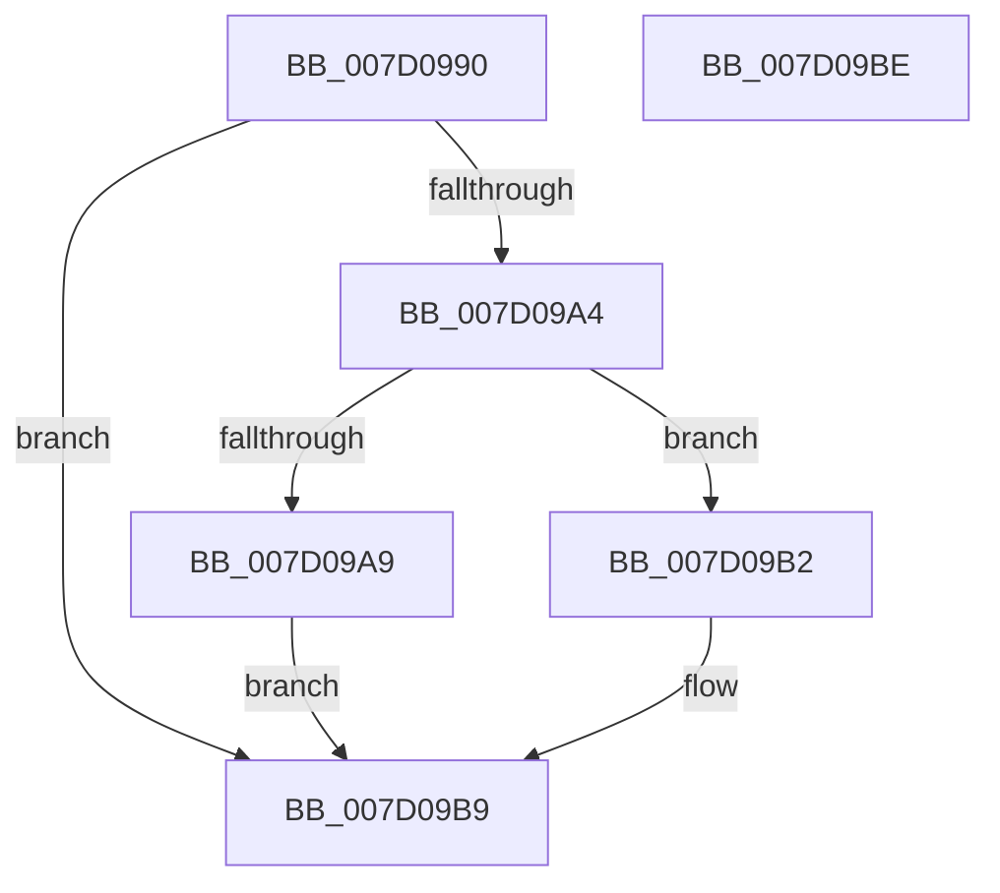

# ExpDereferenceHost

- RVA: `0x007D0990`–`0x007D09BF` (길이 `47` bytes)
- VA: `0x00000001407D0990`
- 실행 섹션: `PAGE`
- PDB 이름 있음: `예`; PDB Function 태그: `아니요`
- unwind 정보 RVA: `0x0005C788`
- 디코드: `15`개 명령, `47/47` bytes 표시
- 미해석 바이트: `0` (있으면 어셈블리에 `.byte`로 보존)

> 이 문서는 커널 이미지의 기계어와 PDB 기호를 분석해 생성했습니다. 4번과 5번은 함수 원형과 자료형을 바이너리 사용 방식에서 추정한 C 해석이며 원본 소스 복구 결과는 아닙니다.

## 1. Dependencies

- 직접 호출 지점: **1**; 고유 호출 대상: **1**
- 직접 호출자로 확인된 함수: **3**
- RIP 상대 이미지 참조: **0**

### Outgoing calls
- `0x007D09B4` → [ExFreePoolWithTag](../../poolcode/B8/ExFreePoolWithTag_function_00B82870.md) (function, `0x00B82870`)

### Direct callers
- [ExRegisterExtension](ExRegisterExtension_function_007D0420.md) at `0x007D0514`
- [ExRegisterExtension](ExRegisterExtension_function_007D0420.md) at `0x007D06A1`
- [ExRegisterHost](ExRegisterHost_function_007D06CC.md) at `0x007D0809`
- [ExRegisterHost](ExRegisterHost_function_007D06CC.md) at `0x007D0811`
- [ExUnregisterExtension](ExUnregisterExtension_function_007D0870.md) at `0x007D096C`

### Static image references
- 디코드된 RIP-relative 메모리 참조가 없습니다.

## 2. Other-region calls and transfers

- 다른 실행 섹션으로 향하는 call: **1**
  - `0x007D09B4` → [ExFreePoolWithTag](../../poolcode/B8/ExFreePoolWithTag_function_00B82870.md) (`PAGE` → `POOLCODE`)
- 별도 외부 분기/꼬리 이동을 확인하지 못했습니다.

## 3. Assembly (complete function range)

```asm
007D0990  48 83 EC 28                     sub rsp, 0x28
007D0994  48 83 C8 FF                     or rax, 0xffffffffffffffff
007D0998  F0 48 0F C1 41 18               lock xadd qword ptr [rcx + 0x18], rax
007D099E  48 83 E8 01                     sub rax, 1
007D09A2  7F 15                           jg 0x1407d09b9
007D09A4  48 85 C0                        test rax, rax
007D09A7  74 09                           je 0x1407d09b2
007D09A9  B9 0E 00 00 00                  mov ecx, 0xe
007D09AE  CD 29                           int 0x29
007D09B0  EB 07                           jmp 0x1407d09b9
007D09B2  33 D2                           xor edx, edx
007D09B4  E8 B7 1E 3B 00                  call 0x140b82870
007D09B9  48 83 C4 28                     add rsp, 0x28
007D09BD  C3                              ret
007D09BE  CC                              int3
```

## 4. C-style interpretation (structured pseudocode)

```c
__int64 __fastcall ExpDereferenceHost(__int64 a1, int a2)
{
    __int64 result;
    __int64 v_rsp;

    v_rsp = (v_rsp) - (40);
    result = (result) | (-1);
    result = (result) - (1);
    if (condition_is_greater) goto loc_007D09B9;
    if (result == 0) goto loc_007D09B2;
    goto loc_007D09B9;
loc_007D09B2:
    a2 = 0;
    result = ExFreePoolWithTag(14, a2, a3, a4);
loc_007D09B9:
    v_rsp = (v_rsp) + (40);
    return result;
}
```

## 5. (Beta) C Style

```c
int64_t ExpDereferenceHost(void *Arg1, int32_t Arg2)
{
    uint8_t *arg1 = (uint8_t *)Arg1;

    int64_t result;
    int64_t local_rsp;

    local_rsp = (local_rsp) - (40);
    result = (result) | (-1);
    result = (result) - (1);
    if (condition_is_greater) goto loc_007D09B9;
    if (result == 0) goto loc_007D09B2;
    goto loc_007D09B9;
loc_007D09B2:
    Arg2 = 0;
    result = ExFreePoolWithTag(14, Arg2, a3, a4);
loc_007D09B9:
    local_rsp = (local_rsp) + (40);
    return result;
}
```

### 관측된 메모리 오프셋

구조체 형식이 확인되지 않은 접근은 인자 기준의 오프셋으로만 기록했습니다.

| 기준 인자 | 오프셋 표현 | 폭 (bit) | 접근 |
|---|---:|---:|---|
| `Arg1` | `+ 0x18` | `64` | `R/W` |

## 6. Execution-region graph

[열기: 2D/3D 그래프와 함수 탐색 컨트롤 패널](../../../control-panel.html?section=page&rva=0x007D0990&view=graph)

- 2D 그래프는 위에서 아래로 흐르고, 3D 그래프는 빈 공간을 드래그해 회전합니다. Shift+드래그는 이동, 휠은 확대·축소, 함수 노드 선택은 대상 보고서 이동입니다.

### Static fallback


