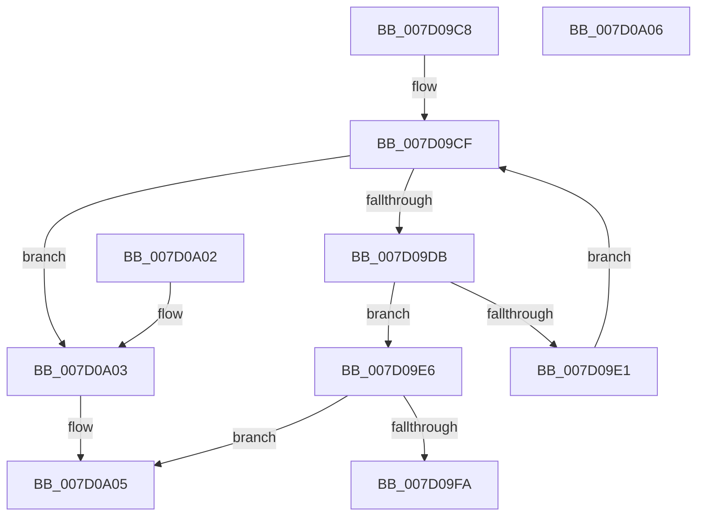

# ExpFindHost

- RVA: `0x007D09C8`–`0x007D0A07` (길이 `63` bytes)
- VA: `0x00000001407D09C8`
- 실행 섹션: `PAGE`
- PDB 이름 있음: `예`; PDB Function 태그: `아니요`
- unwind 정보 RVA: `0x000DB714`
- 디코드: `20`개 명령, `63/63` bytes 표시
- 미해석 바이트: `0` (있으면 어셈블리에 `.byte`로 보존)

> 이 문서는 커널 이미지의 기계어와 PDB 기호를 분석해 생성했습니다. 4번과 5번은 함수 원형과 자료형을 바이너리 사용 방식에서 추정한 C 해석이며 원본 소스 복구 결과는 아닙니다.

## 1. Dependencies

- 직접 호출 지점: **0**; 고유 호출 대상: **0**
- 직접 호출자로 확인된 함수: **2**
- RIP 상대 이미지 참조: **1**

### Outgoing calls
- 직접 디코드된 call 명령이 없습니다.

### Direct callers
- [ExRegisterExtension](ExRegisterExtension_function_007D0420.md) at `0x007D04CD`
- [ExRegisterHost](ExRegisterHost_function_007D06CC.md) at `0x007D07C6`

### Static image references
- `0x007D09C8` → RVA `0x00FDA038` (`PAGEDATA`; read)

## 2. Other-region calls and transfers

- 다른 실행 섹션으로 향하는 call: **0**
- 별도 외부 분기/꼬리 이동을 확인하지 못했습니다.

## 3. Assembly (complete function range)

```asm
007D09C8  48 8B 05 69 96 80 00            mov rax, qword ptr [rip + 0x809669]
007D09CF  48 8D 15 62 96 80 00            lea rdx, [rip + 0x809662]
007D09D6  48 3B C2                        cmp rax, rdx
007D09D9  74 28                           je 0x1407d0a03
007D09DB  66 39 48 10                     cmp word ptr [rax + 0x10], cx
007D09DF  74 05                           je 0x1407d09e6
007D09E1  48 8B 00                        mov rax, qword ptr [rax]
007D09E4  EB E9                           jmp 0x1407d09cf
007D09E6  B9 01 00 00 00                  mov ecx, 1
007D09EB  F0 48 0F C1 48 18               lock xadd qword ptr [rax + 0x18], rcx
007D09F1  48 FF C1                        inc rcx
007D09F4  48 83 F9 01                     cmp rcx, 1
007D09F8  7F 0B                           jg 0x1407d0a05
007D09FA  B9 0E 00 00 00                  mov ecx, 0xe
007D09FF  CD 29                           int 0x29
007D0A01  C3                              ret
007D0A02  CC                              int3
007D0A03  33 C0                           xor eax, eax
007D0A05  C3                              ret
007D0A06  CC                              int3
```

## 4. C-style interpretation (structured pseudocode)

```c
__int64 __fastcall ExpFindHost(unsigned __int16 a1)
{
    __int64 result;

loc_007D09CF:
    if ((*(unsigned __int64 *)(v_rip + 8427113)) == (v_rip + 8427106)) goto loc_007D0A03;
    if ((*(unsigned __int16 *)(*(unsigned __int64 *)(v_rip + 8427113) + 16)) == a1) goto loc_007D09E6;
    goto loc_007D09CF;
loc_007D09E6:
    a1 = (1) + 1;
    if (a1 > 1) goto loc_007D0A05;
    return *(unsigned __int64 *)(*(unsigned __int64 *)(v_rip + 8427113));
loc_007D0A03:
    result = 0;
loc_007D0A05:
    return result;
}
```

## 5. (Beta) C Style

```c
int64_t ExpFindHost(uint16_t Arg1)
{
    int64_t result;

loc_007D09CF:
    if ((*(uint64_t *)(v_rip + 0x809669)) == (v_rip + 8427106)) goto loc_007D0A03;
    if ((*(uint16_t *)(*(uint64_t *)(v_rip + 0x809669) + 0x10)) == Arg1) goto loc_007D09E6;
    goto loc_007D09CF;
loc_007D09E6:
    Arg1 = (1) + 1;
    if (Arg1 > 1) goto loc_007D0A05;
    return *(uint64_t *)(*(uint64_t *)(v_rip + 0x809669));
loc_007D0A03:
    result = 0;
loc_007D0A05:
    return result;
}
```

## 6. Execution-region graph

[열기: 2D/3D 그래프와 함수 탐색 컨트롤 패널](../../../control-panel.html?section=page&rva=0x007D09C8&view=graph)

- 2D 그래프는 위에서 아래로 흐르고, 3D 그래프는 빈 공간을 드래그해 회전합니다. Shift+드래그는 이동, 휠은 확대·축소, 함수 노드 선택은 대상 보고서 이동입니다.

### Static fallback


