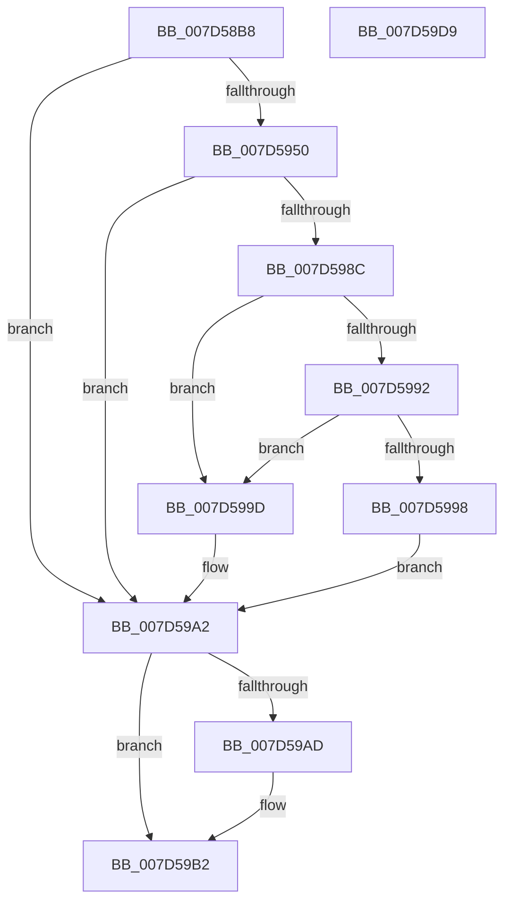

# ExpGetOriginalImageVersionRegistryValue

- RVA: `0x007D58B8`–`0x007D59DA` (길이 `290` bytes)
- VA: `0x00000001407D58B8`
- 실행 섹션: `PAGE`
- PDB 이름 있음: `예`; PDB Function 태그: `아니요`
- unwind 정보 RVA: `0x000D5C94`
- 디코드: `77`개 명령, `290/290` bytes 표시
- 미해석 바이트: `0` (있으면 어셈블리에 `.byte`로 보존)

> 이 문서는 커널 이미지의 기계어와 PDB 기호를 분석해 생성했습니다. 4번과 5번은 함수 원형과 자료형을 바이너리 사용 방식에서 추정한 C 해석이며 원본 소스 복구 결과는 아닙니다.

## 1. Dependencies

- 직접 호출 지점: **6**; 고유 호출 대상: **5**
- 직접 호출자로 확인된 함수: **1**
- RIP 상대 이미지 참조: **3**

### Outgoing calls
- `0x007D5911` → [RtlInitUnicodeString](../../text/42/RtlInitUnicodeString_function_0042A780.md) (function, `0x0042A780`)
- `0x007D5945` → [ZwOpenKey](../../text/6A/ZwOpenKey_function_006AD310.md) (function, `0x006AD310`)
- `0x007D595B` → [RtlInitUnicodeString](../../text/42/RtlInitUnicodeString_function_0042A780.md) (function, `0x0042A780`)
- `0x007D5981` → [ZwQueryValueKey](../../text/6A/ZwQueryValueKey_function_006AD3B0.md) (function, `0x006AD3B0`)
- `0x007D59AD` → [ZwClose](../../text/6A/ZwClose_function_006AD2B0.md) (function, `0x006AD2B0`)
- `0x007D59BB` → [_security_check_cookie](../../text/6A/_security_check_cookie_function_006AC640.md) (function, `0x006AC640`)

### Direct callers
- [Phase1InitializationDiscard](../../init/C1/Phase1InitializationDiscard_function_00C1C728.md) at `0x00C1D9E2`

### Static image references
- `0x007D58D3` → RVA `0x00E0A740` (`.data`; read)
- `0x007D58E3` → RVA `0x00B08DA0` (` ?? ::NNGAKEGL::`string'`; read)
- `0x007D5950` → RVA `0x00B08D70` (` ?? ::NNGAKEGL::`string'`; read)

## 2. Other-region calls and transfers

- 다른 실행 섹션으로 향하는 call: **6**
  - `0x007D5911` → [RtlInitUnicodeString](../../text/42/RtlInitUnicodeString_function_0042A780.md) (`PAGE` → `.text`)
  - `0x007D5945` → [ZwOpenKey](../../text/6A/ZwOpenKey_function_006AD310.md) (`PAGE` → `.text`)
  - `0x007D595B` → [RtlInitUnicodeString](../../text/42/RtlInitUnicodeString_function_0042A780.md) (`PAGE` → `.text`)
  - `0x007D5981` → [ZwQueryValueKey](../../text/6A/ZwQueryValueKey_function_006AD3B0.md) (`PAGE` → `.text`)
  - `0x007D59AD` → [ZwClose](../../text/6A/ZwClose_function_006AD2B0.md) (`PAGE` → `.text`)
  - `0x007D59BB` → [_security_check_cookie](../../text/6A/_security_check_cookie_function_006AC640.md) (`PAGE` → `.text`)
- 별도 외부 분기/꼬리 이동을 확인하지 못했습니다.

## 3. Assembly (complete function range)

```asm
007D58B8  48 8B C4                        mov rax, rsp
007D58BB  48 89 58 10                     mov qword ptr [rax + 0x10], rbx
007D58BF  48 89 70 18                     mov qword ptr [rax + 0x18], rsi
007D58C3  48 89 78 20                     mov qword ptr [rax + 0x20], rdi
007D58C7  55                              push rbp
007D58C8  48 8D 68 A1                     lea rbp, [rax - 0x5f]
007D58CC  48 81 EC B0 00 00 00            sub rsp, 0xb0
007D58D3  48 8B 05 66 4E 63 00            mov rax, qword ptr [rip + 0x634e66]
007D58DA  48 33 C4                        xor rax, rsp
007D58DD  48 89 45 47                     mov qword ptr [rbp + 0x47], rax
007D58E1  33 C0                           xor eax, eax
007D58E3  48 8D 15 B6 34 33 00            lea rdx, [rip + 0x3334b6]
007D58EA  21 45 23                        and dword ptr [rbp + 0x23], eax
007D58ED  48 8B F1                        mov rsi, rcx
007D58F0  21 45 D7                        and dword ptr [rbp - 0x29], eax
007D58F3  48 8D 4D E7                     lea rcx, [rbp - 0x19]
007D58F7  48 21 45 DF                     and qword ptr [rbp - 0x21], rax
007D58FB  0F 57 C0                        xorps xmm0, xmm0
007D58FE  0F 57 C9                        xorps xmm1, xmm1
007D5901  89 45 0B                        mov dword ptr [rbp + 0xb], eax
007D5904  21 45 0B                        and dword ptr [rbp + 0xb], eax
007D5907  33 FF                           xor edi, edi
007D5909  0F 11 45 E7                     movups xmmword ptr [rbp - 0x19], xmm0
007D590D  0F 11 4D F7                     movups xmmword ptr [rbp - 9], xmm1
007D5911  E8 6A 4E C5 FF                  call 0x14042a780
007D5916  48 21 7D 0F                     and qword ptr [rbp + 0xf], rdi
007D591A  48 8D 45 E7                     lea rax, [rbp - 0x19]
007D591E  0F 57 C0                        xorps xmm0, xmm0
007D5921  48 89 45 17                     mov qword ptr [rbp + 0x17], rax
007D5925  4C 8D 45 07                     lea r8, [rbp + 7]
007D5929  C7 45 07 30 00 00 00            mov dword ptr [rbp + 7], 0x30
007D5930  BA 00 00 00 80                  mov edx, 0x80000000
007D5935  C7 45 1F 40 00 00 00            mov dword ptr [rbp + 0x1f], 0x40
007D593C  48 8D 4D DF                     lea rcx, [rbp - 0x21]
007D5940  F3 0F 7F 45 27                  movdqu xmmword ptr [rbp + 0x27], xmm0
007D5945  E8 C6 79 ED FF                  call 0x1406ad310
007D594A  8B D8                           mov ebx, eax
007D594C  85 C0                           test eax, eax
007D594E  78 52                           js 0x1407d59a2
007D5950  48 8D 15 19 34 33 00            lea rdx, [rip + 0x333419]
007D5957  48 8D 4D F7                     lea rcx, [rbp - 9]
007D595B  E8 20 4E C5 FF                  call 0x14042a780
007D5960  48 8B 4D DF                     mov rcx, qword ptr [rbp - 0x21]
007D5964  48 8D 45 D7                     lea rax, [rbp - 0x29]
007D5968  48 89 44 24 28                  mov qword ptr [rsp + 0x28], rax
007D596D  4C 8D 4D 37                     lea r9, [rbp + 0x37]
007D5971  44 8D 47 02                     lea r8d, [rdi + 2]
007D5975  C7 44 24 20 10 00 00 00         mov dword ptr [rsp + 0x20], 0x10
007D597D  48 8D 55 F7                     lea rdx, [rbp - 9]
007D5981  E8 2A 7A ED FF                  call 0x1406ad3b0
007D5986  8B D8                           mov ebx, eax
007D5988  85 C0                           test eax, eax
007D598A  78 16                           js 0x1407d59a2
007D598C  83 7D 3B 03                     cmp dword ptr [rbp + 0x3b], 3
007D5990  75 0B                           jne 0x1407d599d
007D5992  83 7D 3F 04                     cmp dword ptr [rbp + 0x3f], 4
007D5996  75 05                           jne 0x1407d599d
007D5998  8B 7D 43                        mov edi, dword ptr [rbp + 0x43]
007D599B  EB 05                           jmp 0x1407d59a2
007D599D  BB 01 00 00 C0                  mov ebx, 0xc0000001
007D59A2  48 8B 4D DF                     mov rcx, qword ptr [rbp - 0x21]
007D59A6  89 3E                           mov dword ptr [rsi], edi
007D59A8  48 85 C9                        test rcx, rcx
007D59AB  74 05                           je 0x1407d59b2
007D59AD  E8 FE 78 ED FF                  call 0x1406ad2b0
007D59B2  8B C3                           mov eax, ebx
007D59B4  48 8B 4D 47                     mov rcx, qword ptr [rbp + 0x47]
007D59B8  48 33 CC                        xor rcx, rsp
007D59BB  E8 80 6C ED FF                  call 0x1406ac640
007D59C0  4C 8D 9C 24 B0 00 00 00         lea r11, [rsp + 0xb0]
007D59C8  49 8B 5B 18                     mov rbx, qword ptr [r11 + 0x18]
007D59CC  49 8B 73 20                     mov rsi, qword ptr [r11 + 0x20]
007D59D0  49 8B 7B 28                     mov rdi, qword ptr [r11 + 0x28]
007D59D4  49 8B E3                        mov rsp, r11
007D59D7  5D                              pop rbp
007D59D8  C3                              ret
007D59D9  CC                              int3
```

## 4. C-style interpretation (structured pseudocode)

```c
__int64 __fastcall ExpGetOriginalImageVersionRegistryValue(__int64 a1)
{
    __int64 result;
    __int64 v_rdi;
    __int64 v_rsp;
    unsigned __int64 v_stack_m8;
    unsigned __int64 v_stack_m90;
    unsigned int v_stack_m98;

    *(unsigned __int64 *)(v_rsp + 16) = v_rbx;
    *(unsigned __int64 *)(v_rsp + 24) = v_rsi;
    *(unsigned __int64 *)(v_rsp + 32) = v_rdi;
    v_rsp = (v_rsp) - (176);
    result = (*(unsigned __int64 *)(v_rip + 6508134)) ^ (v_rsp);
    *(unsigned __int64 *)(v_rsp - 95 + 71) = result;
    result = 0;
    *(unsigned int *)(v_rsp - 95 + 11) = 0;
    v_rdi = 0;
    *(unsigned __int64 *)(v_rsp - 95 - 25) = v_xmm0;
    *(unsigned __int64 *)(v_rsp - 95 - 9) = v_xmm1;
    result = RtlInitUnicodeString(v_rsp - 95 - 25, v_rip + 3355830, a3, a4);
    *(unsigned __int64 *)(v_rsp - 95 + 23) = v_rsp - 95 - 25;
    *(unsigned int *)(v_rsp - 95 + 7) = 48;
    *(unsigned int *)(v_rsp - 95 + 31) = 64;
    *(unsigned __int64 *)(v_rsp - 95 + 39) = v_xmm0;
    result = ZwOpenKey(v_rsp - 95 - 33, (unsigned int)(0x80000000ULL), v_rsp - 95 + 7, a4);
    if (sign_flag) goto loc_007D59A2;
    result = RtlInitUnicodeString(v_rsp - 95 - 9, v_rip + 3355673, v_rsp - 95 + 7, a4);
    v_stack_m90 = v_rsp - 95 - 41;
    v_stack_m98 = 16;
    result = ZwQueryValueKey(*(unsigned __int64 *)(v_rsp - 95 - 33), v_rsp - 95 - 9, v_rdi + 2, v_rsp - 95 + 55);
    if (sign_flag) goto loc_007D59A2;
    if ((*(unsigned int *)(v_rsp - 95 + 59)) != 3) goto loc_007D599D;
    if ((*(unsigned int *)(v_rsp - 95 + 63)) != 4) goto loc_007D599D;
    goto loc_007D59A2;
loc_007D599D:
loc_007D59A2:
    *(unsigned int *)(a1) = (unsigned int)((unsigned int)(*(unsigned int *)(v_rsp - 95 + 67)));
    if (*(unsigned __int64 *)(v_rsp - 95 - 33) != 0) {
        result = ZwClose(*(unsigned __int64 *)(v_rsp - 95 - 33), v_rsp - 95 - 9, v_rdi + 2, v_rsp - 95 + 55);
    }
    a1 = (*(unsigned __int64 *)(v_rsp - 95 + 71)) ^ (v_rsp);
    result = _security_check_cookie(a1, v_rsp - 95 - 9, v_rdi + 2, v_rsp - 95 + 55);
    return result;
}
```

## 5. (Beta) C Style

```c
int64_t ExpGetOriginalImageVersionRegistryValue(void *Arg1)
{
    uint8_t *arg1 = (uint8_t *)Arg1;

    int64_t result;
    int64_t local_rdi;
    int64_t local_rsp;
    uint64_t v_stack_m8;
    uint64_t v_stack_m90;
    uint32_t v_stack_m98;

    *(uint64_t *)(local_rsp + 0x10) = local_rbx;
    *(uint64_t *)(local_rsp + 0x18) = local_rsi;
    *(uint64_t *)(local_rsp + 0x20) = local_rdi;
    local_rsp = (local_rsp) - (176);
    result = (*(uint64_t *)(v_rip + 0x634E66)) ^ (local_rsp);
    *(uint64_t *)(local_rsp - 0x5F + 0x47) = result;
    result = 0;
    *(uint32_t *)(local_rsp - 0x5F + 0xB) = 0;
    local_rdi = 0;
    *(uint64_t *)(local_rsp - 0x5F - 0x19) = v_xmm0;
    *(uint64_t *)(local_rsp - 0x5F - 0x9) = v_xmm1;
    result = RtlInitUnicodeString(local_rsp - 95 - 25, v_rip + 3355830, a3, a4);
    *(uint64_t *)(local_rsp - 0x5F + 0x17) = local_rsp - 95 - 25;
    *(uint32_t *)(local_rsp - 0x5F + 0x7) = 48;
    *(uint32_t *)(local_rsp - 0x5F + 0x1F) = 64;
    *(uint64_t *)(local_rsp - 0x5F + 0x27) = v_xmm0;
    result = ZwOpenKey(local_rsp - 95 - 33, (uint32_t)(0x80000000ULL), local_rsp - 95 + 7, a4);
    if (sign_flag) goto loc_007D59A2;
    result = RtlInitUnicodeString(local_rsp - 95 - 9, v_rip + 3355673, local_rsp - 95 + 7, a4);
    v_stack_m90 = local_rsp - 95 - 41;
    v_stack_m98 = 16;
    result = ZwQueryValueKey(*(uint64_t *)(local_rsp - 0x5F - 0x21), local_rsp - 95 - 9, local_rdi + 2, local_rsp - 95 + 55);
    if (sign_flag) goto loc_007D59A2;
    if ((*(uint32_t *)(local_rsp - 0x5F + 0x3B)) != 3) goto loc_007D599D;
    if ((*(uint32_t *)(local_rsp - 0x5F + 0x3F)) != 4) goto loc_007D599D;
    goto loc_007D59A2;
loc_007D599D:
loc_007D59A2:
    *(uint32_t *)(arg1) = (uint32_t)((uint32_t)(*(uint32_t *)(local_rsp - 0x5F + 0x43)));
    if (*(uint64_t *)(local_rsp - 0x5F - 0x21) != 0) {
        result = ZwClose(*(uint64_t *)(local_rsp - 0x5F - 0x21), local_rsp - 95 - 9, local_rdi + 2, local_rsp - 95 + 55);
    }
    Arg1 = (*(uint64_t *)(local_rsp - 0x5F + 0x47)) ^ (local_rsp);
    result = _security_check_cookie(Arg1, local_rsp - 95 - 9, local_rdi + 2, local_rsp - 95 + 55);
    return result;
}
```

### 관측된 메모리 오프셋

구조체 형식이 확인되지 않은 접근은 인자 기준의 오프셋으로만 기록했습니다.

| 기준 인자 | 오프셋 표현 | 폭 (bit) | 접근 |
|---|---:|---:|---|
| `Arg1` | `+ 0x0` | `32` | `W` |

## 6. Execution-region graph

[열기: 2D/3D 그래프와 함수 탐색 컨트롤 패널](../../../control-panel.html?section=page&rva=0x007D58B8&view=graph)

- 2D 그래프는 위에서 아래로 흐르고, 3D 그래프는 빈 공간을 드래그해 회전합니다. Shift+드래그는 이동, 휠은 확대·축소, 함수 노드 선택은 대상 보고서 이동입니다.

### Static fallback


