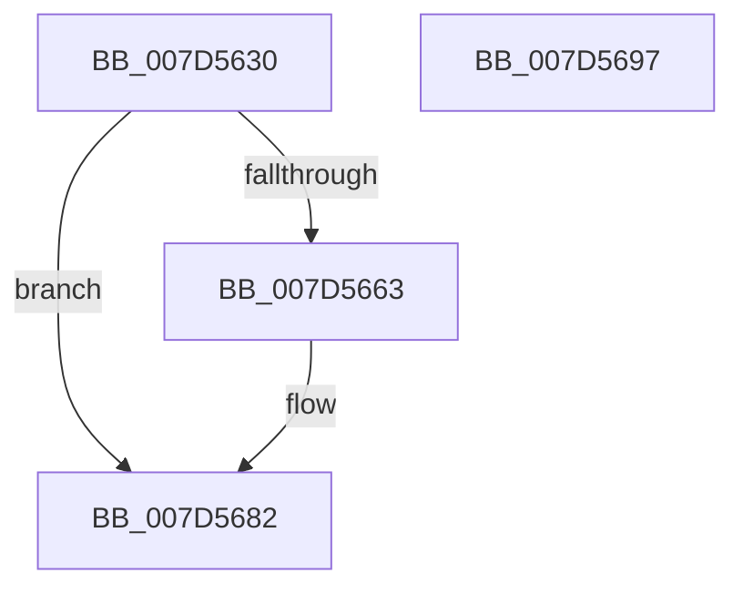

# ExpObCloseCrossVmEvent

- RVA: `0x007D5630`–`0x007D5698` (길이 `104` bytes)
- VA: `0x00000001407D5630`
- 실행 섹션: `PAGE`
- PDB 이름 있음: `예`; PDB Function 태그: `아니요`
- unwind 정보 RVA: `0x0007D3C0`
- 디코드: `30`개 명령, `104/104` bytes 표시
- 미해석 바이트: `0` (있으면 어셈블리에 `.byte`로 보존)

> 이 문서는 커널 이미지의 기계어와 PDB 기호를 분석해 생성했습니다. 4번과 5번은 함수 원형과 자료형을 바이너리 사용 방식에서 추정한 C 해석이며 원본 소스 복구 결과는 아닙니다.

## 1. Dependencies

- 직접 호출 지점: **3**; 고유 호출 대상: **3**
- 직접 호출자로 확인된 함수: **0**
- RIP 상대 이미지 참조: **0**

### Outgoing calls
- `0x007D5659` → [ExpGetExtensionHostForCrossVmObject](../70/ExpGetExtensionHostForCrossVmObject_function_007020E0.md) (function, `0x007020E0`)
- `0x007D5673` → [guard_dispatch_icall](../../text/6B/guard_dispatch_icall_function_006BAAD0.md) (function, `0x006BAAD0`)
- `0x007D567D` → [ExReleaseExtensionTable](../../text/45/ExReleaseExtensionTable_function_00456DC0.md) (function, `0x00456DC0`)

### Direct callers
- 이 함수 시작 RVA로 연결되는 직접 call은 확인되지 않았습니다. 간접 호출은 완전히 역산할 수 없습니다.

### Static image references
- 디코드된 RIP-relative 메모리 참조가 없습니다.

## 2. Other-region calls and transfers

- 다른 실행 섹션으로 향하는 call: **2**
  - `0x007D5673` → [guard_dispatch_icall](../../text/6B/guard_dispatch_icall_function_006BAAD0.md) (`PAGE` → `.text`)
  - `0x007D567D` → [ExReleaseExtensionTable](../../text/45/ExReleaseExtensionTable_function_00456DC0.md) (`PAGE` → `.text`)
- 별도 외부 분기/꼬리 이동을 확인하지 못했습니다.

## 3. Assembly (complete function range)

```asm
007D5630  48 8B C4                        mov rax, rsp
007D5633  48 89 58 08                     mov qword ptr [rax + 8], rbx
007D5637  48 89 68 10                     mov qword ptr [rax + 0x10], rbp
007D563B  48 89 70 18                     mov qword ptr [rax + 0x18], rsi
007D563F  57                              push rdi
007D5640  48 83 EC 40                     sub rsp, 0x40
007D5644  48 83 60 E8 00                  and qword ptr [rax - 0x18], 0
007D5649  48 8B F2                        mov rsi, rdx
007D564C  48 8D 50 E8                     lea rdx, [rax - 0x18]
007D5650  49 8B D9                        mov rbx, r9
007D5653  49 8B F8                        mov rdi, r8
007D5656  48 8B E9                        mov rbp, rcx
007D5659  E8 82 CA F2 FF                  call 0x1407020e0
007D565E  48 85 C0                        test rax, rax
007D5661  74 1F                           je 0x1407d5682
007D5663  48 8B 40 30                     mov rax, qword ptr [rax + 0x30]
007D5667  4C 8B CB                        mov r9, rbx
007D566A  4C 8B C7                        mov r8, rdi
007D566D  48 8B D6                        mov rdx, rsi
007D5670  48 8B CD                        mov rcx, rbp
007D5673  E8 58 54 EE FF                  call 0x1406baad0
007D5678  48 8B 4C 24 30                  mov rcx, qword ptr [rsp + 0x30]
007D567D  E8 3E 17 C8 FF                  call 0x140456dc0
007D5682  48 8B 5C 24 50                  mov rbx, qword ptr [rsp + 0x50]
007D5687  48 8B 6C 24 58                  mov rbp, qword ptr [rsp + 0x58]
007D568C  48 8B 74 24 60                  mov rsi, qword ptr [rsp + 0x60]
007D5691  48 83 C4 40                     add rsp, 0x40
007D5695  5F                              pop rdi
007D5696  C3                              ret
007D5697  CC                              int3
```

## 4. C-style interpretation (structured pseudocode)

```c
__int64 __fastcall ExpObCloseCrossVmEvent(__int64 a1, __int64 a2, __int64 a3, __int64 a4)
{
    __int64 result;
    __int64 v_rsp;
    unsigned __int64 v_stack_m18;
    unsigned __int64 v_stack_p10;
    unsigned __int64 v_stack_p18;
    unsigned __int64 v_stack_p8;

    *(unsigned __int64 *)(v_rsp + 8) = v_rbx;
    *(unsigned __int64 *)(v_rsp + 16) = v_rbp;
    *(unsigned __int64 *)(v_rsp + 24) = v_rsi;
    v_rsp = (v_rsp) - (64);
    result = ExpGetExtensionHostForCrossVmObject(a1, v_rsp - 24, a3, a4);
    if (result != 0) {
        result = *(unsigned __int64 *)(result + 48);
        a4 = a4;
        a3 = a3;
        a2 = a2;
        a1 = a1;
        result = guard_dispatch_icall(a1, a2, a3, a4);
        a1 = v_stack_m18;
        result = ExReleaseExtensionTable(a1, a2, a3, a4);
    }
    v_rsp = (v_rsp) + (64);
    return result;
}
```

## 5. (Beta) C Style

```c
int64_t ExpObCloseCrossVmEvent(int64_t Arg1, int64_t Arg2, int64_t Arg3, int64_t Arg4)
{
    int64_t result;
    int64_t local_rsp;
    uint64_t v_stack_m18;
    uint64_t v_stack_p10;
    uint64_t v_stack_p18;
    uint64_t v_stack_p8;

    *(uint64_t *)(local_rsp + 0x8) = local_rbx;
    *(uint64_t *)(local_rsp + 0x10) = local_rbp;
    *(uint64_t *)(local_rsp + 0x18) = local_rsi;
    local_rsp = (local_rsp) - (64);
    result = ExpGetExtensionHostForCrossVmObject(Arg1, local_rsp - 24, Arg3, Arg4);
    if (result != 0) {
        result = *(uint64_t *)(result + 0x30);
        Arg4 = Arg4;
        Arg3 = Arg3;
        Arg2 = Arg2;
        Arg1 = Arg1;
        result = guard_dispatch_icall(Arg1, Arg2, Arg3, Arg4);
        Arg1 = v_stack_m18;
        result = ExReleaseExtensionTable(Arg1, Arg2, Arg3, Arg4);
    }
    local_rsp = (local_rsp) + (64);
    return result;
}
```

## 6. Execution-region graph

[열기: 2D/3D 그래프와 함수 탐색 컨트롤 패널](../../../control-panel.html?section=page&rva=0x007D5630&view=graph)

- 2D 그래프는 위에서 아래로 흐르고, 3D 그래프는 빈 공간을 드래그해 회전합니다. Shift+드래그는 이동, 휠은 확대·축소, 함수 노드 선택은 대상 보고서 이동입니다.

### Static fallback


