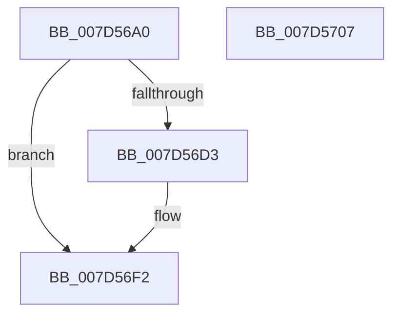

# ExpObCloseCrossVmMutant

- RVA: `0x007D56A0`–`0x007D5708` (길이 `104` bytes)
- VA: `0x00000001407D56A0`
- 실행 섹션: `PAGE`
- PDB 이름 있음: `예`; PDB Function 태그: `아니요`
- unwind 정보 RVA: `0x0007D3C0`
- 디코드: `30`개 명령, `104/104` bytes 표시
- 미해석 바이트: `0` (있으면 어셈블리에 `.byte`로 보존)

> 이 문서는 커널 이미지의 기계어와 PDB 기호를 분석해 생성했습니다. 4번과 5번은 함수 원형과 자료형을 바이너리 사용 방식에서 추정한 C 해석이며 원본 소스 복구 결과는 아닙니다.

## 1. Dependencies

- 직접 호출 지점: **3**; 고유 호출 대상: **3**
- 직접 호출자로 확인된 함수: **0**
- RIP 상대 이미지 참조: **0**

### Outgoing calls
- `0x007D56C9` → [ExpGetExtensionHostForCrossVmObject](../70/ExpGetExtensionHostForCrossVmObject_function_007020E0.md) (function, `0x007020E0`)
- `0x007D56E3` → [guard_dispatch_icall](../../text/6B/guard_dispatch_icall_function_006BAAD0.md) (function, `0x006BAAD0`)
- `0x007D56ED` → [ExReleaseExtensionTable](../../text/45/ExReleaseExtensionTable_function_00456DC0.md) (function, `0x00456DC0`)

### Direct callers
- 이 함수 시작 RVA로 연결되는 직접 call은 확인되지 않았습니다. 간접 호출은 완전히 역산할 수 없습니다.

### Static image references
- 디코드된 RIP-relative 메모리 참조가 없습니다.

## 2. Other-region calls and transfers

- 다른 실행 섹션으로 향하는 call: **2**
  - `0x007D56E3` → [guard_dispatch_icall](../../text/6B/guard_dispatch_icall_function_006BAAD0.md) (`PAGE` → `.text`)
  - `0x007D56ED` → [ExReleaseExtensionTable](../../text/45/ExReleaseExtensionTable_function_00456DC0.md) (`PAGE` → `.text`)
- 별도 외부 분기/꼬리 이동을 확인하지 못했습니다.

## 3. Assembly (complete function range)

```asm
007D56A0  48 8B C4                        mov rax, rsp
007D56A3  48 89 58 08                     mov qword ptr [rax + 8], rbx
007D56A7  48 89 68 10                     mov qword ptr [rax + 0x10], rbp
007D56AB  48 89 70 18                     mov qword ptr [rax + 0x18], rsi
007D56AF  57                              push rdi
007D56B0  48 83 EC 40                     sub rsp, 0x40
007D56B4  48 83 60 E8 00                  and qword ptr [rax - 0x18], 0
007D56B9  48 8B F2                        mov rsi, rdx
007D56BC  48 8D 50 E8                     lea rdx, [rax - 0x18]
007D56C0  49 8B D9                        mov rbx, r9
007D56C3  49 8B F8                        mov rdi, r8
007D56C6  48 8B E9                        mov rbp, rcx
007D56C9  E8 12 CA F2 FF                  call 0x1407020e0
007D56CE  48 85 C0                        test rax, rax
007D56D1  74 1F                           je 0x1407d56f2
007D56D3  48 8B 40 60                     mov rax, qword ptr [rax + 0x60]
007D56D7  4C 8B CB                        mov r9, rbx
007D56DA  4C 8B C7                        mov r8, rdi
007D56DD  48 8B D6                        mov rdx, rsi
007D56E0  48 8B CD                        mov rcx, rbp
007D56E3  E8 E8 53 EE FF                  call 0x1406baad0
007D56E8  48 8B 4C 24 30                  mov rcx, qword ptr [rsp + 0x30]
007D56ED  E8 CE 16 C8 FF                  call 0x140456dc0
007D56F2  48 8B 5C 24 50                  mov rbx, qword ptr [rsp + 0x50]
007D56F7  48 8B 6C 24 58                  mov rbp, qword ptr [rsp + 0x58]
007D56FC  48 8B 74 24 60                  mov rsi, qword ptr [rsp + 0x60]
007D5701  48 83 C4 40                     add rsp, 0x40
007D5705  5F                              pop rdi
007D5706  C3                              ret
007D5707  CC                              int3
```

## 4. C-style interpretation (structured pseudocode)

```c
__int64 __fastcall ExpObCloseCrossVmMutant(__int64 a1, __int64 a2, __int64 a3, __int64 a4)
{
    __int64 result;
    __int64 v_rsp;
    unsigned __int64 v_stack_m18;
    unsigned __int64 v_stack_p10;
    unsigned __int64 v_stack_p18;
    unsigned __int64 v_stack_p8;

    *(unsigned __int64 *)(v_rsp + 8) = v_rbx;
    *(unsigned __int64 *)(v_rsp + 16) = v_rbp;
    *(unsigned __int64 *)(v_rsp + 24) = v_rsi;
    v_rsp = (v_rsp) - (64);
    result = ExpGetExtensionHostForCrossVmObject(a1, v_rsp - 24, a3, a4);
    if (result != 0) {
        result = *(unsigned __int64 *)(result + 96);
        a4 = a4;
        a3 = a3;
        a2 = a2;
        a1 = a1;
        result = guard_dispatch_icall(a1, a2, a3, a4);
        a1 = v_stack_m18;
        result = ExReleaseExtensionTable(a1, a2, a3, a4);
    }
    v_rsp = (v_rsp) + (64);
    return result;
}
```

## 5. (Beta) C Style

```c
int64_t ExpObCloseCrossVmMutant(int64_t Arg1, int64_t Arg2, int64_t Arg3, int64_t Arg4)
{
    int64_t result;
    int64_t local_rsp;
    uint64_t v_stack_m18;
    uint64_t v_stack_p10;
    uint64_t v_stack_p18;
    uint64_t v_stack_p8;

    *(uint64_t *)(local_rsp + 0x8) = local_rbx;
    *(uint64_t *)(local_rsp + 0x10) = local_rbp;
    *(uint64_t *)(local_rsp + 0x18) = local_rsi;
    local_rsp = (local_rsp) - (64);
    result = ExpGetExtensionHostForCrossVmObject(Arg1, local_rsp - 24, Arg3, Arg4);
    if (result != 0) {
        result = *(uint64_t *)(result + 0x60);
        Arg4 = Arg4;
        Arg3 = Arg3;
        Arg2 = Arg2;
        Arg1 = Arg1;
        result = guard_dispatch_icall(Arg1, Arg2, Arg3, Arg4);
        Arg1 = v_stack_m18;
        result = ExReleaseExtensionTable(Arg1, Arg2, Arg3, Arg4);
    }
    local_rsp = (local_rsp) + (64);
    return result;
}
```

## 6. Execution-region graph

[열기: 2D/3D 그래프와 함수 탐색 컨트롤 패널](../../../control-panel.html?section=page&rva=0x007D56A0&view=graph)

- 2D 그래프는 위에서 아래로 흐르고, 3D 그래프는 빈 공간을 드래그해 회전합니다. Shift+드래그는 이동, 휠은 확대·축소, 함수 노드 선택은 대상 보고서 이동입니다.

### Static fallback


