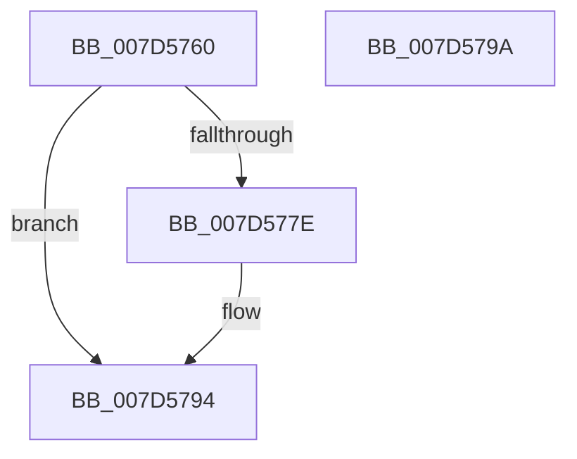

# ExpObDeleteCrossVmMutant

- RVA: `0x007D5760`–`0x007D579B` (길이 `59` bytes)
- VA: `0x00000001407D5760`
- 실행 섹션: `PAGE`
- PDB 이름 있음: `예`; PDB Function 태그: `아니요`
- unwind 정보 RVA: `0x0005CF00`
- 디코드: `17`개 명령, `59/59` bytes 표시
- 미해석 바이트: `0` (있으면 어셈블리에 `.byte`로 보존)

> 이 문서는 커널 이미지의 기계어와 PDB 기호를 분석해 생성했습니다. 4번과 5번은 함수 원형과 자료형을 바이너리 사용 방식에서 추정한 C 해석이며 원본 소스 복구 결과는 아닙니다.

## 1. Dependencies

- 직접 호출 지점: **3**; 고유 호출 대상: **3**
- 직접 호출자로 확인된 함수: **0**
- RIP 상대 이미지 참조: **0**

### Outgoing calls
- `0x007D5774` → [ExpGetExtensionHostForCrossVmObject](../70/ExpGetExtensionHostForCrossVmObject_function_007020E0.md) (function, `0x007020E0`)
- `0x007D5785` → [guard_dispatch_icall](../../text/6B/guard_dispatch_icall_function_006BAAD0.md) (function, `0x006BAAD0`)
- `0x007D578F` → [ExReleaseExtensionTable](../../text/45/ExReleaseExtensionTable_function_00456DC0.md) (function, `0x00456DC0`)

### Direct callers
- 이 함수 시작 RVA로 연결되는 직접 call은 확인되지 않았습니다. 간접 호출은 완전히 역산할 수 없습니다.

### Static image references
- 디코드된 RIP-relative 메모리 참조가 없습니다.

## 2. Other-region calls and transfers

- 다른 실행 섹션으로 향하는 call: **2**
  - `0x007D5785` → [guard_dispatch_icall](../../text/6B/guard_dispatch_icall_function_006BAAD0.md) (`PAGE` → `.text`)
  - `0x007D578F` → [ExReleaseExtensionTable](../../text/45/ExReleaseExtensionTable_function_00456DC0.md) (`PAGE` → `.text`)
- 별도 외부 분기/꼬리 이동을 확인하지 못했습니다.

## 3. Assembly (complete function range)

```asm
007D5760  40 53                           push rbx
007D5762  48 83 EC 20                     sub rsp, 0x20
007D5766  48 83 64 24 38 00               and qword ptr [rsp + 0x38], 0
007D576C  48 8D 54 24 38                  lea rdx, [rsp + 0x38]
007D5771  48 8B D9                        mov rbx, rcx
007D5774  E8 67 C9 F2 FF                  call 0x1407020e0
007D5779  48 85 C0                        test rax, rax
007D577C  74 16                           je 0x1407d5794
007D577E  48 8B 40 68                     mov rax, qword ptr [rax + 0x68]
007D5782  48 8B CB                        mov rcx, rbx
007D5785  E8 46 53 EE FF                  call 0x1406baad0
007D578A  48 8B 4C 24 38                  mov rcx, qword ptr [rsp + 0x38]
007D578F  E8 2C 16 C8 FF                  call 0x140456dc0
007D5794  48 83 C4 20                     add rsp, 0x20
007D5798  5B                              pop rbx
007D5799  C3                              ret
007D579A  CC                              int3
```

## 4. C-style interpretation (structured pseudocode)

```c
__int64 __fastcall ExpObDeleteCrossVmMutant(__int64 a1)
{
    __int64 result;
    __int64 v_rsp;
    unsigned __int64 v_stack_p10;

    v_rsp = (v_rsp) - (32);
    result = ExpGetExtensionHostForCrossVmObject(a1, v_stack_p10, a3, a4);
    if (result != 0) {
        result = *(unsigned __int64 *)(result + 104);
        a1 = a1;
        result = guard_dispatch_icall(a1, v_stack_p10, a3, a4);
        a1 = v_stack_p10;
        result = ExReleaseExtensionTable(a1, v_stack_p10, a3, a4);
    }
    v_rsp = (v_rsp) + (32);
    return result;
}
```

## 5. (Beta) C Style

```c
int64_t ExpObDeleteCrossVmMutant(int64_t Arg1)
{
    int64_t result;
    int64_t local_rsp;
    uint64_t v_stack_p10;

    local_rsp = (local_rsp) - (32);
    result = ExpGetExtensionHostForCrossVmObject(Arg1, v_stack_p10, a3, a4);
    if (result != 0) {
        result = *(uint64_t *)(result + 0x68);
        Arg1 = Arg1;
        result = guard_dispatch_icall(Arg1, v_stack_p10, a3, a4);
        Arg1 = v_stack_p10;
        result = ExReleaseExtensionTable(Arg1, v_stack_p10, a3, a4);
    }
    local_rsp = (local_rsp) + (32);
    return result;
}
```

## 6. Execution-region graph

[열기: 2D/3D 그래프와 함수 탐색 컨트롤 패널](../../../control-panel.html?section=page&rva=0x007D5760&view=graph)

- 2D 그래프는 위에서 아래로 흐르고, 3D 그래프는 빈 공간을 드래그해 회전합니다. Shift+드래그는 이동, 휠은 확대·축소, 함수 노드 선택은 대상 보고서 이동입니다.

### Static fallback


