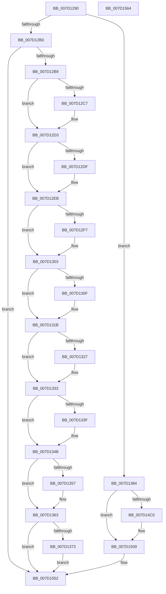

# ExpPcwHostCallback

- RVA: `0x007D1290`–`0x007D1565` (길이 `725` bytes)
- VA: `0x00000001407D1290`
- 실행 섹션: `PAGE`
- PDB 이름 있음: `예`; PDB Function 태그: `아니요`
- unwind 정보 RVA: `0x000D5800`
- 디코드: `143`개 명령, `725/725` bytes 표시
- 미해석 바이트: `0` (있으면 어셈블리에 `.byte`로 보존)

> 이 문서는 커널 이미지의 기계어와 PDB 기호를 분석해 생성했습니다. 4번과 5번은 함수 원형과 자료형을 바이너리 사용 방식에서 추정한 C 해석이며 원본 소스 복구 결과는 아닙니다.

## 1. Dependencies

- 직접 호출 지점: **16**; 고유 호출 대상: **4**
- 직접 호출자로 확인된 함수: **0**
- RIP 상대 이미지 참조: **33**

### Outgoing calls
- `0x007D12C7` → [PcwUnregister](../AC/PcwUnregister_function_00AC41A0.md) (function, `0x00AC41A0`)
- `0x007D12DF` → [PcwUnregister](../AC/PcwUnregister_function_00AC41A0.md) (function, `0x00AC41A0`)
- `0x007D12F7` → [PcwUnregister](../AC/PcwUnregister_function_00AC41A0.md) (function, `0x00AC41A0`)
- `0x007D130F` → [PcwUnregister](../AC/PcwUnregister_function_00AC41A0.md) (function, `0x00AC41A0`)
- `0x007D1327` → [PcwUnregister](../AC/PcwUnregister_function_00AC41A0.md) (function, `0x00AC41A0`)
- `0x007D133F` → [PcwUnregister](../AC/PcwUnregister_function_00AC41A0.md) (function, `0x00AC41A0`)
- `0x007D1357` → [PcwUnregister](../AC/PcwUnregister_function_00AC41A0.md) (function, `0x00AC41A0`)
- `0x007D1373` → [PcwUnregister](../AC/PcwUnregister_function_00AC41A0.md) (function, `0x00AC41A0`)
- `0x007D1384` → [EtwRegisterCounters](../84/EtwRegisterCounters_function_00841400.md) (function, `0x00841400`)
- `0x007D13CF` → [ExpRegisterCounterSet](ExpRegisterCounterSet_function_007D156C.md) (function, `0x007D156C`)
- `0x007D1418` → [ExpRegisterCounterSet](ExpRegisterCounterSet_function_007D156C.md) (function, `0x007D156C`)
- `0x007D1465` → [ExpRegisterCounterSet](ExpRegisterCounterSet_function_007D156C.md) (function, `0x007D156C`)
- `0x007D14B2` → [ExpRegisterCounterSet](ExpRegisterCounterSet_function_007D156C.md) (function, `0x007D156C`)
- `0x007D14B7` → [PsIsDiskCountersEnabled](../../text/5E/PsIsDiskCountersEnabled_function_005E2D70.md) (function, `0x005E2D70`)
- `0x007D1504` → [ExpRegisterCounterSet](ExpRegisterCounterSet_function_007D156C.md) (function, `0x007D156C`)
- `0x007D154D` → [ExpRegisterCounterSet](ExpRegisterCounterSet_function_007D156C.md) (function, `0x007D156C`)

### Direct callers
- 이 함수 시작 RVA로 연결되는 직접 call은 확인되지 않았습니다. 간접 호출은 완전히 역산할 수 없습니다.

### Static image references
- `0x007D12B9` → RVA `0x00E65E10` (`.data`; read)
- `0x007D12CC` → RVA `0x00E65E10` (`.data`; write)
- `0x007D12D3` → RVA `0x00E65E08` (`.data`; read)
- `0x007D12E4` → RVA `0x00E65E08` (`.data`; write)
- `0x007D12EB` → RVA `0x00E65DF0` (`.data`; read)
- `0x007D12FC` → RVA `0x00E65DF0` (`.data`; write)
- `0x007D1303` → RVA `0x00E65DF8` (`.data`; read)
- `0x007D1314` → RVA `0x00E65DF8` (`.data`; write)
- `0x007D131B` → RVA `0x00E65DE8` (`.data`; read)
- `0x007D132C` → RVA `0x00E65DE8` (`.data`; write)
- `0x007D1333` → RVA `0x00E65DE0` (`.data`; read)
- `0x007D1344` → RVA `0x00E65DE0` (`.data`; write)
- `0x007D134B` → RVA `0x00E65E00` (`.data`; read)
- `0x007D135C` → RVA `0x00E65E00` (`.data`; write)
- `0x007D1363` → RVA `0x00E65DD8` (`.data`; read)
- `0x007D1378` → RVA `0x00E65DD8` (`.data`; write)
- `0x007D1389` → RVA `0x00009EA8` (`.rdata`; read)
- `0x007D13A0` → RVA `0x00026540` (`.rdata`; read)
- `0x007D13BA` → RVA `0x00A5F5B0` (`KiSynchCounterSetCallback`; read)
- `0x007D13D4` → RVA `0x00009E88` (`.rdata`; read)
- `0x007D1405` → RVA `0x00A77BE0` (`KiSynchNumaCounterSetCallback`; read)
- `0x007D141D` → RVA `0x00009E98` (`.rdata`; read)
- `0x007D1434` → RVA `0x000266F0` (`.rdata`; read)
- `0x007D144E` → RVA `0x009E4880` (`ExProcessorCounterSetCallback`; read)
- `0x007D146A` → RVA `0x00009E38` (`.rdata`; read)
- `0x007D1481` → RVA `0x00026450` (`.rdata`; read)
- `0x007D149B` → RVA `0x0091CDF0` (`ExProcessCounterSetCallback`; read)
- `0x007D14C0` → RVA `0x00009E78` (`.rdata`; read)
- `0x007D14D7` → RVA `0x000266D8` (`.rdata`; read)
- `0x007D14F1` → RVA `0x00A61540` (`FsRtlDiskIOCounterSetCallback`; read)
- `0x007D1509` → RVA `0x00009E48` (`.rdata`; read)
- `0x007D1520` → RVA `0x000266B8` (`.rdata`; read)
- `0x007D153A` → RVA `0x00A0E350` (`PoThermalCounterSetCallback`; read)

## 2. Other-region calls and transfers

- 다른 실행 섹션으로 향하는 call: **1**
  - `0x007D14B7` → [PsIsDiskCountersEnabled](../../text/5E/PsIsDiskCountersEnabled_function_005E2D70.md) (`PAGE` → `.text`)
- 별도 외부 분기/꼬리 이동을 확인하지 못했습니다.

## 3. Assembly (complete function range)

```asm
007D1290  48 89 5C 24 08                  mov qword ptr [rsp + 8], rbx
007D1295  48 89 74 24 10                  mov qword ptr [rsp + 0x10], rsi
007D129A  55                              push rbp
007D129B  48 8B EC                        mov rbp, rsp
007D129E  48 83 EC 60                     sub rsp, 0x60
007D12A2  33 C0                           xor eax, eax
007D12A4  89 45 C4                        mov dword ptr [rbp - 0x3c], eax
007D12A7  83 E9 01                        sub ecx, 1
007D12AA  0F 84 D4 00 00 00               je 0x1407d1384
007D12B0  83 F9 01                        cmp ecx, 1
007D12B3  0F 85 99 02 00 00               jne 0x1407d1552
007D12B9  48 8B 0D 50 4B 69 00            mov rcx, qword ptr [rip + 0x694b50]
007D12C0  33 DB                           xor ebx, ebx
007D12C2  48 85 C9                        test rcx, rcx
007D12C5  74 0C                           je 0x1407d12d3
007D12C7  E8 D4 2E 2F 00                  call 0x140ac41a0
007D12CC  48 89 1D 3D 4B 69 00            mov qword ptr [rip + 0x694b3d], rbx
007D12D3  48 8B 0D 2E 4B 69 00            mov rcx, qword ptr [rip + 0x694b2e]
007D12DA  48 85 C9                        test rcx, rcx
007D12DD  74 0C                           je 0x1407d12eb
007D12DF  E8 BC 2E 2F 00                  call 0x140ac41a0
007D12E4  48 89 1D 1D 4B 69 00            mov qword ptr [rip + 0x694b1d], rbx
007D12EB  48 8B 0D FE 4A 69 00            mov rcx, qword ptr [rip + 0x694afe]
007D12F2  48 85 C9                        test rcx, rcx
007D12F5  74 0C                           je 0x1407d1303
007D12F7  E8 A4 2E 2F 00                  call 0x140ac41a0
007D12FC  48 89 1D ED 4A 69 00            mov qword ptr [rip + 0x694aed], rbx
007D1303  48 8B 0D EE 4A 69 00            mov rcx, qword ptr [rip + 0x694aee]
007D130A  48 85 C9                        test rcx, rcx
007D130D  74 0C                           je 0x1407d131b
007D130F  E8 8C 2E 2F 00                  call 0x140ac41a0
007D1314  48 89 1D DD 4A 69 00            mov qword ptr [rip + 0x694add], rbx
007D131B  48 8B 0D C6 4A 69 00            mov rcx, qword ptr [rip + 0x694ac6]
007D1322  48 85 C9                        test rcx, rcx
007D1325  74 0C                           je 0x1407d1333
007D1327  E8 74 2E 2F 00                  call 0x140ac41a0
007D132C  48 89 1D B5 4A 69 00            mov qword ptr [rip + 0x694ab5], rbx
007D1333  48 8B 0D A6 4A 69 00            mov rcx, qword ptr [rip + 0x694aa6]
007D133A  48 85 C9                        test rcx, rcx
007D133D  74 0C                           je 0x1407d134b
007D133F  E8 5C 2E 2F 00                  call 0x140ac41a0
007D1344  48 89 1D 95 4A 69 00            mov qword ptr [rip + 0x694a95], rbx
007D134B  48 8B 0D AE 4A 69 00            mov rcx, qword ptr [rip + 0x694aae]
007D1352  48 85 C9                        test rcx, rcx
007D1355  74 0C                           je 0x1407d1363
007D1357  E8 44 2E 2F 00                  call 0x140ac41a0
007D135C  48 89 1D 9D 4A 69 00            mov qword ptr [rip + 0x694a9d], rbx
007D1363  48 8B 0D 6E 4A 69 00            mov rcx, qword ptr [rip + 0x694a6e]
007D136A  48 85 C9                        test rcx, rcx
007D136D  0F 84 DF 01 00 00               je 0x1407d1552
007D1373  E8 28 2E 2F 00                  call 0x140ac41a0
007D1378  48 89 1D 59 4A 69 00            mov qword ptr [rip + 0x694a59], rbx
007D137F  E9 CE 01 00 00                  jmp 0x1407d1552
007D1384  E8 77 00 07 00                  call 0x140841400
007D1389  48 8D 05 18 8B 83 FF            lea rax, [rip - 0x7c74e8]
007D1390  48 C7 45 C0 00 02 00 00         mov qword ptr [rbp - 0x40], 0x200
007D1398  48 89 45 C8                     mov qword ptr [rbp - 0x38], rax
007D139C  48 8D 55 C0                     lea rdx, [rbp - 0x40]
007D13A0  48 8D 05 99 51 85 FF            lea rax, [rip - 0x7aae67]
007D13A7  48 C7 45 D0 2A 00 00 00         mov qword ptr [rbp - 0x30], 0x2a
007D13AF  48 89 45 D8                     mov qword ptr [rbp - 0x28], rax
007D13B3  48 8D 0D 36 4A 69 00            lea rcx, [rip + 0x694a36]
007D13BA  48 8D 05 EF E1 28 00            lea rax, [rip + 0x28e1ef]
007D13C1  33 DB                           xor ebx, ebx
007D13C3  48 89 45 E0                     mov qword ptr [rbp - 0x20], rax
007D13C7  48 89 5D F0                     mov qword ptr [rbp - 0x10], rbx
007D13CB  48 89 5D E8                     mov qword ptr [rbp - 0x18], rbx
007D13CF  E8 98 01 00 00                  call 0x1407d156c
007D13D4  48 8D 05 AD 8A 83 FF            lea rax, [rip - 0x7c7553]
007D13DB  48 C7 45 C0 00 02 00 00         mov qword ptr [rbp - 0x40], 0x200
007D13E3  48 89 45 C8                     mov qword ptr [rbp - 0x38], rax
007D13E7  48 8D 55 C0                     lea rdx, [rbp - 0x40]
007D13EB  48 8D 05 4E 51 85 FF            lea rax, [rip - 0x7aaeb2]
007D13F2  48 C7 45 D0 2A 00 00 00         mov qword ptr [rbp - 0x30], 0x2a
007D13FA  48 89 45 D8                     mov qword ptr [rbp - 0x28], rax
007D13FE  48 8D 0D F3 49 69 00            lea rcx, [rip + 0x6949f3]
007D1405  48 8D 05 D4 67 2A 00            lea rax, [rip + 0x2a67d4]
007D140C  48 89 5D F0                     mov qword ptr [rbp - 0x10], rbx
007D1410  48 89 45 E0                     mov qword ptr [rbp - 0x20], rax
007D1414  48 89 5D E8                     mov qword ptr [rbp - 0x18], rbx
007D1418  E8 4F 01 00 00                  call 0x1407d156c
007D141D  48 8D 05 74 8A 83 FF            lea rax, [rip - 0x7c758c]
007D1424  48 C7 45 C0 00 02 00 00         mov qword ptr [rbp - 0x40], 0x200
007D142C  48 89 45 C8                     mov qword ptr [rbp - 0x38], rax
007D1430  48 8D 55 C0                     lea rdx, [rbp - 0x40]
007D1434  48 8D 05 B5 52 85 FF            lea rax, [rip - 0x7aad4b]
007D143B  48 C7 45 D0 23 00 00 00         mov qword ptr [rbp - 0x30], 0x23
007D1443  48 89 45 D8                     mov qword ptr [rbp - 0x28], rax
007D1447  48 8D 0D 9A 49 69 00            lea rcx, [rip + 0x69499a]
007D144E  48 8D 05 2B 34 21 00            lea rax, [rip + 0x21342b]
007D1455  48 C7 45 F0 01 00 00 00         mov qword ptr [rbp - 0x10], 1
007D145D  48 89 45 E0                     mov qword ptr [rbp - 0x20], rax
007D1461  48 89 5D E8                     mov qword ptr [rbp - 0x18], rbx
007D1465  E8 02 01 00 00                  call 0x1407d156c
007D146A  48 8D 05 C7 89 83 FF            lea rax, [rip - 0x7c7639]
007D1471  48 C7 45 C0 00 02 00 00         mov qword ptr [rbp - 0x40], 0x200
007D1479  48 89 45 C8                     mov qword ptr [rbp - 0x38], rax
007D147D  48 8D 55 C0                     lea rdx, [rbp - 0x40]
007D1481  48 8D 05 C8 4F 85 FF            lea rax, [rip - 0x7ab038]
007D1488  48 C7 45 D0 1E 00 00 00         mov qword ptr [rbp - 0x30], 0x1e
007D1490  48 89 45 D8                     mov qword ptr [rbp - 0x28], rax
007D1494  48 8D 0D 45 49 69 00            lea rcx, [rip + 0x694945]
007D149B  48 8D 05 4E B9 14 00            lea rax, [rip + 0x14b94e]
007D14A2  48 C7 45 F0 01 00 00 00         mov qword ptr [rbp - 0x10], 1
007D14AA  48 89 45 E0                     mov qword ptr [rbp - 0x20], rax
007D14AE  48 89 5D E8                     mov qword ptr [rbp - 0x18], rbx
007D14B2  E8 B5 00 00 00                  call 0x1407d156c
007D14B7  E8 B4 18 E1 FF                  call 0x1405e2d70
007D14BC  84 C0                           test al, al
007D14BE  74 49                           je 0x1407d1509
007D14C0  48 8D 05 B1 89 83 FF            lea rax, [rip - 0x7c764f]
007D14C7  48 C7 45 C0 00 02 00 00         mov qword ptr [rbp - 0x40], 0x200
007D14CF  48 89 45 C8                     mov qword ptr [rbp - 0x38], rax
007D14D3  48 8D 55 C0                     lea rdx, [rbp - 0x40]
007D14D7  48 8D 05 FA 51 85 FF            lea rax, [rip - 0x7aae06]
007D14DE  48 C7 45 D0 02 00 00 00         mov qword ptr [rbp - 0x30], 2
007D14E6  48 89 45 D8                     mov qword ptr [rbp - 0x28], rax
007D14EA  48 8D 0D 0F 49 69 00            lea rcx, [rip + 0x69490f]
007D14F1  48 8D 05 48 00 29 00            lea rax, [rip + 0x290048]
007D14F8  48 89 5D F0                     mov qword ptr [rbp - 0x10], rbx
007D14FC  48 89 45 E0                     mov qword ptr [rbp - 0x20], rax
007D1500  48 89 5D E8                     mov qword ptr [rbp - 0x18], rbx
007D1504  E8 63 00 00 00                  call 0x1407d156c
007D1509  48 8D 05 38 89 83 FF            lea rax, [rip - 0x7c76c8]
007D1510  48 C7 45 C0 00 02 00 00         mov qword ptr [rbp - 0x40], 0x200
007D1518  48 89 45 C8                     mov qword ptr [rbp - 0x38], rax
007D151C  48 8D 55 C0                     lea rdx, [rbp - 0x40]
007D1520  48 8D 05 91 51 85 FF            lea rax, [rip - 0x7aae6f]
007D1527  48 C7 45 D0 04 00 00 00         mov qword ptr [rbp - 0x30], 4
007D152F  48 89 45 D8                     mov qword ptr [rbp - 0x28], rax
007D1533  48 8D 0D 9E 48 69 00            lea rcx, [rip + 0x69489e]
007D153A  48 8D 05 0F CE 23 00            lea rax, [rip + 0x23ce0f]
007D1541  48 89 5D F0                     mov qword ptr [rbp - 0x10], rbx
007D1545  48 89 45 E0                     mov qword ptr [rbp - 0x20], rax
007D1549  48 89 5D E8                     mov qword ptr [rbp - 0x18], rbx
007D154D  E8 1A 00 00 00                  call 0x1407d156c
007D1552  48 8B 5C 24 70                  mov rbx, qword ptr [rsp + 0x70]
007D1557  33 C0                           xor eax, eax
007D1559  48 8B 74 24 78                  mov rsi, qword ptr [rsp + 0x78]
007D155E  48 83 C4 60                     add rsp, 0x60
007D1562  5D                              pop rbp
007D1563  C3                              ret
007D1564  CC                              int3
```

## 4. C-style interpretation (structured pseudocode)

```c
__int64 __fastcall ExpPcwHostCallback(int a1)
{
    __int64 result;
    __int64 v_rbx;
    __int64 v_rsp;
    unsigned __int64 v_stack_m18;
    unsigned __int64 v_stack_m20;
    unsigned __int64 v_stack_m28;
    unsigned __int64 v_stack_m30;
    unsigned __int64 v_stack_m38;
    unsigned __int64 v_stack_m40;
    unsigned int v_stack_m44;
    unsigned __int64 v_stack_m48;
    unsigned __int64 v_stack_p10;
    unsigned __int64 v_stack_p8;

    v_stack_p8 = v_rbx;
    v_stack_p10 = v_rsi;
    v_rsp = (v_rsp) - (96);
    result = 0;
    v_stack_m44 = 0;
    a1 = (unsigned int)((a1) - (1));
    if (condition_is_equal) goto loc_007D1384;
    if (a1 != 1) goto loc_007D1552;
    v_rbx = 0;
    if (*(unsigned __int64 *)(v_rip + 6900560) != 0) {
        result = PcwUnregister(*(unsigned __int64 *)(v_rip + 6900560), a2, a3, a4);
        *(unsigned __int64 *)(v_rip + 6900541) = 0;
    }
    if (*(unsigned __int64 *)(v_rip + 6900526) != 0) {
        result = PcwUnregister(*(unsigned __int64 *)(v_rip + 6900526), a2, a3, a4);
        *(unsigned __int64 *)(v_rip + 6900509) = 0;
    }
    if (*(unsigned __int64 *)(v_rip + 6900478) != 0) {
        result = PcwUnregister(*(unsigned __int64 *)(v_rip + 6900478), a2, a3, a4);
        *(unsigned __int64 *)(v_rip + 6900461) = 0;
    }
    if (*(unsigned __int64 *)(v_rip + 6900462) != 0) {
        result = PcwUnregister(*(unsigned __int64 *)(v_rip + 6900462), a2, a3, a4);
        *(unsigned __int64 *)(v_rip + 6900445) = 0;
    }
    if (*(unsigned __int64 *)(v_rip + 6900422) != 0) {
        result = PcwUnregister(*(unsigned __int64 *)(v_rip + 6900422), a2, a3, a4);
        *(unsigned __int64 *)(v_rip + 6900405) = 0;
    }
    if (*(unsigned __int64 *)(v_rip + 6900390) != 0) {
        result = PcwUnregister(*(unsigned __int64 *)(v_rip + 6900390), a2, a3, a4);
        *(unsigned __int64 *)(v_rip + 6900373) = 0;
    }
    if (*(unsigned __int64 *)(v_rip + 6900398) != 0) {
        result = PcwUnregister(*(unsigned __int64 *)(v_rip + 6900398), a2, a3, a4);
        *(unsigned __int64 *)(v_rip + 6900381) = 0;
    }
    if (*(unsigned __int64 *)(v_rip + 6900334) == 0) goto loc_007D1552;
    result = PcwUnregister(*(unsigned __int64 *)(v_rip + 6900334), a2, a3, a4);
    *(unsigned __int64 *)(v_rip + 6900313) = 0;
    goto loc_007D1552;
loc_007D1384:
    result = EtwRegisterCounters(*(unsigned __int64 *)(v_rip + 6900334), a2, a3, a4);
    v_stack_m48 = 512;
    v_stack_m40 = v_rip - 8156392;
    v_stack_m38 = 42;
    v_stack_m30 = v_rip - 8040039;
    v_rbx = 0;
    v_stack_m28 = v_rip + 2679279;
    v_stack_m18 = 0;
    v_stack_m20 = 0;
    result = ExpRegisterCounterSet(v_rip + 6900278, v_stack_m48, a3, a4);
    v_stack_m48 = 512;
    v_stack_m40 = v_rip - 8156499;
    v_stack_m38 = 42;
    v_stack_m30 = v_rip - 8040114;
    v_stack_m18 = 0;
    v_stack_m28 = v_rip + 2779092;
    v_stack_m20 = 0;
    result = ExpRegisterCounterSet(v_rip + 6900211, v_stack_m48, a3, a4);
    v_stack_m48 = 512;
    v_stack_m40 = v_rip - 8156556;
    v_stack_m38 = 35;
    v_stack_m30 = v_rip - 8039755;
    v_stack_m18 = 1;
    v_stack_m28 = v_rip + 2176043;
    v_stack_m20 = 0;
    result = ExpRegisterCounterSet(v_rip + 6900122, v_stack_m48, a3, a4);
    v_stack_m48 = 512;
    v_stack_m40 = v_rip - 8156729;
    v_stack_m38 = 30;
    v_stack_m30 = v_rip - 8040504;
    v_stack_m18 = 1;
    v_stack_m28 = v_rip + 1358158;
    v_stack_m20 = 0;
    result = ExpRegisterCounterSet(v_rip + 6900037, v_stack_m48, a3, a4);
    result = PsIsDiskCountersEnabled(v_rip + 6900037, v_stack_m48, a3, a4);
    if ((unsigned __int8)(result) != 0) {
        result = v_rip - 8156751;
        v_stack_m48 = 512;
        v_stack_m40 = result;
        a2 = v_stack_m48;
        result = v_rip - 8039942;
        v_stack_m38 = 2;
        v_stack_m30 = result;
        a1 = v_rip + 6899983;
        result = v_rip + 2687048;
        v_stack_m18 = 0;
        v_stack_m28 = result;
        v_stack_m20 = 0;
        result = ExpRegisterCounterSet(a1, a2, a3, a4);
    }
    v_stack_m48 = 512;
    v_stack_m40 = v_rip - 8156872;
    v_stack_m38 = 4;
    v_stack_m30 = v_rip - 8040047;
    v_stack_m18 = 0;
    v_stack_m28 = v_rip + 2346511;
    v_stack_m20 = 0;
    result = ExpRegisterCounterSet(v_rip + 6899870, v_stack_m48, a3, a4);
loc_007D1552:
    result = 0;
    v_rsp = (v_rsp) + (96);
    return result;
}
```

## 5. (Beta) C Style

```c
int64_t ExpPcwHostCallback(int32_t Arg1)
{
    int64_t result;
    int64_t local_rbx;
    int64_t local_rsp;
    uint64_t v_stack_m18;
    uint64_t v_stack_m20;
    uint64_t v_stack_m28;
    uint64_t v_stack_m30;
    uint64_t v_stack_m38;
    uint64_t v_stack_m40;
    uint32_t v_stack_m44;
    uint64_t v_stack_m48;
    uint64_t v_stack_p10;
    uint64_t v_stack_p8;

    v_stack_p8 = local_rbx;
    v_stack_p10 = local_rsi;
    local_rsp = (local_rsp) - (96);
    result = 0;
    v_stack_m44 = 0;
    Arg1 = (uint32_t)((Arg1) - (1));
    if (condition_is_equal) goto loc_007D1384;
    if (Arg1 != 1) goto loc_007D1552;
    local_rbx = 0;
    if (*(uint64_t *)(v_rip + 0x694B50) != 0) {
        result = PcwUnregister(*(uint64_t *)(v_rip + 0x694B50), a2, a3, a4);
        *(uint64_t *)(v_rip + 0x694B3D) = 0;
    }
    if (*(uint64_t *)(v_rip + 0x694B2E) != 0) {
        result = PcwUnregister(*(uint64_t *)(v_rip + 0x694B2E), a2, a3, a4);
        *(uint64_t *)(v_rip + 0x694B1D) = 0;
    }
    if (*(uint64_t *)(v_rip + 0x694AFE) != 0) {
        result = PcwUnregister(*(uint64_t *)(v_rip + 0x694AFE), a2, a3, a4);
        *(uint64_t *)(v_rip + 0x694AED) = 0;
    }
    if (*(uint64_t *)(v_rip + 0x694AEE) != 0) {
        result = PcwUnregister(*(uint64_t *)(v_rip + 0x694AEE), a2, a3, a4);
        *(uint64_t *)(v_rip + 0x694ADD) = 0;
    }
    if (*(uint64_t *)(v_rip + 0x694AC6) != 0) {
        result = PcwUnregister(*(uint64_t *)(v_rip + 0x694AC6), a2, a3, a4);
        *(uint64_t *)(v_rip + 0x694AB5) = 0;
    }
    if (*(uint64_t *)(v_rip + 0x694AA6) != 0) {
        result = PcwUnregister(*(uint64_t *)(v_rip + 0x694AA6), a2, a3, a4);
        *(uint64_t *)(v_rip + 0x694A95) = 0;
    }
    if (*(uint64_t *)(v_rip + 0x694AAE) != 0) {
        result = PcwUnregister(*(uint64_t *)(v_rip + 0x694AAE), a2, a3, a4);
        *(uint64_t *)(v_rip + 0x694A9D) = 0;
    }
    if (*(uint64_t *)(v_rip + 0x694A6E) == 0) goto loc_007D1552;
    result = PcwUnregister(*(uint64_t *)(v_rip + 0x694A6E), a2, a3, a4);
    *(uint64_t *)(v_rip + 0x694A59) = 0;
    goto loc_007D1552;
loc_007D1384:
    result = EtwRegisterCounters(*(uint64_t *)(v_rip + 0x694A6E), a2, a3, a4);
    v_stack_m48 = 512;
    v_stack_m40 = v_rip - 8156392;
    v_stack_m38 = 42;
    v_stack_m30 = v_rip - 8040039;
    local_rbx = 0;
    v_stack_m28 = v_rip + 2679279;
    v_stack_m18 = 0;
    v_stack_m20 = 0;
    result = ExpRegisterCounterSet(v_rip + 6900278, v_stack_m48, a3, a4);
    v_stack_m48 = 512;
    v_stack_m40 = v_rip - 8156499;
    v_stack_m38 = 42;
    v_stack_m30 = v_rip - 8040114;
    v_stack_m18 = 0;
    v_stack_m28 = v_rip + 2779092;
    v_stack_m20 = 0;
    result = ExpRegisterCounterSet(v_rip + 6900211, v_stack_m48, a3, a4);
    v_stack_m48 = 512;
    v_stack_m40 = v_rip - 8156556;
    v_stack_m38 = 35;
    v_stack_m30 = v_rip - 8039755;
    v_stack_m18 = 1;
    v_stack_m28 = v_rip + 2176043;
    v_stack_m20 = 0;
    result = ExpRegisterCounterSet(v_rip + 6900122, v_stack_m48, a3, a4);
    v_stack_m48 = 512;
    v_stack_m40 = v_rip - 8156729;
    v_stack_m38 = 30;
    v_stack_m30 = v_rip - 8040504;
    v_stack_m18 = 1;
    v_stack_m28 = v_rip + 1358158;
    v_stack_m20 = 0;
    result = ExpRegisterCounterSet(v_rip + 6900037, v_stack_m48, a3, a4);
    result = PsIsDiskCountersEnabled(v_rip + 6900037, v_stack_m48, a3, a4);
    if ((uint8_t)(result) != 0) {
        result = v_rip - 8156751;
        v_stack_m48 = 512;
        v_stack_m40 = result;
        a2 = v_stack_m48;
        result = v_rip - 8039942;
        v_stack_m38 = 2;
        v_stack_m30 = result;
        Arg1 = v_rip + 6899983;
        result = v_rip + 2687048;
        v_stack_m18 = 0;
        v_stack_m28 = result;
        v_stack_m20 = 0;
        result = ExpRegisterCounterSet(Arg1, a2, a3, a4);
    }
    v_stack_m48 = 512;
    v_stack_m40 = v_rip - 8156872;
    v_stack_m38 = 4;
    v_stack_m30 = v_rip - 8040047;
    v_stack_m18 = 0;
    v_stack_m28 = v_rip + 2346511;
    v_stack_m20 = 0;
    result = ExpRegisterCounterSet(v_rip + 6899870, v_stack_m48, a3, a4);
loc_007D1552:
    result = 0;
    local_rsp = (local_rsp) + (96);
    return result;
}
```

## 6. Execution-region graph

[열기: 2D/3D 그래프와 함수 탐색 컨트롤 패널](../../../control-panel.html?section=page&rva=0x007D1290&view=graph)

- 2D 그래프는 위에서 아래로 흐르고, 3D 그래프는 빈 공간을 드래그해 회전합니다. Shift+드래그는 이동, 휠은 확대·축소, 함수 노드 선택은 대상 보고서 이동입니다.

### Static fallback


