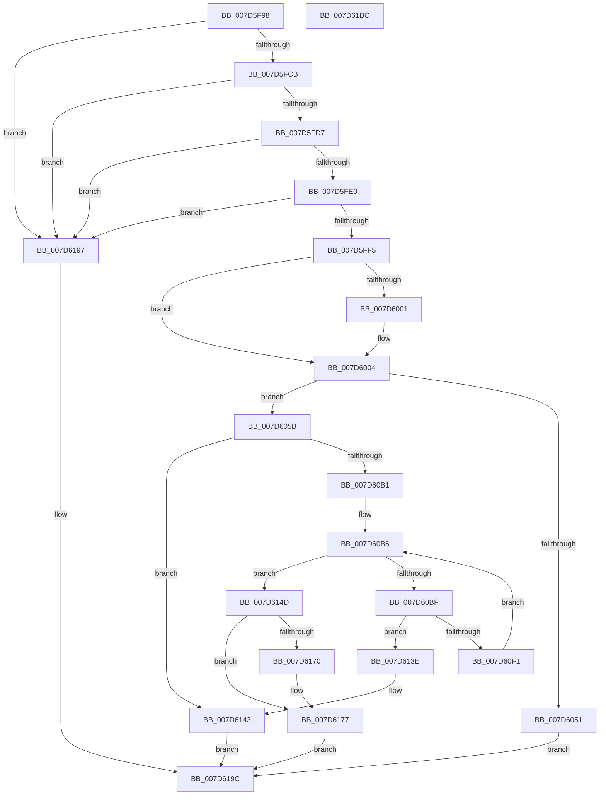

# ExpPrivatePoolCreate

- RVA: `0x007D5F98`–`0x007D61BD` (길이 `549` bytes)
- VA: `0x00000001407D5F98`
- 실행 섹션: `PAGE`
- PDB 이름 있음: `예`; PDB Function 태그: `아니요`
- unwind 정보 RVA: `0x000D5D68`
- 디코드: `138`개 명령, `549/549` bytes 표시
- 미해석 바이트: `0` (있으면 어셈블리에 `.byte`로 보존)

> 이 문서는 커널 이미지의 기계어와 PDB 기호를 분석해 생성했습니다. 4번과 5번은 함수 원형과 자료형을 바이너리 사용 방식에서 추정한 C 해석이며 원본 소스 복구 결과는 아닙니다.

## 1. Dependencies

- 직접 호출 지점: **10**; 고유 호출 대상: **9**
- 직접 호출자로 확인된 함수: **1**
- RIP 상대 이미지 참조: **2**

### Outgoing calls
- `0x007D6028` → [RtlHpEnvContextCreate](../../text/40/RtlHpEnvContextCreate_function_0040A510.md) (function, `0x0040A510`)
- `0x007D6044` → [RtlpHpMetadataAlloc](../../text/2E/RtlpHpMetadataAlloc_function_002EC180.md) (function, `0x002EC180`)
- `0x007D6063` → [memset](../../text/6C/memset_function_006C6C40.md) (function, `0x006C6C40`)
- `0x007D60A2` → [RtlUnicodeStringCopy](../../text/3D/RtlUnicodeStringCopy_function_003D4130.md) (function, `0x003D4130`)
- `0x007D60CF` → [RtlHpEnvContextCreate](../../text/40/RtlHpEnvContextCreate_function_0040A510.md) (function, `0x0040A510`)
- `0x007D60E4` → [RtlpHpHeapCreate](../../text/60/RtlpHpHeapCreate_function_00602FDC.md) (function, `0x00602FDC`)
- `0x007D612C` → [RtlpHpLfhContextUpdateConfig](../../text/60/RtlpHpLfhContextUpdateConfig_function_00604C3C.md) (function, `0x00604C3C`)
- `0x007D6146` → [ExpPrivatePoolDestroy](ExpPrivatePoolDestroy_function_007D61C4.md) (function, `0x007D61C4`)
- `0x007D614D` → [ExpAcquirePoolListLockExclusive](../../text/65/ExpAcquirePoolListLockExclusive_function_0065D804.md) (function, `0x0065D804`)
- `0x007D6185` → [ExpReleasePoolListLockExclusive](../../text/65/ExpReleasePoolListLockExclusive_function_0065D868.md) (function, `0x0065D868`)

### Direct callers
- [ExCreatePool](../../text/65/ExCreatePool_function_00655E80.md) at `0x00655F3B`

### Static image references
- `0x007D5FF5` → RVA `0x00FC5000` (`ALMOSTRO`; read)
- `0x007D6152` → RVA `0x00E6BEE8` (`.data`; read)

## 2. Other-region calls and transfers

- 다른 실행 섹션으로 향하는 call: **9**
  - `0x007D6028` → [RtlHpEnvContextCreate](../../text/40/RtlHpEnvContextCreate_function_0040A510.md) (`PAGE` → `.text`)
  - `0x007D6044` → [RtlpHpMetadataAlloc](../../text/2E/RtlpHpMetadataAlloc_function_002EC180.md) (`PAGE` → `.text`)
  - `0x007D6063` → [memset](../../text/6C/memset_function_006C6C40.md) (`PAGE` → `.text`)
  - `0x007D60A2` → [RtlUnicodeStringCopy](../../text/3D/RtlUnicodeStringCopy_function_003D4130.md) (`PAGE` → `.text`)
  - `0x007D60CF` → [RtlHpEnvContextCreate](../../text/40/RtlHpEnvContextCreate_function_0040A510.md) (`PAGE` → `.text`)
  - `0x007D60E4` → [RtlpHpHeapCreate](../../text/60/RtlpHpHeapCreate_function_00602FDC.md) (`PAGE` → `.text`)
  - `0x007D612C` → [RtlpHpLfhContextUpdateConfig](../../text/60/RtlpHpLfhContextUpdateConfig_function_00604C3C.md) (`PAGE` → `.text`)
  - `0x007D614D` → [ExpAcquirePoolListLockExclusive](../../text/65/ExpAcquirePoolListLockExclusive_function_0065D804.md) (`PAGE` → `.text`)
  - `0x007D6185` → [ExpReleasePoolListLockExclusive](../../text/65/ExpReleasePoolListLockExclusive_function_0065D868.md) (`PAGE` → `.text`)
- 별도 외부 분기/꼬리 이동을 확인하지 못했습니다.

## 3. Assembly (complete function range)

```asm
007D5F98  48 89 5C 24 10                  mov qword ptr [rsp + 0x10], rbx
007D5F9D  48 89 6C 24 18                  mov qword ptr [rsp + 0x18], rbp
007D5FA2  56                              push rsi
007D5FA3  57                              push rdi
007D5FA4  41 54                           push r12
007D5FA6  41 56                           push r14
007D5FA8  41 57                           push r15
007D5FAA  48 83 EC 60                     sub rsp, 0x60
007D5FAE  4D 8B F0                        mov r14, r8
007D5FB1  48 63 E9                        movsxd rbp, ecx
007D5FB4  41 B8 01 00 00 00               mov r8d, 1
007D5FBA  0F 29 74 24 50                  movaps xmmword ptr [rsp + 0x50], xmm6
007D5FBF  49 8B F9                        mov rdi, r9
007D5FC2  41 3B E8                        cmp ebp, r8d
007D5FC5  0F 87 CC 01 00 00               ja 0x1407d6197
007D5FCB  F7 C2 EF FF FF FF               test edx, 0xffffffef
007D5FD1  0F 85 C0 01 00 00               jne 0x1407d6197
007D5FD7  4D 85 F6                        test r14, r14
007D5FDA  0F 84 B7 01 00 00               je 0x1407d6197
007D5FE0  41 0F B7 09                     movzx ecx, word ptr [r9]
007D5FE4  0F B7 C1                        movzx eax, cx
007D5FE7  66 41 2B C0                     sub ax, r8w
007D5FEB  66 83 F8 7F                     cmp ax, 0x7f
007D5FEF  0F 87 A2 01 00 00               ja 0x1407d6197
007D5FF5  0F B7 35 04 F0 7E 00            movzx esi, word ptr [rip + 0x7ef004]
007D5FFC  F6 C2 10                        test dl, 0x10
007D5FFF  75 03                           jne 0x1407d6004
007D6001  41 8B F0                        mov esi, r8d
007D6004  83 64 24 20 00                  and dword ptr [rsp + 0x20], 0
007D6009  45 33 C9                        xor r9d, r9d
007D600C  8B C6                           mov eax, esi
007D600E  44 8B C5                        mov r8d, ebp
007D6011  4C 8D 3C C5 51 00 00 00         lea r15, [rax*8 + 0x51]
007D6019  49 83 E7 FE                     and r15, 0xfffffffffffffffe
007D601D  4D 8B E7                        mov r12, r15
007D6020  4C 03 F9                        add r15, rcx
007D6023  48 8D 4C 24 30                  lea rcx, [rsp + 0x30]
007D6028  E8 E3 44 C3 FF                  call 0x14040a510
007D602D  4C 8D 4C 24 30                  lea r9, [rsp + 0x30]
007D6032  45 33 C0                        xor r8d, r8d
007D6035  49 8B D7                        mov rdx, r15
007D6038  49 8B CF                        mov rcx, r15
007D603B  0F 10 30                        movups xmm6, xmmword ptr [rax]
007D603E  66 0F 7F 74 24 30               movdqa xmmword ptr [rsp + 0x30], xmm6
007D6044  E8 37 61 B1 FF                  call 0x1402ec180
007D6049  48 8B D8                        mov rbx, rax
007D604C  48 85 C0                        test rax, rax
007D604F  75 0A                           jne 0x1407d605b
007D6051  BF 9A 00 00 C0                  mov edi, 0xc000009a
007D6056  E9 41 01 00 00                  jmp 0x1407d619c
007D605B  4D 8B C7                        mov r8, r15
007D605E  33 D2                           xor edx, edx
007D6060  48 8B CB                        mov rcx, rbx
007D6063  E8 D8 0B EF FF                  call 0x1406c6c40
007D6068  C7 03 BD BD AF AF               mov dword ptr [rbx], 0xafafbdbd
007D606E  48 8D 4B 38                     lea rcx, [rbx + 0x38]
007D6072  41 BF 01 00 00 00               mov r15d, 1
007D6078  0F 57 C0                        xorps xmm0, xmm0
007D607B  44 89 7B 04                     mov dword ptr [rbx + 4], r15d
007D607F  48 8B D7                        mov rdx, rdi
007D6082  48 83 63 18 00                  and qword ptr [rbx + 0x18], 0
007D6087  F3 0F 7F 73 08                  movdqu xmmword ptr [rbx + 8], xmm6
007D608C  4C 89 73 30                     mov qword ptr [rbx + 0x30], r14
007D6090  0F B7 07                        movzx eax, word ptr [rdi]
007D6093  0F 11 01                        movups xmmword ptr [rcx], xmm0
007D6096  66 89 41 02                     mov word ptr [rcx + 2], ax
007D609A  49 8D 04 1C                     lea rax, [r12 + rbx]
007D609E  48 89 41 08                     mov qword ptr [rcx + 8], rax
007D60A2  E8 89 E0 BF FF                  call 0x1403d4130
007D60A7  8B F8                           mov edi, eax
007D60A9  85 C0                           test eax, eax
007D60AB  0F 88 92 00 00 00               js 0x1407d6143
007D60B1  89 73 48                        mov dword ptr [rbx + 0x48], esi
007D60B4  33 F6                           xor esi, esi
007D60B6  3B 73 48                        cmp esi, dword ptr [rbx + 0x48]
007D60B9  0F 83 8E 00 00 00               jae 0x1407d614d
007D60BF  83 64 24 20 00                  and dword ptr [rsp + 0x20], 0
007D60C4  48 8D 4C 24 40                  lea rcx, [rsp + 0x40]
007D60C9  44 8B CE                        mov r9d, esi
007D60CC  44 8B C5                        mov r8d, ebp
007D60CF  E8 3C 44 C3 FF                  call 0x14040a510
007D60D4  4C 8D 4C 24 30                  lea r9, [rsp + 0x30]
007D60D9  33 C9                           xor ecx, ecx
007D60DB  0F 10 08                        movups xmm1, xmmword ptr [rax]
007D60DE  F3 0F 7F 4C 24 30               movdqu xmmword ptr [rsp + 0x30], xmm1
007D60E4  E8 F3 CE E2 FF                  call 0x140602fdc
007D60E9  4C 8B C0                        mov r8, rax
007D60EC  48 85 C0                        test rax, rax
007D60EF  74 4D                           je 0x1407d613e
007D60F1  83 A4 24 90 00 00 00 00         and dword ptr [rsp + 0x90], 0
007D60F9  49 8D 88 40 03 00 00            lea rcx, [r8 + 0x340]
007D6100  80 88 4D 01 00 00 10            or byte ptr [rax + 0x14d], 0x10
007D6107  48 8D 94 24 90 00 00 00         lea rdx, [rsp + 0x90]
007D610F  80 88 0D 02 00 00 10            or byte ptr [rax + 0x20d], 0x10
007D6116  B8 00 02 00 00                  mov eax, 0x200
007D611B  66 44 09 BC 24 92 00 00 00      or word ptr [rsp + 0x92], r15w
007D6124  66 89 84 24 90 00 00 00         mov word ptr [rsp + 0x90], ax
007D612C  E8 0B EB E2 FF                  call 0x140604c3c
007D6131  4C 89 44 F3 50                  mov qword ptr [rbx + rsi*8 + 0x50], r8
007D6136  41 03 F7                        add esi, r15d
007D6139  E9 78 FF FF FF                  jmp 0x1407d60b6
007D613E  BF 9A 00 00 C0                  mov edi, 0xc000009a
007D6143  48 8B CB                        mov rcx, rbx
007D6146  E8 79 00 00 00                  call 0x1407d61c4
007D614B  EB 4F                           jmp 0x1407d619c
007D614D  E8 B2 76 E8 FF                  call 0x14065d804
007D6152  48 8D 15 8F 5D 69 00            lea rdx, [rip + 0x695d8f]
007D6159  48 8B C5                        mov rax, rbp
007D615C  48 C1 E0 04                     shl rax, 4
007D6160  48 8D 4B 20                     lea rcx, [rbx + 0x20]
007D6164  48 03 C2                        add rax, rdx
007D6167  48 8B 50 08                     mov rdx, qword ptr [rax + 8]
007D616B  48 39 02                        cmp qword ptr [rdx], rax
007D616E  74 07                           je 0x1407d6177
007D6170  B9 03 00 00 00                  mov ecx, 3
007D6175  CD 29                           int 0x29
007D6177  48 89 01                        mov qword ptr [rcx], rax
007D617A  48 89 51 08                     mov qword ptr [rcx + 8], rdx
007D617E  48 89 0A                        mov qword ptr [rdx], rcx
007D6181  48 89 48 08                     mov qword ptr [rax + 8], rcx
007D6185  E8 DE 76 E8 FF                  call 0x14065d868
007D618A  48 8B 84 24 B0 00 00 00         mov rax, qword ptr [rsp + 0xb0]
007D6192  48 89 18                        mov qword ptr [rax], rbx
007D6195  EB 05                           jmp 0x1407d619c
007D6197  BF 0D 00 00 C0                  mov edi, 0xc000000d
007D619C  0F 28 74 24 50                  movaps xmm6, xmmword ptr [rsp + 0x50]
007D61A1  4C 8D 5C 24 60                  lea r11, [rsp + 0x60]
007D61A6  49 8B 5B 38                     mov rbx, qword ptr [r11 + 0x38]
007D61AA  8B C7                           mov eax, edi
007D61AC  49 8B 6B 40                     mov rbp, qword ptr [r11 + 0x40]
007D61B0  49 8B E3                        mov rsp, r11
007D61B3  41 5F                           pop r15
007D61B5  41 5E                           pop r14
007D61B7  41 5C                           pop r12
007D61B9  5F                              pop rdi
007D61BA  5E                              pop rsi
007D61BB  C3                              ret
007D61BC  CC                              int3
```

## 4. C-style interpretation (structured pseudocode)

```c
__int64 __fastcall ExpPrivatePoolCreate(int a1, int a2, __int64 a3, __int64 a4, __int64 a5)
{
    __int64 result;
    __int64 v_r15;
    __int64 v_rsi;
    __int64 v_rsp;
    unsigned __int64 v_stack_m28;
    unsigned __int64 v_stack_m38;
    unsigned __int64 v_stack_m48;
    unsigned __int64 v_stack_m58;
    unsigned int v_stack_m68;
    unsigned __int64 v_stack_p10;
    unsigned __int64 v_stack_p18;
    unsigned int v_stack_p8;
    unsigned __int16 v_stack_pA;

    v_stack_p10 = v_rbx;
    v_stack_p18 = v_rbp;
    v_rsp = (v_rsp) - (96);
    v_stack_m38 = v_xmm6;
    if (((unsigned int)((int)(a1))) > 1) goto loc_007D6197;
    if (((a2) & (0xFFFFFFEFULL)) != 0) goto loc_007D6197;
    if (a3 == 0) goto loc_007D6197;
    result = (unsigned __int16)(((unsigned __int16)(*(unsigned __int16 *)(a4))) - (1));
    if (((unsigned __int16)(result)) > 127) goto loc_007D6197;
    v_rsi = *(unsigned __int16 *)(v_rip + 8318980);
    if ((((unsigned __int8)(a2)) & (16)) == 0) {
        v_rsi = 1;
    }
    a4 = 0;
    v_r15 = ((unsigned int)((unsigned int)(v_rsi)) * 8 + 81) & (-2);
    v_r15 = (v_r15) + (*(unsigned __int16 *)(a4));
    result = RtlHpEnvContextCreate(v_stack_m58, a2, (unsigned int)((unsigned int)((int)(a1))), a4);
    a3 = 0;
    v_stack_m58 = v_xmm6;
    result = RtlpHpMetadataAlloc(v_r15, v_r15, a3, v_stack_m58);
    if (result != 0) goto loc_007D605B;
    goto loc_007D619C;
loc_007D605B:
    a2 = 0;
    result = memset(result, a2, v_r15, v_stack_m58);
    *(unsigned int *)(result) = 0xAFAFBDBDULL;
    *(unsigned int *)(result + 4) = 1;
    *(unsigned __int64 *)(result + 8) = v_xmm6;
    *(unsigned __int64 *)(result + 48) = 0;
    *(unsigned __int64 *)(result + 56) = v_xmm0;
    *(unsigned __int16 *)(result + 56 + 2) = (unsigned __int16)(*(unsigned __int16 *)((unsigned int)(0xC000009AULL)));
    *(unsigned __int64 *)(result + 56 + 8) = v_r15 + result * 1;
    result = RtlUnicodeStringCopy(result + 56, (unsigned int)(0xC000009AULL), v_r15, v_stack_m58);
    if (sign_flag) goto loc_007D6143;
    *(unsigned int *)(result + 72) = (unsigned int)(v_rsi);
    v_rsi = 0;
loc_007D60B6:
    if (0 >= (*(unsigned int *)(result + 72))) goto loc_007D614D;
    result = RtlHpEnvContextCreate(v_stack_m48, (unsigned int)(0xC000009AULL), (unsigned int)((unsigned int)((int)(a1))), 0);
    a1 = 0;
    v_stack_m58 = v_xmm1;
    result = RtlpHpHeapCreate(a1, (unsigned int)(0xC000009AULL), (unsigned int)((unsigned int)((int)(a1))), v_stack_m58);
    if (result == 0) goto loc_007D613E;
    v_stack_p8 = 512;
    result = RtlpHpLfhContextUpdateConfig(result + 832, v_stack_p8, result, v_stack_m58);
    *(unsigned __int64 *)(result + v_rsi * 8 + 80) = result;
    v_rsi = (unsigned int)((v_rsi) + (1));
    goto loc_007D60B6;
loc_007D613E:
loc_007D6143:
    result = ExpPrivatePoolDestroy(result, v_stack_p8, result, v_stack_m58);
    goto loc_007D619C;
loc_007D614D:
    result = ExpAcquirePoolListLockExclusive(result, v_stack_p8, result, v_stack_m58);
    result = ((int)(a1)) << (4);
    result = (result) + (v_rip + 6905231);
    if ((*(unsigned __int64 *)(*(unsigned __int64 *)(result + 8))) != result) {
        a1 = 3;
    }
    *(unsigned __int64 *)(a1) = result;
    *(unsigned __int64 *)(a1 + 8) = *(unsigned __int64 *)(result + 8);
    *(unsigned __int64 *)(*(unsigned __int64 *)(result + 8)) = a1;
    *(unsigned __int64 *)(result + 8) = a1;
    result = ExpReleasePoolListLockExclusive(a1, *(unsigned __int64 *)(result + 8), result, v_stack_m58);
    *(unsigned __int64 *)(a5) = result;
    goto loc_007D619C;
loc_007D6197:
loc_007D619C:
    return (unsigned int)((unsigned int)((unsigned int)(0xC000000DULL)));
}
```

## 5. (Beta) C Style

```c
int64_t ExpPrivatePoolCreate(int32_t Arg1, int32_t Arg2, int64_t Arg3, void *Arg4, void *Arg5)
{
    uint8_t *arg4 = (uint8_t *)Arg4;
    uint8_t *arg5 = (uint8_t *)Arg5;

    int64_t result;
    int64_t local_r15;
    int64_t local_rsi;
    int64_t local_rsp;
    uint64_t v_stack_m28;
    uint64_t v_stack_m38;
    uint64_t v_stack_m48;
    uint64_t v_stack_m58;
    uint32_t v_stack_m68;
    uint64_t v_stack_p10;
    uint64_t v_stack_p18;
    uint32_t v_stack_p8;
    uint16_t v_stack_pA;

    v_stack_p10 = local_rbx;
    v_stack_p18 = local_rbp;
    local_rsp = (local_rsp) - (96);
    v_stack_m38 = v_xmm6;
    if (((uint32_t)((int32_t)(Arg1))) > 1) goto loc_007D6197;
    if (((Arg2) & (0xFFFFFFEFULL)) != 0) goto loc_007D6197;
    if (Arg3 == 0) goto loc_007D6197;
    result = (uint16_t)(((uint16_t)(*(uint16_t *)(arg4))) - (1));
    if (((uint16_t)(result)) > 127) goto loc_007D6197;
    local_rsi = *(uint16_t *)(v_rip + 0x7EF004);
    if ((((uint8_t)(Arg2)) & (16)) == 0) {
        local_rsi = 1;
    }
    Arg4 = 0;
    local_r15 = ((uint32_t)((uint32_t)(local_rsi)) * 8 + 81) & (-2);
    local_r15 = (local_r15) + (*(uint16_t *)(arg4));
    result = RtlHpEnvContextCreate(v_stack_m58, Arg2, (uint32_t)((uint32_t)((int32_t)(Arg1))), Arg4);
    Arg3 = 0;
    v_stack_m58 = v_xmm6;
    result = RtlpHpMetadataAlloc(local_r15, local_r15, Arg3, v_stack_m58);
    if (result != 0) goto loc_007D605B;
    goto loc_007D619C;
loc_007D605B:
    Arg2 = 0;
    result = memset(result, Arg2, local_r15, v_stack_m58);
    *(uint32_t *)(result) = 0xAFAFBDBDULL;
    *(uint32_t *)(result + 0x4) = 1;
    *(uint64_t *)(result + 0x8) = v_xmm6;
    *(uint64_t *)(result + 0x30) = 0;
    *(uint64_t *)(result + 0x38) = v_xmm0;
    *(uint16_t *)(result + 0x38 + 0x2) = (uint16_t)(*(uint16_t *)((uint32_t)(0xC000009AULL)));
    *(uint64_t *)(result + 0x38 + 0x8) = local_r15 + result * 1;
    result = RtlUnicodeStringCopy(result + 56, (uint32_t)(0xC000009AULL), local_r15, v_stack_m58);
    if (sign_flag) goto loc_007D6143;
    *(uint32_t *)(result + 0x48) = (uint32_t)(local_rsi);
    local_rsi = 0;
loc_007D60B6:
    if (0 >= (*(uint32_t *)(result + 0x48))) goto loc_007D614D;
    result = RtlHpEnvContextCreate(v_stack_m48, (uint32_t)(0xC000009AULL), (uint32_t)((uint32_t)((int32_t)(Arg1))), 0);
    Arg1 = 0;
    v_stack_m58 = v_xmm1;
    result = RtlpHpHeapCreate(Arg1, (uint32_t)(0xC000009AULL), (uint32_t)((uint32_t)((int32_t)(Arg1))), v_stack_m58);
    if (result == 0) goto loc_007D613E;
    v_stack_p8 = 512;
    result = RtlpHpLfhContextUpdateConfig(result + 832, v_stack_p8, result, v_stack_m58);
    *(uint64_t *)(result + local_rsi * 8 + 0x50) = result;
    local_rsi = (uint32_t)((local_rsi) + (1));
    goto loc_007D60B6;
loc_007D613E:
loc_007D6143:
    result = ExpPrivatePoolDestroy(result, v_stack_p8, result, v_stack_m58);
    goto loc_007D619C;
loc_007D614D:
    result = ExpAcquirePoolListLockExclusive(result, v_stack_p8, result, v_stack_m58);
    result = ((int32_t)(Arg1)) << (4);
    result = (result) + (v_rip + 6905231);
    if ((*(uint64_t *)(*(uint64_t *)(result + 0x8))) != result) {
        Arg1 = 3;
    }
    *(uint64_t *)(Arg1) = result;
    *(uint64_t *)(Arg1 + 0x8) = *(uint64_t *)(result + 0x8);
    *(uint64_t *)(*(uint64_t *)(result + 0x8)) = Arg1;
    *(uint64_t *)(result + 0x8) = Arg1;
    result = ExpReleasePoolListLockExclusive(Arg1, *(uint64_t *)(result + 0x8), result, v_stack_m58);
    *(uint64_t *)(arg5) = result;
    goto loc_007D619C;
loc_007D6197:
loc_007D619C:
    return (uint32_t)((uint32_t)((uint32_t)(0xC000000DULL)));
}
```

### 관측된 메모리 오프셋

구조체 형식이 확인되지 않은 접근은 인자 기준의 오프셋으로만 기록했습니다.

| 기준 인자 | 오프셋 표현 | 폭 (bit) | 접근 |
|---|---:|---:|---|
| `Arg4` | `+ 0x0` | `16` | `R` |
| `Arg5` | `+ 0x0` | `64` | `W` |

## 6. Execution-region graph

[열기: 2D/3D 그래프와 함수 탐색 컨트롤 패널](../../../control-panel.html?section=page&rva=0x007D5F98&view=graph)

- 2D 그래프는 위에서 아래로 흐르고, 3D 그래프는 빈 공간을 드래그해 회전합니다. Shift+드래그는 이동, 휠은 확대·축소, 함수 노드 선택은 대상 보고서 이동입니다.

### Static fallback


