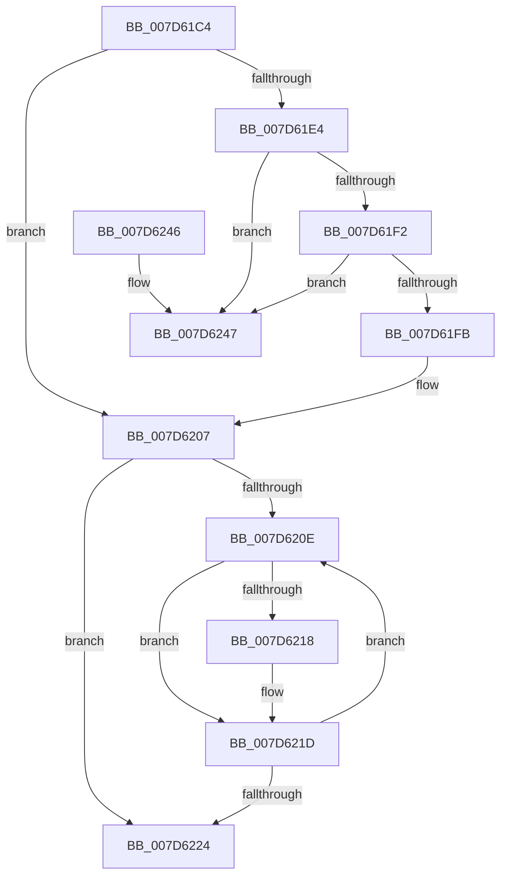

# ExpPrivatePoolDestroy

- RVA: `0x007D61C4`–`0x007D624E` (길이 `138` bytes)
- VA: `0x00000001407D61C4`
- 실행 섹션: `PAGE`
- PDB 이름 있음: `예`; PDB Function 태그: `아니요`
- unwind 정보 RVA: `0x000A3E54`
- 디코드: `41`개 명령, `138/138` bytes 표시
- 미해석 바이트: `0` (있으면 어셈블리에 `.byte`로 보존)

> 이 문서는 커널 이미지의 기계어와 PDB 기호를 분석해 생성했습니다. 4번과 5번은 함수 원형과 자료형을 바이너리 사용 방식에서 추정한 C 해석이며 원본 소스 복구 결과는 아닙니다.

## 1. Dependencies

- 직접 호출 지점: **5**; 고유 호출 대상: **5**
- 직접 호출자로 확인된 함수: **2**
- RIP 상대 이미지 참조: **0**

### Outgoing calls
- `0x007D61D5` → [ExWaitForRundownProtectionRelease](../../text/2A/ExWaitForRundownProtectionRelease_function_002A4CB0.md) (function, `0x002A4CB0`)
- `0x007D61E4` → [ExpAcquirePoolListLockExclusive](../../text/65/ExpAcquirePoolListLockExclusive_function_0065D804.md) (function, `0x0065D804`)
- `0x007D6202` → [ExpReleasePoolListLockExclusive](../../text/65/ExpReleasePoolListLockExclusive_function_0065D868.md) (function, `0x0065D868`)
- `0x007D6218` → [RtlpHpHeapDestroy](../../text/60/RtlpHpHeapDestroy_function_006033AC.md) (function, `0x006033AC`)
- `0x007D6236` → [RtlpHpMetadataFree](../../text/2E/RtlpHpMetadataFree_function_002ECA64.md) (function, `0x002ECA64`)

### Direct callers
- [ExDestroyPool](../../text/65/ExDestroyPool_function_00656030.md) at `0x00656075`
- [ExpPrivatePoolCreate](ExpPrivatePoolCreate_function_007D5F98.md) at `0x007D6146`

### Static image references
- 디코드된 RIP-relative 메모리 참조가 없습니다.

## 2. Other-region calls and transfers

- 다른 실행 섹션으로 향하는 call: **5**
  - `0x007D61D5` → [ExWaitForRundownProtectionRelease](../../text/2A/ExWaitForRundownProtectionRelease_function_002A4CB0.md) (`PAGE` → `.text`)
  - `0x007D61E4` → [ExpAcquirePoolListLockExclusive](../../text/65/ExpAcquirePoolListLockExclusive_function_0065D804.md) (`PAGE` → `.text`)
  - `0x007D6202` → [ExpReleasePoolListLockExclusive](../../text/65/ExpReleasePoolListLockExclusive_function_0065D868.md) (`PAGE` → `.text`)
  - `0x007D6218` → [RtlpHpHeapDestroy](../../text/60/RtlpHpHeapDestroy_function_006033AC.md) (`PAGE` → `.text`)
  - `0x007D6236` → [RtlpHpMetadataFree](../../text/2E/RtlpHpMetadataFree_function_002ECA64.md) (`PAGE` → `.text`)
- 별도 외부 분기/꼬리 이동을 확인하지 못했습니다.

## 3. Assembly (complete function range)

```asm
007D61C4  48 89 5C 24 08                  mov qword ptr [rsp + 8], rbx
007D61C9  57                              push rdi
007D61CA  48 83 EC 30                     sub rsp, 0x30
007D61CE  48 8B D9                        mov rbx, rcx
007D61D1  48 83 C1 18                     add rcx, 0x18
007D61D5  E8 D6 EA AC FF                  call 0x1402a4cb0
007D61DA  48 8D 7B 20                     lea rdi, [rbx + 0x20]
007D61DE  48 83 3F 00                     cmp qword ptr [rdi], 0
007D61E2  74 23                           je 0x1407d6207
007D61E4  E8 1B 76 E8 FF                  call 0x14065d804
007D61E9  48 8B 0F                        mov rcx, qword ptr [rdi]
007D61EC  48 39 79 08                     cmp qword ptr [rcx + 8], rdi
007D61F0  75 55                           jne 0x1407d6247
007D61F2  48 8B 47 08                     mov rax, qword ptr [rdi + 8]
007D61F6  48 39 38                        cmp qword ptr [rax], rdi
007D61F9  75 4C                           jne 0x1407d6247
007D61FB  48 89 08                        mov qword ptr [rax], rcx
007D61FE  48 89 41 08                     mov qword ptr [rcx + 8], rax
007D6202  E8 61 76 E8 FF                  call 0x14065d868
007D6207  33 FF                           xor edi, edi
007D6209  39 7B 48                        cmp dword ptr [rbx + 0x48], edi
007D620C  76 16                           jbe 0x1407d6224
007D620E  48 8B 4C FB 50                  mov rcx, qword ptr [rbx + rdi*8 + 0x50]
007D6213  48 85 C9                        test rcx, rcx
007D6216  74 05                           je 0x1407d621d
007D6218  E8 8F D1 E2 FF                  call 0x1406033ac
007D621D  FF C7                           inc edi
007D621F  3B 7B 48                        cmp edi, dword ptr [rbx + 0x48]
007D6222  72 EA                           jb 0x1407d620e
007D6224  0F 10 43 08                     movups xmm0, xmmword ptr [rbx + 8]
007D6228  48 8D 54 24 20                  lea rdx, [rsp + 0x20]
007D622D  48 8B CB                        mov rcx, rbx
007D6230  F3 0F 7F 44 24 20               movdqu xmmword ptr [rsp + 0x20], xmm0
007D6236  E8 29 68 B1 FF                  call 0x1402eca64
007D623B  48 8B 5C 24 40                  mov rbx, qword ptr [rsp + 0x40]
007D6240  48 83 C4 30                     add rsp, 0x30
007D6244  5F                              pop rdi
007D6245  C3                              ret
007D6246  CC                              int3
007D6247  B9 03 00 00 00                  mov ecx, 3
007D624C  CD 29                           int 0x29
```

## 4. C-style interpretation (structured pseudocode)

```c
__int64 __fastcall ExpPrivatePoolDestroy(__int64 a1)
{
    __int64 result;
    __int64 v_rdi;
    __int64 v_rsp;
    unsigned __int64 v_stack_m18;
    unsigned __int64 v_stack_p8;

    v_stack_p8 = v_rbx;
    v_rsp = (v_rsp) - (48);
    a1 = (a1) + (24);
    result = ExWaitForRundownProtectionRelease(a1, a2, a3, a4);
    if ((*(unsigned __int64 *)(a1 + 32)) == 0) goto loc_007D6207;
    result = ExpAcquirePoolListLockExclusive(a1, a2, a3, a4);
    if ((*(unsigned __int64 *)(*(unsigned __int64 *)(a1 + 32) + 8)) != (a1 + 32)) goto loc_007D6247;
    if ((*(unsigned __int64 *)(*(unsigned __int64 *)(a1 + 32 + 8))) != (a1 + 32)) goto loc_007D6247;
    *(unsigned __int64 *)(*(unsigned __int64 *)(a1 + 32 + 8)) = *(unsigned __int64 *)(a1 + 32);
    *(unsigned __int64 *)(*(unsigned __int64 *)(a1 + 32) + 8) = *(unsigned __int64 *)(a1 + 32 + 8);
    result = ExpReleasePoolListLockExclusive(*(unsigned __int64 *)(a1 + 32), a2, a3, a4);
loc_007D6207:
    v_rdi = 0;
    if ((*(unsigned int *)(a1 + 72)) <= 0) goto loc_007D6224;
loc_007D620E:
    if (*(unsigned __int64 *)(a1 + v_rdi * 8 + 80) != 0) {
        result = RtlpHpHeapDestroy(*(unsigned __int64 *)(a1 + v_rdi * 8 + 80), a2, a3, a4);
    }
    v_rdi = (unsigned int)((v_rdi) + 1);
    if (((unsigned int)(v_rdi)) < (*(unsigned int *)(a1 + 72))) goto loc_007D620E;
loc_007D6224:
    v_stack_m18 = v_xmm0;
    result = RtlpHpMetadataFree(a1, v_stack_m18, a3, a4);
    v_rsp = (v_rsp) + (48);
    return result;
loc_007D6247:
    return result;
}
```

## 5. (Beta) C Style

```c
int64_t ExpPrivatePoolDestroy(void *Arg1)
{
    uint8_t *arg1 = (uint8_t *)Arg1;

    int64_t result;
    int64_t local_rdi;
    int64_t local_rsp;
    uint64_t v_stack_m18;
    uint64_t v_stack_p8;

    v_stack_p8 = local_rbx;
    local_rsp = (local_rsp) - (48);
    Arg1 = (Arg1) + (24);
    result = ExWaitForRundownProtectionRelease(Arg1, a2, a3, a4);
    if ((*(uint64_t *)(arg1 + 0x20)) == 0) goto loc_007D6207;
    result = ExpAcquirePoolListLockExclusive(Arg1, a2, a3, a4);
    if ((*(uint64_t *)(*(uint64_t *)(arg1 + 0x20) + 0x8)) != (Arg1 + 32)) goto loc_007D6247;
    if ((*(uint64_t *)(*(uint64_t *)(arg1 + 0x20 + 0x8))) != (Arg1 + 32)) goto loc_007D6247;
    *(uint64_t *)(*(uint64_t *)(arg1 + 0x20 + 0x8)) = *(uint64_t *)(arg1 + 0x20);
    *(uint64_t *)(*(uint64_t *)(arg1 + 0x20) + 0x8) = *(uint64_t *)(arg1 + 0x20 + 0x8);
    result = ExpReleasePoolListLockExclusive(*(uint64_t *)(arg1 + 0x20), a2, a3, a4);
loc_007D6207:
    local_rdi = 0;
    if ((*(uint32_t *)(arg1 + 0x48)) <= 0) goto loc_007D6224;
loc_007D620E:
    if (*(uint64_t *)(arg1 + local_rdi * 8 + 0x50) != 0) {
        result = RtlpHpHeapDestroy(*(uint64_t *)(arg1 + local_rdi * 8 + 0x50), a2, a3, a4);
    }
    local_rdi = (uint32_t)((local_rdi) + 1);
    if (((uint32_t)(local_rdi)) < (*(uint32_t *)(arg1 + 0x48))) goto loc_007D620E;
loc_007D6224:
    v_stack_m18 = v_xmm0;
    result = RtlpHpMetadataFree(Arg1, v_stack_m18, a3, a4);
    local_rsp = (local_rsp) + (48);
    return result;
loc_007D6247:
    return result;
}
```

### 관측된 메모리 오프셋

구조체 형식이 확인되지 않은 접근은 인자 기준의 오프셋으로만 기록했습니다.

| 기준 인자 | 오프셋 표현 | 폭 (bit) | 접근 |
|---|---:|---:|---|
| `Arg1` | `+ 0x0` | `64` | `R` |
| `Arg1` | `+ 0x8` | `64` | `R` |
| `Arg1` | `+ 0x8` | `128` | `R` |
| `Arg1` | `+ 0x20` | `64` | `R` |
| `Arg1` | `+ 0x48` | `32` | `R` |
| `Arg1` | `+ 0x50 + rdi*8` | `64` | `R` |

## 6. Execution-region graph

[열기: 2D/3D 그래프와 함수 탐색 컨트롤 패널](../../../control-panel.html?section=page&rva=0x007D61C4&view=graph)

- 2D 그래프는 위에서 아래로 흐르고, 3D 그래프는 빈 공간을 드래그해 회전합니다. Shift+드래그는 이동, 휠은 확대·축소, 함수 노드 선택은 대상 보고서 이동입니다.

### Static fallback


