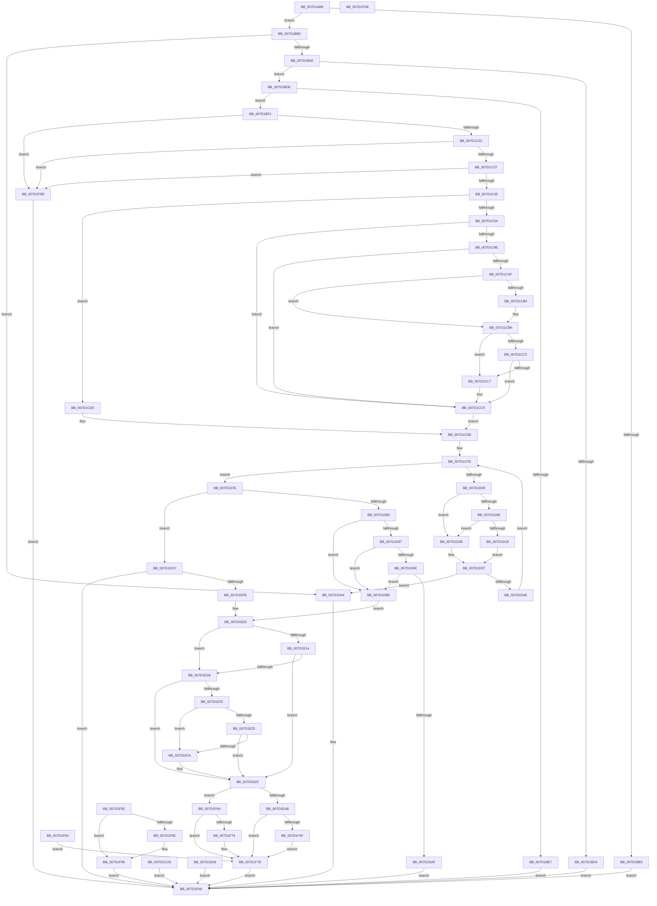

# ExpProfileCreate

- RVA: `0x007D1AB8`–`0x007D1FD7` (길이 `1,311` bytes)
- VA: `0x00000001407D1AB8`
- 실행 섹션: `PAGE`
- PDB 이름 있음: `예`; PDB Function 태그: `아니요`
- unwind 정보 RVA: `0x000D5910`
- 디코드: `289`개 명령, `1,311/1,311` bytes 표시
- 미해석 바이트: `0` (있으면 어셈블리에 `.byte`로 보존)

> 이 문서는 커널 이미지의 기계어와 PDB 기호를 분석해 생성했습니다. 4번과 5번은 함수 원형과 자료형을 바이너리 사용 방식에서 추정한 C 해석이며 원본 소스 복구 결과는 아닙니다.

## 1. Dependencies

- 직접 호출 지점: **17**; 고유 호출 대상: **14**
- 직접 호출자로 확인된 함수: **2**
- RIP 상대 이미지 참조: **5**

### Outgoing calls
- `0x007D1B1F` → [memset](../../text/6C/memset_function_006C6C40.md) (function, `0x006C6C40`)
- `0x007D1C1F` → [guard_dispatch_icall](../../text/6B/guard_dispatch_icall_function_006BAAD0.md) (function, `0x006BAAD0`)
- `0x007D1C8C` → [ProbeForWrite](../8E/ProbeForWrite_function_008E91C0.md) (function, `0x008E91C0`)
- `0x007D1CB4` → [ExRaiseDatatypeMisalignment](../89/ExRaiseDatatypeMisalignment_function_00899FD0.md) (function, `0x00899FD0`)
- `0x007D1CF9` → [memset](../../text/6C/memset_function_006C6C40.md) (function, `0x006C6C40`)
- `0x007D1D41` → [KeVerifyGroupAffinity](../../text/47/KeVerifyGroupAffinity_function_0047B1F0.md) (function, `0x0047B1F0`)
- `0x007D1D66` → [KeAddGroupAffinityEx](../../text/25/KeAddGroupAffinityEx_function_0025B6C0.md) (function, `0x0025B6C0`)
- `0x007D1DA6` → [SeSinglePrivilegeCheck](../87/SeSinglePrivilegeCheck_function_00871E20.md) (function, `0x00871E20`)
- `0x007D1DEE` → [ObpReferenceObjectByHandleWithTag](../86/ObpReferenceObjectByHandleWithTag_function_00869650.md) (function, `0x00869650`)
- `0x007D1E0B` → [ExIsRestrictedCaller](../A2/ExIsRestrictedCaller_function_00A217E8.md) (function, `0x00A217E8`)
- `0x007D1E99` → [ObCreateObjectEx](../89/ObCreateObjectEx_function_0089B1E0.md) (function, `0x0089B1E0`)
- `0x007D1F04` → [memset](../../text/6C/memset_function_006C6C40.md) (function, `0x006C6C40`)
- `0x007D1F19` → [KiCopyAffinityEx](../../text/2C/KiCopyAffinityEx_function_002CE860.md) (function, `0x002CE860`)
- `0x007D1F40` → [ObInsertObjectEx](../8B/ObInsertObjectEx_function_008B97A0.md) (function, `0x008B97A0`)
- `0x007D1F79` → [ObfDereferenceObjectWithTag](../../text/2F/ObfDereferenceObjectWithTag_function_002F78E0.md) (function, `0x002F78E0`)
- `0x007D1F91` → [ObfDereferenceObjectWithTag](../../text/2F/ObfDereferenceObjectWithTag_function_002F78E0.md) (function, `0x002F78E0`)
- `0x007D1FB4` → [_security_check_cookie](../../text/6A/_security_check_cookie_function_006AC640.md) (function, `0x006AC640`)

### Direct callers
- [NtCreateProfile](NtCreateProfile_function_007D2040.md) at `0x007D20F8`
- [NtCreateProfileEx](NtCreateProfileEx_function_007D2120.md) at `0x007D2171`

### Static image references
- `0x007D1AD2` → RVA `0x00E0A740` (`.data`; read)
- `0x007D1C03` → RVA `0x00E00638` (`.data`; read)
- `0x007D1D9F` → RVA `0x00FD9B48` (`PAGEDATA`; read)
- `0x007D1DC0` → RVA `0x00FC6A98` (`ALMOSTRO`; read)
- `0x007D1E61` → RVA `0x00FC5390` (`ALMOSTRO`; read)

## 2. Other-region calls and transfers

- 다른 실행 섹션으로 향하는 call: **10**
  - `0x007D1B1F` → [memset](../../text/6C/memset_function_006C6C40.md) (`PAGE` → `.text`)
  - `0x007D1C1F` → [guard_dispatch_icall](../../text/6B/guard_dispatch_icall_function_006BAAD0.md) (`PAGE` → `.text`)
  - `0x007D1CF9` → [memset](../../text/6C/memset_function_006C6C40.md) (`PAGE` → `.text`)
  - `0x007D1D41` → [KeVerifyGroupAffinity](../../text/47/KeVerifyGroupAffinity_function_0047B1F0.md) (`PAGE` → `.text`)
  - `0x007D1D66` → [KeAddGroupAffinityEx](../../text/25/KeAddGroupAffinityEx_function_0025B6C0.md) (`PAGE` → `.text`)
  - `0x007D1F04` → [memset](../../text/6C/memset_function_006C6C40.md) (`PAGE` → `.text`)
  - `0x007D1F19` → [KiCopyAffinityEx](../../text/2C/KiCopyAffinityEx_function_002CE860.md) (`PAGE` → `.text`)
  - `0x007D1F79` → [ObfDereferenceObjectWithTag](../../text/2F/ObfDereferenceObjectWithTag_function_002F78E0.md) (`PAGE` → `.text`)
  - `0x007D1F91` → [ObfDereferenceObjectWithTag](../../text/2F/ObfDereferenceObjectWithTag_function_002F78E0.md) (`PAGE` → `.text`)
  - `0x007D1FB4` → [_security_check_cookie](../../text/6A/_security_check_cookie_function_006AC640.md) (`PAGE` → `.text`)
- 별도 외부 분기/꼬리 이동을 확인하지 못했습니다.

## 3. Assembly (complete function range)

```asm
007D1AB8  48 89 5C 24 18                  mov qword ptr [rsp + 0x18], rbx
007D1ABD  48 89 74 24 20                  mov qword ptr [rsp + 0x20], rsi
007D1AC2  57                              push rdi
007D1AC3  41 54                           push r12
007D1AC5  41 55                           push r13
007D1AC7  41 56                           push r14
007D1AC9  41 57                           push r15
007D1ACB  48 81 EC 10 02 00 00            sub rsp, 0x210
007D1AD2  48 8B 05 67 8C 63 00            mov rax, qword ptr [rip + 0x638c67]
007D1AD9  48 33 C4                        xor rax, rsp
007D1ADC  48 89 84 24 00 02 00 00         mov qword ptr [rsp + 0x200], rax
007D1AE4  4D 8B E1                        mov r12, r9
007D1AE7  49 8B F8                        mov rdi, r8
007D1AEA  4C 89 44 24 68                  mov qword ptr [rsp + 0x68], r8
007D1AEF  4C 8B EA                        mov r13, rdx
007D1AF2  48 89 8C 24 88 00 00 00         mov qword ptr [rsp + 0x88], rcx
007D1AFA  48 8B 84 24 68 02 00 00         mov rax, qword ptr [rsp + 0x268]
007D1B02  48 89 44 24 78                  mov qword ptr [rsp + 0x78], rax
007D1B07  48 8B 9C 24 88 02 00 00         mov rbx, qword ptr [rsp + 0x288]
007D1B0F  33 D2                           xor edx, edx
007D1B11  41 B8 00 01 00 00               mov r8d, 0x100
007D1B17  48 8D 8C 24 F8 00 00 00         lea rcx, [rsp + 0xf8]
007D1B1F  E8 1C 51 EF FF                  call 0x1406c6c40
007D1B24  0F 57 C0                        xorps xmm0, xmm0
007D1B27  0F 11 84 24 90 00 00 00         movups xmmword ptr [rsp + 0x90], xmm0
007D1B2F  33 F6                           xor esi, esi
007D1B31  48 89 B4 24 80 00 00 00         mov qword ptr [rsp + 0x80], rsi
007D1B39  33 C0                           xor eax, eax
007D1B3B  0F 11 84 24 A8 00 00 00         movups xmmword ptr [rsp + 0xa8], xmm0
007D1B43  0F 11 84 24 B8 00 00 00         movups xmmword ptr [rsp + 0xb8], xmm0
007D1B4B  48 89 84 24 C8 00 00 00         mov qword ptr [rsp + 0xc8], rax
007D1B53  89 84 24 D0 00 00 00            mov dword ptr [rsp + 0xd0], eax
007D1B5A  48 89 74 24 60                  mov qword ptr [rsp + 0x60], rsi
007D1B5F  48 89 74 24 70                  mov qword ptr [rsp + 0x70], rsi
007D1B64  0F 11 84 24 D8 00 00 00         movups xmmword ptr [rsp + 0xd8], xmm0
007D1B6C  48 89 84 24 E8 00 00 00         mov qword ptr [rsp + 0xe8], rax
007D1B74  89 74 24 58                     mov dword ptr [rsp + 0x58], esi
007D1B78  8B 94 24 70 02 00 00            mov edx, dword ptr [rsp + 0x270]
007D1B7F  85 D2                           test edx, edx
007D1B81  75 0A                           jne 0x1407d1b8d
007D1B83  B8 F5 00 00 C0                  mov eax, 0xc00000f5
007D1B88  E9 1C 04 00 00                  jmp 0x1407d1fa9
007D1B8D  8B 8C 24 60 02 00 00            mov ecx, dword ptr [rsp + 0x260]
007D1B94  8D 41 FE                        lea eax, [rcx - 2]
007D1B97  83 F8 1D                        cmp eax, 0x1d
007D1B9A  0F 87 04 04 00 00               ja 0x1407d1fa4
007D1BA0  4D 8B CC                        mov r9, r12
007D1BA3  49 D3 E9                        shr r9, cl
007D1BA6  4C 8B F2                        mov r14, rdx
007D1BA9  41 BA 01 00 00 00               mov r10d, 1
007D1BAF  45 8B C2                        mov r8d, r10d
007D1BB2  49 D3 E0                        shl r8, cl
007D1BB5  33 D2                           xor edx, edx
007D1BB7  49 8B C4                        mov rax, r12
007D1BBA  49 F7 F0                        div r8
007D1BBD  49 8D 49 01                     lea rcx, [r9 + 1]
007D1BC1  48 85 D2                        test rdx, rdx
007D1BC4  49 0F 44 C9                     cmove rcx, r9
007D1BC8  49 8B C6                        mov rax, r14
007D1BCB  48 C1 E8 02                     shr rax, 2
007D1BCF  48 3B C8                        cmp rcx, rax
007D1BD2  76 0A                           jbe 0x1407d1bde
007D1BD4  B8 23 00 00 C0                  mov eax, 0xc0000023
007D1BD9  E9 CB 03 00 00                  jmp 0x1407d1fa9
007D1BDE  4E 8D 3C 27                     lea r15, [rdi + r12]
007D1BE2  4D 3B FC                        cmp r15, r12
007D1BE5  73 0A                           jae 0x1407d1bf1
007D1BE7  B8 05 00 00 80                  mov eax, 0x80000005
007D1BEC  E9 B8 03 00 00                  jmp 0x1407d1fa9
007D1BF1  8B 84 24 78 02 00 00            mov eax, dword ptr [rsp + 0x278]
007D1BF8  89 84 24 D8 00 00 00            mov dword ptr [rsp + 0xd8], eax
007D1BFF  89 74 24 54                     mov dword ptr [rsp + 0x54], esi
007D1C03  48 8B 05 2E EA 62 00            mov rax, qword ptr [rip + 0x62ea2e]
007D1C0A  4C 8D 4C 24 54                  lea r9, [rsp + 0x54]
007D1C0F  4C 8D 84 24 D8 00 00 00         lea r8, [rsp + 0xd8]
007D1C17  BA 18 00 00 00                  mov edx, 0x18
007D1C1C  41 8B CA                        mov ecx, r10d
007D1C1F  E8 AC 8E EE FF                  call 0x1406baad0
007D1C24  85 C0                           test eax, eax
007D1C26  0F 88 71 03 00 00               js 0x1407d1f9d
007D1C2C  83 7C 24 54 18                  cmp dword ptr [rsp + 0x54], 0x18
007D1C31  0F 85 66 03 00 00               jne 0x1407d1f9d
007D1C37  40 38 B4 24 DC 00 00 00         cmp byte ptr [rsp + 0xdc], sil
007D1C3F  0F 84 58 03 00 00               je 0x1407d1f9d
007D1C45  65 48 8B 04 25 88 01 00 00      mov rax, qword ptr gs:[0x188]
007D1C4E  40 8A B0 32 02 00 00            mov sil, byte ptr [rax + 0x232]
007D1C55  40 84 F6                        test sil, sil
007D1C58  74 76                           je 0x1407d1cd0
007D1C5A  48 BF 00 00 FF FF FF 7F 00 00   movabs rdi, 0x7fffffff0000
007D1C64  48 8B CF                        mov rcx, rdi
007D1C67  48 39 BC 24 88 00 00 00         cmp qword ptr [rsp + 0x88], rdi
007D1C6F  48 0F 42 8C 24 88 00 00 00      cmovb rcx, qword ptr [rsp + 0x88]
007D1C78  48 8B 01                        mov rax, qword ptr [rcx]
007D1C7B  48 89 01                        mov qword ptr [rcx], rax
007D1C7E  41 B8 04 00 00 00               mov r8d, 4
007D1C84  49 8B D6                        mov rdx, r14
007D1C87  48 8B 4C 24 78                  mov rcx, qword ptr [rsp + 0x78]
007D1C8C  E8 2F 75 11 00                  call 0x1408e91c0
007D1C91  45 33 F6                        xor r14d, r14d
007D1C94  44 38 B4 24 90 02 00 00         cmp byte ptr [rsp + 0x290], r14b
007D1C9C  75 2B                           jne 0x1407d1cc9
007D1C9E  0F B7 84 24 80 02 00 00         movzx eax, word ptr [rsp + 0x280]
007D1CA6  48 C1 E0 04                     shl rax, 4
007D1CAA  48 85 C0                        test rax, rax
007D1CAD  74 1A                           je 0x1407d1cc9
007D1CAF  F6 C3 03                        test bl, 3
007D1CB2  74 05                           je 0x1407d1cb9
007D1CB4  E8 17 83 0C 00                  call 0x140899fd0
007D1CB9  48 8D 0C 18                     lea rcx, [rax + rbx]
007D1CBD  48 3B CF                        cmp rcx, rdi
007D1CC0  77 05                           ja 0x1407d1cc7
007D1CC2  48 3B CB                        cmp rcx, rbx
007D1CC5  73 02                           jae 0x1407d1cc9
007D1CC7  8A 07                           mov al, byte ptr [rdi]
007D1CC9  EB 12                           jmp 0x1407d1cdd
007D1CCB  E9 D9 02 00 00                  jmp 0x1407d1fa9
007D1CD0  48 BF 00 00 FF FF FF 7F 00 00   movabs rdi, 0x7fffffff0000
007D1CDA  45 33 F6                        xor r14d, r14d
007D1CDD  48 C7 84 24 F0 00 00 00 01 00 20 00  mov qword ptr [rsp + 0xf0], 0x200001
007D1CE9  33 D2                           xor edx, edx
007D1CEB  41 B8 00 01 00 00               mov r8d, 0x100
007D1CF1  48 8D 8C 24 F8 00 00 00         lea rcx, [rsp + 0xf8]
007D1CF9  E8 42 4F EF FF                  call 0x1406c6c40
007D1CFE  66 44 39 B4 24 80 02 00 00      cmp word ptr [rsp + 0x280], r14w
007D1D07  76 75                           jbe 0x1407d1d7e
007D1D09  40 84 F6                        test sil, sil
007D1D0C  74 1D                           je 0x1407d1d2b
007D1D0E  44 38 B4 24 90 02 00 00         cmp byte ptr [rsp + 0x290], r14b
007D1D16  75 13                           jne 0x1407d1d2b
007D1D18  0F 10 03                        movups xmm0, xmmword ptr [rbx]
007D1D1B  F3 0F 7F 84 24 90 00 00 00      movdqu xmmword ptr [rsp + 0x90], xmm0
007D1D24  EB 11                           jmp 0x1407d1d37
007D1D26  E9 7E 02 00 00                  jmp 0x1407d1fa9
007D1D2B  0F 10 03                        movups xmm0, xmmword ptr [rbx]
007D1D2E  F3 0F 7F 84 24 90 00 00 00      movdqu xmmword ptr [rsp + 0x90], xmm0
007D1D37  33 D2                           xor edx, edx
007D1D39  48 8D 8C 24 90 00 00 00         lea rcx, [rsp + 0x90]
007D1D41  E8 AA 94 CA FF                  call 0x14047b1f0
007D1D46  84 C0                           test al, al
007D1D48  0F 84 56 02 00 00               je 0x1407d1fa4
007D1D4E  4C 8B 84 24 90 00 00 00         mov r8, qword ptr [rsp + 0x90]
007D1D56  0F B7 94 24 98 00 00 00         movzx edx, word ptr [rsp + 0x98]
007D1D5E  48 8D 8C 24 F0 00 00 00         lea rcx, [rsp + 0xf0]
007D1D66  E8 55 99 A8 FF                  call 0x14025b6c0
007D1D6B  B8 FF FF 00 00                  mov eax, 0xffff
007D1D70  66 01 84 24 80 02 00 00         add word ptr [rsp + 0x280], ax
007D1D78  48 83 C3 10                     add rbx, 0x10
007D1D7C  EB 80                           jmp 0x1407d1cfe
007D1D7E  4D 85 ED                        test r13, r13
007D1D81  75 3D                           jne 0x1407d1dc0
007D1D83  48 B8 FF FF FE FF FF 7F 00 00   movabs rax, 0x7ffffffeffff
007D1D8D  4C 8B 74 24 68                  mov r14, qword ptr [rsp + 0x68]
007D1D92  4C 3B F0                        cmp r14, rax
007D1D95  77 22                           ja 0x1407d1db9
007D1D97  40 84 F6                        test sil, sil
007D1D9A  74 1D                           je 0x1407d1db9
007D1D9C  40 8A D6                        mov dl, sil
007D1D9F  48 8B 0D A2 7D 80 00            mov rcx, qword ptr [rip + 0x807da2]
007D1DA6  E8 75 00 0A 00                  call 0x140871e20
007D1DAB  84 C0                           test al, al
007D1DAD  75 0A                           jne 0x1407d1db9
007D1DAF  B8 61 00 00 C0                  mov eax, 0xc0000061
007D1DB4  E9 F0 01 00 00                  jmp 0x1407d1fa9
007D1DB9  4C 89 6C 24 60                  mov qword ptr [rsp + 0x60], r13
007D1DBE  EB 43                           jmp 0x1407d1e03
007D1DC0  4C 8B 05 D1 4C 7F 00            mov r8, qword ptr [rip + 0x7f4cd1]
007D1DC7  4C 89 74 24 38                  mov qword ptr [rsp + 0x38], r14
007D1DCC  4C 89 74 24 30                  mov qword ptr [rsp + 0x30], r14
007D1DD1  48 8D 44 24 60                  lea rax, [rsp + 0x60]
007D1DD6  48 89 44 24 28                  mov qword ptr [rsp + 0x28], rax
007D1DDB  C7 44 24 20 45 78 50 66         mov dword ptr [rsp + 0x20], 0x66507845
007D1DE3  44 8A CE                        mov r9b, sil
007D1DE6  BA 00 04 00 00                  mov edx, 0x400
007D1DEB  49 8B CD                        mov rcx, r13
007D1DEE  E8 5D 78 09 00                  call 0x140869650
007D1DF3  45 33 ED                        xor r13d, r13d
007D1DF6  85 C0                           test eax, eax
007D1DF8  0F 88 AB 01 00 00               js 0x1407d1fa9
007D1DFE  4C 8B 74 24 68                  mov r14, qword ptr [rsp + 0x68]
007D1E03  48 8D 54 24 58                  lea rdx, [rsp + 0x58]
007D1E08  40 8A CE                        mov cl, sil
007D1E0B  E8 D8 F9 24 00                  call 0x140a217e8
007D1E10  85 C0                           test eax, eax
007D1E12  75 07                           jne 0x1407d1e1b
007D1E14  44 39 6C 24 58                  cmp dword ptr [rsp + 0x58], r13d
007D1E19  74 11                           je 0x1407d1e2c
007D1E1B  4D 85 E4                        test r12, r12
007D1E1E  74 0C                           je 0x1407d1e2c
007D1E20  4C 3B FF                        cmp r15, rdi
007D1E23  77 05                           ja 0x1407d1e2a
007D1E25  4D 3B FE                        cmp r15, r14
007D1E28  73 02                           jae 0x1407d1e2c
007D1E2A  8A 07                           mov al, byte ptr [rdi]
007D1E2C  C7 84 24 A8 00 00 00 30 00 00 00  mov dword ptr [rsp + 0xa8], 0x30
007D1E37  4C 89 AC 24 B0 00 00 00         mov qword ptr [rsp + 0xb0], r13
007D1E3F  41 BF 20 00 00 00               mov r15d, 0x20
007D1E45  44 89 BC 24 C0 00 00 00         mov dword ptr [rsp + 0xc0], r15d
007D1E4D  4C 89 AC 24 B8 00 00 00         mov qword ptr [rsp + 0xb8], r13
007D1E55  0F 57 C0                        xorps xmm0, xmm0
007D1E58  F3 0F 7F 84 24 C8 00 00 00      movdqu xmmword ptr [rsp + 0xc8], xmm0
007D1E61  48 8B 15 28 35 7F 00            mov rdx, qword ptr [rip + 0x7f3528]
007D1E68  4C 89 6C 24 48                  mov qword ptr [rsp + 0x48], r13
007D1E6D  48 8D 44 24 70                  lea rax, [rsp + 0x70]
007D1E72  48 89 44 24 40                  mov qword ptr [rsp + 0x40], rax
007D1E77  C7 44 24 38 B8 03 00 00         mov dword ptr [rsp + 0x38], 0x3b8
007D1E7F  44 89 6C 24 30                  mov dword ptr [rsp + 0x30], r13d
007D1E84  C7 44 24 28 50 01 00 00         mov dword ptr [rsp + 0x28], 0x150
007D1E8C  44 8A CE                        mov r9b, sil
007D1E8F  4C 8D 84 24 A8 00 00 00         lea r8, [rsp + 0xa8]
007D1E97  33 C9                           xor ecx, ecx
007D1E99  E8 42 93 0C 00                  call 0x14089b1e0
007D1E9E  8B D8                           mov ebx, eax
007D1EA0  85 C0                           test eax, eax
007D1EA2  0F 88 C2 00 00 00               js 0x1407d1f6a
007D1EA8  48 8B 7C 24 70                  mov rdi, qword ptr [rsp + 0x70]
007D1EAD  48 8B 44 24 60                  mov rax, qword ptr [rsp + 0x60]
007D1EB2  48 89 07                        mov qword ptr [rdi], rax
007D1EB5  4C 89 77 08                     mov qword ptr [rdi + 8], r14
007D1EB9  4C 89 67 10                     mov qword ptr [rdi + 0x10], r12
007D1EBD  48 8B 44 24 78                  mov rax, qword ptr [rsp + 0x78]
007D1EC2  48 89 47 18                     mov qword ptr [rdi + 0x18], rax
007D1EC6  8B 84 24 70 02 00 00            mov eax, dword ptr [rsp + 0x270]
007D1ECD  89 47 20                        mov dword ptr [rdi + 0x20], eax
007D1ED0  8B 84 24 60 02 00 00            mov eax, dword ptr [rsp + 0x260]
007D1ED7  89 47 24                        mov dword ptr [rdi + 0x24], eax
007D1EDA  4C 89 6F 30                     mov qword ptr [rdi + 0x30], r13
007D1EDE  44 89 6F 40                     mov dword ptr [rdi + 0x40], r13d
007D1EE2  8B 84 24 78 02 00 00            mov eax, dword ptr [rsp + 0x278]
007D1EE9  89 47 44                        mov dword ptr [rdi + 0x44], eax
007D1EEC  41 8D 77 E1                     lea esi, [r15 - 0x1f]
007D1EF0  48 C7 47 48 01 00 20 00         mov qword ptr [rdi + 0x48], 0x200001
007D1EF8  48 8D 4F 50                     lea rcx, [rdi + 0x50]
007D1EFC  33 D2                           xor edx, edx
007D1EFE  41 B8 00 01 00 00               mov r8d, 0x100
007D1F04  E8 37 4D EF FF                  call 0x1406c6c40
007D1F09  4C 8D 84 24 F0 00 00 00         lea r8, [rsp + 0xf0]
007D1F11  0F B7 57 4A                     movzx edx, word ptr [rdi + 0x4a]
007D1F15  48 8D 4F 48                     lea rcx, [rdi + 0x48]
007D1F19  E8 42 C9 AF FF                  call 0x1402ce860
007D1F1E  48 8D 84 24 80 00 00 00         lea rax, [rsp + 0x80]
007D1F26  48 89 44 24 30                  mov qword ptr [rsp + 0x30], rax
007D1F2B  4C 89 6C 24 28                  mov qword ptr [rsp + 0x28], r13
007D1F30  44 89 6C 24 20                  mov dword ptr [rsp + 0x20], r13d
007D1F35  45 33 C9                        xor r9d, r9d
007D1F38  44 8B C6                        mov r8d, esi
007D1F3B  33 D2                           xor edx, edx
007D1F3D  48 8B CF                        mov rcx, rdi
007D1F40  E8 5B 78 0E 00                  call 0x1408b97a0
007D1F45  8B D8                           mov ebx, eax
007D1F47  89 44 24 68                     mov dword ptr [rsp + 0x68], eax
007D1F4B  85 C0                           test eax, eax
007D1F4D  78 2F                           js 0x1407d1f7e
007D1F4F  48 8B 84 24 80 00 00 00         mov rax, qword ptr [rsp + 0x80]
007D1F57  48 8B 8C 24 88 00 00 00         mov rcx, qword ptr [rsp + 0x88]
007D1F5F  48 89 01                        mov qword ptr [rcx], rax
007D1F62  EB 1A                           jmp 0x1407d1f7e
007D1F64  8B 5C 24 68                     mov ebx, dword ptr [rsp + 0x68]
007D1F68  EB 14                           jmp 0x1407d1f7e
007D1F6A  48 8B 4C 24 60                  mov rcx, qword ptr [rsp + 0x60]
007D1F6F  48 85 C9                        test rcx, rcx
007D1F72  74 0A                           je 0x1407d1f7e
007D1F74  BA 45 78 50 66                  mov edx, 0x66507845
007D1F79  E8 62 59 B2 FF                  call 0x1402f78e0
007D1F7E  8B C3                           mov eax, ebx
007D1F80  EB 27                           jmp 0x1407d1fa9
007D1F82  48 8B 4C 24 60                  mov rcx, qword ptr [rsp + 0x60]
007D1F87  48 85 C9                        test rcx, rcx
007D1F8A  74 0A                           je 0x1407d1f96
007D1F8C  BA 45 78 50 66                  mov edx, 0x66507845
007D1F91  E8 4A 59 B2 FF                  call 0x1402f78e0
007D1F96  B8 22 00 00 C0                  mov eax, 0xc0000022
007D1F9B  EB 0C                           jmp 0x1407d1fa9
007D1F9D  B8 BB 00 00 C0                  mov eax, 0xc00000bb
007D1FA2  EB 05                           jmp 0x1407d1fa9
007D1FA4  B8 0D 00 00 C0                  mov eax, 0xc000000d
007D1FA9  48 8B 8C 24 00 02 00 00         mov rcx, qword ptr [rsp + 0x200]
007D1FB1  48 33 CC                        xor rcx, rsp
007D1FB4  E8 87 A6 ED FF                  call 0x1406ac640
007D1FB9  4C 8D 9C 24 10 02 00 00         lea r11, [rsp + 0x210]
007D1FC1  49 8B 5B 40                     mov rbx, qword ptr [r11 + 0x40]
007D1FC5  49 8B 73 48                     mov rsi, qword ptr [r11 + 0x48]
007D1FC9  49 8B E3                        mov rsp, r11
007D1FCC  41 5F                           pop r15
007D1FCE  41 5E                           pop r14
007D1FD0  41 5D                           pop r13
007D1FD2  41 5C                           pop r12
007D1FD4  5F                              pop rdi
007D1FD5  C3                              ret
007D1FD6  CC                              int3
```

## 4. C-style interpretation (structured pseudocode)

```c
__int64 __fastcall ExpProfileCreate(__int64 a1, __int64 a2, __int64 a3, __int64 a4, unsigned int a5, __int64 a6, unsigned int a7, unsigned int a8, unsigned __int16 a9, __int64 a10, unsigned __int8 a11)
{
    __int64 result;
    __int64 v_r13;
    __int64 v_r14;
    __int64 v_rbx;
    __int64 v_rsi;
    __int64 v_rsp;
    unsigned __int64 v_stack_m140;
    unsigned __int64 v_stack_m148;
    unsigned __int64 v_stack_m150;
    unsigned __int8 v_stack_m15C;
    unsigned __int64 v_stack_m160;
    unsigned int v_stack_m168;
    unsigned __int64 v_stack_m170;
    unsigned int v_stack_m178;
    unsigned __int64 v_stack_m180;
    unsigned __int64 v_stack_m188;
    unsigned __int64 v_stack_m190;
    unsigned __int16 v_stack_m1A0;
    unsigned __int64 v_stack_m1A8;
    unsigned __int64 v_stack_m1B0;
    unsigned __int64 v_stack_m1B8;
    unsigned __int64 v_stack_m1C0;
    unsigned __int64 v_stack_m1C8;
    unsigned __int64 v_stack_m1D0;
    unsigned __int64 v_stack_m1D8;
    unsigned int v_stack_m1E0;
    unsigned int v_stack_m1E4;
    unsigned __int64 v_stack_m1F0;
    unsigned __int64 v_stack_m1F8;
    unsigned __int64 v_stack_m200;
    unsigned __int64 v_stack_m208;
    unsigned __int64 v_stack_m210;
    unsigned int v_stack_m218;
    unsigned __int64 v_stack_m28;
    unsigned __int64 v_stack_m38;
    unsigned __int64 v_stack_p18;
    unsigned __int64 v_stack_p20;

    v_stack_p18 = v_rbx;
    v_stack_p20 = v_rsi;
    v_rsp = (v_rsp) - (528);
    result = (*(unsigned __int64 *)(v_rip + 6524007)) ^ (v_rsp);
    v_stack_m38 = result;
    v_stack_m1D0 = a3;
    v_stack_m1B0 = a1;
    v_stack_m1C0 = a6;
    a2 = 0;
    result = memset(v_stack_m140, a2, 256, a4);
    v_stack_m1A8 = v_xmm0;
    v_rsi = 0;
    v_stack_m1B8 = 0;
    result = 0;
    v_stack_m190 = v_xmm0;
    v_stack_m180 = v_xmm0;
    v_stack_m170 = 0;
    v_stack_m168 = 0;
    v_stack_m1D8 = 0;
    v_stack_m1C8 = 0;
    v_stack_m160 = v_xmm0;
    v_stack_m150 = 0;
    v_stack_m1E0 = 0;
    if ((unsigned int)((unsigned int)(a7)) != 0) goto loc_007D1B8D;
    goto loc_007D1FA9;
loc_007D1B8D:
    if (((unsigned int)((unsigned int)(a5) - 2)) > 29) goto loc_007D1FA4;
    a4 = (a4) >> ((unsigned __int8)((unsigned int)(a5)));
    a3 = (1) << ((unsigned __int8)((unsigned int)(a5)));
    a2 = 0;
    a1 = a4 + 1;
    if (0 == 0) { a1 = a4; }
    result = ((unsigned int)(a7)) >> (2);
    if (a1 <= result) goto loc_007D1BDE;
    goto loc_007D1FA9;
loc_007D1BDE:
    if ((a3 + a4 * 1) >= a4) goto loc_007D1BF1;
    goto loc_007D1FA9;
loc_007D1BF1:
    v_stack_m160 = (unsigned int)((unsigned int)(a8));
    v_stack_m1E4 = 0;
    result = guard_dispatch_icall(1, 24, v_stack_m160, v_stack_m1E4);
    if (sign_flag) goto loc_007D1F9D;
    if (v_stack_m1E4 != 24) goto loc_007D1F9D;
    if (v_stack_m15C == 0) goto loc_007D1F9D;
    if ((unsigned __int8)(*(unsigned __int8 *)(*(unsigned __int64 *)(gs_base + (0 + 392)) + 562)) == 0) goto loc_007D1CD0;
    if (v_stack_m1B0 < a3) { a3 = v_stack_m1B0; }
    *(unsigned __int64 *)(a3) = *(unsigned __int64 *)(a3);
    result = ProbeForWrite(v_stack_m1C0, (unsigned int)(a7), 4, v_stack_m1E4);
    v_r14 = 0;
    if (a11 != 0) goto loc_007D1CC9;
    result = (a9) << (4);
    if (result == 0) goto loc_007D1CC9;
    if ((((unsigned __int8)(a10)) & (3)) != 0) {
        result = ExRaiseDatatypeMisalignment(v_stack_m1C0, (unsigned int)(a7), 4, v_stack_m1E4);
    }
    if ((result + a10 * 1) > a3) goto loc_007D1CC7;
    if ((result + a10 * 1) < a10) {
        result = *(unsigned __int8 *)(a3);
    }
    goto loc_007D1CDD;
loc_007D1CD0:
    v_r14 = 0;
loc_007D1CDD:
    v_stack_m148 = 0x200001ULL;
    a2 = 0;
    result = memset(v_stack_m140, a2, 256, v_stack_m1E4);
loc_007D1CFE:
    if (a9 <= 0) goto loc_007D1D7E;
    if ((unsigned __int8)(*(unsigned __int8 *)(*(unsigned __int64 *)(gs_base + (0 + 392)) + 562)) == 0) goto loc_007D1D2B;
    if (a11 != 0) goto loc_007D1D2B;
    v_stack_m1A8 = v_xmm0;
    goto loc_007D1D37;
loc_007D1D2B:
    v_stack_m1A8 = v_xmm0;
loc_007D1D37:
    a2 = 0;
    result = KeVerifyGroupAffinity(v_stack_m1A8, a2, 256, v_stack_m1E4);
    if ((unsigned __int8)(result) == 0) goto loc_007D1FA4;
    result = KeAddGroupAffinityEx(v_stack_m148, v_stack_m1A0, v_stack_m1A8, v_stack_m1E4);
    v_rbx = (a10) + (16);
    goto loc_007D1CFE;
loc_007D1D7E:
    if (0 != 0) goto loc_007D1DC0;
    if (v_stack_m1D0 > ((unsigned int)(0xFFFFULL))) goto loc_007D1DB9;
    if ((unsigned __int8)(*(unsigned __int8 *)(*(unsigned __int64 *)(gs_base + (0 + 392)) + 562)) == 0) goto loc_007D1DB9;
    result = SeSinglePrivilegeCheck(*(unsigned __int64 *)(v_rip + 8420770), (unsigned __int8)(*(unsigned __int8 *)(*(unsigned __int64 *)(gs_base + (0 + 392)) + 562)), v_stack_m1A8, v_stack_m1E4);
    if ((unsigned __int8)(result) != 0) goto loc_007D1DB9;
    goto loc_007D1FA9;
loc_007D1DB9:
    v_stack_m1D8 = 0;
    goto loc_007D1E03;
loc_007D1DC0:
    v_stack_m200 = v_stack_m1D0;
    v_stack_m208 = v_stack_m1D0;
    v_stack_m210 = v_stack_m1D8;
    v_stack_m218 = 0x66507845ULL;
    result = ObpReferenceObjectByHandleWithTag(0, (unsigned int)(0x400ULL), *(unsigned __int64 *)(v_rip + 8342737), (unsigned __int8)(*(unsigned __int8 *)(*(unsigned __int64 *)(gs_base + (0 + 392)) + 562)));
    v_r13 = 0;
    if (sign_flag) goto loc_007D1FA9;
loc_007D1E03:
    result = ExIsRestrictedCaller((unsigned __int8)(*(unsigned __int8 *)(*(unsigned __int64 *)(gs_base + (0 + 392)) + 562)), v_stack_m1E0, *(unsigned __int64 *)(v_rip + 8342737), (unsigned __int8)(*(unsigned __int8 *)(*(unsigned __int64 *)(gs_base + (0 + 392)) + 562)));
    if ((unsigned int)(result) != 0) goto loc_007D1E1B;
    if (v_stack_m1E0 == 0) goto loc_007D1E2C;
loc_007D1E1B:
    if (a4 == 0) goto loc_007D1E2C;
    if ((a3 + a4 * 1) > a3) goto loc_007D1E2A;
    if ((a3 + a4 * 1) < v_stack_m1D0) {
        result = *(unsigned __int8 *)(a3);
    }
    v_stack_m190 = 48;
    v_stack_m188 = 0;
    v_stack_m178 = 32;
    v_stack_m180 = 0;
    v_stack_m170 = v_xmm0;
    v_stack_m1F0 = 0;
    v_stack_m1F8 = v_stack_m1C8;
    v_stack_m200 = 952;
    v_stack_m208 = 0;
    v_stack_m210 = 336;
    a1 = 0;
    result = ObCreateObjectEx(a1, *(unsigned __int64 *)(v_rip + 8336680), v_stack_m190, (unsigned __int8)(*(unsigned __int8 *)(*(unsigned __int64 *)(gs_base + (0 + 392)) + 562)));
    if (sign_flag) goto loc_007D1F6A;
    *(unsigned __int64 *)(v_stack_m1C8) = v_stack_m1D8;
    *(unsigned __int64 *)(v_stack_m1C8 + 8) = v_stack_m1D0;
    *(unsigned __int64 *)(v_stack_m1C8 + 16) = a4;
    *(unsigned __int64 *)(v_stack_m1C8 + 24) = v_stack_m1C0;
    *(unsigned int *)(v_stack_m1C8 + 32) = (unsigned int)((unsigned int)(a7));
    *(unsigned int *)(v_stack_m1C8 + 36) = (unsigned int)((unsigned int)(a5));
    *(unsigned __int64 *)(v_stack_m1C8 + 48) = 0;
    *(unsigned int *)(v_stack_m1C8 + 64) = 0;
    *(unsigned int *)(v_stack_m1C8 + 68) = (unsigned int)((unsigned int)(a8));
    *(unsigned __int64 *)(v_stack_m1C8 + 72) = 0x200001ULL;
    a2 = 0;
    result = memset(v_stack_m1C8 + 80, a2, 256, (unsigned __int8)(*(unsigned __int8 *)(*(unsigned __int64 *)(gs_base + (0 + 392)) + 562)));
    result = KiCopyAffinityEx(v_stack_m1C8 + 72, *(unsigned __int16 *)(v_stack_m1C8 + 74), v_stack_m148, (unsigned __int8)(*(unsigned __int8 *)(*(unsigned __int64 *)(gs_base + (0 + 392)) + 562)));
    v_stack_m208 = v_stack_m1B8;
    v_stack_m210 = 0;
    v_stack_m218 = 0;
    a4 = 0;
    a2 = 0;
    result = ObInsertObjectEx(v_stack_m1C8, a2, (unsigned int)((unsigned int)(32 - 31)), a4);
    v_stack_m1D0 = (unsigned int)(result);
    if (sign_flag) goto loc_007D1F7E;
    *(unsigned __int64 *)(v_stack_m1B0) = v_stack_m1B8;
    goto loc_007D1F7E;
loc_007D1F6A:
    result = v_stack_m1B8;
    if (v_stack_m1D8 != 0) {
        a2 = 0x66507845ULL;
        result = ObfDereferenceObjectWithTag(v_stack_m1D8, a2, (unsigned int)((unsigned int)(32 - 31)), a4);
    }
    goto loc_007D1FA9;
loc_007D1F9D:
    goto loc_007D1FA9;
loc_007D1FA4:
loc_007D1FA9:
    a1 = (v_stack_m38) ^ (v_rsp);
    result = _security_check_cookie(a1, a2, (unsigned int)((unsigned int)(32 - 31)), a4);
    return result;
}
```

## 5. (Beta) C Style

```c
int64_t ExpProfileCreate(int64_t Arg1, int64_t Arg2, void *Arg3, int64_t Arg4, void *Arg5, int64_t Arg6, uint32_t Arg7, uint32_t Arg8, uint16_t Arg9, int64_t Arg10, uint8_t Arg11)
{
    uint8_t *arg3 = (uint8_t *)Arg3;
    uint8_t *arg5 = (uint8_t *)Arg5;

    int64_t result;
    int64_t local_r13;
    int64_t local_r14;
    int64_t local_rbx;
    int64_t local_rsi;
    int64_t local_rsp;
    uint64_t v_stack_m140;
    uint64_t v_stack_m148;
    uint64_t v_stack_m150;
    uint8_t v_stack_m15C;
    uint64_t v_stack_m160;
    uint32_t v_stack_m168;
    uint64_t v_stack_m170;
    uint32_t v_stack_m178;
    uint64_t v_stack_m180;
    uint64_t v_stack_m188;
    uint64_t v_stack_m190;
    uint16_t v_stack_m1A0;
    uint64_t v_stack_m1A8;
    uint64_t v_stack_m1B0;
    uint64_t v_stack_m1B8;
    uint64_t v_stack_m1C0;
    uint64_t v_stack_m1C8;
    uint64_t v_stack_m1D0;
    uint64_t v_stack_m1D8;
    uint32_t v_stack_m1E0;
    uint32_t v_stack_m1E4;
    uint64_t v_stack_m1F0;
    uint64_t v_stack_m1F8;
    uint64_t v_stack_m200;
    uint64_t v_stack_m208;
    uint64_t v_stack_m210;
    uint32_t v_stack_m218;
    uint64_t v_stack_m28;
    uint64_t v_stack_m38;
    uint64_t v_stack_p18;
    uint64_t v_stack_p20;

    v_stack_p18 = local_rbx;
    v_stack_p20 = local_rsi;
    local_rsp = (local_rsp) - (528);
    result = (*(uint64_t *)(v_rip + 0x638C67)) ^ (local_rsp);
    v_stack_m38 = result;
    v_stack_m1D0 = Arg3;
    v_stack_m1B0 = Arg1;
    v_stack_m1C0 = Arg6;
    Arg2 = 0;
    result = memset(v_stack_m140, Arg2, 256, Arg4);
    v_stack_m1A8 = v_xmm0;
    local_rsi = 0;
    v_stack_m1B8 = 0;
    result = 0;
    v_stack_m190 = v_xmm0;
    v_stack_m180 = v_xmm0;
    v_stack_m170 = 0;
    v_stack_m168 = 0;
    v_stack_m1D8 = 0;
    v_stack_m1C8 = 0;
    v_stack_m160 = v_xmm0;
    v_stack_m150 = 0;
    v_stack_m1E0 = 0;
    if ((uint32_t)((uint32_t)(Arg7)) != 0) goto loc_007D1B8D;
    goto loc_007D1FA9;
loc_007D1B8D:
    if (((uint32_t)((uint32_t)(Arg5) - 2)) > 29) goto loc_007D1FA4;
    Arg4 = (Arg4) >> ((uint8_t)((uint32_t)(Arg5)));
    Arg3 = (1) << ((uint8_t)((uint32_t)(Arg5)));
    Arg2 = 0;
    Arg1 = Arg4 + 1;
    if (0 == 0) { Arg1 = Arg4; }
    result = ((uint32_t)(Arg7)) >> (2);
    if (Arg1 <= result) goto loc_007D1BDE;
    goto loc_007D1FA9;
loc_007D1BDE:
    if ((Arg3 + Arg4 * 1) >= Arg4) goto loc_007D1BF1;
    goto loc_007D1FA9;
loc_007D1BF1:
    v_stack_m160 = (uint32_t)((uint32_t)(Arg8));
    v_stack_m1E4 = 0;
    result = guard_dispatch_icall(1, 24, v_stack_m160, v_stack_m1E4);
    if (sign_flag) goto loc_007D1F9D;
    if (v_stack_m1E4 != 24) goto loc_007D1F9D;
    if (v_stack_m15C == 0) goto loc_007D1F9D;
    if ((uint8_t)(*(uint8_t *)(*(uint64_t *)(gs_base + (0 + 0x188)) + 0x232)) == 0) goto loc_007D1CD0;
    if (v_stack_m1B0 < Arg3) { Arg3 = v_stack_m1B0; }
    *(uint64_t *)(arg3) = *(uint64_t *)(arg3);
    result = ProbeForWrite(v_stack_m1C0, (uint32_t)(Arg7), 4, v_stack_m1E4);
    local_r14 = 0;
    if (Arg11 != 0) goto loc_007D1CC9;
    result = (Arg9) << (4);
    if (result == 0) goto loc_007D1CC9;
    if ((((uint8_t)(Arg10)) & (3)) != 0) {
        result = ExRaiseDatatypeMisalignment(v_stack_m1C0, (uint32_t)(Arg7), 4, v_stack_m1E4);
    }
    if ((result + Arg10 * 1) > Arg3) goto loc_007D1CC7;
    if ((result + Arg10 * 1) < Arg10) {
        result = *(uint8_t *)(arg3);
    }
    goto loc_007D1CDD;
loc_007D1CD0:
    local_r14 = 0;
loc_007D1CDD:
    v_stack_m148 = 0x200001ULL;
    Arg2 = 0;
    result = memset(v_stack_m140, Arg2, 256, v_stack_m1E4);
loc_007D1CFE:
    if (Arg9 <= 0) goto loc_007D1D7E;
    if ((uint8_t)(*(uint8_t *)(*(uint64_t *)(gs_base + (0 + 0x188)) + 0x232)) == 0) goto loc_007D1D2B;
    if (Arg11 != 0) goto loc_007D1D2B;
    v_stack_m1A8 = v_xmm0;
    goto loc_007D1D37;
loc_007D1D2B:
    v_stack_m1A8 = v_xmm0;
loc_007D1D37:
    Arg2 = 0;
    result = KeVerifyGroupAffinity(v_stack_m1A8, Arg2, 256, v_stack_m1E4);
    if ((uint8_t)(result) == 0) goto loc_007D1FA4;
    result = KeAddGroupAffinityEx(v_stack_m148, v_stack_m1A0, v_stack_m1A8, v_stack_m1E4);
    local_rbx = (Arg10) + (16);
    goto loc_007D1CFE;
loc_007D1D7E:
    if (0 != 0) goto loc_007D1DC0;
    if (v_stack_m1D0 > ((uint32_t)(0xFFFFULL))) goto loc_007D1DB9;
    if ((uint8_t)(*(uint8_t *)(*(uint64_t *)(gs_base + (0 + 0x188)) + 0x232)) == 0) goto loc_007D1DB9;
    result = SeSinglePrivilegeCheck(*(uint64_t *)(v_rip + 0x807DA2), (uint8_t)(*(uint8_t *)(*(uint64_t *)(gs_base + (0 + 0x188)) + 0x232)), v_stack_m1A8, v_stack_m1E4);
    if ((uint8_t)(result) != 0) goto loc_007D1DB9;
    goto loc_007D1FA9;
loc_007D1DB9:
    v_stack_m1D8 = 0;
    goto loc_007D1E03;
loc_007D1DC0:
    v_stack_m200 = v_stack_m1D0;
    v_stack_m208 = v_stack_m1D0;
    v_stack_m210 = v_stack_m1D8;
    v_stack_m218 = 0x66507845ULL;
    result = ObpReferenceObjectByHandleWithTag(0, (uint32_t)(0x400ULL), *(uint64_t *)(v_rip + 0x7F4CD1), (uint8_t)(*(uint8_t *)(*(uint64_t *)(gs_base + (0 + 0x188)) + 0x232)));
    local_r13 = 0;
    if (sign_flag) goto loc_007D1FA9;
loc_007D1E03:
    result = ExIsRestrictedCaller((uint8_t)(*(uint8_t *)(*(uint64_t *)(gs_base + (0 + 0x188)) + 0x232)), v_stack_m1E0, *(uint64_t *)(v_rip + 0x7F4CD1), (uint8_t)(*(uint8_t *)(*(uint64_t *)(gs_base + (0 + 0x188)) + 0x232)));
    if ((uint32_t)(result) != 0) goto loc_007D1E1B;
    if (v_stack_m1E0 == 0) goto loc_007D1E2C;
loc_007D1E1B:
    if (Arg4 == 0) goto loc_007D1E2C;
    if ((Arg3 + Arg4 * 1) > Arg3) goto loc_007D1E2A;
    if ((Arg3 + Arg4 * 1) < v_stack_m1D0) {
        result = *(uint8_t *)(arg3);
    }
    v_stack_m190 = 48;
    v_stack_m188 = 0;
    v_stack_m178 = 32;
    v_stack_m180 = 0;
    v_stack_m170 = v_xmm0;
    v_stack_m1F0 = 0;
    v_stack_m1F8 = v_stack_m1C8;
    v_stack_m200 = 952;
    v_stack_m208 = 0;
    v_stack_m210 = 336;
    Arg1 = 0;
    result = ObCreateObjectEx(Arg1, *(uint64_t *)(v_rip + 0x7F3528), v_stack_m190, (uint8_t)(*(uint8_t *)(*(uint64_t *)(gs_base + (0 + 0x188)) + 0x232)));
    if (sign_flag) goto loc_007D1F6A;
    *(uint64_t *)(v_stack_m1C8) = v_stack_m1D8;
    *(uint64_t *)(v_stack_m1C8 + 0x8) = v_stack_m1D0;
    *(uint64_t *)(v_stack_m1C8 + 0x10) = Arg4;
    *(uint64_t *)(v_stack_m1C8 + 0x18) = v_stack_m1C0;
    *(uint32_t *)(v_stack_m1C8 + 0x20) = (uint32_t)((uint32_t)(Arg7));
    *(uint32_t *)(v_stack_m1C8 + 0x24) = (uint32_t)((uint32_t)(Arg5));
    *(uint64_t *)(v_stack_m1C8 + 0x30) = 0;
    *(uint32_t *)(v_stack_m1C8 + 0x40) = 0;
    *(uint32_t *)(v_stack_m1C8 + 0x44) = (uint32_t)((uint32_t)(Arg8));
    *(uint64_t *)(v_stack_m1C8 + 0x48) = 0x200001ULL;
    Arg2 = 0;
    result = memset(v_stack_m1C8 + 80, Arg2, 256, (uint8_t)(*(uint8_t *)(*(uint64_t *)(gs_base + (0 + 0x188)) + 0x232)));
    result = KiCopyAffinityEx(v_stack_m1C8 + 72, *(uint16_t *)(v_stack_m1C8 + 0x4A), v_stack_m148, (uint8_t)(*(uint8_t *)(*(uint64_t *)(gs_base + (0 + 0x188)) + 0x232)));
    v_stack_m208 = v_stack_m1B8;
    v_stack_m210 = 0;
    v_stack_m218 = 0;
    Arg4 = 0;
    Arg2 = 0;
    result = ObInsertObjectEx(v_stack_m1C8, Arg2, (uint32_t)((uint32_t)(32 - 31)), Arg4);
    v_stack_m1D0 = (uint32_t)(result);
    if (sign_flag) goto loc_007D1F7E;
    *(uint64_t *)(v_stack_m1B0) = v_stack_m1B8;
    goto loc_007D1F7E;
loc_007D1F6A:
    result = v_stack_m1B8;
    if (v_stack_m1D8 != 0) {
        Arg2 = 0x66507845ULL;
        result = ObfDereferenceObjectWithTag(v_stack_m1D8, Arg2, (uint32_t)((uint32_t)(32 - 31)), Arg4);
    }
    goto loc_007D1FA9;
loc_007D1F9D:
    goto loc_007D1FA9;
loc_007D1FA4:
loc_007D1FA9:
    Arg1 = (v_stack_m38) ^ (local_rsp);
    result = _security_check_cookie(Arg1, Arg2, (uint32_t)((uint32_t)(32 - 31)), Arg4);
    return result;
}
```

### 관측된 메모리 오프셋

구조체 형식이 확인되지 않은 접근은 인자 기준의 오프셋으로만 기록했습니다.

| 기준 인자 | 오프셋 표현 | 폭 (bit) | 접근 |
|---|---:|---:|---|
| `Arg3` | `+ 0x0 + r12*1` | `64` | `R` |
| `Arg5` | `- 0x2` | `32` | `R` |

## 6. Execution-region graph

[열기: 2D/3D 그래프와 함수 탐색 컨트롤 패널](../../../control-panel.html?section=page&rva=0x007D1AB8&view=graph)

- 2D 그래프는 위에서 아래로 흐르고, 3D 그래프는 빈 공간을 드래그해 회전합니다. Shift+드래그는 이동, 휠은 확대·축소, 함수 노드 선택은 대상 보고서 이동입니다.

### Static fallback


