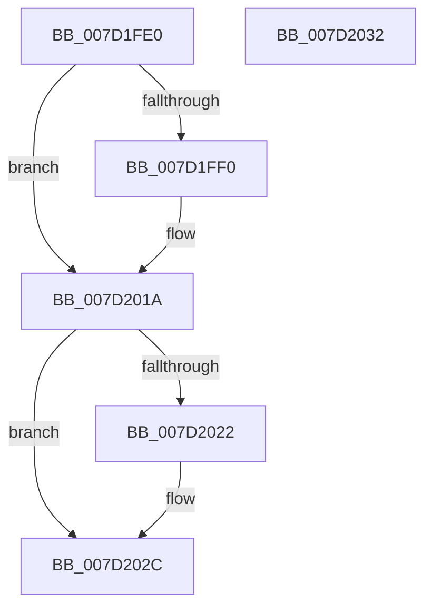

# ExpProfileDelete

- RVA: `0x007D1FE0`–`0x007D2033` (길이 `83` bytes)
- VA: `0x00000001407D1FE0`
- 실행 섹션: `PAGE`
- PDB 이름 있음: `예`; PDB Function 태그: `아니요`
- unwind 정보 RVA: `0x0005CF00`
- 디코드: `24`개 명령, `83/83` bytes 표시
- 미해석 바이트: `0` (있으면 어셈블리에 `.byte`로 보존)

> 이 문서는 커널 이미지의 기계어와 PDB 기호를 분석해 생성했습니다. 4번과 5번은 함수 원형과 자료형을 바이너리 사용 방식에서 추정한 C 해석이며 원본 소스 복구 결과는 아닙니다.

## 1. Dependencies

- 직접 호출 지점: **5**; 고유 호출 대상: **5**
- 직접 호출자로 확인된 함수: **0**
- RIP 상대 이미지 참조: **0**

### Outgoing calls
- `0x007D1FF4` → [KeStopProfile](../../text/5C/KeStopProfile_function_005C0640.md) (function, `0x005C0640`)
- `0x007D2001` → [MmUnmapLockedPages](../../text/24/MmUnmapLockedPages_function_00246E60.md) (function, `0x00246E60`)
- `0x007D200A` → [MmUnlockPages](../../text/29/MmUnlockPages_function_0029EEE0.md) (function, `0x0029EEE0`)
- `0x007D2015` → [ExFreePoolWithTag](../../poolcode/B8/ExFreePoolWithTag_function_00B82870.md) (function, `0x00B82870`)
- `0x007D2027` → [ObfDereferenceObjectWithTag](../../text/2F/ObfDereferenceObjectWithTag_function_002F78E0.md) (function, `0x002F78E0`)

### Direct callers
- 이 함수 시작 RVA로 연결되는 직접 call은 확인되지 않았습니다. 간접 호출은 완전히 역산할 수 없습니다.

### Static image references
- 디코드된 RIP-relative 메모리 참조가 없습니다.

## 2. Other-region calls and transfers

- 다른 실행 섹션으로 향하는 call: **5**
  - `0x007D1FF4` → [KeStopProfile](../../text/5C/KeStopProfile_function_005C0640.md) (`PAGE` → `.text`)
  - `0x007D2001` → [MmUnmapLockedPages](../../text/24/MmUnmapLockedPages_function_00246E60.md) (`PAGE` → `.text`)
  - `0x007D200A` → [MmUnlockPages](../../text/29/MmUnlockPages_function_0029EEE0.md) (`PAGE` → `.text`)
  - `0x007D2015` → [ExFreePoolWithTag](../../poolcode/B8/ExFreePoolWithTag_function_00B82870.md) (`PAGE` → `POOLCODE`)
  - `0x007D2027` → [ObfDereferenceObjectWithTag](../../text/2F/ObfDereferenceObjectWithTag_function_002F78E0.md) (`PAGE` → `.text`)
- 별도 외부 분기/꼬리 이동을 확인하지 못했습니다.

## 3. Assembly (complete function range)

```asm
007D1FE0  40 53                           push rbx
007D1FE2  48 83 EC 20                     sub rsp, 0x20
007D1FE6  48 83 79 30 00                  cmp qword ptr [rcx + 0x30], 0
007D1FEB  48 8B D9                        mov rbx, rcx
007D1FEE  74 2A                           je 0x1407d201a
007D1FF0  48 8B 49 28                     mov rcx, qword ptr [rcx + 0x28]
007D1FF4  E8 47 E6 DE FF                  call 0x1405c0640
007D1FF9  48 8B 53 38                     mov rdx, qword ptr [rbx + 0x38]
007D1FFD  48 8B 4B 30                     mov rcx, qword ptr [rbx + 0x30]
007D2001  E8 5A 4E A7 FF                  call 0x140246e60
007D2006  48 8B 4B 38                     mov rcx, qword ptr [rbx + 0x38]
007D200A  E8 D1 CE AC FF                  call 0x14029eee0
007D200F  48 8B 4B 28                     mov rcx, qword ptr [rbx + 0x28]
007D2013  33 D2                           xor edx, edx
007D2015  E8 56 08 3B 00                  call 0x140b82870
007D201A  48 8B 0B                        mov rcx, qword ptr [rbx]
007D201D  48 85 C9                        test rcx, rcx
007D2020  74 0A                           je 0x1407d202c
007D2022  BA 45 78 50 66                  mov edx, 0x66507845
007D2027  E8 B4 58 B2 FF                  call 0x1402f78e0
007D202C  48 83 C4 20                     add rsp, 0x20
007D2030  5B                              pop rbx
007D2031  C3                              ret
007D2032  CC                              int3
```

## 4. C-style interpretation (structured pseudocode)

```c
__int64 __fastcall ExpProfileDelete(__int64 a1)
{
    __int64 result;
    __int64 v_rsp;

    v_rsp = (v_rsp) - (32);
    if ((*(unsigned __int64 *)(a1 + 48)) != 0) {
        a1 = *(unsigned __int64 *)(a1 + 40);
        result = KeStopProfile(a1, a2, a3, a4);
        a2 = *(unsigned __int64 *)(a1 + 56);
        a1 = *(unsigned __int64 *)(a1 + 48);
        result = MmUnmapLockedPages(a1, a2, a3, a4);
        a1 = *(unsigned __int64 *)(a1 + 56);
        result = MmUnlockPages(a1, a2, a3, a4);
        a1 = *(unsigned __int64 *)(a1 + 40);
        a2 = 0;
        result = ExFreePoolWithTag(a1, a2, a3, a4);
    }
    if (*(unsigned __int64 *)(a1) != 0) {
        a2 = 0x66507845ULL;
        result = ObfDereferenceObjectWithTag(*(unsigned __int64 *)(a1), a2, a3, a4);
    }
    v_rsp = (v_rsp) + (32);
    return result;
}
```

## 5. (Beta) C Style

```c
int64_t ExpProfileDelete(void *Arg1)
{
    uint8_t *arg1 = (uint8_t *)Arg1;

    int64_t result;
    int64_t local_rsp;

    local_rsp = (local_rsp) - (32);
    if ((*(uint64_t *)(arg1 + 0x30)) != 0) {
        Arg1 = *(uint64_t *)(arg1 + 0x28);
        result = KeStopProfile(Arg1, a2, a3, a4);
        a2 = *(uint64_t *)(arg1 + 0x38);
        Arg1 = *(uint64_t *)(arg1 + 0x30);
        result = MmUnmapLockedPages(Arg1, a2, a3, a4);
        Arg1 = *(uint64_t *)(arg1 + 0x38);
        result = MmUnlockPages(Arg1, a2, a3, a4);
        Arg1 = *(uint64_t *)(arg1 + 0x28);
        a2 = 0;
        result = ExFreePoolWithTag(Arg1, a2, a3, a4);
    }
    if (*(uint64_t *)(arg1) != 0) {
        a2 = 0x66507845ULL;
        result = ObfDereferenceObjectWithTag(*(uint64_t *)(arg1), a2, a3, a4);
    }
    local_rsp = (local_rsp) + (32);
    return result;
}
```

### 관측된 메모리 오프셋

구조체 형식이 확인되지 않은 접근은 인자 기준의 오프셋으로만 기록했습니다.

| 기준 인자 | 오프셋 표현 | 폭 (bit) | 접근 |
|---|---:|---:|---|
| `Arg1` | `+ 0x0` | `64` | `R` |
| `Arg1` | `+ 0x28` | `64` | `R` |
| `Arg1` | `+ 0x30` | `64` | `R` |
| `Arg1` | `+ 0x38` | `64` | `R` |

## 6. Execution-region graph

[열기: 2D/3D 그래프와 함수 탐색 컨트롤 패널](../../../control-panel.html?section=page&rva=0x007D1FE0&view=graph)

- 2D 그래프는 위에서 아래로 흐르고, 3D 그래프는 빈 공간을 드래그해 회전합니다. Shift+드래그는 이동, 휠은 확대·축소, 함수 노드 선택은 대상 보고서 이동입니다.

### Static fallback


