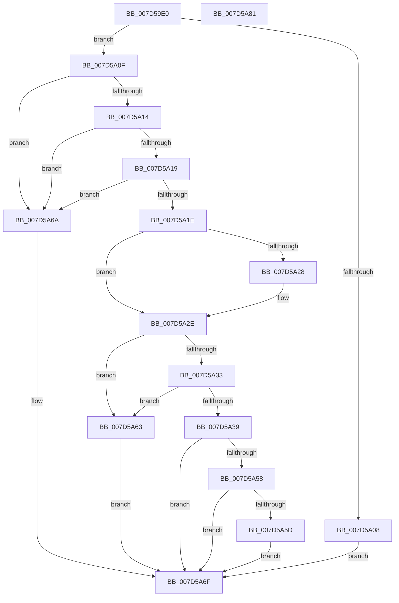

# ExpQueryOriginalImageFeatureInformation

- RVA: `0x007D59E0`–`0x007D5A82` (길이 `162` bytes)
- VA: `0x00000001407D59E0`
- 실행 섹션: `PAGE`
- PDB 이름 있음: `예`; PDB Function 태그: `아니요`
- unwind 정보 RVA: `0x00060BC4`
- 디코드: `48`개 명령, `162/162` bytes 표시
- 미해석 바이트: `0` (있으면 어셈블리에 `.byte`로 보존)

> 이 문서는 커널 이미지의 기계어와 PDB 기호를 분석해 생성했습니다. 4번과 5번은 함수 원형과 자료형을 바이너리 사용 방식에서 추정한 C 해석이며 원본 소스 복구 결과는 아닙니다.

## 1. Dependencies

- 직접 호출 지점: **2**; 고유 호출 대상: **2**
- 직접 호출자로 확인된 함수: **1**
- RIP 상대 이미지 참조: **0**

### Outgoing calls
- `0x007D5A41` → [memset](../../text/6C/memset_function_006C6C40.md) (function, `0x006C6C40`)
- `0x007D5A4C` → [ExpGetOriginalImageVersion](../../text/65/ExpGetOriginalImageVersion_function_0065D5D0.md) (function, `0x0065D5D0`)

### Direct callers
- [ExpQuerySystemInformation](../A5/ExpQuerySystemInformation_function_00A57858.md) at `0x00A5B4B6`

### Static image references
- 디코드된 RIP-relative 메모리 참조가 없습니다.

## 2. Other-region calls and transfers

- 다른 실행 섹션으로 향하는 call: **2**
  - `0x007D5A41` → [memset](../../text/6C/memset_function_006C6C40.md) (`PAGE` → `.text`)
  - `0x007D5A4C` → [ExpGetOriginalImageVersion](../../text/65/ExpGetOriginalImageVersion_function_0065D5D0.md) (`PAGE` → `.text`)
- 별도 외부 분기/꼬리 이동을 확인하지 못했습니다.

## 3. Assembly (complete function range)

```asm
007D59E0  48 89 5C 24 08                  mov qword ptr [rsp + 8], rbx
007D59E5  48 89 74 24 10                  mov qword ptr [rsp + 0x10], rsi
007D59EA  57                              push rdi
007D59EB  48 83 EC 20                     sub rsp, 0x20
007D59EF  65 48 8B 04 25 88 01 00 00      mov rax, qword ptr gs:[0x188]
007D59F8  33 DB                           xor ebx, ebx
007D59FA  49 8B F0                        mov rsi, r8
007D59FD  48 8B F9                        mov rdi, rcx
007D5A00  38 98 32 02 00 00               cmp byte ptr [rax + 0x232], bl
007D5A06  74 07                           je 0x1407d5a0f
007D5A08  BB 22 00 00 C0                  mov ebx, 0xc0000022
007D5A0D  EB 60                           jmp 0x1407d5a6f
007D5A0F  48 85 FF                        test rdi, rdi
007D5A12  74 56                           je 0x1407d5a6a
007D5A14  83 FA 14                        cmp edx, 0x14
007D5A17  72 51                           jb 0x1407d5a6a
007D5A19  83 39 01                        cmp dword ptr [rcx], 1
007D5A1C  75 4C                           jne 0x1407d5a6a
007D5A1E  48 8B 44 24 50                  mov rax, qword ptr [rsp + 0x50]
007D5A23  48 85 C0                        test rax, rax
007D5A26  74 06                           je 0x1407d5a2e
007D5A28  C7 00 05 00 00 00               mov dword ptr [rax], 5
007D5A2E  48 85 F6                        test rsi, rsi
007D5A31  74 30                           je 0x1407d5a63
007D5A33  41 83 F9 05                     cmp r9d, 5
007D5A37  72 2A                           jb 0x1407d5a63
007D5A39  45 8B C1                        mov r8d, r9d
007D5A3C  33 D2                           xor edx, edx
007D5A3E  48 8B CE                        mov rcx, rsi
007D5A41  E8 FA 11 EF FF                  call 0x1406c6c40
007D5A46  C7 06 01 00 00 00               mov dword ptr [rsi], 1
007D5A4C  E8 7F 7B E8 FF                  call 0x14065d5d0
007D5A51  3D 0C 00 00 0A                  cmp eax, 0xa00000c
007D5A56  72 17                           jb 0x1407d5a6f
007D5A58  39 47 10                        cmp dword ptr [rdi + 0x10], eax
007D5A5B  77 12                           ja 0x1407d5a6f
007D5A5D  C6 46 04 01                     mov byte ptr [rsi + 4], 1
007D5A61  EB 0C                           jmp 0x1407d5a6f
007D5A63  BB 04 00 00 C0                  mov ebx, 0xc0000004
007D5A68  EB 05                           jmp 0x1407d5a6f
007D5A6A  BB 0D 00 00 C0                  mov ebx, 0xc000000d
007D5A6F  48 8B 74 24 38                  mov rsi, qword ptr [rsp + 0x38]
007D5A74  8B C3                           mov eax, ebx
007D5A76  48 8B 5C 24 30                  mov rbx, qword ptr [rsp + 0x30]
007D5A7B  48 83 C4 20                     add rsp, 0x20
007D5A7F  5F                              pop rdi
007D5A80  C3                              ret
007D5A81  CC                              int3
```

## 4. C-style interpretation (structured pseudocode)

```c
__int64 __fastcall ExpQueryOriginalImageFeatureInformation(__int64 a1, int a2, __int64 a3, int a4, __int64 a5)
{
    __int64 result;
    __int64 v_rbx;
    __int64 v_rsp;
    unsigned __int64 v_stack_p10;
    unsigned __int64 v_stack_p8;

    v_stack_p8 = v_rbx;
    v_stack_p10 = v_rsi;
    v_rsp = (v_rsp) - (32);
    v_rbx = 0;
    if ((*(unsigned __int8 *)(*(unsigned __int64 *)(gs_base + (0 + 392)) + 562)) == 0) goto loc_007D5A0F;
    goto loc_007D5A6F;
loc_007D5A0F:
    if (a1 == 0) goto loc_007D5A6A;
    if (a2 < 20) goto loc_007D5A6A;
    if ((*(unsigned int *)(a1)) != 1) goto loc_007D5A6A;
    if (a5 != 0) {
        *(unsigned int *)(a5) = 5;
    }
    if (a3 == 0) goto loc_007D5A63;
    if (a4 < 5) goto loc_007D5A63;
    a2 = 0;
    result = memset(a3, a2, (unsigned int)(a4), a4);
    *(unsigned int *)(a3) = 1;
    result = ExpGetOriginalImageVersion(a3, a2, (unsigned int)(a4), a4);
    if (((unsigned int)(result)) < 0xA00000CULL) goto loc_007D5A6F;
    if ((*(unsigned int *)(a1 + 16)) > ((unsigned int)(result))) goto loc_007D5A6F;
    *(unsigned __int8 *)(a3 + 4) = 1;
    goto loc_007D5A6F;
loc_007D5A63:
    goto loc_007D5A6F;
loc_007D5A6A:
loc_007D5A6F:
    v_rsp = (v_rsp) + (32);
    return (unsigned int)((unsigned int)((unsigned int)(0xC000000DULL)));
}
```

## 5. (Beta) C Style

```c
int64_t ExpQueryOriginalImageFeatureInformation(void *Arg1, int32_t Arg2, int64_t Arg3, int32_t Arg4, int64_t Arg5)
{
    uint8_t *arg1 = (uint8_t *)Arg1;

    int64_t result;
    int64_t local_rbx;
    int64_t local_rsp;
    uint64_t v_stack_p10;
    uint64_t v_stack_p8;

    v_stack_p8 = local_rbx;
    v_stack_p10 = local_rsi;
    local_rsp = (local_rsp) - (32);
    local_rbx = 0;
    if ((*(uint8_t *)(*(uint64_t *)(gs_base + (0 + 0x188)) + 0x232)) == 0) goto loc_007D5A0F;
    goto loc_007D5A6F;
loc_007D5A0F:
    if (Arg1 == NULL) goto loc_007D5A6A;
    if (Arg2 < 20) goto loc_007D5A6A;
    if ((*(uint32_t *)(arg1)) != 1) goto loc_007D5A6A;
    if (Arg5 != 0) {
        *(uint32_t *)(Arg5) = 5;
    }
    if (Arg3 == 0) goto loc_007D5A63;
    if (Arg4 < 5) goto loc_007D5A63;
    Arg2 = 0;
    result = memset(Arg3, Arg2, (uint32_t)(Arg4), Arg4);
    *(uint32_t *)(Arg3) = 1;
    result = ExpGetOriginalImageVersion(Arg3, Arg2, (uint32_t)(Arg4), Arg4);
    if (((uint32_t)(result)) < 0xA00000CULL) goto loc_007D5A6F;
    if ((*(uint32_t *)(arg1 + 0x10)) > ((uint32_t)(result))) goto loc_007D5A6F;
    *(uint8_t *)(Arg3 + 0x4) = 1;
    goto loc_007D5A6F;
loc_007D5A63:
    goto loc_007D5A6F;
loc_007D5A6A:
loc_007D5A6F:
    local_rsp = (local_rsp) + (32);
    return (uint32_t)((uint32_t)((uint32_t)(0xC000000DULL)));
}
```

### 관측된 메모리 오프셋

구조체 형식이 확인되지 않은 접근은 인자 기준의 오프셋으로만 기록했습니다.

| 기준 인자 | 오프셋 표현 | 폭 (bit) | 접근 |
|---|---:|---:|---|
| `Arg1` | `+ 0x0` | `32` | `R` |

## 6. Execution-region graph

[열기: 2D/3D 그래프와 함수 탐색 컨트롤 패널](../../../control-panel.html?section=page&rva=0x007D59E0&view=graph)

- 2D 그래프는 위에서 아래로 흐르고, 3D 그래프는 빈 공간을 드래그해 회전합니다. Shift+드래그는 이동, 휠은 확대·축소, 함수 노드 선택은 대상 보고서 이동입니다.

### Static fallback


