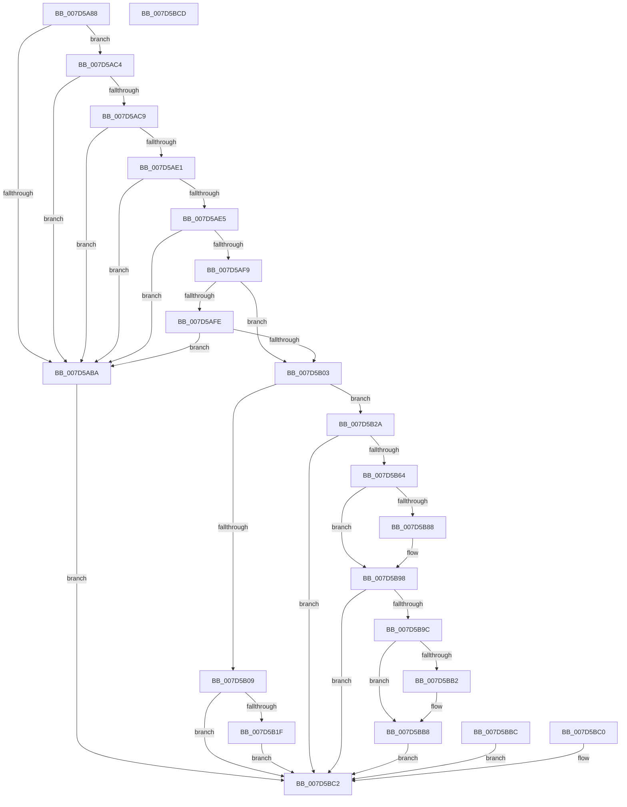

# ExpQuerySystemMemoryNumaInformation

- RVA: `0x007D5A88`–`0x007D5BCE` (길이 `326` bytes)
- VA: `0x00000001407D5A88`
- 실행 섹션: `PAGE`
- PDB 이름 있음: `예`; PDB Function 태그: `아니요`
- unwind 정보 RVA: `0x000D5CB8`
- 디코드: `84`개 명령, `326/326` bytes 표시
- 미해석 바이트: `0` (있으면 어셈블리에 `.byte`로 보존)

> 이 문서는 커널 이미지의 기계어와 PDB 기호를 분석해 생성했습니다. 4번과 5번은 함수 원형과 자료형을 바이너리 사용 방식에서 추정한 C 해석이며 원본 소스 복구 결과는 아닙니다.

## 1. Dependencies

- 직접 호출 지점: **2**; 고유 호출 대상: **1**
- 직접 호출자로 확인된 함수: **1**
- RIP 상대 이미지 참조: **2**

### Outgoing calls
- `0x007D5B59` → [guard_dispatch_icall](../../text/6B/guard_dispatch_icall_function_006BAAD0.md) (function, `0x006BAAD0`)
- `0x007D5B7D` → [guard_dispatch_icall](../../text/6B/guard_dispatch_icall_function_006BAAD0.md) (function, `0x006BAAD0`)

### Direct callers
- [ExpQuerySystemInformation](../A5/ExpQuerySystemInformation_function_00A57858.md) at `0x00A5B67B`

### Static image references
- `0x007D5AEE` → RVA `0x00FC5000` (`ALMOSTRO`; read)
- `0x007D5B40` → RVA `0x00E00638` (`.data`; read)

## 2. Other-region calls and transfers

- 다른 실행 섹션으로 향하는 call: **2**
  - `0x007D5B59` → [guard_dispatch_icall](../../text/6B/guard_dispatch_icall_function_006BAAD0.md) (`PAGE` → `.text`)
  - `0x007D5B7D` → [guard_dispatch_icall](../../text/6B/guard_dispatch_icall_function_006BAAD0.md) (`PAGE` → `.text`)
- 별도 외부 분기/꼬리 이동을 확인하지 못했습니다.

## 3. Assembly (complete function range)

```asm
007D5A88  4C 8B DC                        mov r11, rsp
007D5A8B  53                              push rbx
007D5A8C  48 81 EC 90 00 00 00            sub rsp, 0x90
007D5A93  49 8B D8                        mov rbx, r8
007D5A96  41 83 63 08 00                  and dword ptr [r11 + 8], 0
007D5A9B  0F 57 C0                        xorps xmm0, xmm0
007D5A9E  33 C0                           xor eax, eax
007D5AA0  0F 11 44 24 70                  movups xmmword ptr [rsp + 0x70], xmm0
007D5AA5  49 89 43 E8                     mov qword ptr [r11 - 0x18], rax
007D5AA9  49 89 43 A0                     mov qword ptr [r11 - 0x60], rax
007D5AAD  89 44 24 40                     mov dword ptr [rsp + 0x40], eax
007D5AB1  21 44 24 48                     and dword ptr [rsp + 0x48], eax
007D5AB5  48 85 C9                        test rcx, rcx
007D5AB8  75 0A                           jne 0x1407d5ac4
007D5ABA  B9 0D 00 00 C0                  mov ecx, 0xc000000d
007D5ABF  E9 FE 00 00 00                  jmp 0x1407d5bc2
007D5AC4  83 FA 0C                        cmp edx, 0xc
007D5AC7  72 F1                           jb 0x1407d5aba
007D5AC9  F2 0F 10 01                     movsd xmm0, qword ptr [rcx]
007D5ACD  F2 0F 11 44 24 38               movsd qword ptr [rsp + 0x38], xmm0
007D5AD3  8B 41 08                        mov eax, dword ptr [rcx + 8]
007D5AD6  89 44 24 40                     mov dword ptr [rsp + 0x40], eax
007D5ADA  83 7C 24 38 01                  cmp dword ptr [rsp + 0x38], 1
007D5ADF  75 D9                           jne 0x1407d5aba
007D5AE1  85 C0                           test eax, eax
007D5AE3  75 D5                           jne 0x1407d5aba
007D5AE5  48 8B 4C 24 38                  mov rcx, qword ptr [rsp + 0x38]
007D5AEA  48 C1 E9 20                     shr rcx, 0x20
007D5AEE  0F B7 05 0B F5 7E 00            movzx eax, word ptr [rip + 0x7ef50b]
007D5AF5  3B C8                           cmp ecx, eax
007D5AF7  73 C1                           jae 0x1407d5aba
007D5AF9  48 85 DB                        test rbx, rbx
007D5AFC  75 05                           jne 0x1407d5b03
007D5AFE  45 85 C9                        test r9d, r9d
007D5B01  75 B7                           jne 0x1407d5aba
007D5B03  41 83 F9 10                     cmp r9d, 0x10
007D5B07  73 21                           jae 0x1407d5b2a
007D5B09  B9 23 00 00 C0                  mov ecx, 0xc0000023
007D5B0E  48 8B 84 24 C0 00 00 00         mov rax, qword ptr [rsp + 0xc0]
007D5B16  48 85 C0                        test rax, rax
007D5B19  0F 84 A3 00 00 00               je 0x1407d5bc2
007D5B1F  C7 00 10 00 00 00               mov dword ptr [rax], 0x10
007D5B25  E9 98 00 00 00                  jmp 0x1407d5bc2
007D5B2A  48 83 64 24 58 00               and qword ptr [rsp + 0x58], 0
007D5B30  C7 44 24 50 01 00 00 00         mov dword ptr [rsp + 0x50], 1
007D5B38  C7 44 24 54 10 00 00 00         mov dword ptr [rsp + 0x54], 0x10
007D5B40  48 8B 05 F1 AA 62 00            mov rax, qword ptr [rip + 0x62aaf1]
007D5B47  4C 8D 4C 24 48                  lea r9, [rsp + 0x48]
007D5B4C  4C 8D 44 24 70                  lea r8, [rsp + 0x70]
007D5B51  BA 18 00 00 00                  mov edx, 0x18
007D5B56  8D 4A 1A                        lea ecx, [rdx + 0x1a]
007D5B59  E8 72 4F EE FF                  call 0x1406baad0
007D5B5E  8B C8                           mov ecx, eax
007D5B60  85 C0                           test eax, eax
007D5B62  78 5E                           js 0x1407d5bc2
007D5B64  4C 8D 84 24 A0 00 00 00         lea r8, [rsp + 0xa0]
007D5B6C  8B 54 24 3C                     mov edx, dword ptr [rsp + 0x3c]
007D5B70  B9 01 00 00 00                  mov ecx, 1
007D5B75  48 8B 84 24 80 00 00 00         mov rax, qword ptr [rsp + 0x80]
007D5B7D  E8 4E 4F EE FF                  call 0x1406baad0
007D5B82  8B C8                           mov ecx, eax
007D5B84  85 C0                           test eax, eax
007D5B86  78 10                           js 0x1407d5b98
007D5B88  83 4C 24 5C 01                  or dword ptr [rsp + 0x5c], 1
007D5B8D  8B 84 24 A0 00 00 00            mov eax, dword ptr [rsp + 0xa0]
007D5B94  89 44 24 58                     mov dword ptr [rsp + 0x58], eax
007D5B98  85 C9                           test ecx, ecx
007D5B9A  78 26                           js 0x1407d5bc2
007D5B9C  0F 10 44 24 50                  movups xmm0, xmmword ptr [rsp + 0x50]
007D5BA1  F3 0F 7F 03                     movdqu xmmword ptr [rbx], xmm0
007D5BA5  48 8B 84 24 C0 00 00 00         mov rax, qword ptr [rsp + 0xc0]
007D5BAD  48 85 C0                        test rax, rax
007D5BB0  74 06                           je 0x1407d5bb8
007D5BB2  C7 00 10 00 00 00               mov dword ptr [rax], 0x10
007D5BB8  33 C9                           xor ecx, ecx
007D5BBA  EB 06                           jmp 0x1407d5bc2
007D5BBC  8B C8                           mov ecx, eax
007D5BBE  EB 02                           jmp 0x1407d5bc2
007D5BC0  8B C8                           mov ecx, eax
007D5BC2  8B C1                           mov eax, ecx
007D5BC4  48 81 C4 90 00 00 00            add rsp, 0x90
007D5BCB  5B                              pop rbx
007D5BCC  C3                              ret
007D5BCD  CC                              int3
```

## 4. C-style interpretation (structured pseudocode)

```c
__int64 __fastcall ExpQuerySystemMemoryNumaInformation(__int64 a1, int a2, __int64 a3, int a4, __int64 a5)
{
    __int64 result;
    __int64 v_rsp;
    unsigned __int64 v_stack_m18;
    unsigned __int64 v_stack_m28;
    unsigned int v_stack_m3C;
    unsigned __int64 v_stack_m40;
    unsigned int v_stack_m44;
    unsigned int v_stack_m48;
    unsigned int v_stack_m50;
    unsigned int v_stack_m58;
    unsigned int v_stack_m5C;
    unsigned __int64 v_stack_m60;
    unsigned __int64 v_stack_p8;

    v_rsp = (v_rsp) - (144);
    result = 0;
    v_stack_m28 = v_xmm0;
    *(unsigned __int64 *)(v_rsp - 24) = 0;
    *(unsigned __int64 *)(v_rsp - 96) = 0;
    v_stack_m58 = 0;
    if (a1 != 0) goto loc_007D5AC4;
loc_007D5ABA:
    goto loc_007D5BC2;
loc_007D5AC4:
    if (a2 < 12) goto loc_007D5ABA;
    v_stack_m60 = v_xmm0;
    v_stack_m58 = (unsigned int)((unsigned int)(*(unsigned int *)((unsigned int)(0xC000000DULL) + 8)));
    if (v_stack_m60 != 1) goto loc_007D5ABA;
    if ((unsigned int)((unsigned int)(*(unsigned int *)((unsigned int)(0xC000000DULL) + 8))) != 0) goto loc_007D5ABA;
    a1 = (v_stack_m60) >> (32);
    if (((unsigned int)(a1)) >= ((unsigned int)(*(unsigned __int16 *)(v_rip + 8320267)))) goto loc_007D5ABA;
    if (a3 != 0) goto loc_007D5B03;
    if (a4 != 0) goto loc_007D5ABA;
loc_007D5B03:
    if (a4 >= 16) goto loc_007D5B2A;
    if (a5 == 0) goto loc_007D5BC2;
    *(unsigned int *)(a5) = 16;
    goto loc_007D5BC2;
loc_007D5B2A:
    v_stack_m48 = 1;
    v_stack_m44 = 16;
    result = guard_dispatch_icall(24 + 26, 24, v_stack_m28, v_stack_m50);
    if (sign_flag) goto loc_007D5BC2;
    result = guard_dispatch_icall(1, (unsigned int)(v_stack_m5C), v_stack_p8, v_stack_m50);
    if (!(sign_flag)) {
        result = v_stack_p8;
        v_stack_m40 = (unsigned int)(result);
    }
    if (sign_flag) goto loc_007D5BC2;
    *(unsigned __int64 *)(a3) = v_xmm0;
    if (a5 != 0) {
        *(unsigned int *)(a5) = 16;
    }
    a1 = 0;
    goto loc_007D5BC2;
loc_007D5BC2:
    v_rsp = (v_rsp) + (144);
    return 0;
}
```

## 5. (Beta) C Style

```c
int64_t ExpQuerySystemMemoryNumaInformation(int64_t Arg1, int32_t Arg2, int64_t Arg3, int32_t Arg4, int64_t Arg5)
{
    int64_t result;
    int64_t local_rsp;
    uint64_t v_stack_m18;
    uint64_t v_stack_m28;
    uint32_t v_stack_m3C;
    uint64_t v_stack_m40;
    uint32_t v_stack_m44;
    uint32_t v_stack_m48;
    uint32_t v_stack_m50;
    uint32_t v_stack_m58;
    uint32_t v_stack_m5C;
    uint64_t v_stack_m60;
    uint64_t v_stack_p8;

    local_rsp = (local_rsp) - (144);
    result = 0;
    v_stack_m28 = v_xmm0;
    *(uint64_t *)(local_rsp - 0x18) = 0;
    *(uint64_t *)(local_rsp - 0x60) = 0;
    v_stack_m58 = 0;
    if (Arg1 != 0) goto loc_007D5AC4;
loc_007D5ABA:
    goto loc_007D5BC2;
loc_007D5AC4:
    if (Arg2 < 12) goto loc_007D5ABA;
    v_stack_m60 = v_xmm0;
    v_stack_m58 = (uint32_t)((uint32_t)(*(uint32_t *)((uint32_t)(0xC000000DULL) + 0x8)));
    if (v_stack_m60 != 1) goto loc_007D5ABA;
    if ((uint32_t)((uint32_t)(*(uint32_t *)((uint32_t)(0xC000000DULL) + 0x8))) != 0) goto loc_007D5ABA;
    Arg1 = (v_stack_m60) >> (32);
    if (((uint32_t)(Arg1)) >= ((uint32_t)(*(uint16_t *)(v_rip + 0x7EF50B)))) goto loc_007D5ABA;
    if (Arg3 != 0) goto loc_007D5B03;
    if (Arg4 != 0) goto loc_007D5ABA;
loc_007D5B03:
    if (Arg4 >= 16) goto loc_007D5B2A;
    if (Arg5 == 0) goto loc_007D5BC2;
    *(uint32_t *)(Arg5) = 16;
    goto loc_007D5BC2;
loc_007D5B2A:
    v_stack_m48 = 1;
    v_stack_m44 = 16;
    result = guard_dispatch_icall(24 + 26, 24, v_stack_m28, v_stack_m50);
    if (sign_flag) goto loc_007D5BC2;
    result = guard_dispatch_icall(1, (uint32_t)(v_stack_m5C), v_stack_p8, v_stack_m50);
    if (!(sign_flag)) {
        result = v_stack_p8;
        v_stack_m40 = (uint32_t)(result);
    }
    if (sign_flag) goto loc_007D5BC2;
    *(uint64_t *)(Arg3) = v_xmm0;
    if (Arg5 != 0) {
        *(uint32_t *)(Arg5) = 16;
    }
    Arg1 = 0;
    goto loc_007D5BC2;
loc_007D5BC2:
    local_rsp = (local_rsp) + (144);
    return 0;
}
```

## 6. Execution-region graph

[열기: 2D/3D 그래프와 함수 탐색 컨트롤 패널](../../../control-panel.html?section=page&rva=0x007D5A88&view=graph)

- 2D 그래프는 위에서 아래로 흐르고, 3D 그래프는 빈 공간을 드래그해 회전합니다. Shift+드래그는 이동, 휠은 확대·축소, 함수 노드 선택은 대상 보고서 이동입니다.

### Static fallback


