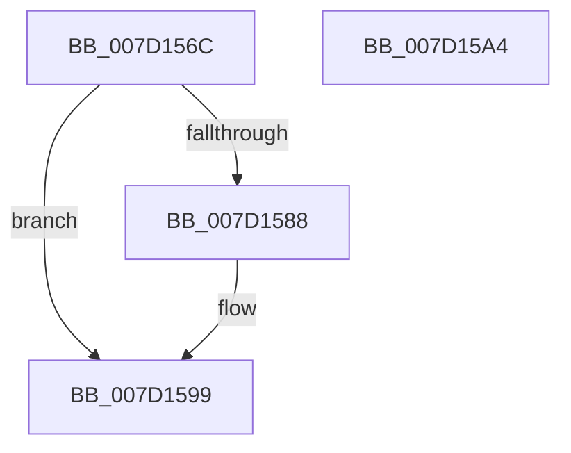

# ExpRegisterCounterSet

- RVA: `0x007D156C`–`0x007D15A5` (길이 `57` bytes)
- VA: `0x00000001407D156C`
- 실행 섹션: `PAGE`
- PDB 이름 있음: `예`; PDB Function 태그: `아니요`
- unwind 정보 RVA: `0x0005CAAC`
- 디코드: `17`개 명령, `57/57` bytes 표시
- 미해석 바이트: `0` (있으면 어셈블리에 `.byte`로 보존)

> 이 문서는 커널 이미지의 기계어와 PDB 기호를 분석해 생성했습니다. 4번과 5번은 함수 원형과 자료형을 바이너리 사용 방식에서 추정한 C 해석이며 원본 소스 복구 결과는 아닙니다.

## 1. Dependencies

- 직접 호출 지점: **2**; 고유 호출 대상: **1**
- 직접 호출자로 확인된 함수: **2**
- RIP 상대 이미지 참조: **0**

### Outgoing calls
- `0x007D157C` → [PcwRegister](../A6/PcwRegister_function_00A61180.md) (function, `0x00A61180`)
- `0x007D1594` → [PcwRegister](../A6/PcwRegister_function_00A61180.md) (function, `0x00A61180`)

### Direct callers
- [ExpPcwHostCallback](ExpPcwHostCallback_function_007D1290.md) at `0x007D13CF`
- [ExpPcwHostCallback](ExpPcwHostCallback_function_007D1290.md) at `0x007D1418`
- [ExpPcwHostCallback](ExpPcwHostCallback_function_007D1290.md) at `0x007D1465`
- [ExpPcwHostCallback](ExpPcwHostCallback_function_007D1290.md) at `0x007D14B2`
- [ExpPcwHostCallback](ExpPcwHostCallback_function_007D1290.md) at `0x007D1504`
- [ExpPcwHostCallback](ExpPcwHostCallback_function_007D1290.md) at `0x007D154D`
- [EtwRegisterCounters](../84/EtwRegisterCounters_function_00841400.md) at `0x00841462`
- [EtwRegisterCounters](../84/EtwRegisterCounters_function_00841400.md) at `0x008414B5`

### Static image references
- 디코드된 RIP-relative 메모리 참조가 없습니다.

## 2. Other-region calls and transfers

- 다른 실행 섹션으로 향하는 call: **0**
- 별도 외부 분기/꼬리 이동을 확인하지 못했습니다.

## 3. Assembly (complete function range)

```asm
007D156C  48 89 5C 24 08                  mov qword ptr [rsp + 8], rbx
007D1571  57                              push rdi
007D1572  48 83 EC 20                     sub rsp, 0x20
007D1576  48 8B DA                        mov rbx, rdx
007D1579  48 8B F9                        mov rdi, rcx
007D157C  E8 FF FB 28 00                  call 0x140a61180
007D1581  3D F0 00 00 C0                  cmp eax, 0xc00000f0
007D1586  75 11                           jne 0x1407d1599
007D1588  48 8B D3                        mov rdx, rbx
007D158B  C7 03 00 01 00 00               mov dword ptr [rbx], 0x100
007D1591  48 8B CF                        mov rcx, rdi
007D1594  E8 E7 FB 28 00                  call 0x140a61180
007D1599  48 8B 5C 24 30                  mov rbx, qword ptr [rsp + 0x30]
007D159E  48 83 C4 20                     add rsp, 0x20
007D15A2  5F                              pop rdi
007D15A3  C3                              ret
007D15A4  CC                              int3
```

## 4. C-style interpretation (structured pseudocode)

```c
__int64 __fastcall ExpRegisterCounterSet(__int64 a1, __int64 a2)
{
    __int64 result;
    __int64 v_rsp;
    unsigned __int64 v_stack_p8;

    v_stack_p8 = v_rbx;
    v_rsp = (v_rsp) - (32);
    result = PcwRegister(a1, a2, a3, a4);
    if (((unsigned int)(result)) == 0xC00000F0ULL) {
        a2 = a2;
        *(unsigned int *)(a2) = 256;
        a1 = a1;
        result = PcwRegister(a1, a2, a3, a4);
    }
    v_rsp = (v_rsp) + (32);
    return result;
}
```

## 5. (Beta) C Style

```c
int64_t ExpRegisterCounterSet(int64_t Arg1, void *Arg2)
{
    uint8_t *arg2 = (uint8_t *)Arg2;

    int64_t result;
    int64_t local_rsp;
    uint64_t v_stack_p8;

    v_stack_p8 = local_rbx;
    local_rsp = (local_rsp) - (32);
    result = PcwRegister(Arg1, Arg2, a3, a4);
    if (((uint32_t)(result)) == 0xC00000F0ULL) {
        Arg2 = Arg2;
        *(uint32_t *)(arg2) = 256;
        Arg1 = Arg1;
        result = PcwRegister(Arg1, Arg2, a3, a4);
    }
    local_rsp = (local_rsp) + (32);
    return result;
}
```

### 관측된 메모리 오프셋

구조체 형식이 확인되지 않은 접근은 인자 기준의 오프셋으로만 기록했습니다.

| 기준 인자 | 오프셋 표현 | 폭 (bit) | 접근 |
|---|---:|---:|---|
| `Arg2` | `+ 0x0` | `32` | `W` |

## 6. Execution-region graph

[열기: 2D/3D 그래프와 함수 탐색 컨트롤 패널](../../../control-panel.html?section=page&rva=0x007D156C&view=graph)

- 2D 그래프는 위에서 아래로 흐르고, 3D 그래프는 빈 공간을 드래그해 회전합니다. Shift+드래그는 이동, 휠은 확대·축소, 함수 노드 선택은 대상 보고서 이동입니다.

### Static fallback


