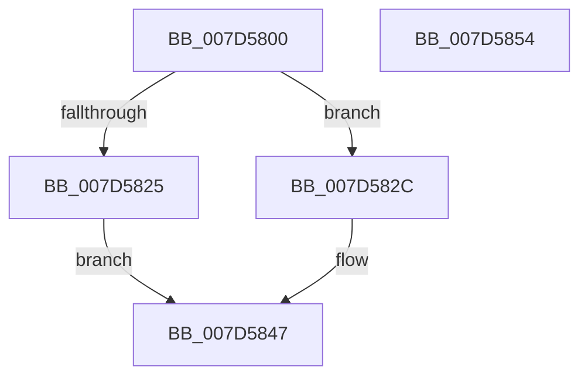

# ExpReleaseCrossVmMutant

- RVA: `0x007D5800`–`0x007D5855` (길이 `85` bytes)
- VA: `0x00000001407D5800`
- 실행 섹션: `PAGE`
- PDB 이름 있음: `예`; PDB Function 태그: `아니요`
- unwind 정보 RVA: `0x0005CAAC`
- 디코드: `25`개 명령, `85/85` bytes 표시
- 미해석 바이트: `0` (있으면 어셈블리에 `.byte`로 보존)

> 이 문서는 커널 이미지의 기계어와 PDB 기호를 분석해 생성했습니다. 4번과 5번은 함수 원형과 자료형을 바이너리 사용 방식에서 추정한 C 해석이며 원본 소스 복구 결과는 아닙니다.

## 1. Dependencies

- 직접 호출 지점: **3**; 고유 호출 대상: **3**
- 직접 호출자로 확인된 함수: **1**
- RIP 상대 이미지 참조: **0**

### Outgoing calls
- `0x007D581B` → [ExpGetExtensionHostForCrossVmObject](../70/ExpGetExtensionHostForCrossVmObject_function_007020E0.md) (function, `0x007020E0`)
- `0x007D5836` → [guard_dispatch_icall](../../text/6B/guard_dispatch_icall_function_006BAAD0.md) (function, `0x006BAAD0`)
- `0x007D5842` → [ExReleaseExtensionTable](../../text/45/ExReleaseExtensionTable_function_00456DC0.md) (function, `0x00456DC0`)

### Direct callers
- [NtReleaseMutant](../9A/NtReleaseMutant_function_009A2780.md) at `0x009A28CC`

### Static image references
- 디코드된 RIP-relative 메모리 참조가 없습니다.

## 2. Other-region calls and transfers

- 다른 실행 섹션으로 향하는 call: **2**
  - `0x007D5836` → [guard_dispatch_icall](../../text/6B/guard_dispatch_icall_function_006BAAD0.md) (`PAGE` → `.text`)
  - `0x007D5842` → [ExReleaseExtensionTable](../../text/45/ExReleaseExtensionTable_function_00456DC0.md) (`PAGE` → `.text`)
- 별도 외부 분기/꼬리 이동을 확인하지 못했습니다.

## 3. Assembly (complete function range)

```asm
007D5800  48 89 5C 24 08                  mov qword ptr [rsp + 8], rbx
007D5805  57                              push rdi
007D5806  48 83 EC 20                     sub rsp, 0x20
007D580A  48 83 64 24 40 00               and qword ptr [rsp + 0x40], 0
007D5810  48 8B DA                        mov rbx, rdx
007D5813  48 8D 54 24 40                  lea rdx, [rsp + 0x40]
007D5818  48 8B F9                        mov rdi, rcx
007D581B  E8 C0 C8 F2 FF                  call 0x1407020e0
007D5820  48 85 C0                        test rax, rax
007D5823  75 07                           jne 0x1407d582c
007D5825  BB 02 00 00 C0                  mov ebx, 0xc0000002
007D582A  EB 1B                           jmp 0x1407d5847
007D582C  48 8B 40 58                     mov rax, qword ptr [rax + 0x58]
007D5830  48 8B D3                        mov rdx, rbx
007D5833  48 8B CF                        mov rcx, rdi
007D5836  E8 95 52 EE FF                  call 0x1406baad0
007D583B  8B D8                           mov ebx, eax
007D583D  48 8B 4C 24 40                  mov rcx, qword ptr [rsp + 0x40]
007D5842  E8 79 15 C8 FF                  call 0x140456dc0
007D5847  8B C3                           mov eax, ebx
007D5849  48 8B 5C 24 30                  mov rbx, qword ptr [rsp + 0x30]
007D584E  48 83 C4 20                     add rsp, 0x20
007D5852  5F                              pop rdi
007D5853  C3                              ret
007D5854  CC                              int3
```

## 4. C-style interpretation (structured pseudocode)

```c
__int64 __fastcall ExpReleaseCrossVmMutant(__int64 a1, __int64 a2)
{
    __int64 result;
    __int64 v_rsp;
    unsigned __int64 v_stack_p18;
    unsigned __int64 v_stack_p8;

    v_stack_p8 = v_rbx;
    v_rsp = (v_rsp) - (32);
    result = ExpGetExtensionHostForCrossVmObject(a1, v_stack_p18, a3, a4);
    if (result != 0) goto loc_007D582C;
    goto loc_007D5847;
loc_007D582C:
    result = guard_dispatch_icall(a1, (unsigned int)(0xC0000002ULL), a3, a4);
    result = ExReleaseExtensionTable(v_stack_p18, (unsigned int)(0xC0000002ULL), a3, a4);
loc_007D5847:
    v_rsp = (v_rsp) + (32);
    return (unsigned int)((unsigned int)((unsigned int)((unsigned int)(result))));
}
```

## 5. (Beta) C Style

```c
int64_t ExpReleaseCrossVmMutant(int64_t Arg1, int64_t Arg2)
{
    int64_t result;
    int64_t local_rsp;
    uint64_t v_stack_p18;
    uint64_t v_stack_p8;

    v_stack_p8 = local_rbx;
    local_rsp = (local_rsp) - (32);
    result = ExpGetExtensionHostForCrossVmObject(Arg1, v_stack_p18, a3, a4);
    if (result != 0) goto loc_007D582C;
    goto loc_007D5847;
loc_007D582C:
    result = guard_dispatch_icall(Arg1, (uint32_t)(0xC0000002ULL), a3, a4);
    result = ExReleaseExtensionTable(v_stack_p18, (uint32_t)(0xC0000002ULL), a3, a4);
loc_007D5847:
    local_rsp = (local_rsp) + (32);
    return (uint32_t)((uint32_t)((uint32_t)((uint32_t)(result))));
}
```

## 6. Execution-region graph

[열기: 2D/3D 그래프와 함수 탐색 컨트롤 패널](../../../control-panel.html?section=page&rva=0x007D5800&view=graph)

- 2D 그래프는 위에서 아래로 흐르고, 3D 그래프는 빈 공간을 드래그해 회전합니다. Shift+드래그는 이동, 휠은 확대·축소, 함수 노드 선택은 대상 보고서 이동입니다.

### Static fallback


