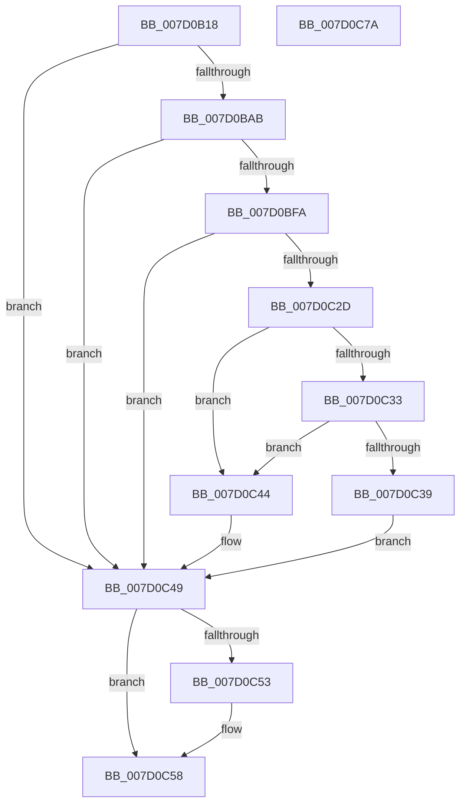

# ExpUuidLoadSequenceNumber

- RVA: `0x007D0B18`–`0x007D0C7B` (길이 `355` bytes)
- VA: `0x00000001407D0B18`
- 실행 섹션: `PAGE`
- PDB 이름 있음: `예`; PDB Function 태그: `아니요`
- unwind 정보 RVA: `0x000D56A0`
- 디코드: `82`개 명령, `355/355` bytes 표시
- 미해석 바이트: `0` (있으면 어셈블리에 `.byte`로 보존)

> 이 문서는 커널 이미지의 기계어와 PDB 기호를 분석해 생성했습니다. 4번과 5번은 함수 원형과 자료형을 바이너리 사용 방식에서 추정한 C 해석이며 원본 소스 복구 결과는 아닙니다.

## 1. Dependencies

- 직접 호출 지점: **7**; 고유 호출 대상: **7**
- 직접 호출자로 확인된 함수: **1**
- RIP 상대 이미지 참조: **5**

### Outgoing calls
- `0x007D0B71` → [memset](../../text/6C/memset_function_006C6C40.md) (function, `0x006C6C40`)
- `0x007D0B9C` → [RtlGetPersistedStateLocation](../8C/RtlGetPersistedStateLocation_function_008C8DE0.md) (function, `0x008C8DE0`)
- `0x007D0BB3` → [RtlInitUnicodeString](../../text/42/RtlInitUnicodeString_function_0042A780.md) (function, `0x0042A780`)
- `0x007D0BEF` → [ZwOpenKey](../../text/6A/ZwOpenKey_function_006AD310.md) (function, `0x006AD310`)
- `0x007D0C22` → [ZwQueryValueKey](../../text/6A/ZwQueryValueKey_function_006AD3B0.md) (function, `0x006AD3B0`)
- `0x007D0C53` → [ZwClose](../../text/6A/ZwClose_function_006AD2B0.md) (function, `0x006AD2B0`)
- `0x007D0C64` → [_security_check_cookie](../../text/6A/_security_check_cookie_function_006AC640.md) (function, `0x006AC640`)

### Direct callers
- [ExpAllocateUuids](../A9/ExpAllocateUuids_function_00A965F4.md) at `0x00A966BA`

### Static image references
- `0x007D0B2D` → RVA `0x00E0A740` (`.data`; read)
- `0x007D0B84` → RVA `0x00B08A90` (` ?? ::NNGAKEGL::`string'`; read)
- `0x007D0B95` → RVA `0x00B08A70` (` ?? ::NNGAKEGL::`string'`; read)
- `0x007D0C1B` → RVA `0x0000BDB0` (`.rdata`; read)
- `0x007D0C3C` → RVA `0x00FD8078` (`PAGEDATA`; write)

## 2. Other-region calls and transfers

- 다른 실행 섹션으로 향하는 call: **6**
  - `0x007D0B71` → [memset](../../text/6C/memset_function_006C6C40.md) (`PAGE` → `.text`)
  - `0x007D0BB3` → [RtlInitUnicodeString](../../text/42/RtlInitUnicodeString_function_0042A780.md) (`PAGE` → `.text`)
  - `0x007D0BEF` → [ZwOpenKey](../../text/6A/ZwOpenKey_function_006AD310.md) (`PAGE` → `.text`)
  - `0x007D0C22` → [ZwQueryValueKey](../../text/6A/ZwQueryValueKey_function_006AD3B0.md) (`PAGE` → `.text`)
  - `0x007D0C53` → [ZwClose](../../text/6A/ZwClose_function_006AD2B0.md) (`PAGE` → `.text`)
  - `0x007D0C64` → [_security_check_cookie](../../text/6A/_security_check_cookie_function_006AC640.md) (`PAGE` → `.text`)
- 별도 외부 분기/꼬리 이동을 확인하지 못했습니다.

## 3. Assembly (complete function range)

```asm
007D0B18  48 89 5C 24 08                  mov qword ptr [rsp + 8], rbx
007D0B1D  55                              push rbp
007D0B1E  48 8D AC 24 40 FE FF FF         lea rbp, [rsp - 0x1c0]
007D0B26  48 81 EC C0 02 00 00            sub rsp, 0x2c0
007D0B2D  48 8B 05 0C 9C 63 00            mov rax, qword ptr [rip + 0x639c0c]
007D0B34  48 33 C4                        xor rax, rsp
007D0B37  48 89 85 B0 01 00 00            mov qword ptr [rbp + 0x1b0], rax
007D0B3E  33 C0                           xor eax, eax
007D0B40  48 8D 4D B0                     lea rcx, [rbp - 0x50]
007D0B44  21 44 24 40                     and dword ptr [rsp + 0x40], eax
007D0B48  0F 57 C0                        xorps xmm0, xmm0
007D0B4B  48 21 44 24 48                  and qword ptr [rsp + 0x48], rax
007D0B50  BB FE 01 00 00                  mov ebx, 0x1fe
007D0B55  44 8B C3                        mov r8d, ebx
007D0B58  48 89 44 24 70                  mov qword ptr [rsp + 0x70], rax
007D0B5D  33 D2                           xor edx, edx
007D0B5F  89 44 24 78                     mov dword ptr [rsp + 0x78], eax
007D0B63  0F 11 44 24 50                  movups xmmword ptr [rsp + 0x50], xmm0
007D0B68  0F 11 44 24 60                  movups xmmword ptr [rsp + 0x60], xmm0
007D0B6D  0F 11 45 80                     movups xmmword ptr [rbp - 0x80], xmm0
007D0B71  E8 CA 60 EF FF                  call 0x1406c6c40
007D0B76  48 83 64 24 30 00               and qword ptr [rsp + 0x30], 0
007D0B7C  48 8D 45 B0                     lea rax, [rbp - 0x50]
007D0B80  89 5C 24 28                     mov dword ptr [rsp + 0x28], ebx
007D0B84  4C 8D 05 05 7F 33 00            lea r8, [rip + 0x337f05]
007D0B8B  45 33 C9                        xor r9d, r9d
007D0B8E  48 89 44 24 20                  mov qword ptr [rsp + 0x20], rax
007D0B93  33 D2                           xor edx, edx
007D0B95  48 8D 0D D4 7E 33 00            lea rcx, [rip + 0x337ed4]
007D0B9C  E8 3F 82 0F 00                  call 0x1408c8de0
007D0BA1  8B D8                           mov ebx, eax
007D0BA3  85 C0                           test eax, eax
007D0BA5  0F 88 9E 00 00 00               js 0x1407d0c49
007D0BAB  48 8D 55 B0                     lea rdx, [rbp - 0x50]
007D0BAF  48 8D 4D 80                     lea rcx, [rbp - 0x80]
007D0BB3  E8 C8 9B C5 FF                  call 0x14042a780
007D0BB8  48 83 64 24 58 00               and qword ptr [rsp + 0x58], 0
007D0BBE  48 8D 45 80                     lea rax, [rbp - 0x80]
007D0BC2  0F 57 C0                        xorps xmm0, xmm0
007D0BC5  48 89 44 24 60                  mov qword ptr [rsp + 0x60], rax
007D0BCA  4C 8D 44 24 50                  lea r8, [rsp + 0x50]
007D0BCF  C7 44 24 50 30 00 00 00         mov dword ptr [rsp + 0x50], 0x30
007D0BD7  BA 00 00 00 80                  mov edx, 0x80000000
007D0BDC  C7 44 24 68 40 02 00 00         mov dword ptr [rsp + 0x68], 0x240
007D0BE4  48 8D 4C 24 48                  lea rcx, [rsp + 0x48]
007D0BE9  F3 0F 7F 44 24 70               movdqu xmmword ptr [rsp + 0x70], xmm0
007D0BEF  E8 1C C7 ED FF                  call 0x1406ad310
007D0BF4  8B D8                           mov ebx, eax
007D0BF6  85 C0                           test eax, eax
007D0BF8  78 4F                           js 0x1407d0c49
007D0BFA  48 8B 4C 24 48                  mov rcx, qword ptr [rsp + 0x48]
007D0BFF  48 8D 44 24 40                  lea rax, [rsp + 0x40]
007D0C04  48 89 44 24 28                  mov qword ptr [rsp + 0x28], rax
007D0C09  4C 8D 4D 90                     lea r9, [rbp - 0x70]
007D0C0D  41 B8 02 00 00 00               mov r8d, 2
007D0C13  C7 44 24 20 14 00 00 00         mov dword ptr [rsp + 0x20], 0x14
007D0C1B  48 8D 15 8E B1 83 FF            lea rdx, [rip - 0x7c4e72]
007D0C22  E8 89 C7 ED FF                  call 0x1406ad3b0
007D0C27  8B D8                           mov ebx, eax
007D0C29  85 C0                           test eax, eax
007D0C2B  78 1C                           js 0x1407d0c49
007D0C2D  83 7D 94 04                     cmp dword ptr [rbp - 0x6c], 4
007D0C31  75 11                           jne 0x1407d0c44
007D0C33  83 7D 98 04                     cmp dword ptr [rbp - 0x68], 4
007D0C37  75 0B                           jne 0x1407d0c44
007D0C39  8B 45 9C                        mov eax, dword ptr [rbp - 0x64]
007D0C3C  89 05 36 74 80 00               mov dword ptr [rip + 0x807436], eax
007D0C42  EB 05                           jmp 0x1407d0c49
007D0C44  BB 01 00 00 C0                  mov ebx, 0xc0000001
007D0C49  48 8B 4C 24 48                  mov rcx, qword ptr [rsp + 0x48]
007D0C4E  48 85 C9                        test rcx, rcx
007D0C51  74 05                           je 0x1407d0c58
007D0C53  E8 58 C6 ED FF                  call 0x1406ad2b0
007D0C58  8B C3                           mov eax, ebx
007D0C5A  48 8B 8D B0 01 00 00            mov rcx, qword ptr [rbp + 0x1b0]
007D0C61  48 33 CC                        xor rcx, rsp
007D0C64  E8 D7 B9 ED FF                  call 0x1406ac640
007D0C69  48 8B 9C 24 D0 02 00 00         mov rbx, qword ptr [rsp + 0x2d0]
007D0C71  48 81 C4 C0 02 00 00            add rsp, 0x2c0
007D0C78  5D                              pop rbp
007D0C79  C3                              ret
007D0C7A  CC                              int3
```

## 4. C-style interpretation (structured pseudocode)

```c
__int64 __fastcall ExpUuidLoadSequenceNumber(__int64 a1, int a2, __int64 a3, int a4)
{
    __int64 result;
    __int64 v_rsp;
    unsigned __int64 v_stack_m18;
    unsigned __int64 v_stack_m1C8;
    unsigned __int64 v_stack_m218;
    unsigned int v_stack_m22C;
    unsigned int v_stack_m230;
    unsigned int v_stack_m234;
    unsigned __int64 v_stack_m238;
    unsigned __int64 v_stack_m248;
    unsigned int v_stack_m250;
    unsigned __int64 v_stack_m258;
    unsigned int v_stack_m260;
    unsigned __int64 v_stack_m268;
    unsigned __int64 v_stack_m270;
    unsigned __int64 v_stack_m278;
    unsigned __int64 v_stack_m280;
    unsigned int v_stack_m288;
    unsigned __int64 v_stack_m298;
    unsigned int v_stack_m2A0;
    unsigned __int64 v_stack_m2A8;
    unsigned __int64 v_stack_p8;

    v_stack_p8 = v_rbx;
    v_rsp = (v_rsp) - (704);
    result = (*(unsigned __int64 *)(v_rip + 6528012)) ^ (v_rsp);
    v_stack_m18 = result;
    result = 0;
    v_stack_m258 = 0;
    a2 = 0;
    v_stack_m250 = 0;
    v_stack_m278 = v_xmm0;
    v_stack_m268 = v_xmm0;
    v_stack_m248 = v_xmm0;
    result = memset(v_stack_m218, a2, 510, a4);
    v_stack_m2A0 = 510;
    a4 = 0;
    v_stack_m2A8 = v_stack_m218;
    a2 = 0;
    result = RtlGetPersistedStateLocation(v_rip + 3374804, a2, v_rip + 3374853, a4);
    if (sign_flag) goto loc_007D0C49;
    result = RtlInitUnicodeString(v_stack_m248, v_stack_m218, v_rip + 3374853, a4);
    v_stack_m268 = v_stack_m248;
    v_stack_m278 = 48;
    v_stack_m260 = 576;
    v_stack_m258 = v_xmm0;
    result = ZwOpenKey(v_stack_m280, (unsigned int)(0x80000000ULL), v_stack_m278, a4);
    if (sign_flag) goto loc_007D0C49;
    v_stack_m2A0 = v_stack_m288;
    v_stack_m2A8 = 20;
    result = ZwQueryValueKey(v_stack_m280, v_rip - 8146546, 2, v_stack_m238);
    if (sign_flag) goto loc_007D0C49;
    if (v_stack_m234 != 4) goto loc_007D0C44;
    if (v_stack_m230 != 4) goto loc_007D0C44;
    *(unsigned int *)(v_rip + 8418358) = (unsigned int)((unsigned int)(v_stack_m22C));
    goto loc_007D0C49;
loc_007D0C44:
loc_007D0C49:
    result = (unsigned int)(v_stack_m22C);
    if (v_stack_m280 != 0) {
        result = ZwClose(v_stack_m280, v_rip - 8146546, 2, v_stack_m238);
    }
    a1 = (v_stack_m18) ^ (v_rsp);
    result = _security_check_cookie(a1, v_rip - 8146546, 2, v_stack_m238);
    v_rsp = (v_rsp) + (704);
    return result;
}
```

## 5. (Beta) C Style

```c
int64_t ExpUuidLoadSequenceNumber(int64_t Arg1, int32_t Arg2, int64_t Arg3, int32_t Arg4)
{
    int64_t result;
    int64_t local_rsp;
    uint64_t v_stack_m18;
    uint64_t v_stack_m1C8;
    uint64_t v_stack_m218;
    uint32_t v_stack_m22C;
    uint32_t v_stack_m230;
    uint32_t v_stack_m234;
    uint64_t v_stack_m238;
    uint64_t v_stack_m248;
    uint32_t v_stack_m250;
    uint64_t v_stack_m258;
    uint32_t v_stack_m260;
    uint64_t v_stack_m268;
    uint64_t v_stack_m270;
    uint64_t v_stack_m278;
    uint64_t v_stack_m280;
    uint32_t v_stack_m288;
    uint64_t v_stack_m298;
    uint32_t v_stack_m2A0;
    uint64_t v_stack_m2A8;
    uint64_t v_stack_p8;

    v_stack_p8 = local_rbx;
    local_rsp = (local_rsp) - (704);
    result = (*(uint64_t *)(v_rip + 0x639C0C)) ^ (local_rsp);
    v_stack_m18 = result;
    result = 0;
    v_stack_m258 = 0;
    Arg2 = 0;
    v_stack_m250 = 0;
    v_stack_m278 = v_xmm0;
    v_stack_m268 = v_xmm0;
    v_stack_m248 = v_xmm0;
    result = memset(v_stack_m218, Arg2, 510, Arg4);
    v_stack_m2A0 = 510;
    Arg4 = 0;
    v_stack_m2A8 = v_stack_m218;
    Arg2 = 0;
    result = RtlGetPersistedStateLocation(v_rip + 3374804, Arg2, v_rip + 3374853, Arg4);
    if (sign_flag) goto loc_007D0C49;
    result = RtlInitUnicodeString(v_stack_m248, v_stack_m218, v_rip + 3374853, Arg4);
    v_stack_m268 = v_stack_m248;
    v_stack_m278 = 48;
    v_stack_m260 = 576;
    v_stack_m258 = v_xmm0;
    result = ZwOpenKey(v_stack_m280, (uint32_t)(0x80000000ULL), v_stack_m278, Arg4);
    if (sign_flag) goto loc_007D0C49;
    v_stack_m2A0 = v_stack_m288;
    v_stack_m2A8 = 20;
    result = ZwQueryValueKey(v_stack_m280, v_rip - 8146546, 2, v_stack_m238);
    if (sign_flag) goto loc_007D0C49;
    if (v_stack_m234 != 4) goto loc_007D0C44;
    if (v_stack_m230 != 4) goto loc_007D0C44;
    *(uint32_t *)(v_rip + 0x807436) = (uint32_t)((uint32_t)(v_stack_m22C));
    goto loc_007D0C49;
loc_007D0C44:
loc_007D0C49:
    result = (uint32_t)(v_stack_m22C);
    if (v_stack_m280 != 0) {
        result = ZwClose(v_stack_m280, v_rip - 8146546, 2, v_stack_m238);
    }
    Arg1 = (v_stack_m18) ^ (local_rsp);
    result = _security_check_cookie(Arg1, v_rip - 8146546, 2, v_stack_m238);
    local_rsp = (local_rsp) + (704);
    return result;
}
```

## 6. Execution-region graph

[열기: 2D/3D 그래프와 함수 탐색 컨트롤 패널](../../../control-panel.html?section=page&rva=0x007D0B18&view=graph)

- 2D 그래프는 위에서 아래로 흐르고, 3D 그래프는 빈 공간을 드래그해 회전합니다. Shift+드래그는 이동, 휠은 확대·축소, 함수 노드 선택은 대상 보고서 이동입니다.

### Static fallback


