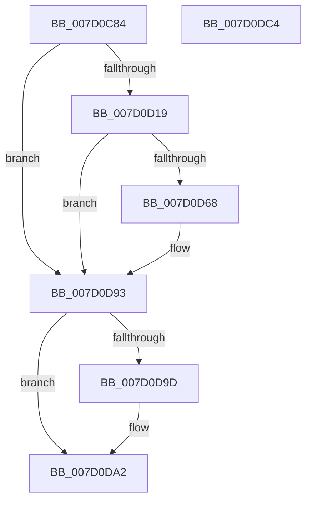

# ExpUuidSaveSequenceNumber

- RVA: `0x007D0C84`–`0x007D0DC5` (길이 `321` bytes)
- VA: `0x00000001407D0C84`
- 실행 섹션: `PAGE`
- PDB 이름 있음: `예`; PDB Function 태그: `아니요`
- unwind 정보 RVA: `0x000D5684`
- 디코드: `73`개 명령, `321/321` bytes 표시
- 미해석 바이트: `0` (있으면 어셈블리에 `.byte`로 보존)

> 이 문서는 커널 이미지의 기계어와 PDB 기호를 분석해 생성했습니다. 4번과 5번은 함수 원형과 자료형을 바이너리 사용 방식에서 추정한 C 해석이며 원본 소스 복구 결과는 아닙니다.

## 1. Dependencies

- 직접 호출 지점: **7**; 고유 호출 대상: **7**
- 직접 호출자로 확인된 함수: **1**
- RIP 상대 이미지 참조: **5**

### Outgoing calls
- `0x007D0CE3` → [memset](../../text/6C/memset_function_006C6C40.md) (function, `0x006C6C40`)
- `0x007D0D0E` → [RtlGetPersistedStateLocation](../8C/RtlGetPersistedStateLocation_function_008C8DE0.md) (function, `0x008C8DE0`)
- `0x007D0D21` → [RtlInitUnicodeString](../../text/42/RtlInitUnicodeString_function_0042A780.md) (function, `0x0042A780`)
- `0x007D0D5D` → [ZwOpenKey](../../text/6A/ZwOpenKey_function_006AD310.md) (function, `0x006AD310`)
- `0x007D0D8C` → [ZwSetValueKey](../../text/6A/ZwSetValueKey_function_006ADCD0.md) (function, `0x006ADCD0`)
- `0x007D0D9D` → [ZwClose](../../text/6A/ZwClose_function_006AD2B0.md) (function, `0x006AD2B0`)
- `0x007D0DAE` → [_security_check_cookie](../../text/6A/_security_check_cookie_function_006AC640.md) (function, `0x006AC640`)

### Direct callers
- [ExpUuidSaveSequenceNumberIf](../A9/ExpUuidSaveSequenceNumberIf_function_00A9672C.md) at `0x00A96741`

### Static image references
- `0x007D0C99` → RVA `0x00E0A740` (`.data`; read)
- `0x007D0CAA` → RVA `0x00FD8078` (`PAGEDATA`; read)
- `0x007D0CF6` → RVA `0x00B08A90` (` ?? ::NNGAKEGL::`string'`; read)
- `0x007D0D07` → RVA `0x00B08A70` (` ?? ::NNGAKEGL::`string'`; read)
- `0x007D0D78` → RVA `0x0000BDB0` (`.rdata`; read)

## 2. Other-region calls and transfers

- 다른 실행 섹션으로 향하는 call: **6**
  - `0x007D0CE3` → [memset](../../text/6C/memset_function_006C6C40.md) (`PAGE` → `.text`)
  - `0x007D0D21` → [RtlInitUnicodeString](../../text/42/RtlInitUnicodeString_function_0042A780.md) (`PAGE` → `.text`)
  - `0x007D0D5D` → [ZwOpenKey](../../text/6A/ZwOpenKey_function_006AD310.md) (`PAGE` → `.text`)
  - `0x007D0D8C` → [ZwSetValueKey](../../text/6A/ZwSetValueKey_function_006ADCD0.md) (`PAGE` → `.text`)
  - `0x007D0D9D` → [ZwClose](../../text/6A/ZwClose_function_006AD2B0.md) (`PAGE` → `.text`)
  - `0x007D0DAE` → [_security_check_cookie](../../text/6A/_security_check_cookie_function_006AC640.md) (`PAGE` → `.text`)
- 별도 외부 분기/꼬리 이동을 확인하지 못했습니다.

## 3. Assembly (complete function range)

```asm
007D0C84  48 89 5C 24 08                  mov qword ptr [rsp + 8], rbx
007D0C89  55                              push rbp
007D0C8A  48 8D AC 24 60 FE FF FF         lea rbp, [rsp - 0x1a0]
007D0C92  48 81 EC A0 02 00 00            sub rsp, 0x2a0
007D0C99  48 8B 05 A0 9A 63 00            mov rax, qword ptr [rip + 0x639aa0]
007D0CA0  48 33 C4                        xor rax, rsp
007D0CA3  48 89 85 90 01 00 00            mov qword ptr [rbp + 0x190], rax
007D0CAA  8B 05 C8 73 80 00               mov eax, dword ptr [rip + 0x8073c8]
007D0CB0  48 8D 4D 90                     lea rcx, [rbp - 0x70]
007D0CB4  0F 57 C0                        xorps xmm0, xmm0
007D0CB7  89 44 24 40                     mov dword ptr [rsp + 0x40], eax
007D0CBB  33 C0                           xor eax, eax
007D0CBD  BB FE 01 00 00                  mov ebx, 0x1fe
007D0CC2  48 21 44 24 48                  and qword ptr [rsp + 0x48], rax
007D0CC7  44 8B C3                        mov r8d, ebx
007D0CCA  33 D2                           xor edx, edx
007D0CCC  48 89 44 24 70                  mov qword ptr [rsp + 0x70], rax
007D0CD1  89 44 24 78                     mov dword ptr [rsp + 0x78], eax
007D0CD5  0F 11 44 24 50                  movups xmmword ptr [rsp + 0x50], xmm0
007D0CDA  0F 11 44 24 60                  movups xmmword ptr [rsp + 0x60], xmm0
007D0CDF  0F 11 45 80                     movups xmmword ptr [rbp - 0x80], xmm0
007D0CE3  E8 58 5F EF FF                  call 0x1406c6c40
007D0CE8  48 83 64 24 30 00               and qword ptr [rsp + 0x30], 0
007D0CEE  48 8D 45 90                     lea rax, [rbp - 0x70]
007D0CF2  89 5C 24 28                     mov dword ptr [rsp + 0x28], ebx
007D0CF6  4C 8D 05 93 7D 33 00            lea r8, [rip + 0x337d93]
007D0CFD  45 33 C9                        xor r9d, r9d
007D0D00  48 89 44 24 20                  mov qword ptr [rsp + 0x20], rax
007D0D05  33 D2                           xor edx, edx
007D0D07  48 8D 0D 62 7D 33 00            lea rcx, [rip + 0x337d62]
007D0D0E  E8 CD 80 0F 00                  call 0x1408c8de0
007D0D13  8B D8                           mov ebx, eax
007D0D15  85 C0                           test eax, eax
007D0D17  78 7A                           js 0x1407d0d93
007D0D19  48 8D 55 90                     lea rdx, [rbp - 0x70]
007D0D1D  48 8D 4D 80                     lea rcx, [rbp - 0x80]
007D0D21  E8 5A 9A C5 FF                  call 0x14042a780
007D0D26  48 83 64 24 58 00               and qword ptr [rsp + 0x58], 0
007D0D2C  48 8D 45 80                     lea rax, [rbp - 0x80]
007D0D30  0F 57 C0                        xorps xmm0, xmm0
007D0D33  48 89 44 24 60                  mov qword ptr [rsp + 0x60], rax
007D0D38  4C 8D 44 24 50                  lea r8, [rsp + 0x50]
007D0D3D  C7 44 24 50 30 00 00 00         mov dword ptr [rsp + 0x50], 0x30
007D0D45  BA 00 00 00 C0                  mov edx, 0xc0000000
007D0D4A  C7 44 24 68 40 02 00 00         mov dword ptr [rsp + 0x68], 0x240
007D0D52  48 8D 4C 24 48                  lea rcx, [rsp + 0x48]
007D0D57  F3 0F 7F 44 24 70               movdqu xmmword ptr [rsp + 0x70], xmm0
007D0D5D  E8 AE C5 ED FF                  call 0x1406ad310
007D0D62  8B D8                           mov ebx, eax
007D0D64  85 C0                           test eax, eax
007D0D66  78 2B                           js 0x1407d0d93
007D0D68  48 8B 4C 24 48                  mov rcx, qword ptr [rsp + 0x48]
007D0D6D  48 8D 44 24 40                  lea rax, [rsp + 0x40]
007D0D72  41 B9 04 00 00 00               mov r9d, 4
007D0D78  48 8D 15 31 B0 83 FF            lea rdx, [rip - 0x7c4fcf]
007D0D7F  44 89 4C 24 28                  mov dword ptr [rsp + 0x28], r9d
007D0D84  45 33 C0                        xor r8d, r8d
007D0D87  48 89 44 24 20                  mov qword ptr [rsp + 0x20], rax
007D0D8C  E8 3F CF ED FF                  call 0x1406adcd0
007D0D91  8B D8                           mov ebx, eax
007D0D93  48 8B 4C 24 48                  mov rcx, qword ptr [rsp + 0x48]
007D0D98  48 85 C9                        test rcx, rcx
007D0D9B  74 05                           je 0x1407d0da2
007D0D9D  E8 0E C5 ED FF                  call 0x1406ad2b0
007D0DA2  8B C3                           mov eax, ebx
007D0DA4  48 8B 8D 90 01 00 00            mov rcx, qword ptr [rbp + 0x190]
007D0DAB  48 33 CC                        xor rcx, rsp
007D0DAE  E8 8D B8 ED FF                  call 0x1406ac640
007D0DB3  48 8B 9C 24 B0 02 00 00         mov rbx, qword ptr [rsp + 0x2b0]
007D0DBB  48 81 C4 A0 02 00 00            add rsp, 0x2a0
007D0DC2  5D                              pop rbp
007D0DC3  C3                              ret
007D0DC4  CC                              int3
```

## 4. C-style interpretation (structured pseudocode)

```c
__int64 __fastcall ExpUuidSaveSequenceNumber(__int64 a1, int a2, __int64 a3, int a4)
{
    __int64 result;
    __int64 v_rbx;
    __int64 v_rsp;
    unsigned __int64 v_stack_m18;
    unsigned __int64 v_stack_m1A8;
    unsigned __int64 v_stack_m218;
    unsigned __int64 v_stack_m228;
    unsigned int v_stack_m230;
    unsigned __int64 v_stack_m238;
    unsigned int v_stack_m240;
    unsigned __int64 v_stack_m248;
    unsigned __int64 v_stack_m250;
    unsigned __int64 v_stack_m258;
    unsigned __int64 v_stack_m260;
    unsigned int v_stack_m268;
    unsigned __int64 v_stack_m278;
    unsigned int v_stack_m280;
    unsigned __int64 v_stack_m288;
    unsigned __int64 v_stack_p8;

    v_stack_p8 = v_rbx;
    v_rsp = (v_rsp) - (672);
    result = (*(unsigned __int64 *)(v_rip + 6527648)) ^ (v_rsp);
    v_stack_m18 = result;
    v_stack_m268 = (unsigned int)((unsigned int)(*(unsigned int *)(v_rip + 8418248)));
    result = 0;
    a2 = 0;
    v_stack_m238 = 0;
    v_stack_m230 = 0;
    v_stack_m258 = v_xmm0;
    v_stack_m248 = v_xmm0;
    v_stack_m228 = v_xmm0;
    result = memset(v_stack_m218, a2, 510, a4);
    v_stack_m280 = 510;
    a4 = 0;
    v_stack_m288 = v_stack_m218;
    a2 = 0;
    result = RtlGetPersistedStateLocation(v_rip + 3374434, a2, v_rip + 3374483, a4);
    if (sign_flag) goto loc_007D0D93;
    result = RtlInitUnicodeString(v_stack_m228, v_stack_m218, v_rip + 3374483, a4);
    v_stack_m248 = v_stack_m228;
    v_stack_m258 = 48;
    v_stack_m240 = 576;
    v_stack_m238 = v_xmm0;
    result = ZwOpenKey(v_stack_m260, (unsigned int)(0xC0000000ULL), v_stack_m258, a4);
    v_rbx = (unsigned int)((unsigned int)(result));
    if (!(sign_flag)) {
        a1 = v_stack_m260;
        result = v_stack_m268;
        a4 = 4;
        a2 = v_rip - 8146895;
        v_stack_m280 = a4;
        a3 = 0;
        v_stack_m288 = result;
        result = ZwSetValueKey(a1, a2, a3, a4);
        v_rbx = (unsigned int)(result);
    }
    if (v_stack_m260 != 0) {
        result = ZwClose(v_stack_m260, a2, a3, a4);
    }
    a1 = (v_stack_m18) ^ (v_rsp);
    result = _security_check_cookie(a1, a2, a3, a4);
    v_rsp = (v_rsp) + (672);
    return result;
}
```

## 5. (Beta) C Style

```c
int64_t ExpUuidSaveSequenceNumber(int64_t Arg1, int32_t Arg2, int64_t Arg3, int32_t Arg4)
{
    int64_t result;
    int64_t local_rbx;
    int64_t local_rsp;
    uint64_t v_stack_m18;
    uint64_t v_stack_m1A8;
    uint64_t v_stack_m218;
    uint64_t v_stack_m228;
    uint32_t v_stack_m230;
    uint64_t v_stack_m238;
    uint32_t v_stack_m240;
    uint64_t v_stack_m248;
    uint64_t v_stack_m250;
    uint64_t v_stack_m258;
    uint64_t v_stack_m260;
    uint32_t v_stack_m268;
    uint64_t v_stack_m278;
    uint32_t v_stack_m280;
    uint64_t v_stack_m288;
    uint64_t v_stack_p8;

    v_stack_p8 = local_rbx;
    local_rsp = (local_rsp) - (672);
    result = (*(uint64_t *)(v_rip + 0x639AA0)) ^ (local_rsp);
    v_stack_m18 = result;
    v_stack_m268 = (uint32_t)((uint32_t)(*(uint32_t *)(v_rip + 0x8073C8)));
    result = 0;
    Arg2 = 0;
    v_stack_m238 = 0;
    v_stack_m230 = 0;
    v_stack_m258 = v_xmm0;
    v_stack_m248 = v_xmm0;
    v_stack_m228 = v_xmm0;
    result = memset(v_stack_m218, Arg2, 510, Arg4);
    v_stack_m280 = 510;
    Arg4 = 0;
    v_stack_m288 = v_stack_m218;
    Arg2 = 0;
    result = RtlGetPersistedStateLocation(v_rip + 3374434, Arg2, v_rip + 3374483, Arg4);
    if (sign_flag) goto loc_007D0D93;
    result = RtlInitUnicodeString(v_stack_m228, v_stack_m218, v_rip + 3374483, Arg4);
    v_stack_m248 = v_stack_m228;
    v_stack_m258 = 48;
    v_stack_m240 = 576;
    v_stack_m238 = v_xmm0;
    result = ZwOpenKey(v_stack_m260, (uint32_t)(0xC0000000ULL), v_stack_m258, Arg4);
    local_rbx = (uint32_t)((uint32_t)(result));
    if (!(sign_flag)) {
        Arg1 = v_stack_m260;
        result = v_stack_m268;
        Arg4 = 4;
        Arg2 = v_rip - 8146895;
        v_stack_m280 = Arg4;
        Arg3 = 0;
        v_stack_m288 = result;
        result = ZwSetValueKey(Arg1, Arg2, Arg3, Arg4);
        local_rbx = (uint32_t)(result);
    }
    if (v_stack_m260 != 0) {
        result = ZwClose(v_stack_m260, Arg2, Arg3, Arg4);
    }
    Arg1 = (v_stack_m18) ^ (local_rsp);
    result = _security_check_cookie(Arg1, Arg2, Arg3, Arg4);
    local_rsp = (local_rsp) + (672);
    return result;
}
```

## 6. Execution-region graph

[열기: 2D/3D 그래프와 함수 탐색 컨트롤 패널](../../../control-panel.html?section=page&rva=0x007D0C84&view=graph)

- 2D 그래프는 위에서 아래로 흐르고, 3D 그래프는 빈 공간을 드래그해 회전합니다. Shift+드래그는 이동, 휠은 확대·축소, 함수 노드 선택은 대상 보고서 이동입니다.

### Static fallback


