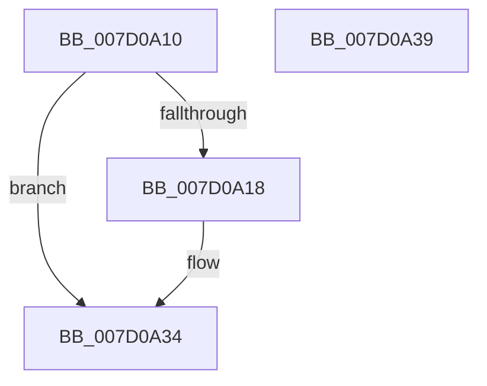

# ExpVerifyCallbackResult

- RVA: `0x007D0A10`–`0x007D0A3A` (길이 `42` bytes)
- VA: `0x00000001407D0A10`
- 실행 섹션: `PAGE`
- PDB 이름 있음: `예`; PDB Function 태그: `아니요`
- unwind 정보 RVA: `0x0005D2F4`
- 디코드: `13`개 명령, `42/42` bytes 표시
- 미해석 바이트: `0` (있으면 어셈블리에 `.byte`로 보존)

> 이 문서는 커널 이미지의 기계어와 PDB 기호를 분석해 생성했습니다. 4번과 5번은 함수 원형과 자료형을 바이너리 사용 방식에서 추정한 C 해석이며 원본 소스 복구 결과는 아닙니다.

## 1. Dependencies

- 직접 호출 지점: **1**; 고유 호출 대상: **1**
- 직접 호출자로 확인된 함수: **2**
- RIP 상대 이미지 참조: **0**

### Outgoing calls
- `0x007D0A2E` → [KeBugCheckEx](../../text/4F/KeBugCheckEx_function_004FD660.md) (function, `0x004FD660`)

### Direct callers
- [ExRegisterExtension](ExRegisterExtension_function_007D0420.md) at `0x007D062E`
- [ExUnregisterExtension](ExUnregisterExtension_function_007D0870.md) at `0x007D0908`
- [ExUnregisterExtension](ExUnregisterExtension_function_007D0870.md) at `0x007D0942`

### Static image references
- 디코드된 RIP-relative 메모리 참조가 없습니다.

## 2. Other-region calls and transfers

- 다른 실행 섹션으로 향하는 call: **1**
  - `0x007D0A2E` → [KeBugCheckEx](../../text/4F/KeBugCheckEx_function_004FD660.md) (`PAGE` → `.text`)
- 별도 외부 분기/꼬리 이동을 확인하지 못했습니다.

## 3. Assembly (complete function range)

```asm
007D0A10  48 83 EC 38                     sub rsp, 0x38
007D0A14  85 D2                           test edx, edx
007D0A16  79 1C                           jns 0x1407d0a34
007D0A18  48 83 64 24 20 00               and qword ptr [rsp + 0x20], 0
007D0A1E  4C 63 CA                        movsxd r9, edx
007D0A21  BA 01 00 00 00                  mov edx, 1
007D0A26  4C 63 C1                        movsxd r8, ecx
007D0A29  B9 03 02 00 00                  mov ecx, 0x203
007D0A2E  E8 2D CC D2 FF                  call 0x1404fd660
007D0A33  CC                              int3
007D0A34  48 83 C4 38                     add rsp, 0x38
007D0A38  C3                              ret
007D0A39  CC                              int3
```

## 4. C-style interpretation (structured pseudocode)

```c
__int64 __fastcall ExpVerifyCallbackResult(int a1, int a2)
{
    __int64 result;
    __int64 v_rsp;
    unsigned __int64 v_stack_m18;

    v_rsp = (v_rsp) - (56);
    if (sign_flag) {
        a4 = (int)(a2);
        a2 = 1;
        a3 = (int)(a1);
        a1 = 515;
        result = KeBugCheckEx(a1, a2, a3, a4);
    }
    v_rsp = (v_rsp) + (56);
    return result;
}
```

## 5. (Beta) C Style

```c
int64_t ExpVerifyCallbackResult(int32_t Arg1, int32_t Arg2)
{
    int64_t result;
    int64_t local_rsp;
    uint64_t v_stack_m18;

    local_rsp = (local_rsp) - (56);
    if (sign_flag) {
        a4 = (int32_t)(Arg2);
        Arg2 = 1;
        a3 = (int32_t)(Arg1);
        Arg1 = 515;
        result = KeBugCheckEx(Arg1, Arg2, a3, a4);
    }
    local_rsp = (local_rsp) + (56);
    return result;
}
```

## 6. Execution-region graph

[열기: 2D/3D 그래프와 함수 탐색 컨트롤 패널](../../../control-panel.html?section=page&rva=0x007D0A10&view=graph)

- 2D 그래프는 위에서 아래로 흐르고, 3D 그래프는 빈 공간을 드래그해 회전합니다. Shift+드래그는 이동, 휠은 확대·축소, 함수 노드 선택은 대상 보고서 이동입니다.

### Static fallback


