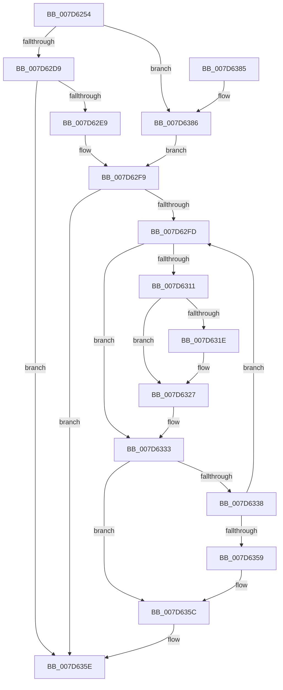

# ExpWnfDeletePermanentStateData

- RVA: `0x007D6254`–`0x007D6397` (길이 `323` bytes)
- VA: `0x00000001407D6254`
- 실행 섹션: `PAGE`
- PDB 이름 있음: `예`; PDB Function 태그: `아니요`
- unwind 정보 RVA: `0x000D5D88`
- 디코드: `96`개 명령, `323/323` bytes 표시
- 미해석 바이트: `0` (있으면 어셈블리에 `.byte`로 보존)

> 이 문서는 커널 이미지의 기계어와 PDB 기호를 분석해 생성했습니다. 4번과 5번은 함수 원형과 자료형을 바이너리 사용 방식에서 추정한 C 해석이며 원본 소스 복구 결과는 아닙니다.

## 1. Dependencies

- 직접 호출 지점: **10**; 고유 호출 대상: **9**
- 직접 호출자로 확인된 함수: **2**
- RIP 상대 이미지 참조: **1**

### Outgoing calls
- `0x007D62BF` → [ExpWnfComposeValueName](../8B/ExpWnfComposeValueName_function_008BDBCC.md) (function, `0x008BDBCC`)
- `0x007D62E0` → [ExpWnfGetPermanentDataStore](../AA/ExpWnfGetPermanentDataStore_function_00AA39F0.md) (function, `0x00AA39F0`)
- `0x007D62F4` → [ExpWnfAcquirePermanentDataStoreHandle](../A7/ExpWnfAcquirePermanentDataStoreHandle_function_00A7A210.md) (function, `0x00A7A210`)
- `0x007D6305` → [ZwDeleteValueKey](../../text/6A/ZwDeleteValueKey_function_006AECB0.md) (function, `0x006AECB0`)
- `0x007D6322` → [ExfReleasePushLockShared](../../text/26/ExfReleasePushLockShared_function_00263440.md) (function, `0x00263440`)
- `0x007D632B` → [KeAbPostRelease](../../text/2E/KeAbPostRelease_function_002E1600.md) (function, `0x002E1600`)
- `0x007D633C` → [ZwClose](../../text/6A/ZwClose_function_006AD2B0.md) (function, `0x006AD2B0`)
- `0x007D6350` → [ExpWnfEnumeratePermanentDataStoreHandles](ExpWnfEnumeratePermanentDataStoreHandles_function_007D65AC.md) (function, `0x007D65AC`)
- `0x007D6365` → [_security_check_cookie](../../text/6A/_security_check_cookie_function_006AC640.md) (function, `0x006AC640`)
- `0x007D638D` → [ExpWnfEnumeratePermanentDataStoreHandles](ExpWnfEnumeratePermanentDataStoreHandles_function_007D65AC.md) (function, `0x007D65AC`)

### Direct callers
- [ExpNtDeleteWnfStateData](../7C/ExpNtDeleteWnfStateData_function_007CF1A8.md) at `0x007CF408`
- [ExpNtDeleteWnfStateData](../7C/ExpNtDeleteWnfStateData_function_007CF1A8.md) at `0x007CF47E`
- [NtDeleteWnfStateName](../90/NtDeleteWnfStateName_function_00908E60.md) at `0x00909291`

### Static image references
- `0x007D626E` → RVA `0x00E0A740` (`.data`; read)

## 2. Other-region calls and transfers

- 다른 실행 섹션으로 향하는 call: **5**
  - `0x007D6305` → [ZwDeleteValueKey](../../text/6A/ZwDeleteValueKey_function_006AECB0.md) (`PAGE` → `.text`)
  - `0x007D6322` → [ExfReleasePushLockShared](../../text/26/ExfReleasePushLockShared_function_00263440.md) (`PAGE` → `.text`)
  - `0x007D632B` → [KeAbPostRelease](../../text/2E/KeAbPostRelease_function_002E1600.md) (`PAGE` → `.text`)
  - `0x007D633C` → [ZwClose](../../text/6A/ZwClose_function_006AD2B0.md) (`PAGE` → `.text`)
  - `0x007D6365` → [_security_check_cookie](../../text/6A/_security_check_cookie_function_006AC640.md) (`PAGE` → `.text`)
- 별도 외부 분기/꼬리 이동을 확인하지 못했습니다.

## 3. Assembly (complete function range)

```asm
007D6254  48 89 5C 24 18                  mov qword ptr [rsp + 0x18], rbx
007D6259  55                              push rbp
007D625A  56                              push rsi
007D625B  57                              push rdi
007D625C  41 54                           push r12
007D625E  41 55                           push r13
007D6260  41 56                           push r14
007D6262  41 57                           push r15
007D6264  48 8B EC                        mov rbp, rsp
007D6267  48 81 EC 80 00 00 00            sub rsp, 0x80
007D626E  48 8B 05 CB 44 63 00            mov rax, qword ptr [rip + 0x6344cb]
007D6275  48 33 C4                        xor rax, rsp
007D6278  48 89 45 F0                     mov qword ptr [rbp - 0x10], rax
007D627C  4C 8B F9                        mov r15, rcx
007D627F  45 33 ED                        xor r13d, r13d
007D6282  48 8B F2                        mov rsi, rdx
007D6285  4C 89 6D A8                     mov qword ptr [rbp - 0x58], r13
007D6289  4C 8B F2                        mov r14, rdx
007D628C  48 C1 EE 04                     shr rsi, 4
007D6290  48 8B C2                        mov rax, rdx
007D6293  49 C1 EE 06                     shr r14, 6
007D6297  0F 57 C0                        xorps xmm0, xmm0
007D629A  41 8D 4D 22                     lea ecx, [r13 + 0x22]
007D629E  0F 11 45 B0                     movups xmmword ptr [rbp - 0x50], xmm0
007D62A2  66 89 4D B2                     mov word ptr [rbp - 0x4e], cx
007D62A6  48 8D 55 B0                     lea rdx, [rbp - 0x50]
007D62AA  48 8D 4D C8                     lea rcx, [rbp - 0x38]
007D62AE  41 8B DD                        mov ebx, r13d
007D62B1  48 89 4D B8                     mov qword ptr [rbp - 0x48], rcx
007D62B5  83 E6 03                        and esi, 3
007D62B8  48 8B C8                        mov rcx, rax
007D62BB  41 83 E6 0F                     and r14d, 0xf
007D62BF  E8 08 79 0E 00                  call 0x1408bdbcc
007D62C4  45 33 C0                        xor r8d, r8d
007D62C7  4C 89 6D A0                     mov qword ptr [rbp - 0x60], r13
007D62CB  45 8B E5                        mov r12d, r13d
007D62CE  8B D6                           mov edx, esi
007D62D0  4D 85 FF                        test r15, r15
007D62D3  0F 84 AD 00 00 00               je 0x1407d6386
007D62D9  4C 8D 4D A8                     lea r9, [rbp - 0x58]
007D62DD  49 8B CF                        mov rcx, r15
007D62E0  E8 0B D7 2C 00                  call 0x140aa39f0
007D62E5  85 C0                           test eax, eax
007D62E7  78 75                           js 0x1407d635e
007D62E9  48 8B 5D A8                     mov rbx, qword ptr [rbp - 0x58]
007D62ED  48 8D 55 A0                     lea rdx, [rbp - 0x60]
007D62F1  48 8B CB                        mov rcx, rbx
007D62F4  E8 17 3F 2A 00                  call 0x140a7a210
007D62F9  85 C0                           test eax, eax
007D62FB  78 61                           js 0x1407d635e
007D62FD  48 8B 4D A0                     mov rcx, qword ptr [rbp - 0x60]
007D6301  48 8D 55 B0                     lea rdx, [rbp - 0x50]
007D6305  E8 A6 89 ED FF                  call 0x1406aecb0
007D630A  8B F8                           mov edi, eax
007D630C  48 85 DB                        test rbx, rbx
007D630F  74 22                           je 0x1407d6333
007D6311  B8 11 00 00 00                  mov eax, 0x11
007D6316  F0 4C 0F B1 6B 08               lock cmpxchg qword ptr [rbx + 8], r13
007D631C  74 09                           je 0x1407d6327
007D631E  48 8D 4B 08                     lea rcx, [rbx + 8]
007D6322  E8 19 D1 A8 FF                  call 0x140263440
007D6327  48 8D 4B 08                     lea rcx, [rbx + 8]
007D632B  E8 D0 B2 B0 FF                  call 0x1402e1600
007D6330  49 8B DD                        mov rbx, r13
007D6333  4D 85 FF                        test r15, r15
007D6336  75 24                           jne 0x1407d635c
007D6338  48 8B 4D A0                     mov rcx, qword ptr [rbp - 0x60]
007D633C  E8 6F 6F ED FF                  call 0x1406ad2b0
007D6341  41 FF C4                        inc r12d
007D6344  4C 8D 4D A0                     lea r9, [rbp - 0x60]
007D6348  45 8B C4                        mov r8d, r12d
007D634B  8B D6                           mov edx, esi
007D634D  41 8B CE                        mov ecx, r14d
007D6350  E8 57 02 00 00                  call 0x1407d65ac
007D6355  85 C0                           test eax, eax
007D6357  79 A4                           jns 0x1407d62fd
007D6359  41 8B FD                        mov edi, r13d
007D635C  8B C7                           mov eax, edi
007D635E  48 8B 4D F0                     mov rcx, qword ptr [rbp - 0x10]
007D6362  48 33 CC                        xor rcx, rsp
007D6365  E8 D6 62 ED FF                  call 0x1406ac640
007D636A  48 8B 9C 24 D0 00 00 00         mov rbx, qword ptr [rsp + 0xd0]
007D6372  48 81 C4 80 00 00 00            add rsp, 0x80
007D6379  41 5F                           pop r15
007D637B  41 5E                           pop r14
007D637D  41 5D                           pop r13
007D637F  41 5C                           pop r12
007D6381  5F                              pop rdi
007D6382  5E                              pop rsi
007D6383  5D                              pop rbp
007D6384  C3                              ret
007D6385  CC                              int3
007D6386  4C 8D 4D A0                     lea r9, [rbp - 0x60]
007D638A  41 8B CE                        mov ecx, r14d
007D638D  E8 1A 02 00 00                  call 0x1407d65ac
007D6392  E9 62 FF FF FF                  jmp 0x1407d62f9
```

## 4. C-style interpretation (structured pseudocode)

```c
__int64 __fastcall ExpWnfDeletePermanentStateData(__int64 a1, __int64 a2, int a3)
{
    __int64 result;
    __int64 v_r12;
    __int64 v_r13;
    __int64 v_r14;
    __int64 v_rsi;
    __int64 v_rsp;
    unsigned __int64 v_stack_m48;
    unsigned __int64 v_stack_m70;
    unsigned __int64 v_stack_m80;
    unsigned __int16 v_stack_m86;
    unsigned __int64 v_stack_m88;
    unsigned __int64 v_stack_m90;
    unsigned __int64 v_stack_m98;
    unsigned __int64 v_stack_p18;

    v_stack_p18 = v_rbx;
    v_rsp = (v_rsp) - (128);
    result = (*(unsigned __int64 *)(v_rip + 6505675)) ^ (v_rsp);
    v_stack_m48 = result;
    v_r13 = 0;
    v_stack_m90 = 0;
    v_rsi = (a2) >> (4);
    v_r14 = (a2) >> (6);
    v_stack_m88 = v_xmm0;
    v_stack_m86 = (unsigned __int16)(v_r13 + 34);
    v_stack_m80 = v_stack_m70;
    v_rsi = (unsigned int)((v_rsi) & (3));
    v_r14 = (unsigned int)((v_r14) & (15));
    result = ExpWnfComposeValueName(a2, v_stack_m88, a3, a4);
    a3 = 0;
    v_stack_m98 = 0;
    if (a1 == 0) goto loc_007D6386;
    result = ExpWnfGetPermanentDataStore(a1, (unsigned int)((unsigned int)(v_rsi)), a3, v_stack_m90);
    if (sign_flag) goto loc_007D635E;
    result = ExpWnfAcquirePermanentDataStoreHandle(v_stack_m90, v_stack_m98, a3, v_stack_m90);
loc_007D62F9:
    if (sign_flag) goto loc_007D635E;
loc_007D62FD:
    result = ZwDeleteValueKey(v_stack_m98, v_stack_m88, a3, v_stack_m90);
    if (v_stack_m90 == 0) goto loc_007D6333;
    result = 17;
    if (v_stack_m90 != 0) {
        a1 = v_stack_m90 + 8;
        result = ExfReleasePushLockShared(a1, v_stack_m88, a3, v_stack_m90);
    }
    result = KeAbPostRelease(v_stack_m90 + 8, v_stack_m88, a3, v_stack_m90);
loc_007D6333:
    if (a1 != 0) goto loc_007D635C;
    result = ZwClose(v_stack_m98, v_stack_m88, a3, v_stack_m90);
    v_r12 = (unsigned int)((0) + 1);
    result = ExpWnfEnumeratePermanentDataStoreHandles((unsigned int)((unsigned int)(v_r14)), (unsigned int)((unsigned int)(v_rsi)), (unsigned int)((unsigned int)(v_r12)), v_stack_m98);
    if (!sign_flag) goto loc_007D62FD;
loc_007D635C:
loc_007D635E:
    a1 = (v_stack_m48) ^ (v_rsp);
    result = _security_check_cookie(a1, (unsigned int)((unsigned int)(v_rsi)), (unsigned int)((unsigned int)(v_r12)), v_stack_m98);
    v_rsp = (v_rsp) + (128);
    return result;
loc_007D6386:
    result = ExpWnfEnumeratePermanentDataStoreHandles((unsigned int)((unsigned int)(v_r14)), (unsigned int)((unsigned int)(v_rsi)), (unsigned int)((unsigned int)(v_r12)), v_stack_m98);
    goto loc_007D62F9;
}
```

## 5. (Beta) C Style

```c
int64_t ExpWnfDeletePermanentStateData(int64_t Arg1, int64_t Arg2, int32_t Arg3)
{
    int64_t result;
    int64_t local_r12;
    int64_t local_r13;
    int64_t local_r14;
    int64_t local_rsi;
    int64_t local_rsp;
    uint64_t v_stack_m48;
    uint64_t v_stack_m70;
    uint64_t v_stack_m80;
    uint16_t v_stack_m86;
    uint64_t v_stack_m88;
    uint64_t v_stack_m90;
    uint64_t v_stack_m98;
    uint64_t v_stack_p18;

    v_stack_p18 = local_rbx;
    local_rsp = (local_rsp) - (128);
    result = (*(uint64_t *)(v_rip + 0x6344CB)) ^ (local_rsp);
    v_stack_m48 = result;
    local_r13 = 0;
    v_stack_m90 = 0;
    local_rsi = (Arg2) >> (4);
    local_r14 = (Arg2) >> (6);
    v_stack_m88 = v_xmm0;
    v_stack_m86 = (uint16_t)(local_r13 + 34);
    v_stack_m80 = v_stack_m70;
    local_rsi = (uint32_t)((local_rsi) & (3));
    local_r14 = (uint32_t)((local_r14) & (15));
    result = ExpWnfComposeValueName(Arg2, v_stack_m88, Arg3, a4);
    Arg3 = 0;
    v_stack_m98 = 0;
    if (Arg1 == 0) goto loc_007D6386;
    result = ExpWnfGetPermanentDataStore(Arg1, (uint32_t)((uint32_t)(local_rsi)), Arg3, v_stack_m90);
    if (sign_flag) goto loc_007D635E;
    result = ExpWnfAcquirePermanentDataStoreHandle(v_stack_m90, v_stack_m98, Arg3, v_stack_m90);
loc_007D62F9:
    if (sign_flag) goto loc_007D635E;
loc_007D62FD:
    result = ZwDeleteValueKey(v_stack_m98, v_stack_m88, Arg3, v_stack_m90);
    if (v_stack_m90 == 0) goto loc_007D6333;
    result = 17;
    if (v_stack_m90 != 0) {
        Arg1 = v_stack_m90 + 8;
        result = ExfReleasePushLockShared(Arg1, v_stack_m88, Arg3, v_stack_m90);
    }
    result = KeAbPostRelease(v_stack_m90 + 8, v_stack_m88, Arg3, v_stack_m90);
loc_007D6333:
    if (Arg1 != 0) goto loc_007D635C;
    result = ZwClose(v_stack_m98, v_stack_m88, Arg3, v_stack_m90);
    local_r12 = (uint32_t)((0) + 1);
    result = ExpWnfEnumeratePermanentDataStoreHandles((uint32_t)((uint32_t)(local_r14)), (uint32_t)((uint32_t)(local_rsi)), (uint32_t)((uint32_t)(local_r12)), v_stack_m98);
    if (!sign_flag) goto loc_007D62FD;
loc_007D635C:
loc_007D635E:
    Arg1 = (v_stack_m48) ^ (local_rsp);
    result = _security_check_cookie(Arg1, (uint32_t)((uint32_t)(local_rsi)), (uint32_t)((uint32_t)(local_r12)), v_stack_m98);
    local_rsp = (local_rsp) + (128);
    return result;
loc_007D6386:
    result = ExpWnfEnumeratePermanentDataStoreHandles((uint32_t)((uint32_t)(local_r14)), (uint32_t)((uint32_t)(local_rsi)), (uint32_t)((uint32_t)(local_r12)), v_stack_m98);
    goto loc_007D62F9;
}
```

## 6. Execution-region graph

[열기: 2D/3D 그래프와 함수 탐색 컨트롤 패널](../../../control-panel.html?section=page&rva=0x007D6254&view=graph)

- 2D 그래프는 위에서 아래로 흐르고, 3D 그래프는 빈 공간을 드래그해 회전합니다. Shift+드래그는 이동, 휠은 확대·축소, 함수 노드 선택은 대상 보고서 이동입니다.

### Static fallback


