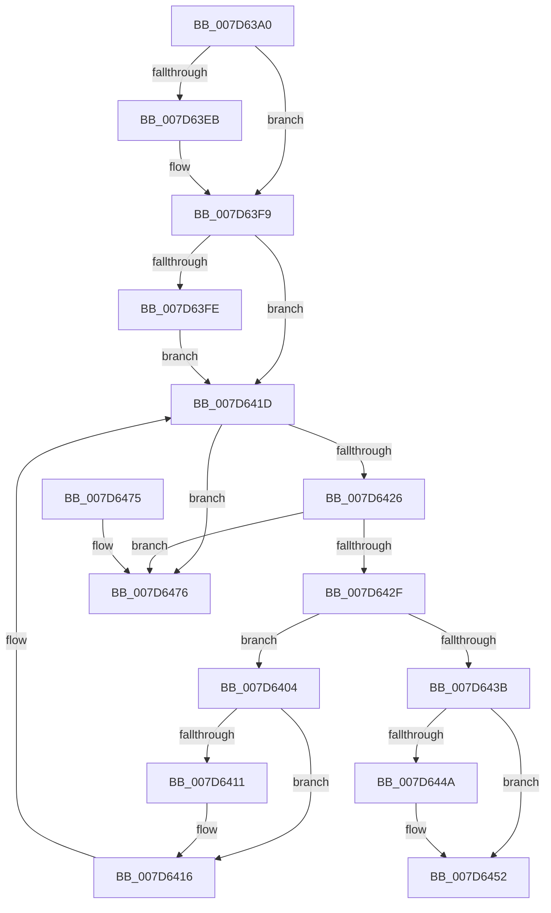

# ExpWnfDeleteScopeInstances

- RVA: `0x007D63A0`–`0x007D647D` (길이 `221` bytes)
- VA: `0x00000001407D63A0`
- 실행 섹션: `PAGE`
- PDB 이름 있음: `예`; PDB Function 태그: `아니요`
- unwind 정보 RVA: `0x0006B020`
- 디코드: `65`개 명령, `221/221` bytes 표시
- 미해석 바이트: `0` (있으면 어셈블리에 `.byte`로 보존)

> 이 문서는 커널 이미지의 기계어와 PDB 기호를 분석해 생성했습니다. 4번과 5번은 함수 원형과 자료형을 바이너리 사용 방식에서 추정한 C 해석이며 원본 소스 복구 결과는 아닙니다.

## 1. Dependencies

- 직접 호출 지점: **5**; 고유 호출 대상: **5**
- 직접 호출자로 확인된 함수: **1**
- RIP 상대 이미지 참조: **0**

### Outgoing calls
- `0x007D63DB` → [KeAbPreAcquire](../../text/21/KeAbPreAcquire_function_00210230.md) (function, `0x00210230`)
- `0x007D63F4` → [ExfAcquirePushLockExclusiveEx](../../text/20/ExfAcquirePushLockExclusiveEx_function_0020FC90.md) (function, `0x0020FC90`)
- `0x007D6418` → [ExpWnfFreeScopeInstance](../A7/ExpWnfFreeScopeInstance_function_00A77614.md) (function, `0x00A77614`)
- `0x007D644D` → [ExfTryToWakePushLock](../../text/26/ExfTryToWakePushLock_function_00265DD0.md) (function, `0x00265DD0`)
- `0x007D6455` → [KeAbPostRelease](../../text/2E/KeAbPostRelease_function_002E1600.md) (function, `0x002E1600`)

### Direct callers
- [PspDeleteServerSiloGlobals](../77/PspDeleteServerSiloGlobals_function_0077FC54.md) at `0x0077FCD2`
- [PspDeleteServerSiloGlobals](../77/PspDeleteServerSiloGlobals_function_0077FC54.md) at `0x0077FCE0`

### Static image references
- 디코드된 RIP-relative 메모리 참조가 없습니다.

## 2. Other-region calls and transfers

- 다른 실행 섹션으로 향하는 call: **4**
  - `0x007D63DB` → [KeAbPreAcquire](../../text/21/KeAbPreAcquire_function_00210230.md) (`PAGE` → `.text`)
  - `0x007D63F4` → [ExfAcquirePushLockExclusiveEx](../../text/20/ExfAcquirePushLockExclusiveEx_function_0020FC90.md) (`PAGE` → `.text`)
  - `0x007D644D` → [ExfTryToWakePushLock](../../text/26/ExfTryToWakePushLock_function_00265DD0.md) (`PAGE` → `.text`)
  - `0x007D6455` → [KeAbPostRelease](../../text/2E/KeAbPostRelease_function_002E1600.md) (`PAGE` → `.text`)
- 별도 외부 분기/꼬리 이동을 확인하지 못했습니다.

## 3. Assembly (complete function range)

```asm
007D63A0  48 8B C4                        mov rax, rsp
007D63A3  48 89 58 08                     mov qword ptr [rax + 8], rbx
007D63A7  48 89 68 10                     mov qword ptr [rax + 0x10], rbp
007D63AB  48 89 70 18                     mov qword ptr [rax + 0x18], rsi
007D63AF  48 89 78 20                     mov qword ptr [rax + 0x20], rdi
007D63B3  41 56                           push r14
007D63B5  48 83 EC 20                     sub rsp, 0x20
007D63B9  44 8B F2                        mov r14d, edx
007D63BC  48 8D 79 20                     lea rdi, [rcx + 0x20]
007D63C0  48 8D 59 28                     lea rbx, [rcx + 0x28]
007D63C4  48 8B E9                        mov rbp, rcx
007D63C7  33 D2                           xor edx, edx
007D63C9  4F 8D 04 76                     lea r8, [r14 + r14*2]
007D63CD  4A 8D 3C C7                     lea rdi, [rdi + r8*8]
007D63D1  4A 8D 1C C3                     lea rbx, [rbx + r8*8]
007D63D5  48 8B CF                        mov rcx, rdi
007D63D8  45 33 C0                        xor r8d, r8d
007D63DB  E8 50 9E A3 FF                  call 0x140210230
007D63E0  F0 48 0F BA 2F 00               lock bts qword ptr [rdi], 0
007D63E6  48 8B F0                        mov rsi, rax
007D63E9  73 0E                           jae 0x1407d63f9
007D63EB  4C 8B C7                        mov r8, rdi
007D63EE  48 8B D0                        mov rdx, rax
007D63F1  48 8B CF                        mov rcx, rdi
007D63F4  E8 97 98 A3 FF                  call 0x14020fc90
007D63F9  48 85 F6                        test rsi, rsi
007D63FC  74 1F                           je 0x1407d641d
007D63FE  C6 46 0A 01                     mov byte ptr [rsi + 0xa], 1
007D6402  EB 19                           jmp 0x1407d641d
007D6404  48 83 20 00                     and qword ptr [rax], 0
007D6408  48 8D 48 E0                     lea rcx, [rax - 0x20]
007D640C  45 85 F6                        test r14d, r14d
007D640F  75 05                           jne 0x1407d6416
007D6411  48 83 65 08 00                  and qword ptr [rbp + 8], 0
007D6416  B2 01                           mov dl, 1
007D6418  E8 F7 11 2A 00                  call 0x140a77614
007D641D  48 8B 03                        mov rax, qword ptr [rbx]
007D6420  48 39 58 08                     cmp qword ptr [rax + 8], rbx
007D6424  75 50                           jne 0x1407d6476
007D6426  48 8B 08                        mov rcx, qword ptr [rax]
007D6429  48 39 41 08                     cmp qword ptr [rcx + 8], rax
007D642D  75 47                           jne 0x1407d6476
007D642F  48 89 0B                        mov qword ptr [rbx], rcx
007D6432  48 89 59 08                     mov qword ptr [rcx + 8], rbx
007D6436  48 3B C3                        cmp rax, rbx
007D6439  75 C9                           jne 0x1407d6404
007D643B  48 83 C8 FF                     or rax, 0xffffffffffffffff
007D643F  F0 48 0F C1 07                  lock xadd qword ptr [rdi], rax
007D6444  24 06                           and al, 6
007D6446  3C 02                           cmp al, 2
007D6448  75 08                           jne 0x1407d6452
007D644A  48 8B CF                        mov rcx, rdi
007D644D  E8 7E F9 A8 FF                  call 0x140265dd0
007D6452  48 8B CF                        mov rcx, rdi
007D6455  E8 A6 B1 B0 FF                  call 0x1402e1600
007D645A  48 8B 5C 24 30                  mov rbx, qword ptr [rsp + 0x30]
007D645F  48 8B 6C 24 38                  mov rbp, qword ptr [rsp + 0x38]
007D6464  48 8B 74 24 40                  mov rsi, qword ptr [rsp + 0x40]
007D6469  48 8B 7C 24 48                  mov rdi, qword ptr [rsp + 0x48]
007D646E  48 83 C4 20                     add rsp, 0x20
007D6472  41 5E                           pop r14
007D6474  C3                              ret
007D6475  CC                              int3
007D6476  B9 03 00 00 00                  mov ecx, 3
007D647B  CD 29                           int 0x29
```

## 4. C-style interpretation (structured pseudocode)

```c
__int64 __fastcall ExpWnfDeleteScopeInstances(__int64 a1, int a2)
{
    __int64 result;
    __int64 v_rsp;
    unsigned __int64 v_stack_p10;
    unsigned __int64 v_stack_p18;
    unsigned __int64 v_stack_p20;
    unsigned __int64 v_stack_p8;

    *(unsigned __int64 *)(v_rsp + 8) = v_rbx;
    *(unsigned __int64 *)(v_rsp + 16) = v_rbp;
    *(unsigned __int64 *)(v_rsp + 24) = v_rsi;
    *(unsigned __int64 *)(v_rsp + 32) = v_rdi;
    v_rsp = (v_rsp) - (32);
    a2 = 0;
    a3 = 0;
    result = KeAbPreAcquire(a1 + 32 + (unsigned int)(a2) + (unsigned int)(a2) * 2 * 8, a2, a3, a4);
    if (!(condition_is_above_or_equal)) {
        a3 = a1 + 32 + (unsigned int)(a2) + (unsigned int)(a2) * 2 * 8;
        a2 = result;
        a1 = a1 + 32 + (unsigned int)(a2) + (unsigned int)(a2) * 2 * 8;
        result = ExfAcquirePushLockExclusiveEx(a1, a2, a3, a4);
    }
    if (result == 0) goto loc_007D641D;
    *(unsigned __int8 *)(result + 10) = 1;
    goto loc_007D641D;
loc_007D6404:
    if ((unsigned int)((unsigned int)(a2)) == 0) {
    }
    result = ExpWnfFreeScopeInstance(result - 32, 1, a3, a4);
loc_007D641D:
    if ((*(unsigned __int64 *)(*(unsigned __int64 *)(a1 + 40 + (unsigned int)(a2) + (unsigned int)(a2) * 2 * 8) + 8)) != (a1 + 40 + (unsigned int)(a2) + (unsigned int)(a2) * 2 * 8)) goto loc_007D6476;
    if ((*(unsigned __int64 *)(*(unsigned __int64 *)(*(unsigned __int64 *)(a1 + 40 + (unsigned int)(a2) + (unsigned int)(a2) * 2 * 8)) + 8)) != (*(unsigned __int64 *)(a1 + 40 + (unsigned int)(a2) + (unsigned int)(a2) * 2 * 8))) goto loc_007D6476;
    *(unsigned __int64 *)(a1 + 40 + (unsigned int)(a2) + (unsigned int)(a2) * 2 * 8) = *(unsigned __int64 *)(*(unsigned __int64 *)(a1 + 40 + (unsigned int)(a2) + (unsigned int)(a2) * 2 * 8));
    *(unsigned __int64 *)(*(unsigned __int64 *)(*(unsigned __int64 *)(a1 + 40 + (unsigned int)(a2) + (unsigned int)(a2) * 2 * 8)) + 8) = a1 + 40 + (unsigned int)(a2) + (unsigned int)(a2) * 2 * 8;
    if ((*(unsigned __int64 *)(a1 + 40 + (unsigned int)(a2) + (unsigned int)(a2) * 2 * 8)) != (a1 + 40 + (unsigned int)(a2) + (unsigned int)(a2) * 2 * 8)) goto loc_007D6404;
    result = (*(unsigned __int64 *)(a1 + 40 + (unsigned int)(a2) + (unsigned int)(a2) * 2 * 8)) | (-1);
    result = (unsigned __int8)((result) & (6));
    if (((unsigned __int8)(result)) == 2) {
        a1 = a1 + 32 + (unsigned int)(a2) + (unsigned int)(a2) * 2 * 8;
        result = ExfTryToWakePushLock(a1, 1, a3, a4);
    }
    result = KeAbPostRelease(a1 + 32 + (unsigned int)(a2) + (unsigned int)(a2) * 2 * 8, 1, a3, a4);
    v_rsp = (v_rsp) + (32);
    return result;
loc_007D6476:
    return result;
}
```

## 5. (Beta) C Style

```c
int64_t ExpWnfDeleteScopeInstances(void *Arg1, void *Arg2)
{
    uint8_t *arg1 = (uint8_t *)Arg1;
    uint8_t *arg2 = (uint8_t *)Arg2;

    int64_t result;
    int64_t local_rsp;
    uint64_t v_stack_p10;
    uint64_t v_stack_p18;
    uint64_t v_stack_p20;
    uint64_t v_stack_p8;

    *(uint64_t *)(local_rsp + 0x8) = local_rbx;
    *(uint64_t *)(local_rsp + 0x10) = local_rbp;
    *(uint64_t *)(local_rsp + 0x18) = local_rsi;
    *(uint64_t *)(local_rsp + 0x20) = local_rdi;
    local_rsp = (local_rsp) - (32);
    Arg2 = 0;
    a3 = 0;
    result = KeAbPreAcquire(Arg1 + 32 + (uint32_t)(Arg2) + (uint32_t)(Arg2) * 2 * 8, Arg2, a3, a4);
    if (!(condition_is_above_or_equal)) {
        a3 = Arg1 + 32 + (uint32_t)(Arg2) + (uint32_t)(Arg2) * 2 * 8;
        Arg2 = result;
        Arg1 = Arg1 + 32 + (uint32_t)(Arg2) + (uint32_t)(Arg2) * 2 * 8;
        result = ExfAcquirePushLockExclusiveEx(Arg1, Arg2, a3, a4);
    }
    if (result == 0) goto loc_007D641D;
    *(uint8_t *)(result + 0xA) = 1;
    goto loc_007D641D;
loc_007D6404:
    if ((uint32_t)((uint32_t)(Arg2)) == 0) {
    }
    result = ExpWnfFreeScopeInstance(result - 32, 1, a3, a4);
loc_007D641D:
    if ((*(uint64_t *)(*(uint64_t *)(arg1 + 0x28 + (uint32_t)(arg2) + (uint32_t)(arg2) * 2 * 8) + 0x8)) != (Arg1 + 40 + (uint32_t)(Arg2) + (uint32_t)(Arg2) * 2 * 8)) goto loc_007D6476;
    if ((*(uint64_t *)(*(uint64_t *)(*(uint64_t *)(arg1 + 0x28 + (uint32_t)(arg2) + (uint32_t)(arg2) * 2 * 8)) + 0x8)) != (*(uint64_t *)(arg1 + 0x28 + (uint32_t)(arg2) + (uint32_t)(arg2) * 2 * 8))) goto loc_007D6476;
    *(uint64_t *)(arg1 + 0x28 + (uint32_t)(arg2) + (uint32_t)(arg2) * 2 * 8) = *(uint64_t *)(*(uint64_t *)(arg1 + 0x28 + (uint32_t)(arg2) + (uint32_t)(arg2) * 2 * 8));
    *(void **)(*(uint64_t *)(*(uint64_t *)(arg1 + 0x28 + (uint32_t)(arg2) + (uint32_t)(arg2) * 2 * 8)) + 0x8) = Arg1 + 40 + (uint32_t)(Arg2) + (uint32_t)(Arg2) * 2 * 8;
    if ((*(uint64_t *)(arg1 + 0x28 + (uint32_t)(arg2) + (uint32_t)(arg2) * 2 * 8)) != (Arg1 + 40 + (uint32_t)(Arg2) + (uint32_t)(Arg2) * 2 * 8)) goto loc_007D6404;
    result = (*(uint64_t *)(arg1 + 0x28 + (uint32_t)(arg2) + (uint32_t)(arg2) * 2 * 8)) | (-1);
    result = (uint8_t)((result) & (6));
    if (((uint8_t)(result)) == 2) {
        Arg1 = Arg1 + 32 + (uint32_t)(Arg2) + (uint32_t)(Arg2) * 2 * 8;
        result = ExfTryToWakePushLock(Arg1, 1, a3, a4);
    }
    result = KeAbPostRelease(Arg1 + 32 + (uint32_t)(Arg2) + (uint32_t)(Arg2) * 2 * 8, 1, a3, a4);
    local_rsp = (local_rsp) + (32);
    return result;
loc_007D6476:
    return result;
}
```

### 관측된 메모리 오프셋

구조체 형식이 확인되지 않은 접근은 인자 기준의 오프셋으로만 기록했습니다.

| 기준 인자 | 오프셋 표현 | 폭 (bit) | 접근 |
|---|---:|---:|---|
| `Arg1` | `+ 0x0` | `64` | `R` |
| `Arg1` | `+ 0x0` | `64` | `R/W` |
| `Arg1` | `+ 0x0` | `64` | `W` |
| `Arg1` | `+ 0x0 + r8*8` | `64` | `R` |
| `Arg1` | `+ 0x8` | `64` | `R/W` |
| `Arg1` | `+ 0x20` | `64` | `R` |
| `Arg1` | `+ 0x28` | `64` | `R` |
| `Arg2` | `+ 0x0 + r14*2` | `64` | `R` |

## 6. Execution-region graph

[열기: 2D/3D 그래프와 함수 탐색 컨트롤 패널](../../../control-panel.html?section=page&rva=0x007D63A0&view=graph)

- 2D 그래프는 위에서 아래로 흐르고, 3D 그래프는 빈 공간을 드래그해 회전합니다. Shift+드래그는 이동, 휠은 확대·축소, 함수 노드 선택은 대상 보고서 이동입니다.

### Static fallback


