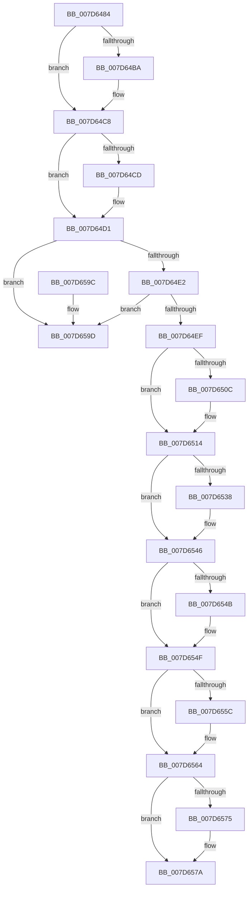

# ExpWnfDestroyPermanentDataStore

- RVA: `0x007D6484`–`0x007D65A4` (길이 `288` bytes)
- VA: `0x00000001407D6484`
- 실행 섹션: `PAGE`
- PDB 이름 있음: `예`; PDB Function 태그: `아니요`
- unwind 정보 RVA: `0x00069AD0`
- 디코드: `79`개 명령, `288/288` bytes 표시
- 미해석 바이트: `0` (있으면 어셈블리에 `.byte`로 보존)

> 이 문서는 커널 이미지의 기계어와 PDB 기호를 분석해 생성했습니다. 4번과 5번은 함수 원형과 자료형을 바이너리 사용 방식에서 추정한 C 해석이며 원본 소스 복구 결과는 아닙니다.

## 1. Dependencies

- 직접 호출 지점: **10**; 고유 호출 대상: **6**
- 직접 호출자로 확인된 함수: **2**
- RIP 상대 이미지 참조: **2**

### Outgoing calls
- `0x007D64AA` → [KeAbPreAcquire](../../text/21/KeAbPreAcquire_function_00210230.md) (function, `0x00210230`)
- `0x007D64C3` → [ExfAcquirePushLockExclusiveEx](../../text/20/ExfAcquirePushLockExclusiveEx_function_0020FC90.md) (function, `0x0020FC90`)
- `0x007D650F` → [ExfTryToWakePushLock](../../text/26/ExfTryToWakePushLock_function_00265DD0.md) (function, `0x00265DD0`)
- `0x007D6517` → [KeAbPostRelease](../../text/2E/KeAbPostRelease_function_002E1600.md) (function, `0x002E1600`)
- `0x007D6528` → [KeAbPreAcquire](../../text/21/KeAbPreAcquire_function_00210230.md) (function, `0x00210230`)
- `0x007D6541` → [ExfAcquirePushLockExclusiveEx](../../text/20/ExfAcquirePushLockExclusiveEx_function_0020FC90.md) (function, `0x0020FC90`)
- `0x007D655F` → [ExfTryToWakePushLock](../../text/26/ExfTryToWakePushLock_function_00265DD0.md) (function, `0x00265DD0`)
- `0x007D6567` → [KeAbPostRelease](../../text/2E/KeAbPostRelease_function_002E1600.md) (function, `0x002E1600`)
- `0x007D6575` → [ZwClose](../../text/6A/ZwClose_function_006AD2B0.md) (function, `0x006AD2B0`)
- `0x007D6582` → [ExFreePoolWithTag](../../poolcode/B8/ExFreePoolWithTag_function_00B82870.md) (function, `0x00B82870`)

### Direct callers
- [ExpWnfFreeScopeInstance](../A7/ExpWnfFreeScopeInstance_function_00A77614.md) at `0x00A7769E`
- [ExpWnfFreeScopeInstance](../A7/ExpWnfFreeScopeInstance_function_00A77614.md) at `0x00A776A5`
- [sub_00B49AA2](../B4/Unknown_function_00B49AA2.md) at `0x00B49BC3`

### Static image references
- `0x007D649B` → RVA `0x00FD9C88` (`PAGEDATA`; read)
- `0x007D64FD` → RVA `0x00FD9C88` (`PAGEDATA`; read/write)

## 2. Other-region calls and transfers

- 다른 실행 섹션으로 향하는 call: **10**
  - `0x007D64AA` → [KeAbPreAcquire](../../text/21/KeAbPreAcquire_function_00210230.md) (`PAGE` → `.text`)
  - `0x007D64C3` → [ExfAcquirePushLockExclusiveEx](../../text/20/ExfAcquirePushLockExclusiveEx_function_0020FC90.md) (`PAGE` → `.text`)
  - `0x007D650F` → [ExfTryToWakePushLock](../../text/26/ExfTryToWakePushLock_function_00265DD0.md) (`PAGE` → `.text`)
  - `0x007D6517` → [KeAbPostRelease](../../text/2E/KeAbPostRelease_function_002E1600.md) (`PAGE` → `.text`)
  - `0x007D6528` → [KeAbPreAcquire](../../text/21/KeAbPreAcquire_function_00210230.md) (`PAGE` → `.text`)
  - `0x007D6541` → [ExfAcquirePushLockExclusiveEx](../../text/20/ExfAcquirePushLockExclusiveEx_function_0020FC90.md) (`PAGE` → `.text`)
  - `0x007D655F` → [ExfTryToWakePushLock](../../text/26/ExfTryToWakePushLock_function_00265DD0.md) (`PAGE` → `.text`)
  - `0x007D6567` → [KeAbPostRelease](../../text/2E/KeAbPostRelease_function_002E1600.md) (`PAGE` → `.text`)
  - `0x007D6575` → [ZwClose](../../text/6A/ZwClose_function_006AD2B0.md) (`PAGE` → `.text`)
  - `0x007D6582` → [ExFreePoolWithTag](../../poolcode/B8/ExFreePoolWithTag_function_00B82870.md) (`PAGE` → `POOLCODE`)
- 별도 외부 분기/꼬리 이동을 확인하지 못했습니다.

## 3. Assembly (complete function range)

```asm
007D6484  48 89 5C 24 08                  mov qword ptr [rsp + 8], rbx
007D6489  48 89 6C 24 10                  mov qword ptr [rsp + 0x10], rbp
007D648E  48 89 74 24 18                  mov qword ptr [rsp + 0x18], rsi
007D6493  57                              push rdi
007D6494  48 83 EC 20                     sub rsp, 0x20
007D6498  48 8B F1                        mov rsi, rcx
007D649B  48 8D 3D E6 37 80 00            lea rdi, [rip + 0x8037e6]
007D64A2  48 8B CF                        mov rcx, rdi
007D64A5  45 33 C0                        xor r8d, r8d
007D64A8  33 D2                           xor edx, edx
007D64AA  E8 81 9D A3 FF                  call 0x140210230
007D64AF  F0 48 0F BA 2F 00               lock bts qword ptr [rdi], 0
007D64B5  48 8B D8                        mov rbx, rax
007D64B8  73 0E                           jae 0x1407d64c8
007D64BA  4C 8B C7                        mov r8, rdi
007D64BD  48 8B D0                        mov rdx, rax
007D64C0  48 8B CF                        mov rcx, rdi
007D64C3  E8 C8 97 A3 FF                  call 0x14020fc90
007D64C8  48 85 DB                        test rbx, rbx
007D64CB  74 04                           je 0x1407d64d1
007D64CD  C6 43 0A 01                     mov byte ptr [rbx + 0xa], 1
007D64D1  48 8D 46 18                     lea rax, [rsi + 0x18]
007D64D5  48 8B 10                        mov rdx, qword ptr [rax]
007D64D8  48 39 42 08                     cmp qword ptr [rdx + 8], rax
007D64DC  0F 85 BB 00 00 00               jne 0x1407d659d
007D64E2  48 8B 48 08                     mov rcx, qword ptr [rax + 8]
007D64E6  48 39 01                        cmp qword ptr [rcx], rax
007D64E9  0F 85 AE 00 00 00               jne 0x1407d659d
007D64EF  48 83 CB FF                     or rbx, 0xffffffffffffffff
007D64F3  48 89 11                        mov qword ptr [rcx], rdx
007D64F6  48 8B C3                        mov rax, rbx
007D64F9  48 89 4A 08                     mov qword ptr [rdx + 8], rcx
007D64FD  F0 48 0F C1 05 82 37 80 00      lock xadd qword ptr [rip + 0x803782], rax
007D6506  24 06                           and al, 6
007D6508  3C 02                           cmp al, 2
007D650A  75 08                           jne 0x1407d6514
007D650C  48 8B CF                        mov rcx, rdi
007D650F  E8 BC F8 A8 FF                  call 0x140265dd0
007D6514  48 8B CF                        mov rcx, rdi
007D6517  E8 E4 B0 B0 FF                  call 0x1402e1600
007D651C  48 8D 7E 08                     lea rdi, [rsi + 8]
007D6520  45 33 C0                        xor r8d, r8d
007D6523  48 8B CF                        mov rcx, rdi
007D6526  33 D2                           xor edx, edx
007D6528  E8 03 9D A3 FF                  call 0x140210230
007D652D  F0 48 0F BA 2F 00               lock bts qword ptr [rdi], 0
007D6533  48 8B E8                        mov rbp, rax
007D6536  73 0E                           jae 0x1407d6546
007D6538  4C 8B C7                        mov r8, rdi
007D653B  48 8B D0                        mov rdx, rax
007D653E  48 8B CF                        mov rcx, rdi
007D6541  E8 4A 97 A3 FF                  call 0x14020fc90
007D6546  48 85 ED                        test rbp, rbp
007D6549  74 04                           je 0x1407d654f
007D654B  C6 45 0A 01                     mov byte ptr [rbp + 0xa], 1
007D654F  F0 48 0F C1 1F                  lock xadd qword ptr [rdi], rbx
007D6554  80 E3 06                        and bl, 6
007D6557  80 FB 02                        cmp bl, 2
007D655A  75 08                           jne 0x1407d6564
007D655C  48 8B CF                        mov rcx, rdi
007D655F  E8 6C F8 A8 FF                  call 0x140265dd0
007D6564  48 8B CF                        mov rcx, rdi
007D6567  E8 94 B0 B0 FF                  call 0x1402e1600
007D656C  48 8B 4E 10                     mov rcx, qword ptr [rsi + 0x10]
007D6570  48 85 C9                        test rcx, rcx
007D6573  74 05                           je 0x1407d657a
007D6575  E8 36 6D ED FF                  call 0x1406ad2b0
007D657A  BA 57 6E 66 20                  mov edx, 0x20666e57
007D657F  48 8B CE                        mov rcx, rsi
007D6582  E8 E9 C2 3A 00                  call 0x140b82870
007D6587  48 8B 5C 24 30                  mov rbx, qword ptr [rsp + 0x30]
007D658C  48 8B 6C 24 38                  mov rbp, qword ptr [rsp + 0x38]
007D6591  48 8B 74 24 40                  mov rsi, qword ptr [rsp + 0x40]
007D6596  48 83 C4 20                     add rsp, 0x20
007D659A  5F                              pop rdi
007D659B  C3                              ret
007D659C  CC                              int3
007D659D  B9 03 00 00 00                  mov ecx, 3
007D65A2  CD 29                           int 0x29
```

## 4. C-style interpretation (structured pseudocode)

```c
__int64 __fastcall ExpWnfDestroyPermanentDataStore(__int64 a1, int a2, int a3)
{
    __int64 result;
    __int64 v_rbx;
    __int64 v_rsp;
    unsigned __int64 v_stack_p10;
    unsigned __int64 v_stack_p18;
    unsigned __int64 v_stack_p8;

    v_stack_p8 = v_rbx;
    v_stack_p10 = v_rbp;
    v_stack_p18 = v_rsi;
    v_rsp = (v_rsp) - (32);
    a3 = 0;
    a2 = 0;
    result = KeAbPreAcquire(v_rip + 8402918, a2, a3, a4);
    if (!(condition_is_above_or_equal)) {
        a3 = v_rip + 8402918;
        a2 = result;
        a1 = v_rip + 8402918;
        result = ExfAcquirePushLockExclusiveEx(a1, a2, a3, a4);
    }
    if (result != 0) {
        *(unsigned __int8 *)(result + 10) = 1;
    }
    if ((*(unsigned __int64 *)(*(unsigned __int64 *)(a1 + 24) + 8)) != (a1 + 24)) goto loc_007D659D;
    if ((*(unsigned __int64 *)(*(unsigned __int64 *)(a1 + 24 + 8))) != (a1 + 24)) goto loc_007D659D;
    v_rbx = (result) | (-1);
    *(unsigned __int64 *)(*(unsigned __int64 *)(a1 + 24 + 8)) = *(unsigned __int64 *)(a1 + 24);
    *(unsigned __int64 *)(*(unsigned __int64 *)(a1 + 24) + 8) = *(unsigned __int64 *)(a1 + 24 + 8);
    result = (unsigned __int8)((v_rbx) & (6));
    if (((unsigned __int8)(result)) == 2) {
        a1 = v_rip + 8402918;
        result = ExfTryToWakePushLock(a1, *(unsigned __int64 *)(a1 + 24), a3, a4);
    }
    result = KeAbPostRelease(v_rip + 8402918, *(unsigned __int64 *)(a1 + 24), a3, a4);
    a3 = 0;
    a2 = 0;
    result = KeAbPreAcquire(a1 + 8, a2, a3, a4);
    if (!(condition_is_above_or_equal)) {
        a3 = a1 + 8;
        a2 = result;
        a1 = a1 + 8;
        result = ExfAcquirePushLockExclusiveEx(a1, a2, a3, a4);
    }
    if (result != 0) {
        *(unsigned __int8 *)(result + 10) = 1;
    }
    v_rbx = (unsigned __int8)((v_rbx) & (6));
    if (((unsigned __int8)(v_rbx)) == 2) {
        a1 = a1 + 8;
        result = ExfTryToWakePushLock(a1, a2, a3, a4);
    }
    result = KeAbPostRelease(a1 + 8, a2, a3, a4);
    if (*(unsigned __int64 *)(a1 + 16) != 0) {
        result = ZwClose(*(unsigned __int64 *)(a1 + 16), a2, a3, a4);
    }
    result = ExFreePoolWithTag(a1, (unsigned int)(0x20666E57ULL), a3, a4);
    v_rsp = (v_rsp) + (32);
    return result;
loc_007D659D:
    return result;
}
```

## 5. (Beta) C Style

```c
int64_t ExpWnfDestroyPermanentDataStore(void *Arg1, int32_t Arg2, int32_t Arg3)
{
    uint8_t *arg1 = (uint8_t *)Arg1;

    int64_t result;
    int64_t local_rbx;
    int64_t local_rsp;
    uint64_t v_stack_p10;
    uint64_t v_stack_p18;
    uint64_t v_stack_p8;

    v_stack_p8 = local_rbx;
    v_stack_p10 = local_rbp;
    v_stack_p18 = local_rsi;
    local_rsp = (local_rsp) - (32);
    Arg3 = 0;
    Arg2 = 0;
    result = KeAbPreAcquire(v_rip + 8402918, Arg2, Arg3, a4);
    if (!(condition_is_above_or_equal)) {
        Arg3 = v_rip + 8402918;
        Arg2 = result;
        Arg1 = v_rip + 8402918;
        result = ExfAcquirePushLockExclusiveEx(Arg1, Arg2, Arg3, a4);
    }
    if (result != 0) {
        *(uint8_t *)(result + 0xA) = 1;
    }
    if ((*(uint64_t *)(*(uint64_t *)(arg1 + 0x18) + 0x8)) != (Arg1 + 24)) goto loc_007D659D;
    if ((*(uint64_t *)(*(uint64_t *)(arg1 + 0x18 + 0x8))) != (Arg1 + 24)) goto loc_007D659D;
    local_rbx = (result) | (-1);
    *(uint64_t *)(*(uint64_t *)(arg1 + 0x18 + 0x8)) = *(uint64_t *)(arg1 + 0x18);
    *(uint64_t *)(*(uint64_t *)(arg1 + 0x18) + 0x8) = *(uint64_t *)(arg1 + 0x18 + 0x8);
    result = (uint8_t)((local_rbx) & (6));
    if (((uint8_t)(result)) == 2) {
        Arg1 = v_rip + 8402918;
        result = ExfTryToWakePushLock(Arg1, *(uint64_t *)(arg1 + 0x18), Arg3, a4);
    }
    result = KeAbPostRelease(v_rip + 8402918, *(uint64_t *)(arg1 + 0x18), Arg3, a4);
    Arg3 = 0;
    Arg2 = 0;
    result = KeAbPreAcquire(Arg1 + 8, Arg2, Arg3, a4);
    if (!(condition_is_above_or_equal)) {
        Arg3 = Arg1 + 8;
        Arg2 = result;
        Arg1 = Arg1 + 8;
        result = ExfAcquirePushLockExclusiveEx(Arg1, Arg2, Arg3, a4);
    }
    if (result != 0) {
        *(uint8_t *)(result + 0xA) = 1;
    }
    local_rbx = (uint8_t)((local_rbx) & (6));
    if (((uint8_t)(local_rbx)) == 2) {
        Arg1 = Arg1 + 8;
        result = ExfTryToWakePushLock(Arg1, Arg2, Arg3, a4);
    }
    result = KeAbPostRelease(Arg1 + 8, Arg2, Arg3, a4);
    if (*(uint64_t *)(arg1 + 0x10) != 0) {
        result = ZwClose(*(uint64_t *)(arg1 + 0x10), Arg2, Arg3, a4);
    }
    result = ExFreePoolWithTag(Arg1, (uint32_t)(0x20666E57ULL), Arg3, a4);
    local_rsp = (local_rsp) + (32);
    return result;
loc_007D659D:
    return result;
}
```

### 관측된 메모리 오프셋

구조체 형식이 확인되지 않은 접근은 인자 기준의 오프셋으로만 기록했습니다.

| 기준 인자 | 오프셋 표현 | 폭 (bit) | 접근 |
|---|---:|---:|---|
| `Arg1` | `+ 0x0` | `64` | `R` |
| `Arg1` | `+ 0x0` | `64` | `R/W` |
| `Arg1` | `+ 0x8` | `64` | `R` |
| `Arg1` | `+ 0x10` | `64` | `R` |
| `Arg1` | `+ 0x18` | `64` | `R` |

## 6. Execution-region graph

[열기: 2D/3D 그래프와 함수 탐색 컨트롤 패널](../../../control-panel.html?section=page&rva=0x007D6484&view=graph)

- 2D 그래프는 위에서 아래로 흐르고, 3D 그래프는 빈 공간을 드래그해 회전합니다. Shift+드래그는 이동, 휠은 확대·축소, 함수 노드 선택은 대상 보고서 이동입니다.

### Static fallback


