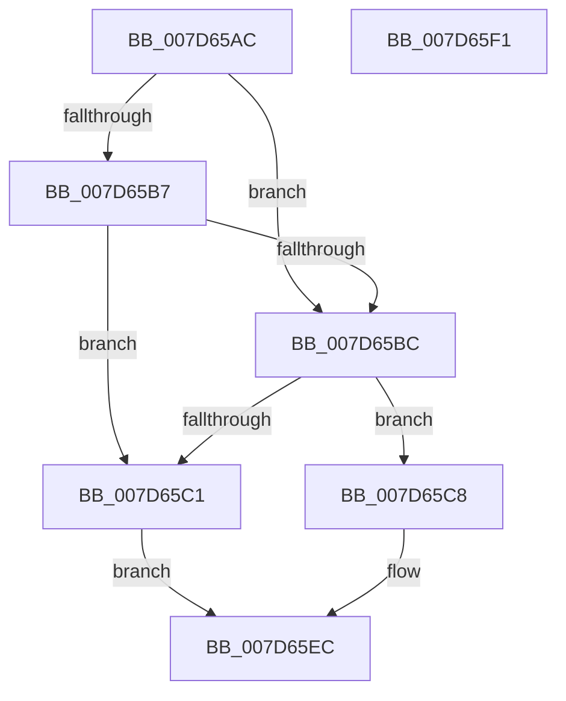

# ExpWnfEnumeratePermanentDataStoreHandles

- RVA: `0x007D65AC`–`0x007D65F2` (길이 `70` bytes)
- VA: `0x00000001407D65AC`
- 실행 섹션: `PAGE`
- PDB 이름 있음: `예`; PDB Function 태그: `아니요`
- unwind 정보 RVA: `0x00063458`
- 디코드: `23`개 명령, `70/70` bytes 표시
- 미해석 바이트: `0` (있으면 어셈블리에 `.byte`로 보존)

> 이 문서는 커널 이미지의 기계어와 PDB 기호를 분석해 생성했습니다. 4번과 5번은 함수 원형과 자료형을 바이너리 사용 방식에서 추정한 C 해석이며 원본 소스 복구 결과는 아닙니다.

## 1. Dependencies

- 직접 호출 지점: **1**; 고유 호출 대상: **1**
- 직접 호출자로 확인된 함수: **1**
- RIP 상대 이미지 참조: **0**

### Outgoing calls
- `0x007D65E7` → [ExpWnfGetPermanentDataStoreHandleByScopeId](ExpWnfGetPermanentDataStoreHandleByScopeId_function_007D65F8.md) (function, `0x007D65F8`)

### Direct callers
- [ExpWnfDeletePermanentStateData](ExpWnfDeletePermanentStateData_function_007D6254.md) at `0x007D6350`
- [ExpWnfDeletePermanentStateData](ExpWnfDeletePermanentStateData_function_007D6254.md) at `0x007D638D`

### Static image references
- 디코드된 RIP-relative 메모리 참조가 없습니다.

## 2. Other-region calls and transfers

- 다른 실행 섹션으로 향하는 call: **0**
- 별도 외부 분기/꼬리 이동을 확인하지 못했습니다.

## 3. Assembly (complete function range)

```asm
007D65AC  48 83 EC 48                     sub rsp, 0x48
007D65B0  44 8B D1                        mov r10d, ecx
007D65B3  85 C9                           test ecx, ecx
007D65B5  74 05                           je 0x1407d65bc
007D65B7  83 F9 02                        cmp ecx, 2
007D65BA  74 05                           je 0x1407d65c1
007D65BC  45 85 C0                        test r8d, r8d
007D65BF  74 07                           je 0x1407d65c8
007D65C1  B8 34 00 00 C0                  mov eax, 0xc0000034
007D65C6  EB 24                           jmp 0x1407d65ec
007D65C8  33 C9                           xor ecx, ecx
007D65CA  4C 89 4C 24 30                  mov qword ptr [rsp + 0x30], r9
007D65CF  8D 42 FE                        lea eax, [rdx - 2]
007D65D2  83 F8 01                        cmp eax, 1
007D65D5  0F 96 C1                        setbe cl
007D65D8  83 64 24 28 00                  and dword ptr [rsp + 0x28], 0
007D65DD  89 4C 24 20                     mov dword ptr [rsp + 0x20], ecx
007D65E1  45 33 C0                        xor r8d, r8d
007D65E4  41 8B CA                        mov ecx, r10d
007D65E7  E8 0C 00 00 00                  call 0x1407d65f8
007D65EC  48 83 C4 48                     add rsp, 0x48
007D65F0  C3                              ret
007D65F1  CC                              int3
```

## 4. C-style interpretation (structured pseudocode)

```c
__int64 __fastcall ExpWnfEnumeratePermanentDataStoreHandles(int a1, __int64 a2, int a3, __int64 a4)
{
    __int64 result;
    __int64 v_rsp;
    unsigned __int64 v_stack_m18;
    unsigned int v_stack_m20;
    unsigned int v_stack_m28;

    v_rsp = (v_rsp) - (72);
    if (a1 == 0) goto loc_007D65BC;
    if (a1 == 2) goto loc_007D65C1;
loc_007D65BC:
    if (a3 == 0) goto loc_007D65C8;
loc_007D65C1:
    goto loc_007D65EC;
loc_007D65C8:
    a1 = 0;
    v_stack_m18 = a4;
    a1 = (((unsigned int)(a2 - 2)) <= 1) ? 1 : 0;
    v_stack_m28 = a1;
    a3 = 0;
    result = ExpWnfGetPermanentDataStoreHandleByScopeId((unsigned int)((unsigned int)((unsigned int)(a1))), a2, a3, a4);
loc_007D65EC:
    v_rsp = (v_rsp) + (72);
    return result;
}
```

## 5. (Beta) C Style

```c
int64_t ExpWnfEnumeratePermanentDataStoreHandles(int32_t Arg1, void *Arg2, int32_t Arg3, int64_t Arg4)
{
    uint8_t *arg2 = (uint8_t *)Arg2;

    int64_t result;
    int64_t local_rsp;
    uint64_t v_stack_m18;
    uint32_t v_stack_m20;
    uint32_t v_stack_m28;

    local_rsp = (local_rsp) - (72);
    if (Arg1 == 0) goto loc_007D65BC;
    if (Arg1 == 2) goto loc_007D65C1;
loc_007D65BC:
    if (Arg3 == 0) goto loc_007D65C8;
loc_007D65C1:
    goto loc_007D65EC;
loc_007D65C8:
    Arg1 = 0;
    v_stack_m18 = Arg4;
    Arg1 = (((uint32_t)(Arg2 - 2)) <= 1) ? 1 : 0;
    v_stack_m28 = Arg1;
    Arg3 = 0;
    result = ExpWnfGetPermanentDataStoreHandleByScopeId((uint32_t)((uint32_t)((uint32_t)(Arg1))), Arg2, Arg3, Arg4);
loc_007D65EC:
    local_rsp = (local_rsp) + (72);
    return result;
}
```

### 관측된 메모리 오프셋

구조체 형식이 확인되지 않은 접근은 인자 기준의 오프셋으로만 기록했습니다.

| 기준 인자 | 오프셋 표현 | 폭 (bit) | 접근 |
|---|---:|---:|---|
| `Arg2` | `- 0x2` | `32` | `R` |

## 6. Execution-region graph

[열기: 2D/3D 그래프와 함수 탐색 컨트롤 패널](../../../control-panel.html?section=page&rva=0x007D65AC&view=graph)

- 2D 그래프는 위에서 아래로 흐르고, 3D 그래프는 빈 공간을 드래그해 회전합니다. Shift+드래그는 이동, 휠은 확대·축소, 함수 노드 선택은 대상 보고서 이동입니다.

### Static fallback


